# Mark Schemes — Addition Polymerisation
**20. Polymerisation** · Cambridge (CIE) A-LEVEL chemistry (9701)

## Multiple Choice Questions (17 questions)

### Q1
**Final answer:** **The correct answer is B**

- 1,1-Dichloroethene (CCl2=CH2) has a C=C double bond, with **two** chlorine atoms on C1 and two hydrogen atoms on C2.
- In addition polymerisation, the π bond breaks and each carbon forms new C−C bonds with adjacent monomers.
- So, the repeat unit is −CCl2−CH2−:

**A** is incorrect as −CCl2CCl2CCl2CCl2CCl2CCl2− has **two** chlorine atoms on **every** backbone carbon. This would correspond to a monomer of 1,1,2,2-tetrachloroethene, not 1,1-dichloroethene.

**C** is incorrect as −CH2CCl2CHClCHClCH2CCl2− contains CHCl units (one Cl per carbon) within the chain. In poly(1,1-dichloroethene) the two Cl atoms are always on the same carbon (CCl2), never distributed singly across two carbons.

**D** is incorrect as −CHClCHClCHClCHClCHClCHCl− has one chlorine per backbone carbon. This corresponds to poly(1,2-dichloroethene), not poly(1,1-dichloroethene).

### Q2
**Final answer:** **The correct answer is B**

- PHB contains an **ester repeat unit**: the −O− and C=O groups within the chain form an ester linkage.

- The PHB monomer contains both a hydroxyl group and a carboxylic acid group.

  - These react by **condensation polymerisation** to form the polymer chain.

- Ester bonds are broken by **hydrolysis** reactions ('hydro' = water; 'lysis' = to break), which is why PHB is biodegradable.

**A** is incorrect as addition reactions involve adding small molecules (e.g. Br2, H2O) across a C=C double bond. PHB contains no C=C bonds.

**C** is incorrect as reduction involves the addition of hydrogen or removal of oxygen and does not break ester linkages.

**D** is incorrect as substitution involves replacing one atom or group with another. Breaking the ester bonds in PHB requires hydrolysis (reaction with water).

### Q3
**Final answer:** **The correct answer is B**

- The repeat unit of the polymer contains 2 carbons, 2 oxygens and 4 hydrogens.
- Calculate the *M*r of the repeat unit:

*M*r = (2 x 12) + (2 x 16) + (4 x 1)

*M*r = 60 g mol-1

- Calculate the number of monomer units:

number of monomer units = $\frac{9600}{60}$

number of monomer units = **160**

**A** is incorrect as 80 monomer units gives a polymer *M*r of 4800, not 9600.

**C** is incorrect as 240 monomer units gives a polymer *M*r of 14 400, not 9600.

**D** is incorrect as 320 monomer units gives a polymer *M*r of 19 200, not 9600.

### Q4
**Final answer:** **The correct answer is A**

- The C−C−C bonds referred to are those in the carbon backbone of poly(chloroethene) (PVC).
- PVC is **fully saturated**, meaning there are only single bonds in the molecule.
- Carbon forms **4 bonds** arranged in a **tetrahedral** geometry to maximise separation between bonding electron pairs.
- The C−C−C bond angles along the backbone are **approximately 109.5°** (slightly less than ideal due to the bulky Cl substituents).

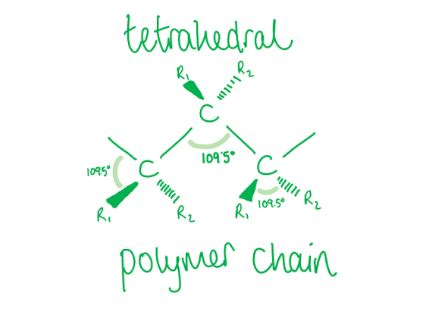

**B** is incorrect as 120° corresponds to **trigonal planar** geometry, which is seen in **alkenes** such as chloroethene (the PVC monomer). Once polymerised, PVC has only C−C single bonds.

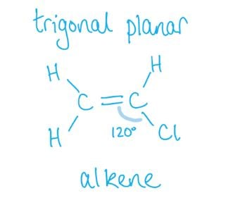

**C** is incorrect as 180° corresponds to **linear** geometry (e.g. CO2), not the tetrahedral geometry of the sp3 carbons in PVC.

**D** is incorrect as PVC has only C−C single bonds throughout the polymer chain. The 120° angles associated with C=C double bonds (as in the chloroethene monomer) are not present in PVC.

### Q5
**Final answer:** **The correct answer is C**

- In this question n is the number of propene repeat units in the polymer chain.
- Complete combustion occurs because the question states burning in an excess of air.
- The balanced equation for the complete combustion of one propene unit is:

C3H6 + 4.5O2 → 3CO2 + 3H2O

- On each side:

  - 3 carbon
  - 6 hydrogen
  - 9 oxygen.
- Therefore, for n repeat units:

(C3H6)***n*** + **(*****n***** x 4.5)**O2 → **(*****n***** x 3)**CO2 + **(*****n***** x 3)**H2O

**A **is incorrect as this shows incomplete combustion (CO formation). Burning in an excess of air gives complete combustion, so CO2 is produced, not CO.

**B **is incorrect as burning in excess of air gives complete combustion. Carbon dioxide (CO2) is produced, not carbon.

**D **is incorrect as the stoichiometry for O2 is incorrect. 9.0n moles of O2 does not balance the equation for complete combustion of (C3H6)***n***.

### Q6
**Final answer:** **The correct answer is D**

- In but-2-en-1-ol:

  - 'but' = 4 carbons
  - '2-en' = C=C double bond between C2 and C3
  - '1-ol' = OH group on C1.
- In addition polymerisation, the C=C double bond breaks, forming a 2-carbon backbone in the repeat unit.

  - All other groups remain as pendant substituents:

- The repeat unit is −CH(CH3)−CH(CH2OH)−:

  - C3 (bearing the methyl group) and C2 (bearing the hydroxymethyl group) form the 2-carbon backbone.

**A** is incorrect as repeat units in addition polymers do **not** contain C=C double bonds; all C=C bonds break during polymerisation.

**B** is incorrect as in addition polymerisation only the **two carbons** of the original double bond form the backbone. C1 (CH2OH) and C4 (CH3) remain as pendant groups, giving a 2-carbon rather than 4-carbon backbone.

**C** is incorrect as in addition polymerisation only the **two carbons** of the original double bond form the backbone. The OH group remains as a pendant substituent, not a terminal end group.

### Q7
**Final answer:** **The correct answer is D**

- PVC, poly(chloroethene), is made by the addition polymerisation of chloroethene, H2C=CHCl:

- When PVC is incinerated, **harmful gases** are produced, including **hydrogen chloride (HCl)**, **dioxins** and **carbon monoxide (CO)**, all of which are toxic to humans and animals.

**A** is incorrect as ozone layer destruction is caused by chlorine free radicals (Cl•) from CFC compounds, not by incinerating PVC. Burning PVC produces HCl gas, not chlorine radicals.

**B** is incorrect as while PVC has some flame-retardant properties due to its chlorine content, it can still be incinerated at high temperatures. The reason for its removal is the **toxic combustion products** (HCl, dioxins, CO), not difficulty in burning.

**C** is incorrect as PVC is **not** biodegradable. Synthetic polymers are not broken down by bacteria, so biodegradability is not relevant to the decision to remove it before incineration.

### Q8
**Final answer:** **The correct answer is A**

- In addition polymerisation, the C=C double bond in chloroethene, H2C=CHCl, breaks to form a C−C single bond, giving the repeat unit −CH2−CHCl−.
- PVC (polyvinylchloride) is more correctly named poly(chloroethene), made from the addition polymerisation of chloroethene.

**B** is incorrect as this is the repeat unit for poly(1,2-dichloroethene), which has one chlorine atom on each of the two adjacent carbons in the repeat unit.

**C** is incorrect as repeat units in addition polymers do **not** contain a C=C double bond. All C=C bonds break during addition polymerisation.

**D** is incorrect as repeat units in addition polymers do **not** contain a C=C double bond, and the repeat unit of PVC has only **one** chlorine atom, not two.

### Q9
**Final answer:** **The correct answer is A**

- Repeat units in addition polymers have a **2-carbon backbone**.

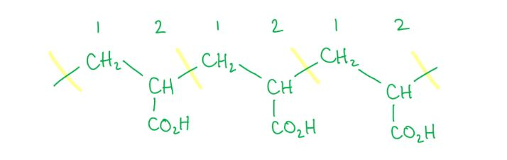

- One repeat unit:

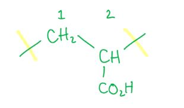

- The repeat unit is −CH₂−CH(CO₂H)−, giving the polymer name **poly(prop-2-enoic acid)**.

  - The corresponding monomer is prop-2-enoic acid with a C=C double bond.

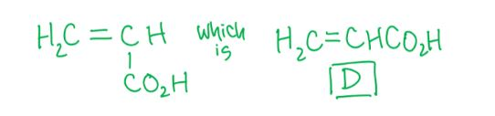

**B** is incorrect as this monomer has no C=C double bond; addition polymerisation requires a C=C double bond. The resulting polymer would also contain a hydroxyl group, which is not present in the polymer shown.

**C** is incorrect as this monomer has no C=C double bond and would not undergo addition polymerisation. The hydroxyl group would give an incorrect pendant group in the resulting polymer.

**D** is incorrect as, although this monomer contains a C=C double bond, addition polymerisation would give **poly(but-2-enedioic acid)**, in which every backbone carbon carries a CO₂H group; in the polymer shown, CO₂H appears on only alternate backbone carbons.

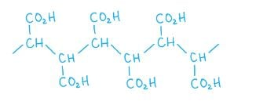

### Q10
**Final answer:** **The correct answer is B**

- The polymer molecule contains double bonds in its main chain, which means the monomer must have 2 sets of double bonds.

  - This narrows the answer down to **B** or **D**.

- The 2 double bonds open up during addition polymerisation, forming a new double bond in the middle of the repeat unit as well as single bonds to the adjacent monomers.

- To distinguish between **B** and **D**:

  - Option **B **has a methyl group (CH3) on carbon 2, which matches the methyl group visible coming off the polymer chain.

**A** is incorrect as CH2=C(CH3)CH2CH3 has only one C=C double bond and cannot form a polymer with double bonds in the main chain.

**C** is incorrect as CH3CH2CH2CH=CH2 has only one C=C double bond and cannot form a polymer with double bonds in the main chain.

**D** is incorrect as CH3CH=CHCH=CH2 would place the methyl group on carbon 1, not carbon 2, which does not match the polymer structure.

### Q11
**Final answer:** **The correct answer is D**

- PVC, poly(chloroethene), is made by the addition polymerisation of chloroethene, H2C=CHCl.
- In the repeat unit −CH2−CHCl−, there is **one** chlorine atom per repeat unit (not two).
- The repeat unit −CHCl−CHCl− would correspond to poly(1,2-dichloroethene), not PVC.

**A** is not the answer as the statement 'Combustion of PVC waste produces a highly acidic gas' is correct. PVC combustion produces hydrogen chloride (HCl), which is a highly acidic gas.

**B** is not the answer as the statement 'PVC molecules are saturated' is correct. All C=C double bonds break during addition polymerisation, leaving only C−C single bonds in the polymer chain.

**C** is not the answer as the statement 'The empirical formula of PVC is the same as the empirical formula of its monomer' is correct. This holds for all addition polymers because no atoms are gained or lost during polymerisation.

### Q12
**Final answer:** **The correct answer is C**

- When 2-methylpropene undergoes addition polymerisation its C=C **double bond breaks** to leave a single bond between the carbons, allowing each carbon to form a bond with adjacent monomer units.
- The compound's name indicates that the double bond is between carbons 1 and 2, and the methyl substituent is on carbon 2.
- Therefore, in the repeat unit the second carbon has two methyl groups (one from C3 of the main chain and one from the 2-methyl substituent):

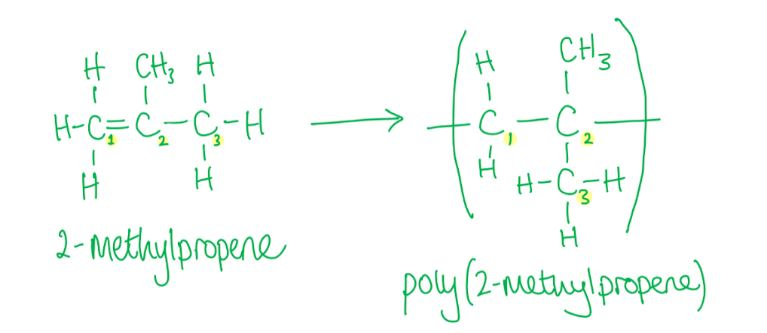

**A** is incorrect as repeat units in addition polymers have a **2-carbon backbone**. The 3-carbon backbone shown would require a different monomer or polymerisation mechanism.

**B** is incorrect as this is the repeat unit of **poly(but-2-ene)**, not poly(2-methylpropene). In poly(but-2-ene) each carbon in the repeat unit carries one methyl group.

**D** is incorrect as during addition polymerisation one bond in the C=C double bond breaks. The repeat unit contains only C−C single bonds in the main chain, not a retained double bond.

### Q13
**Final answer:** **The correct answer is C**

- Chloroethene contains a C=C **double bond**; PVC contains C−C **single bonds** in the polymer chain.
- **Double bonds** are **shorter** and **stronger** than single bonds, because more electrons are shared between the two carbons, pulling the atoms closer together.
- Therefore, the C=C bond in chloroethene is **shorter and stronger** than the C−C bond in PVC.

**A** is incorrect as the C=C double bond in chloroethene is **shorter** than the C−C single bond in PVC, not longer.

**B** is incorrect as the C=C double bond is both **shorter** (not longer) and **stronger** (not weaker) than the C−C single bond.

**D** is incorrect as the C=C double bond in chloroethene is **stronger** than the C−C single bond in PVC, not weaker.

### Q14
**Final answer:** **The correct answer is A**

- **Step 1:**

  - 1,2-Dichloroethene (CHCl=CHCl) undergoes addition polymerisation to form poly(1,2-dichloroethene).
  - The repeat unit is −CHCl−CHCl−.
- **Step 2:**

  - Hydrolysis of the C−Cl bonds converts each −CHCl− group to −CH(OH)−.
  - This produces the poly-diol polymer shown in which every backbone carbon carries an −OH group.

**B** is incorrect as alcohol groups are **not** produced from chlorine substituents by oxidation with H+ / KMnO4. **Hydrolysis** is the correct step to convert C−Cl bonds to C−OH.

**C** is incorrect as polymerising ethene produces repeat units with the structure −CH2−CH2− (an alkane backbone). Alkanes are unreactive and cannot be subsequently converted to an alcohol polymer by hydration.

**D** is incorrect as polymerising ethene gives an unreactive alkane backbone that cannot be converted to an alcohol polymer. Furthermore, oxidation with H+ / KMnO4 does not convert C−H bonds to alcohol groups.

### Q15
**Final answer:** **The correct answer is B**

- A copolymer is an addition polymer made from two different monomers.
- Each monomer contributes a **2-carbon** unit to the main chain.

  - All other groups (e.g. −OH, −CH3) must be pendant substituents, written **in brackets**.
  - Groups written without brackets are assumed to be part of the main chain.
- Hydrogen atoms may be written with their carbon.

**A** is incorrect as this accurately shows the copolymer of ethenol and propene with the pattern: propene, ethenol, ethenol, propene.

**C** is incorrect as this accurately shows the copolymer of ethenol and propene with the two monomers alternating: ethenol, propene, ethenol, propene.

**D** is incorrect as this accurately shows poly(ethenol), which could be produced from a reaction mixture with a large excess of ethenol and very little propene.

### Q16
**Final answer:** **The correct answer is B**

- During addition polymerisation the C=C double bond on the alkene monomer breaks.
- The π bond is broken and the two electrons are used to form new C−C σ bonds with adjacent monomer units.

- Therefore, **π bonds are broken** and **σ bonds are formed**.

**A** is incorrect as no π bonds are formed. New C−C σ bonds form, not double bonds.

**C** is incorrect as no σ bonds are broken. Only the π component of the C=C double bond breaks, and no π bonds are formed.

**D** is incorrect as no σ bonds are broken. Only the π bond in the C=C double bond breaks during addition polymerisation.

### Q17
**Final answer:** **The correct answer is A**

- In addition polymerisation, the C=C double bond in ethenol, CH2=CH(OH), opens to form the repeat unit −CH(OH)−CH2−:

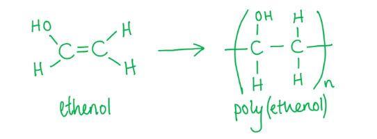

- Structure A shows two of these repeat units joined together, which is the correct polymer chain section.

**B** is incorrect as while the first repeat unit is correctly drawn, the second is connected via a C−O ether linkage rather than a C−C bond. In addition polymerisation only carbon-carbon bonds join repeat units in the main chain.

**C** is incorrect as in **addition polymerisation** only C−C bonds connect repeat units in the main chain. Oxygen atoms within the backbone (as shown) are characteristic of condensation polymerisation, not addition polymerisation.

**D** is incorrect as in addition polymerisation the hydroxyl (−OH) group remains as a pendant side group throughout the chain. It does not react or appear as a terminal end group.

## Structured Questions (11 questions)

### Q1
> **[mark-scheme]**
> Addition polymerisation is:
> 
> - A reaction in which many monomers, each containing one or more C=C double bonds, **[1 mark]**
> - Join together to form a long polymer chain as the only product **[1 mark]**
> 
> 'Many' (or an equivalent such as 'n') must be stated to gain the first mark.

> **[exam-tip]**
> Addition polymerisation requires monomers with at least one C=C double bond. Unlike condensation polymerisation, no by-product such as water is formed. The only product is the polymer.
i) The displayed formula of *trans*-hept-2-ene is:

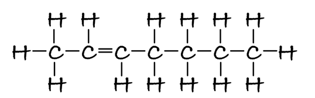

**[1 mark]**

> **[mark-scheme]**
> 1 mark for the correct displayed formula with all bonds shown and the *trans* configuration (H atoms on opposite sides of the C=C double bond)

ii) The structure of poly(hept-2-ene) showing two repeat units is:

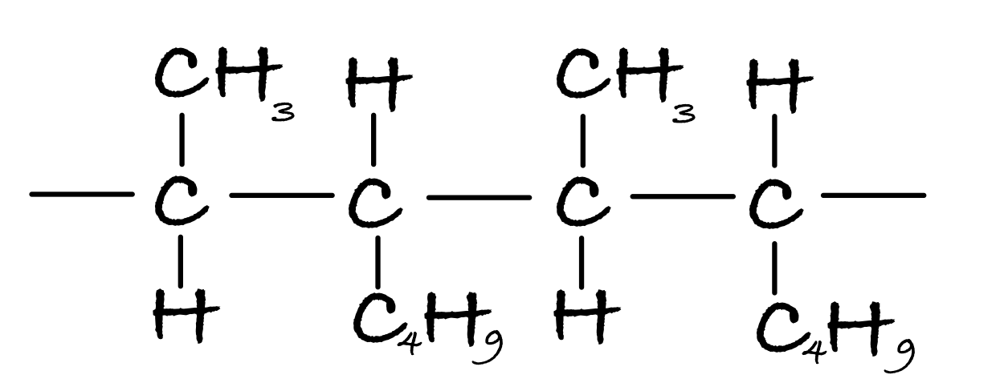

**[1 mark]**

> **[mark-scheme]**
> 1 mark for the correct structure showing two repeat units with continuation bonds at each end

> **[exam-tip]**
> For *trans*-hept-2-ene, the C=C is at position 2 and the H atoms on each C=C carbon are on opposite sides. To draw the polymer, replace the C=C with a C–C single bond and add continuation bonds on each side. The *trans* prefix is dropped from the polymer name because the C–C bond has free rotation.
> **[mark-scheme]**
> The polymer is not called poly(*trans*-hept-2-ene) because:
> 
> - The polymer no longer contains a C=C double bond **[1 mark]**
> - So there is free rotation about the C–C bond / geometric isomers no longer exist **[1 mark]**

> **[exam-tip]**
> In *trans*-hept-2-ene, the C=C double bond restricts rotation, giving rise to geometric isomers. When the polymer forms, the C=C becomes a C–C single bond, which has free rotation. With no restricted rotation, geometric isomers cannot exist, so the prefix '*trans*-' is not needed in the polymer name.
> **[mark-scheme]**
> There is a difference in states because:
> 
> - Poly(hept-2-ene) has many more electrons than *trans*-hept-2-ene **[1 mark]**
> - So poly(hept-2-ene) has greater / stronger instantaneous dipole–induced dipole / London dispersion forces **[1 mark]**
> - More energy is required to overcome these forces, so poly(hept-2-ene) has a higher boiling point and remains solid at room temperature **[1 mark]**

> **[exam-tip]**
> When explaining differences in state for covalent molecules, refer to the type and strength of intermolecular forces. Poly(hept-2-ene) is a much larger molecule with far more electrons than the monomer, so its London (id–id) forces are much stronger. 'Van der Waals forces' is accepted but being specific about London forces is better practice.

### Q2
> **[mark-scheme]**
> The structural formulae of **A**, **B** and **C** are:
> 
> - **A** = CH3CO2H **[1 mark]**
> - **B** = CH3CH(OH)CH(OH)CH3 **[1 mark]**
> - **C** = CH3COCOCH3 **[1 mark]**

> **[exam-tip]**
> The products of reaction with acidified potassium manganate(VII) depend on the conditions used:
> 
> - Hot, concentrated KMnO4: oxidises at the C=C bond, breaking the chain. For but-2-ene, each half forms ethanal, which is further oxidised to ethanoic acid (compound **A**).
> - Cold, dilute KMnO4: adds an OH group across the C=C bond to form a diol (compound **B**: butane-2,3-diol).
> - Compound **C** is formed by further oxidation of the diol to give a diketone (butane-2,3-dione).
The structural formula of two repeat units of poly(but-2-ene) is:

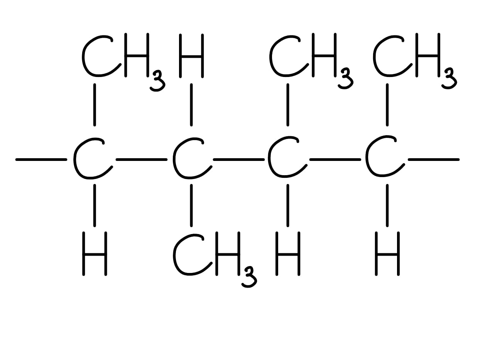

**[1 mark]**

> **[mark-scheme]**
> 1 mark for two correct repeating units with continuation bonds at each end; the CH3 groups may be drawn in any orientation

> **[exam-tip]**
> To draw the polymer from but-2-ene: replace the C=C double bond with a C–C single bond and add continuation bonds at each end. The CH3 groups can be shown on either side of the backbone as both orientations are accepted.
> **[mark-scheme]**
> Two reasons why there is an increasing demand for polymers to be recycled rather than incinerated:
> 
> Any **two** from (1 mark for each point):
> 
> - Less CO2 / greenhouse gases / pollutants are released into the atmosphere
> - Oil supplies / fossil fuels / finite raw materials are conserved
> - Less energy is required to recycle polymers than to produce them from crude oil
> 
> **[2 marks]**

> **[exam-tip]**
> Know the advantages and disadvantages of all three main disposal methods: incineration (releases greenhouse gases and toxic gases, but generates energy), recycling (conserves resources and reduces pollution, but requires energy and sorting), and landfill (simple, but wastes materials and takes up land).

### Q3
> **[mark-scheme]**
> Two reasons why these polymers are unreactive:
> 
> - They are saturated / contain only single C–C bonds **[1 mark]**
> - They are non-polar **[1 mark]**

> **[exam-tip]**
> Addition polymers are unreactive for the same reasons as alkanes: the absence of a C=C double bond means there is no site for electrophilic addition, and the non-polar C–H and C–C bonds are not susceptible to ionic attack.
> **[mark-scheme]**
> Advantage:
> 
> Any **one **from:
> 
> - Chemically inert
> - Durable
> - Safe to use
> 
> **[1 mark]**
> 
> Disadvantage:
> 
> Any **one **from:
> 
> - Non-biodegradable
> - Difficult and expensive to recycle
> - Release toxic gases when incinerated
> 
> **[1 mark]**

> **[exam-tip]**
> The chemical unreactivity of addition polymers is both their greatest strength and their biggest environmental problem. They are stable and safe in use, but this same stability means microorganisms cannot break them down, leading to persistent environmental pollution.
The structure of monomer **X** is:

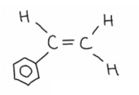

**[1 mark]**

> **[mark-scheme]**
> 1 mark for the correct structure of phenylethene: a C=C double bond with a phenyl group on one carbon and an H atom on each carbon

> **[exam-tip]**
> To find the monomer from a polymer, identify the repeat unit (the pattern that repeats every two backbone carbons), then restore the C=C double bond between those two carbons. The phenyl group can appear unfamiliar, but it can be treated like any other substituent.
i) The structure of monomer **Y** is:

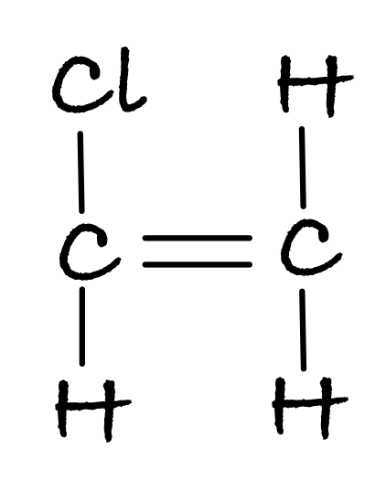

**[1 mark]**

> **[mark-scheme]**
> 1 mark for the correct structure of chloroethene (C=C double bond with one Cl substituent)
> 
> ii) The IUPAC name of monomer **Y** is:
> 
> - Chloroethene **[1 mark]**

> **[exam-tip]**
> To identify monomer **Y**, look at the repeating unit of the polymer. The 4-carbon repeat unit contains a phenyl group (from monomer **X**) and a Cl atom (from monomer **Y**). Monomer **Y** must therefore be the 2-carbon alkene with one Cl substituent: chloroethene.

### Q4
The skeletal formula of the monomer is:

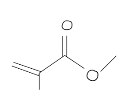

**[1 mark]**

> **[mark-scheme]**
> 1 mark for the correct skeletal formula of methyl methacrylate: a C=C double bond with a CH3 group and a COOCH3 ester group at the same carbon

> **[exam-tip]**
> To find the monomer from a polymer: identify the repeat unit in the polymer chain, then restore the C=C double bond between the two backbone carbons. Draw the displayed formula first, then convert to skeletal formula by removing H atoms from C atoms and representing the carbon skeleton as a zigzag.
> **[mark-scheme]**
> Poly(methyl methacrylate) is fairly unreactive because:
> 
> - It is saturated / contains only single C–C bonds **[1 mark]**
> - The (hydrocarbon) backbone is non-polar **[1 mark]**

> **[exam-tip]**
> Like alkanes, addition polymers are fairly unreactive: the absence of a C=C double bond means there is no site for electrophilic addition, and the non-polar C–H and C–C bonds are not susceptible to ionic attack.
> **[mark-scheme]**
> i) Photodegradable polymers are broken down by:
> 
> - Absorbing UV / visible light, which weakens / breaks the chemical bonds in the polymer **[1 mark]**
> 
> ii) Two disadvantages of using photodegradable polymers:
> 
> Any **two** from (1 mark for each point):
> 
> - The polymer may not be exposed to sufficient sunlight to degrade
> - They are still oil-based / derived from non-renewable fossil fuels
> - They may not degrade completely, leaving behind small plastic fragments
> 
> **[2 marks]**

> **[exam-tip]**
> Photodegradable polymers absorb light energy that breaks bonds within the polymer chain, causing it to fragment. However, they are still derived from crude oil (unlike plant-based bioplastics), and degradation depends on sufficient light exposure, which may be limited in landfill.

### Q5
> **[mark-scheme]**
> The type of polymerisation is:
> 
> - Addition (polymerisation) **[1 mark]**

> **[exam-tip]**
> Addition polymerisation involves monomers containing at least one C=C double bond joining together to form a long polymer chain. No other products are formed.
i) The fully displayed formula of the monomer is:

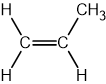

**[1 mark]**

> **[mark-scheme]**
> ii) The name of polymer **X** is:
> 
> - Poly(propene) **[1 mark]**

> **[exam-tip]**
> The repeating unit of poly(propene) has two backbone carbons, one CH2 group and one CH group carrying a CH3 side chain. To draw the monomer, restore the C=C double bond between these two backbone carbons and remove the continuation bonds at each end.
> **[mark-scheme]**
> Two reasons why the disposal of poly(alkenes) such as polymer **X** is difficult:
> 
> Any **two** from (1 mark for each point):
> 
> - They are non-biodegradable / can take hundreds of years to decompose
> - They are unreactive / resistant to chemical attack
> - They release harmful / toxic chemicals when burnt / incinerated
> - Recycling requires separation by polymer type, which is time-consuming
> 
> **[2 marks]**

> **[exam-tip]**
> Poly(alkenes) such as poly(propene) are difficult to dispose of because their C–C backbone bonds make them chemically inert and resistant to biodegradation. They do not break down naturally in landfill and produce toxic gases if incinerated.

### Q6
> **[mark-scheme]**
> The IUPAC name of PVC is:
> 
> - Poly(chloroethene) **[1 mark]**

> **[exam-tip]**
> You must know that PVC is the common name for poly(chloroethene). The 'chloro' prefix indicates a chlorine substituent on the ethene monomer.
i) The repeating unit of PVC is:

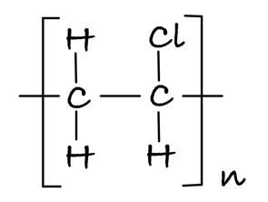

**[1 mark]**

> **[mark-scheme]**
> 1 mark for the correct repeating unit: two backbone carbons with one Cl substituent and continuation bonds, enclosed in square brackets with subscript n

ii) The structure and IUPAC name of the monomer are:

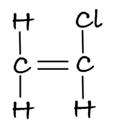

**[1 mark]**

> **[mark-scheme]**
> 1 mark for the correct structure of the monomer (chloroethene: C=C double bond with one Cl atom)
> 
> The IUPAC name of the monomer is:
> 
> - Chloroethene **[1 mark]**

iii) The equation for the formation of PVC from its monomer is:

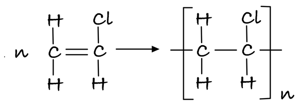

**[1 mark]**

> **[mark-scheme]**
> 1 mark for the correct equation: n chloroethene monomers (in square brackets with n outside) forming the PVC polymer chain (in square brackets with subscript n)

> **[exam-tip]**
> When drawing a repeating unit or a polymerisation equation, you must use square brackets with a subscript n to represent the very large number of repeat units in the polymer chain.
i) The repeating unit of poly(propene) is:

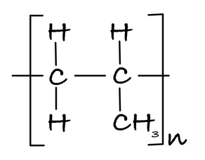

**[1 mark]**

> **[mark-scheme]**
> 1 mark for the correct repeating unit: two backbone carbons, one CH3 substituent, and continuation bonds

ii) The completed Table 2.1 is:

| **Physical property** | **Poly(methylpropene)** | **Poly(ethene)** |
|---|---|---|
| Insoluble in water | **Final answer:** **X** | **Final answer:** **X** |
| Unreactive | **Final answer:** **X** | **Final answer:** **X** |
| High density |   | **Final answer:** **X** |

**[3 marks]**

> **[mark-scheme]**
> 1 mark for both polymers marked as insoluble in water
> 
> 1 mark for both polymers marked as unreactive
> 
> 1 mark for poly(ethene) only marked as high density

> **[mark-scheme]**
> iii) The melting point of poly(methylpropene) is much higher than that of methylpropene because:
> 
> - Poly(methylpropene) has many more electrons than methylpropene **[1 mark]**
> - So it has stronger instantaneous dipole–induced dipole / London dispersion forces, which require more energy to overcome **[1 mark]**

> **[exam-tip]**
> Both poly(methylpropene) and poly(ethene) are non-polar, making them both insoluble in water and unreactive. Poly(methylpropene) is a branched polymer, so its chains cannot pack together as closely as the linear poly(ethene) chains, giving it a lower density.
> **[mark-scheme]**
> The disadvantages are:
> 
> - Recycling: Expensive / difficult to separate the different polymers from each other **[1 mark]**
> - Incineration: Releases CO2 / greenhouse gases / pollutant gases
> **OR**
> Requires very high temperatures / large amounts of energy **[1 mark]**
> - Landfill: Polymers persist for many years as they are not broken down by microorganisms **[1 mark]**

> **[exam-tip]**
> Learn the key disadvantage of each disposal method: recycling = expensive and difficult to sort; incineration = releases greenhouse gases and toxic gases (especially problematic for halogenated polymers like PVC); landfill = non-biodegradable polymers remain for hundreds of years.

### Q7
An equation to show how poly(but-1-ene) is formed from but-1-ene is:

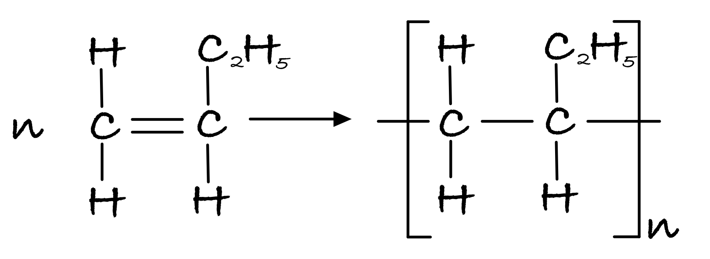

**[1 mark]**

> **[mark-scheme]**
> 1 mark for the correct polymerisation equation: n monomer units (in square brackets with n) forming the polymer chain with correct structure, continuation bonds, and square brackets with subscript n

> **[exam-tip]**
> The polymer equation must show: the monomer in square brackets with n outside, an arrow, and the polymer repeat unit in square brackets with subscript n. The C=C double bond in the monomer becomes a C–C single bond in the polymer, with continuation bonds at each end.
i) The structure of the monomer of PVA is:

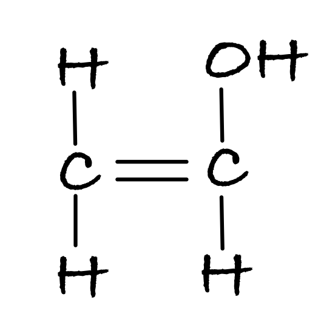

**[1 mark]**

> **[mark-scheme]**
> 1 mark for the correct structure of the monomer (ethenol: C=C double bond with an OH group)
> 
> The IUPAC name of the monomer is:
> 
> - Ethenol **[1 mark]**
> 
> ii) PVA is soluble but poly(but-1-ene) is not because:
> 
> - PVA has OH / hydroxyl groups **[1 mark]**
> - Which can form hydrogen bonds with water **[1 mark]**

> **[exam-tip]**
> To find the monomer from PVA: identify the 2-carbon repeat unit, then restore the C=C double bond. Name it: 'eth-' (2 carbons) + '-en-' (double bond) + '-ol' (OH group) = ethenol.
> 
> The –OH group allows hydrogen bonding with water, making PVA soluble. Unlike poly(but-1-ene), which has no polar groups and cannot hydrogen bond.
> **[mark-scheme]**
> One advantage and one disadvantage to the environment of disposing of polymers by combustion:
> 
> - Advantage: Generates heat / energy that can be used to generate electricity
> **OR**
> Reduces the amount sent to landfill **[1 mark]**
> - Disadvantage: Releases carbon dioxide, which causes global warming
> **OR**
> Releases toxic gases
> **OR**
> Uses up finite oil resources to make more polymers **[1 mark]**

> **[exam-tip]**
> Answers must refer to environmental issues. Economic answers (e.g. 'it is cheap') are not accepted. For the disadvantage, you must explain the environmental impact: just stating 'releases CO2' without linking it to global warming will not score.
> **[mark-scheme]**
> A reagent that can be used to remove hydrogen chloride from the waste gases is:
> 
> - Any named base (e.g. sodium hydroxide / calcium carbonate / sodium hydrogencarbonate) **[1 mark]**

> **[exam-tip]**
> Hydrogen chloride is an acidic gas, so it can be neutralised by a base. Any named base is acceptable: for example, sodium hydroxide (NaOH), calcium carbonate (CaCO3), or sodium hydrogencarbonate (NaHCO3).

### Q8
The displayed formula of the monomer used to form PTFE is:

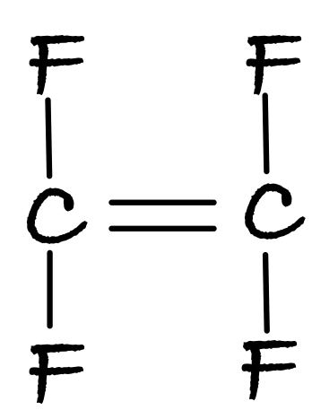

**[1 mark]**

> **[mark-scheme]**
> 1 mark for the correct displayed formula of tetrafluoroethene: a C=C double bond with two F atoms on each carbon

> **[exam-tip]**
> The monomer is given within the brackets of the polymer name: PTFE = poly(**tetrafluoroethene**). 'Tetra' = four fluorine atoms; 'ethene' = two carbons joined by a C=C double bond. There are no alternative positions for the four F atoms, so no locant numbers are needed in the name.
Two repeating units of poly(tetrafluoroethene) are:

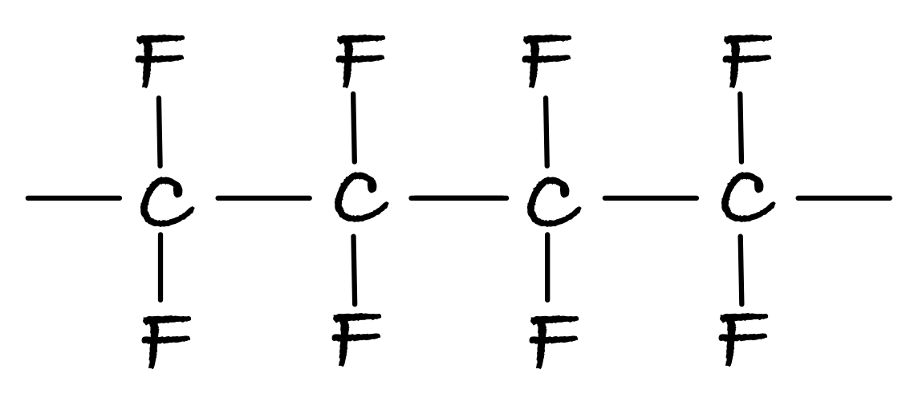

**[1 mark]**

> **[mark-scheme]**
> 1 mark for the correct structure showing two repeat units with continuation bonds at each end

> **[exam-tip]**
> To draw the polymer from the monomer: replace the C=C double bond with a C–C single bond, then add continuation bonds on each side. Join two of these repeat units together to show two repeating units.
> **[mark-scheme]**
> Explaining the differences in melting point in terms of intermolecular forces:
> 
> - Both polymers have instantaneous dipole–induced dipole / London dispersion forces **[1 mark]**
> - Poly(chloroethene) / PVC also has permanent dipole–permanent dipole forces (due to the polar C–Cl bond) **[1 mark]**
> - Poly(chloroethene) / PVC therefore requires more energy to separate its chains and has a higher melting point **[1 mark]**

> **[exam-tip]**
> PVC is similar to poly(ethene) but has one H atom per repeat unit replaced by Cl. Because Cl is more electronegative than C, the C–Cl bond is polar, giving PVC a permanent dipole. This means PVC has both id–id and pd–pd forces, while poly(ethene) has only id–id forces. The additional pd–pd forces make PVC harder to melt. Note: van der Waals forces is accepted for id–id, but being specific scores better in CIE mark schemes.
> **[mark-scheme]**
> Two pollution problems caused by non-biodegradable polymers:
> 
> Any **two** from (1 mark for each point):
> 
> - Animals can ingest plastics, which can be fatal
> - Animals can become entangled in plastic waste (e.g. fishing line)
> - Combustion releases toxic / poisonous gases
> - Landfill consumes land that could be used for other purposes
> 
> **[2 marks]**

> **[exam-tip]**
> Non-biodegradable polymers cause pollution because they persist in the environment for hundreds of years. They can harm wildlife directly (ingestion, entanglement) and pose risks when incinerated or landfilled.

### Q9
A sketch showing p-orbital involvement in C=C bond formation:

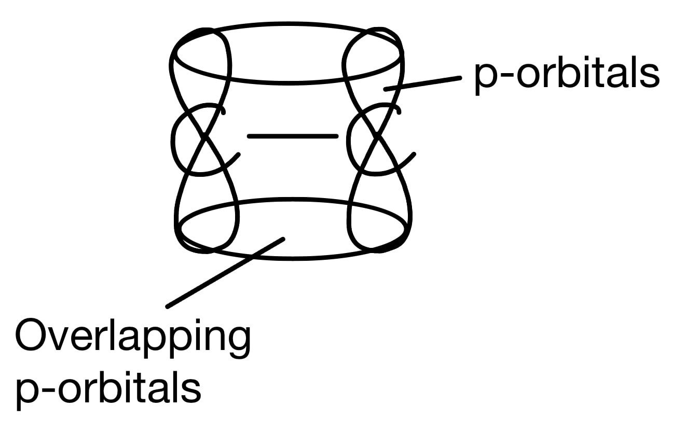

**[2 marks]**

> **[mark-scheme]**
> 1 mark for a diagram showing at least two carbons, each with a sigma bond and a p-orbital perpendicular to the C–C bond axis
> 
> 1 mark for adjacent p-orbitals overlapping sideways (shown in the diagram or stated in words)

> **[exam-tip]**
> A C=C double bond consists of a sigma bond (from overlap of sp² orbitals) and a pi bond (from sideways overlap of unhybridised p-orbitals). The p-orbitals must be parallel to each other and perpendicular to the C–C sigma bond axis for effective overlap to occur.
> **[mark-scheme]**
> i) The IUPAC name of isomer **1** is:
> 
> - 1,2,3-trichloropropene **[1 mark]**

ii) Three other structural isomers of C3H3Cl3 that are chloroalkenes are:

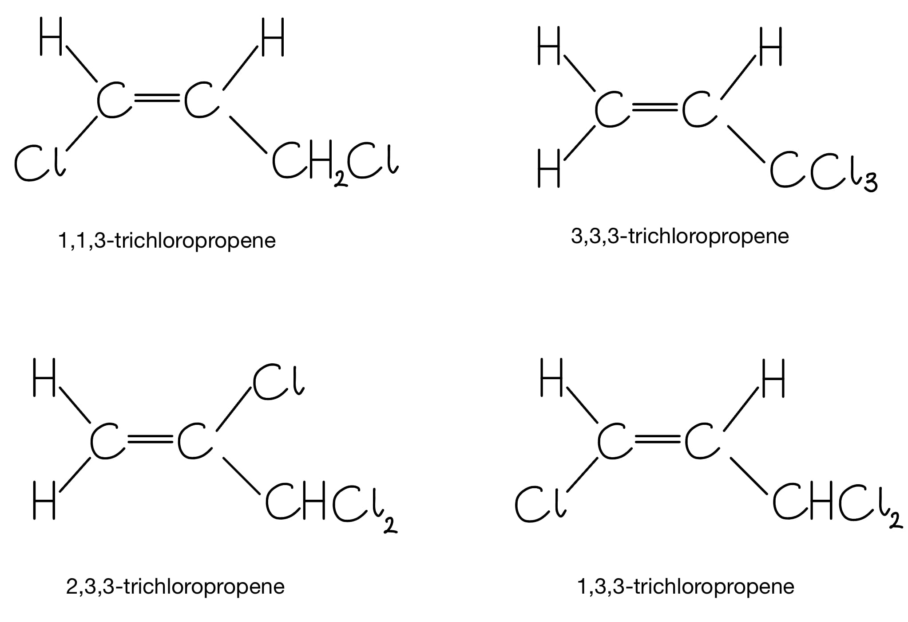

**[3 marks]**

> **[mark-scheme]**
> 1 mark for each correct structural isomer drawn; any three from those shown above

iii) Two repeat units of the polymer formed by isomer **2** are:

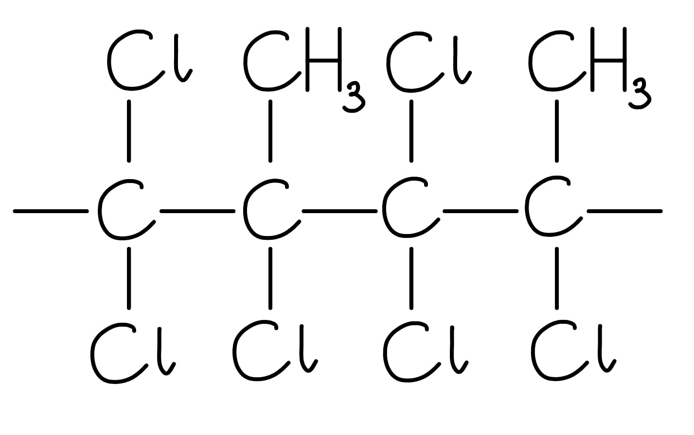

**[1 mark]**

> **[mark-scheme]**
> 1 mark for four backbone carbons connected by single bonds, with the correct atoms/groups attached and continuation bonds at each end

> **[exam-tip]**
> For chloroalkene isomers of C3H3Cl3: consider different positions of the C=C bond (C1–C2 or C2–C3) and different arrangements of the three Cl atoms. Draw the carbon skeleton first, then systematically place the Cl atoms. Remember: the compound must remain an alkene (contain a C=C).
> **[mark-scheme]**
> i) The balanced symbol equation for the incineration of poly(chloroethene) is:
> 
> - —CH2CHCl— + 2½O2 → 2CO2 + H2O + HCl **[1 mark]**
> 
> ii) The environmental impact of the carbon dioxide produced:
> 
> - Carbon dioxide contributes to global warming / the greenhouse effect **[1 mark]**
> 
> iii) The environmental impact of the hydrogen chloride produced:
> 
> - Hydrogen chloride is toxic / corrosive / dissolves to form an acidic solution **[1 mark]**
> 
> iv) To reduce the environmental impact of the hydrogen chloride:
> 
> - React the hydrogen chloride with a base / alkali / carbonate to neutralise it before it is released into the atmosphere **[1 mark]**

> **[exam-tip]**
> When incinerating poly(chloroethene), the two key pollutants are CO2 (a greenhouse gas) and HCl (toxic and acidic). Since HCl is acidic, it can be neutralised by a base. For example by passing the exhaust gases through a solution of sodium hydroxide or calcium carbonate, before they are released into the atmosphere.

### Q10
> **[mark-scheme]**
> The alternative name for poly(chloroethene) is:
> 
> - Poly(vinyl chloride) / PVC **[1 mark]**

> **[exam-tip]**
> You are expected to know both the IUPAC name poly(chloroethene) and the alternative name poly(vinyl chloride) / PVC, and to be able to draw its repeating unit.
A diagram of the structure of poly(chloroethene) including three repeat units is:

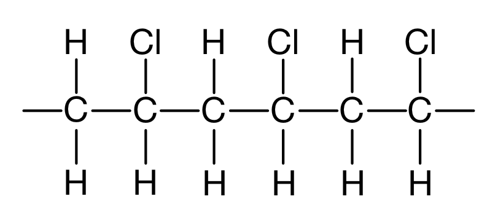

**[2 marks]**

> **[mark-scheme]**
> 1 mark for the correct structure of the repeat unit (two backbone carbons, one carrying a Cl substituent)
> 
> 1 mark for three repeat units joined together with continuation bonds at each end

> **[exam-tip]**
> To draw an addition polymer from its monomer: replace the C=C double bond with a C–C single bond, then add continuation bonds on each side. Join three of these repeat units together, with continuation bonds at the very ends of the chain.
> **[mark-scheme]**
> A problem caused by combustion of poly(chloroethene) and a way to reduce its effects:
> 
> - Problem 1: Acidic hydrogen chloride gas is produced / released
> - Suggestion 1: Neutralise the acidic gases (with a base) before releasing into the atmosphere
> 
> **OR**
> 
> - Problem 2: Dioxins / toxic compounds are released
> - Suggestion 2: Use a very high combustion temperature to break down the toxic compounds
> 
> **[2 marks]**
> 
> 'Recycling' is not accepted as a method for reducing the effects of combustion.

> **[exam-tip]**
> The high chlorine content of poly(chloroethene) means that incineration produces hydrogen chloride gas, which is acidic and corrosive. Being acidic, it can be neutralised by a base before the exhaust gases are released into the atmosphere.

### Q11
i) The displayed formulae of the three isomers, **A**, **B** and **C**, are:

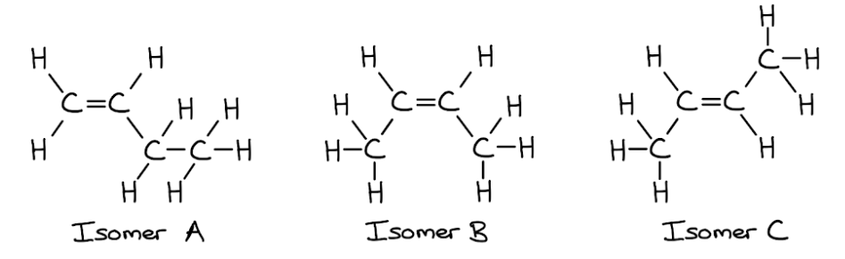

**[3 marks]**

> **[mark-scheme]**
> 1 mark for the correct displayed formula of isomer **A** (but-1-ene: 4-carbon chain with C=C at C1)
> 
> 1 mark for the correct displayed formula of isomer **B** (*cis*-but-2-ene: C=C at C2, both CH3 groups on the same side)
> 
> 1 mark for the correct displayed formula of isomer **C** (*trans*-but-2-ene: C=C at C2, CH3 groups on opposite sides)
> 
> ii) The names of the three isomers are:
> 
> - Isomer **A** = but-1-ene **[1 mark]**
> - Isomer **B** = *cis*-but-2-ene **[1 mark]**
> - Isomer **C** = *trans*-but-2-ene **[1 mark]**

> **[exam-tip]**
> For geometric isomers, focus on the C=C bond position and arrangement: *cis* has identical or similar groups on the same side; *trans* has them on opposite sides. Isomer **A** (but-1-ene) does not show geometric isomerism because one carbon of the C=C bond carries two identical hydrogen atoms.
The displayed formula of the addition polymer formed by isomer **A** is:

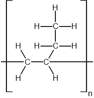

**[1 mark]**

> **[mark-scheme]**
> 1 mark for the correct repeating unit of poly(but-1-ene): two backbone carbons with an ethyl side chain (–CH2CH3) and continuation bonds on each side

> **[exam-tip]**
> To draw an addition polymer from a monomer: replace the C=C double bond with a C–C single bond, then add continuation bonds extending from each of the two backbone carbon atoms. Brackets with a subscript *n* are good practice but not always required.
> **[mark-scheme]**
> The two structures are the same addition polymer because:
> 
> - There is free rotation around the C–C single bond
> **OR**
> The C–C bond can freely rotate
> **OR**
> There is no longer a C=C double bond to restrict rotation **[1 mark]**

> **[exam-tip]**
> Single C–C bonds allow free rotation, unlike C=C double bonds which are restricted and planar. This means that the geometric isomers **B** and **C** produce identical addition polymers. Once the C=C becomes C–C, the arrangement of groups around that bond no longer matters.
