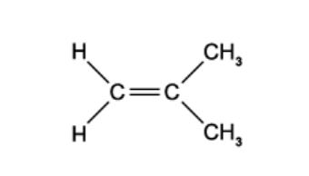
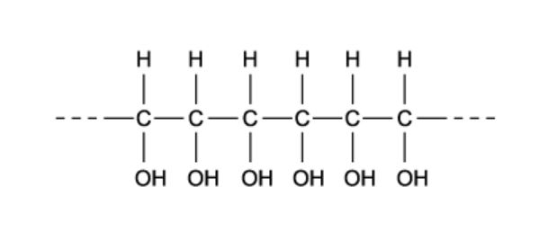
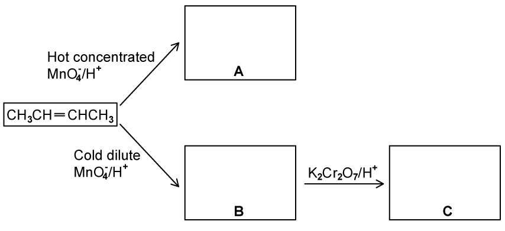
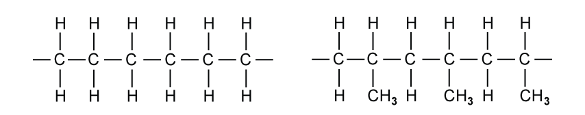
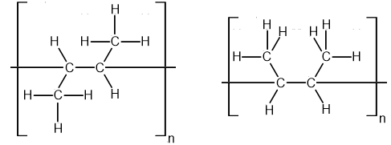

# Exam Questions — Addition Polymerisation
**20. Polymerisation** · Cambridge (CIE) A-LEVEL chemistry (9701)
> Source: [https://www.savemyexams.com/a-level/chemistry/cie/25/topic-questions/](https://www.savemyexams.com/a-level/chemistry/cie/25/topic-questions/) · 28 questions across 2 sets

## Multiple Choice Questions (17 questions)

### Q1 — medium — 1 marks

**Q1** [1 mark]

1,1-Dichloroethene undergoes addition polymerisation to form a polymer used in cling film.

Which sequence appears in a short length of the polymer chain?

### Q2 — hard — 1 marks

**Q2** [1 mark]

Some micro-organisms produce the naturally occurring polymer PHB (polyhydroxybutyric acid), shown below.

![Structural formula of the PHB (polyhydroxybutyric acid) repeat unit: −[O−CH(CH₃)−CH₂−C(=O)]n, showing an ester linkage within a 4-carbon backbone with a methyl side group, with subscript n](assets/002-structural-formula-of-the-phb-polyhydroxybutyric.png)

Which type of reaction would break down PHB?

### Q3 — medium — 1 marks

**Q3** [1 mark]

The diagram shows a short length of an addition polymer chain.

The polymer has a relative molecular mass of 9600.

Approximately how many monomer units are joined together in each polymer molecule?

### Q4 — medium — 1 marks

**Q4** [1 mark]

What are the C−C−C bond angles along the polymeric chain in PVC?

### Q5 — hard — 1 marks

**Q5** [1 mark]

Which row correctly describes what happens when poly(propene), (C3H6)~*n*~, is burned in an excess of air?

|   | **Moles of O****2** | **Products** |
|---|---|---|
| **A** | 3.0*n* | 3*n*CO + 3*n*H2O |
| **B** | 1.5*n* | 3*n*C + 3*n*H2O |
| **C** | 4.5*n* | 3*n*CO2 + 3*n*H2O |
| **D** | 9.0*n* | 3*n*CO2 + 3*n*H2O |

### Q6 — medium — 1 marks

**Q6** [1 mark]

But-2-en-1-ol, CH3CH=CHCH2OH, is a monomer that undergoes addition polymerisation.

Which structure is the repeat unit in poly(but-2-en-1-ol)?

### Q7 — easy — 1 marks

**Q7** [1 mark]

Plastic waste can be incinerated to provide energy.

Which statement explains why poly(chloroethene), PVC, is removed from the waste before incineration?

### Q8 — easy — 1 marks

**Q8** [1 mark]

What is the repeat unit of PVC, poly(chloroethene)?

### Q9 — medium — 1 marks

**Q9** [1 mark]

The absorbent material in disposable nappies is made from the addition polymer shown.

Which monomer is used to make this polymer?

### Q10 — medium — 1 marks

**Q10** [1 mark]

A naturally occurring compound is formed by the addition polymerisation of four identical monomer molecules, as shown.

Which structural formula represents the monomer?

### Q11 — medium — 1 marks

**Q11** [1 mark]

Which statement about PVC, poly(chloroethene), is **not** correct?

### Q12 — easy — 1 marks

**Q12** [1 mark]

The diagram below shows 2-methylpropene, C4H8, a monomer used in the production of synthetic rubber.

What is the compound formed by 2-methylpropene when it undergoes addition polymerisation?

### Q13 — medium — 1 marks

**Q13** [1 mark]

PVC is produced by the addition polymerisation of chloroethene.

Which row correctly describes the carbon-carbon bond in chloroethene compared with the carbon-carbon bond in PVC?

|   | **Bond length** | **Bond strength** |
|---|---|---|
| **A** | Longer | Stronger |
| **B** | Longer | Weaker |
| **C** | Shorter | Stronger |
| **D** | Shorter | Weaker |

### Q14 — hard — 1 marks

**Q14** [1 mark]

The structure of a polymer is shown.

Which row identifies step 1 and step 2 to make this polymer?

|   | **Step 1** | **Step 2** |
|---|---|---|
| **A** | Polymerise 1,2-dichloroethene | Hydrolysis |
| **B** | Polymerise 1,2-dichloroethene | Oxidation with H+ / KMnO4 |
| **C** | Polymerise ethene | Hydration |
| **D** | Polymerise ethene | Oxidation with H+ / KMnO4 |

### Q15 — medium — 1 marks

**Q15** [1 mark]

Which polymer is **not** made when ethenol and propene undergo addition polymerisation?

### Q16 — medium — 1 marks

**Q16** [1 mark]

In the addition polymerisation of alkenes, which row identifies the types of bond breakage and bond formation that occur?

|   | **Bond breakage** | **Bond formation** |
|---|---|---|
| **A** | π only | σ and π |
| **B** | π only | σ only |
| **C** | σ and π | σ and π |
| **D** | σ and π | σ only |

### Q17 — easy — 1 marks

**Q17** [1 mark]

Poly(ethenol) is a polymer used to make dissolvable plastic bags. It can be made by addition polymerisation of CH2=CH(OH).

Which structure shows a polymer chain consisting of two monomer residues?

## Structured Questions (11 questions)

### Q1 — medium — 9 marks

**Q1** [2 marks]

Addition polymers are made by the polymerisation of alkenes.

Explain what is meant by the term addition polymerisation.

**Q1** [2 marks]

*Trans*-hept-2-ene can be made into an addition polymer.

i) Draw the displayed formula of *trans*-hept-2-ene.

[1]

ii) Draw the structure of poly(hept-2-ene) showing two repeat units.

[1]

**Q1** [2 marks]

**Extract:**

*Trans*-hept-2-ene can be made into an addition polymer.

i) Draw the displayed formula of *trans*-hept-2-ene.

ii) Draw the structure of poly(hept-2-ene) showing two repeat units.

Suggest why the polymer made from *trans*-hept-2-ene is not called poly(*trans*-hept-2-ene).

**Q1** [3 marks]

*Trans*-hept-2-ene is a liquid at room temperature and pressure but poly(hept-2-ene) is a solid.

Explain why there is a difference in the states of *trans*-hept-2-ene and poly(hept-2-ene).

### Q2 — hard — 6 marks

**Q2** [3 marks]

But-2-ene, CH3CH=CHCH3, is an important compound which is obtained from the cracking of hydrocarbons present in crude oil.

Some reactions of but-2-ene are shown in Fig. 3.1.

**Fig. 3.1**

State the structural formulae of the organic compounds **A** to **C**.

**Q2** [1 mark]

**Extract:**

But-2-ene, CH~3~CH=CHCH~3~, is an important compound which is obtained from the cracking of hydrocarbons present in crude oil.

But-2-ene can be polymerised to give poly(but-2-ene). Draw the structural formula of a portion of the polymer chain in poly(but-2-ene) showing **two** repeat units.

**Q2** [2 marks]

State **two** reasons why there is an increasing demand for polymers to be recycled rather than incinerated.

### Q3 — medium — 7 marks

**Q3** [2 marks]

The structures of two different polymers, poly(ethene) and poly(propene) are shown in Fig. 4.1.

**Fig. 4.1**

Suggest **two** reasons why these polymers are unreactive.

**Q3** [2 marks]

State **one **advantage and **one **disadvantage of the unreactivity of addition polymers.

**Q3** [1 mark]

Another example of a polymer is polystyrene which is often used as packing material and electrical insulation.

Fig. 4.2 shows three repeating units of the polymer.

**Fig. 4.2**

Draw the structure of monomer **X** which is used to form the polymer shown in Fig. 4.2.

**Q3** [2 marks]

**Extract:**

Another example of a polymer is polystyrene which is often used as packing material and electrical insulation.

Fig. 4.2 shows three repeating units of the polymer.

Draw the structure of monomer **X** which is used to form the polymer shown in Fig. 4.2.

The structure of monomer **X** is: phenylethene (a C=C double bond with a phenyl ring attached to one carbon)

Two different monomers can also join together to form an addition polymer.

Monomer **X** can react with monomer **Y** to form a polymer. Two repeating units of this polymer are shown in Fig. 4.3.

**Fig. 4.3**

i) Draw the structure of monomer **Y** which reacts with monomer **X** to form the polymer shown in Fig. 4.3.

[1]

ii) State the IUPAC name of monomer **Y**.

[1]

### Q4 — hard — 6 marks

**Q4** [1 mark]

Poly(methyl methacrylate) is used as a glass substitute in Perspex.

A section of the polymer chain is shown in Fig. 1.1.

**Fig. 1.1**

Draw the skeletal formula of the monomer.

**Q4** [2 marks]

Explain why poly(methyl methacrylate) is fairly unreactive.

**Q4** [3 marks]

Bioplastics, such as biodegradable plastics, offer a sustainable alternative to oil-based products.

Where the use of plant-based polymers is not possible, photodegradable polymers are being developed.

i) Explain how photodegradable polymers are broken down.

[1]

ii) Suggest **two** disadvantages of using photodegradable polymers.

[2]

### Q5 — easy — 5 marks

**Q5** [1 mark]

Polymer **X** can be formed from an alkene. The structure of polymer **X** is shown in Fig. 1.1.

**Fig. 1.1**

State the type of polymerisation involved in the formation of polymer **X**.

**Q5** [2 marks]

**Extract:**

Polymer **X** can be formed from an alkene. The structure of polymer **X** is shown in Fig. 1.1.

{align=center} **Fig. 1.1**

i) Draw the fully displayed formula of the monomer used to form polymer **X**.

[1]

ii) State the name of polymer **X**.

[1]

**Q5** [2 marks]

State **two** reasons why the disposal of poly(alkenes) such as polymer **X** is difficult.

### Q6 — medium — 14 marks

**Q6** [1 mark]

Polyvinyl chloride (PVC) is a polymer which is rigid enough for use as a drainpipe and flexible enough for plastic aprons.

State the IUPAC name of PVC.

**Q6** [4 marks]

Fig. 2.1 below shows a section of the PVC polymer.

**Fig. 2.1**

i) Draw the repeating unit of PVC.

[1]

ii) Draw the structure and state the name of the monomer of the PVC polymer.

[2]

iii) Construct the equation to represent the formation of PVC from its monomer.

[1]

**Q6** [6 marks]

The polymer poly(propene) is formed from the monomer propene.

i) Draw the repeating unit of this polymer.

[1]

ii) The properties of two different polymers, poly(methylpropene) and poly(ethene) are compared to each other. Complete Table 2.1 by placing an **X** in the correct box. You may place more than one **X** for each physical property.

[3]

**Table 2.1**

| **Physical property** | **Poly(methylpropene)** | **Poly(ethene)** |
|---|---|---|
| Insoluble in water |   |   |
| Unreactive |   |   |
| High density |   |   |

iii) Explain why the melting point of poly(methylpropene) is much higher than that of methylpropene.

[2]

**Q6** [3 marks]

Polymers are unreactive compounds due to their long non-polar chain of saturated carbon-carbon and carbon-hydrogen bonds. This means that they are safe to use, but it also means that they are non-biodegradable as they are not attacked by biological agents such as enzymes.

Table 2.2 shows three different ways in which polymers can be disposed of.

**Table 2.2**

| **Method of disposal** | **Disadvantage** |
|---|---|
| Recycling |   |
| Incineration |   |
| Landfill |   |

State the disadvantage of each method of disposal to complete Table 2.2.

### Q7 — medium — 8 marks

**Q7** [1 mark]

Poly(but-1-ene) is insoluble in water so is used in applications such as making water pipes.

Write an equation to show how poly(but-1-ene) is formed from the monomer but-1-ene.

**Q7** [4 marks]

Not all polymers are insoluble in water. One example is poly(vinyl alcohol) known as PVA. PVA is used in applications such as in the casing of detergent-filled capsules.

A section of the polymer chain of PVA is shown in Fig. 5.1.

**Fig. 5.1**

i) Draw the structure and state the IUPAC name of the monomer of PVA.

[2]

ii) Suggest why PVA is soluble, but poly(but-1-ene) is not.

[2]

**Q7** [2 marks]

Combustion can be used to dispose of poly(alkenes), such as poly(but-1-ene).

State **one** advantage and **one** disadvantage to the environment of disposing of polymers by combustion.

**Q7** [1 mark]

Poly(chloroethene), PVC, can also be disposed of via combustion but it produces toxic waste gases including hydrogen chloride.

Suggest a reagent that can be used to remove this toxic gas from the waste gases.

### Q8 — medium — 7 marks

**Q8** [1 mark]

Poly(tetrafluoroethene), also known as PTFE, is an addition polymer used as a non-stick coating in pans as it is very unreactive.

Draw the displayed formula of the monomer used to form PTFE.

**Q8** [1 mark]

Draw two repeating units of poly(tetrafluoroethene).

**Q8** [3 marks]

The table shows the melting points of two polymers.

| **Polymer** | **Melting point / °C** |
|---|---|
| Poly(ethene) | 137 |
| Poly(chloroethene) (PVC) | 212 |

Explain the differences in melting point of these two polymers in terms of the intermolecular forces between the chains.

**Q8** [2 marks]

Poly(ethene) bags pollute the environment for a long time because they are non-biodegradable.

Describe **two **pollution problems that are caused by non-biodegradable polymers.

### Q9 — hard — 11 marks

**Q9** [2 marks]

Explain how p-orbitals are involved in the formation of the C=C bond in chloroalkenes.

You should include a sketch in your answer.

**Q9** [5 marks]

Compound Y has six possible structural isomers of C3H3Cl3.

Two of these isomers are shown in Fig. 2.1.

**Fig. 2.1**

i) State the IUPAC name of isomer **1**.

[1]

ii) Draw three other structural isomers of C3H3Cl3 that are chloroalkenes.

[3]

iii) Show **two** repeat units for the polymer formed by isomer **2**.

[1]

**Q9** [4 marks]

Polymers can be disposed of by incineration.

i) Write a balanced symbol equation for the incineration of poly(chloroethene). Carbon dioxide, water and HCl are formed.

[1]

ii) State the environmental impact of the carbon dioxide produced during this reaction.

[1]

iii) State the environmental impact of the hydrogen chloride produced during this reaction.

[1]

iv) Suggest how the environmental impact of the hydrogen chloride could be reduced.

[1]

### Q10 — easy — 5 marks

**Q10** [1 mark]

A molecule of chloroethene is shown in Fig. 3.1.

**Fig. 3.1**

Chloroethene can be polymerised to form poly(chloroethene).

State the alternative name for poly(chloroethene).

**Q10** [2 marks]

**Extract:**

A molecule of chloroethene is shown in Fig. 3.1.

Chloroethene can be polymerised to form poly(chloroethene).

Draw a diagram of the structure of poly(chloroethene) including **three** repeat units.

**Q10** [2 marks]

State a problem caused by the combustion of poly(chloroethene) as a method of disposal and suggest how the effects of this problem can be reduced.

### Q11 — easy — 8 marks

**Q11** [6 marks]

Butene, C4H8, can exist as three isomers.

Isomer **A** is a position isomer of isomers **B** and **C** and does not show geometric isomerism.

Isomers **B** and **C** are geometric isomers of each other.

Isomer **B** is the *cis* isomer.

Isomer **C** is the *trans* isomer.

i) Draw the displayed formulae of the three isomers, **A**, **B** and **C**, of butene, C4H8.

[3]

ii) State the names of all three isomers, **A**, **B** and **C**, of butene, C4H8.

[3]

**Q11** [1 mark]

**Extract:**

Butene, C~4~H~8~, can exist as three isomers.

Isomer **A** is a position isomer of isomers **B** and **C** and does not show geometric isomerism.

Isomers **B** and **C** are geometric isomers of each other.

Isomer **B** is the *cis* isomer.

Isomer **C** is the *trans* isomer.

Isomer **A** = but-1-ene (4-carbon chain with C=C at C1)

Draw the displayed formula of the addition polymer formed by isomer **A**.

**Q11** [1 mark]

**Extract:**

Butene, C~4~H~8~, can exist as three isomers.

Isomer **A** is a position isomer of isomers **B** and **C** and does not show geometric isomerism.

Isomers **B** and **C** are geometric isomers of each other.

Isomer **B** is the *cis* isomer.

Isomer **C** is the *trans* isomer.

A student was asked to draw the displayed formula of the addition polymer of isomers **B** and **C**. They suggested that there were two structures as shown in Fig. 2.1.

**Fig. 2.1**

State why the student's two suggested structures are the same addition polymer.
