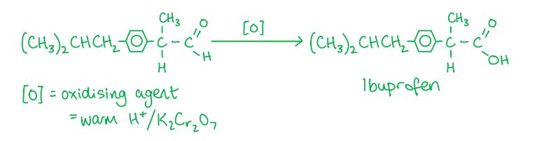
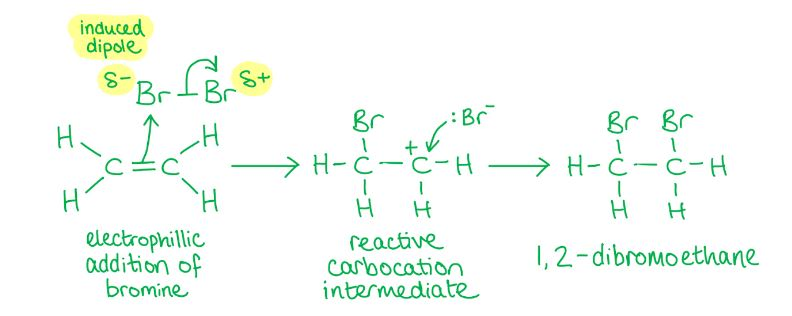
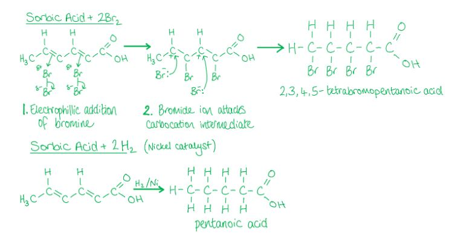
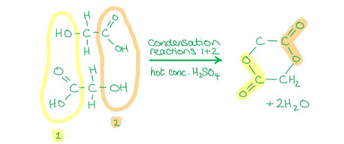
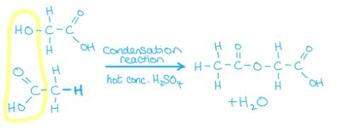
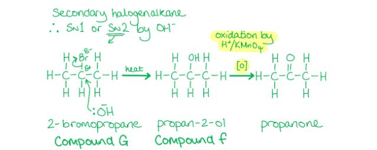
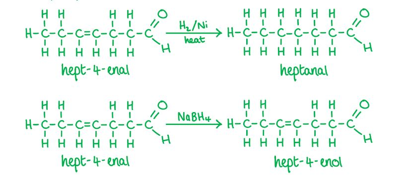
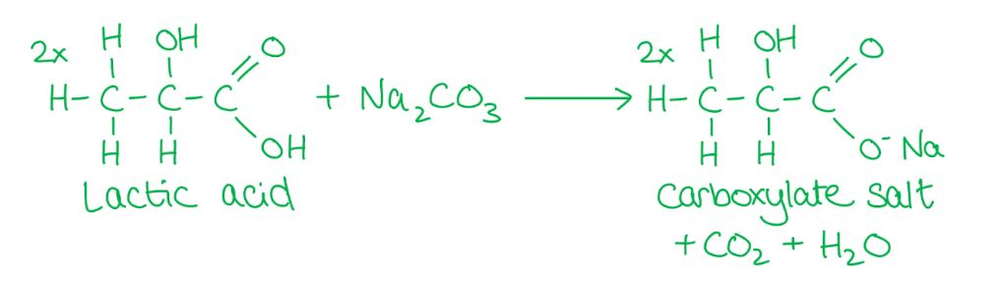

# Mark Schemes — Organic Synthesis
**21 .Organic Synthesis** · Cambridge (CIE) A-LEVEL chemistry (9701)

## Multiple Choice Questions (19 questions)

### Q1
**Final answer:** **The correct answer is A**

- Propanoic acid is a **liquid** at room temperature.
- The carboxylic acid group (-COOH) is highly polar and forms H-bonds with water, causing propanoic acid to be readily soluble in water.
- Propanoic acid is an **acid** which reacts with cold aqueous sodium hydroxide in an acid-base reaction to form sodium propanoate and water.

**B** is incorrect as propanol does not react with cold sodium hydroxide. Propanol is a very weak acid and OH- is not strong enough to deprotonate the alcohol group.

**C** is incorrect as propene is a **gas** at room temperature. It is also insoluble in water as it is non-polar, and it does not react with sodium hydroxide.

**D** is incorrect as propyl propanoate does not react with cold aqueous sodium hydroxide. Saponification of an ester requires heating under reflux with concentrated alkali. Additionally, the large non-polar alkyl groups make propyl propanoate poorly soluble in water.

### Q2
**Final answer:** **The correct answer is A**

- Warm acidified potassium dichromate (VI) **oxidises** aldehydes to **carboxylic acids**.
- The aldehyde group (-CHO) in the precursor shown in **A** is oxidised to give the carboxylic acid (-CO2H) group of ibuprofen.

**B** is incorrect as hot, concentrated KMnO4 causes **oxidative cleavage** of the C=C double bond. The =CH2 end is oxidised to CO2 and the ring-attached carbon becomes a ketone, giving a methyl ketone and CO2.

**C** is incorrect as warm H2SO4 (aq) cannot oxidise a **ketone** to a carboxylic acid. Ketones are resistant to mild oxidation, and H2SO4 is not an oxidising agent under these conditions.

**D** is incorrect as H2/Pt catalyst causes **hydrogenation**, reducing the C=C double bonds to C–C single bonds. This does not introduce a carboxylic acid group, so ibuprofen is not formed.

### Q3
**Final answer:** **The correct answer is A**

- **Alkenes** will undergo an addition reaction when shaken with orange/yellow bromine water (Br2) to turn the solution colourless.
- The first step involves **electrophilic** attack of the slightly positively charged bromine atom on the C=C bond.
- This results in the formation of a primary carbocation, which then undergoes **nucleophilic** attack by the Br- to form 1,2-dibromoethane.

**B** is incorrect as this is **nucleophilic substitution** of the bromine by OH- in the primary halogenoalkane following an SN2 mechanism. This reaction does not involve a carbocation intermediate.

**C** is incorrect as this is a **free-radical substitution** reaction initiated by sunlight, which involves free radicals, not carbocation intermediates.

**D** is incorrect as this is **nucleophilic addition** of CN- to the carbonyl carbon to form a hydroxynitrile. This reaction does not involve a carbocation intermediate.

### Q4
**Final answer:** **The correct answer is A**

- Sorbic acid contains two C=C double bonds.
- Each C=C double bond undergoes **electrophilic addition** with one mole of bromine (Br2) in an organic solvent.

  - So, two moles of Br2 are incorporated per mole of sorbic acid.
- Each C=C double bond also undergoes **addition** with one mole of hydrogen in a **hydrogenation** reaction in the presence of a Ni catalyst.

  - So, two moles of H2 are incorporated per mole of sorbic acid.

**B** is incorrect as sorbic acid reacts with two moles of hydrogen, not three. There are two C=C double bonds in sorbic acid, each incorporating one mole of H2 during hydrogenation.

**C** is incorrect as sorbic acid reacts with two moles of bromine, not half a mole. Each of the two C=C double bonds undergoes electrophilic addition with one mole of Br2.

**D** is incorrect as sorbic acid reacts with two moles of bromine (not 2½) and two moles of hydrogen (not three). Each C=C double bond reacts with one mole of each reagent.

### Q5
**Final answer:** **The correct answer is B**

- Compound G contains an **amide** and an **ester** group which can both undergo **hydrolysis** when heated with dilute hydrochloric acid.

  - Hydrolysis of the **amide** produces an **amine** and a **carboxylic acid**.
- Under acidic conditions, the basic amine is protonated to give NH3+.

  - Hydrolysis of the **ester** produces an **alcohol** and a **carboxylic acid**.

**A** is incorrect as neither product is the result of complete hydrolysis. H2NCOCH2OH retains the amide bond intact rather than breaking it to give separate amine and carboxylic acid groups. HOCH2CHO (glycolaldehyde) has an aldehyde group rather than a carboxylic acid, which is not the product of ester hydrolysis.

**C** is incorrect as HOCH2CO2H (glycolic acid from ester hydrolysis) is correct, but H2NCH2CO2H (glycine) is incorrect. Under acidic conditions (dilute HCl), the amine is protonated to NH3+, so the correct amide hydrolysis product is HO2CCH2NH3+, not the free amine.

**D** is incorrect as the amide bond in HOCH2CONH3+ has not been hydrolysed. The amide linkage is merely protonated, not broken. Acid hydrolysis of the amide produces separate NH3+ and carboxylic acid groups. HOCH2CHO is also incorrect for the ester product (should be HOCH2CO2H).

### Q6
**Final answer:** **The correct answer is A**

- The **halogenation** of methyl propanoate (CH3CH2CO2CH3) can be achieved by a **free-radical substitution** reaction.
- The hydrogen atom in the alkyl group (-CH3) is substituted for a halogen.
- The reaction is **initiated** by the formation of two **radicals** using UV light (which comes from the Sun).

  - Radicals are species with unpaired electrons.
- In the **propagation** step the formed radicals attack **reactant molecules** to generate more free radicals.
- In the **termination** step two radicals react together to form an unreactive molecule.
- **Initiation step**

Cl2 $\overset{\mathrm{UV}}{\rightarrow}$ 2Cl•

- **Propagation steps:**

CH3CH2CO2CH3 + Cl• → CH3CH2CO2CH2• + HCl

CH3CH2CO2CH2• + Cl2 → CH3CH2CO2CH2Cl + Cl•

- **Termination steps:**

2Cl• → Cl2

CH3CH2CO2CH2• + Cl• → CH3CH2CO2CH2Cl

2CH3CH2CO2CH2• → CH3CH2CO2CH2CH2CO2CH2CH3

**B**, **C** & **D** are incorrect as these reagents are used in the **nucleophilic substitution** reaction of alcohols. CH3CH2CO2CH3 is not an alcohol but an ester.

### Q7
**Final answer:** **The correct answer is D**

- Two molecules of HOCH2COOH will react with each other to form **two ester groups** in a cyclic structure.
- Each ester group is formed by a **condensation** reaction between the **alcohol** (-OH) of one molecule and the **carboxylic acid** (-COOH) of the other, eliminating water.

**A** & **C** are incorrect as neither molecule contains a free alcohol (-OH) group that can react with a carboxylic acid group of another molecule to form an ester linkage. Without a free -OH, self-esterification to give the cyclic diester cannot occur.

**B** is incorrect as mixing CH3COOH with HOCH2COOH would not produce compound M. The CH3COOH would react with the alcohol group of HOCH2COOH to give a single linear mixed ester, not a cyclic diester with two ester groups.

### Q8
**Final answer:** **The correct answer is D**

- Phenylhydrazine contains a terminal **hydrazine group** (-NHNH₂) which undergoes a **nucleophilic addition-elimination (condensation)** reaction with the **ketone group** (C=O) of compound **X**.

  - The ketone carbonyl carbon is electrophilic due to the electronegativity of the oxygen.
  - The nitrogen lone pair of the terminal NH2 attacks this carbon.
- After proton transfers, a water molecule is eliminated to form a **C=N** (hydrazone) linkage, giving the phenylhydrazone product.
- The **ester group** in compound **X** is not attacked and is preserved in product **Y**.

**A** is incorrect as the ester group of compound **X** has been replaced by an amide linkage (-CONH-Ph), suggesting reaction at the ester rather than the ketone. In the condensation, phenylhydrazine reacts selectively with the more electrophilic ketone C=O; the ester group is preserved in the product.

**B** is incorrect as both the ketone group of compound **X** and the N–N bond of phenylhydrazine appear to have been lost. In the actual condensation, only the ketone oxygen is lost as water. The N–N bond is retained in the C=N–NHPh linkage of the phenylhydrazone.

**C** is incorrect as the NHNH2 group remains unreacted and the acyl group has been transferred directly to the phenyl ring, which does not occur under these conditions. In the condensation, the terminal NH2 attacks the ketone to form a hydrazone C=N linkage with elimination of water.

### Q9
**Final answer:** **The correct answer is C**

- **Cold, dilute acidified MnO****4****-** is a **mild** oxidising reagent which oxidises alkenes to a diol.
- The C=C in cholesterol becomes a **diol**.

  - The two carbon atoms are now bonded to four different groups, creating **two new chiral centres** (+2).
- Cold, dilute MnO4- will not oxidise the -OH group already present in cholesterol.

  - Therefore, the **total number of hydroxy groups** in the product is **three** (1 original + 2 from diol).
- **Hot, concentrated acidified MnO****4****-** is a **strong** oxidising reagent that completely breaks the C=C bond to form a ketone and an aldehyde.

  - The aldehyde is further oxidised to a carboxylic acid.
- The secondary alcohol group already present in cholesterol is also oxidised to a **ketone**, removing that chiral centre (**−1 chiral centre**).
- Only **two 6-membered rings** remain in the product.

**A** is incorrect as the cold, dilute KMnO4 values are wrong: the diol formation adds **two** new chiral centres (+2, not +1) and gives **three** hydroxy groups in total (not one). The hot value of -1 chiral centre is correct, but **two** 6-membered rings remain (not three).

**B** is incorrect as the cold, dilute KMnO4 values are wrong for the same reasons as A (+1 and 1 should be +2 and 3). The hot value of 2 rings is correct, but the chiral change is **-1** (not 0) as the secondary alcohol is oxidised to a ketone, removing that chiral centre.

**D** is incorrect as the cold, dilute KMnO4 values (+2 and 3) are both correct. However, both hot, concentrated KMnO4 values are wrong: the chiral change is **-1** (not 0), and **two** 6-membered rings remain (not three).

### Q10
**Final answer:** **The correct answer is A**

- 1-bromobutane undergoes **nucleophilic substitution** with KCN in ethanol, in which the CN- ion replaces the bromine atom to form pentanenitrile.
- Pentanenitrile then undergoes **hydrolysis** with dilute HCl under reflux to produce pentanoic acid and ammonium chloride.

**B** is incorrect as KCN in ethanol does form a nitrile correctly, but NaOH (aq) hydrolyses the nitrile under alkaline conditions to give a carboxylate salt, not pentanoic acid.

**C** is incorrect as NaOH (aq) substitutes the bromine to give 1-butanol (an alcohol); treatment with HCl (aq) then substitutes the -OH with Cl, giving 1-chlorobutane, not pentanoic acid.

**D** is incorrect as NH3 in ethanol substitutes the bromine to give a primary amine; primary amines cannot be oxidised by H+/Cr2O72- (aq) to produce a carboxylic acid.

### Q11
**Final answer:** **The correct answer is B**

- A relative molecular mass increase of 34 corresponds to the addition of two hydrogen atoms and two oxygen atoms.

- This occurs when an alkene undergoes mild oxidation with cold, dilute acidified MnO4- to form a **diol**.

  - A diol is an organic compound containing two -OH groups.

- The relative molecular mass of the two -OH groups added: 2 x (16 + 1) = 34

**A** is incorrect as cold, concentrated MnO4- would be too strongly oxidising for selective diol formation. Dilute conditions are required for mild oxidation.

**C** is incorrect as hot, concentrated MnO4- is a strong oxidant that fully cleaves the C=C bond, forming ketones, aldehydes, or carboxylic acids rather than a diol.

**D** is incorrect as hot conditions promote stronger oxidation that cleaves the C=C bond rather than forming a diol. Cold conditions are required to limit the extent of oxidation.

### Q12
**Final answer:** **The correct answer is C**

- Since propanone is produced upon oxidation of mixture **F** with acidified potassium dichromate, **F** must contain a **secondary alcohol**.
- **Propan-2-ol** (**F**) forms when compound **G** reacts with aqueous NaOH via **nucleophilic substitution**, in which OH- replaces the halogen.
- Compound **G** is therefore a **secondary halogenoalkane** which reacts with silver nitrate to form a coloured precipitate of a **silver halide**.
- **Silver bromide** gives a **cream precipitate**, so the unknown halogen is **bromine**.

**A** is incorrect as CH3CH2CH2Br is a **primary** halogenoalkane. Reaction with NaOH gives propan-1-ol (a primary alcohol), which is oxidised to **propanal** (an aldehyde), not propanone.

**B** is incorrect as CH3CH2CH2I is a **primary** halogenoalkane, also giving propanal on oxidation rather than propanone. Additionally, silver iodide gives a **yellow** precipitate with silver nitrate, not a cream precipitate.

**D** is incorrect as CH3CHICH3 is a secondary halogenoalkane and would give propan-2-ol and thus propanone on oxidation. However, silver iodide gives a **yellow** precipitate with silver nitrate, not a cream precipitate.

### Q13
**Final answer:** **The correct answer is D**

- The first step involves **nucleophilic addition** of HCN (with trace NaCN to generate CN- ions) at **room temperature**.

  - The CN- nucleophile attacks the slightly positive carbonyl carbon of each aldehyde group in OHCCHO to form a **dihydroxynitrile**.

- In the second step, the nitrile groups are **hydrolysed** by refluxing with dilute aqueous sulfuric acid, forming a **carboxylic acid** and an ammonium salt.

**A** is incorrect as HCl does not perform nucleophilic addition to an aldehyde group. Cl- is a weaker nucleophile than CN- and this combination of reagents does not produce a hydroxynitrile.

**B** is incorrect as H2SO4 (aq) alone cannot add across the C=O bond of an aldehyde, and K2Cr2O7/H2SO4 is an oxidising agent used to oxidise alcohols and aldehydes, not to hydrolyse nitriles.

**C** is incorrect as KCN in aq/alcoholic solution can form the dihydroxynitrile (step 1 is plausible), but K2Cr2O7/H2SO4 (step 2) would oxidise the secondary alcohol groups in the intermediate to ketones, rather than hydrolysing the nitrile groups to carboxylic acids.

### Q14
**Final answer:** **The correct answer is D**

- The oxygen is more electronegative and therefore has a stronger pull on the electrons in the C=O bond.
- This leaves the carbon slightly positively charged and the oxygen slightly negatively charged.
- The carbonyl carbon is attracted to **nucleophiles** and will undergo **nucleophilic addition**.
- A nucleophile attacks the carbon atom in the carbonyl group and addition across the C=O bond occurs.

**A** is incorrect as the C=C in group **1** cannot undergo electrophilic substitution because there are no groups on the double bond that can be replaced. Group **1** undergoes **electrophilic addition**.

**B** is incorrect as the C=C double bond in group **1** is rich in electrons and is therefore attracted to **electrophiles**. Group **1** undergoes **electrophilic addition**, not nucleophilic addition.

**C** is incorrect as the carbon in C=O is slightly positively charged because oxygen is more electronegative and draws electrons away from the carbon. The carbonyl carbon is attracted to **nucleophiles**, not electrophiles. Group **2** undergoes **nucleophilic addition**, not electrophilic substitution.

### Q15
**Final answer:** **The correct answer is B**

- Fehling's reagent tests for the presence of **aldehydes** by oxidising the aldehyde to a **carboxylic acid**.

  - The Cu2+ ions are reduced to Cu+ ions, changing the clear **blue** solution to an **opaque orange/red** due to the formation of copper(I) oxide.
- Civetone does not contain any aldehyde group, so it will **not** react with Fehling's reagent.

**A** is incorrect as the ketone group in civetone can undergo a **condensation reaction** with **2,4-dinitrophenylhydrazine** to form a **deep-orange** precipitate and water.

**C** is incorrect as the C=C double bond in civetone can undergo **electrophilic addition** with HBr.

**D** is incorrect as the ketone group in civetone will be reduced by NaBH4 to a secondary alcohol.

### Q16
**Final answer:** **The correct answer is D**

- The addition of H2 to a double bond in the presence of a Ni catalyst is a **hydrogenation** reaction, which reduces the C=C but does not affect the aldehyde group.

  - When reacted with H2 / Ni, the alkene group in hept-4-enal undergoes hydrogenation to give heptanal (aldehyde preserved).
- NaBH4 is a reducing agent that reduces **ketones** and **aldehydes** to secondary and primary alcohols respectively.

  - When reacted with NaBH4, the aldehyde group in hept-4-enal is reduced to a primary alcohol, giving hept-4-en-1-ol (C=C preserved).

**A** is incorrect as the alkene group has been reduced but so has the aldehyde group, which is not possible using a single reagent from those given.

**B** is incorrect as NaBH4 reduces **aldehydes**, not **alkenes**. The product shown is heptanal (saturated, CHO preserved), which is the H2/Ni product, not the NaBH4 product.

**C** is incorrect as H2/Ni reduces **alkenes**, not **aldehydes**. The product shown has the C=C preserved and the aldehyde reduced, which is what NaBH4 does, not H2/Ni.

### Q17
**Final answer:** **The correct answer is C**

- **Aldehydes** and **ketones** react with 2,4-dinitrophenylhydrazine (2,4-DNPH) in a **condensation** reaction.
- Two molecules join together while eliminating a small molecule (water) to form a **deep orange** precipitate.
- CH3CHO (ethanal) is an **aldehyde** which undergoes condensation with 2,4-DNPH to form a deep orange precipitate.

**A** is incorrect as ethene undergoes **mild oxidation** with cold dilute acidified KMnO4 to form a colourless diol (ethane-1,2-diol). The purple MnO4- ions are reduced to colourless Mn2+ ions.

**B** is incorrect as ethanol is **oxidised** by acidified K2Cr2O7, but the coloured product is Cr3+ (green), which is an **inorganic** species, not a coloured organic compound. The organic product (ethanal or ethanoic acid) is colourless.

**D** is incorrect as **ketones** do not react with Fehling's solution. Only aldehydes reduce the Cu2+ ions in Fehling's solution to form a brick red Cu2O precipitate, which is an inorganic product.

### Q18
**Final answer:** **The correct answer is C**

- Lactic acid contains a **carboxylic acid** (-COOH) group.
- **Sodium carbonate** reacts with carboxylic acids to form a salt, carbon dioxide and water.

**A** is incorrect as bromine water is decolourised when shaken with an **alkene** which undergoes an **addition reaction** with the bromine. Lactic acid contains no C=C double bond.

**B** is incorrect as lactic acid contains two **polar** groups: -COOH (carboxylic acid) and -OH (hydroxyl) which can form H-bonds with water. Lactic acid is therefore readily soluble in water.

**D** is incorrect as only **aldehydes** react with Fehling's reagent by being oxidised to a **carboxylic acid**, reducing the Cu²⁺ ions. This causes the **clear blue** solution to become an **opaque red/orange** colour as lactic acid contains no aldehyde group.

### Q19
**Final answer:** **The correct answer is D**

- When a **lactone (cyclic ester)** is heated with dilute H2SO4, it undergoes **hydrolysis** to form a **carboxylic acid** and an **alcohol** (+2 active H atoms from these two -OH groups).
- Santonin contains **two alkene groups**, both of which undergo **mild oxidation** by cold, dilute acidified MnO4- to form **diols** (+4 active H atoms from the four -OH groups).
- Cold, dilute MnO4- is not a strong enough oxidising reagent to further oxidise the alcohol from ester hydrolysis.
- Total displaceable H atoms:

4 (from two diols) + 1 (carboxylic acid -OH) + 1 (alcohol -OH) = **6**.

- **Alcohols** and **carboxylic acids** both react with reactive metals such as Na to form a **salt** and **hydrogen gas (H****2****)**.

**A** is incorrect as 2 accounts only for the carboxylic acid (1 H) and alcohol (1 H) produced by lactone hydrolysis. The four additional O–H groups from mild oxidation of the two C=C bonds to diols are not included.

**B** is incorrect as 4 would account for two diol OH groups (from one C=C) plus the carboxylic acid and alcohol (2 H). However, santonin contains two C=C double bonds, both oxidised to diols, giving four diol OH groups in total, not two.

**C** is incorrect as 5 omits one of the six displaceable hydrogen atoms. Both the carboxylic acid and the alcohol produced by lactone hydrolysis each contribute one active hydrogen, and the two diols from mild oxidation of the two alkenes contribute four more, giving six in total.
