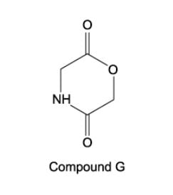

# Exam Questions — Organic Synthesis
**21 .Organic Synthesis** · Cambridge (CIE) A-LEVEL chemistry (9701)
> Source: [https://www.savemyexams.com/a-level/chemistry/cie/25/topic-questions/](https://www.savemyexams.com/a-level/chemistry/cie/25/topic-questions/) · 19 questions across 1 sets

## Multiple Choice Questions (19 questions)

### Q1 — easy — 1 marks

**Q1** [1 mark]

A compound **X** has the following properties:

- liquid at room temperature
- soluble in water
- reacts with cold aqueous sodium hydroxide

Which of the following could be compound **X**?

### Q2 — hard — 1 marks

**Q2** [1 mark]

Ibuprofen is an anti-inflammatory drug, the structure of which is shown below.

Which reaction leads to the formation of ibuprofen?

### Q3 — medium — 1 marks

**Q3** [1 mark]

In which reaction does a carbocation intermediate form?

### Q4 — medium — 1 marks

**Q4** [1 mark]

Sorbic acid is a natural organic compound which is used as a food preservative because it kills fungi. Sorbic acid reacts with bromine in an organic solvent and hydrogen in the presence of a nickel catalyst.

How many moles of bromine (in an organic solvent) and of hydrogen (in the presence of a Pt / Ni catalyst) will be incorporated into one mole of sorbic acid by these reactions?

|   | **Moles of bromine** | **Moles of hydrogen** |
|---|---|---|
| **A** | 2 | 2 |
| **B** | 2 | 3 |
| **C** | $\frac{1}{2}$ | 2 |
| **D** | 2$\frac{1}{2}$ | 3 |

### Q5 — hard — 1 marks

**Q5** [1 mark]

The cyclic compound G is heated with dilute hydrochloric acid.

Which of the following are the products of the reaction?

### Q6 — easy — 1 marks

**Q6** [1 mark]

Which reagent can be used to convert CH3CH2CO2CH3 into CH3CH2CO2CH2Cl?

### Q7 — hard — 1 marks

**Q7** [1 mark]

Compound M is used in leather processing.

Compound M is synthesised in the presence of concentrated sulfuric acid and heat.

Which other starting materials are required to synthesise compound M?

### Q8 — hard — 1 marks

**Q8** [1 mark]

Antipyrine is a drug used to reduce fever. The initial step of its synthesis is the reaction of phenylhydrazine with compound **X**.

Which of the following is product **Y**?

### Q9 — hard — 1 marks

**Q9** [1 mark]

The diagram shows the structure of the naturally-occurring molecule cholesterol.

Two separate test tubes of cholesterol are used in an experiment. One test tube of cholesterol is treated with cold, dilute acidified KMnO4, and the other is treated with hot, concentrated acidified KMnO4.

Which row correctly describes the change in the **number** of chiral carbon atoms in the molecule during each reaction and the structure of the product in each test tube?

|   | **Cold, dilute acidified KMnO****4** | **Hot, concentrated acidified KMnO****4** |   |   |
|---|---|---|---|---|
|   | Change in the number of chiral carbons | Number of hydroxy groups in product | Change in the number of chiral carbons | Number of 6-membered rings remaining in product |
| **A** | +1 | 1 | -1 | 3 |
| **B** | +1 | 1 | 0 | 2 |
| **C** | +2 | 3 | -1 | 2 |
| **D** | +2 | 3 | 0 | 3 |

### Q10 — medium — 1 marks

**Q10** [1 mark]

Pentanoic acid can be produced from 1-bromobutane using reagents Y and Z as shown below.

1-bromobutane  $\overset{\mathrm{reagent}Y}{\rightarrow}$  compound X  $\overset{\mathrm{reagent}Z}{\rightarrow}$  pentanoic acid

Which of the following could be reagents Y and Z?

|   | **Y** | **Z** |
|---|---|---|
| **A** | KCN in ethanol | HCl (aq) |
| **B** | KCN in ethanol | NaOH (aq) |
| **C** | NaOH (aq) | HCl (aq) |
| **D** | NH3 in ethanol | H+/Cr2O72- (aq) |

### Q11 — medium — 1 marks

**Q11** [1 mark]

An alkene is reacted with acidified manganate (VII) ions, MnO4- . The organic product has a relative molecular mass greater than that of the alkene by 34.

Which of the following are the correct conditions for this reaction?

### Q12 — hard — 1 marks

**Q12** [1 mark]

Mixture **F** is produced upon refluxing compound **G** with aqueous sodium hydroxide.

Upon distillation of mixture **F** with acidified potassium dichromate (VI), propanone is produced. Mixing compound **G** with aqueous silver nitrate and dilute nitric acid gives a cream precipitate.

Which of the following could be compound **G**?

### Q13 — easy — 1 marks

**Q13** [1 mark]

Tartaric acid (HO2CCH(OH)CH(OH)CO2H) can occur naturally, for example in wine, and may be synthesised in the laboratory.

The laboratory synthesis occurs in 2 steps:

OHCCHO  $\overset{\mathrm{step}1}{\rightarrow}$  intermediate  $\overset{\mathrm{step}2}{\rightarrow}$  HO2CCH(OH)CH(OH)CO2H

Which reagents could be used for this synthesis?

|   | **Step 1** | **Step 2** |
|---|---|---|
| **A** | HCl (aq) | HCN (g) |
| **B** | H2SO4 (aq) | K2Cr2O7 / H2SO4 (aq) |
| **C** | KCN (aq/alcoholic) | K2Cr2O7 / H2SO4 (aq) |
| **D** | HCN, NaCN (aq/alcoholic) | H2SO4 (aq) |

### Q14 — easy — 1 marks

**Q14** [1 mark]

This molecule is responsible for the flavour of spearmint chewing gum.

Which statement about functional groups **1** and **2** is correct?

### Q15 — medium — 1 marks

**Q15** [1 mark]

The naturally-occurring molecule civetone was one of the first known ingredients used in perfumery.

Which reagent will **not** react with civetone?

### Q16 — medium — 1 marks

**Q16** [1 mark]

Hept-4-enal, shown below, naturally occurs in cow's milk.

CH3CH2CH=CHCH2CH2CHO

Which organic product is formed when hept-4-enal is reduced with **either** hydrogen with a nickel catalyst **or** sodium borohydride?

### Q17 — easy — 1 marks

**Q17** [1 mark]

Which reaction produces a coloured organic compound?

### Q18 — easy — 1 marks

**Q18** [1 mark]

Lactic acid occurs naturally, for example in sour milk.

Which property does lactic acid have?

### Q19 — hard — 1 marks

**Q19** [1 mark]

Santonin is a drug that has been used to treat a worm infection.

When santonin is first treated with warm dilute H2SO4, product X is formed. If X is treated with cold acidified KMnO4, the final product Y is obtained.

How many atoms of hydrogen in each molecule of product Y could be displaced in a reaction with sodium metal?
