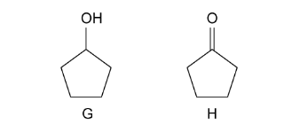
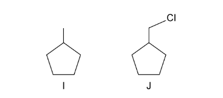
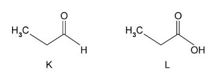
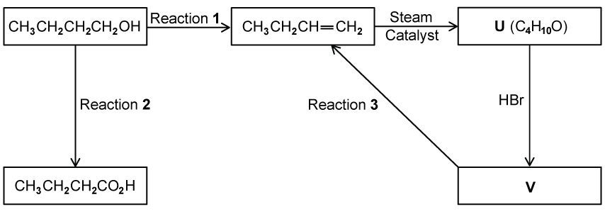
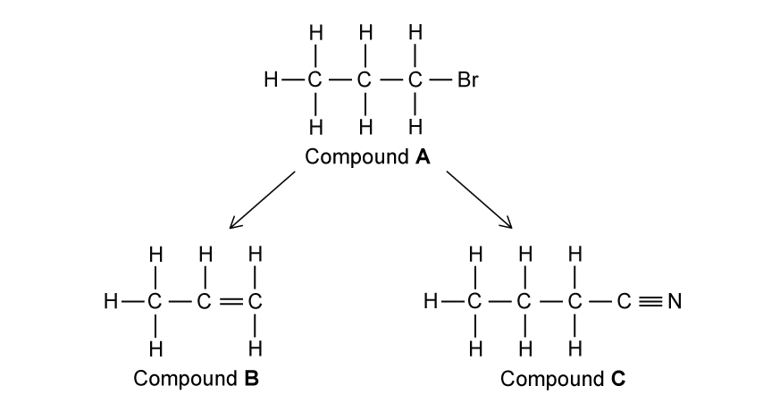
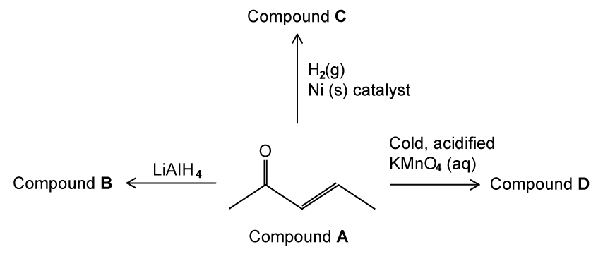

# Exam Questions — Organic Synthesis
**21 .Organic Synthesis** · Cambridge (CIE) A-LEVEL chemistry (9701)
> Source: [https://www.savemyexams.com/a-level/chemistry/cie/25/topic-questions/](https://www.savemyexams.com/a-level/chemistry/cie/25/topic-questions/) · 30 questions across 2 sets

## Multiple Choice Questions (19 questions)

### Q1 — easy — 1 marks

**Q1** [1 mark]

A compound **X** has the following properties:

- liquid at room temperature
- soluble in water
- reacts with cold aqueous sodium hydroxide

Which of the following could be compound **X**?

### Q2 — hard — 1 marks

**Q2** [1 mark]

Ibuprofen is an anti-inflammatory drug, the structure of which is shown below.

Which reaction leads to the formation of ibuprofen?

### Q3 — medium — 1 marks

**Q3** [1 mark]

In which reaction does a carbocation intermediate form?

### Q4 — medium — 1 marks

**Q4** [1 mark]

Sorbic acid is a natural organic compound which is used as a food preservative because it kills fungi. Sorbic acid reacts with bromine in an organic solvent and hydrogen in the presence of a nickel catalyst.

How many moles of bromine (in an organic solvent) and of hydrogen (in the presence of a Pt / Ni catalyst) will be incorporated into one mole of sorbic acid by these reactions?

|   | **Moles of bromine** | **Moles of hydrogen** |
|---|---|---|
| **A** | 2 | 2 |
| **B** | 2 | 3 |
| **C** | $\frac{1}{2}$ | 2 |
| **D** | 2$\frac{1}{2}$ | 3 |

### Q5 — hard — 1 marks

**Q5** [1 mark]

The cyclic compound G is heated with dilute hydrochloric acid.

Which of the following are the products of the reaction?

### Q6 — easy — 1 marks

**Q6** [1 mark]

Which reagent can be used to convert CH3CH2CO2CH3 into CH3CH2CO2CH2Cl?

### Q7 — hard — 1 marks

**Q7** [1 mark]

Compound M is used in leather processing.

Compound M is synthesised in the presence of concentrated sulfuric acid and heat.

Which other starting materials are required to synthesise compound M?

### Q8 — hard — 1 marks

**Q8** [1 mark]

Antipyrine is a drug used to reduce fever. The initial step of its synthesis is the reaction of phenylhydrazine with compound **X**.

Which of the following is product **Y**?

### Q9 — hard — 1 marks

**Q9** [1 mark]

The diagram shows the structure of the naturally-occurring molecule cholesterol.

Two separate test tubes of cholesterol are used in an experiment. One test tube of cholesterol is treated with cold, dilute acidified KMnO4, and the other is treated with hot, concentrated acidified KMnO4.

Which row correctly describes the change in the **number** of chiral carbon atoms in the molecule during each reaction and the structure of the product in each test tube?

|   | **Cold, dilute acidified KMnO****4** | **Hot, concentrated acidified KMnO****4** |   |   |
|---|---|---|---|---|
|   | Change in the number of chiral carbons | Number of hydroxy groups in product | Change in the number of chiral carbons | Number of 6-membered rings remaining in product |
| **A** | +1 | 1 | -1 | 3 |
| **B** | +1 | 1 | 0 | 2 |
| **C** | +2 | 3 | -1 | 2 |
| **D** | +2 | 3 | 0 | 3 |

### Q10 — medium — 1 marks

**Q10** [1 mark]

Pentanoic acid can be produced from 1-bromobutane using reagents Y and Z as shown below.

1-bromobutane  $\overset{\mathrm{reagent}Y}{\rightarrow}$  compound X  $\overset{\mathrm{reagent}Z}{\rightarrow}$  pentanoic acid

Which of the following could be reagents Y and Z?

|   | **Y** | **Z** |
|---|---|---|
| **A** | KCN in ethanol | HCl (aq) |
| **B** | KCN in ethanol | NaOH (aq) |
| **C** | NaOH (aq) | HCl (aq) |
| **D** | NH3 in ethanol | H+/Cr2O72- (aq) |

### Q11 — medium — 1 marks

**Q11** [1 mark]

An alkene is reacted with acidified manganate (VII) ions, MnO4- . The organic product has a relative molecular mass greater than that of the alkene by 34.

Which of the following are the correct conditions for this reaction?

### Q12 — hard — 1 marks

**Q12** [1 mark]

Mixture **F** is produced upon refluxing compound **G** with aqueous sodium hydroxide.

Upon distillation of mixture **F** with acidified potassium dichromate (VI), propanone is produced. Mixing compound **G** with aqueous silver nitrate and dilute nitric acid gives a cream precipitate.

Which of the following could be compound **G**?

### Q13 — easy — 1 marks

**Q13** [1 mark]

Tartaric acid (HO2CCH(OH)CH(OH)CO2H) can occur naturally, for example in wine, and may be synthesised in the laboratory.

The laboratory synthesis occurs in 2 steps:

OHCCHO  $\overset{\mathrm{step}1}{\rightarrow}$  intermediate  $\overset{\mathrm{step}2}{\rightarrow}$  HO2CCH(OH)CH(OH)CO2H

Which reagents could be used for this synthesis?

|   | **Step 1** | **Step 2** |
|---|---|---|
| **A** | HCl (aq) | HCN (g) |
| **B** | H2SO4 (aq) | K2Cr2O7 / H2SO4 (aq) |
| **C** | KCN (aq/alcoholic) | K2Cr2O7 / H2SO4 (aq) |
| **D** | HCN, NaCN (aq/alcoholic) | H2SO4 (aq) |

### Q14 — easy — 1 marks

**Q14** [1 mark]

This molecule is responsible for the flavour of spearmint chewing gum.

Which statement about functional groups **1** and **2** is correct?

### Q15 — medium — 1 marks

**Q15** [1 mark]

The naturally-occurring molecule civetone was one of the first known ingredients used in perfumery.

Which reagent will **not** react with civetone?

### Q16 — medium — 1 marks

**Q16** [1 mark]

Hept-4-enal, shown below, naturally occurs in cow's milk.

CH3CH2CH=CHCH2CH2CHO

Which organic product is formed when hept-4-enal is reduced with **either** hydrogen with a nickel catalyst **or** sodium borohydride?

### Q17 — easy — 1 marks

**Q17** [1 mark]

Which reaction produces a coloured organic compound?

### Q18 — easy — 1 marks

**Q18** [1 mark]

Lactic acid occurs naturally, for example in sour milk.

Which property does lactic acid have?

### Q19 — hard — 1 marks

**Q19** [1 mark]

Santonin is a drug that has been used to treat a worm infection.

When santonin is first treated with warm dilute H2SO4, product X is formed. If X is treated with cold acidified KMnO4, the final product Y is obtained.

How many atoms of hydrogen in each molecule of product Y could be displaced in a reaction with sodium metal?

## Structured Questions (11 questions)

### Q1 — medium — 16 marks

**Q1** [3 marks]

The following reaction pathway in Fig. 5.1 is used to produce compounds **A** and **B**, which when reacted together, form a branched ester molecule, compound **C**.

State the reagents and conditions for the synthesis of compound **A** via step **1** and state the type of reaction.

**Fig. 5.1**

reagents and conditions

......................................................................................................................

type of reaction

......................................................................................................................

**Q1** [4 marks]

**Extract:**

The following reaction pathway in Fig. 5.1 is used to produce compounds **A** and **B**, which when reacted together, form a branched ester molecule, compound **C**.

{align=center} **Fig. 5.1**

In order for the ester to be produced, the ketone shown in Fig. 5.1 must be converted to another compound, **B**.

i) State the systematic name and draw the fully displayed formula of compound **B** that is produced from step **2**.

[2]

ii) State the type of reaction involved in step **2** and state the reagents and conditions required.

[2]

**Q1** [6 marks]

Outline how ethanol can be synthesised from ethane in **two** steps. State the reagents, conditions and type of reaction for each step.

**Step 1** (ethane to intermediate)

reagents and conditions

......................................................................................................................

type of reaction

......................................................................................................................

**Step 2** (intermediate to ethanol)

reagents and conditions

......................................................................................................................

type of reaction

......................................................................................................................

**Q1** [3 marks]

The four-step synthesis shown in Fig. 5.2 produces propan-1-ol from a ketone.

**Fig. 5.2**

i) State the systematic name of compound **D**.

[1]

ii) State the reagents and conditions required for step **4**.

[2]

### Q2 — medium — 10 marks

**Q2** [3 marks]

But-2-ene can be converted into butan-2-ol by two different synthetic routes. One route is a one-step process and the other is a two-step process.

State the reagents and conditions required for the one-step process. Construct an equation for this reaction using structural formulae.

reagents and conditions

......................................................................................................................

equation

......................................................................................................................

**Q2** [3 marks]

**Extract:**

But-2-ene can be converted into butan-2-ol by two different synthetic routes. One route is a one-step process and the other is a two-step process.

For the two-step process, identify the intermediate organic compound and state the reagents and conditions required for each step.

intermediate

......................................................................................................................

step 1 reagents and conditions

......................................................................................................................

step 2 reagents and conditions

......................................................................................................................

**Q2** [2 marks]

**Extract:**

But-2-ene can be converted into butan-2-ol by two different synthetic routes. One route is a one-step process and the other is a two-step process.

One-step process (hydration):
- Reagents: Steam / water vapour / H₂O (g)
- Conditions: Concentrated phosphoric acid / H₃PO₄ catalyst OR Concentrated sulfuric acid / H₂SO₄ catalyst

Two-step process:
- Intermediate: 2-bromobutane
- Step 1 reagent: hydrogen bromide / HBr
- Step 2 reagent: aqueous sodium hydroxide / NaOH (aq) AND heat under reflux OR Aqueous potassium hydroxide / KOH (aq) AND heat under reflux

But-1-ene can also be used to form butan-2-ol by both the one-step and two-step reaction routes.

Explain why using but-1-ene gives a lower yield of butan-2-ol compared to using but-2-ene.

**Q2** [2 marks]

Draw the fully displayed formula of the organic product(s) formed when but-2-ene is:

- reacted with cold dilute acidified KMnO4
- reacted with hot concentrated acidified KMnO4

### Q3 — easy — 6 marks

**Q3** [2 marks]

Describe one simple test-tube reaction that allows you to distinguish between compounds **G** and **H** shown in Fig. 2.1.

**Fig. 2.1**

**Q3** [2 marks]

Describe one simple test-tube reaction that allows you to distinguish between compounds **I** and **J**, shown in Fig. 2.2.

**Fig. 2.2**

**Q3** [2 marks]

Describe one simple test-tube reaction that allows you to distinguish between compounds **K** and **L**, shown in Fig. 2.3.

**Fig. 2.3**

### Q4 — medium — 9 marks

**Q4** [2 marks]

A series of reactions based on butan-1-ol is shown in Fig. 2.1.

**Fig. 2.1**

State the reagent and conditions required for reaction 1.

reagent

......................................................................................................................

conditions

......................................................................................................................

**Q4** [3 marks]

**Extract:**

A series of reactions based on butan-1-ol is shown in Fig. 2.1.

**Fig. 2.1**

i) Construct an equation for reaction **2**. Use [O] to represent one atom of oxygen from an oxidising agent.

[1]

ii) State the reagents and conditions required for reaction **2**.

[2]

**Q4** [2 marks]

**Extract:**

A series of reactions based on butan-1-ol is shown in Fig. 2.1.

butan-1-ol converting to but-1-ene via reaction 1, to butanoic acid via reaction 2, and further reactions producing compounds U and V

Draw the structural formulae of compounds **U** and **V**.

**U** ......................................................................................................................

**V** ......................................................................................................................

**Q4** [2 marks]

**Extract:**

A series of reactions based on butan-1-ol is shown in Fig. 2.1.

**Fig. 2.1**

State the reagent and conditions required for reaction **3**.

reagent

......................................................................................................................

conditions

......................................................................................................................

### Q5 — easy — 10 marks

**Q5** [6 marks]

A reaction pathway is shown in Fig. 3.1.

**Fig. 3.1**

State the reagents and conditions required for the conversion of:

i) compound **A** to compound **B**

[3]

ii) compound **A** to compound **C**

[3]

**Q5** [1 mark]

**Extract:**

A reaction pathway is shown in Fig. 3.1.

**Fig. 3.1**

State the systematic name of compound **C** shown in Fig. 3.1 in part **(a)**.

**Q5** [3 marks]

**Extract:**

A reaction pathway is shown in Fig. 3.1.

Compound A (1-bromopropane) converting to propene (compound B) via elimination, and to butanenitrile (compound C) via nucleophilic substitution

i) Compound **B** reacts with cold dilute acidified potassium manganate(VII) to form compound **D**. Draw the skeletal formula of compound **D**.

| Compound **D** |
|---|
|   |

[1]

ii) Compound **B** also reacts with hot concentrated acidified potassium manganate(VII) to form compounds **E** and **F**. Draw the skeletal formulae of compounds **E** and **F**.

| Compound **E** | Compound **F** |
|---|---|
|   |   |

[2]

### Q6 — medium — 12 marks

**Q6** [2 marks]

The reaction scheme shows three steps to synthesise 2-hydroxy-2-methylpropanenitrile.

propene $\overset{\mathrm{reaction}1}{\rightarrow}$ propan-2-ol $\overset{\mathrm{reaction}2}{\rightarrow}$ compound **G** $\overset{\mathrm{reaction}3}{\rightarrow}$ 2-hydroxy-2-methylpropanenitrile

Name the mechanism for reaction **1** and reaction **3**.

reaction **1**

......................................................................................................................

reaction **3**

......................................................................................................................

**Q6** [4 marks]

**Extract:**

The reaction scheme shows three steps to synthesise 2-hydroxy-2-methylpropanenitrile.

propene → propan-2-ol → compound G → 2-hydroxy-2-methylpropanenitrile

(reaction 1: propene → propan-2-ol, reaction 2: propan-2-ol → compound G, reaction 3: compound G → 2-hydroxy-2-methylpropanenitrile)

State the reagents and conditions required for reaction **1** and reaction **2**.

reaction **1**:

reaction **2**:

**Q6** [4 marks]

**Extract:**

The reaction scheme shows three steps to synthesise 2-hydroxy-2-methylpropanenitrile.

propene → propan-2-ol → compound G → 2-hydroxy-2-methylpropanenitrile

reaction 1: electrophilic addition
reaction 3: nucleophilic addition

Complete the diagram to show the mechanism for reaction **3**. Include charges, dipoles, lone pairs of electrons and curly arrows, as appropriate. Draw the structure of the organic intermediate.

**Q6** [2 marks]

Explain why 2-hydroxy-2-methylpropanenitrile does not exhibit optical isomerism.

### Q7 — easy — 5 marks

**Q7** [2 marks]

Butan-1-ol can be converted directly into 1-bromobutane.

State the reagents and conditions required for this conversion.

**Q7** [2 marks]

Butan-1-ol is heated with concentrated sulfuric acid.

State the type of reaction involved and state the systematic name of the alkene formed.

**Q7** [1 mark]

**Extract:**

Butan-1-ol is heated with concentrated sulfuric acid.

State the type of reaction involved and state the systematic name of the alkene formed.

The type of reaction and the systematic name of the alkene formed are:
- Elimination / dehydration
- But-1-ene

The alkene formed in part **(b)** reacts with hydrogen bromide.

State the systematic name of the major organic product formed.

### Q8 — hard — 8 marks

**Q8** [2 marks]

Compounds **W**, **X**, **Y** and **Z** contain carbon, hydrogen and oxygen only. Compounds **X** and **Y** are unbranched molecules, each containing five carbon atoms. **X** reacts with **Y** in the presence of an acid catalyst to form **W** and a by-product, **Z**. **X** can be oxidised by heating with acidified potassium dichromate(VI) to give **Y**.

2.754 g of compound **Y** contains 0.0270 mol.

Calculate the relative molecular mass of compound **Y** and use this to state its systematic name.

**Q8** [2 marks]

**Extract:**

Compounds **W**, **X**, **Y** and **Z** contain carbon, hydrogen and oxygen only. Compounds **X** and **Y** are unbranched molecules, each containing five carbon atoms. **X** reacts with **Y** in the presence of an acid catalyst to form **W** and a by-product, **Z**. **X** can be oxidised by heating with acidified potassium dichromate(VI) to give **Y**.

Draw the structural formula of compound **W** and identify by-product **Z**.

**Q8** [2 marks]

**Extract:**

Compounds **W**, **X**, **Y** and **Z** contain carbon, hydrogen and oxygen only. Compounds **X** and **Y** are unbranched molecules, each containing five carbon atoms. **X** reacts with **Y** in the presence of an acid catalyst to form **W** and a by-product, **Z**. **X** can be oxidised by heating with acidified potassium dichromate(VI) to give **Y**.

By altering the reaction conditions, the oxidation of compound **X** can be stopped before compound **Y** is produced.

Identify the homologous series of the organic compound produced at this intermediate stage and state the conditions required to favour its formation.

**Q8** [2 marks]

**Extract:**

Compounds **W**, **X**, **Y** and **Z** contain carbon, hydrogen and oxygen only. Compounds **X** and **Y** are unbranched molecules, each containing five carbon atoms. **X** reacts with **Y** in the presence of an acid catalyst to form **W** and a by-product, **Z**. **X** can be oxidised by heating with acidified potassium dichromate(VI) to give **Y**.

Compound **X** is a primary alcohol (pentan-1-ol), which oxidises fully to the carboxylic acid (compound **Y**).

Draw the skeletal formula of a structural isomer of compound **X** that does not react with acidified potassium dichromate(VI), H+/K2Cr2O7, and state its systematic name.

### Q9 — hard — 7 marks

**Q9** [2 marks]

A reaction scheme starting from 1-chlorobutane is shown in Fig. 2.1.

1-chlorobutane $\overset{\mathrm{Step}1}{\rightarrow}$ compound **G** `-> from K _ 2 Cr _ 2 O _ 7 / H _ 2 SO _ 4 to Step 2 of` compound **H**

**Fig. 2.1**

State the type of reaction for each of step 1 and step 2.

**Q9** [1 mark]

**Extract:**

A reaction scheme starting from 1-chlorobutane is shown in Fig. 2.1.

1-chlorobutane \$\$\overset{Step 1}{\rightarrow}\$\$ compound **G** \$\$\rightarrow_{K_{2} Cr_{2} O_{7} / H_{2} SO_{4}}^{Step 2}\$\$ compound **H**

**Fig. 2.1**

Step 2 is carried out by heating under reflux.

State the systematic name of compound **H**.

**Q9** [2 marks]

1-chlorobutane can be produced as the minor product when an unbranched alkene reacts with hydrogen chloride.

Draw the skeletal formula of this alkene and state the reagent required.

**Q9** [2 marks]

**Extract:**

A reaction scheme starting from 1-chlorobutane is shown in Fig. 2.1.

1-chlorobutane → (Step 1) → compound **G** → (Step 2, K₂Cr₂O₇/H₂SO₄) → compound **H**

**Fig. 2.1**

The systematic name of compound **H** is butanoic acid.

2-chlorobutane can be used instead of 1-chlorobutane as the starting compound in the reaction scheme in Fig. 2.1.

Identify the homologous series of the final organic compound formed and explain why this is different from compound **H**.

### Q10 — medium — 7 marks

**Q10** [3 marks]

Some reactions of compound **A** are shown in Fig. 3.1.

**Fig. 3.1**

Draw the skeletal formulae of compounds **B**, **C** and **D** in the table below.

| Compound** B** | Compound **C** | Compound **D** |
|---|---|---|
|   |   |   |

**Q10** [1 mark]

**Extract:**

Some reactions of compound A are shown in Fig. 3.1.

Compound A (a molecule containing both a C=O and a C=C group) undergoes three reactions: LiAlH4 to give compound B, H2 with Ni catalyst to give compound C, and cold dilute acidified KMnO4 to give compound D

State the colour change observed during the reaction to form compound **D**.

from ....................................... to .......................................

**Q10** [2 marks]

**Extract:**

Some reactions of compound A are shown in Fig. 3.1.

Compound A is a molecule containing both a C=O and a C=C group.

Compound **A** reacts with alkaline I2 (aq) to form a yellow precipitate and an organic ion.

Identify the yellow precipitate and draw the skeletal formula of the organic ion.

identity of yellow precipitate

......................................................................................................................

skeletal formula of organic ion

**Q10** [1 mark]

**Extract:**

Some reactions of compound **A** are shown in Fig. 3.1.

compound A (a molecule containing both a C=O and a C=C group)

State the systematic name of compound **A**.

### Q11 — hard — 10 marks

**Q11** [5 marks]

1-bromo-1-methylcyclohexane can be produced by the following reaction steps, as shown in Fig. 1.1.

compound **D** $\overset{\mathrm{step}1}{\rightarrow}$ compound **E** $\overset{\mathrm{HBr}}{\rightarrow}$ 1-bromo-1-methylcyclohexane

**Fig. 1.1**

i) Name the mechanism for the reaction between compound **E** and hydrogen bromide.

[1]

ii) Complete the diagram to show the mechanism for this reaction. Include charges, dipoles, lone pairs of electrons and curly arrows, as appropriate. Draw the structures of the organic intermediate and the major organic product.

[4]

**Q11** [2 marks]

**Extract:**

1-bromo-1-methylcyclohexane can be produced by the following reaction steps, as shown in Fig. 1.1.

compound **D** → compound **E** → 1-bromo-1-methylcyclohexane (with HBr)

i) Name the mechanism for the reaction between compound **E** and hydrogen bromide.

ii) Complete the diagram to show the mechanism for this reaction. Include charges, dipoles, lone pairs of electrons and curly arrows, as appropriate. Draw the structures of the organic intermediate and the major organic product.

The name of the mechanism is: Electrophilic addition

The methyl substituent on compound **E** (1-methylcyclohexene) means the addition of H-Br can generate either a tertiary or a secondary carbocation intermediate. The major product forms via the more stable carbocation.

Explain why a major product and a minor product are produced in the reaction outlined in part **(a)**.

**Q11** [3 marks]

**Extract:**

1-bromo-1-methylcyclohexane can be produced by the following reaction steps, as shown in Fig. 1.1.

compound **D** → (step 1) → compound **E** → (HBr) → 1-bromo-1-methylcyclohexane

**Fig. 1.1**

Compound **E** can be synthesised from compound **D** in step 1.

i) Draw the skeletal formula of a possible structure for compound **D**.

[1]

ii) State the reagents and conditions required for step 1, based on your suggested structure for compound **D**.

[2]
