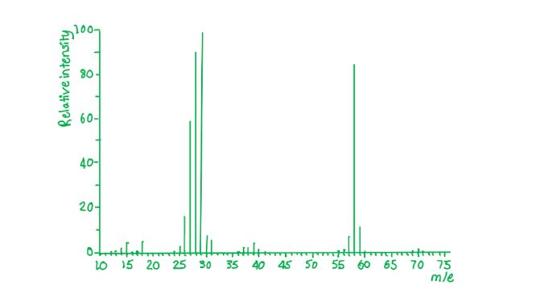
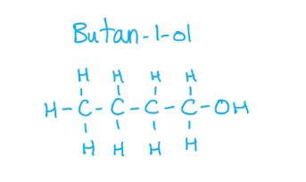
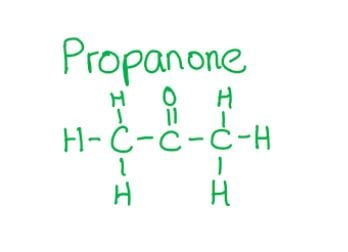
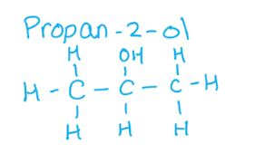
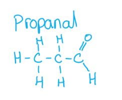

# Mark Schemes — Infrared Spectroscopy
**22. Analytical Techniques** · Cambridge (CIE) A-LEVEL chemistry (9701)

## Multiple Choice Questions (9 questions)

### Q1
**Final answer:** **The correct answer is B**

- The spectrum shows an absorption at 3200–3600 cm-1, characteristic of the O-H bond in an alcohol.
- The spectrum also shows an absorption at approximately 1700–1740 cm-1, characteristic of a C=O (carbonyl) bond in a ketone or aldehyde.
- The compound contains both an alcohol O-H and a ketone C=O; the O-H of a carboxylic acid absorbs at 2500–3000 cm-1, which is not observed here.

**A** is incorrect as butanoic acid is a carboxylic acid whose O-H absorption appears at 2500–3000 cm-1, not at 3200–3600 cm-1 as shown in the spectrum.

**C** is incorrect as pent-4-en-1-ol contains a C=C bond that would produce a characteristic absorption at 1500–1680 cm-1, which is absent in this spectrum.

**D** is incorrect as pent-4-en-2-one does not contain an O-H bond, but the spectrum shows an O-H absorption at 3200–3600 cm-1.

> **[exam-tip]**
> Note the position of the O-H absorption carefully:
> 
> - In alcohols it appears at 3200–3600 cm-1
> - In carboxylic acids it is a broader absorption at 2500–3000 cm-1.
> 
> A common error is to label the C-H absorption (2850–2950 cm-1) as O-H.

### Q2
**Final answer:** **The correct answer is D**

- The molecular ion peak (M+) is the peak with the highest *m/e* ratio, excluding any peaks due to heavier isotopes.

- Both propanal and propanone have the molecular formula C3H6O and so both have a molecular ion peak at *m/e* = 58.

- Propanal arises from the CH3CH2CHO+ ion.
- Propanone arises from the CH3COCH3+ ion.

- Propanal mass spectrum.

- Propanone mass spectrum.

**A** is incorrect as propanal and propanone do have a different fingerprint region in the infrared spectrum.

**B** is incorrect as both compounds show absorption in the infrared spectrum due to the C=O bond.

**C** is incorrect as propanal and propanone do have different fragmentation patterns in the mass spectrum.

### Q3
**Final answer:** **The correct answer is A**

- The absorption between 1670 and 1740 cm-1 is characteristic of the C=O (carbonyl) bond, found in aldehydes, ketones, and carboxylic acids.
- Alcohols do not contain a C=O bond; the characteristic absorption of an alcohol is the O-H bond at 3200–3550 cm-1.

**B** is incorrect as aldehydes contain a C=O bond, which produces the characteristic absorption between 1670 and 1740 cm-1.

**C** is incorrect as carboxylic acids contain a C=O bond as part of the carboxyl group, which absorbs between 1670 and 1740 cm-1.

**D** is incorrect as ketones contain a C=O bond, which produces the characteristic absorption between 1670 and 1740 cm-1.

> **[exam-tip]**
> The three key infrared absorptions to learn for CIE IAL Chemistry are:
> 
> - O-H (alcohol): 3230–3550 cm-1.
> - C=O (aldehyde, ketone, carboxylic acid): 1670–1740 cm-1.
> - O-H (carboxylic acid, broad): 2500–3000 cm-1.

### Q4
**Final answer:** **The correct answer is A**

- A carboxylic acid shows a broad O-H absorption from 2500 to 3000 cm-1, caused by hydrogen bonding of the carboxyl O-H group, in addition to a strong C=O absorption at approximately 1700 cm-1.

**B** is incorrect as this is the IR spectrum of an alcohol, identified by the sharp O-H absorption at 3200–3600 cm-1 with no C=O absorption present.

**C** is incorrect as this is the IR spectrum of an ester, showing a strong C=O absorption between 1710 and 1750 cm-1 with no O-H absorption.

**D** is incorrect as this is the IR spectrum of a ketone, identified by the strong C=O absorption at approximately 1710 cm-1 with no O-H absorption.

### Q5
**Final answer:** **The correct answer is B**

- Infrared spectroscopy measures the absorption of infrared radiation by molecules, which is used to identify functional groups based on the bond strength and mass of the atoms involved.
- It is not used to determine the molecular mass.

  - A mass spectrometer is used for this.

**A** is incorrect as the identity of a compound can be determined by comparing its infrared spectrum with reference spectra.

**C** is incorrect as the presence of C=O bonds can be detected from the infrared spectrum.

**D** is incorrect as the presence of O-H bonds can be detected from the infrared spectrum.

### Q6
**Final answer:** **The correct answer is C**

- The spectrum shows a strong absorption between 1670 and 1740 cm-1, characteristic of a C=O (carbonyl) bond in an aldehyde.
- C-H absorptions are visible at 2850–2950 cm-1 (alkyl C-H) and at approximately 2700–2820 cm-1 (the characteristic aldehyde C-H doublet).
- Butanal is an aldehyde and contains a C=O group consistent with the spectrum.

**A** is incorrect as 1-bromobutane contains no C=O bond and would show no absorption at approximately 1700 cm-1.

**B** is incorrect as butan-1-ol would show a strong O-H absorption at 3200–3600 cm-1 due to the hydroxyl group, with no C=O absorption at approximately 1700 cm-1.

**D** is incorrect as butanoic acid would show a broad O-H absorption at 2500–3000 cm-1 due to the carboxyl group, in addition to the C=O absorption.

### Q7
**Final answer:** **The correct answer is C**

- Butanal contains a C=O (carbonyl) group, which gives the characteristic absorption between 1670 and 1740 cm-1.

**A** is incorrect as there is no absorption at 1500–1680 cm-1 due to C=C, therefore the compound cannot be but-1-ene.

**B** is incorrect as there is no absorption at 3200–3600 cm-1 due to O-H (alcohol), therefore the compound cannot be butan-1-ol.

**D** is incorrect as there is no absorption at 2500–3000 cm-1 due to O-H (acid), therefore the compound cannot be butanoic acid.

### Q8
**Final answer:** **The correct answer is C**

- A carboxylic acid shows two key absorptions in the infrared spectrum:
- The C=O bond absorbs at 1670–1740 cm-1.
- The O-H bond in carboxylic acids produces a broad absorption at 2500–3000 cm-1.

**A** is incorrect as an alcohol would only show an O-H absorption at 3200–3600 cm-1 and not the broad O-H absorption at 2500–3000 cm-1 characteristic of a carboxylic acid.

**B** is incorrect as an aldehyde would only show a C=O absorption at 1670–1740 cm-1 and not the broad O-H absorption at 2500–3000 cm-1.

**D** is incorrect as a ketone would only show a C=O absorption at 1670–1740 cm-1 and not the broad O-H absorption at 2500–3000 cm-1.

### Q9
**Final answer:** **The correct answer is D**

- The infrared spectrum has a strong absorption at approximately 1700 cm-1.
- This matches the C=O absorption of propanone in the range 1670–1740 cm-1.
- Propanone contains a ketone C=O group, consistent with this absorption.

**A** is incorrect as propan-1-ol would not show an absorption at approximately 1700 cm-1 but would show an O-H absorption at 3200–3600 cm-1 due to the hydroxyl group.

**B** is incorrect as propan-2-ol would not show an absorption at approximately 1700 cm-1 but would show an O-H absorption at 3200–3600 cm-1 due to the hydroxyl group.

**C** is incorrect as propanal would show a C=O absorption at approximately 1700 cm-1, but also shows characteristic aldehyde C-H absorptions at 2700–2775 cm-1 and 2820–2900 cm-1, which are absent in this spectrum.

