# Exam Questions — Infrared Spectroscopy
**22. Analytical Techniques** · Cambridge (CIE) A-LEVEL chemistry (9701)
> Source: [https://www.savemyexams.com/a-level/chemistry/cie/25/topic-questions/](https://www.savemyexams.com/a-level/chemistry/cie/25/topic-questions/) · 16 questions across 2 sets

## Multiple Choice Questions (9 questions)

### Q1 — hard — 1 marks

**Q1** [1 mark]

The infrared spectrum below shows an unknown compound.

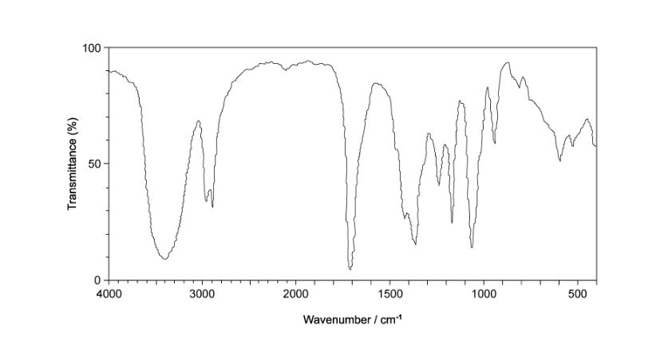

Which compound could have produced the infrared spectrum?

### Q2 — easy — 1 marks

**Q2** [1 mark]

Which of the following statements about propanal, CH3CH2CHO, and propanone, CH3COCH3, is **not** correct?

### Q3 — medium — 1 marks

**Q3** [1 mark]

Which class of compound does **not** contain the functional group responsible for the strong absorption between 1670 cm-1 and 1740 cm-1?

### Q4 — hard — 1 marks

**Q4** [1 mark]

Which of the following infrared spectra could show a carboxylic acid?

### Q5 — easy — 1 marks

**Q5** [1 mark]

Which of the following **cannot** be obtained from an infrared spectrum?

### Q6 — hard — 1 marks

**Q6** [1 mark]

The infrared spectrum below shows an unknown compound.

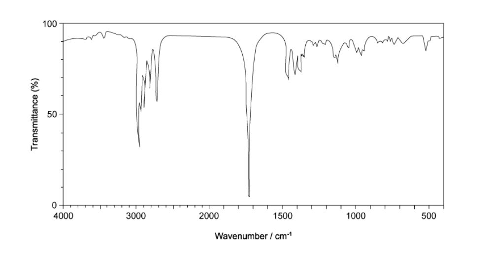

Which compound would give this spectrum?

### Q7 — medium — 1 marks

**Q7** [1 mark]

The infrared spectrum of a compound is shown below.

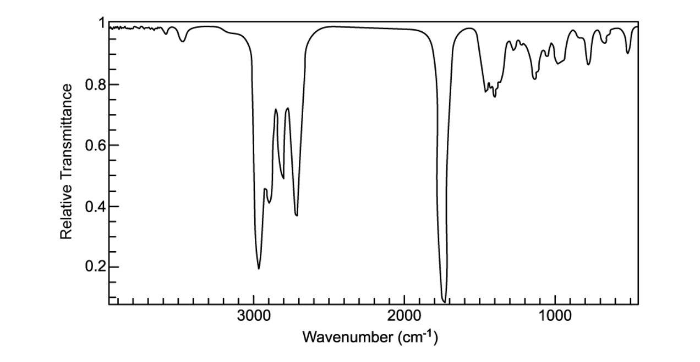

Which compound is shown by the infrared spectrum?

### Q8 — easy — 1 marks

**Q8** [1 mark]

Which type of organic compound could have produced the infrared spectrum shown?

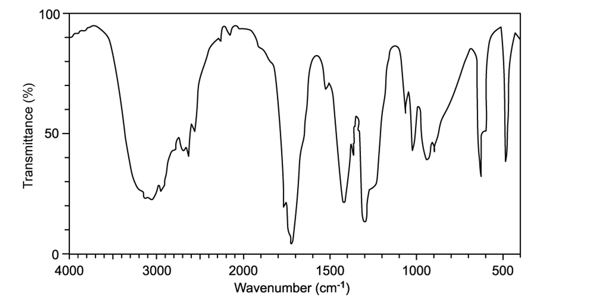

### Q9 — medium — 1 marks

**Q9** [1 mark]

The infrared spectrum of a compound is shown below.

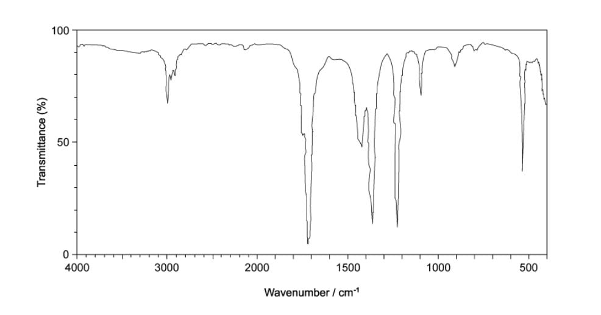

Which compound is shown by the infrared spectrum?

## Structured Questions (7 questions)

### Q1 — hard — 11 marks

**Q1** [2 marks]

Alcohol **A** can be prepared by hydrolysing the halogenoalkane C2H5CHBrCH3 with aqueous sodium hydroxide. The melting and boiling point information of alcohol **A** and C2H5CHBrCH3 are given in Table 1.1.

**Table 1.1**

|   | **melting point / K** | **boiling point / K** |
|---|---|---|
| alcohol **A** | 158 | 373 |
| C2H5CHBrCH3 | 161 | 364 |

Construct an equation for the hydrolysis of C2H5CHBrCH3 with aqueous sodium hydroxide. Include state symbols in your answer.

**Q1** [3 marks]

**Extract:**

Alcohol **A** can be prepared by hydrolysing the halogenoalkane C~2~H~5~CHBrCH~3~ with aqueous sodium hydroxide. The melting and boiling point information of alcohol **A** and C~2~H~5~CHBrCH~3~ are given in Table 1.1.

**Table 1.1**

|   | **melting point / K** | **boiling point / K** |
| --- | :---: | :---: |
| alcohol **A** | 158 | 373 |
| C~2~H~5~CHBrCH~3~ | 161 | 364 |

Using the information in Table 1.1, explain how alcohol **A** can be separated from the products identified in part **(a)**.

**Q1** [2 marks]

**Extract:**

Alcohol **A** can be prepared by hydrolysing the halogenoalkane C~2~H~5~CHBrCH~3~ with aqueous sodium hydroxide.

The equation for the hydrolysis of C~2~H~5~CHBrCH~3~ with aqueous sodium hydroxide is:

C~2~H~5~CHBrCH~3~ (l) + NaOH (aq) → C~2~H~5~CHOHCH~3~ (l) + NaBr (aq)

Describe **two** chemical tests and their expected observations to confirm the identity of the inorganic product of the reaction in part **(a)**. Use one test for each ion.

**Q1** [3 marks]

**Extract:**

Alcohol **A** can be prepared by hydrolysing the halogenoalkane C2H5CHBrCH3 with aqueous sodium hydroxide.

The equation for the hydrolysis of C2H5CHBrCH3 with aqueous sodium hydroxide is:

C2H5CHBrCH3 (l) + NaOH (aq) → C2H5CHOHCH3 (l) + NaBr (aq)

The infrared spectrum of C2H5CHBrCH3 is shown in Fig. 1.1 with the C–Br bond absorption labelled.

**Fig. 1.1**

Use Table 1.2 to identify **three** differences between the infrared spectrum of C2H5CHBrCH3 and that of alcohol **A**. In your answer, identify the bonds responsible for the relevant absorptions.

**Table 1.2**

| **Bond ** | **Functional groups containing** **the bond** | **Characteristic infrared absorption range (in wavenumber) / cm****–1** |
|---|---|---|
| C−O | hydroxy, ester | 1040 – 1300 |
| C=C | aromatic compound, alkene | 1500 – 1680 |
| C=O | amide  carbonyl, carboxyl  ester | 1640 – 1690 1670 – 1740 1710 – 1750 |
| C≡N | nitrile | 2200 – 2250 |
| C−H | alkane | 2850 – 2950 |
| N−H | amine, amide | 3300 – 3500 |
| O−H | carboxyl  hydroxy | 2500 – 3000 3200 – 3600 |

**Q1** [1 mark]

The mass spectrum of (CH3)2CHCH2OH is shown in Fig. 1.2.

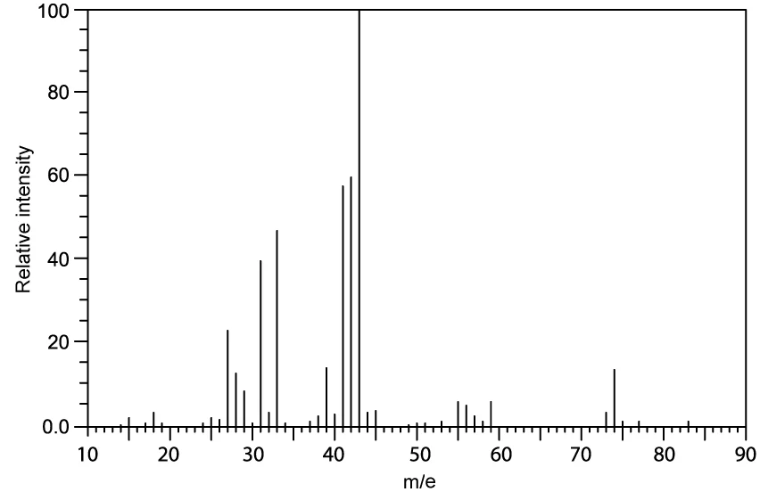

**Fig. 1.2**

Deduce the formula of the fragment ion responsible for the peak with the greatest relative abundance.

### Q2 — hard — 8 marks

**Q2** [3 marks]

Unknown organic compound **C** is analysed by mass spectrometry and infrared spectroscopy. The mass spectrum is shown in Fig. 2.1 and the infrared spectrum is shown in Fig. 2.2.

**Fig. 2.1**

**Fig. 2.2**

Deduce **one** possible identity for compound **C**. Explain your answer.

In your answer, use the molecular ion peak at *m* / *e* = 55, relevant infrared absorptions in the region **above** 1500 cm-1 and Table 2.1.

**Table 2.1**

| **Bond ** | **Functional groups containing** **the bond** | **Characteristic infrared absorption range (in wavenumber) / cm****–1** |
|---|---|---|
| C−O | hydroxy, ester | 1040 – 1300 |
| C=C | aromatic compound, alkene | 1500 – 1680 |
| C=O | amide  carbonyl, carboxyl  ester | 1640 – 1690 1670 – 1740 1710 – 1750 |
| C≡N | nitrile | 2200 – 2250 |
| C−H | alkane | 2850 – 2950 |
| N−H | amine, amide | 3300 – 3500 |
| O−H | carboxyl  hydroxy | 2500 – 3000 3200 – 3600 |

**Q2** [1 mark]

The mass spectrum of compound **C** shows an M+1 peak at *m* / *e* = 56.

Identify the isotope responsible for the M+1 peak.

**Q2** [2 marks]

**Extract:**

Unknown organic compound **C** is analysed by mass spectrometry and infrared spectroscopy. The mass spectrum is shown in Fig. 2.1 and the infrared spectrum is shown in Fig. 2.2.

Deduce **one** possible identity for compound **C**. Explain your answer.

In your answer, use the molecular ion peak at *m* / *e* = 55, relevant infrared absorptions in the region **above** 1500 cm^-1^ and Table 2.1.

One possible identity of compound **C** is propanenitrile / propionitrile / C~2~H~5~CN (molecular formula C~3~H~5~N, *M*~r~ = 55).

Calculate the percentage by mass of each element in compound **C**.

Give your answers to 3 significant figures.

**Q2** [2 marks]

**Extract:**

Unknown organic compound **C** is analysed by mass spectrometry and infrared spectroscopy. The mass spectrum is shown in Fig. 2.1 and the infrared spectrum is shown in Fig. 2.2.

Deduce **one** possible identity for compound **C**. Explain your answer.

In your answer, use the molecular ion peak at *m* / *e* = 55, relevant infrared absorptions in the region **above** 1500 cm^-1^ and Table 2.1.

**Table 2.1**

| **Bond ** | **Functional groups containing the bond** | **Characteristic infrared absorption range (in wavenumber) / cm**^**–1**^ |
| :---: | :---: | :---: |
| C−O | hydroxy, ester | 1040 – 1300 |
| C=C | aromatic compound, alkene | 1500 – 1680 |
| C=O | amide carbonyl, carboxyl ester | 1640 – 1690 1670 – 1740 1710 – 1750 |
| C≡N | nitrile | 2200 – 2250 |
| C−H | alkane | 2850 – 2950 |
| N−H | amine, amide | 3300 – 3500 |
| O−H | carboxyl hydroxy | 2500 – 3000 3200 – 3600 |

One possible identity of compound **C** is: Propanenitrile / propionitrile / C~2~H~5~CN. The infrared spectrum shows an absorption at around 2250 cm^-1^ which corresponds to a C≡N (nitrile) group.

Compound **C** undergoes a reaction to form compound **D**. The IR spectrum of compound **D** is shown in Fig. 2.3.

**Fig. 2.3**

State the reagents and conditions required for this reaction. In your answer, use Table 2.1 and identify any relevant absorptions in the infrared spectrum to justify your answer.

### Q3 — medium — 5 marks

**Q3** [2 marks]

Explain how infrared spectroscopy can provide information about the bonds present in an organic molecule.

**Q3** [2 marks]

Infrared spectroscopy is used to distinguish between a primary alcohol and an aldehyde.

**Table 3.1**

| **Bond ** | **Functional groups containing** **the bond** | **Characteristic infrared absorption range (in wavenumber) / cm****–1** |
|---|---|---|
| C−O | hydroxy, ester | 1040 – 1300 |
| C=C | aromatic compound, alkene | 1500 – 1680 |
| C=O | amide  carbonyl, carboxyl  ester | 1640 – 1690 1670 – 1740 1710 – 1750 |
| C≡N | nitrile | 2200 – 2250 |
| C−H | alkane | 2850 – 2950 |
| N−H | amine, amide | 3300 – 3500 |
| O−H | carboxyl  hydroxy | 2500 – 3000 3200 – 3600 |

Use Table 3.1 to explain how the spectra produced could distinguish between these two molecules.

**Q3** [1 mark]

**Extract:**

**Table 3.1**

| **Bond ** | **Functional groups containing the bond** | **Characteristic infrared absorption range (in wavenumber) / cm**^**–1**^ |
| :---: | :---: | :---: |
| C−O | hydroxy, ester | 1040 – 1300 |
| C=C | aromatic compound, alkene | 1500 – 1680 |
| C=O | amide carbonyl, carboxyl ester | 1640 – 1690 1670 – 1740 1710 – 1750 |
| C≡N | nitrile | 2200 – 2250 |
| C−H | alkane | 2850 – 2950 |
| N−H | amine, amide | 3300 – 3500 |
| O−H | carboxyl hydroxy | 2500 – 3000 3200 – 3600 |

The alcohol from part (b) is fully oxidised by refluxing with acidified potassium dichromate solution.

Use Table 3.1 to explain how infrared spectroscopy could prove that the reaction has taken place.

### Q4 — easy — 6 marks

**Q4** [2 marks]

Some alcohols with the molecular formula C5H12O were oxidised using acidified potassium dichromate(VI). The organic products were separated and purified.

The infrared spectra of two of these organic products are shown in Fig. 2.1.

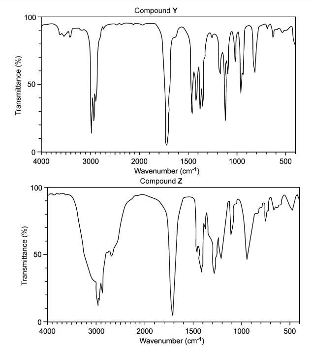

**Fig. 2.1**

Using the data in Table 2.1, identify the functional group present in each compound. Explain your answer, referring only to absorptions at frequencies greater than 1500 cm-1.

**Table 2.1**

| **Bond ** | **Functional groups containing** **the bond** | **Characteristic infrared absorption range (in wavenumber) / cm****–1** |
|---|---|---|
| C−O | hydroxy, ester | 1040 – 1300 |
| C=C | aromatic compound, alkene | 1500 – 1680 |
| C=O | amide  carbonyl, carboxyl  ester | 1640 – 1690 1670 – 1740 1710 – 1750 |
| C≡N | nitrile | 2200 – 2250 |
| C−H | alkane | 2850 – 2950 |
| N−H | amine, amide | 3300 – 3500 |
| O−H | carboxyl  hydroxy | 2500 – 3000 3200 – 3600 |

**Q4** [1 mark]

**Extract:**

Table 2.1

| **Bond ** | **Functional groups containing the bond** | **Characteristic infrared absorption range (in wavenumber) / cm**^**–1**^ |
| :---: | :---: | :---: |
| C−O | hydroxy, ester | 1040 – 1300 |
| C=C | aromatic compound, alkene | 1500 – 1680 |
| C=O | amide carbonyl, carboxyl ester | 1640 – 1690 1670 – 1740 1710 – 1750 |
| C≡N | nitrile | 2200 – 2250 |
| C−H | alkane | 2850 – 2950 |
| N−H | amine, amide | 3300 – 3500 |
| O−H | carboxyl hydroxy | 2500 – 3000 3200 – 3600 |

The infrared spectrum of an organic compound containing carbon, hydrogen and oxygen is shown in Fig. 2.2.

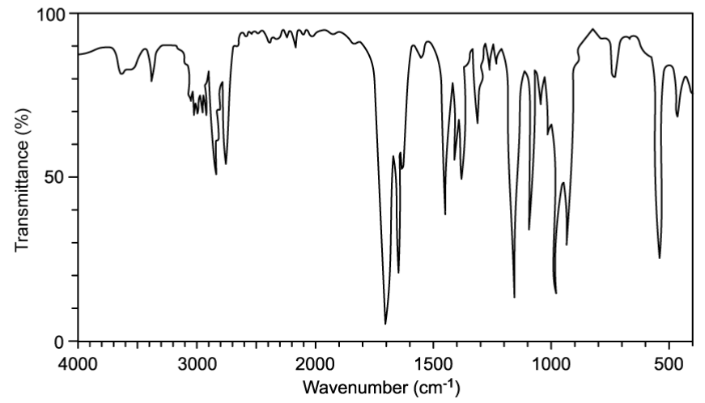

**Fig. 2.2**

Use Table 2.1 and the infrared spectrum in Fig. 2.2 to explain how the presence of a carbonyl group can be identified.

**Q4** [3 marks]

**Extract:**

**Table 2.1**

| **Bond ** | **Functional groups containing the bond** | **Characteristic infrared absorption range (in wavenumber) / cm**^**–1**^ |
| :---: | :---: | :---: |
| C−O | hydroxy, ester | 1040 – 1300 |
| C=C | aromatic compound, alkene | 1500 – 1680 |
| C=O | amide carbonyl, carboxyl ester | 1640 – 1690 1670 – 1740 1710 – 1750 |
| C≡N | nitrile | 2200 – 2250 |
| C−H | alkane | 2850 – 2950 |
| N−H | amine, amide | 3300 – 3500 |
| O−H | carboxyl hydroxy | 2500 – 3000 3200 – 3600 |

In an experiment to prepare a sample of ethanal, CH3CHO, ethanol, C2H5OH, is reacted with acidified potassium dichromate(VI) and the reaction mixture is distilled. The infrared spectra for ethanol and ethanal are shown in Fig. 2.3.

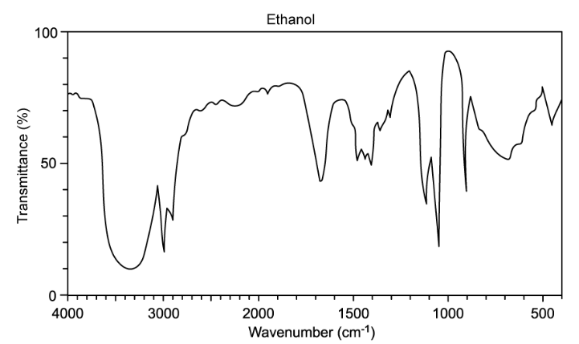

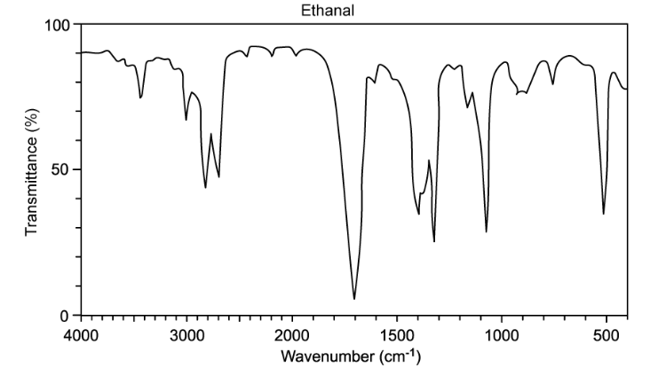

**Fig. 2.3**

i) Identify the bond responsible for the absorption at 3400 cm-1 in the ethanol spectrum and the bond responsible for the absorption at 1720 cm-1 in the ethanal spectrum.

[2]

ii) Explain why the absorption at 3400 cm-1 in the ethanol spectrum does not appear in the spectrum for ethanal.

[1]

### Q5 — easy — 8 marks

**Q5** [2 marks]

There are three possible isomers, **A**, **B** and **C**, with the molecular formula C3H8O.

Isomers **A** and **B** are positional isomers of each other.

Isomer **C** is a functional group isomer of **A** and **B**.

The percentage by mass of carbon in all three isomers is 60.0%.

Calculate the percentage by mass of hydrogen and oxygen in all three isomers.

**Q5** [2 marks]

**Extract:**

There are three possible isomers, **A**, **B** and **C**, with the molecular formula C~3~H~8~O.

Isomers **A** and **B** are positional isomers of each other.

Isomer **C** is a functional group isomer of **A** and **B**.

The infrared spectrum of isomer **C** shown in Fig. 1.1 does not have an absorption in the region of 3200–3600 cm-1.

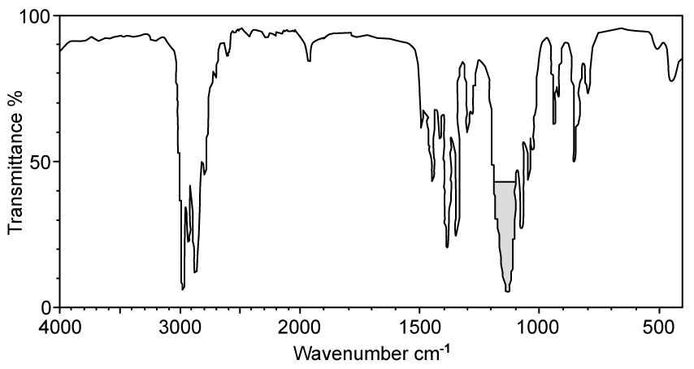

**Fig. 1.1**

i) Using the infrared spectrum in Fig. 1.1 and Table 1.1, deduce the fully displayed formula of isomer **C**.

**Table 1.1**

| **Bond ** | **Functional groups containing** **the bond** | **Characteristic infrared absorption range (in wavenumber) / cm****–1** |
|---|---|---|
| C−O | hydroxy, ester | 1040 – 1300 |
| C=C | aromatic compound, alkene | 1500 – 1680 |
| C=O | amide  carbonyl, carboxyl  ester | 1640 – 1690 1670 – 1740 1710 – 1750 |
| C≡N | nitrile | 2200 – 2250 |
| C−H | alkane | 2850 – 2950 |
| N−H | amine, amide | 3300 – 3500 |
| O−H | carboxyl  hydroxy | 2500 – 3000 3200 – 3600 |

[1]

ii) Identify the bond responsible for the absorption at around 1130 cm-1.

[1]

**Q5** [2 marks]

**Extract:**

There are three possible isomers, **A**, **B** and **C**, with the molecular formula C~3~H~8~O.

Isomers **A** and **B** are positional isomers of each other.

Isomer **C** is a functional group isomer of **A** and **B**.

Isomers **A** and **B** both have an absorption at 3200–3600 cm-1 in their infrared spectra.

State the **systematic** names of isomers **A** and **B**.

**Q5** [2 marks]

**Extract:**

There are three possible isomers, A, B and C, with the molecular formula C3H8O.

Isomers A and B are positional isomers of each other.

Isomer C is a functional group isomer of A and B.

Isomers A and B both have an absorption at 3200–3600 cm^-1^ in their infrared spectra.

The systematic names of isomers A and B are:
- Propan-1-ol
- Propan-2-ol

Isomer **A** has a major peak at *m*/*e* = 31 in its mass spectrum.

Deduce which isomer is compound **A**. Explain your reasoning by identifying the fragment ion responsible for the peak at *m*/*e* = 31.

### Q6 — medium — 8 marks

**Q6** [2 marks]

Compounds **X**, **Y** and **Z** are structural isomers, as shown below.

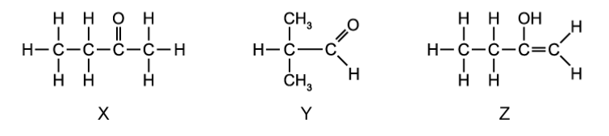

Explain why determining the exact mass using mass spectrometry would not help in distinguishing between **X**, **Y** and **Z**.

**Q6** [2 marks]

**Extract:**

Compounds **X**, **Y** and **Z** are structural isomers, as shown below.

Compounds **X**, **Y** and **Z** were analysed using IR spectroscopy. The spectrum of one of the compounds is shown in Fig 1.1.

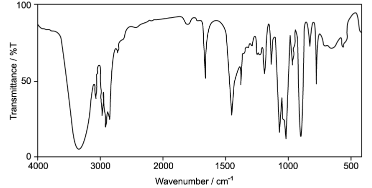

**Fig 1.1**

Use Table 1.1 and Fig. 1.1 to deduce the identity of the compound whose spectrum is shown. Explain your answer by identifying the bonds responsible for the relevant absorptions.

**Table 1.1**

| **Bond ** | **Functional groups containing** **the bond** | **Characteristic infrared absorption range (in wavenumber) / cm****–1** |
|---|---|---|
| C−O | hydroxy, ester | 1040 – 1300 |
| C=C | aromatic compound, alkene | 1500 – 1680 |
| C=O | amide  carbonyl, carboxyl  ester | 1640 – 1690 1670 – 1740 1710 – 1750 |
| C≡N | nitrile | 2200 – 2250 |
| C−H | alkane | 2850 – 2950 |
| N−H | amine, amide | 3300 – 3500 |
| O−H | carboxyl  hydroxy | 2500 – 3000 3200 – 3600 |

**Q6** [2 marks]

**Extract:**

Compounds **X**, **Y** and **Z** are structural isomers, as shown below.

Explain why infrared spectroscopy alone could not be used to distinguish between compounds **X** and **Y**.

**Q6** [2 marks]

**Extract:**

Compounds **X**, **Y** and **Z** are structural isomers, as shown below.

Mass spectrometry can be used to distinguish between compounds **X** and **Y**.

Deduce the *m*/*e* value and formula of a fragment ion present in the mass spectrum of compound **Y** but absent from that of compound **X**.

### Q7 — medium — 11 marks

**Q7** [1 mark]

The isomers **A** and **B**, C5H10O, both form an orange precipitate when reacted with 2,4-DNPH.

**A** is unbranched and reacts with alkaline I2 (aq) to produce a yellow precipitate.

**B** does not react with alkaline I2 (aq). It contains a chiral centre and produces a silver mirror when warmed with Tollens' reagent.

Draw the structure of the yellow precipitate produced by the reaction between **A** and alkaline I2 (aq).

**Q7** [3 marks]

**Extract:**

The isomers **A** and **B**, C~5~H~10~O, both form an orange precipitate when reacted with 2,4-DNPH.

**A** is unbranched and reacts with alkaline I~2~ (aq) to produce a yellow precipitate.

**B** does not react with alkaline I~2~ (aq). It contains a chiral centre and produces a silver mirror when warmed with Tollens' reagent.

i) Draw the structural formula of **A** and of **B**.

**A**

**B**

[2]

ii) Explain what is meant by the term *chiral centre*.

[1]

**Q7** [2 marks]

**C** and **D** are isomers with the molecular formula C3H6O2. The infrared spectra of isomers **C** and **D** are shown in Fig. 2.1 and Fig. 2.2.

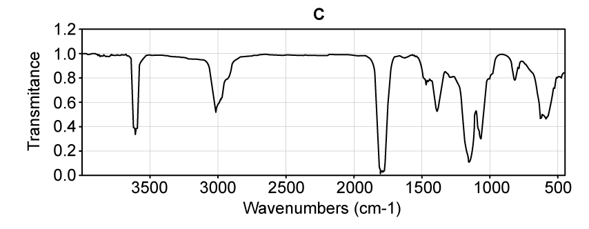

**Fig. 2.1**

**Fig. 2.2**

**Table 2.1**

| **Bond ** | **Functional groups containing** **the bond** | **Characteristic infrared absorption range (in wavenumber) / cm****–1** |
|---|---|---|
| C−O | hydroxy, ester | 1040 – 1300 |
| C=C | aromatic compound, alkene | 1500 – 1680 |
| C=O | amide  carbonyl, carboxyl  ester | 1640 – 1690 1670 – 1740 1710 – 1750 |
| C≡N | nitrile | 2200 – 2250 |
| C−H | alkane | 2850 – 2950 |
| N−H | amine, amide | 3300 – 3500 |
| O−H | carboxyl  hydroxy | 2500 – 3000 3200 – 3600 |

Using Table 2.1, identify the bonds responsible for the principal absorptions above 1500 cm-1 in each spectrum.

spectrum of **C** ........................................................................

spectrum of **D** ........................................................................

**Q7** [2 marks]

**Extract:**

**C** and **D** are isomers with the molecular formula C3H6O2. The infrared spectra of isomers **C** and **D** are shown in Fig. 2.1 and Fig. 2.2.

The bonds responsible for the principal absorptions above 1500 cm^-1^ are:

Compound **C**:
- C=O (carboxyl / carbonyl) AND O−H (carboxyl)

Compound **D**:
- C=O (carbonyl / ester) AND C−H (alkane)

Draw the displayed formulae of possible structures for isomers **C** and **D**.

**Q7** [3 marks]

**Extract:**

**C** and **D** are isomers with the molecular formula C~3~H~6~O~2~.

The displayed formulae of isomers **C** and **D** are:

1 mark for the correct displayed formula of propanoic acid (CH~3~CH~2~COOH)

1 mark for the correct displayed formula of methyl ethanoate (HCOOCH~2~CH~3~) **OR** ethyl methanoate (CH~3~COOCH~3~)

Deduce the formulae of the fragment ions responsible for the peaks at *m*/*e* = 73, 45 and 29 in the mass spectrum of compound **C**.
