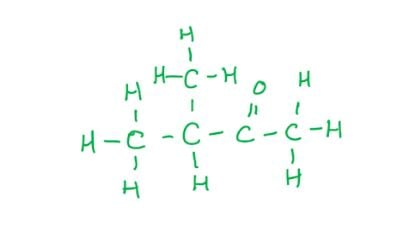
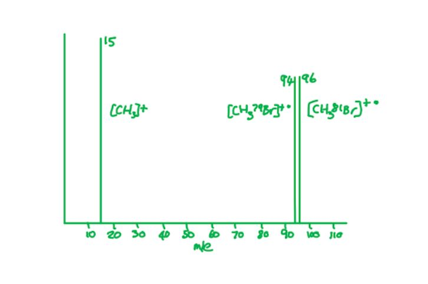
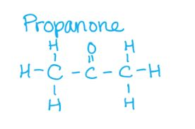
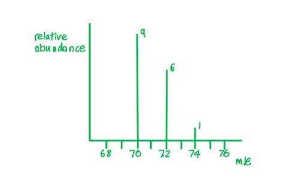

# Mark Schemes — Mass Spectrometry
**22. Analytical Techniques** · Cambridge (CIE) A-LEVEL chemistry (9701)

## Multiple Choice Questions (23 questions)

### Q1
**Final answer:** **The correct answer is D**

- The **base peak** is the most intense (tallest) peak in a mass spectrum.
- It corresponds to the ion with the greatest abundance in the sample.

**A** is incorrect as a fragment ion does not necessarily produce the base peak. The base peak is the most abundant ion regardless of how it is formed.

**B** is incorrect as the base peak is not necessarily produced by the ion with the lowest m/z ratio.

**C** is incorrect as the molecular ion peak does not necessarily correspond to the base peak. The molecular ion (M+ or M●+) is the unfragmented ionised molecule. It has the highest m/z ratio (excluding isotope peaks) but is not always the most abundant ion.

### Q2
**Final answer:** **The correct answer is B**

- To calculate the relative atomic mass of chlorine, multiply each isotopic mass by its percentage abundance, add the values, then divide by 100.

*A*r(Cl) = $\frac{(35\times75.3)+(37\times24.7)}{100}$

*A*r(Cl) = $\frac{2635.5+913.9}{100}$

*A*r(Cl) = $\frac{3549.4}{100}$

*A*r(Cl) = 35.49

**A** is incorrect as 35.00 is the mass of the more abundant isotope, 35Cl, not the relative atomic mass.

**C** is incorrect as 36.00 is the simple mean of 35 and 37 without weighting for percentage abundance.

**D** is incorrect as 36.51 results from swapping the percentage abundances — using 75.3% for 37Cl and 24.7% for 35Cl instead.

### Q3
**Final answer:** **The correct answer is A**

- A line at m/z = 57 corresponds to an ion with a mass of 57, for example:

  - [C4H9]+
  - [C2H5CO]+
- 3-methylbutan-2-one will not have either of these fragments.

**B** is incorrect as hexan-3-one has a peak at m/z = 57 due to the fragment ion [C2H5CO]+.

**C** is incorrect as pentan-3-one has a peak at m/z = 57 due to the fragment ion [C2H5CO]+.

**D** is incorrect as butanone has a peak at m/z = 57 due to the fragment ion [C2H5CO]+.

### Q4
**Final answer:** **The correct answer is B**

- In mass spectrometry, peaks correspond to specific isotopic masses, not average relative atomic masses.
- Bromine has two stable isotopes:

  - 79Br (mass 79)
  - 81Br (mass 81)
- If X = 79Br:

remaining mass for F atoms = 222 − 79 = 143

n = 143 ÷ 19 = 7.53 (not a whole number)

- If X = 81Br:

remaining mass for F atoms = 222 − 81 = 141

n = 141 ÷ 19 = 7.42 (not a whole number)

- Neither bromine isotope gives a whole number of F atoms, so the compound cannot contain bromine.

**A** is incorrect as iodine has one stable isotope with mass 127. Substituting: 222 − 127 = 95; n = 95 ÷ 19 = 5 (a whole number), confirming IF5. This statement is correct.

**C** is incorrect as iodine fits all conditions. IF5 has molecular mass = 127 + (5 × 19) = 222, consistent with the single molecular ion peak. This statement is correct.

**D** is incorrect as both 19F and 127I each exist as a single stable isotope, which explains why the molecular ion appears as a single unfragmented peak at m/z = 222 with no M+2 peak. This statement is correct.

### Q5
**Final answer:** **The correct answer is A**

- The mass spectrum of CH3Br shows three peaks:

1. Ionisation of CH379Br:

CH379Br → [CH379Br]•+ + e− at m/z = 94

2. Ionisation of CH381Br:

CH381Br → [CH381Br]•+ + e− at m/z = 96

3. Fragmentation:

[CH3Br]•+ → [CH3]+ + Br• at m/z = 15

- The two molecular ion peaks at m/z = 94 and 96 are of approximately equal size because 79Br and 81Br occur in approximately equal abundance.

**B** is incorrect as the two molecular ion peaks at m/z = 94 and 96 are of approximately equal size, not in a 3:1 ratio. A 3:1 ratio is characteristic of compounds containing chlorine, not bromine.

**C** is incorrect as there is no molecular ion peak at m/z = 44 in the mass spectrum of CH3Br. The molecular ion peaks occur at m/z = 94 and 96.

**D** is incorrect as there is no single molecular ion peak at m/z = 95. Mass spectrometry separates isotopes, giving two distinct molecular ion peaks at m/z = 94 and 96.

### Q6
**Final answer:** **The correct answer is B**

- The peak representing the **molecular ion (M****+**** or M•****+****)** is called the **molecular ion peak**.
- Excluding any peaks due to the presence of heavier isotopes, this is the peak with the highest m/z ratio.

  - This is the whole molecule that has lost one electron.
- Bromine has two isotopes, so there are two possible molecular ions:

  - M (79Br) m/z = 122
  - M+2 (81Br) m/z = 124

**A** is incorrect as isotopes have identical chemical reactivities.

**C** is incorrect as the differences in the number of neutrons do not affect atomic radii.

**D** is incorrect as the differences in the number of neutrons do not affect the first ionisation energy.

### Q7
**Final answer:** **The correct answer is B**

- Chlorine exists as diatomic molecules.

  - When a sample of Cl2 is ionised in the mass spectrometer, each molecule loses one electron to form the molecular ion, Cl2•+.
- There are three possible Cl2•+ molecular ions, depending on which combination of isotopes is present:

  - 35Cl2•+ at m/z = 70
  - 35Cl37Cl•+ at m/z = 72
  - 37Cl2•+ at m/z = 74
- This gives three molecular ion peaks.
- Some Cl2•+ ions fragment further:

Cl2•+ → Cl• + Cl+

- The Cl+ ions give additional fragment ion peaks at m/z = 35 and m/z = 37, but these are not molecular ion peaks.

**A** is incorrect as 2 is the number of chlorine isotopes, not the number of molecular ion peaks.

**C** is incorrect as there are three possible Cl2•+ molecular ions (at m/z = 70, 72 and 74), not four.

**D** is incorrect as 5 is the total number of peaks in the mass spectrum, including two fragment ion peaks at m/z = 35 and 37, not just the molecular ion peaks.

### Q8
**Final answer:** **The correct answer is C**

- A fragment ion at m/z = 43 corresponds to [C3H7]+, for example:
- [CH3CH2CH2]+
- [(CH3)2CH]+

- CH3CH2CH(OH)CH3 cannot produce a [C3H7]+ fragment — C−C cleavage on either side of the OH group gives at most a two-carbon fragment ([CH3CH2]+, m/z = 29) or a one-carbon fragment ([CH3]+, m/z = 15).

**A** is incorrect as [(CH3)2CH]+ can be produced from (CH3)2CHCH2OH by cleavage adjacent to the CH2OH group, giving m/z = 43.

**B** is incorrect as [CH3CH2CH2]+ can be produced from CH3CH(OH)CH2CH2CH3 by cleavage of the bond between C-3 and C-4, giving m/z = 43.

**D** is incorrect as [CH3CH2CH2]+ can be produced from CH3CH2CH2CH2OH by C−C cleavage adjacent to the OH, giving m/z = 43.

> **[exam-tip]**
> Draw a vertical line through each C−C bond in turn to identify possible fragment ions. For m/z = 43, look for a three-carbon, seven-hydrogen fragment ([C3H7]+) on either side of each bond.

### Q9
**Final answer:** **The correct answer is C**

- Bromine is a diatomic molecule, so the mass spectrum of Br2 shows peaks from both the molecular ion (Br2+) and fragment ions (Br+).
- When Br2 passes through the mass spectrometer, an electron is removed to form the molecular ion:

Br2 → Br2+ + e−

- Br2+ can then fragment:

Br2+ → Br+ + Br

- The Br+ fragment ions give peaks at m/z = 79 and 81 in equal intensity.
- The unfragmented Br2+ ion exists in three isotopologue combinations:

  - 79Br79Br+: m/z = 79 + 79 = 158 (relative probability 1)
  - 79Br81Br+: m/z = 79 + 81 = 160 (relative probability 2)
  - 81Br81Br+: m/z = 81 + 81 = 162 (relative probability 1)
- This gives five peaks in total: Br+ at 79 and 81 (equal height), and Br2+ at 158, 160 and 162 in a 1:2:1 ratio.

**A** is incorrect as it shows only a single molecular ion peak, not three.

**B** is incorrect as it also shows only a single molecular ion peak, not three.

**D** is incorrect as it shows three molecular ion peaks at m/z = 158, 160 and 162 in a 9:6:1 ratio. The 9:6:1 pattern corresponds to Cl2 (35Cl : 37Cl ≈ 3:1), not Br2 (79Br : 81Br ≈ 1:1).

### Q10
**Final answer:** **The correct answer is D**

- The molecular ion peak (M+ or M●+) corresponds to the unfragmented molecule that has lost one electron.
- It is the peak with the highest m/z value (excluding isotope peaks).
- The molecular formula C4H10O has a relative molecular mass of (4 × 12) + (10 × 1) + 16 = 74.
- In all three mass spectra, the highest m/z peak (the molecular ion peak) appears at m/z = 74, confirming the molecular formula.

**A** is incorrect as m/z = 73 is a fragment ion peak ([M − H]+), not the molecular ion peak.

**B** is incorrect as m/z = 15 is a fragment ion peak ([CH3]+), not the molecular ion peak.

**C** is incorrect as m/z = 33 is a fragment ion peak, not the molecular ion peak.

### Q11
**Final answer:** **The correct answer is B**

- If CF3CO2H fragmented by sequential loss of F atoms (mass 19 each time), peaks would be expected at m/z = 203, 184, 165, etc.
- The observed peaks at m/z = 69 ([CF3]+) and 45 ([HO2C]+) are consistent with a single C−C bond cleavage, not sequential F loss.
- The small peak at m/z = 70 (1.1% of m/z = 69) is consistent with the natural abundance of 13C (~1.1%).

  - Since fluorine exists as a single stable isotope (19F only), this peak cannot arise from a heavier F isotope.

**A** is incorrect as this statement is supported. C−C bond cleavage is the fragmentation pathway, producing [CF3]+ at m/z = 69 and [HO2C]+ at m/z = 45.

**C** is incorrect as this statement is supported. 19F is the only stable isotope of fluorine, which explains why the peak at m/z = 70 arises from 13C and not from a heavier fluorine isotope.

**D** is incorrect as this statement is supported. [HO2C]+ is a fragment ion at m/z = 45, which is the base peak formed by C−C bond cleavage.

### Q12
**Final answer:** **The correct answer is B**

- A line at m/z = 29 can correspond to one of two fragment ions:

  - [C2H5]+ (m/z = 29)
  - [CHO]+ (m/z = 29)
- Propan-1-ol gives a peak at m/z = 29 due to the [C2H5]+ fragment ion, and propanal gives a peak at m/z = 29 due to the [CHO]+ fragment ion.

![[Structural diagrams showing C–C bond cleavage in propan-1-ol producing [C2H5]+ at m/z = 29 and C–C bond cleavage in propanal producing [CHO]+ at m/z = 29]](assets/007-structural-diagrams-showing-c-c-bond-cleavage-in.jpg)

**A** is incorrect as propan-2-ol does not give a [C2H5]+ fragment ion and does not have a peak at m/z = 29.

**C** is incorrect as propan-2-ol does not give a [C2H5]+ fragment ion and does not have a peak at m/z = 29.

![[Structural diagram of propan-2-ol showing that bond cleavage does not produce a [C2H5]+ fragment ion at m/z = 29]](assets/008-structural-diagram-of-propan-2-ol-showing-that-b.jpg)

**D** is incorrect as propanone does not give a [C2H5]+ or [CHO]+ fragment ion and does not have a peak at m/z = 29.

### Q13
**Final answer:** **The correct answer is C**

- To calculate the relative atomic mass of neon, multiply each isotopic mass by its percentage abundance, add the values, then divide by 100.

*A*r(Ne) = $\frac{(20\times90.92)+(21\times0.26)+(22\times8.82)}{100}$

*A*r(Ne) = $\frac{1818.40+5.46+194.04}{100}$

*A*r(Ne) = $\frac{2017.90}{100}$

*A*r(Ne) = 20.18

**A** is incorrect as 20.00 is the mass of the most abundant isotope (20Ne), not the relative atomic mass.

**B** is incorrect as 20.09 results from mixing up the percentage abundances of 21Ne and 22Ne (using 0.26% for 22Ne and 8.82% for 21Ne).

**D** is incorrect as 21.00 is the simple mean of 20, 21 and 22 without weighting for percentage abundance.

### Q14
**Final answer:** **The correct answer is B**

- To calculate the relative atomic mass of silicon, multiply each isotopic mass by its percentage abundance, add the values, then divide by 100.

*A*r(Si) = $\frac{(28\times81.21)+(29\times14.10)+(30\times4.69)}{100}$

*A*r(Si) = $\frac{2823.48}{100}$

*A*r(Si) = 28.2

**A** is incorrect as 28.0 is the mass of the most abundant isotope (28Si), not the relative atomic mass.

**C** is incorrect as 29.0 is the simple mean of the three isotopic masses without weighting for abundance.

**D** is incorrect as 29.8 results from incorrectly mixing up the percentage abundances of the isotopes.

### Q15
**Final answer:** **The correct answer is D**

- Cl2 is a diatomic molecule. When it passes through the mass spectrometer, an electron is removed to form the molecular ion:

Cl2 → Cl2+ + e−

- Cl2+ can then fragment:

Cl2+ → Cl+ + Cl

- The neutral Cl atom carries no charge and is not detected; the Cl+ ions give peaks at m/z = 35 and 37.
- Three isotopologue combinations give three molecular ion peaks:

  - 35Cl35Cl+ at m/z = 70 — relative probability ∝ 3 × 3 = 9
  - 35Cl37Cl+ (two arrangements) at m/z = 72 — relative probability ∝ 2 × (3 × 1) = 6
  - 37Cl37Cl+ at m/z = 74 — relative probability ∝ 1 × 1 = 1
- The three molecular ion peaks at m/z = 70, 72 and 74 therefore appear in a 9:6:1 ratio.

**A** is incorrect as there are three molecular ion peaks (at m/z = 70, 72 and 74), not two. A 3:1 ratio applies to the individual chlorine isotopes, not to the molecular ion peaks.

**B** is incorrect as three molecular ion peaks exist. The peak at m/z = 72 from 35Cl37Cl+ is absent from this option.

**C** is incorrect as the middle peak arises from two arrangements (35Cl37Cl+ and 37Cl35Cl+), giving a relative probability of 2 × (3 × 1) = 6. The correct ratio is 9:6:1, not 9:3:1.

### Q16
**Final answer:** **The correct answer is A**

- A line at m/z = 31 corresponds to an ion with a mass of 31, for example:

  - [CH2OH]+
- 2-methylpropan-1-ol is likely to have a fragment at m/z = 31 as it contains a [CH2OH]+ group.

**B** is incorrect as pentan-2-ol does not contain a [CH2OH]+ group and does not give a fragment ion at m/z = 31.

**C** is incorrect as 2-methylpentan-2-ol does not contain a [CH2OH]+ group; the OH group is not bonded to a –CH2– unit.

**D** is incorrect as butan-2-ol does not contain a [CH2OH]+ group and does not give a fragment ion at m/z = 31.

> **[exam-tip]**
> If you are not sure, draw vertical lines in the structural formula of each compound to identify the possible fragment ions.

### Q17
**Final answer:** **The correct answer is A**

- A peak at m/z = 55 corresponds to a fragment ion with a mass of 55.
- [C4H7]+ has m/z = (4 × 12) + (7 × 1) = 55.

**B** is incorrect as [CH2CO2]+ has m/z = 58, not 55.

**C** is incorrect as [CH$\equiv$CHCHOH]+ has m/z = 56, not 55.

**D** is incorrect as [COOH]+ has m/z = 45, not 55.

### Q18
**Final answer:** **The correct answer is D**

- Each Cl atom can be either 35Cl or 37Cl, giving 5 possible isotopologue combinations for a molecule with 4 Cl atoms.
- The 5 possible molecular ions for [C4H6Cl4]+ are:

  - All four Cl atoms as 35Cl → M (base mass)
  - Three 35Cl and one 37Cl → M+2
  - Two 35Cl and two 37Cl → M+4
  - One 35Cl and three 37Cl → M+6
  - All four Cl atoms as 37Cl → M+8

**A** is incorrect as 2 is the number of chlorine isotopes, not the number of molecular ion peaks.

**B** is incorrect as 3 molecular ion peaks would be expected for a molecule containing two chlorine atoms (M, M+2 and M+4). C4H6Cl4 contains four chlorine atoms, giving five molecular ion peaks.

**C** is incorrect as 4 peaks omits the M+8 peak (corresponding to all four chlorine atoms being 37Cl). Five molecular ion peaks are expected.

### Q19
**Final answer:** **The correct answer is B**

- Reading relative abundances from the mass spectrum: m/z = 28 (80%), m/z = 29 (12%), m/z = 30 (8%).
- To calculate the relative atomic mass, multiply each isotopic mass by its relative abundance, add the values, then divide by 100.

*A*r(Si) = $\frac{(28\times80)+(29\times12)+(30\times8)}{100}$

*A*r(Si) = $\frac{2240+348+240}{100}$

*A*r(Si) = $\frac{2828}{100}$

*A*r(Si) = 28.3

**A** is incorrect as 28.0 is the mass of the most abundant isotope (28Si), not the relative atomic mass.

**C** is incorrect as 28.8 results from misreading the graph by swapping the relative abundances of the peaks at m/z = 28 and m/z = 29.

**D** is incorrect as 29.0 is the simple mean of 28, 29 and 30 without weighting for relative abundance.

### Q20
**Final answer:** **The correct answer is A**

- A strong absorption at 1720 cm-1 is consistent with a C═O (carbonyl) stretch.

  - Compound A contains a carbonyl group in the ketone wavenumber range (~1715–1725 cm-1).
- The molecular ion peak at m/z = 128 matches the relative molecular mass of compound A.
- The fragment ion at m/z = 15 corresponds to [CH3]+, consistent with a terminal methyl group in compound A.
- The absence of a broad absorption around 3200 cm-1 confirms that no O−H group is present.

**B** is incorrect as compound B contains a hydroxyl (O−H) group, which would produce a broad absorption around 3200 cm-1. This absorption is absent from the data.

**C** is incorrect as compound C has a relative molecular mass of 129, not 128. A molecular ion at m/z = 129 does not match the data.

**D** is incorrect as compound D contains both a carbonyl group and a hydroxyl group. The O−H group would produce a broad absorption around 3200 cm-1, which is absent from the data.

### Q21
**Final answer:** **The correct answer is B**

- In a mass spectrometer, ions with a smaller m/z ratio are deflected to a greater extent by the magnetic field.

  - 35Cl+ has m/z = 35
  - 35Cl2+ has m/z = $\frac{35}{2}$ = 17.5
  - 37Cl+ has m/z = 37
- 35Cl2+ has the smallest m/z ratio of the charged species and is therefore deflected to the greatest extent.

**A** is incorrect as 35Cl+ has m/z = 35, which is greater than the m/z of 35Cl2+.

**C** is incorrect as 37Cl carries no charge and is not deflected by the magnetic field.

**D** is incorrect as 37Cl+ has m/z = 37, which is the largest m/z of the charged species and is therefore deflected the least.

### Q22
**Final answer:** **The correct answer is A**

- A peak at m/z = 43 can arise from an ion with a mass of 43 for example:

  - [CH3CH2CH2]+
  - [CH3CO]+
  - [(CH3)2CH]+
- Propanoic acid (compound A) cannot produce any of these fragments:

  - It has no three-carbon hydrocarbon fragment .
  - It has no [CH3CO]+ unit — the carbonyl is bonded to CH3CH2, giving [CH3CH2CO]+ at m/z = 57, not 43.

**B** is incorrect as it contains a [CH3CO]+ unit, which produces [CH3CO]+ at m/z = 43.

**C** is incorrect as it contains a (CH3)2CH unit, which produces [(CH3)2CH]+ at m/z = 43.

**D** is incorrect as it contains a CH3CH2CH2 unit, which produces [CH3CH2CH2]+ at m/z = 43.

> **[exam-tip]**
> Draw a vertical line through each C−C bond in turn to identify possible fragment ions. For m/z = 43, look for either a three-carbon hydrocarbon unit ([C3H7]+) or a CH3−C=O unit ([CH3CO]+) on either side of the bond.

### Q23
**Final answer:** **The correct answer is D**

- The question states that there are only nitrogen atoms with a mass of 14.
- All three Cl as 35Cl:

[14N(35Cl)3]+, m/z = 14 + (3 x 35) = 119

- Two 35Cl and one 37Cl:

[14N(35Cl)2(37Cl)]+, m/z = 14 + (2 x 35) + 37 = 121

- One 35Cl and two 37Cl:

[14N(35Cl)(37Cl)2]+, m/z = 14 + 35 + (2 x 37) = 123

- All three Cl as 37Cl:

[14N(37Cl)3]+, m/z = 14 + (3 x 37) = 125

- Therefore, ion **D** in the table should be [14N(37Cl)3]+.

**A**, **B** and **C** are incorrect as these are all valid molecular ions with correct m/z values.
