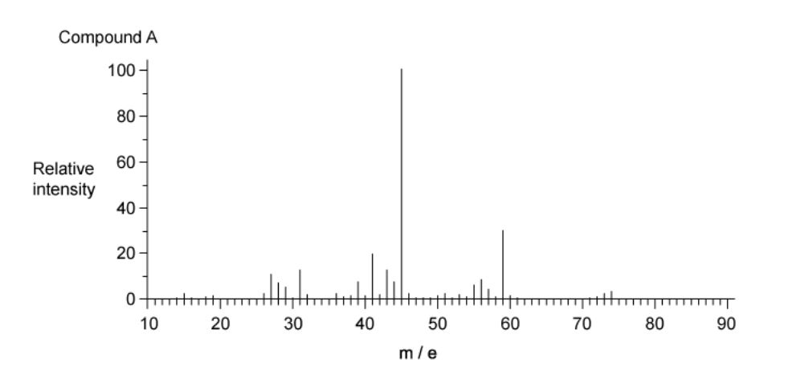
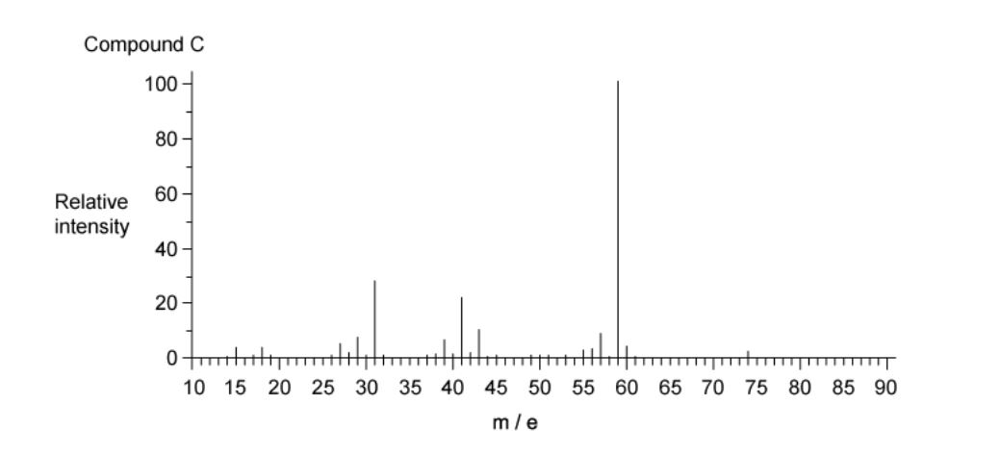
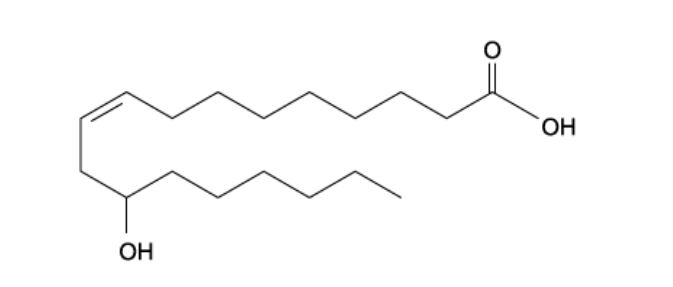
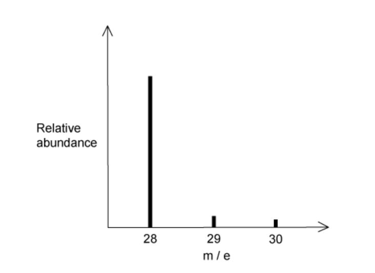

# Exam Questions — Mass Spectrometry
**22. Analytical Techniques** · Cambridge (CIE) A-LEVEL chemistry (9701)
> Source: [https://www.savemyexams.com/a-level/chemistry/cie/25/topic-questions/](https://www.savemyexams.com/a-level/chemistry/cie/25/topic-questions/) · 23 questions across 1 sets

## Multiple Choice Questions (23 questions)

### Q1 — easy — 1 marks

**Q1** [1 mark]

Which of the following corresponds to the base peak in a mass spectrum?

### Q2 — easy — 1 marks

**Q2** [1 mark]

Chlorine exists as two isotopes with mass numbers 35 and 37. A sample of chlorine contains 75.3% of chlorine-35 atoms.

Which is the relative atomic mass of chlorine in this sample, to 2 dp?

### Q3 — medium — 1 marks

**Q3** [1 mark]

Which of the ketones listed would **not** be expected to have a peak in its mass spectrum at *m/z* = 57?

### Q4 — hard — 1 marks

**Q4** [1 mark]

A compound XFn is a fluoride of another halogen, X, and it is known that n > 1. The highest mass peak in the mass spectrum of XFn is assigned to the molecular ion and appears as a single peak at m/z = 222.

Which of the following statements is **not **correct?

### Q5 — medium — 1 marks

**Q5** [1 mark]

Which of the following statements about the mass spectrum of CH3Br is correct?

### Q6 — medium — 1 marks

**Q6** [1 mark]

Bromine exists as two isotopes 79Br and 81Br, which are found in almost equal abundance.

Which of the following statements is correct?

### Q7 — medium — 1 marks

**Q7** [1 mark]

Chlorine has two isotopes, 35Cl and 37Cl.

Which of the following is the number of molecular ion peaks in the mass spectrum of a sample of Cl2?

### Q8 — medium — 1 marks

**Q8** [1 mark]

Which alcohol does **not** have a fragment ion at m/z = 43 in its mass spectrum?

### Q9 — hard — 1 marks

**Q9** [1 mark]

Two stable isotopes of bromine, 79Br and 81Br, exist in approximately equal abundance.

Which is the correct pattern of peaks in the mass spectrum of Br2?

### Q10 — hard — 1 marks

**Q10** [1 mark]

The mass spectra of three compounds A, B and C are shown below.

Which feature of the three mass spectra confirms that all three compounds have the molecular formula C4H10O?

### Q11 — hard — 1 marks

**Q11** [1 mark]

In the mass spectrum of trifluoroacetic acid, CF3CO2H, intense peaks are observed at m/z = 69 and 45 (base peak) in addition to other peaks.

The peak at m/z = 69 is accompanied by a peak at m/z = 70, which is about 1.1% the intensity of the peak at m/z = 69.

Which of the following statements is **not** supported by this information?

### Q12 — medium — 1 marks

**Q12** [1 mark]

Which pair of compounds would you expect to both have a singly charged peak at *m/z* = 29 in the mass spectrum?

### Q13 — easy — 1 marks

**Q13** [1 mark]

A sample of neon contains the following isotopes.

| **Isotope** | **Percentage abundance** |
|---|---|
| 20Ne | 90.92 |
| 21Ne | 0.26 |
| 22Ne | 8.82 |

Which is the relative atomic mass of neon in this sample, to 2 dp?

### Q14 — easy — 1 marks

**Q14** [1 mark]

A sample of silicon contains the following isotopes.

| **Isotope** | **Percentage abundance** |
|---|---|
| 28Si | 81.21 |
| 29Si | 14.10 |
| 30Si | 4.69 |

Which is the relative atomic mass of silicon in this sample, to 1 dp?

### Q15 — hard — 1 marks

**Q15** [1 mark]

Chlorine exists as two isotopes, 35Cl and 37Cl, in the ratio 3:1.

Which of the following statements about the molecular ion peaks in the mass spectrum of Cl2 is correct?

### Q16 — medium — 1 marks

**Q16** [1 mark]

Which alcohol is likely to have a fragment ion at *m/z* = 31 in its mass spectrum?

### Q17 — easy — 1 marks

**Q17** [1 mark]

The diagram shows the structural formula of ricinoleic acid.

The mass spectrum of ricinoleic acid shows a peak at m/z = 55.

Which fragment ion is responsible for this peak?

### Q18 — medium — 1 marks

**Q18** [1 mark]

Assuming chlorine exists as two isotopes and that carbon and hydrogen each exist as a single stable isotope only, how many molecular ion peaks are shown in the mass spectrum of C4H6Cl4?

### Q19 — easy — 1 marks

**Q19** [1 mark]

The mass spectrum of silicon is shown below.

Which is the relative atomic mass of silicon in this sample, to 1 dp?

### Q20 — hard — 1 marks

**Q20** [1 mark]

A sample is analysed by mass spectrometry and infrared spectroscopy. The data obtained are shown below.

| **Mass spectrometry** | **Infrared spectroscopy** |
|---|---|
| Molecular ion peak at m/z = 128 | Strong absorption at 1720 cm-1 |
| Fragment ion peak at m/z = 15 | No broad absorption around 3200 cm-1 |

Which compound is consistent with these spectroscopic data?

### Q21 — easy — 1 marks

**Q21** [1 mark]

In a mass spectrometer, the ions are separated.

Which of the following species will be deflected to the greatest extent?

### Q22 — medium — 1 marks

**Q22** [1 mark]

Which of the compounds below is **not** likely to have a fragment ion at m/z = 43 in its mass spectrum?

### Q23 — easy — 1 marks

**Q23** [1 mark]

Nitrogen trichloride has the formula NCl3. A sample contains only 14N atoms and chlorine atoms with mass numbers 35 and 37.

Which ion and m/z value in the table is **not** correct?

|   | **Ion** | **m/z** |
|---|---|---|
| **A** | [14N(35Cl)3]+ | 119 |
| **B** | [14N(35Cl)2(37Cl)]+ | 121 |
| **C** | [14N(35Cl)(37Cl)2]+ | 123 |
| **D** | [14N(37Cl)2]+ | 125 |
