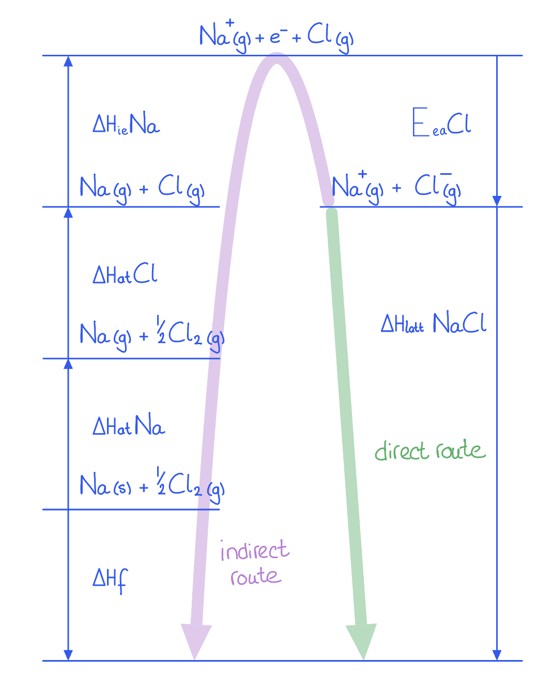
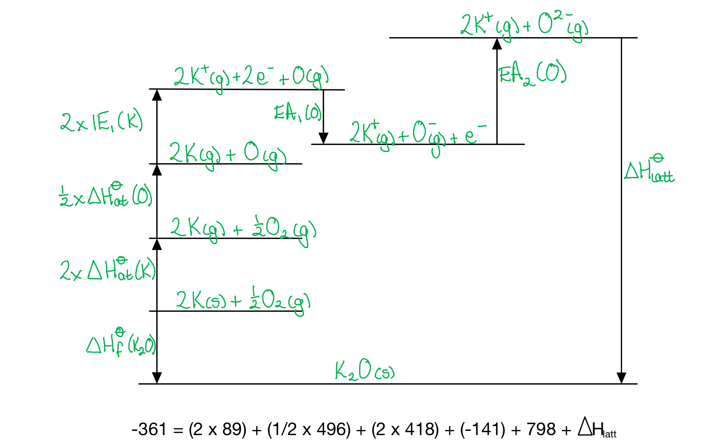
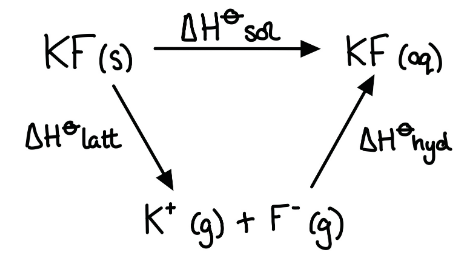

# Mark Schemes — Lattice Energy & Born-Haber Cycles
**23. Chemical Energetics** · Cambridge (CIE) A-LEVEL chemistry (9701)

## Structured Questions (11 questions)

### Q1
> **[mark-scheme]**
> The definition of lattice energy:
> 
> - The energy change (or enthalpy change) when one mole of an ionic compound is formed **[1 mark]**
> - From its constituent gaseous ions, under standard conditions **[1 mark]**

> **[exam-tip]**
> Learn all thermodynamic definitions for CIE IAL Chemistry. Lattice energy is always exothermic (negative), as forming ionic bonds from gaseous ions releases energy.
> **[mark-scheme]**
> The equation for the first electron affinity of chlorine is:
> 
> - Cl (g) + e- → Cl- (g) **[1 mark]**
> 
> State symbols must be included for the mark.

> **[exam-tip]**
> ½Cl2 (g) + e- → Cl- (g) is not an acceptable answer because this represents both the enthalpy of atomisation and the electron affinity, not just the electron affinity.
To calculate the first electron affinity of chlorine:

- Use the Born-Haber relationship:

Δ*H*f = Δ*H*at(Mg) + IE1(Mg) + IE2(Mg) + 2Δ*H*at(Cl) + 2(EACl) + Δ*H*latt(MgCl2)

–641 = 148 + 738 + 1450 + 2(121) + 2(EACl) + (–2526) **[1 mark]**

- Simplify:

–641 = 52 + 2(EACl) **[1 mark]**

2(EACl) = –693 kJ mol-1

- Calculate the result:

EACl = **–346.5 kJ mol****-1** **[1 mark]**

> **[mark-scheme]**
> 1 mark for correct Born-Haber equation with correct substitution
> **OR**
> 1 mark for a correctly drawn and labelled Born-Haber cycle
> 
> 1 mark for correct simplification: –641 = 52 + 2(EACl)
> **OR**
> 2(EACl) = –693 kJ mol-1
> 
> 1 mark for EACl = –346.5 kJ mol-1

> **[exam-tip]**
> When calculating using a Born-Haber cycle, always check:
> 
> - Correct values from the data table
> - Lattice energy is negative (energy released on forming the solid)
> - Correct multipliers for the formula (MgCl2 contains 2 Cl, so use 2 x EACl and 2 x Δ*H*at(Cl))
> 
> A very common error is forgetting the stoichiometry of the chlorine. Since the formula is MgCl2, two chloride ions are formed. Therefore both the enthalpy of atomisation of chlorine and the electron affinity must be multiplied by 2.
> **[mark-scheme]**
> The thermal stability of Group 2 carbonates increases down the group because:
> 
> - The ionic radius of the Group 2 cation (M2+) increases down the group **[1 mark]**
> - The charge density of M2+ decreases as a result **[1 mark]**
> - There is less polarisation / less distortion of the CO32- ion by the cation **[1 mark]**
> - The C–O bonds are weakened less, so a higher temperature is needed to decompose the carbonate **[1 mark]**

> **[exam-tip]**
> Students often lose marks on questions like this by mixing up cause and effect.
> 
> Make sure you clearly connect the chain:
> 
> - larger cation
> - → lower charge density
> - → less polarisation of CO32-
> - → C–O bonds less weakened
> - → harder to decompose
> - → greater thermal stability.
> 
> When explaining polarisation, focus on the carbonate anion and use the word "polarisation" or "distortion" explicitly. Restating that thermal stability increases does not explain the underlying reason.
> **[mark-scheme]**
> The sign of Δ*S*θ for the decomposition of MgCO3 (s) is:
> 
> - Positive
> **OR**
> Δ*S*θ > 0 **[1 mark]**
> - A gas (CO2) is produced from solid reactants, increasing the number of gaseous particles and therefore increasing disorder/entropy **[1 mark]**

> **[exam-tip]**
> When explaining entropy changes, focus on what happens to the particles, not just the states of matter involved.
> 
> Many students lose marks by writing vague statements such as "a solid turns into a gas" without explaining that a gas is produced from solids, which increases disorder.
> 
> In entropy questions, always check whether the number of gaseous particles increases, as this is usually the dominant factor affecting Δ*S*θ.

### Q2
> **[mark-scheme]**
> The definition of lattice energy:
> 
> - Formation of 1 mole of an ionic lattice from its constituent gaseous ions **[1 mark]**
> - Under standard conditions **[1 mark]**

> **[exam-tip]**
> There are many thermodynamic definitions you need to know for CIE IAL Chemistry. They are typically worth 2 or 3 marks and are worth memorising.
The missing species are:

- (Step **E**) Ca2+(g) + O (g) + 2e- **[1 mark]**
- (Step **G**) Ca2+(g) + O2-(g) **[1 mark]**

> **[exam-tip]**
> Step E in the Born-Haber cycle begins with Ca+(g) + O (g) + 2e-. The calcium ion needs to lose another electron to form a 2+ ion (second ionisation energy), so Ca2+(g) + O (g) + 2e- is the missing species.
> 
> Step G represents the second electron affinity of oxygen. This is the enthalpy change when one mole of O-(g) ions forms one mole of O2-(g) ions. As shown in the Born-Haber cycle, Ca2+(g) + O-(g) + e- becomes Ca2+(g) + O2-(g).
> 
> Examiners often ask about the second electron affinity of oxygen, so make sure you know it well.
> **[mark-scheme]**
> The enthalpy changes represented by each step are:
> 
> - (**B**) enthalpy change of atomisation (of calcium) **[1 mark]**
> - (**D**) first ionisation energy (of calcium) **[1 mark]**
> - (**F**) first electron affinity (of oxygen) **[1 mark]**

> **[exam-tip]**
> The enthalpy change of atomisation is the enthalpy change when one mole of gaseous atoms is formed from an element in its standard state, for example Ca (s) → Ca (g).
> 
> The first ionisation energy is the enthalpy change when one mole of electrons is removed from one mole of gaseous atoms to form one mole of gaseous ions with a single positive charge, for example Ca (g) → Ca+(g).
> 
> The first electron affinity is the enthalpy change when one mole of gaseous atoms gains one mole of electrons to form one mole of gaseous ions with a single negative charge, for example O (g) → O-(g).
> **[mark-scheme]**
> The enthalpy change of atomisation is always endothermic because:
> 
> - Energy must be absorbed to break the bonds in the element **[1 mark]**
> - No bond forming occurs in this process, so no energy is released **[1 mark]**

> **[exam-tip]**
> The enthalpy change of atomisation is the enthalpy change when one mole of gaseous atoms is formed from an element in its standard state, for example O2 (g) → 2O (g).
> 
> This process is always endothermic because bond breaking requires energy input, and no bond forming occurs to release energy.
> 
> Remember that endothermic reactions always have positive enthalpy changes and exothermic reactions have negative enthalpy changes.

### Q3
> **[mark-scheme]**
> An equation to represent the lattice energy of MgO is:
> 
> - Mg2+ (g) + O2- (g) → MgO (s) **[1 mark]**
> 
> State symbols and ionic charges are required

> **[exam-tip]**
> Lattice energy is the enthalpy change when one mole of an ionic compound is formed from its gaseous ions under standard conditions.
> 
> For magnesium oxide, the equation is Mg2+ (g) + O2- (g) → MgO (s). Both state symbols and the correct ionic charges (2+ and 2–) must be shown.
To calculate the second ionisation energy of magnesium:

- Write the Born-Haber equation relating all enthalpy changes:

Δ*H*θf = Δ*H*θat(Mg) + Δ*H*θie1(Mg) + Δ*H*θie2(Mg) + Δ*H*θat(O) + Eea1(O) + Eea2(O) + Δ*H*θlatt(MgO) **[1 mark]**

- Rearrange and substitute values:

Δ*H*θie2(Mg) = –552 – 148 – 736 – 248 + 141 – 798 + 3791 **[1 mark]**

Δ*H*θie2(Mg) = **+1450 kJ mol****–1** **[1 mark]**

> **[exam-tip]**
> Rearrange the Born-Haber equation to make Δ*H*θie2(Mg) the subject before substituting values. When a term moves to the other side of the equation, its sign changes.
> 
> The second ionisation energy must always be positive (endothermic), as energy is always required to remove an electron from an already positively charged ion.
> 
> Show your working clearly — if you make an arithmetic error you can still gain marks for a correct method.
> **[mark-scheme]**
> There is no enthalpy of solution data for calcium oxide because:
> 
> - Calcium oxide reacts with water to produce OH- ions in solution **[1 mark]**

> **[exam-tip]**
> The reaction of calcium oxide with water is:
> 
> CaO (s) + H2O (l) → Ca(OH)2 (aq)
> 
> This is a chemical reaction rather than a simple dissolution into ions, so the enthalpy of solution definition does not apply. The enthalpy of solution is the enthalpy change when one mole of an ionic compound dissolves in excess water to give its constituent ions at infinite dilution.

### Q4
> **[mark-scheme]**
> The lattice energy of calcium chloride is shown by the equation:
> 
> - Ca2+ (g) + 2Cl- (g) → CaCl2 (s) **[1 mark]**
> 
> State symbols must be correct to score the mark.

> **[exam-tip]**
> Lattice energy is the enthalpy change when 1 mole of ionic compound is formed from its gaseous ions under standard conditions. The equation must show 1 mole of CaCl2 being formed.
> 
> Don't forget to balance the chloride ions as 2 Cl- are needed for 1 Ca2+.
> **[mark-scheme]**
> The lattice energies of calcium fluoride and calcium sulfide compared to calcium chloride:
> 
> - Both have larger lattice energies (more exothermic) than CaCl2
> **OR**
> Both lattice energies are more negative than that of CaCl2 **[1 mark]**
> - F- is smaller than Cl-, so the Ca2+–F- distance is shorter and the electrostatic attraction is stronger (for CaF2) **[1 mark]**
> - S2- has a higher charge than Cl-, so the electrostatic attraction between Ca2+ and S2- is greater (for CaS) **[1 mark]**

> **[exam-tip]**
> Two factors affect the magnitude of lattice energy:
> 
> Charge on the ions:
> 
> - Higher charge
> - → stronger electrostatic attraction
> - → more exothermic lattice energy
> 
> Size of the ions:
> 
> - Smaller ion
> - → shorter inter-ionic distance
> - → stronger attraction
> - → more exothermic lattice energy
> 
> For CaF2 vs CaCl2: same charge, but F- is smaller than Cl-, so the Ca2+–F- distance is shorter and the lattice energy is more exothermic.
> 
> For CaS vs CaCl2: S2- has a 2- charge compared to 1- for Cl-, giving stronger electrostatic attraction and a more exothermic lattice energy.
To calculate the lattice energy of CaCl2:

- Identify the relevant values and apply correct multipliers (2 Cl atoms required, so 2 × Eea(Cl)):

Δ*H*θat(Ca) = +178; IE1(Ca) = +590; IE2(Ca) = +1150; Δ*H*θat(Cl2) = +244; 2 x Eea(Cl) = 2 x (–349) = –698 **[1 mark]**

- Apply Hess's Law:

Δ*H*θlatt(CaCl2) = –796 – 178 – 590 – 1150 – 244 – (–698) **[1 mark]**

- Calculate the result:

Δ*H*θlatt(CaCl2) = **–2260 kJ mol****-1** **[1 mark]**

> **[exam-tip]**
> To calculate lattice energy, rearrange the Hess equation: Δ*H*θlatt = Δ*H*θf minus all other enthalpy changes in the cycle.
> 
> Be careful with the sign of the electron affinity. The electron affinity of Cl is –349 kJ mol-1 (exothermic). When you subtract Eea from the rearranged Hess equation, you get: –(–349) = +349 per mole of Cl. For 2 moles of Cl, this contributes +698 kJ mol-1.
> 
> Lattice energy is always exothermic (negative), as forming ionic bonds releases energy. If your answer is positive, check the signs in your calculation.
i) To find the empirical formula, divide each percentage by the relative atomic mass:

Ca: $\frac{28.2}{40.1}$ = 0.703

C: $\frac{25.2}{12.0}$ = 2.100

H: $\frac{1.4}{1.0}$ = 1.400

O: $\frac{45.2}{16.0}$ = 2.825

**[1 mark]**

- Divide all values by the smallest (0.703):

Ca : C : H : O = 1 : 2.99 : 1.99 : 4.02

Ca : C : H : O ≈ 1 : 3 : 2 : 4

- Empirical formula:

CaC3H2O4

**[1 mark]**

> **[mark-scheme]**
> ii) The structural formula of malonic acid:
> 
> - CH2(COOH)2 / HOOC–CH2–COOH **[1 mark]**

> **[exam-tip]**
> To find an empirical formula: divide the percentage of each element by its relative atomic mass to get moles, then divide all values by the smallest to find the whole-number ratio.
> 
> For part ii): the empirical formula of the calcium salt (CaC3H2O4) consists of Ca2+ and the malonate ion C3H2O42-. Malonic acid is a dicarboxylic acid, so it contains two COOH groups, accounting for 2C and 4O. The remaining group is CH2. The malonate ion is CH2(COO)22-, so malonic acid is CH2(COOH)2.

### Q5
To calculate the lattice energy of sodium chloride, a Born-Haber cycle can be constructed:

- Apply Hess's Law (direct route = indirect route):

Δ*H*θf (NaCl) = Δ*H*θat (Na) + Δ*H*θat (Cl) + Eea (Cl) + Δ*H*θie (Na) + Δ*H*θlatt (NaCl) **[1 mark]**

- Rearrange and substitute:

Δ*H*θlatt (NaCl) = –411 – 108 – 121 – (–349) – 496 **[1 mark]**

- Calculate the result:

Δ*H*θlatt (NaCl) = **–787 kJ mol****-1** **[1 mark]**

> **[mark-scheme]**
> Allow 1 mark for directly writing the rearranged equation: Δ*H*θlatt = Δ*H*θf – Δ*H*θat (Na) – Δ*H*θat (Cl) – Eea (Cl) – Δ*H*θie (Na)

> **[exam-tip]**
> When calculating lattice energy using a Born-Haber cycle, remember that the direct route (enthalpy of formation) must equal the indirect route (sum of all other steps). This is Hess's Law.
> 
> Draw the cycle carefully and make sure you account for the sign of each enthalpy change when substituting values.
> **[mark-scheme]**
> The definition of first electron affinity:
> 
> - The enthalpy change when one mole of electrons is gained by one mole of gaseous atoms to form one mole of gaseous ions with a single negative charge **[1 mark]**
> - Under standard conditions **[1 mark]**

> **[exam-tip]**
> Learning thermodynamic definitions is important for CIE IAL Chemistry. You should also be able to represent the first electron affinity with an equation, for example O (g) + e- → O-(g).
> 
> Note that the first electron affinity can be exothermic or endothermic depending on the element. For most elements in Group 16 and 17, the first electron affinity is exothermic because energy is released when an electron is attracted to the neutral atom.
> **[mark-scheme]**
> The arrows point in different directions because:
> 
> - The first electron affinity of oxygen is exothermic (arrow points downwards) **[1 mark]**
> - The second electron affinity of oxygen is endothermic (arrow points upwards) **[1 mark]**
> - The repulsion between the incoming electron and the O- ion must be overcome, which requires energy input **[1 mark]**

> **[exam-tip]**
> In a Born-Haber cycle, an arrow pointing downwards represents an exothermic process (negative enthalpy change), while an arrow pointing upwards represents an endothermic process (positive enthalpy change).
> 
> The first electron affinity: O (g) + e- → O-(g). This is exothermic because energy is released when an electron is attracted to the neutral atom.
> 
> The second electron affinity: O-(g) + e- → O2-(g). This is endothermic because the incoming electron is repelled by the existing negative charge on O-, requiring energy input to overcome this repulsion.

### Q6
> **[mark-scheme]**
> i) The definition of enthalpy of atomisation:
> 
> - Formation of one mole of gaseous atoms from the element **[1 mark]**
> - In its standard state, under standard conditions **[1 mark]**
> 
> ii) The enthalpy of atomisation of fluorine is positive because:
> 
> - Energy is required to break the F–F bonds in F2 / the process involves only bond breaking **[1 mark]**

iii) The completed Born-Haber cycle for lithium fluoride is:

**[2 marks]**

> **[mark-scheme]**
> 1 mark for (atomisation of Li): Li (g) + ½F2 (g), written on the correct line
> 
> 1 mark for (first ionisation of Li): Li+ (g) + e- + ½F2 (g), written on the correct line

> **[exam-tip]**
> When completing a Born-Haber cycle, you must include state symbols and any electrons at each level of the cycle.
> 
> A useful method for drawing Born-Haber cycles is the F.A.I.L. approach: Formation (start with elements in standard states), Atomisation, Ionisation, Lattice energy. Work clockwise from the elements.
> 
> For lithium: atomisation converts Li (s) → Li (g).
> 
> For fluorine: only ½F2 is needed, so atomisation gives ½F2 (g) → F (g).
i) To calculate the lattice energy of LiF:

- Set up the Hess equation:

Δ*H*θlatt(LiF) = Δ*H*θf(LiF) – Δ*H*θat(Li) – IE1(Li) – ½D(F–F) – Eea(F)

- Substitute the values (note: ½ x 158 = 79 kJ mol-1):

Δ*H*θlatt(LiF) = –594 – 216 – 520 – 79 + 348 **[1 mark]**

- Calculate the result:

Δ*H*θlatt(LiF) = **–1061 kJ mol****-1** **[1 mark]**

> **[mark-scheme]**
> ii) The lattice energy of LiBr compared to LiF:
> 
> - LiBr has a less negative / less exothermic lattice energy than LiF **[1 mark]**
> - Br- is larger than F-
> **OR**
> Br- has more electron shells than F- **[1 mark]**
> - Therefore the inter-ionic distance between Li+ and Br- is greater, so the electrostatic attraction between them is weaker **[1 mark]**

> **[exam-tip]**
> When calculating lattice energy using a Born-Haber cycle, the easiest method is to rearrange the Hess equation so that lattice energy is the subject. Any enthalpy change going in the same direction as the lattice energy arrow is added; any going in the opposite direction is subtracted.
> 
> Remember to halve the F2 bond dissociation energy, since only 1 mole of F atoms is needed to form LiF.
> 
> When comparing lattice energies, consider ionic charge and ionic radius. A larger ion means a greater inter-ionic distance, which reduces the electrostatic attraction between the ions and gives a less exothermic (less negative) lattice energy.
> **[mark-scheme]**
> i) The equation for the enthalpy of solution of potassium fluoride:
> 
> - KF (s) → K+(aq) + F-(aq) **[1 mark]**
> 
> Allow H2O over the arrow or an equilibrium arrow.

ii) To calculate the standard enthalpy of solution of potassium fluoride:

- Apply the equation:

Δ*H*θsol KF = Δ*H*θlatt diss KF + Δ*H*θhyd K+ + Δ*H*θhyd F-

- Substitute the values:

Δ*H*θsol KF = 829 + (–340) + (–504) **[1 mark]**

- Calculate the result:

Δ*H*θsol KF = **–15 kJ mol****-1** **[1 mark]**

> **[exam-tip]**
> When writing equations for enthalpy of solution, you must include state symbols and charges on the ions.
> 
> Note the sign convention: lattice dissociation is endothermic (positive value), while lattice formation is exothermic (negative value). The values are equal in magnitude but opposite in sign. The table gives dissociation (+829), so use +829 directly.
> 
> A common error is using the wrong sign for the lattice enthalpy. Always check whether the table gives lattice formation or lattice dissociation.
> **[mark-scheme]**
> The enthalpy of hydration becomes less exothermic (increases in value) from Li+ to Cs+ because:
> 
> - Ionic radius increases down Group 1 (more electron shells) **[1 mark]**
> - Therefore the attraction between the ion and the δ- oxygen atoms in water molecules decreases, so less energy is released on hydration **[1 mark]**

> **[exam-tip]**
> The enthalpy of hydration becomes less exothermic (less negative) going down Group 1. The approximate values are:
> 
> - Li+: –538 kJ mol-1
> - Na+: –424 kJ mol-1
> - K+: –340 kJ mol-1
> - Rb+: –315 kJ mol-1
> - Cs+: –291 kJ mol-1
> 
> A smaller ion has a higher charge density, so it attracts the δ- oxygen of water molecules more strongly, releasing more energy on hydration. A larger ion has a lower charge density, so less energy is released.

### Q7
> **[mark-scheme]**
> i) The definition of lattice energy:
> 
> - Formation of 1 mole of an ionic lattice from its constituent gaseous ions **[1 mark]**
> - Under standard conditions **[1 mark]**
> 
> ii) Lattice energy is an exothermic process because:
> 
> - Energy is released when ionic bonds form between oppositely charged gaseous ions **[1 mark]**

> **[exam-tip]**
> Lattice energy is one of the definitions you need to know for CIE IAL Chemistry. It is worth investing time to learn these definitions as they are straightforward marks.
> 
> Lattice energy is always a large negative value because forming ionic bonds from gaseous ions releases a large amount of energy. Oppositely charged ions attract each other strongly, and this attraction releases energy as the system moves to a lower energy state.
i) To calculate the lattice energy of K2O (s):

- Identify the relevant data and apply correct multipliers:

2 x Δ*H*θat(K) = 2 x 89 = +178 kJ mol-1

2 x IE1(K) = 2 x 418 = +836 kJ mol-1

½ x D(O=O) = ½ x 496 = +248 kJ mol-1 **[1 mark]**

- Rearrange and substitute:

Δ*H*θlatt(K2O) = –361 – 2(89) – 2(418) – ½(496) – (–141 + 798) **[1 mark]**

- Calculate the result:

Δ*H*θlatt(K2O) = **–2280 kJ mol****-1** **[1 mark]**

> **[mark-scheme]**
> ii) Δ*H*θlatt Na2O (s) compared to Δ*H*θlatt K2O (s):
> 
> - Tick only in the third box: Δ*H*θlatt Na2O (s) is more negative than Δ*H*θlatt K2O (s) **[1 mark]**
> - Na+ has a smaller ionic radius than K+ (fewer electron shells), so the distance between Na+ and O2- is shorter, leading to stronger electrostatic attraction **[1 mark]**

> **[exam-tip]**
> When constructing the Born-Haber cycle for K2O, remember:
> 
> - There are 2 moles of K, so multiply Δ*H*θat(K) and IE1(K) by 2
> - There is ½ mole of O2, so multiply the O=O bond energy by ½
> - K forms K+ only (not K2+), so only the first ionisation energy is needed. The second ionisation energy of potassium in the table is a distractor.
> 
> A common error is failing to apply the correct multipliers. Always check the stoichiometry of the formation equation:
> 
> 2K (s) + ½O2 (g) → K2O (s).
> 
> When comparing lattice energies, consider both ionic charge and ionic radius. In this case, both Na+ and K+ have a 1+ charge, so the difference is due to ionic radius. Na+ is smaller than K+ (fewer electron shells), so the Na+–O2- inter-ionic distance is shorter and the electrostatic attraction is stronger, giving Na2O a more exothermic (more negative) lattice energy.

### Q8
The complete Born-Haber cycle for the formation of potassium sulfide is:

**[4 marks]**

> **[mark-scheme]**
> 1 mark for enthalpy of formation (Δ*H*f) correctly labelled with 2K (s) + S (s) as starting species and K2S (s) as product
> 
> 1 mark for atomisation of sulfur (Δ*H*at(S)) and atomisation of potassium (2Δ*H*at(K)) both correctly labelled with correct species and state symbols
> 
> 1 mark for double first ionisation energy (2Δ*H*ie(K)) correctly labelled, giving 2K+ (g) + S (g) + 2e-
> 
> 1 mark for first electron affinity (Eea1(S)), second electron affinity (Eea2(S)), and lattice energy (Δ*H*latt) all correctly labelled

> **[exam-tip]**
> You must be able to draw Born-Haber cycles from scratch.
> 
> Harder questions often include elements that form ions with a 2+ or 2– charge, so ensure your cycle reflects this with two ionisation energy steps and two electron affinity steps.
> 
> Arrows pointing upwards represent an endothermic process; arrows pointing downwards represent an exothermic process.
To calculate the lattice energy of potassium sulfide:

- Write the Born-Haber equation relating lattice energy to the other enthalpy changes:

Δ*H*θf = Δ*H*θat(S) + 2Δ*H*θat(K) + 2Δ*H*θie(K) + Eea1(S) + Eea2(S) + Δ*H*θlatt **[1 mark]**

- Rearrange and substitute values:

Δ*H*θlatt = –381 – (279 + 178 + 838 – 200 + 640) **[1 mark]**

Δ*H*θlatt = **–2116 kJ mol****–1** **[1 mark]**

> **[exam-tip]**
> The Born-Haber equation can be simplified to Δ*H*θf = Δ*H*θ1 + Δ*H*θlatt, where Δ*H*θ1 includes all the steps that convert elements from their standard state into gaseous ions (atomisation, ionisation, and electron affinities).
> 
> Rearranging gives Δ*H*θlatt = Δ*H*θf – Δ*H*θ1, after which the values can be substituted in.
> 
> Remember to multiply the atomisation enthalpy and ionisation energy of potassium by 2, as two moles of potassium are needed to form one mole of K2S.
> 
> You can also use the Born-Haber cycle by starting at the lattice energy arrow and travelling around the cycle in the other direction, changing the sign of any step that points opposite to your direction of travel.
> **[mark-scheme]**
> Explanation of the difference between the first and second electron affinities of sulfur:
> 
> - (The value for) the first electron affinity is exothermic
> **AND**
> the second electron affinity is endothermic **[1 mark]**
> - (Energy is required because of) repulsion between the negative ion S- (g) and the incoming negative electron **[1 mark]**

> **[exam-tip]**
> The first electron affinity is the enthalpy change when one mole of gaseous atoms gains one electron to form gaseous ions with a single negative charge.
> 
> The second electron affinity is the enthalpy change when one mole of gaseous ions with a single negative charge gains one electron to form gaseous ions with a double negative charge.
> 
> The second electron affinity is always endothermic because energy is needed to overcome electrostatic repulsion between the negative ion and the incoming electron.
> 
> Exam questions frequently ask about the second electron affinity of oxygen or sulfur, so make sure you can explain the sign difference.

### Q9
> **[mark-scheme]**
> The definition of first electron affinity:
> 
> - Enthalpy change when 1 mole of electrons is gained by 1 mole of gaseous atoms **[1 mark]**
> - To form 1 mole of gaseous ions with a single negative charge, under standard conditions **[1 mark]**

> **[exam-tip]**
> Make sure you learn all the thermodynamic definitions for CIE IAL Chemistry. The exact wording matters for scoring marks on definition questions.
> **[mark-scheme]**
> i) The equation for the second electron affinity of fluorine:
> 
> - F- (g) + e- → F2- (g) **[1 mark]**
> 
> State symbols must be included.
> 
> ii) The second electron affinity of fluorine is endothermic because:
> 
> - Energy is needed to overcome the repulsion between the incoming electron and the negatively charged F- ion **[1 mark]**

> **[exam-tip]**
> The second electron affinity is the enthalpy change when 1 mole of electrons is added to 1 mole of gaseous 1– ions to form 1 mole of gaseous 2– ions under standard conditions. The equation must start with the fluoride ion F- (g), not the neutral atom.
> 
> The first electron affinity is always exothermic (energy is released when electrons are added to neutral atoms). The second electron affinity is always endothermic because the incoming electron must be forced onto an already-negative ion, requiring energy to overcome the repulsion.
To calculate the electron affinity of fluorine:

- Apply Hess's Law and rearrange:

2 x Eea(F) = Δ*H*θf(MgF2) – Δ*H*θat(Mg) – IE1(Mg) – IE2(Mg) – 2Δ*H*θat(F) – Δ*H*θlatt(MgF2) **[1 mark]**

- Substitute the values (note: 2 x Δ*H*θat(F) = 2 x 79.5 = 159 kJ mol-1):

2 x Eea(F) = –642 – 150 – 738 – 1450 – 159 – (–2493) **[1 mark]**

2 x Eea(F) = –646

- Calculate the result:

Eea(F) = $\frac{-646}{2}$ = **–323 kJ mol****-1** **[1 mark]**

> **[exam-tip]**
> To solve this type of calculation, sketch a simple Born-Haber cycle, then identify which enthalpy changes form the indirect route (all except the one being calculated). Apply Hess's Law to rearrange and solve.
> 
> Be careful to multiply the atomisation enthalpy of fluorine by 2 (since MgF2 contains 2 moles of fluorine atoms), giving 2 x 79.5 = 159 kJ mol-1.
> **[mark-scheme]**
> The first electron affinity of chlorine is less exothermic than that of fluorine because:
> 
> - Cl has more electron shells than F, so the outer shell electrons are further from the nucleus **[1 mark]**
> - There is greater shielding by inner electron shells in Cl than in F **[1 mark]**
> - Therefore the attraction between the incoming electron and the nucleus is weaker in Cl, so less energy is released **[1 mark]**

> **[exam-tip]**
> The three factors that affect electron affinity are the same as those for ionisation energy: nuclear charge, atomic radius, and shielding by inner electrons.
> 
> For comparisons within the same group (e.g. F vs Cl): nuclear charge increases but so does shielding and atomic radius. The increase in atomic radius and shielding outweighs the increased nuclear charge, so the electron affinity becomes less exothermic going down the group.
> 
> You should be able to explain trends in electron affinity both across a period and down Groups 16 and 17.

### Q10
> **[mark-scheme]**
> The three equations, with state symbols, are:
> 
> - Na (s) → Na (g) **[1 mark]**
> - Mg+(g) → Mg2+(g) + e- **[1 mark]**
> - Cl (g) + e- → Cl-(g) **[1 mark]**

> **[exam-tip]**
> Learning to write equations for enthalpy change definitions is an important skill for CIE IAL Chemistry. Make sure you can construct balanced equations with state symbols for: atomisation, ionisation energies, electron affinities, lattice energy, enthalpy of formation, and enthalpy of hydration.
The completed Table 2.1 is:

| **Step** | **Name of the Enthalpy Change** |
|---|---|
| **1** | **Final answer:** **Enthalpy change of formation** |
| **2** | Atomisation of potassium |
| **3** | **Final answer:** **Atomisation of fluorine** |
| **4** | First ionisation energy of potassium |
| **5** | **Final answer:** **First electron affinity of fluorine** |
| **6** | Lattice energy |

**[3 marks]**

> **[mark-scheme]**
> 1 mark for Step 1: enthalpy change of formation
> 
> 1 mark for Step 3: atomisation of fluorine
> 
> 1 mark for Step 5: first electron affinity of fluorine

> **[exam-tip]**
> Labelling steps in a Born-Haber cycle is an important skill. Take time to learn which enthalpy changes correspond to each step, particularly the distinction between atomisation, ionisation energies, and electron affinities.
> **[mark-scheme]**
> The lattice energy of potassium fluoride is more exothermic than that of caesium fluoride because:
> 
> - The potassium ion is smaller than the caesium ion
> **OR**
> The potassium ion has fewer electron shells **[1 mark]**
> - The distance between K+ and F- is shorter than that between Cs+ and F- **[1 mark]**
> - Therefore the electrostatic attraction between K+ and F- is stronger **[1 mark]**

> **[exam-tip]**
> When comparing lattice energies, consider two key factors:
> 
> - The charges on the ions (higher charge = stronger electrostatic attraction = more exothermic lattice energy)
> - The size of the ions (smaller ions = shorter inter-ionic distance = stronger attraction)
> 
> The size of ions increases down Group 1 due to the increased number of electron shells, so K+ is smaller than Cs+. The shorter the inter-ionic distance, the stronger the electrostatic attraction between the ions, and the more energy is released when the lattice forms.
To calculate the enthalpy of solution of potassium fluoride:

- Apply the equation:

Δ*H*θsol = ΣΔ*H*θhyd – Δ*H*θlatt **[1 mark]**

- Substitute the values:

Δ*H*θsol = (–351) + (–504) – (–830) **[1 mark]**

- Calculate the result:

Δ*H*θsol = **–25 kJ mol****-1** **[1 mark]**

> **[mark-scheme]**
> Allow 1 mark for a correctly constructed Hess cycle in place of the equation.

> **[exam-tip]**
> The enthalpy change of solution is the enthalpy change when one mole of an ionic substance dissolves in water to give a solution of infinite dilution, for example KF (s) → KF (aq).
> 
> The enthalpy of hydration is the enthalpy change when one mole of gaseous ions dissolves in water to give a solution of infinite dilution, for example K+(g) → K+(aq).
> 
> Make sure you include the sum of hydration enthalpies for both ions in the ionic compound. A common mistake is to use only one ion's hydration enthalpy.

### Q11
> **[mark-scheme]**
> The equations for processes 1, 2 and 3 are:
> 
> - 1: 2Na (s) + Se (s) **[1 mark]**
> - 2: 2Na (g) + Se (g) **[1 mark]**
> - 3: 2Na+ (g) + Se- (g) + e- **[1 mark]**
> 
> State symbols and, where applicable, ionic charges and electrons are required

> **[exam-tip]**
> When labelling species in a Born-Haber cycle, always include state symbols. For charged species, include the correct charge; for ionisation steps, show the electrons released.
> **[mark-scheme]**
> If sulfur replaces selenium, the change in lattice energy and the reasoning are:
> 
> - Lattice energy would become more negative / more exothermic **[1 mark]**
> - The S2- ion is smaller than the Se2- ion
> **OR**
> The S2- ion has fewer electron shells than the Se2- ion **[1 mark]**
> - Therefore there is a stronger electrostatic attraction between Na+ and S2- ions **[1 mark]**

> **[exam-tip]**
> Lattice energy is the enthalpy change when one mole of an ionic lattice forms from its gaseous ions. It is always exothermic (negative) because energy is released as the lattice forms.
> 
> Smaller ions have shorter interionic distances, which increases electrostatic attraction and makes the lattice energy more negative.
> 
> Both the size argument (S2- is smaller than Se2-) and the electron shell argument (S2- has fewer electron shells) are accepted as equivalent explanations.
To calculate the lattice energy of aluminium oxide:

- Write the Born-Haber equation relating all enthalpy changes:

Δ*H*θf(Al2O3) = 2Δ*H*θat(Al) + 3Δ*H*θat(O) + 2Δ*H*θie1(Al) + 2Δ*H*θie2(Al) + 2Δ*H*θie3(Al) + 3Eea1(O) + 3Eea2(O-) + Δ*H*θlatt(Al2O3) **[1 mark]**

- Rearrange and substitute values, multiplying each term by the stoichiometric coefficient:

Δ*H*θlatt = –1670 – (2 x 326) – (3 x 249) – (2 x 578) – (2 x 1817) – (2 x 2745) – (3 x –141) – (3 x 753)

Δ*H*θlatt = –1670 – 652 – 747 – 1156 – 3634 – 5490 + 423 – 2259 **[1 mark]**

Δ*H*θlatt(Al2O3) = **–15 185 kJ mol****–1** **[1 mark]**

> **[exam-tip]**
> The formula of aluminium oxide is Al2O3, so values for aluminium must be multiplied by 2 and values for oxygen by 3. The enthalpy of formation is not multiplied as it already refers to one mole of Al2O3.
> 
> Take care with the sign of Eea1(O): its value is –141, so 3 x (–141) = –423, which becomes +423 when moved to the other side of the equation.
> 
> Show your working clearly because  if you make an arithmetic error you can still gain marks for a correct method.
