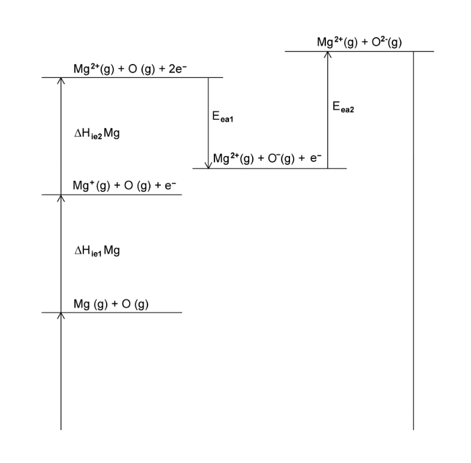
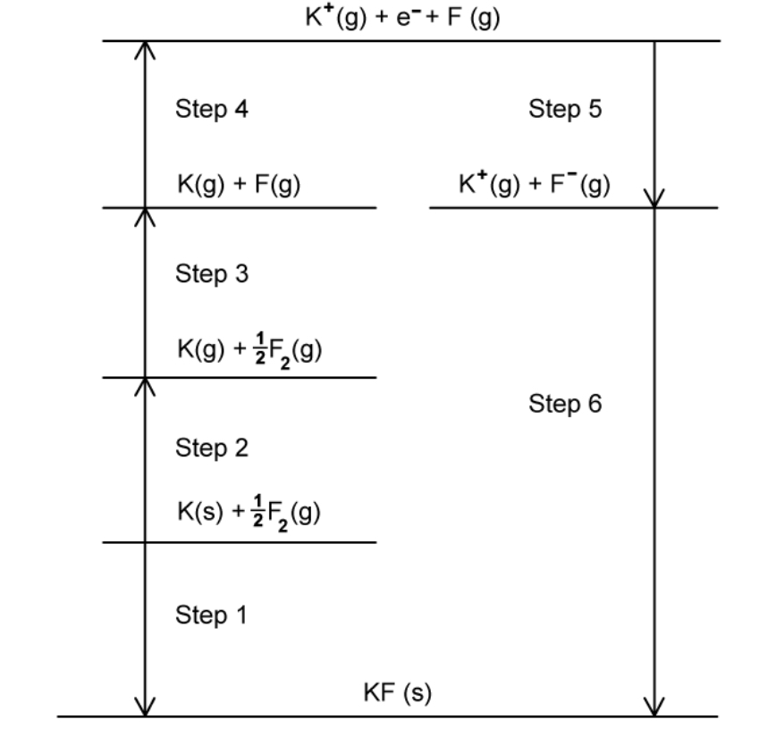
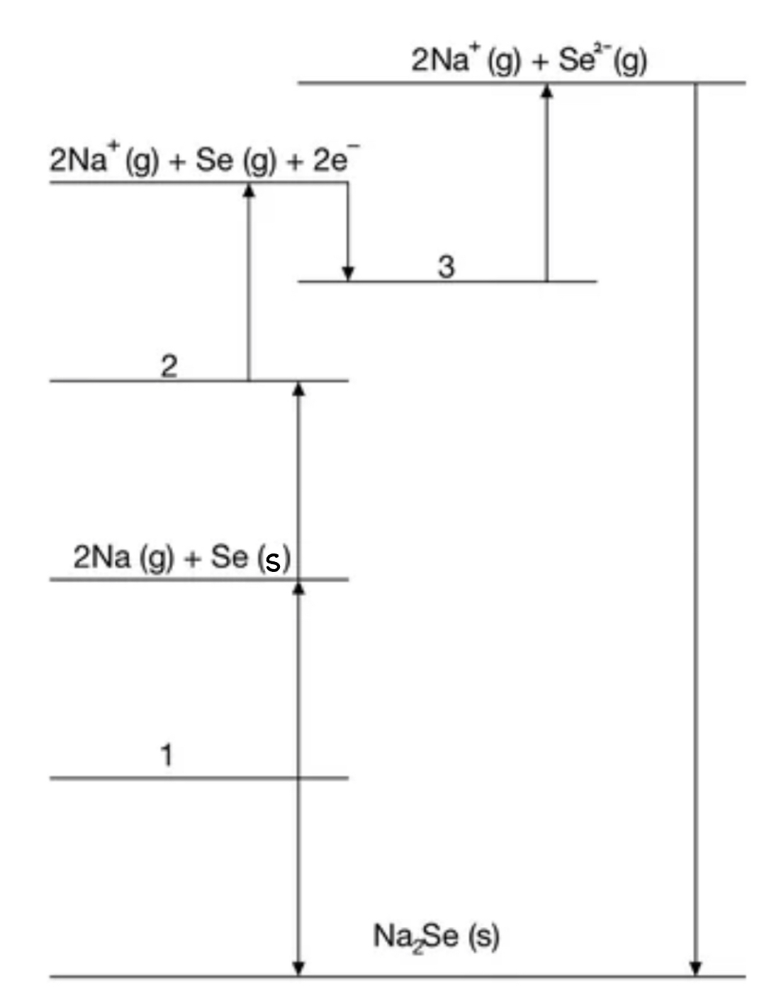

# Exam Questions — Lattice Energy & Born-Haber Cycles
**23. Chemical Energetics** · Cambridge (CIE) A-LEVEL chemistry (9701)
> Source: [https://www.savemyexams.com/a-level/chemistry/cie/25/topic-questions/](https://www.savemyexams.com/a-level/chemistry/cie/25/topic-questions/) · 11 questions across 1 sets

## Structured Questions (11 questions)

### Q1 — medium — 12 marks

**Q1** [2 marks]

Define the term lattice energy.

**Q1** [1 mark]

Construct an equation, including state symbols, to represent the first electron affinity of chlorine.

**Q1** [3 marks]

Some energy changes are shown in Table 1.1.

**Table 1.1**

| **Energy change** | **Value / kJ mol****-1** |
|---|---|
| Standard enthalpy change of formation of MgCl2 (s) | –641 |
| Standard enthalpy change of atomisation of magnesium | +148 |
| First ionisation energy of magnesium | +738 |
| Second ionisation energy of magnesium | +1450 |
| Standard enthalpy change of atomisation of chlorine | +121 |
| Lattice energy, Δ*H*θlatt, of magnesium chloride, MgCl2 (s) | –2526 |

Calculate the first electron affinity of chlorine. Use relevant data from Table 1.1 in your working.

Show your working.

It may be helpful to draw a labelled energy cycle.

**Q1** [4 marks]

Explain, in terms of ionic radius, charge density and polarisation, why the thermal stability of Group 2 carbonates increases down the group.

**Q1** [2 marks]

Predict and explain the sign of the standard entropy change, Δ*S*θ, for the decomposition of MgCO3 (s).

### Q2 — easy — 9 marks

**Q2** [2 marks]

Define the term lattice energy.

**Q2** [2 marks]

The Born-Haber cycle in Fig. 1.1 can be used to determine the lattice energy of calcium oxide.

Steps **A**–**G** include the values for enthalpy changes.

Complete the Born-Haber cycle by adding the species present on the two dotted lines.

Include state symbols.

**Fig. 1.1**

**Q2** [3 marks]

**Extract:**

The Born-Haber cycle in Fig. 1.1 can be used to determine the lattice energy of calcium oxide.

Steps **A**–**G** include the values for enthalpy changes.

Identify the enthalpy changes represented by steps **B**, **D** and **F** in the Born-Haber cycle.

**Q2** [2 marks]

Step **C** represents the enthalpy change of atomisation of oxygen.

Explain why the enthalpy change of atomisation is always endothermic.

### Q3 — hard — 5 marks

**Q3** [1 mark]

Magnesium oxide is often used in optical applications due to its light-reflecting properties in crystal form.

Write an equation to represent the lattice energy of MgO.

**Q3** [3 marks]

Use the data in Table 2.1 to calculate a value for the second ionisation energy of magnesium, Δ*H*θie2. Show your working.

**Table 2.1**

| **Enthalpy change** | **Enthalpy change / kJ mol**-1 |
|---|---|
| Lattice energy of MgO (s) | – 3791 |
| Enthalpy change of atomisation of Mg | + 148 |
| Enthalpy of atomisation of oxygen | + 248 |
| Electron affinity of the oxygen atom | – 141 |
| Electron affinity of the oxygen anion, O- | + 798 |
| First ionisation energy of Mg | + 736 |
| Enthalpy of formation of MgO | – 552 |

**Q3** [1 mark]

Magnesium oxide is generally insoluble in water whereas calcium oxide is sparingly soluble. Explain why there is no enthalpy of solution data for calcium oxide.

### Q4 — medium — 10 marks

**Q4** [1 mark]

Calcium chloride, CaCl2, is an important industrial chemical used in refrigeration plants, for de-icing roads and for giving greater strength to concrete.

Construct an equation to show what is meant by the lattice energy of calcium chloride.

**Q4** [3 marks]

Explain how the lattice energies of the following salts compare in magnitude with that of calcium chloride.

- calcium fluoride
- calcium sulfide

**Q4** [3 marks]

Use the data in Table 3.1 to calculate the lattice energy of CaCl2.

Show your working.

**Table 3.1**

| **Enthalpy change** | **Value / kJ mol****-1** |
|---|---|
| Standard enthalpy change of formation of CaCl2 (s) | –796 |
| Standard enthalpy change of atomisation of Ca (s) | +178 |
| Electron affinity per mole of Cl atoms | –349 |
| First ionisation energy of Ca | +590 |
| Second ionisation energy of Ca | +1150 |
| Standard enthalpy change of atomisation of Cl2 (g) | +244 |

**Q4** [3 marks]

When a solution of CaCl2 is added to a solution of the dicarboxylic acid, malonic acid, the salt calcium malonate is precipitated as a white solid.

The solid has the following composition by mass: Ca, 28.2%; C, 25.2%; H, 1.4%; O, 45.2%.

i) Calculate the empirical formula of calcium malonate.

[2]

ii) Suggest the structural formula of malonic acid.

[1]

### Q5 — easy — 8 marks

**Q5** [3 marks]

Table 3.1 shows the enthalpy data for the formation of sodium chloride.

**Table 3.1**

| **Symbol** | **Equation** | **Value / kJ mol****-1** |
|---|---|---|
| Δ*H*θf NaCl | Na (s) + ½Cl2 (g) → NaCl (s) | –411 |
| Δ*H*θat Cl | ½Cl2 (g) → Cl (g) | 121 |
| Δ*H*θat Na | Na (s) → Na (g) | 108 |
| Eea Cl | Cl (g) + e- → Cl- (g) | –349 |
| Δ*H*θie Na | Na (g) → Na+ (g) | 496 |
| Δ*H*θlatt NaCl | Na+(g) + Cl-(g) → NaCl (s) | To be calculated |

Calculate the lattice energy of sodium chloride.

Show your working.

**Q5** [2 marks]

Define the term first electron affinity.

**Q5** [3 marks]

**Extract:**

Define the term first electron affinity.

The definition of first electron affinity:
- The enthalpy change when one mole of electrons is gained by one mole of gaseous atoms to form one mole of gaseous ions with a single negative charge
- Under standard conditions

A section of the Born-Haber cycle for the formation of magnesium oxide is shown in Fig. 3.1.

**Fig. 3.1**

The first electron affinity of oxygen has a negative value so the arrow points downwards. The second electron affinity of oxygen has a positive value so the arrow points upwards.

Explain why the arrows point in different directions.

### Q6 — medium — 15 marks

**Q6** [5 marks]

One use of pure crystals of lithium fluoride is in X-ray monochromators.

The Born-Haber cycle for lithium fluoride is shown in Fig. 2.1.

**Fig. 2.1**

i) Define the term enthalpy of atomisation.

[2]

ii) Explain why the enthalpy of atomisation of fluorine is positive.

[1]

iii) Complete the Born-Haber cycle for lithium fluoride in Fig. 2.1 by adding the missing species on the lines.

[2]

**Q6** [5 marks]

**Extract:**

One use of pure crystals of lithium fluoride is in X-ray monochromators.

The Born-Haber cycle for lithium fluoride is shown in Fig. 2.1.

Use the data in Table 2.1 and your completed Born-Haber cycle from part **(a)** to answer the questions below.

**Table 2.1**

| **Name of enthalpy change** | **Energy change / kJ mol****-1** |
|---|---|
| Li (s) → Li (g) | +216 |
| Li (g) → Li+ (g) + e- | +520 |
| F2 (g) → 2F (g) | +158 |
| F (g) + e- → F- (g) | –348 |
| Li (s) + ½F2 (g) → LiF (s) | –594 |

i) Calculate the lattice energy of lithium fluoride.

Show your working.

[2]

ii) Explain and justify how the lattice energy of LiBr compares with that of LiF.

You must refer to the size of the ions in your answer.

[3]

**Q6** [3 marks]

This question is about enthalpy changes in solution.

i) Write the equation for the process showing the enthalpy of solution of potassium fluoride. Include state symbols in your answer.

[1]

ii) Use the data in Table 2.2 to calculate the standard enthalpy of solution of potassium fluoride.

Show your working.

[2]

**Table 2.2**

| **Name of enthalpy change in solution** | **Enthalpy change (kJ m****-1****)** |
|---|---|
| Enthalpy of lattice dissociation of potassium fluoride | +829 |
| Enthalpy of hydration of potassium ions | –340 |
| Enthalpy of hydration of fluoride ions | –504 |

**Q6** [2 marks]

Explain why the value for the enthalpy of hydration, Δ*H*θhyd, of Group 1 ions increases from lithium to caesium.

### Q7 — medium — 8 marks

**Q7** [3 marks]

Lattice energies are always negative showing that they represent exothermic changes.

i) Define the term lattice energy.

[2]

ii) Explain why lattice energy is an exothermic process.

[1]

**Table 5.1**

| **Enthalpy change** | **Value / kJ mol****-1** |
|---|---|
| Standard enthalpy change of atomisation of potassium | +89 |
| Electron affinity of O (g) | –141 |
| Electron affinity of O-(g) | +798 |
| Standard enthalpy change of formation of potassium oxide | –361 |
| First ionisation energy of potassium | +418 |
| Second ionisation energy of potassium | +3070 |
| First ionisation energy of oxygen | +1310 |
| Second ionisation energy of oxygen | +3390 |
| O=O bond energy (diatomic molecule) | +496 |
| O–O bond energy (polyatomic molecule) | +150 |

*Source: 2022 Specimen Paper 4 Q5A*

**Q7** [5 marks]

**Extract:**

**Table 5.1**

| **Enthalpy change** | **Value / kJ mol**^**-1**^ |
| --- | :---: |
| Standard enthalpy change of atomisation of potassium | +89 |
| Electron affinity of O (g) | –141 |
| Electron affinity of O^-^(g) | +798 |
| Standard enthalpy change of formation of potassium oxide | –361 |
| First ionisation energy of potassium | +418 |
| Second ionisation energy of potassium | +3070 |
| First ionisation energy of oxygen | +1310 |
| Second ionisation energy of oxygen | +3390 |
| O=O bond energy (diatomic molecule) | +496 |
| O–O bond energy (polyatomic molecule) | +150 |

i) Use relevant data from Table 5.1 to calculate the lattice energy, Δ*H*θlatt, of potassium oxide, K2O (s).

Show your working.

[3]

ii) State how Δ*H*θlatt Na2O (s) differs from Δ*H*θlatt K2O (s). Indicate this by placing **one** tick in the appropriate box in Table 5.2.

**Table 5.2**

| Δ*H*θlatt Na2O (s) is less negative than Δ*H*θlatt K2O (s) |   |
|---|---|
| Δ*H*θlatt Na2O (s) is the same as Δ*H*θlatt K2O (s) |   |
| Δ*H*θlatt Na2O (s) is more negative than Δ*H*θlatt K2O (s) |   |

Explain your answer.

[2]

*Source: 2022 Specimen Paper 4 Q5B*

### Q8 — hard — 9 marks

**Q8** [4 marks]

Potassium sulfide is a reagent used in analytical chemistry and pharmaceutical preparations.

Draw a fully labelled Born-Haber cycle for the formation of potassium sulfide from its elements.

Include state symbols for all species involved.

**Q8** [3 marks]

Use the data in Table 1.1 to calculate the lattice energy of potassium sulfide, Δ*H*θ*latt*. Show your working.

**Table 1.1**

| **Enthalpy change** | **Enthalpy change** **/ kJ mol**-1 |
|---|---|
| Formation of potassium sulfide | -381 |
| 1st electron affinity of sulfur | -200 |
| 2nd electron affinity of sulfur | +640 |
| Atomisation of sulfur | +279 |
| 1st ionisation energy of potassium | +419 |
| Atomisation of potassium | +89 |

**Q8** [2 marks]

**Extract:**

Table 1.1

| Enthalpy change | Enthalpy change / kJ mol^-1^ |
| :---: | :---: |
| Formation of potassium sulfide | -381 |
| 1st electron affinity of sulfur | -200 |
| 2nd electron affinity of sulfur | +640 |
| Atomisation of sulfur | +279 |
| 1st ionisation energy of potassium | +419 |
| Atomisation of potassium | +89 |

Explain the difference in values between the first and second electron affinities of sulfur.

### Q9 — medium — 10 marks

**Q9** [2 marks]

Magnesium reacts with fluorine to form magnesium fluoride.

Define the term first electron affinity.

**Q9** [2 marks]

i) Construct an equation for the second electron affinity of fluorine.

[1]

ii) Explain why the second electron affinity of fluorine is endothermic.

[1]

**Q9** [3 marks]

Calculate the electron affinity of a fluorine atom, Δ*H*θEA, using Table 5.1.

Show your working.

[3]

**Table 5.1**

| **Name of enthalpy change** | **Energy change (kJ mol****-1****)** |
|---|---|
| Enthalpy of atomisation of magnesium | +150 |
| First ionisation energy of magnesium | +738 |
| Second ionisation energy of magnesium | +1450 |
| Enthalpy of formation of magnesium fluoride | –642 |
| Enthalpy of atomisation of fluorine | +79.5 |
| Lattice energy of magnesium fluoride | –2493 |

**Q9** [3 marks]

**Extract:**

Define the term first electron affinity.

The definition of first electron affinity:
- Enthalpy change when 1 mole of electrons is gained by 1 mole of gaseous atoms
- To form 1 mole of gaseous ions with a single negative charge, under standard conditions

Explain why the first electron affinity of chlorine is less exothermic than that of fluorine.

### Q10 — easy — 12 marks

**Q10** [3 marks]

Construct one equation to represent each of the following changes.

Include state symbols.

- Atomisation of sodium
- Second ionisation energy of magnesium
- First electron affinity of chlorine

**Q10** [3 marks]

The Born-Haber cycle for the formation of potassium fluoride is shown in Fig. 2.1.

**Fig. 2.1**

Complete Table 2.1 by naming the enthalpy changes associated with the identified steps.

**Table 2.1**

| **Step** | **Name of the Enthalpy Change** |
|---|---|
| **1** |   |
| **2** | Atomisation of potassium |
| **3** |   |
| **4** | First ionisation energy of potassium |
| **5** |   |
| **6** | Lattice energy |

**Q10** [3 marks]

The lattice energies of potassium fluoride and caesium fluoride are –830 kJ mol-1 and –730 kJ mol-1 respectively.

Explain why the lattice energy of potassium fluoride is more exothermic than that of caesium fluoride.

**Q10** [3 marks]

Use the data in Table 2.2 to calculate the enthalpy of solution of potassium fluoride.

Show your working.

**Table 2.2**

| **Enthalpy change** | **Enthalpy change (kJ mol****-1****)** |
|---|---|
| Δ*H*θlatt KF | –830 |
| Δ*H*θhyd K+ | –351 |
| Δ*H*θhyd F- | –504 |

### Q11 — hard — 9 marks

**Q11** [3 marks]

The incomplete Born-Haber cycle for sodium selenide is shown below in Fig. 3.1.

Write the equations for processes 1, 2 and 3.

**Fig. 3.1**

**Q11** [3 marks]

If sulfur is used as opposed to selenium in the lattice, suggest the change in value of the lattice energy, Δ*H*θ*latt*. Explain your answer.

**Q11** [3 marks]

Use the data in Table 3.1 to calculate the lattice energy of aluminium oxide, Δ*H*θ*latt*. Show your working.

**Table 3.1**

| **Enthalpy Change** | **Enthalpy Change / kJ mol**-1 |
|---|---|
| Atomisation of aluminium | +326 |
| Atomisation of oxygen | +249 |
| First ionisation energy of aluminium | +578 |
| Second ionisation energy of aluminium | +1817 |
| Third ionisation energy of aluminium | +2745 |
| Electron affinity of O atom | –141 |
| Electron affinity of O- | +753 |
| Formation of aluminium oxide | –1670 |
