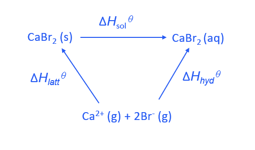
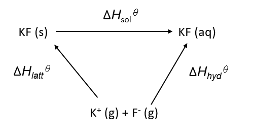

# Mark Schemes — Enthalpies of Solution & Hydration
**23. Chemical Energetics** · Cambridge (CIE) A-LEVEL chemistry (9701)

## Structured Questions (4 questions)

### Q1
The identity of M+ is deduced by calculating Δ*H*θhyd(M+) from the energy cycle.

- State the relationship from the energy cycle:

lattice energy + Δ*H*θsol = Δ*H*θhyd(M+) + Δ*H*θhyd(Cl–) **[1 mark]**

- Rearrange and substitute the known values:

Δ*H*θhyd(M+) = lattice energy + Δ*H*θsol − Δ*H*θhyd(Cl–)

Δ*H*θhyd(M+) = (−773) + (+4) − (−363)

Δ*H*θhyd(M+) = −406 kJ mol–1 **[1 mark]**

- Compare with Table 4.1:

M+ = **Na****+** **[1 mark]**

> **[mark-scheme]**
> 1 mark for correct energy cycle relationship
> 
> 1 mark for Δ*H*θhyd(M+) = −406 kJ mol–
> 
> 1 mark for Na+ **OR** correct identification of a Group 1 ion based on a numerical answer matching a value in Table 4.1
> 
> Allow error carried forward from incorrect rearrangement

> **[exam-tip]**
> Set up the energy cycle equation first:
> 
> lattice energy + Δ*H*θsol = ΣΔ*H*θhyd.
> 
> Rearranging to find Δ*H*θhyd(M+): subtract Δ*H*θhyd(Cl–) from both sides. The lattice energy given is negative. CIE defines lattice energy as the formation of the ionic lattice, so take care with signs when substituting.
> **[mark-scheme]**
> A possible formula for the new compound is:
> 
> - MBr (s) / MI (s) **[1 mark]**
> - The new halide ion has a larger ionic radius than Cl– / has more electron shells than Cl– **[1 mark]**
> - The attraction between M+ and the new halide ion is weaker than between M+ and Cl–, giving a less exothermic lattice energy **[1 mark]**

> **[exam-tip]**
> The lattice energy of the new compound (−705 kJ mol–) is less exothermic than that of MCl (−773 kJ mol–). Since M+ is unchanged, the difference must come from the halide ion. A less exothermic lattice energy means weaker ionic attractions, which occurs when the halide ion is larger. Both Br– and I– are larger than Cl–, so MBr and MI are both valid answers. MF would be incorrect as F– is smaller than Cl–, so MF would have a more exothermic lattice energy than MCl.
> **[mark-scheme]**
> i) The standard enthalpy change of hydration of Group 1 ions is exothermic because:
> 
> - Group 1 ions / M+ attract the δ– oxygen atoms in polar water molecules / ion-dipole attractions form between M+ and water **[1 mark]**
> - Bonds form between the Group 1 ion and water molecules, releasing energy **[1 mark]**
> 
> ii) The standard enthalpy change of hydration becomes less exothermic down Group 1 because:
> 
> - The ionic radius of M+ increases down the group **[1 mark]**
> - The ion-dipole attraction between M+ and water molecules decreases / water molecules are attracted less strongly as charge density decreases **[1 mark]**

> **[exam-tip]**
> For part i, connect two steps: the positive Group 1 ion is attracted to the δ– oxygen in water, and forming this attraction releases energy. Bond formation is always exothermic.
> 
> For part ii, all Group 1 ions carry the same charge (+1), so ionic radius is the only variable. A larger ion has a lower charge density, forms weaker ion-dipole attractions with water, and releases less energy on hydration.

### Q2
> **[mark-scheme]**
> The formation of CaBr2 in terms of electron transfer:
> 
> - One calcium atom loses two electrons **[1 mark]**
> - Two bromine atoms each gain one electron **[1 mark]**
> - Forming one Ca2+
> **AND**
> Two Br– ions **[1 mark]**
> 
> Answers referring to "bromine ions" instead of "bromide ions" are not accepted in the third mark point.

> **[exam-tip]**
> The formula CaBr2 tells you the ratio: one Ca to two Br. Calcium is in Group 2 and loses both outer electrons to form Ca2+. Each bromine atom individually gains one electron to form Br–, giving two bromide ions in total. Use "bromide" (not "bromine") when referring to the Br– ion.
> **[mark-scheme]**
> i) Lattice energy is the enthalpy change when:
> 
> - One mole of an ionic compound / ionic lattice is formed **[1 mark]**
> - From its constituent gaseous ions **[1 mark]**

ii) The enthalpy change of hydration of Ca2+ is calculated from the energy cycle.

- State the relationship from the energy cycle:

lattice energy + Δ*H*θsol(CaBr2) = Δ*H*θhyd(Ca2+) + 2 x Δ*H*θhyd(Br–)

- Rearrange and substitute values from Table 3.1:

Δ*H*θhyd(Ca2+) = (−2176) + (−99) − 2 x (−348) **[1 mark]**

Δ*H*θhyd(Ca2+) = **−1579 kJ mol****–1** **[1 mark]**

> **[mark-scheme]**
> Allow error carried forward from incorrect sign convention if the method is otherwise correct.

> **[exam-tip]**
> For part i, CIE uses "lattice energy" exclusively, always defined as the formation of the ionic lattice from gaseous ions (always exothermic, negative). This differs from other exam boards, which use separate terms for formation and dissociation.
> 
> For part ii, the overall equation (lattice energy + Δ*H*θsol = ΣΔ*H*θhyd) is not awarded a mark, but writing it out avoids sign errors. Multiply Δ*H*θhyd(Br–) by two, as two bromide ions dissolve per mole of CaBr2.
The standard enthalpy change of solution of KF is calculated using Hess's law.

- State the relationship from the energy cycle:

Δ*H*θsol = ΣΔ*H*θhyd − lattice energy **[1 mark]**

- Substitute the values from Table 3.2 and calculate:

Δ*H*θsol = [(−351) + (−504)] − (−830) **[1 mark]**

Δ*H*θsol(KF) = **−25 kJ mol****–1** **[1 mark]**

> **[mark-scheme]**
> 1 mark for correct relationship: ΣΔ*H*θhyd − lattice energy **OR** correctly constructed energy cycle
> 
> 1 mark for correct substitution
> 
> 1 mark for −25 kJ mol–1
> 
> Allow error carried forward from incorrect substitution if method is correct

> **[exam-tip]**
> The energy cycle gives:
> 
> lattice energy + Δ*H*θsol = ΣΔ*H*θhyd.
> 
> Rearranging:
> 
> Δ*H*θsol = ΣΔ*H*θhyd − lattice energy.
> 
> KF is a 1:1 ionic compound, so add both hydration enthalpies directly without multiplying either by a stoichiometric coefficient.

### Q3
> **[mark-scheme]**
> i) The standard enthalpy change of hydration of the fluoride ion is the enthalpy change when:
> 
> - One mole of F– (g) / one mole of gaseous fluoride ions **[1 mark]**
> - Dissolves in excess water to form an infinitely dilute solution / forms F– (aq) **[1 mark]**
> 
> ii) The standard enthalpy change of hydration of the fluoride ion is:
> 
> - Exothermic **[1 mark]**
> - The F– ion attracts the δ+ hydrogen atoms in water molecules / ion-dipole bonds form between F– and water molecules / energy is released as bonds form between the ion and water **[1 mark]**

> **[exam-tip]**
> For part i, both the quantity (one mole) and state (gaseous) of the fluoride ion must be stated, along with the product (infinitely dilute aqueous solution). A definition that omits "gaseous" or "excess water / infinite dilution" will lose a mark.
> 
> For part ii, state "exothermic" first. This earns the first mark independently. The explanation should focus on the ion-dipole attraction between the negative fluoride ion and the δ+ hydrogen atoms on water molecules. Forming these bonds releases energy, making the process exothermic.
> **[mark-scheme]**
> The fluoride ion's enthalpy change of hydration is more exothermic because:
> 
> - The fluoride ion has a smaller ionic radius than the chloride ion **[1 mark]**
> - The ion-dipole attraction between the fluoride ion and water molecules is stronger / the fluoride ion attracts the δ+ hydrogen atoms in water more strongly **[1 mark]**
> 
> Hydrogen bonding is not accepted as the basis for the explanation.

> **[exam-tip]**
> Both ions carry the same charge (1−), so the difference in hydration enthalpy is determined by ionic radius. A smaller ion concentrates the same charge in a smaller space (higher charge density), forming stronger ion-dipole attractions with the δ+ hydrogen atoms on water molecules and releasing more energy on hydration.
> **[mark-scheme]**
> Ca2+ has a more exothermic enthalpy change of hydration than Na+ because:
> 
> - Ca2+ has a higher charge (+2) than Na+ (+1) / Ca2+ has a higher charge density than Na+ **[1 mark]**
> - Ca2+ forms stronger ion-dipole attractions with water molecules / attracts water molecules more strongly **[1 mark]**
> 
> "Higher size to charge ratio" is not accepted; the correct comparison is charge density (charge relative to ionic radius).

> **[exam-tip]**
> The ionic radii of Ca2+ and Na+ are very similar (approximately 100 pm and 102 pm respectively), so the difference in hydration enthalpy is primarily due to the charge. Ca2+ carries twice the charge of Na+. Higher charge means a stronger attraction to the partial charges on surrounding water molecules, releasing more energy on hydration.

### Q4
> **[mark-scheme]**
> The standard enthalpy change of hydration is the enthalpy change when:
> 
> - One mole of gaseous ions **[1 mark]**
> - Dissolves in excess water to form an infinitely dilute solution **[1 mark]**

> **[exam-tip]**
> CIE requires both elements of this definition: the quantity and state of the ions (one mole, gaseous) and the process (dissolving in excess water to form an infinitely dilute solution). Writing only "dissolves in water" without specifying excess water or infinite dilution will not score the second mark.
> **[mark-scheme]**
> i) An equation representing the Δ*H*θhyd of the Mg2+ ion:
> 
> - Mg2+ (g) → Mg2+ (aq)
> **OR**
> Mg2+ (g) + 6H2O (l) → [Mg(H2O)6]2+ (aq) **[1 mark]**
> 
> ii) The Δ*H*θhyd of Mg2+ is more exothermic than that of Ca2+ because:
> 
> - Mg2+ has a smaller ionic radius / higher charge density than Ca2+ **[1 mark]**

> **[exam-tip]**
> For part i, both the simple ionic equation (Mg2+ (g) → Mg2+ (aq)) and the full coordination equation showing water molecules score the mark.
> 
> For part ii, Mg2+ and Ca2+ carry the same charge, so the smaller Mg2+ ion has a greater charge density, forming stronger ion-dipole attractions with water molecules and releasing more energy on hydration.
> **[mark-scheme]**
> The apparatus and measurements needed to determine Δ*H*θsol for MgCl2:
> 
> - Measure a known volume / mass of water into a polystyrene cup / calorimeter **[1 mark]**
> - Record the initial temperature of the water **[1 mark]**
> - Weigh out a known mass of MgCl2 **[1 mark]**
> - Record the final / maximum temperature reached
> **OR**
> Record the temperature change **[1 mark]**

> **[exam-tip]**
> CIE rewards four distinct steps: setting up a calorimeter with a known volume of water, recording the starting temperature, measuring the mass of MgCl2 added, and recording the temperature change. Once you have these measurements, calculate the energy change using *q* = *mc*Δ*T*, then convert to kJ mol–1 using the molar mass of MgCl2 (95.3 g mol–1).
The standard enthalpy change of solution of MgCl2 is calculated using Hess's law.

- State the relationship between Δ*H*θsol, Δ*H*θlatt and Δ*H*θhyd:

Δ*H*θsol = Δ*H*θhyd(Mg2+) + 2 x Δ*H*θhyd(Cl–) − Δ*H*θlatt **[1 mark]**

- Substitute the values from Table 4.1 and calculate:

Δ*H*θsol = (−1890) + 2 x (−398) − (−2526) **[1 mark]**

Δ*H*θsol = **−160 kJ mol****–1** **[1 mark]**

> **[mark-scheme]**
> 1 mark for correct relationship: Δ*H*θhyd(Mg2+) + 2 x Δ*H*θhyd(Cl–) − Δ*H*θlatt
> 
> 1 mark for correct substitution
> 
> 1 mark for −160 kJ mol–1; allow ECF from incorrect substitution if method is correct

> **[exam-tip]**
> The relationship Δ*H*θsol = ΣΔ*H*θhyd − Δ*H*θlatt follows from Hess's law. The lattice energy in the table is for formation (exothermic, negative), so subtracting it effectively adds its magnitude back. Remember to multiply Δ*H*θhyd(Cl–) by two, as two chloride ions are released when one mole of MgCl2 dissolves.
