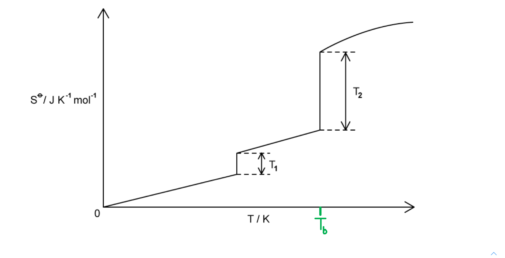

# Mark Schemes — Entropy Change, ΔS
**23. Chemical Energetics** · Cambridge (CIE) A-LEVEL chemistry (9701)

## Structured Questions (4 questions)

### Q1
> **[mark-scheme]**
> The meaning of the symbol ⊖ in Δ*H*⊖ is:
> 
> - Standard conditions **[1 mark]**

> **[exam-tip]**
> The ⊖ symbol indicates that the value was measured under standard conditions: a pressure of 101 kPa and a temperature of 298 K (25 °C).
> **[mark-scheme]**
> The standard entropy change is positive because:
> 
> - A liquid is formed from a solid / ice melts to form liquid water **[1 mark]**
> - Liquid water is more disordered than solid ice / particles have greater freedom of movement in a liquid than in a solid **[1 mark]**

> **[exam-tip]**
> Entropy is a measure of disorder in a system. The greater the disorder, the higher the entropy.
> 
> In this process, ice (a solid) changes to liquid water. Particles in a liquid have greater freedom of movement than those in a solid, so the system becomes more disordered and entropy increases, making Δ*S*⊖ positive.
To calculate the temperature at which Δ*G*⊖ = 0:

- List the known values:

  - Δ*H*⊖ = +6.03 kJ mol−1
  - Δ*S*⊖ = +22.1 J K−1 mol−1
- Rearrange Δ*G*⊖ = Δ*H*⊖ − *T*Δ*S*⊖ = 0 to find *T*:

*T* = `\frac{\Delta H^{\ominus}}{\Delta S^{\ominus}}` **[1 mark]**

- Convert Δ*H*⊖ from kJ mol−1 to J mol−1 and substitute:

*T* = $\frac{6.03\times1000}{22.1}$ **[1 mark]**

*T* = **273 K** **[1 mark]**

> **[mark-scheme]**
> 1 mark for the correct rearrangement: *T* = Δ*H*⊖ ÷ Δ*S*⊖
> 
> 1 mark for correct substitution with consistent units (Δ*H*⊖ converted to J mol−1, or Δ*S*⊖ converted to kJ K−1 mol−1)
> 
> 1 mark for the correct answer: 273 K

> **[exam-tip]**
> When using the Gibbs equation, Δ*H* and Δ*S* must be in the same units. Here, Δ*H*⊖ is in kJ mol−1 and Δ*S*⊖ is in J K−1 mol−1, so you must convert one to match the other before dividing.
> 
> The simplest approach is to multiply Δ*H*⊖ by 1000 to convert to J mol−1: 6.03 x 1000 = 6030 J mol−1.
> 
> Alternatively, divide Δ*S*⊖ by 1000 to convert to kJ K−1 mol−1: 22.1 ÷ 1000 = 0.0221 kJ K−1 mol−1. Both approaches give *T* = 273 K, which is 0 °C, the melting point of ice.

### Q2
i) The balanced equation for the reaction of ammonia with oxygen is:

4NH3 (g) + 5O2 (g) → 4NO (g) + 6H2O (g)

**[2 marks]**

> **[mark-scheme]**
> 1 mark for correct reactants, products and balancing
> 
> 1 mark for all correct state symbols

ii) To calculate Δ*S*θ for this reaction:

- Apply Δ*S*θ = ΣΔ*S*θ(products) − ΣΔ*S*θ(reactants):

Δ*S*θ = [(4 x Δ*S*θ(NO (g))) + (6 x Δ*S*θ(H2O (g)))] − [(4 x Δ*S*θ(NH3 (g))) + (5 x Δ*S*θ(O2 (g)))] **[1 mark]**

Δ*S*θ = [(4 x 210.8) + (6 x 188.8)] − [(4 x 192.8) + (5 x 205.2)]

Δ*S*θ = [843.2 + 1132.8] − [771.2 + 1026.0]

Δ*S*θ = 1976.0 − 1797.2

Δ*S*θ = **+178.8 J K****−1**** mol****−1** **[1 mark]**

> **[mark-scheme]**
> 1 mark for the correct method: ΣΔ*S*θ(products) − ΣΔ*S*θ(reactants) with stoichiometric coefficients correctly applied
> 
> 1 mark for the correct answer: +178.8 J K−1 mol−1

> **[exam-tip]**
> The equation to calculate entropy change is:
> 
> Δ*S*θ = ΣΔ*S*θ(products) − ΣΔ*S*θ(reactants)
> 
> Don't forget to multiply each standard entropy value by the stoichiometric coefficient of that species in the balanced equation. This balancing step must be carried through the entire calculation.
> **[mark-scheme]**
> The standard entropy change is positive because:
> 
> - There are 10 moles of gas in the products
> **AND**
> 9 moles of gas in the reactants
> **OR**
> There are more moles of gas in the products than in the reactants
> **OR**
> The system becomes more disordered **[1 mark]**

> **[exam-tip]**
> Examiners noted that many candidates did not explicitly state the change in moles of gaseous species. For full credit, state both the number of moles of gas in the products and the number in the reactants: 10 moles of gas on the right and 9 moles of gas on the left means the system becomes more disordered, giving a positive Δ*S*θ.
i) To calculate Δ*S*θ for the reaction 2NO (g) + O2 (g) → 2NO2 (g):

- Apply Δ*S*θ = ΣΔ*S*θ(products) − ΣΔ*S*θ(reactants):

Δ*S*θ = [2 x Δ*S*θ(NO2 (g))] − [(2 x Δ*S*θ(NO (g))) + Δ*S*θ(O2 (g))] **[1 mark]**

Δ*S*θ = (2 x 240.0) − [(2 x 210.8) + 205.2]

Δ*S*θ = 480.0 − [421.6 + 205.2]

Δ*S*θ = 480.0 − 626.8

Δ*S*θ = **−146.8 J K****−1**** mol****−1** **[1 mark]**

> **[mark-scheme]**
> i)
> 
> 1 mark for the correct method: ΣΔ*S*θ(products) − ΣΔ*S*θ(reactants) with stoichiometric coefficients correctly applied
> 
> 1 mark for the correct answer: −146.8 J K−1 mol−1

ii) To calculate Δ*G*θ for this reaction at 298 K:

- List the known values:

  - Δ*H*θ = −112 kJ mol−1
  - Δ*S*θ = −146.8 J K−1 mol−1 (from (c)(i))
  - *T* = 298 K
- State the Gibbs equation:

Δ*G*θ = Δ*H*θ − *T*Δ*S*θ **[1 mark]**

- Convert Δ*S*θ to kJ K−1 mol−1 and substitute:

Δ*G*θ = −112 − (298 x −0.1468) **[1 mark]**

Δ*G*θ = −112 + 43.7

Δ*G*θ = **−68.3 kJ mol****−1** **[1 mark]**

> **[mark-scheme]**
> ii)
> 
> 1 mark for stating the Gibbs equation: Δ*G*θ = Δ*H*θ − *T*Δ*S*θ
> 
> 1 mark for correct substitution with consistent units
> 
> 1 mark for the correct answer: −68.3 kJ mol−1
> 
> Allow error carried forward from an incorrect value of Δ*S*θ in (c)(i)

> **[exam-tip]**
> For part (i), the entropy change is negative because the number of moles of gas decreases: 3 moles of gas on the left (2NO + O2) become 2 moles on the right (2NO2). Fewer moles of gas means less disorder, so Δ*S*θ is negative.
> 
> For part (ii), remember to convert Δ*S*θ from J K−1 mol−1 to kJ K−1 mol−1 before substituting into the Gibbs equation, since Δ*H*θ is given in kJ mol−1. Divide Δ*S*θ by 1000: −146.8 ÷ 1000 = −0.1468 kJ K−1 mol−1.

### Q3
> **[mark-scheme]**
> The equation for potassium nitrate dissolving in water is:
> 
> - KNO3 (s) → K+ (aq) + NO3− (aq)
> **OR**
> KNO3 (s) + aq → K+ (aq) + NO3− (aq) **[1 mark]**

> **[exam-tip]**
> The standard enthalpy change of solution (Δ*H*θsol) is the enthalpy change when 1 mole of an ionic substance dissolves in sufficient water to form a very dilute solution.
> 
> The symbol (aq) indicates that the ions are dissolved in sufficient water to form a dilute aqueous solution.
> **[mark-scheme]**
> Δ*S*θ is positive because:
> 
> - Disorder increases as the solid dissolves / solid changes to aqueous ions / particles have greater freedom of movement in solution **[1 mark]**

> **[exam-tip]**
> When KNO3 dissolves, the ionic lattice breaks down:
> 
> KNO3 (s) → K+ (aq) + NO3− (aq)
> 
> The ions are now free to move in solution, so disorder increases and entropy increases, making Δ*S*θ positive.
To calculate the temperature above which the dissolving of potassium nitrate becomes feasible:

- List the known values:

  - Δ*H*θ = +34.9 kJ mol−1
  - Δ*S*θ = +117 J K−1 mol−1
- At the feasibility threshold, Δ*G*θ = 0. Rearrange Δ*G*θ = Δ*H*θ − *T*Δ*S*θ = 0 to find *T*:

*T* = $\frac{ΔH^{θ}}{ΔS^{θ}}$ **[1 mark]**

- Convert Δ*H*θ from kJ mol−1 to J mol−1 and substitute:

*T* = $\frac{34.9\times1000}{117}$ **[1 mark]**

*T* = **298 K** **[1 mark]**

> **[mark-scheme]**
> 1 mark for the correct rearrangement: *T* = Δ*H*θ ÷ Δ*S*θ
> 
> 1 mark for correct substitution with consistent units
> 
> 1 mark for the correct answer: 298 K

> **[exam-tip]**
> The reaction becomes feasible when Δ*G*θ ≤ 0. Setting Δ*G*θ = 0 gives the threshold temperature above which the reaction becomes feasible.
> 
> Remember to ensure Δ*H*θ and Δ*S*θ are in the same units before dividing. Here, multiply Δ*H*θ by 1000 to convert from kJ mol−1 to J mol−1: 34.9 x 1000 = 34 900 J mol−1. Then divide by Δ*S*θ = 117 J K−1 mol−1 to get *T* = 298 K.
> **[mark-scheme]**
> i) The sign of Δ*G*θ at a temperature lower than 298 K:
> 
> - Positive / Δ*G*θ > 0 **[1 mark]**
> 
> ii) A positive Δ*G*θ indicates that:
> 
> - The dissolving of potassium nitrate is not feasible / not spontaneous / does not occur at this temperature **[1 mark]**
> 
> Allow error carried forward from (d)(i): if negative, allow "feasible / spontaneous"

> **[exam-tip]**
> At the threshold temperature from part (c), Δ*G*θ = 0. Below this temperature, the *T*Δ*S*θ term decreases in magnitude, so Δ*G*θ = Δ*H*θ − *T*Δ*S*θ becomes more positive.
> 
> A positive Δ*G*θ means the process is not feasible: potassium nitrate is less likely to dissolve at temperatures below 298 K.

### Q4
iii) The completed figure is:

**[1 mark]**

> **[mark-scheme]**
> i) At 0 K, the entropy of water is zero because:
> 
> - (At 0 K) particles are stationary / not moving / not vibrating
> **OR**
> The particles have zero kinetic energy **[1 mark]**
> - There is no disorder / perfect order / maximum order in the arrangement of the particles **[1 mark]**
> 
> ii) The entropy change is larger at *T*2 than at *T*1 because:
> 
> - *T*2 corresponds to boiling / evaporating / condensing / l → g / g → l
> **AND**
> *T*1 corresponds to melting / freezing / s → l / l → s **[1 mark]**
> - The change in disorder is greater for *T*2 / boiling than for *T*1 / melting **[1 mark]**
> 
> iii) 1 mark for *T*b marked on the temperature axis, vertically below the second step, *T*2

> **[exam-tip]**
> When explaining the entropy change from Fig. 3.1, compare the change in state with the change in disorder to gain both marks.
> 
> Avoid discussing the change in disorder without clearly stating the change in state — for example, specify a change from liquid to gas, not just 'gas'.
> 
> The boiling point represents the largest change in entropy, as the state changes from liquid to gas. This is why *T*b is marked on the temperature axis, vertically below *T*2 on Fig. 3.1.
To calculate Δ*S*θ for the reaction:

- Apply the formula Δ*S*θ = Σ*S*θ (products) – Σ*S*θ (reactants):

Δ*S*θ = (240.0 + 205.2) – (210.8 + 238.9) **[1 mark]**

Δ*S*θ = 445.2 – 449.7

Δ*S*θ = **–4.5 J K****–1**** mol****–1** **[1 mark]**

> **[mark-scheme]**
> 1 mark for correct formula and substitution: (240.0 + 205.2) – (210.8 + 238.9)
> 
> 1 mark for the correct final answer: –4.5 J K–1 mol–1

> **[exam-tip]**
> When calculating the standard entropy change of a reaction, use the formula:
> 
> Δ*S*θ = Σ*S*θ (products) – Σ*S*θ (reactants)
> 
> Remember to account for the number of moles of each substance in the balanced equation when applying this formula.
i) To calculate the standard enthalpy change of reaction:

- Apply the formula:

Δ*H*θ = ΣΔ*H*fθ (products) – ΣΔ*H*fθ (reactants)

**OR**

Δ*H*θ = (2 x –395) – (2 x –297) **[1 mark]**

Δ*H*θ = –790 – (–594)

Δ*H*θ = **–196 kJ mol****–1** **[1 mark]**

> **[mark-scheme]**
> i)
> 
> 1 mark for the formula **AND** correct substitution: (2 × –395) – (2 × –297)
> 
> 1 mark for the correct final answer: –196 kJ mol–1

> **[exam-tip]**
> Writing out the formula at the start of a calculation can sometimes earn the first mark, and is good practice for structuring your working.

ii) To calculate the standard Gibbs free energy change at 298 K:

- Convert Δ*S*θ from J K–1 mol–1 to kJ K–1 mol–1:

Δ*S*θ = –189 ÷ 1000 = –0.189 kJ K–1 mol–1 **[1 mark]**

- Apply the formula:

Δ*G*θ = Δ*H*θ – *T*Δ*S*θ

**OR**

Δ*G*θ = –196 – (298 x –0.189) **[1 mark]**

Δ*G*θ = **–140 kJ mol****–1** **[1 mark]**

> **[mark-scheme]**
> ii)
> 
> 1 mark for converting Δ*S*θ to kJ K–1 mol–1: –189 ÷ 1000 = –0.189 kJ K–1 mol–1
> 
> 1 mark for the formula **AND** correct substitution into Δ*G*θ = Δ*H*θ – *T*Δ*S*θ
> 
> Allow error carried forward from part (i) for the enthalpy value
> 
> 1 mark for the correct final answer: –140 kJ mol–1

> **[exam-tip]**
> For part (ii), convert Δ*S*θ from J K–1 mol–1 to kJ K–1 mol–1 before substituting into the formula, as Δ*H*θ is in kJ mol–1. Divide by 1000: –189 ÷ 1000 = –0.189 kJ K–1 mol–1.

> **[mark-scheme]**
> iii) Whether the reaction is feasible at 298 K:
> 
> - (Yes,) the reaction is feasible because Δ*G*θ is negative **[1 mark]**

> **[exam-tip]**
> For part (iii), reference Δ*G*θ being negative to justify feasibility at 298 K.
