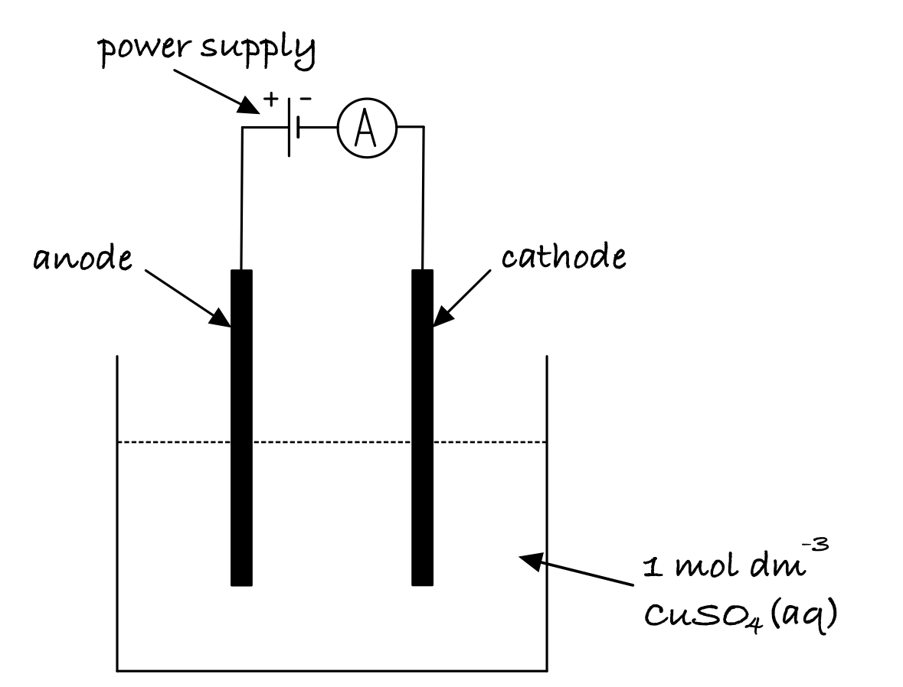
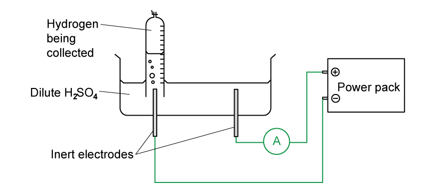

# Mark Schemes — Electrolysis
**24. Electrochemistry** · Cambridge (CIE) A-LEVEL chemistry (9701)

## Structured Questions (10 questions)

### Q1
> **[mark-scheme]**
> The lithium-iodine electrochemical cell is a dry cell because:
> 
> - There is no water / liquid present in the cell **[1 mark]**
> - Water / liquid could react with the lithium electrode
> **AND**
> (this) could cause the cell to explode
> **OR**
> (this) could cause a build-up of pressure inside the cell **[1 mark]**

> **[exam-tip]**
> This question uses knowledge of Group 1 metal reactivity. Lithium, like all Group 1 metals, reacts vigorously with water to produce a metal hydroxide and hydrogen gas. Since the cell is sealed, hydrogen production would cause a dangerous pressure build-up.
> 
> For both marks, you need two separate points: that there is no liquid in the cell, and why the presence of liquid would be harmful.
> **[mark-scheme]**
> The overall equation for the lithium-iodine electrochemical cell:
> 
> - 2Li + I2 → 2Li+ + 2I– **[1 mark]**
> 
> State symbols are not required

> **[exam-tip]**
> Combine the two half-equations, ensuring the electrons cancel:
> 
> - Oxidation (anode): 2Li → 2Li+ + 2e–
> - Reduction (cathode): I2 + 2e– → 2I–
> 
> Adding these together cancels the 2e–, giving the overall equation 2Li + I2 → 2Li+ + 2I–.
To calculate *E*θcell for the lithium-iodine electrochemical cell:

*E*θcell = *E*θreduced − *E*θoxidised

*E*θcell = (+0.54) − (−3.04)

*E*θcell = **+3.58 V** **[1 mark]**

> **[exam-tip]**
> The iodine half-cell (I2 / I–, *E*θ = +0.54 V) undergoes reduction as it has the more positive electrode potential. Lithium (Li+ / Li, *E*θ = −3.04 V) is oxidised.
> 
> The Ni2+ / Ni half-cell is a distractor. It is not involved in the lithium-iodine cell.
To calculate the number of days for 0.08 g of the lithium electrode to be used up:

- Calculate the moles of lithium:

n(Li) = $\frac{0.08}{6.9}$

n(Li) =  = **1.16 × 10****-2**** mol** **[1 mark]**

- Calculate the charge required:

*Q* = n × *F*

*Q* = 1.16 × 10-2 × 9.65 × 104

*Q* = **1119 C** **[1 mark]**

- Calculate the time in seconds:

*t* = $\frac{1119}{1.5\times10^{-5}}$

*t* = **7.46 × 10****7**** s** **[1 mark]**

- Convert to days:

*t* = $\frac{7.46\times10^{7}}{60\times60\times24}$

*t* = **863 days** **[1 mark]**

### Q2
> **[mark-scheme]**
> The equation linking charge, current and time:
> 
> - *Q* = *I* x *t*
> **OR**
> *I* = *Q* / *t*
> **OR**
> *t* = *Q* / *I* **[1 mark]**
> 
> The units for each term:
> 
> - Charge = coulombs (C)
> **AND**
> Current = amps / amperes (A)
> **AND**
> Time = seconds (s) **[1 mark]**

> **[exam-tip]**
> Questions using Faraday's law are not very common at IAL level, but you should know the equations and be able to apply them.
> 
> The most useful form to learn is *Q* = *I* x *t*, since charge is usually what you calculate first in Faraday's law problems.
> **[mark-scheme]**
> One Faraday measures:
> 
> - The charge carried by 1 mole of electrons / 1 mole of singly charged ions **[1 mark]**

> **[exam-tip]**
> The equation *F* = *L* x *e* shows this clearly: *L* is Avogadro's constant (one mole of particles) and *e* is the charge on a single electron. Multiplying gives the total charge on one mole of electrons.
The completed table is:

| **Equation** | **Number of moles of electrons** | **Amount of charge / C** |
|---|---|---|
| K+ + e– → K | 1 | 96 500 |
| Cr3+ + 3e– → Cr | **Final answer:** **3** | **Final answer:** **289 500** |
| **Final answer:** **S****2–**** → S + 2e****–** | **Final answer:** **2** | **Final answer:** **193 000** |

**[3 marks]**

> **[mark-scheme]**
> 1 mark for Cr3+ row: 3 moles of electrons **AND **289 500 C of charge
> 
> 1 mark for S2– equation: S2– → S + 2e–
> 
> 1 mark for S2– values: 2 moles of electrons **AND **193 000 C of charge

> **[exam-tip]**
> The example row shows that K+ requires 1 mole of electrons and 96 500 C of charge (one Faraday).
> 
> For Cr3+ + 3e– → Cr:
> 
> - 3 moles of electrons are needed, so charge = 3 x 96 500 = 289 500 C.
> 
> For S2–:
> 
> - The ion carries a 2– charge, so it loses 2 moles of electrons to form neutral sulfur.
> - The half-equation is S2– → S + 2e–, and charge = 2 x 96 500 = 193 000 C.
To calculate the standard electrode potential of the Cr / Cr3+ half-cell:

- Write the cell potential equation:

*E*θcell = *E*θreduced − *E*θoxidised

- Rearrange the cell potential equation for *E*θoxidised:

*E*θoxidised = *E*θreduced − *E*θcell

- Substitute values and solve:

*E*θoxidised = +0.34 − 1.08

*E*θoxidised = **-0.74 V** **[1 mark]**

> **[exam-tip]**
> The cell potential equation is *E*θcell = *E*θreduced − *E*θoxidised. Since the copper half-cell undergoes reduction, it provides *E*θreduced. Rearrange to find *E*θoxidised for the chromium half-cell.
> 
> Always identify which half-cell is reduced and which is oxidised before applying the equation. The question tells you copper is reduced, so chromium must be oxidised.
> **[mark-scheme]**
> The two half-equations are:
> 
> - Cr (s) → Cr3+ (aq) + 3e– **[1 mark]**
> - 2H+ (aq) + 2e– → H2 (g) **[1 mark]**

> **[exam-tip]**
> The standard electrode potential of Cr / Cr3+ is negative (−0.74 V from the previous part), so chromium is more easily oxidised than hydrogen. This means chromium undergoes oxidation (loses electrons) and hydrogen undergoes reduction (gains electrons).

### Q3
> **[mark-scheme]**
> The relationship between *F*, *e*, and *L* is:
> 
> - *F* = *L* x *e*
> **OR**
> *L* = *F* / *e*
> **OR**
> *e* = *F* / *L* **[1 mark]**

> **[exam-tip]**
> *F* is the Faraday constant (96 500 C mol-1), *e* is the charge on one electron (1.60 x 10-19 C), and *L* is the Avogadro constant (6.02 x 1023 mol-1). This relationship defines one faraday as the charge carried by one mole of electrons.
The completed diagram of the apparatus is:

**[4 marks]**

> **[mark-scheme]**
> 1 mark for a correct circuit with two electrodes and a power supply
> 
> 1 mark for an ammeter correctly connected in series
> 
> 1 mark for anode and cathode correctly labelled with the correct polarity
> 
> 1 mark for CuSO4(aq) / CuCl2(aq) / Cu2+(aq) **AND** stated as 1 mol dm-3

> **[exam-tip]**
> Both electrodes are made from copper. The cathode increases in mass as copper is deposited and the anode decreases in mass as copper goes into solution as Cu2+ ions. A variable resistor is sometimes included to adjust the current to a suitable value, but it is not required for full marks. Calculations based on this experiment typically use the decrease in mass of the anode, as not all copper formed on the cathode adheres correctly.
To calculate the Avogadro constant, *L*:

- List the known values:

- current, *I* = 0.375 A
- time, *t* = 40.0 min = 40.0 x 60 = 2400 s
- mass of Cu deposited = 49.936 − 49.637 = 0.299 g

- Calculate the charge passed, *Q*:

*Q* = *It*

*Q* = 0.375 x 2400

*Q* = 900 C **[1 mark]**

- Calculate the moles of copper deposited, n(Cu):

n(Cu) = $\frac{0.299}{63.5}$

n(Cu) = 4.71 x 10-3 mol **[1 mark]**

- Calculate the charge required to deposit 1 mol of Cu:

charge for 1 mol Cu = $\frac{900}{4.71\times10^{-3}}$

charge for 1 mol Cu = 191 083 C **[1 mark]**

- Calculate the charge carried by 1 mol of electrons (Cu2+ + 2e– → Cu, so 1 mol Cu requires 2 mol e–):

charge on 1 mol e– = $\frac{191083}{2}$

charge on 1 mol e– = 95 541 C **[1 mark]**

- Calculate *L*:

*L* = $\frac{95541}{1.60\times10^{-19}}$

*L* = **5.97 x 10****23**** mol****-1** **[1 mark]**

> **[mark-scheme]**
> Allow Method 2: calculate n(Cu) → n(e–) = 2 x n(Cu) → Q = *It* → number of e– passed = Q / e → *L* = number of e– / n(e–), also giving *L* = 5.97 x 1023 mol-1.
> 
> Allow intermediate values rounded to 3 sf at each step, provided the final answer rounds correctly to 5.97 x 1023 mol-1.

> **[exam-tip]**
> Each Cu2+ ion requires 2 electrons to be reduced to Cu, so 1 mol Cu requires 2 mol of electrons. This is the key step that converts charge per mole of Cu into charge per mole of electrons.
> 
> If you use the unrounded value for n(Cu) (4.70866... x 10-3 mol) at each step, intermediate values differ slightly but the final answer to 3 significant figures remains 5.97 x 1023 mol-1. The final answer must be given to 3 significant figures.
The substances formed at each electrode are:

| **compound** | **product at anode** | **product at cathode** |
|---|---|---|
| AgF | **Final answer:** **O****2**** / Oxygen** | **Final answer:** **Ag / Silver** |
| FeSO4 | **Final answer:** **O****2**** / Oxygen** | **Final answer:** **H****2**** / Hydrogen** |
| MgBr2 | **Final answer:** **Br****2**** / Bromine** | **Final answer:** **H****2**** / Hydrogen** |

**[5 marks]**

> **[mark-scheme]**
> 6 correct answers: 5 marks
> 
> 5 correct answers: 4 marks
> 
> 4 correct answers: 3 marks
> 
> 3 correct answers: 2 marks
> 
> 2 correct answers: 1 mark
> 
> Molecular formulae are required. Atomic symbols alone (e.g. Br, O) are not accepted.

> **[exam-tip]**
> In an aqueous solution, H+ and OH– ions from water are also present and can be discharged. To predict which ion is discharged:
> 
> At the cathode, the cation with the most positive *E*θ is discharged.
> 
> - In AgF, Ag+ (*E*θ = +0.80 V) and H+ (*E*θ = 0.00 V) are both present.
> - Ag+ has the more positive *E*θ, so Ag is deposited at the cathode.
> 
> At the anode, the anion discharged depends on its identity:
> 
> - Halide ions (Cl–, Br–, I–) are discharged in preference to OH– from water, producing the halogen (Cl2, Br2, or I2).
> - F– is never discharged in aqueous solution.
> 
>   - F2/F– has the highest reduction *E*θ in the table (+2.87 V), making F– far too difficult to oxidise.
>   - OH– from water is preferentially oxidised, forming O2.
> - Polyatomic anions (SO42–, NO3–) are never discharged in preference to OH–.
> 
>   - OH– is oxidised, forming O2.
> 
> Applying these rules:
> 
> - AgF:
> 
>   - F– is never discharged in aqueous solution.
>   - So, OH– is oxidised → O2 at the anode.
> - FeSO4:
> 
>   - SO42– is a polyatomic anion.
>   - So, OH– is oxidised → O2 at the anode.
> - MgBr2:
> 
>   - Br– is a halide.
>   - So, Br2 is produced at the anode.

### Q4
> **[mark-scheme]**
> The equation for the electrolysis of lead(II) chloride:
> 
> - PbCl2 → Pb + Cl2 **[1 mark]**
> 
> State symbols are not required

> **[exam-tip]**
> The electrolysis of molten lead(II) chloride produces lead at the cathode (reduction) and chlorine at the anode (oxidation). The overall equation shows the decomposition of the ionic compound into its elements.
> **[mark-scheme]**
> i) The half-equation for the reduction of the lead(II) ion, Pb2+:
> 
> - Pb2+ + 2e– → Pb **[1 mark]**

ii) To calculate the mass of lead deposited at the cathode:

- Determine the number of coulombs required to deposit one mole of lead:

From Pb2+ + 2e– → Pb, 2 moles of electrons are required per mole of lead

Coulombs per mole of Pb = 2 x 96 500

Coulombs per mole of Pb = **193 000 C** **[1 mark]**

- Convert time to seconds:

*t* = 10 x 60

*t *= **600 s** **[1 mark]**

- Calculate the charge transferred:

*Q* = *I* x *t*

*Q* = 1.65 x 600

*Q* = **990 C** **[1 mark]**

- Calculate the moles of lead deposited:

*n*(Pb) = $\frac{990}{193000}$

*n*(Pb) = **5.13 × 10****-3**** mol** **[1 mark]**

- Calculate the mass of lead:

mass = n x *M*r

mass = 5.13 × 10-3 x 207.2

mass = **1.06 g** **[1 mark]**

> **[exam-tip]**
> Work through Faraday's law calculations step by step. The key is identifying the number of electrons from the half-equation.
> 
> For Pb2+ + 2e– → Pb, two electrons are needed, so 2 x 96 500 = 193 000 C are required per mole of lead.
> 
> Always convert time to seconds before calculating charge.
> **[mark-scheme]**
> i) The half-equation for the oxidation of the chloride ion, Cl–:
> 
> - 2Cl– → Cl2 + 2e– **[1 mark]**

ii) To calculate the volume of chlorine released at the anode:

- Determine the number of coulombs required to form one mole of chlorine:

From 2Cl– → Cl2 + 2e–, 2 moles of electrons are required per mole of Cl2

Coulombs per mole of Cl2 = 2 x 96 500

Coulombs per mole of Cl2 = **193 000 C** **[1 mark]**

- Calculate the moles of chlorine released:

*n*(Cl2) = $\frac{990}{193000}$

*n*(Cl2) = 5.1295 x 10-3 mol

- Calculate the volume of chlorine released:

Volume = 5.1295 x 10-3 x 24.0

Volume = **0.123 dm****3**

**[1 mark]**

> **[exam-tip]**
> Since 2Cl– → Cl2 + 2e– also involves 2 moles of electrons, the charge calculations are identical to part (b): 193 000 C per mole of Cl2 and 990 C transferred.
> 
> At RTP, one mole of gas occupies 24.0 dm3. Convert moles to volume: 5.1295 x 10-3 x 24.0 = 0.123 dm3.

### Q5
> **[mark-scheme]**
> i) The two additional pieces of equipment needed:
> 
> - Ammeter / galvanometer **[1 mark]**
> - Clock / stopwatch / timer
> **OR**
> Variable resistor / rheostat **[1 mark]**

ii) The completed diagram is:

> **[mark-scheme]**
> 1 mark for ammeter shown in circuit AND a complete circuit
> 
> 1 mark for negative terminal of power pack connected to the left-hand electrode (cathode)

> **[exam-tip]**
> Current and time are both needed to calculate charge (*Q* = *I* × *t*), so an ammeter and timer are essential. A variable resistor can be used to keep the current constant during the experiment.
> 
> Hydrogen collects at the cathode (negative electrode) and oxygen at the anode. Since hydrogen forms at the left electrode, the negative terminal must connect there.
> **[mark-scheme]**
> The measurements needed to calculate the Faraday constant:
> 
> - Volume of hydrogen gas collected **[1 mark]**
> - Time **[1 mark]**
> - Current / ammeter reading **[1 mark]**

> **[exam-tip]**
> To calculate the Faraday constant, you need two things:
> 
> 1. The charge that passed (*Q* = *I* × *t*, requiring current and time)
> 2. The moles of electrons that carried it
> 
> From the half-equation 2H+ + 2e– → H2, moles of e– = 2 × moles of H2. Moles of H2 come from the volume of gas collected at RTP.
> **[mark-scheme]**
> The relationship between *F*, *L*, and *e*:
> 
> - *F* = *L* × *e*
> **OR**
> *L* = *F* / *e*
> **OR**
> *e* = *F* / *L* **[1 mark]**

> **[exam-tip]**
> One faraday is the charge carried by one mole of electrons. Each electron carries charge *e* coulombs, and there are *L* electrons per mole, so the total charge is *F* = *L* × *e*.
To calculate the Avogadro constant using *L* = *F* / *e*:

*L* = $\frac{9.65\times10^{4}}{1.60\times10^{-19}}$

*L* = **6.03 x 10****23**** mol****-1** **[1 mark]**

> **[mark-scheme]**
> Allow 6.02 × 1023 mol-1 if the student uses a slightly different value of *F*

> **[exam-tip]**
> Rearrange *F* = *L* × *e* to *L* = *F* / *e*, then substitute.
> 
> The answer should be around 6 × 1023 mol-1.
> 
> If you get a small number or a negative exponent, recheck your entry into the calculator.

### Q6
> **[mark-scheme]**
> The definition of electrolysis:
> 
> - Breaking down / decomposing a compound into its elements **[1 mark]**
> - Using an electric current
> **OR**
> Using electricity **[1 mark]**

> **[exam-tip]**
> The word 'electrolysis' itself hints at the definition: 'electro' refers to electricity, while 'lysis' comes from the Greek meaning to loosen or separate.
> 
> This is a definition you should know from GCSE, so learn it precisely.
The completed table is:

| **Term** | **Charge (positive / negative)** |
|---|---|
| Anion | **Final answer:** **Negative** |
| Anode | **Final answer:** **Positive** |
| Cathode | **Final answer:** **Negative** |
| Cation | **Final answer:** **Positive** |

**[2 marks]**

> **[mark-scheme]**
> 2 marks for all four correct answers
> 
> 1 mark for any two or three correct answers

> **[exam-tip]**
> Remember PANIC: **P**ositive **A**node, **N**egative **I**s **C**athode. Anions and cations carry the matching charges to be attracted to their respective electrodes: anions (negative) to the positive anode; cations (positive) to the negative cathode.
> **[mark-scheme]**
> i) The definitions of oxidation and reduction in terms of electrons:
> 
> - Oxidation = loss of electrons **[1 mark]**
> - Reduction = gain of electrons **[1 mark]**
> 
> ii) The half-equation for the reduction of copper(II) ions, Cu2+:
> 
> - Cu2+ + 2e– → Cu **[1 mark]**
> 
> iii) The half-equation for the oxidation of chloride ions, Cl–:
> 
> - 2Cl– → Cl2 + 2e– **[1 mark]**

> **[exam-tip]**
> Remember OILRIG: Oxidation Is Loss, Reduction Is Gain. This applies specifically to electrons in electrochemistry.
> 
> In half-equations, electrons appear on the right-hand side for oxidation (loss) and on the left-hand side for reduction (gain).

### Q7
> **[mark-scheme]**
> i) The half-equation at the anode:
> 
> - Cu (s) → Cu2+ (aq) + 2e– **[1 mark]**
> 
> State symbols required
> 
> ii) Silver remains as the metal because:
> 
> - *E*θ for Ag+ / Ag (+0.80 V) is more positive than *E*θ for Cu2+ / Cu (+0.34 V) **[1 mark]**
> - Silver is less easily oxidised than copper **[1 mark]**
> 
> iii) Nickel at the anode:
> 
> - *E*θ for Ni2+ / Ni (−0.25 V) is more negative than *E*θ for Cu2+ / Cu (+0.34 V) **[1 mark]**
> - Nickel is readily oxidised and dissolves as Ni2+ (aq) **[1 mark]**
> 
> iv) The half-equation at the cathode:
> 
> - Cu2+ (aq) + 2e– → Cu (s) **[1 mark]**
> 
> State symbols required
> 
> v) Zinc is not deposited at the cathode because:
> 
> - *E*θ for Zn2+ / Zn is −0.76 V (more negative than Cu2+ / Cu), so Zn2+ is less easily reduced than Cu2+ **[1 mark]**

> **[exam-tip]**
> The key rule: the more positive the *E*θ, the more easily the left-hand species is reduced; the more negative the *E*θ, the more easily the right-hand species is oxidised.
> 
> Ag (+0.80 V) is more positive than Cu (+0.34 V), so Ag is harder to oxidise and stays as the metal.
> 
> Ni (−0.25 V) and Zn (−0.76 V) are more negative than Cu, so they dissolve from the anode. At the cathode, Cu2+ (+0.34 V) is preferentially reduced over Zn2+ (−0.76 V).
> **[mark-scheme]**
> The blue colour fades because:
> 
> - Cu2+ ions are removed from solution at the cathode / the concentration of Cu2+ decreases **[1 mark]**
> - Zn2+ / Ni2+ ions replace some Cu2+ in solution
> **OR**
> the rate of Cu2+ removal at the cathode exceeds the rate of Cu2+ replacement from the anode **[1 mark]**

> **[exam-tip]**
> The blue colour of copper sulfate solution comes from the Cu2+ ion. As electrolysis proceeds, Cu2+ is reduced to Cu at the cathode. Although the anode does release Cu2+, Zn and Ni impurities also dissolve as Zn2+ and Ni2+, partially replacing the Cu2+. The net effect is a gradual decrease in Cu2+ concentration, so the blue colour fades.
To calculate the percentage of current wasted:

i) Calculate the moles of copper produced at the cathode:

n(Cu)  = $\frac{\mathrm{mass}}{A_{r}}$

n(Cu) = $\frac{225}{63.5}$

n(Cu) = **3.54 mol** **[1 mark]**

ii) Calculate the moles of electrons needed to produce this copper:

n(e–) needed = 2 × 3.54

n(e–) needed = **7.09 mol** **[1 mark]**

iii) Calculate the moles of electrons that passed through the cell:

- Convert time to seconds: *t* = 10.0 × 3600 = 36 000 s

*Q* = *I* × *t*

*Q* = 20.0 × 36 000

*Q* = **7.20 × 10****5**** C** **[1 mark]**

- Calculate the moles of electrons:

n(e–) passed = $\frac{7.20\times10^{5}}{9.65\times10^{4}}$

n(e–) passed = **7.46 mol** **[1 mark]**

iv) Calculate the percentage wasted:

% wasted = $\frac{7.46-7.09}{7.46}$ × 100

% wasted = **5.0%** **[1 mark]**

> **[mark-scheme]**
> Accept 4.98% to 5.10% (variation due to rounding at intermediate steps)

> **[exam-tip]**
> Time must be in seconds for *Q* = *I* × *t*: 10.0 hours × 3600 = 36 000 s. Then moles of electrons passed = *Q* / *F*.
> 
> To find the percentage wasted: subtract the moles of electrons that actually deposited copper from the total moles that passed, then divide by the total and multiply by 100. For the best accuracy, carry unrounded intermediate values through your calculator.
> **[mark-scheme]**
> What happens to iron during the nickel purification process:
> 
> - *E*θ for Fe2+ / Fe (−0.44 V) is more negative than *E*θ for Ni2+ / Ni (−0.25 V) **[1 mark]**
> - Iron is more easily oxidised than nickel and dissolves into solution as Fe2+ (aq) **[1 mark]**

> **[exam-tip]**
> The more negative the *E*θ, the more easily the species is oxidised at the anode. Since Fe2+ / Fe (−0.44 V) is more negative than Ni2+ / Ni (−0.25 V), iron is preferentially oxidised and dissolves as Fe2+ ions. Iron is not deposited at the cathode because its *E*θ is more negative than Ni2+ / Ni.

### Q8
> **[mark-scheme]**
> Ionic compounds need to be molten or aqueous for electrolysis to occur because:
> 
> - (When aqueous or molten) the ions are free to move / mobile
> **OR**
> (When solid) the ions are in fixed positions / cannot move **[1 mark]**
> 
> Answers that refer to electrons moving instead of ions are not accepted

> **[exam-tip]**
> For electrolysis to work, a current must flow through the compound. In ionic compounds, it is the ions that carry the charge. In the solid state, ions are held rigidly in a lattice and cannot move. Melting or dissolving the compound frees the ions so current can flow.
> 
> If you refer to electrons moving rather than ions, you will not gain this mark.
i) The completed table is:

| **Ionic compound** | **Product at anode** | **Product at cathode** |
|---|---|---|
| NaH | Hydrogen | Sodium |
| CaCl2 | **Final answer:** **Chlorine / Cl****2** | **Final answer:** **Calcium / Ca** |
| Pb3O4 | **Final answer:** **Oxygen / O****2** | **Final answer:** **Lead / Pb** |

**[2 marks]**

> **[mark-scheme]**
> 1 mark for CaCl2 row: anode = chlorine / Cl2 AND cathode = calcium / Ca
> 
> 1 mark for Pb3O4 row: anode = oxygen / O2 AND cathode = lead / Pb
> 
> ii) Sodium forms at the cathode because:
> 
> - Sodium is a cation / positive ion attracted to the negative cathode
> **OR**
> Na+ is attracted to the negative cathode **[1 mark]**

> **[exam-tip]**
> In molten electrolysis, the products are always the component elements. There are no competing ions from water, so the only ions present are those of the compound itself.
> 
> Sodium forms at the cathode because Na+ is a positive ion. Opposite charges attract, so positive ions migrate to the negative cathode.
> **[mark-scheme]**
> The two ions that can form different products during the electrolysis of aqueous solutions are:
> 
> - H+
> **AND**
> OH– **[1 mark]**

> **[exam-tip]**
> The key difference between aqueous and molten electrolysis is the water present in aqueous solutions. Water partially dissociates into H+ and OH– ions. It is these ions that compete with the ions of the dissolved salt and can produce alternative products: hydrogen gas at the cathode and oxygen gas at the anode.
> **[mark-scheme]**
> i) The relationship between electrode potential and ions discharged:
> 
> - The ion / cation with the most positive electrode potential / *E*θ is discharged at the cathode
> **OR**
> The ion / anion with the most negative electrode potential / *E*θ is discharged at the anode **[1 mark]**
> 
> ii) The relationship between concentration and ions discharged:
> 
> - As the concentration of an ion increases, it is more likely to be discharged **[1 mark]**

> **[exam-tip]**
> For part i), the rule follows standard electrode potential: the more positive the *E*θ, the more readily that species is reduced. At the cathode, reduction occurs, so the ion with the most positive *E*θ is preferentially discharged.
> 
> For part ii), a higher concentration means more ions are available at the electrode surface, increasing the likelihood of discharge. A classic example is the electrolysis of concentrated versus dilute NaCl(aq): concentrated solution gives Cl2 at the anode; dilute solution gives O2 instead because OH– ions are relatively more abundant.

### Q9
> **[mark-scheme]**
> The full equation for the cell:
> 
> - Cr2O72– (aq) + 14H+ (aq) + 6Br– (aq) → 2Cr3+ (aq) + 3Br2 (l) + 7H2O (l) **[1 mark]**
> 
> State symbols are not required

> **[exam-tip]**
> Identify which half-equation has the more positive *E*θ: that is the reduction (forward direction). The other is reversed to give the oxidation. Multiply each half-equation so the electrons balance, then cancel them to give the overall equation.
> 
> Here:
> 
> - Cr2O72– / Cr3+ (*E*θ = +1.36 V) is reduced
> - Br– / Br2 (*E*θ = +1.09 V) is oxidised.
> - Multiply the Br– equation by 6 to get 6Br– → 3Br2 + 6e–
> - Add to the Cr2O72– equation, and cancel the 6e–.
To calculate *E*θcell for the electrochemical cell:

*E*θcell = *E*θreduced − *E*θoxidised

*E*θcell = 1.36 − 1.09

*E*θcell = **+0.27 V** **[1 mark]**

> **[exam-tip]**
> Cr2O72– / Cr3+ has the more positive *E*θ (+1.36 V) and undergoes reduction. Br2 / Br– (*E*θ = +1.09 V) undergoes oxidation. Apply *E*θcell = *E*θreduced − *E*θoxidised.
> 
> A positive *E*θcell confirms the reaction is thermodynamically feasible.
To deduce whether the reaction is feasible:

Δ*G*θ = −*n*F*E*θ = −6 × 9.65 × 104 × 0.27 = −156 kJ mol–

Δ*G*θ is negative, therefore the reaction is feasible

**[1 mark]**

> **[exam-tip]**
> n = 6 here because there are 6 electrons transferred in the balanced equation from part (a). Substitute: −6 × 9.65 × 104 × 0.27 = −156 330 J mol– ≈ −156 kJ mol–.
> 
> For feasibility: Δ*G*θ ≤ 0 means the reaction is spontaneous / feasible. A negative value confirms feasibility.
To deduce the reactions at each electrode:

- Calculate *E*θcell from Δ*G*θ:

*E*θcell = $\frac{ΔG^{θ}}{-nF}$

*E*θcell = $\frac{-14475}{-1\times96500}$

*E*θcell =  **+0.15 V** **[1 mark]**

> **[mark-scheme]**
> The pair of half-cells with *E*θcell = 0.15 V:
> 
> - ClO2 (aq) + e– ⇌ ClO2– (aq), *E*θ = +0.95 V
> **AND**
> Ag+ (aq) + e– ⇌ Ag (s), *E*θ = +0.80 V
> (difference = 0.95 − 0.80 = 0.15 V) **[1 mark]**
> 
> The reactions at each electrode:
> 
> - Anode: Ag (s) → Ag+ (aq) + e–
> **AND**
> Cathode: ClO2 (aq) + e– → ClO2– (aq) **[1 mark]**

> **[exam-tip]**
> Rearrange Δ*G*θ = −nF*E*θ to give *E*θcell = Δ*G*θ / (−nF). Since all half-equations involve 1 electron, n = 1. Substituting gives *E*θcell = 0.15 V.
> 
> Test pairs from the table until you find two whose *E*θ values differ by 0.15 V: ClO2/ClO2– (+0.95 V) and Ag+/Ag (+0.80 V). The higher *E*θ undergoes reduction at the cathode (ClO2 + e– → ClO2–); the lower undergoes oxidation at the anode (Ag → Ag+ + e–).

### Q10
> **[mark-scheme]**
> The half-equations at each electrode:
> 
> - Cathode: 2H+ + 2e– → H2
> **OR**
> H+ + e– → ½H2
> **OR**
> 2H2O + 2e– → H2 + 2OH– **[1 mark]**
> - Anode: 2Cl– → Cl2 + 2e–
> **OR**
> Cl– → ½Cl2 + e– **[1 mark]**
> 
> Allow 1 mark if the half-equations are correct but assigned to the wrong electrode

> **[exam-tip]**
> At the cathode (negative electrode), reduction occurs: H+ ions from water gain electrons to form H2 gas. At the anode (positive electrode), the concentrated Cl– is preferentially discharged to form Cl2 over OH–, because the concentration of Cl– is high enough to override the electrode potential difference.
> 
> If you write both half-equations correctly but place them at the wrong electrodes, you can still earn one mark.
To calculate the time to produce 2.00 dm3 of chlorine gas at the anode:

- Calculate the moles of chlorine:

n(Cl2) = $\frac{2.00}{24.0}$

n(Cl2) = 0.0833 mol

- Calculate the moles of electrons transferred:

2Cl– → Cl2 + 2e–

n(e–) = 0.0833 × 2

n(e–) = 0.167 mol **[1 mark]**

- Calculate the charge transferred:

*Q* = n × *F*

*Q* = 0.167 × 9.65 × 104

*Q* = 16 100 C **[1 mark]**

- Calculate the time:

*t* = $\frac{16100}{6}$

*t *= 2680 s

- Convert time to minutes:

*t* = $\frac{2680}{60}$

*t *= **45 min** **[1 mark]**

> **[mark-scheme]**
> Allow 48 min if student uses 22.4 dm3 mol– (STP) instead of 24.0 dm3 mol– (RTP), provided all other steps are correct

> **[exam-tip]**
> At RTP, one mole of gas occupies 24.0 dm3. Use this to find moles of Cl2.
> 
> The half-equation 2Cl– → Cl2 + 2e– shows that 2 moles of electrons are transferred per mole of Cl2. Multiply moles of Cl2 by 2 to get moles of electrons, then use *Q* = n × *F* and *t* = *Q* ÷ *I*. Remember to convert seconds to minutes at the end.
> **[mark-scheme]**
> The change at the anode when using very dilute NaCl solution:
> 
> - Oxygen gas / O2 is produced instead of chlorine **[1 mark]**
> 
> The half-equation at the anode in dilute NaCl solution:
> 
> - 2H2O (l) → 4H+ (aq) + O2 (g) + 4e–
> **OR**
> H2O (l) → 2H+ (aq) + ½O2 (g) + 2e–
> **OR**
> 4OH– (aq) → 2H2O (l) + O2 (g) + 4e–
> **OR**
> 2OH– (aq) → H2O (l) + ½O2 (g) + 2e– **[1 mark]**

> **[exam-tip]**
> In concentrated NaCl solution, the high Cl– concentration causes preferential discharge of Cl– at the anode. In very dilute solution, Cl– concentration is low and OH– / H2O is discharged instead, producing O2.
> 
> At in-between concentrations, a mixture of both chlorine and oxygen is produced at the anode.
> **[mark-scheme]**
> Products identified:
> 
> - Anode: oxygen gas / O2 (g)
> **OR**
> carbon dioxide / CO2 (g)
> **AND**
> cathode: copper metal / Cu (s) **[1 mark]**
> 
> At the cathode:
> 
> - Cu2+ (aq) + 2e– → Cu (s), *E*θ = +0.34 V is preferred over 2H2O (l) + 2e– → H2 (g) + 4OH– (aq), *E*θ = −0.83 V, because Cu2+ / Cu has a more positive *E*θ **[1 mark]**
> 
> At the anode:
> 
> - Sulfate ions cannot be oxidised
> **AND**
> hydroxide / OH– ions (from water) are oxidised to form water **[1 mark]**
> - The half-equation at the anode: 2H2O (l) → 4H+ (aq) + O2 (g) + 4e– **[1 mark]**
> - The O2 produced reacts with the carbon / graphite electrode to form CO2 **[1 mark]**

> **[exam-tip]**
> At the cathode: identify which reduction half-equation has the most positive *E*θ. Cu2+ / Cu (+0.34 V) is more positive than H2O / H2 (−0.83 V), so copper is preferentially deposited.
> 
> At the anode: oxidation occurs at the most positive *E*θ for the reverse reaction. Sulfate cannot be oxidised under these conditions. Water / OH– is oxidised to give O2, which then reacts with the graphite electrode to form CO2. This is why graphite electrodes deteriorate during the electrolysis of CuSO4(aq).
