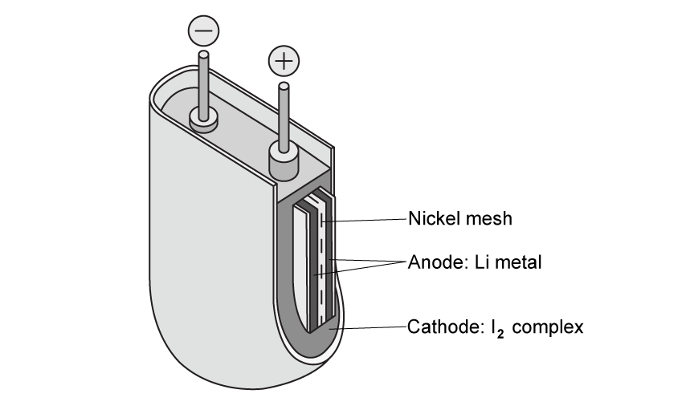

# Exam Questions — Electrolysis
**24. Electrochemistry** · Cambridge (CIE) A-LEVEL chemistry (9701)
> Source: [https://www.savemyexams.com/a-level/chemistry/cie/25/topic-questions/](https://www.savemyexams.com/a-level/chemistry/cie/25/topic-questions/) · 10 questions across 1 sets

## Structured Questions (10 questions)

### Q1 — hard — 8 marks

**Q1** [2 marks]

Fig. 1.1 shows a lithium–iodine electrochemical cell. These cells are often used in pacemakers as they are reliable and have a life span in the region of 10 years.

**Fig. 1.1**

It consists of a lithium electrode and an inert electrode immersed in body fluids that are separated by a nickel mesh and collect charge from the anode. It has a high internal resistance which means that only a low current can be drawn.

Explain why the lithium-iodine electrochemical cell is a **dry** cell.

**Q1** [1 mark]

Construct the overall equation for the reaction taking place at the electrodes of the lithium-iodine electrochemical cell when a current flows.

**Q1** [1 mark]

Table 1.1 lists electrode potentials for some electrode reactions.

**Table 1.1**

| **Electrode reaction** | ***E*****θ**** / V** |
|---|---|
| I2 + 2e– ⇌ 2I– | + 0.54 |
| Li+ + e– ⇌ Li | – 3.04 |
| Ni2+ + 2e– ⇌ Ni | – 0.25 |

Calculate the *E*θcell for the lithium-iodine electrochemical cell.

**Q1** [4 marks]

A current of 1.5 × 10-5 A is drawn from this cell.

Calculate the number of days for 0.08 g of the lithium electrode to be used up. Assume the current remains constant throughout this period. Show your working.

The Faraday constant, *F* = 9.65 × 104 C mol–.

### Q2 — easy — 9 marks

**Q2** [2 marks]

State the equation linking charge, *Q*, current, *I*, and time, *t*. Give the units for each term.

**Q2** [1 mark]

The relationship between the Faraday constant, *F*, and Avogadro's constant, *L*, is shown in the equation.

*F* = *L* x e

State what one Faraday measures.

**Q2** [3 marks]

**Extract:**

The relationship between the Faraday constant, F, and Avogadro's constant, L, is shown in the equation.

F = L x e

One Faraday measures the charge carried by 1 mole of electrons / 1 mole of singly charged ions.

Complete Table 3.1 to show the number of moles of electrons and the amount of charge for each equation.

**Table 3.1**

| **Equation** | **Number of moles of electrons** | **Amount of charge / C** |
|---|---|---|
| K+ + e– → K | 1 | 96 500 |
| Cr3+ + 3e– → Cr |   |   |
| S2– → ..... + ...... |   |   |

**Q2** [1 mark]

The chromium half-cell containing Cr / Cr3+ is connected to a copper half-cell containing Cu / Cu2+.

The standard electrode potential for copper is shown as:

Cu2+ + 2e– ⇌ Cu   *E*θ = +0.34 V

The standard cell potential of this combination was found to be +1.08 V, where the copper half-cell would undergo reduction.

Calculate the standard electrode potential of the Cr / Cr3+ half-cell.

**Q2** [2 marks]

**Extract:**

The chromium half-cell containing Cr / Cr^3+^ is connected to a copper half-cell containing Cu / Cu^2+^.

The standard electrode potential for copper is shown as:

Cu^2+^ + 2e^–^ ⇌ Cu   *E*^θ^ = +0.34 V

The standard cell potential of this combination was found to be +1.08 V, where the copper half-cell would undergo reduction.

Calculate the standard electrode potential of the Cr / Cr^3+^ half-cell.

*E*^θ^~oxidised~ = -0.74 V

Construct **two** half-equations to show what would occur if the chromium half-cell was attached to the standard hydrogen half-cell.

### Q3 — medium — 15 marks

**Q3** [1 mark]

State the relationship between the Faraday constant, *F*, the charge on an electron, *e*, and the Avogadro constant, *L*.

**Q3** [4 marks]

If the charge on the electron, the *A*r and the charge of copper ions are known, the Avogadro constant can be determined experimentally by passing a known current for a known time through a copper electrolysis cell and weighing the mass of copper deposited onto the cathode.

Draw a diagram of apparatus which is suitable for carrying out this practical. Label the following:

- power supply with the + and − terminals identified
- anode
- cathode
- ammeter

State the composition of the electrolyte.

**Q3** [5 marks]

The following are the results obtained from one such experiment.

| current passed through the cell | 0.375 A |
|---|---|
| time current was passed through cell | 40.0 min |
| initial mass of copper cathode | 49.637 g |
| final mass of copper cathode | 49.936 g |

Use the experimental results to calculate a value of the Avogadro constant, *L*, to 3 significant figures.

[electronic charge, *e* = 1.60 x 10-19 C]

**Q3** [5 marks]

**Table 2.1** shows a list of standard electrode potentials at 298 K.

**Table 2.1**

| **Electrode reaction** | ***E*****θ**** / V** |
|---|---|
| Ag+ + e– ⇌ Ag | +0.80 |
| Br2 + 2e– ⇌ 2Br– | +1.07 |
| F2 + 2e– ⇌ 2F– | +2.87 |
| Fe2+ + 2e– ⇌ Fe | –0.44 |
| 2H+ + 2e– ⇌ H2 | 0.00 |
| Mg2+ + 2e– ⇌ Mg | –2.38 |
| O2 + 2H2O + 4e– ⇌ 4OH– | +0.40 |
| SO42– + 4H+ + 2e– ⇌ SO2 + 2H2O | +0.17 |

Use the information in **Table 2.1** to deduce the substances formed at the anode and cathode when 1.0 mol dm−3 aqueous solutions of the following compounds are electrolysed.

| **compound** | **product at anode** | **product at cathode** |
|---|---|---|
| AgF |   |   |
| FeSO4 |   |   |
| MgBr2 |   |   |

### Q4 — easy — 10 marks

**Q4** [1 mark]

Faraday's constant can be used to calculate the mass of a substance deposited at an electrode or the volume of gas liberated at an electrode during electrolysis.

A current of 1.65 A flows through molten lead(II) chloride for 10 minutes.

Construct the equation for the electrolysis of lead(II) chloride, PbCl2.

**Q4** [6 marks]

**Extract:**

A current of 1.65 A flows through molten lead(II) chloride for 10 minutes.

i) Construct the half-equation for the reduction of the lead(II) ion, Pb2+.

[1]

ii) The equation to calculate the charge transferred is *Q* = *I* x *t*. The Faraday constant, *F* = 96 500 C mol-1.

Use the information in part (a) to calculate the number of coulombs required to deposit one mole of lead at the cathode, the charge transferred during the electrolysis of molten lead(II) chloride, and the mass of lead deposited at the cathode.

[5]

**Q4** [3 marks]

**Extract:**

A current of 1.65 A flows through molten lead(II) chloride for 10 minutes.

From part (b) calculations:
- Time converted: t = 10 x 60 = 600 s
- Charge transferred: Q = I x t = 1.65 x 600 = 990 C

i) Construct the half-equation for the oxidation of the chloride ion, Cl–, to form chlorine, Cl2.

[1]

ii) The equation to calculate the charge transferred is *Q* = *I* x *t*. The Faraday constant, *F* = 96 500 C mol-1.

Use the information in part (a) and your answers to part (b) to calculate the number of coulombs required to form one mole of chlorine at the anode and the volume of chlorine released at the anode.

[2]

### Q5 — medium — 9 marks

**Q5** [4 marks]

A student decided to determine the value of the Faraday constant by an electrolysis experiment. Fig. 2.1 is an incomplete diagram showing the apparatus that was used.

**Fig. 2.1**

i) Apart from connecting wires, state **two** additional pieces of equipment needed for this experiment.

[2]

ii) Complete the diagram, showing the additional equipment connected in the circuit and the power pack connected to the correct electrodes.

[2]

**Q5** [3 marks]

**Extract:**

A student decided to determine the value of the Faraday constant by an electrolysis experiment. Fig. 2.1 is an incomplete diagram showing the apparatus that was used.

List the measurements the student would need to make in order to use the results to calculate a value for the Faraday constant.

**Q5** [1 mark]

Using an equation, state the relationship between the Faraday constant, *F*, the Avogadro constant, *L*, and the charge on the electron, *e*.

**Q5** [1 mark]

**Extract:**

Using an equation, state the relationship between the Faraday constant, *F*, the Avogadro constant, *L*, and the charge on the electron, *e*.

The relationship between *F*, *L*, and *e*:

- *F* = *L* × *e*

OR

*L* = *F* / *e*

OR

*e* = *F* / *L*

The value the student obtained was: 1 faraday = 9.65 × 104 coulombs.

Use this value and your equation in part (c) to calculate the Avogadro constant. Take the charge on the electron to be 1.60 × 10–19 coulombs.

### Q6 — easy — 8 marks

**Q6** [2 marks]

Define the term *electrolysis*.

**Q6** [2 marks]

Complete Table 1.1 to show the correct charge associated with each term.

**Table 1.1 **

| **Term** | **Charge (positive / negative)** |
|---|---|
| Anion |   |
| Anode |   |
| Cathode |   |
| Cation |   |

**Q6** [4 marks]

i) Define the terms *oxidation* and *reduction* in terms of electrons.

[2]

ii) Construct the half-equation for the reduction of copper(II) ions, Cu2+, to form copper metal.

[1]

iii) Construct the half-equation for the oxidation of chloride ions, Cl–, to form chlorine, Cl2.

[1]

### Q7 — medium — 16 marks

**Q7** [7 marks]

The electrolytic purification of copper can be carried out in an apparatus similar to the one shown in **Fig. 5.1**.

**Fig. 5.1**

The impure copper anode contains small quantities of metallic nickel, zinc and silver, together with inert oxides and carbon resulting from the initial reduction of the copper ore with coke. The copper goes into solution at the anode, but the silver remains as the metal and falls to the bottom as part of the anode 'sludge'. The zinc also dissolves.

**Table 5.1** shows a list of standard electrode potentials at 298 K.

**Table 5.1**

| **Electrode reaction** | ***E*****θ**** / V** |
|---|---|
| Ag+ + e– ⇌ Ag | +0.80 |
| Cu2+ + 2e– ⇌ Cu | +0.34 |
| Fe2+ + 2e– ⇌ Fe | −0.44 |
| Ni2+ + 2e– ⇌ Ni | −0.25 |
| SO42– + 4H+ + 2e– ⇌ SO2 + 2H2O | +0.17 |
| Zn2+ + 2e– ⇌ Zn | −0.76 |

i) Construct a half-equation including state symbols for the reaction of copper at the anode.

[1]

ii) Use data from **Table 5.1** to explain why silver remains as the metal.

[2]

iii) Use data from **Table 5.1** to deduce what happens to the nickel at the anode.

[2]

iv) Construct a half-equation including state symbols for the main reaction at the cathode.

[1]

v) Use data from **Table 5.1** to explain why zinc is not deposited on the cathode.

[1]

**Q7** [2 marks]

**Extract:**

The electrolytic purification of copper can be carried out in an apparatus similar to the one shown in **Fig. 5.1**.

The impure copper anode contains small quantities of metallic nickel, zinc and silver, together with inert oxides and carbon resulting from the initial reduction of the copper ore with coke. The copper goes into solution at the anode, but the silver remains as the metal and falls to the bottom as part of the anode 'sludge'. The zinc also dissolves.

**Table 5.1** shows a list of standard electrode potentials at 298 K.

| **Electrode reaction** | ***E***^**θ**^** / V** |
| --- | :---: |
| Ag^+^ + e^–^ ⇌ Ag | +0.80 |
| Cu^2+^ + 2e^–^ ⇌ Cu | +0.34 |
| Fe^2+^ + 2e^–^ ⇌ Fe | −0.44 |
| Ni^2+^ + 2e^–^ ⇌ Ni | −0.25 |
| SO~4~^2–^ + 4H^+^ + 2e^–^ ⇌ SO~2~ + 2H~2~O | +0.17 |
| Zn^2+^ + 2e^–^ ⇌ Zn | −0.76 |

As the electrolysis proceeds, the blue colour of the electrolyte slowly fades.

Explain why the blue colour fades.

**Q7** [5 marks]

Most of the current passed through the cell is used to dissolve the copper at the anode and precipitate pure copper onto the cathode. However, a small proportion of it is ‘wasted’ in dissolving the impurities at the anode which then remain in solution. When a current of 20.0 A was passed through the cell for 10.0 hours, it was found that 225 g of pure copper was deposited on the cathode.

[Faraday constant, *F* = 9.65 x 104 C mol-1]

i) Calculate the number of moles of copper produced at the cathode.

[1]

ii) Calculate the number of moles of electrons needed to produce this copper.

[1]

iii) Calculate the number of moles of electrons that passed through the cell.

[2]

iv) Hence calculate the percentage of the current through the cell that has been ‘wasted’ in dissolving the impurities at the anode.

[1]

**Q7** [2 marks]

**Extract:**

**Table 5.1** shows a list of standard electrode potentials at 298 K.

| **Electrode reaction** | ***E***^**θ**^** / V** |
| --- | :---: |
| Ag^+^ + e^–^ ⇌ Ag | +0.80 |
| Cu^2+^ + 2e^–^ ⇌ Cu | +0.34 |
| Fe^2+^ + 2e^–^ ⇌ Fe | −0.44 |
| Ni^2+^ + 2e^–^ ⇌ Ni | −0.25 |
| SO~4~^2–^ + 4H^+^ + 2e^–^ ⇌ SO~2~ + 2H~2~O | +0.17 |
| Zn^2+^ + 2e^–^ ⇌ Zn | −0.76 |

Nickel often occurs in ores along with iron. After the initial reduction of the ore with coke, a nickel-iron alloy is formed.

Use data from **Table 5.1** to explain why nickel can be purified by a similar electrolysis technique to that used for copper, using an impure nickel anode, a pure nickel cathode, and nickel sulfate as the electrolyte.

Explain what would happen to the iron during this process.

### Q8 — easy — 7 marks

**Q8** [1 mark]

Electrolysis is used to extract reactive metals from their metal ores, purify metals and produce non-metals such as fluorine.

Explain why ionic compounds need to be molten or aqueous for electrolysis to occur.

**Q8** [3 marks]

i) Complete **Table 2.1** to show the electrolysis products of the molten ionic compounds.

**Table 2.1**

| **Ionic compound** | **Product at anode** | **Product at cathode** |
|---|---|---|
| NaH | Hydrogen | Sodium |
| CaCl2 |   |   |
| Pb3O4 |   |   |

[2]

ii) State why sodium forms at the negative cathode during the electrolysis of sodium hydride, NaH.

[1]

**Q8** [1 mark]

Electrolysis of aqueous ionic solutions can give different products compared to the electrolysis of molten ionic compounds.

Give the formulae of **two** ions that can form the different products during the electrolysis of aqueous solutions.

**Q8** [2 marks]

Two factors that affect the actual ions discharged during the electrolysis of aqueous solutions are:

- The relative electrode potential of the ions
- The concentration of the ions

i) State the relationship between the relative electrode potential of the ions and the ions that are discharged during the electrolysis of an aqueous solution.

[1]

ii) Describe the relationship between the concentration of the ions and the ions that are discharged during the electrolysis of an aqueous solution.

[1]

### Q9 — hard — 6 marks

**Q9** [1 mark]

Table 2.1 lists electrode potentials for the Cr2O72– (aq) / Cr3+ (aq) and Br2 (l) / Br– (aq) half-cells.

**Table 2.1**

| **Electrode reaction** | ***E*****θ**** / V** |
|---|---|
| ½Br2 (l) + e– ⇌ Br– (aq) | + 1.09 |
| Cr2O72– (aq) + 14H+ (aq) + 6e– ⇌ 2Cr3+ (aq) + 7H2O (l) | + 1.36 |

Deduce the full equation for the Cr2O72– (aq) / Cr3+ (aq) and Br2 (l) / Br– (aq) cell.

**Q9** [1 mark]

**Extract:**

Table 2.1 lists electrode potentials for the Cr~2~O~7~^2–^ (aq) / Cr^3+^ (aq) and Br~2~ (l) / Br^–^ (aq) half-cells.

**Table 2.1**

| **Electrode reaction** | ***E***^**θ**^** / V** |
| --- | :---: |
| ½Br~2~ (l) + e^–^ ⇌ Br^–^ (aq) | + 1.09 |
| Cr~2~O~7~^2–^ (aq) + 14H^+^ (aq) + 6e^–^ ⇌ 2Cr^3+^ (aq) + 7H~2~O (l) | + 1.36 |

Using Table 2.1, calculate the *E*θcell for the electrochemical cell outlined in part (a).

**Q9** [1 mark]

**Extract:**

Table 2.1 lists electrode potentials for the Cr₂O₇²⁻ (aq) / Cr³⁺ (aq) and Br₂ (l) / Br⁻ (aq) half-cells.

**Table 2.1**

| **Electrode reaction** | ***E***^**θ**^** / V** |
| --- | :---: |
| ½Br₂ (l) + e⁻ ⇌ Br⁻ (aq) | + 1.09 |
| Cr₂O₇²⁻ (aq) + 14H⁺ (aq) + 6e⁻ ⇌ 2Cr³⁺ (aq) + 7H₂O (l) | + 1.36 |

The full equation for the cell:
Cr₂O₇²⁻ (aq) + 14H⁺ (aq) + 6Br⁻ (aq) → 2Cr³⁺ (aq) + 3Br₂ (l) + 7H₂O (l)

*E*^θ^~cell~ = +0.27 V

The electrochemical equation for standard free energy change is given.

Δ*G*θ = −*n*F*E*θ

The Faraday constant, *F* = 9.65 × 104 C mol–.

Use your answers to parts (a) and (b) to deduce whether the reaction of the electrochemical cell is feasible.

**Q9** [3 marks]

**Extract:**

The electrochemical equation for standard free energy change is given.

Δ*G*^θ^ = −*n*F*E*^θ^

The Faraday constant, *F* = 9.65 × 10^4^ C mol^–^.

An electrochemical cell has a free energy change of −14.475 kJ mol–.

Use the information in Table 2.1 to deduce the reactions taking place at each electrode of the electrochemical cell.

**Table 2.1**

| **Electrode reaction** | ***E*****θ**** / V** |
|---|---|
| Ag+ (aq) + e– ⇌ Ag (s) | +0.80 |
| Li+ (aq) + e– ⇌ Li (s) | −3.04 |
| ClO2 (aq) + e– ⇌ ClO2– (aq) | +0.95 |
| H2O (l) + e– ⇌ ½H2 (g) + OH– (aq) | −0.83 |
| Fe3+ (aq) + e– ⇌ Fe2+ (aq) | +0.77 |

### Q10 — hard — 12 marks

**Q10** [2 marks]

A student set up an electrochemical cell using a concentrated sodium chloride solution using a current of 6 A.

State the half-equations occurring at the electrodes during the electrolysis of the concentrated aqueous solution of sodium chloride.

**Q10** [3 marks]

**Extract:**

A student set up an electrochemical cell using a concentrated sodium chloride solution using a current of 6 A.

Calculate the time, in minutes, to produce 2.00 dm3 of gas at the **anode** at room temperature and pressure.

The Faraday constant, *F* = 9.65 × 104 C mol–.

State your answer to 2 significant figures and show your working.

**Q10** [2 marks]

**Extract:**

A student set up an electrochemical cell using a concentrated sodium chloride solution using a current of 6 A.

State the half-equations occurring at the electrodes during the electrolysis of the concentrated aqueous solution of sodium chloride.

Anode: 2Cl^– → Cl2 + 2e^–

The student changed the electrolyte to a very dilute sodium chloride solution.

State what change would occur at the anode and give the half equation for the process.

**Q10** [5 marks]

In a different electrolysis experiment, copper(II) sulfate solution was electrolysed using graphite electrodes.

Table 2.1 lists electrode potentials for some electrode reactions.

**Table 2.1**

| **Electrode reaction** | ***E*****θ**** / V** |
|---|---|
| Cu+ + e– ⇌ Cu | + 0.52 |
| Cu2+ + 2e– ⇌ Cu | + 0.34 |
| Cu2+ + e– ⇌ Cu+ | + 0.15 |
| 2H2O + 2e– ⇌ H2 + 4OH– | – 0.83 |
| O2 + 2H2O + 4e– ⇌ 4OH– | + 0.40 |
| ½O2 + 2H+ + 2e– ⇌ H2O | + 1.23 |
| SO42– + 4H+ + 2e– ⇌ SO2 + 2H2O | + 0.17 |
| S2O82– + 2e– ⇌ 2SO42– | + 2.01 |

Explain how the products at the anode and cathode are produced.
