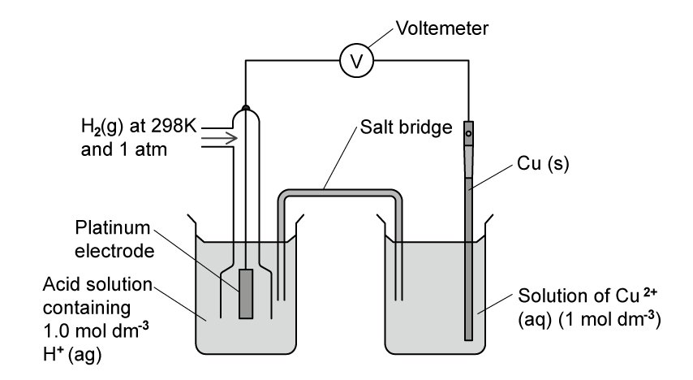
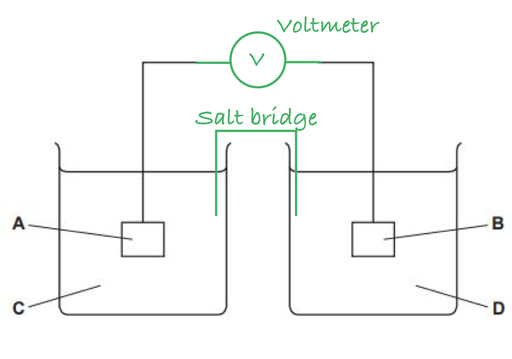
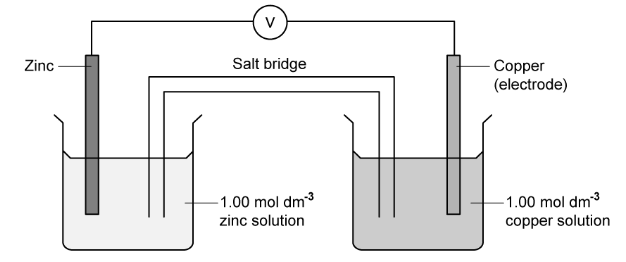
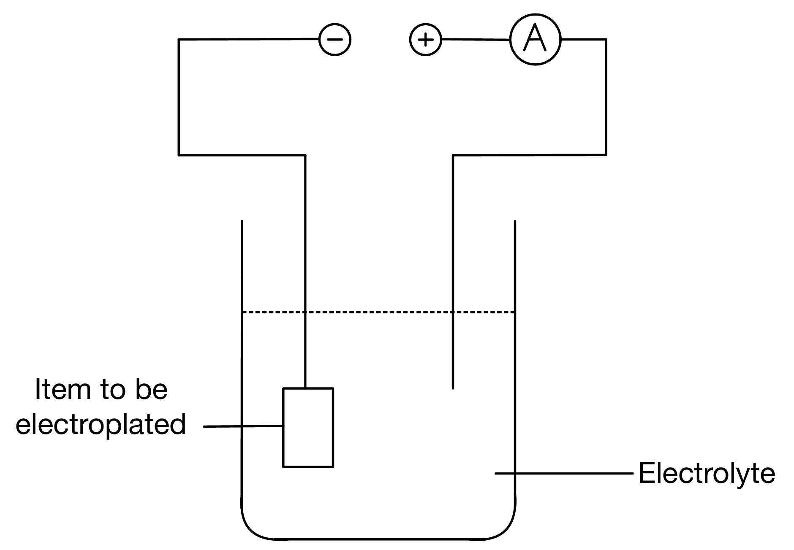

# Mark Schemes — Standard Electrode Potentials E⦵, Standard Cell Potentials E⦵cell & the Nernst Equation
**24. Electrochemistry** · Cambridge (CIE) A-LEVEL chemistry (9701)

## Structured Questions (13 questions)

### Q1
> **[mark-scheme]**
> Standard electrode potential is the:
> 
> - Electrode potential of a half-cell measured relative to the standard hydrogen electrode (SHE) **[1 mark]**
> - Measured under standard conditions (298 K, 1.0 mol dm-3, 101 kPa / 1 atm) **[1 mark]**

> **[exam-tip]**
> The definition has two components:
> 
> 1. What it is measured against
> 
>   - The standard hydrogen electrode (SHE), which is assigned a value of 0 V
> 2. The conditions under which it is measured:
> 
>   - 298 K, 1.0 mol dm-3 ion concentration, and 101 kPa.
> 
> Both parts are needed for full marks.
The labelled diagram showing how the standard electrode potential of a Cu2+/Cu half-cell can be measured relative to the standard hydrogen electrode (SHE) is:

**[4 marks]**

> **[mark-scheme]**
> 1 mark for the standard hydrogen electrode correctly shown: platinum electrode in contact with hydrogen gas at 1 atm and 1.0 mol dm-3 H+ (aq)
> 
> 1 mark for the Cu2+/Cu half-cell correctly shown: copper electrode in 1.0 mol dm-3 Cu2+ (aq)
> 
> 1 mark for a high-resistance voltmeter connected between the two electrodes in the external circuit
> 
> 1 mark for a salt bridge connecting the two half-cell solutions

> **[exam-tip]**
> The standard hydrogen electrode must show all required features: a platinum electrode in contact with hydrogen gas at 1 atm and a solution of H+ ions at 1.0 mol dm-3. The temperature of 298 K should be labelled. The salt bridge must be shown dipping into both solutions to complete the ionic circuit.
To calculate the mass of copper deposited at the cathode:

- List the known values:

  - current, *I* = 1.50 A
  - time, *t* = 25.0 min = 1500 s
  - Faraday constant, *F* = 9.65 × 104 C mol-1
  - *M*r of copper = 63.5
- Calculate the charge passed, *Q*:

*Q* = *I* x *t*

*Q* = 1.50 x 1500

*Q* = 2250 C **[1 mark]**

- Calculate the moles of electrons transferred:

n(e-) = $\frac{Q}{F}$

n(e-) = $\frac{2250}{9.65\times10^{4}}$

n(e-) = 0.02332 mol **[1 mark]**

- Use the half-equation to find the mass of copper deposited:

Cu2+ (aq) + 2e- → Cu (s)

n(Cu) = 0.02332 ÷ 2 = 0.01166 mol

mass = 0.01166 x 63.5

mass = **0.740 g** **[1 mark]**

> **[exam-tip]**
> Always convert time to seconds before calculating charge: 25.0 minutes x 60 = 1500 s. The ratio of electrons to copper atoms comes from the half-equation Cu2+ (aq) + 2e- → Cu (s), which shows 2 mol of electrons are needed to deposit 1 mol of copper.
To calculate the electrode potential of the Fe3+/Fe2+ half-cell:

- List the known values:

  - *E*θ(Fe3+/Fe2+) = +0.77 V
  - [Fe3+] = 0.50 mol dm-3
  - [Fe2+] = 0.01 mol dm-3
  - *z* = 1 (one electron transferred: Fe3+ + e- ⇌ Fe2+)
- Substitute into the Nernst equation:

*E* = *E*θ + $( \frac{0.059}{z} )$ log10 $\frac{[ \text{oxidised} \text{species} ]}{[ \text{reduced} \text{species} ]}$

*E* = 0.77 + $\frac{0.059}{1}$ log10 $\frac{0.50}{0.01}$ **[1 mark]**

*E* = 0.77 + 0.059 x log10 (50)

*E* = 0.77 + (0.059 x 1.699)

*E* = 0.77 + 0.100

*E* = **+0.870 V** **[1 mark]**

> **[exam-tip]**
> Check that the oxidised species ([Fe3+]) is in the numerator and the reduced species ([Fe2+]) is in the denominator of the log term. Here *z* = 1 since only one electron is transferred in the Fe3+/Fe2+ half-equation. The simplified Nernst constant of 0.059 only applies at 298 K.
To calculate the standard Gibbs free energy change, Δ*G*θ, for this reaction:

- List the known values:

  - *n* = 2 (2 mol of electrons transferred per mol of Cu oxidised)
  - *F* = 9.65 × 104 C mol-1
  - *E*θcell = +0.43 V
- Apply the equation:

Δ*G*θ = −*nFE*θcell **[1 mark]**

- Substitute values:

Δ*G*θ = −2 x (9.65 × 104) x 0.43

Δ*G*θ = −82 990 J mol-1

**[1 mark]**

- Convert to kJ mol-1:

Δ*G*θ = −$\frac{82990}{1000}$

Δ*G*θ = **−83.0 kJ mol****-1** **[1 mark]**

> **[exam-tip]**
> Don't drop the minus sign. A positive *E*θcell gives a negative Δ*G*θ, confirming the reaction is feasible under standard conditions.
> 
> Remember *n* is the number of moles of electrons transferred per mole of reaction as written. Here 2 mol of Fe3+ are each reduced by 1 electron, so *n* = 2.

### Q2
The completed diagram is:

**[2 marks]**

> **[mark-scheme]**
> 1 mark for voltmeter / V labelled and connected to both electrodes in the external circuit
> 
> 1 mark for salt bridge labelled and connecting both solutions

> **[exam-tip]**
> The voltmeter measures the potential difference between the two half-cells. Ensure the wires in the external circuit are continuous with no gaps as any break means the circuit is incomplete.
> 
> The salt bridge connects the two solutions and allows ions to flow, completing the internal circuit. It is typically drawn as a bridge touching both solutions, and is usually a strip of filter paper soaked in saturated potassium nitrate solution.
The four letters in Fig. 1.1 represent:

| **A** | copper / Cu electrode |
|---|---|
| **B** | iron / Fe electrode |
| **C** | 1 mol dm-3 solution containing Cu2+ ions (e.g. CuSO4) |
| **D** | 1 mol dm-3 solution containing Fe2+ ions (e.g. FeSO4) |

> **[mark-scheme]**
> 1 mark for A = copper / Cu electrode
> 
> 1 mark for B = iron / Fe electrode
> 
> 1 mark for C = 1 mol dm-3 solution containing Cu2+ ions (e.g. CuSO4)
> 
> 1 mark for D = 1 mol dm-3 solution containing Fe2+ ions (e.g. FeSO4)
> 
> (A and B) and (C and D) are interchangeable
> 
> The solution for C must correspond to the metal stated for A and the solution for D must correspond to the metal stated for B

> **[exam-tip]**
> Both half-cells are metal / metal ion half-cells, so the electrode is the metal itself and the solution contains an aqueous solution of the corresponding metal ion.
> 
> Since this is a standard electrode potential measurement, all solution concentrations must be 1 mol dm-3. Any appropriate Cu2+ or Fe2+ salt is accepted.
> **[mark-scheme]**
> i) The electrode that acts as the negative electrode is:
> 
> - Iron / Fe **[1 mark]**
> 
> ii) The overall equation for this electrochemical cell is:
> 
> - Cu2+(aq) + Fe(s) ⇌ Cu(s) + Fe2+(aq) **[1 mark]**

> **[exam-tip]**
> The half-cell with the more negative standard electrode potential acts as the negative electrode and undergoes oxidation. Fe2+/Fe (*E*θ = −0.44 V) is more negative than Cu2+/Cu (*E*θ = +0.34 V), so iron is the negative electrode.
> 
> Electrons flow from the negative electrode (Fe) to the positive electrode (Cu) through the external circuit.
> 
> To construct the overall equation, reverse the iron half-equation for oxidation and add to the copper reduction half-equation:
> 
> - Reduction: Cu2+(aq) + 2e– ⇌ Cu(s)
> - Oxidation: Fe(s) ⇌ Fe2+(aq) + 2e–
> - Overall: Cu2+(aq) + Fe(s) ⇌ Cu(s) + Fe2+(aq)
> **[mark-scheme]**
> Whether this reaction is feasible:
> 
> - Feasible **[1 mark]**
> - *E*θcell is positive **[1 mark]**

> **[exam-tip]**
> A reaction is feasible (thermodynamically likely to occur) when the standard cell potential *E*θcell is positive. A positive *E*θcell means the forward reaction releases energy and can proceed under standard conditions.

### Q3
> **[mark-scheme]**
> i) The overall equation for the cell reaction is:
> 
> - 2Fe3+ (aq) + Cu (s) → 2Fe2+ (aq) + Cu2+ (aq) **[1 mark]**
> 
> ii) The voltage of this cell is:
> 
> - *E*cell (= 0.77 − 0.34) = 0.43 V **[1 mark]**

> **[exam-tip]**
> Redox system 2 (Fe3+/Fe2+, +0.77 V) is more positive than system 3 (Cu2+/Cu, +0.34 V), so Fe3+ is more readily reduced and acts as the oxidising agent. Cu undergoes oxidation.
> 
> To construct the overall equation, write Fe3+ as reduced (forward) and Cu as oxidised (reverse), multiply to balance electrons, then cancel:
> 
> - 2Fe3+ (aq) + 2e– → 2Fe2+ (aq)
> - Cu (s) → Cu2+ (aq) + 2e–
> - Overall: 2Fe3+ (aq) + Cu (s) → 2Fe2+ (aq) + Cu2+ (aq)
i) The overall equations for **three** reactions that might be feasible are:

- 3O2 (g) + 12H+ (aq) + 4Al (s) → 6H2O (l) + 4Al3+ (aq) **[1 mark]**
- 3I2 (aq) + 2Al (s) → 2Al3+ (aq) + 6I– (aq) **[1 mark]**
- O2 (g) + 4H+ (aq) + 4I– (aq) → 2H2O (l) + 2I2 (aq) **[1 mark]**

ii) **Two** reasons why these reactions might not take place, even if they are feasible:

- The rate of reaction is slow / *E*a is high **[1 mark]**
- Suitable conditions (e.g. catalyst, temperature) are not available **[1 mark]**

> **[mark-scheme]**
> For part (i), any three of the three equations above are required. State symbols must be correct throughout for the mark to be awarded.
> 
> For part (ii), allow any two kinetic / conditions-based reasons. Do not accept 'the conditions are not standard' or 'concentration is not 1.0 mol dm-3' as a reason for a feasible reaction not proceeding because thermodynamic feasibility already accounts for standard conditions.

> **[exam-tip]**
> A reaction being thermodynamically feasible (positive *E*θcell) means it is energetically downhill, but this says nothing about the rate. Many feasible reactions have high activation energies and proceed extremely slowly without a catalyst.
> 
> For the three equations, the possible combinations from systems 5, 6, and 7 are: 5 & 6, 6 & 7, and 5 & 7.
> **[mark-scheme]**
> i) An oxidising agent that oxidises Fe2+ (aq) to Fe3+ (aq) is:
> 
> - Cl2
> **OR**
> O2 **AND** H+ **[1 mark]**
> 
> ii) A species that reduces Fe3+ (aq) to Fe2+ (aq) but does not reduce Cu2+ (aq) to Cu (s) is:
> 
> - I− **[1 mark]**

> **[exam-tip]**
> For (i), the oxidising agent must have a higher *E*θ than Fe3+/Fe2+ (+0.77 V): Cl2 (+1.36 V) and O2 (+1.23 V, with H+) both qualify. Both O2 and H+ must be given for the O2 option.
> 
> For (ii), the reducing agent must have an *E*θ between +0.34 V (Cu2+/Cu) and +0.77 V (Fe3+/Fe2+). Only I2/I− (+0.54 V) falls in this range, so I− can reduce Fe3+ but cannot reduce Cu2+.
To calculate the electrode potential of redox system 3 at non-standard conditions:

- State the Nernst equation (from the Data Booklet) and identify the variables:

*E*θ(Cu2+/Cu) = +0.34 V

z = 2

[Cu2+] = 0.0002 mol dm-3

The reduced species is the solid metal Cu, which has no concentration term, so the equation simplifies to:

*E* = *E*θ + `\frac{0.059}{z}\log_{10}[\text{Cu}^{2+}]`

- Substitute values:

*E* = 0.34 + $\frac{0.059}{2} \mathrm{log}_{10} ( 0 . 0002 )$ **[1 mark]**

- Calculate the logarithm term:

log10(0.0002) = −3.699

- Solve the equation:

*E* = 0.34 + (0.0295 x −3.699)

*E* = 0.34 − 0.109 **[1 mark]**

*E* = **+0.23 V** **[1 mark]**

> **[mark-scheme]**
> Allow *E* = 0.23 V, 0.231 V, or 0.2309 V
> 
> Allow error carried forward if correct substitution but arithmetic error in logarithm step

> **[exam-tip]**
> The Nernst equation is in the Data Booklet: *E* = *E*θ + (0.059/*z*) log10([oxidised species]/[reduced species]).
> 
> For a metal / metal ion half-cell, the reduced species is the solid metal and its activity = 1, so the term simplifies to just log10[Cu2+].
> 
> Since [Cu2+] = 0.0002 mol dm-3 < 1.0 mol dm-3, log10[Cu2+] is negative and *E* is less positive than *E*θ.

### Q4
To calculate *E*θcell and identify the negative electrode:

- The two relevant half-cells from Table 2.1:

Ag+ + e– ⇌ Ag  *E*θ = +0.80 V

Fe3+ + e– ⇌ Fe2+  *E*θ = +0.77 V

- Calculate *E*θcell:

*E*θcell = *E*θ(more positive) − *E*θ(less positive)

*E*θcell = +0.80 − +0.77

*E*θcell = **+0.03 V** **[1 mark]**

- The negative electrode is the half-cell with the less positive *E*θ:

Pt / platinum (Fe3+/Fe2+ half-cell electrode) **[1 mark]**

> **[mark-scheme]**
> Allow *E*θcell = 0.03 V (without + sign)

> **[exam-tip]**
> The Ag+/Ag half-cell has the more positive *E*θ (+0.80 V) and undergoes reduction (positive electrode). The Fe3+/Fe2+ half-cell has the less positive *E*θ (+0.77 V) and undergoes oxidation (negative electrode).
> **[mark-scheme]**
> The actual *E*cell would:
> 
> - Be less positive / more negative than *E*θcell **[1 mark]**
> - Because the concentration of Ag+(aq) is less than 1.0 mol dm-3 **[1 mark]**

> **[exam-tip]**
> The cell contains Ag2SO4 (aq), which is a sparingly soluble silver salt. Silver ions from the dissolved Ag2SO4 are at a lower concentration than the standard 1.0 mol dm-3. A lower [Ag+] shifts the Ag+/Ag equilibrium to the left, making *E* less positive and reducing *E*cell.
> **[mark-scheme]**
> i) The change in *E*cell if Na2SO4 (aq) is added to the Fe3+(aq)/Fe2+ (aq) beaker:
> 
> - No change **[1 mark]**
> 
> ii) The change in *E*cell if Na2SO4 (aq) is added to the Ag2SO4 (aq) beaker:
> 
> - More negative / less positive **[1 mark]**
> 
> iii) Explanation:
> 
> - The concentration of Ag+(aq) decreases **[1 mark]**
> - *E*electrode becomes less positive
> **OR**
> due to the common ion effect **[1 mark]**

> **[exam-tip]**
> SO42– ions have no effect on the Fe3+/Fe2+ equilibrium, so *E*cell is unchanged in (i).
> 
> In (ii), adding Na2SO4 to the Ag2SO4 solution increases [SO42–]. By the common ion effect, the equilibrium Ag2SO4 (s) ⇌ 2Ag+ (aq) + SO42– (aq) shifts left, reducing [Ag+]. This makes *E*(Ag+/Ag) less positive and so *E*cell becomes more negative.
> **[mark-scheme]**
> The equation for the reaction in the electrochemical cell is:
> 
> - Ag+ (aq) + Fe2+ (aq) → Ag (s) + Fe3+ (aq) **[1 mark]**

> **[exam-tip]**
> Ag+ (aq) is reduced (gains an electron) and Fe2+ (aq) is oxidised (loses an electron). The two half-equations each involve 1 electron, so they combine directly:
> 
> - Ag+ (aq) + e– → Ag (s)
> - Fe2+ (aq) → Fe3+ (aq) + e–
> - Overall: Ag+ (aq) + Fe2+ (aq) → Ag (s) + Fe3+ (aq)

### Q5
> **[mark-scheme]**
> i) The substance used as the electrode in Fig. 3.1 is:
> 
> - Platinum **[1 mark]**
> 
> ii) Platinum is used as the electrode because:
> 
> - It is inert
> **AND**
> it conducts electricity **[1 mark]**
> - It provides a surface on which the H2 (g) / H+(aq) equilibrium can be established **[1 mark]**
> 
> iii) The standard conditions used in a standard hydrogen electrode are:
> 
> - H+ ion concentration = 1.00 mol dm-3 **[1 mark]**
> - Temperature = 298 K **[1 mark]**
> - Pressure = 101 kPa **[1 mark]**

> **[exam-tip]**
> Platinum is chosen because it is chemically inert, conducts electricity, and provides a surface for the H2 (g) / H+(aq) equilibrium to be established. It does not participate in the reaction.
> 
> All three standard conditions must be stated: 298 K, 101 kPa, and H+ concentration = 1.00 mol dm-3.
i) The completed electrochemical cell is:

**[4 marks]**

> **[mark-scheme]**
> 1 mark for correctly labelled electrode (copper)
> 
> 1 mark for copper solution / Cu2+ solution labelled AND 1 mol dm-3
> 
> 1 mark for salt bridge completed and labelled, connecting both solutions
> 
> 1 mark for voltmeter connected between the two electrodes
> 
> ii) The half-equations at each electrode are:
> 
> - Zn2+(aq) + 2e− → Zn(s) **[1 mark]**
> - Cu2+(aq) + 2e− → Cu(s) **[1 mark]**

> **[exam-tip]**
> The IUPAC convention requires half-equations to be written as reduction reactions (left to right), and state symbols must be included: (aq) for ions, (s) for solid metals.
> 
> Ensure the salt bridge is drawn contacting both solutions. The voltmeter connects the two electrodes via the external circuit to measure the cell EMF.
> **[mark-scheme]**
> i) The half-equation for the reaction at the positive electrode is:
> 
> - Ag+(aq) + e− → Ag(s) **[1 mark]**
> 
> ii) The half-equation for the reaction at the negative electrode is:
> 
> - Cu(s) → Cu2+(aq) + 2e− **[1 mark]**

iii) The overall equation for the cell is:

Cu(s) + 2Ag+(aq) → Cu2+(aq) + 2Ag(s)

**[2 marks]**

> **[mark-scheme]**
> 1 mark for correct overall equation: Cu + 2Ag+ → Cu2+ + 2Ag
> 
> 1 mark for all correct state symbols: (s), (aq), (aq), (s)

> **[exam-tip]**
> In the cell representation Cu / Cu2+ ; Ag+ / Ag, the left-hand side is the negative electrode (oxidation) and the right-hand side is the positive electrode (reduction).
> 
> To construct the overall equation, multiply the Ag+ half-equation by 2 so both have the same number of electrons, then add and cancel:
> 
> - Reduction: 2Ag+(aq) + 2e− → 2Ag(s)
> - Oxidation: Cu(s) → Cu2+(aq) + 2e−
> - Overall: Cu(s) + 2Ag+(aq) → Cu2+(aq) + 2Ag(s)
> **[mark-scheme]**
> i) The salt bridge provides an electrical connection between the two solutions because:
> 
> - It has mobile / free ions
> **OR**
> it has ions that can move through it
> **OR**
> the ions in the salt bridge are not fixed in position **[1 mark]**
> 
> ii) Potassium chloride would not be suitable because:
> 
> - Cl−(aq) would react with / form a precipitate with Ag+(aq)
> **OR**
> AgCl(s) would form **[1 mark]**

> **[exam-tip]**
> A salt bridge provides an ionic connection between the two half-cells without allowing the solutions to mix. The ions must be mobile to complete the internal circuit.
> 
> Potassium nitrate (KNO3) is the standard salt bridge electrolyte because NO3− and K+ ions do not react with the species in most half-cells. KCl is unsuitable here because Cl− ions precipitate with Ag+ as AgCl(s).

### Q6
> **[mark-scheme]**
> Table 3.1 could be adapted into an electrochemical series by:
> 
> - Placing the reactions in decreasing numerical order of *E*θ / ordering from the most positive to the most negative *E*θ value **[1 mark]**

> **[exam-tip]**
> An electrochemical series lists electrode reactions in decreasing order of standard electrode potential, with the most positive *E*θ at the top and the most negative at the bottom.
> 
> Species at the top have the strongest tendency to be reduced (strongest oxidising agents); species at the bottom have the strongest tendency to be oxidised (strongest reducing agents).
> **[mark-scheme]**
> The halide ion that is the weakest reducing agent is:
> 
> - Cl- / chloride (ion) **[1 mark]**

> **[exam-tip]**
> The weakest reducing agent is the one least easily oxidised.
> 
> From Table 3.1, the halide system with the highest *E*θ is Cl2 + 2e- ⇌ 2Cl- (*E*θ = +1.36 V). The high *E*θ means Cl2 is a strong oxidising agent and Cl- is the weakest reducing agent of the halide ions listed.
> **[mark-scheme]**
> Sulfate ions cannot oxidise iodide ions because:
> 
> - The *E*θ value for the SO42-/SO2 system (+0.17 V) is less than the *E*θ value for the I2/I- system (+0.54 V)
> **OR**
> *E*θ SO42-/SO2 < *E*θ I2/I- **[1 mark]**

> **[exam-tip]**
> For an oxidation to be feasible, the oxidising agent must have a more positive *E*θ than the species being oxidised.
> 
> SO42- (*E*θ = +0.17 V) would need a higher *E*θ than the I2/I- system (+0.54 V) to oxidise I-.
> 
> Since 0.17 < 0.54, *E*θcell would be negative and the reaction is not feasible.
> **[mark-scheme]**
> i) The acid that will oxidise copper is:
> 
> - Nitric acid / HNO3 **[1 mark]**
> - Because the *E*θ value for the NO3-/NO2 system (+0.81 V) is greater than the *E*θ value for the Cu2+/Cu system (+0.34 V) / NO3- is a better oxidising agent than Cu2+ **[1 mark]**
> 
> ii) The equation for the reaction is:
> 
> - Cu (s) + 2NO3- (aq) + 4H+ (aq) ⇌ Cu2+ (aq) + 2NO2 (g) + 2H2O (l) **[1 mark]**
> 
> State symbols are required as this is an ionic equation.
> 
> iii) The *E*θcell for this reaction is:
> 
> - *E*θcell = 0.81 − 0.34 = **+0.47 V** **[1 mark]**

> **[exam-tip]**
> Only nitric acid will oxidise copper because only the NO3-/NO2 system (*E*θ = +0.81 V) has a more positive *E*θ than Cu2+/Cu (+0.34 V).
> 
> The equation is derived by reversing the copper half-equation and doubling the nitrate half-equation to balance electrons.
> **[mark-scheme]**
> The two cobalt(III) complex ions have different standard electrode potentials because:
> 
> - They have different ligands **[1 mark]**

> **[exam-tip]**
> Different ligands affect the electron density around the cobalt centre by different amounts (related to ligand field strength). This changes how readily Co3+ is reduced to Co2+, so the *E*θ value differs.
> 
> NH3 is a stronger-field ligand than H2O, giving [Co(NH3)6]3+/2+ a much lower *E*θ (+0.11 V) compared to [Co(H2O)6]3+/2+ (+1.81 V).
> **[mark-scheme]**
> i) [Co(H2O)6]3+ will undergo a redox reaction with [Fe(H2O)6]2+ because:
> 
> - The *E*θ value for [Co(H2O)6]3+/[Co(H2O)6]2+ (+1.81 V) is greater than the *E*θ value for Fe3+/Fe2+ (+0.77 V), so *E*θcell is positive / *E*θcell = +1.04 V **[1 mark]**

ii) The equation for this reaction is:

[Co(H2O)6]3+ (aq) + [Fe(H2O)6]2+ (aq) ⇌ [Co(H2O)6]2+ (aq) + [Fe(H2O)6]3+ (aq)

**[2 marks]**

> **[mark-scheme]**
> 1 mark for the correct species: [Co(H2O)6]3+ and [Fe(H2O)6]2+ on the left; [Co(H2O)6]2+ and [Fe(H2O)6]3+ on the right
> 
> 1 mark for (aq) state symbols on all four complex ion species

> **[exam-tip]**
> State symbols are essential for this ionic equation. All four cobalt and iron complex ions are aqueous species, so (aq) must appear on every species.
> 
> A common error is to write the simplified equation Co3+ + Fe2+ ⇌ Co2+ + Fe3+ without state symbols, which would lose the second equation mark.

### Q7
> **[mark-scheme]**
> Fig. 3.1 does not represent the standard hydrogen electrode because:
> 
> - Sulfuric acid is a diprotic acid **[1 mark]**
> - The H+ ion concentration of the solution is not 1.0 mol dm-3 **[1 mark]**

> **[exam-tip]**
> Sulfuric acid undergoes complete first dissociation (H2SO4 → H+ + HSO4-), but the second dissociation (HSO4- ⇌ H+ + SO42-) is only partial. This means a 0.5 mol dm-3 H2SO4 solution does not give exactly 1.0 mol dm-3 H+.
> 
> For the standard hydrogen electrode, the H+ concentration must be exactly 1.0 mol dm-3, which requires a strong monoprotic acid at 1.0 mol dm-3.
> **[mark-scheme]**
> The minus sign means:
> 
> - Electrons flow from the Zn2+/Zn half-cell to the standard hydrogen electrode / the zinc half-cell is the negative electrode
> **OR**
> Zn is a better reducing agent than H2 / Zn is oxidised more readily than H2  **[1 mark]**

> **[exam-tip]**
> A negative standard electrode potential means the half-cell acts as a better reducing agent than the standard hydrogen electrode.
> 
> Electrons flow from the more negative electrode to the more positive electrode, from the Zn2+/Zn half-cell towards the SHE in the external circuit.
> **[mark-scheme]**
> i) A suitable electrolyte for zinc electroplating is:
> 
> - Zinc sulfate / zinc chloride / zinc nitrate **[1 mark]**

ii) The completed diagram with the polarity of the power source labelled is:

**[1 mark]**

> **[mark-scheme]**
> 1 mark for the negative terminal (−) labelled on the left **AND **the positive terminal (+) labelled on the right

> **[exam-tip]**
> In electroplating, the object to be plated is connected to the negative terminal (cathode) where Zn2+ ions are reduced and deposited. The zinc anode (positive terminal) oxidises and dissolves to replenish the Zn2+ ions in solution.
To calculate the time required to deposit 1.0 g of zinc:

- List the known values:

  - mass of Zn = 1.0 g
  - *M*r of Zn = 65.4 g mol-1
  - current, *I* = 0.1 A
  - Faraday constant, *F* = 9.65 × 104 C mol-1
- Calculate the moles of Zn required:

n(Zn) = $\frac{mass}{M_{r}}$

n(Zn) = $\frac{1.0}{65.4}$

n(Zn) = 0.01529 mol

- Calculate the moles of electrons required:

Zn2+ (aq) + 2e- → Zn (s)

n(e-) = 0.01529 × 2

n(e-) = 0.03058 mol **[1 mark]**

- Calculate the charge required, *Q*:

*Q* = n(e-) × *F*

*Q* = 0.03058 × 9.65 × 104

*Q* = 2951 C **[1 mark]**

- Calculate the time and convert to hours:

*t* = $\frac{Q}{I}$

*t *= $\frac{2951}{0.1}$

*t *= 29 510 s

- Convert to hours:

*t* = $\frac{29510}{3600}$

*t* = **8.20 hours** **[1 mark]**

> **[exam-tip]**
> Remember to convert time from seconds to hours at the end by dividing by 3600 (60 × 60).
> 
> The number of moles of electrons comes from the half-equation Zn2+ (aq) + 2e- → Zn (s), which shows 2 mol of electrons are needed per mol of zinc deposited.

### Q8
> **[mark-scheme]**
> The weakest oxidising agent in Table 4.1 is:
> 
> - Fe2+ / Fe(II) / iron(II) ion **[1 mark]**
> - It has the smallest / most negative electrode potential / *E*θ **[1 mark]**

> **[exam-tip]**
> The weakest oxidising agent has the greatest tendency to undergo oxidation (lose electrons), which corresponds to the most negative *E*θ value.
> 
> Careful: identify the specific ion (Fe2+), not just the redox system (Fe / Fe2+). Also, the *E*θ must be the most negative in the table, not just negative.
The standard cell potential of this cell is:

*E*θcell = *E*θ(more positive) − *E*θ(less positive)

*E*θcell = +0.34 − (−0.25)

*E*θcell = **+0.59 V** **[1 mark]**

> **[exam-tip]**
> Cu2+/Cu (+0.34 V) is more positive than Ni2+/Ni (−0.25 V), so Cu2+ undergoes reduction (cathode) and Ni undergoes oxidation (anode).
To calculate Δ*G*θ:

- List the known values:

  - *E*θcell = +0.59 V (from part b)
  - *n* = 2 (Ni2+/Ni and Cu2+/Cu both involve 2 electrons)
  - *F* = 9.65 × 104 C mol−1 (Data Booklet)
- Apply the Gibbs free energy formula:

Δ*G*θ = −*nFE*θcell **[1 mark]**

Δ*G*θ = −2 × 9.65 × 104 × 0.59 **[1 mark]**

Δ*G*θ = −113 870 J mol−1 **OR** −113.87 kJ mol−1 **[1 mark]**

The reaction is feasible **[1 mark]**

> **[mark-scheme]**
> Allow Δ*G*θ = −114 000 J mol−1 or −114 kJ mol−1 (3 sf rounding)
> 
> Allow error carried forward from part (b) *E*θcell value

> **[exam-tip]**
> *n* = 2 because both half-cells involve 2 electrons: Ni2+ + 2e− ⇌ Ni and Cu2+ + 2e− ⇌ Cu.
> 
> The Faraday constant *F* is given in the Data Booklet. Units of Δ*G*θ as calculated are J mol−1; divide by 1000 to convert to kJ mol−1.
> 
> A positive *E*θcell gives a negative Δ*G*θ, confirming the reaction is feasible under standard conditions.
> **[mark-scheme]**
> i) The two half-equations connected in the cell are:
> 
> - Fe2+ (aq) + 2e− ⇌ Fe (s)
> **AND**
> Sn2+ (aq) + 2e− ⇌ Sn (s) **[1 mark]**
> 
> ii) The half-equation for the reaction at the cathode is:
> 
> - Sn2+ (aq) + 2e− → Sn (s) **[1 mark]**

> **[exam-tip]**
> For part (i), only Fe2+/Fe (−0.45 V) and Sn2+/Sn (−0.14 V) have a difference of exactly 0.31 V: −0.14 − (−0.45) = +0.31 V.
> 
> For part (ii), reduction occurs at the cathode. The more positive half-cell undergoes reduction, so Sn2+/Sn (−0.14 V) is the cathode.

### Q9
## Solution

> **[mark-scheme]**
> i) The standard conditions are:
> 
> - 298 K / 25 °C (temperature) AND 101 kPa / 100 kPa / 1 atm (pressure) **[1 mark]**

ii) The completed table identifying the three mistakes is:

| Mistake in diagram | Modification needed to correct mistake |
|---|---|
| **Final answer:** **Ammeter / symbol for ammeter shown in circuit** | **Final answer:** **Replace with a high-resistance voltmeter** |
| **Final answer:** **Ethanoic acid used as the acidic solution** | **Final answer:** **Replace with a solution that is 1.0 mol dm****-3**** with respect to H****+**** (aq)** |
| **Final answer:** **Potassium chloride used in the salt bridge** | **Final answer:** **Replace with potassium nitrate (KNO****3****) / sodium nitrate (NaNO****3****)** |

**[3 marks]**

> **[mark-scheme]**
> 1 mark for identifying the ammeter and replacing it with a voltmeter
> 
> 1 mark for identifying ethanoic acid and replacing the solution with one that is 1.0 mol dm-3 with respect to H+ (aq)
> 
> 1 mark for identifying potassium chloride in the salt bridge and replacing it with potassium nitrate / sodium nitrate

> **[exam-tip]**
> Potassium chloride is unsuitable as a salt bridge electrolyte here because Cl- ions would react with Ag+ ions to form AgCl precipitate, contaminating the half-cell.
> 
> The acid used must be a strong monoprotic acid at 1.0 mol dm-3 so that [H+] = 1.0 mol dm-3 exactly. Ethanoic acid is a weak acid and would not give the required H+ concentration.
To calculate the concentration of silver ions in the half-cell:

- List the known values:

  - *E*θ(Ag+/Ag) = +0.80 V
  - *E* = +0.72 V
  - *z* = 1 (one electron transferred: Ag+ + e- ⇌ Ag)
  - temperature = 25 °C = 298 K
- Substitute into the Nernst equation:

*E* = *E*θ + (0.059/*z*) log10 [Ag+ (aq)]

0.72 = 0.80 + (0.059/1) log10 [Ag+ (aq)] **[1 mark]**

- Rearrange to find log10 [Ag+]:

log10 [Ag+ (aq)] = (0.72 − 0.80) ÷ 0.059

log10 [Ag+ (aq)] = −0.08 ÷ 0.059 = −1.356 **[1 mark]**

- Calculate [Ag+]:

[Ag+ (aq)] = 10−1.356

[Ag+ (aq)] = **0.0440 mol dm****−3** **[1 mark]**

> **[exam-tip]**
> For a 1-electron half-reaction (Ag+ + e- ⇌ Ag), *z* = 1, so the Nernst equation simplifies to *E* = *E*θ + 0.059 log10 [Ag+].
> 
> Since [Ag+] < 1 mol dm-3, the log term is negative, making *E* less than *E*θ which is consistent with the measured value of +0.72 V being lower than the standard value of +0.80 V.

### Q10
> **[mark-scheme]**
> The material that should be used for each electrode is:
> 
> - Electrode 1: Platinum **[1 mark]**
> - Electrode 2: Platinum **[1 mark]**

> **[exam-tip]**
> Both half-cells contain ions in different oxidation states (Cr2O72– / Cr3+) with no solid metal electrode. An inert platinum electrode is required in these ion / ion half-cells to conduct electricity without participating in the reaction.
> **[mark-scheme]**
> Solution **1** could be:
> 
> - 1 mol dm-3 HCl / HNO3 **[1 mark]**

> **[exam-tip]**
> Solution 1 is the acid for the standard hydrogen electrode. The H+ concentration must be exactly 1.00 mol dm-3.
> 
> HCl and HNO3 are strong, monobasic acids that fully ionise, so 1 mol dm-3 gives exactly 1 mol dm-3 H+. Avoid weak acids (e.g. ethanoic acid) or dibasic acids (e.g. H2SO4) as neither gives the required H+ concentration from a 1 mol dm-3 solution.
To calculate the mass of Cr2(SO4)3⋅18H2O:

- List the known values:

  - Mass of K2Cr2O7 = 14.71 g
  - *M*r(K2Cr2O7) = 294.2
  - *M*r(Cr2(SO4)3⋅18H2O) = 716.3
- Calculate the moles of K2Cr2O7:

moles = $\frac{\mathrm{mass}}{M_{r}}$

moles = $\frac{14.71}{294.2}$

moles of K2Cr2O7 = 0.0500 mol **[1 mark]**

- The standard solution requires equal molar concentrations of Cr2O72– and Cr3+, so 0.0500 mol Cr3+ is needed:

Each mole of Cr2(SO4)3⋅18H2O provides 2 mol Cr3+

moles of Cr2(SO4)3⋅18H2O = $\frac{0.0500}{2}$ = 0.0250 mol **[1 mark]**

- Calculate the mass:

mass = moles x *M*r

mass = 0.0250 x 716.3

mass = **17.9 g** **[1 mark]**

> **[mark-scheme]**
> Allow 17.91 g (4 sf)
> 
> Allow error carried forward for subsequent marks if the moles of K2Cr2O7 is incorrect

> **[exam-tip]**
> For a standard electrode potential measurement, both the oxidised and reduced species must be at 1.00 mol dm-3. This means the molar concentrations of Cr2O72– and Cr3+ must be equal.
> 
> Since 1 mol Cr2(SO4)3⋅18H2O provides 2 mol Cr3+, you need half the number of moles of Cr2(SO4)3⋅18H2O compared to K2Cr2O7.
> **[mark-scheme]**
> Solution **2** is best acidified with H2SO4 instead of HCl or HBr because:
> 
> - Dichromate ions / Cr2O72– are strongly oxidising **[1 mark]**
> - Cl− / Br− ions are more easily oxidised than SO42– ions **[1 mark]**

> **[exam-tip]**
> Potassium dichromate is a strong oxidising agent. Halide ions (Cl−, Br−) are more easily oxidised than sulfate, so the dichromate would oxidise the acid anion rather than acting as the working oxidant. Sulfate ions are resistant to oxidation, making H2SO4 the correct choice.

### Q11
> **[mark-scheme]**
> The equations for the feasible reactions are:
> 
> - 3Ag+ (aq) + Cr (s) → 3Ag (s) + Cr3+ (aq) **[1 mark]**
> - 2Cr3+ (aq) + 3Mg (s) → 2Cr (s) + 3Mg2+ (aq) **[1 mark]**
> - 2Ag+ (aq) + Mg (s) → 2Ag (s) + Mg2+ (aq) **[1 mark]**

> **[exam-tip]**
> There are three possible combinations from three redox systems: 1 & 2, 2 & 3, and 1 & 3. For each pair, the system with the more positive *E*θ undergoes reduction (forward reaction) and the other undergoes oxidation (reverse reaction).
> 
> State symbols are required: (aq) for metal ions, (s) for solid metals.
i) The standard cell potential is:

*E*θcell = −0.74 − (−2.37)

*E*θcell = **+1.63 V** **[1 mark]**

> **[mark-scheme]**
> ii) The sign of the electrode in redox system **2** is:
> 
> - Positive **[1 mark]**

> **[exam-tip]**
> The calculation involves two negative numbers: −0.74 − (−2.37) = +1.63 V. Subtracting a more negative number gives a larger positive result.
> 
> Redox system 2 (Cr3+/Cr, *E*θ = −0.74 V) is less negative than redox system 3 (Mg2+/Mg, *E*θ = −2.37 V). The less negative electrode undergoes reduction and is the positive electrode.
> **[mark-scheme]**
> Diluting redox system **3** with distilled water:
> 
> - The cell potential will be more positive **[1 mark]**
> - Because the concentration of Mg2+ (aq) decreases **[1 mark]**
> - The *E*θ for Mg2+/Mg becomes more negative **[1 mark]**

> **[exam-tip]**
> For the Mg2+ (aq) + 2e− ⇌ Mg (s) equilibrium, decreasing [Mg2+] shifts the equilibrium to the left, making Mg2+ less easily reduced and the *E*^ value more negative.
> 
> A more negative *E*^ for redox system 3 increases the difference *E*θcell = −0.74 − (−x) where x > 2.37, so *E*cell increases.
To calculate the electrode potential for redox system 2 at non-standard conditions:

- Identify the variables:

  - *E*θ(Cr3+/Cr) = −0.74 V
  - z = 3
  - [Cr3+] = 0.01 mol dm−3
- Substitute into the Nernst equation (Data Booklet):

*E* = *E*θ + `\frac{0.059}{z} \log_{10}[\text{Cr}^{3+}]`

*E* = −0.74 + $\frac{0.059}{3} \mathrm{log}_{10} ( 0 . 01 )$ **[1 mark]**

- Solve for *E*:

log10(0.01) = −2

*E* = −0.74 + (0.01967 × −2) = −0.74 − 0.0393

*E* = **−0.78 V** **[1 mark]**

> **[mark-scheme]**
> Allow −0.7793 V (4 sf)
> 
> Allow error carried forward if correct method but arithmetic error

> **[exam-tip]**
> The Nernst equation is in the Data Booklet. Since Cr is a solid, the reduced species has no concentration term, so [oxidised species]/[reduced species] simplifies to [Cr3+].
> 
> Since [Cr3+] = 0.01 mol dm−3 < 1.0 mol dm−3, log10[Cr3+] is negative, so *E* is more negative than *E*θ.

### Q12
> **[mark-scheme]**
> The standard conditions for measuring standard electrode potentials are:
> 
> - Temperature = 298 K **[1 mark]**
> - Pressure = 1 atm / 101 kPa **[1 mark]**
> - Ion concentration = 1.0 mol dm–3 **[1 mark]**

> **[exam-tip]**
> These standard conditions apply across all of thermodynamics, not just electrochemistry. You will need them for enthalpy, Gibbs free energy, and electrode potential questions.
> **[mark-scheme]**
> i) The half-equation from Table 4.1 with the equilibrium position that lies furthest left is:
> 
> - C / 2H2O + 2e– ⇌ H2 + 2OH– **[1 mark]**
> 
> ii) The half-equation from Table 4.1 with the equilibrium position that lies furthest right is:
> 
> - B / ClO– + H2O + 2e– ⇌ Cl– + 2OH– **[1 mark]**

> **[exam-tip]**
> The more negative the standard electrode potential, the further the equilibrium lies to the left (the half-cell is less easily reduced). The more positive the value, the further the equilibrium lies to the right (more easily reduced). Here, C has the most negative value (–0.83 V) so lies furthest left; B has the most positive value (+0.89 V) so lies furthest right.
> **[mark-scheme]**
> i) The standard hydrogen electrode consists of:
> 
> - Hydrogen gas at a pressure of 1 atm / 101 kPa bubbled into / in equilibrium with a 1.0 mol dm–3 solution of H+ ions **[1 mark]**
> - With an inert platinum electrode in contact with the hydrogen gas and H+ ions **[1 mark]**
> 
> ii) The standard electrode potential of the standard hydrogen electrode is:
> 
> - *E*θ = 0 V **[1 mark]**

> **[exam-tip]**
> Note that sulfuric acid cannot be used as the electrolyte in a standard hydrogen electrode. H2SO4 is diprotic and does not fully dissociate in its second step, so 1.0 mol dm–3 H2SO4 does not give [H+] = 1.0 mol dm–3. A strong monoprotic acid such as HCl gives exactly 1.0 mol dm–3 H+.

### Q13
The completed table is:

| **Type of half-cell** | **Require a platinum electrode?** |
|---|---|
| non-metal / non-metal ion | Yes |
| **Final answer:** **metal / metal ion** | **Final answer:** **No** |
| **Final answer:** **ion / ion** | **Final answer:** **Yes** |

**[2 marks]**

> **[mark-scheme]**
> 1 mark for metal / metal ion as a type of half-cell that does not require a platinum electrode
> 
> 1 mark for ion / ion as a type of half-cell that requires a platinum electrode

> **[exam-tip]**
> There are three types of half-cell: non-metal / non-metal ion, metal / metal ion, and ion / ion.
> 
> The metal / metal ion half-cell does not require a platinum electrode because the metal itself acts as the electrode. The other two types both require an inert platinum electrode.
> **[mark-scheme]**
> The direction of electron flow in the external circuit is:
> 
> - From the negative electrode to the positive electrode **[1 mark]**

> **[exam-tip]**
> Electrons flow from the negative electrode to the positive electrode in the external circuit. Conventional current flows in the opposite direction (positive to negative), so do not confuse the two.
> **[mark-scheme]**
> i) The half-cell that will ensure the Cu+ / Cu half-cell undergoes oxidation is:
> 
> - Fe3+ / Fe2+ half-cell **[1 mark]**

ii) The overall equation for the feasible reaction is:

Fe3+(aq) + Cu(s) ⇌ Fe2+(aq) + Cu+(aq)

**[2 marks]**

> **[mark-scheme]**
> 1 mark for correct reactants: Fe3+(aq) and Cu(s)
> 
> 1 mark for correct products: Fe2+(aq) and Cu+(aq) with correct state symbols throughout

> **[exam-tip]**
> For part (i), for the Cu+ / Cu half-cell to undergo oxidation, the other half-cell must have a higher *E*θ value. Only Fe3+ + e– ⇌ Fe2+ (+0.77 V) has a higher *E*θ than Cu+ + e– ⇌ Cu (+0.52 V).
> 
> For part (ii), construct the overall equation by:
> 
> - Writing the reduction half-equation: Fe3+(aq) + e– ⇌ Fe2+(aq)
> - Reversing the Cu half-equation for oxidation: Cu(s) ⇌ Cu+(aq) + e–
> - Cancelling the electrons to give: Fe3+(aq) + Cu(s) ⇌ Fe2+(aq) + Cu+(aq)
