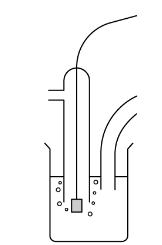
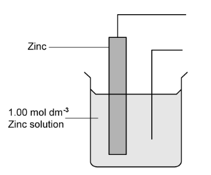
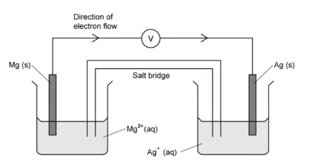
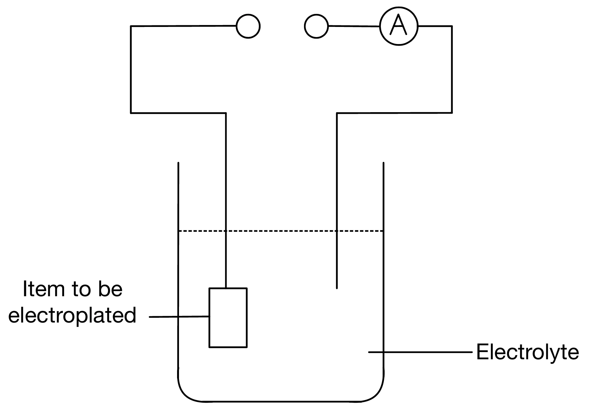
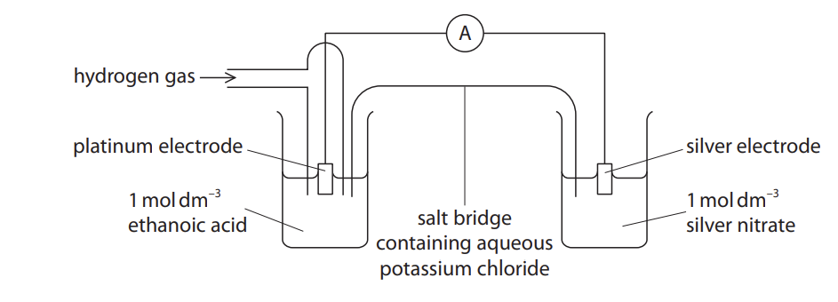
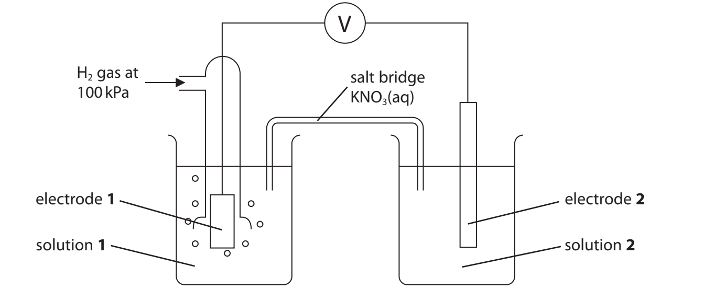

# Exam Questions — Standard Electrode Potentials E⦵, Standard Cell Potentials E⦵cell & the Nernst Equation
**24. Electrochemistry** · Cambridge (CIE) A-LEVEL chemistry (9701)
> Source: [https://www.savemyexams.com/a-level/chemistry/cie/25/topic-questions/](https://www.savemyexams.com/a-level/chemistry/cie/25/topic-questions/) · 13 questions across 1 sets

## Structured Questions (13 questions)

### Q1 — medium — 14 marks

**Q1** [2 marks]

Define the term standard electrode potential.

**Q1** [4 marks]

Draw a labelled diagram to show how the standard electrode potential of a Cu2+/Cu half-cell can be measured relative to the Standard Hydrogen Electrode (SHE).

Identify the chemicals, conditions, and relevant pieces of apparatus.

**Q1** [3 marks]

A current of 1.50 A is passed through aqueous CuSO4 for 25.0 minutes.

Calculate the mass of copper deposited at the cathode. Show your working.

**Q1** [2 marks]

Use the Nernst equation from the Data Booklet to calculate the electrode potential (*E*) for the Fe3+/Fe2+ half-cell where [Fe3+] = 0.50 mol dm-3 and [Fe2+] = 0.01 mol dm-3 (*E*θ = +0.77 V). Show your working.

**Q1** [3 marks]

A cell is constructed using the Fe3+/Fe2+ and Cu2+/Cu half-cells under standard conditions. The equation for the overall cell reaction is shown.

2Fe3+ (aq) + Cu (s) → 2Fe2+ (aq) + Cu2+ (aq)

The standard cell potential, *E*θcell, for this reaction is +0.43 V.

Calculate the standard Gibbs free energy change, Δ*G*θ, for this reaction. Give your answer in kJ mol-1 to three significant figures. Show your working.

### Q2 — medium — 9 marks

**Q2** [2 marks]

This question is about electrochemical cells.

**Fig. 1.1** shows the apparatus used to measure the standard electrode potential, *E*θ, of a cell composed of a Cu(II)/Cu half-cell and an Fe(II)/Fe half-cell.

**Fig. 1.1**

Complete the diagram by adding components to show the complete circuit. Label the components you add.

**Q2** [3 marks]

**Extract:**

This question is about electrochemical cells.

**Fig. 1.1** shows the apparatus used to measure the standard electrode potential, *E*^θ^, of a cell composed of a Cu(II)/Cu half-cell and an Fe(II)/Fe half-cell.

In the spaces below, identify what the four letters **A**–**D** in **Fig. 1.1** represent.

| **A** |   |
|---|---|
| **B** |   |
| **C** |   |
| **D** |   |

**Q2** [2 marks]

The standard electrode potentials of the two half-cells are as follows.

Fe2+ + 2e– ⇌ Fe  *E*θ = −0.44 V

Cu2+ + 2e– ⇌ Cu  *E*θ = +0.34 V

i) Identify which electrode acts as the negative electrode.

[1]

ii) Construct the overall equation for this electrochemical cell.

[1]

**Q2** [2 marks]

**Extract:**

The standard electrode potentials of the two half-cells are as follows.

Fe²⁺ + 2e⁻ ⇌ Fe  E° = −0.44 V

Cu²⁺ + 2e⁻ ⇌ Cu  E° = +0.34 V

The overall equation for this electrochemical cell is:

Cu²⁺(aq) + Fe(s) ⇌ Cu(s) + Fe²⁺(aq)

*E*θcell of this cell is +0.78 V.

State whether this reaction is feasible. Explain your answer.

### Q3 — medium — 12 marks

**Q3** [2 marks]

The standard electrode potentials for seven different redox systems are shown in **Table 3.1**.

**Table 3.1**

| **redox system** | **equation** | ***E*****θ**** / V** |
|---|---|---|
| **1** | 2H+(aq) + 2e– ⇌ H2 (g) | 0.00 |
| **2** | Fe3+(aq) + e– ⇌ Fe2+(aq) | +0.77 |
| **3** | Cu2+(aq) + 2e– ⇌ Cu(s) | +0.34 |
| **4** | Cl2(aq) + 2e– ⇌ 2Cl–(aq) | +1.36 |
| **5** | O2 (g) + 4H+(aq) + 4e– ⇌ 2H2O(l) | +1.23 |
| **6** | Al3+(aq) + 3e– ⇌ Al(s) | −1.66 |
| **7** | I2(aq) + 2e– ⇌ 2I–(aq) | +0.54 |

An electrochemical cell can be made based on redox systems **2** and **3**.

i) Construct the overall equation for the cell reaction.

[1]

ii) Calculate the voltage of this cell.

[1]

**Q3** [5 marks]

**Extract:**

The standard electrode potentials for seven different redox systems are shown in **Table 3.1**.

**Table 3.1**

| **redox system** | **equation** | ***E***^**θ**^** / V** |
| --- | --- | :---: |
| **1** | 2H^+^(aq) + 2e^–^ ⇌ H~2~ (g) | 0.00 |
| **2** | Fe^3+^(aq) + e^–^ ⇌ Fe^2+^(aq) | +0.77 |
| **3** | Cu^2+^(aq) + 2e^–^ ⇌ Cu(s) | +0.34 |
| **4** | Cl~2~(aq) + 2e^–^ ⇌ 2Cl^–^(aq) | +1.36 |
| **5** | O~2~ (g) + 4H^+^(aq) + 4e^–^ ⇌ 2H~2~O(l) | +1.23 |
| **6** | Al^3+^(aq) + 3e^–^ ⇌ Al(s) | −1.66 |
| **7** | I~2~(aq) + 2e^–^ ⇌ 2I^–^(aq) | +0.54 |

i) Using redox systems **5**, **6** and **7** **only** in **Table 3.1**, construct the overall equations for **three** reactions that might be feasible.

[3]

ii) Give **two** reasons why these reactions might not take place, even if they are feasible.

[2]

**Q3** [2 marks]

**Extract:**

The standard electrode potentials for seven different redox systems are shown in **Table 3.1**.

{align=center} **Table 3.1**

| **redox system** | **equation** | ***E***^**θ**^** / V** |
| --- | --- | :---: |
| **1** | 2H^+^(aq) + 2e^–^ ⇌ H~2~ (g) | 0.00 |
| **2** | Fe^3+^(aq) + e^–^ ⇌ Fe^2+^(aq) | +0.77 |
| **3** | Cu^2+^(aq) + 2e^–^ ⇌ Cu(s) | +0.34 |
| **4** | Cl~2~(aq) + 2e^–^ ⇌ 2Cl^–^(aq) | +1.36 |
| **5** | O~2~ (g) + 4H^+^(aq) + 4e^–^ ⇌ 2H~2~O(l) | +1.23 |
| **6** | Al^3+^(aq) + 3e^–^ ⇌ Al(s) | −1.66 |
| **7** | I~2~(aq) + 2e^–^ ⇌ 2I^–^(aq) | +0.54 |

Select from **Table 3.1**,

i) an oxidising agent that oxidises Fe2+ (aq) to Fe3+ (aq),

[1]

ii) a species that reduces Fe3+ (aq) to Fe2+ but does not reduce Cu2+ (aq) to Cu (s).

[1]

**Q3** [3 marks]

**Extract:**

The standard electrode potentials for seven different redox systems are shown in **Table 3.1**.

**Table 3.1**

| **redox system** | **equation** | ***E***^**θ**^** / V** |
| --- | --- | :---: |
| **1** | 2H^+^(aq) + 2e^–^ ⇌ H~2~ (g) | 0.00 |
| **2** | Fe^3+^(aq) + e^–^ ⇌ Fe^2+^(aq) | +0.77 |
| **3** | Cu^2+^(aq) + 2e^–^ ⇌ Cu(s) | +0.34 |
| **4** | Cl~2~(aq) + 2e^–^ ⇌ 2Cl^–^(aq) | +1.36 |
| **5** | O~2~ (g) + 4H^+^(aq) + 4e^–^ ⇌ 2H~2~O(l) | +1.23 |
| **6** | Al^3+^(aq) + 3e^–^ ⇌ Al(s) | −1.66 |
| **7** | I~2~(aq) + 2e^–^ ⇌ 2I^–^(aq) | +0.54 |

Calculate the electrode potential at 298 K of redox system **3** if the concentration of Cu2+ (aq) ions was 0.0002 mol dm-3. Show your working.

### Q4 — medium — 9 marks

**Q4** [2 marks]

An electrochemical cell is set up as shown in Fig. 2.1.

**Fig. 2.1**

Use the electrode potential list in Table 2.1 to calculate the value of *E*θcell under standard conditions, stating which electrode is the negative one.

**Table 2.1**

| **Electrode reaction** | ***E*****θ**** / V** |
|---|---|
| Ag+ + e– ⇌ Ag | +0.80 |
| Fe2+ + 2e– ⇌ Fe | −0.44 |
| Fe3+ + e– ⇌ Fe2+ | +0.77 |
| SO42– + 4H+ + 2e– ⇌ SO2 + 2H2O | +0.17 |

[2]

**Q4** [2 marks]

**Extract:**

An electrochemical cell is set up as shown in Fig. 2.1.

Use the electrode potential list in Table 2.1 to calculate the value of E°_cell under standard conditions, stating which electrode is the negative one.

Table 2.1

| Electrode reaction | E°/ V |
| --- | :---: |
| Ag+ + e– ⇌ Ag | +0.80 |
| Fe2+ + 2e– ⇌ Fe | −0.44 |
| Fe3+ + e– ⇌ Fe2+ | +0.77 |
| SO4^2– + 4H+ + 2e– ⇌ SO2 + 2H2O | +0.17 |

How would the actual *E*cell of the above cell compare to the *E*θcell under standard conditions?

Explain your answer.

**Q4** [4 marks]

**Extract:**

An electrochemical cell is set up as shown in Fig. 2.1.

**Table 2.1**

| **Electrode reaction** | ***E***^**θ**^** / V** |
| --- | :---: |
| Ag^+^ + e^–^ ⇌ Ag | +0.80 |
| Fe^2+^ + 2e^–^ ⇌ Fe | −0.44 |
| Fe^3+^ + e^–^ ⇌ Fe^2+^ | +0.77 |
| SO~4~^2–^ + 4H^+^ + 2e^–^ ⇌ SO~2~ + 2H~2~O | +0.17 |

How would the *E*cell of the cell in Fig. 2.1 change, if at all, if a few cm3 of concentrated Na2SO4 (aq) were added to the following?

i) The beaker containing Fe3+ (aq) and Fe2+ (aq).

[1]

ii) The beaker containing Ag2SO4 (aq).

[1]

iii) Explain any changes in *E*cell you have stated in **(i)** and **(ii)**.

[2]

**Q4** [1 mark]

**Extract:**

An electrochemical cell is set up as shown in Fig. 2.1.

**Table 2.1**

| **Electrode reaction** | ***E***^**θ**^** / V** |
| --- | :---: |
| Ag^+^ + e^–^ ⇌ Ag | +0.80 |
| Fe^2+^ + 2e^–^ ⇌ Fe | −0.44 |
| Fe^3+^ + e^–^ ⇌ Fe^2+^ | +0.77 |
| SO~4~^2–^ + 4H^+^ + 2e^–^ ⇌ SO~2~ + 2H~2~O | +0.17 |

Construct an equation to show the reaction taking place in the electrochemical cell in Fig. 2.1.

### Q5 — medium — 18 marks

**Q5** [6 marks]

This question is about electrochemical cells.

The diagram shown in **Fig. 3.1** represents the standard hydrogen electrode.

**Fig 3.1**

i) Name the substance used as the electrode in **Fig 3.1**.

[1]

ii) Suggest why this substance is used as an electrode.

[2]

iii) Give the standard conditions used in a standard hydrogen electrode.

[3]

**Q5** [6 marks]

A student set up an electrochemical cell consisting of copper and zinc.

i) Complete **Fig. 3.2** to show the components and reagents, including their concentrations and label any apparatus required to complete the electrochemical cell.

[4]

**Fig. 3.2**

ii) Use the IUPAC convention to give the half-equations occurring at each electrode.

[2]

**Q5** [4 marks]

A student set up another electrochemical cell consisting of copper and silver as shown in the following cell representation where the half cell with the greatest negative standard electrode potential is written on the left:

Cu / Cu2+ ; Ag+ / Ag

i) Construct a half-equation for the reaction that occurs at the positive electrode.

[1]

ii) Construct a half-equation for the reaction that occurs at the negative electrode.

[1]

iii) Use the half-equations to deduce an overall equation for the cell. Include all state symbols.

[2]

**Q5** [2 marks]

A diagram of a cell is shown below in **Fig. 3.3**.

**Fig. 3.3**

i) Explain how the salt bridge, in **Fig. 3.3, **provides an electrical connection between the two solutions.

[1]

ii) Suggest why potassium chloride would **not** be suitable for use in the salt bridge of this cell.

[1]

### Q6 — hard — 11 marks

**Q6** [1 mark]

Table 3.1 lists electrode potentials for some electrode reactions.

**Table 3.1 **

| **Electrode reaction ** | ***E*****θ**** / V** |
|---|---|
| Br2 + 2e– ⇌ 2Br– | + 1.07 |
| Cl2 + 2e– ⇌ 2Cl – | + 1.36 |
| [Co(H2O)6]3++ e– ⇌  [Co(H2O)6]2+ | + 1.81 |
| [Co(NH3)6]3+ + e– ⇌ [Co(NH3)6]2+  | + 0.11 |
| Cu2+ + 2e– ⇌ Cu | + 0.34 |
| Fe2+ + 2e– ⇌ Fe | – 0.44 |
| Fe3+ + e– ⇌ Fe2+ | + 0.77 |
| 2H+ + 2e– ⇌ H2 | 0.00 |
| I2 + 2e– ⇌ 2I– | + 0.54 |
| NO3– + 2H+ + e– ⇌ NO2 + H2O | + 0.81 |
| SO42– + 4H+ + 2e– ⇌ SO2 + 2H2O | + 0.17 |
| VO2+ + 2H+ + e– ⇌ VO2+ + H2O | +1.00 |

Explain how Table 3.1 could be adapted to show an electrochemical series.

**Q6** [1 mark]

**Extract:**

Table 3.1 lists electrode potentials for some electrode reactions.

**Table 3.1 **

| **Electrode reaction ** | ***E***^**θ**^** / V** |
| --- | :---: |
| Br~2~ + 2e^–^ ⇌ 2Br^–^ | + 1.07 |
| Cl~2~ + 2e^–^ ⇌ 2Cl ^–^ | + 1.36 |
| [Co(H~2~O)~6~]^3+^+ e^–^ ⇌  [Co(H~2~O)~6~]^2+^ | + 1.81 |
| [Co(NH~3~)~6~]^3+ ^+ e^–^ ⇌ [Co(NH~3~)~6~]^2+ ^ | + 0.11 |
| Cu^2+^ + 2e^–^ ⇌ Cu | + 0.34 |
| Fe^2+^ + 2e^–^ ⇌ Fe | – 0.44 |
| Fe^3+^ + e^–^ ⇌ Fe^2+^ | + 0.77 |
| 2H^+^ + 2e^–^ ⇌ H~2~ | 0.00 |
| I~2~ + 2e^–^ ⇌ 2I^–^ | + 0.54 |
| NO~3~^–^ + 2H^+^ + e^–^ ⇌ NO~2~ + H~2~O | + 0.81 |
| SO~4~^2–^ + 4H^+^ + 2e^–^ ⇌ SO~2~ + 2H~2~O | + 0.17 |
| VO~2~^+^ + 2H^+^ + e^–^ ⇌ VO^2+^ + H~2~O | +1.00 |

Use Table 3.1 to identify the halide ion that is the weakest reducing agent.

**Q6** [1 mark]

**Extract:**

Table 3.1 lists electrode potentials for some electrode reactions.

**Table 3.1 **

| **Electrode reaction ** | ***E***^**θ**^** / V** |
| --- | :---: |
| Br~2~ + 2e^–^ ⇌ 2Br^–^ | + 1.07 |
| Cl~2~ + 2e^–^ ⇌ 2Cl ^–^ | + 1.36 |
| [Co(H~2~O)~6~]^3+^+ e^–^ ⇌  [Co(H~2~O)~6~]^2+^ | + 1.81 |
| [Co(NH~3~)~6~]^3+ ^+ e^–^ ⇌ [Co(NH~3~)~6~]^2+ ^ | + 0.11 |
| Cu^2+^ + 2e^–^ ⇌ Cu | + 0.34 |
| Fe^2+^ + 2e^–^ ⇌ Fe | – 0.44 |
| Fe^3+^ + e^–^ ⇌ Fe^2+^ | + 0.77 |
| 2H^+^ + 2e^–^ ⇌ H~2~ | 0.00 |
| I~2~ + 2e^–^ ⇌ 2I^–^ | + 0.54 |
| NO~3~^–^ + 2H^+^ + e^–^ ⇌ NO~2~ + H~2~O | + 0.81 |
| SO~4~^2–^ + 4H^+^ + 2e^–^ ⇌ SO~2~ + 2H~2~O | + 0.17 |
| VO~2~^+^ + 2H^+^ + e^–^ ⇌ VO^2+^ + H~2~O | +1.00 |

Use Table 3.1 to justify why sulfate ions should **not** be capable of oxidising iodide ions.

**Q6** [4 marks]

**Extract:**

Table 3.1 lists electrode potentials for some electrode reactions.

**Table 3.1 **

| **Electrode reaction ** | ***E***^**θ**^** / V** |
| --- | :---: |
| Br~2~ + 2e^–^ ⇌ 2Br^–^ | + 1.07 |
| Cl~2~ + 2e^–^ ⇌ 2Cl ^–^ | + 1.36 |
| [Co(H~2~O)~6~]^3+^+ e^–^ ⇌  [Co(H~2~O)~6~]^2+^ | + 1.81 |
| [Co(NH~3~)~6~]^3+ ^+ e^–^ ⇌ [Co(NH~3~)~6~]^2+ ^ | + 0.11 |
| Cu^2+^ + 2e^–^ ⇌ Cu | + 0.34 |
| Fe^2+^ + 2e^–^ ⇌ Fe | – 0.44 |
| Fe^3+^ + e^–^ ⇌ Fe^2+^ | + 0.77 |
| 2H^+^ + 2e^–^ ⇌ H~2~ | 0.00 |
| I~2~ + 2e^–^ ⇌ 2I^–^ | + 0.54 |
| NO~3~^–^ + 2H^+^ + e^–^ ⇌ NO~2~ + H~2~O | + 0.81 |
| SO~4~^2–^ + 4H^+^ + 2e^–^ ⇌ SO~2~ + 2H~2~O | + 0.17 |
| VO~2~^+^ + 2H^+^ + e^–^ ⇌ VO^2+^ + H~2~O | +1.00 |

i) Use Table 3.1 to identify an acid that will oxidise copper. Explain your answer.

[2]

ii) Construct an equation for the reaction.

[1]

iii) Calculate the *E*θcell for the same overall reaction.

[1]

**Q6** [1 mark]

**Extract:**

Table 3.1 lists electrode potentials for some electrode reactions.

| **Electrode reaction ** | ***E***^**θ**^** / V** |
| --- | :---: |
| Br~2~ + 2e^–^ ⇌ 2Br^–^ | + 1.07 |
| Cl~2~ + 2e^–^ ⇌ 2Cl ^–^ | + 1.36 |
| [Co(H~2~O)~6~]^3+^+ e^–^ ⇌  [Co(H~2~O)~6~]^2+^ | + 1.81 |
| [Co(NH~3~)~6~]^3+ ^+ e^–^ ⇌ [Co(NH~3~)~6~]^2+ ^ | + 0.11 |
| Cu^2+^ + 2e^–^ ⇌ Cu | + 0.34 |
| Fe^2+^ + 2e^–^ ⇌ Fe | – 0.44 |
| Fe^3+^ + e^–^ ⇌ Fe^2+^ | + 0.77 |
| 2H^+^ + 2e^–^ ⇌ H~2~ | 0.00 |
| I~2~ + 2e^–^ ⇌ 2I^–^ | + 0.54 |
| NO~3~^–^ + 2H^+^ + e^–^ ⇌ NO~2~ + H~2~O | + 0.81 |
| SO~4~^2–^ + 4H^+^ + 2e^–^ ⇌ SO~2~ + 2H~2~O | + 0.17 |
| VO~2~^+^ + 2H^+^ + e^–^ ⇌ VO^2+^ + H~2~O | +1.00 |

Suggest why the two cobalt(III) complex ions in Table 3.1 have different electrode potentials.

**Q6** [3 marks]

**Extract:**

Table 3.1 lists electrode potentials for some electrode reactions.

**Table 3.1 **

| **Electrode reaction ** | ***E***^**θ**^** / V** |
| --- | :---: |
| Br~2~ + 2e^–^ ⇌ 2Br^–^ | + 1.07 |
| Cl~2~ + 2e^–^ ⇌ 2Cl ^–^ | + 1.36 |
| [Co(H~2~O)~6~]^3+^+ e^–^ ⇌  [Co(H~2~O)~6~]^2+^ | + 1.81 |
| [Co(NH~3~)~6~]^3+ ^+ e^–^ ⇌ [Co(NH~3~)~6~]^2+ ^ | + 0.11 |
| Cu^2+^ + 2e^–^ ⇌ Cu | + 0.34 |
| Fe^2+^ + 2e^–^ ⇌ Fe | – 0.44 |
| Fe^3+^ + e^–^ ⇌ Fe^2+^ | + 0.77 |
| 2H^+^ + 2e^–^ ⇌ H~2~ | 0.00 |
| I~2~ + 2e^–^ ⇌ 2I^–^ | + 0.54 |
| NO~3~^–^ + 2H^+^ + e^–^ ⇌ NO~2~ + H~2~O | + 0.81 |
| SO~4~^2–^ + 4H^+^ + 2e^–^ ⇌ SO~2~ + 2H~2~O | + 0.17 |
| VO~2~^+^ + 2H^+^ + e^–^ ⇌ VO^2+^ + H~2~O | +1.00 |

i) Use Table 3.1 to explain why [Co(H2O)6]3+ (aq) will undergo a redox reaction with [Fe(H2O)6]2+ (aq).

[1]

ii) Give an equation for this reaction.

[2]

### Q7 — hard — 8 marks

**Q7** [2 marks]

Explain why Fig. 3.1 does not represent the standard hydrogen electrode.

**Fig. 3.1**

**Q7** [1 mark]

The standard electrode potential for Zn2+ (aq) + 2e– → Zn (s) is –0.76 V.

State the meaning of the minus sign in the value of –0.76 V.

**Q7** [2 marks]

Zinc coating on metals serves as physical protection which prevents rust from affecting the underlying metal surface. This is achieved by electroplating as shown in Fig. 3.2.

**Fig. 3.2**

i) Suggest a suitable solution to act as the electrolyte during zinc electroplating.

[1]

ii) Complete the diagram by labelling the polarity of the power source by using a + and - sign.

[1]

**Q7** [3 marks]

**Extract:**

The standard electrode potential for Zn^2+^ (aq) + 2e^–^ → Zn (s) is –0.76 V.

Calculate the length of time, in hours, required to deposit 1.0 g of zinc on the item to be electroplated. Assume the current is a constant 0.1 A throughout this period.

State your answer to 3 significant figures and show your working.

### Q8 — medium — 9 marks

**Q8** [2 marks]

**Table 4.1** below contains some standard electrode potential data which you will need to answer the following questions.

**Table 4.1**

| **electrode reaction** | ***E***^**θ**^** / V** |
|---|---|
| Cu2+ (aq) + 2e− ⇌ Cu (s) | +0.34 |
| Ni2+ (aq) + 2e− ⇌ Ni (s) | −0.25 |
| Fe3+ (aq) + e− ⇌ Fe2+ (aq) | +0.77 |
| Sn2+ (aq) + 2e− ⇌ Sn (s) | −0.14 |
| Fe2+ (aq) + 2e− ⇌ Fe (s) | −0.45 |

Deduce the species from **Table 4.1** that is the weakest oxidising agent. Explain your choice.

**Q8** [1 mark]

**Extract:**

**Table 4.1**

| **electrode reaction** | ***E***^**θ**^** / V** |
| --- | :---: |
| Cu^2+^ (aq) + 2e^−^ ⇌ Cu (s) | +0.34 |
| Ni^2+^ (aq) + 2e^−^ ⇌ Ni (s) | −0.25 |
| Fe^3+^ (aq) + e^−^ ⇌ Fe^2+^ (aq) | +0.77 |
| Sn^2+^ (aq) + 2e^−^ ⇌ Sn (s) | −0.14 |
| Fe^2+^ (aq) + 2e^−^ ⇌ Fe (s) | −0.45 |

A cell is made by connecting two half-cells with a salt bridge.

A student produced a cell by using nickel in a solution of nickel chloride solution and another consisted of copper in a solution of copper sulfate solution.

Calculate the standard cell potential of this cell using the values given in **Table 4.1** in part **(a)**.

**Q8** [4 marks]

**Extract:**

A cell is made by connecting two half-cells with a salt bridge.

A student produced a cell by using nickel in a solution of nickel chloride solution and another consisted of copper in a solution of copper sulfate solution.

**Table 4.1**

| **electrode reaction** | ***E***^**θ**^** / V** |
| --- | :---: |
| Cu^2+^ (aq) + 2e^−^ ⇌ Cu (s) | +0.34 |
| Ni^2+^ (aq) + 2e^−^ ⇌ Ni (s) | −0.25 |
| Fe^3+^ (aq) + e^−^ ⇌ Fe^2+^ (aq) | +0.77 |
| Sn^2+^ (aq) + 2e^−^ ⇌ Sn (s) | −0.14 |
| Fe^2+^ (aq) + 2e^−^ ⇌ Fe (s) | −0.45 |

Calculate the standard Gibbs free energy change, and give the units, for the electrochemical cell in part **(b)** and state whether the reaction is feasible.

Show your working.

[4]

**Q8** [2 marks]

**Extract:**

**Table 4.1** below contains some standard electrode potential data which you will need to answer the following questions.

**Table 4.1**

| **electrode reaction** | ***E***^**θ**^** / V** |
| --- | :---: |
| Cu^2+^ (aq) + 2e^−^ ⇌ Cu (s) | +0.34 |
| Ni^2+^ (aq) + 2e^−^ ⇌ Ni (s) | −0.25 |
| Fe^3+^ (aq) + e^−^ ⇌ Fe^2+^ (aq) | +0.77 |
| Sn^2+^ (aq) + 2e^−^ ⇌ Sn (s) | −0.14 |
| Fe^2+^ (aq) + 2e^−^ ⇌ Fe (s) | −0.45 |

Two half-cells, involving species in **Table 4.1**, are connected together to give a cell with a standard cell potential = +0.31 V.

i) Determine which two half equations are connected using the data from **Table 4.1.**

[1]

ii) Suggest the half-equation for the reaction that occurs at the cathode.

[1]

### Q9 — hard — 7 marks

**Q9** [4 marks]

This question is about the Ag+ (aq) / Ag (s) half-cell.

A student was asked to plan an experiment to measure the standard electrode potential of the Ag+ (aq) / Ag (s) half-cell.

i) State the conditions of temperature and pressure under which standard electrode potentials are measured.

[1]

ii) Fig. 1.1 shows the diagram drawn by the student.

**Fig. 1.1 **

Complete Table 1.1 to identify **three** mistakes in this diagram and the modifications that should be made to correct them.

**Table 1.1 **

| **Mistake in diagram** | **Modification needed to correct mistake** |
|---|---|
|   |   |
|   |   |
|   |   |

[3]

*Source: June 2019 9CHO/03 Q2A*

**Q9** [3 marks]

The standard electrode potential, *E*θ, of the Ag+ (aq) / Ag (s) half-cell is +0.80 V.

The electrode potential of an Ag+ (aq) / Ag (s) half-cell was measured at 25 °C and found to be +0.72 V.

Use the Nernst equation from the Data Booklet to calculate the concentration of silver ions, in mol dm-3, in this half-cell. Show your working.

*Source: June 2019 9CHO/03 Q*

### Q10 — medium — 8 marks

**Q10** [2 marks]

The apparatus shown was used to measure the standard electrode potential for the reduction of Cr2O72– ions to Cr3+ ions in acid solution:

Cr2O72– (aq) + 14H+ (aq) + 6e– ⇌ 2Cr3+ (aq) + 7H2O (l)

Which material should be used for each electrode?

*Source: Oct 2021 WCH15/01 Q1A*

**Q10** [1 mark]

**Extract:**

The apparatus shown was used to measure the standard electrode potential for the reduction of Cr~2~O~7~^2–^ ions to Cr^3+^ ions in acid solution:

Cr~2~O~7~^2–^ (aq) + 14H^+^ (aq) + 6e^–^ ⇌ 2Cr^3+^ (aq) + 7H~2~O (l)

Suggest a suitable solution that could be used as solution **1**.

*Source: Oct 2021 WCH15/01 Q1B*

**Q10** [3 marks]

**Extract:**

The apparatus shown was used to measure the standard electrode potential for the reduction of Cr2O7^2– ions to Cr^3+ ions in acid solution:

Cr2O7^2– (aq) + 14H+ (aq) + 6e– ⇌ 2Cr^3+ (aq) + 7H2O (l)

Solution **2** contains 14.71 g of K2Cr2O7.

Calculate the mass of Cr2(SO4)3⋅18H2O that should also be used. Show your working.

[*M*r values: K2Cr2O7 = 294.2, Cr2(SO4)3⋅18H2O = 716.3]

*Source: Oct 2021 WCH15/01 Q1C*

**Q10** [2 marks]

**Extract:**

The apparatus shown was used to measure the standard electrode potential for the reduction of Cr2O7^2– ions to Cr^3+ ions in acid solution:

Cr2O7^2– (aq) + 14H^+ (aq) + 6e^– ⇌ 2Cr^3+ (aq) + 7H2O (l)

Solution 2 contains 14.71 g of K2Cr2O7.

Solution **2** is best acidified with H2SO4 instead of HCl or HBr.

Suggest why.

*Source: Oct 2021 WCH15/01 Q1D*

### Q11 — medium — 10 marks

**Q11** [3 marks]

The standard electrode potentials in **Table 5.1** can be used to predict redox reactions.

**Table 5.1**

| **redox system** | **equation** | ***E*****θ**** / V** |
|---|---|---|
| **1** | Ag+ (aq) + e– ⇌ Ag (s) | +0.80 |
| **2** | Cr3+ (aq) + 3e– ⇌ Cr (s) | −0.74 |
| **3 ** | Mg2+ (aq) + 2e– ⇌ Mg (s) | −2.37 |

Using the information in **Table 5.1**, construct equations for the reactions that are feasible.

**Q11** [2 marks]

**Extract:**

The standard electrode potentials in **Table 5.1** can be used to predict redox reactions.

**Table 5.1**

| **redox system** | **equation** | ***E***^**θ**^** / V** |
| :---: | :---: | :---: |
| **1** | Ag^+^ (aq) + e^–^ ⇌ Ag (s) | +0.80 |
| **2** | Cr^3+^ (aq) + 3e^–^ ⇌ Cr (s) | −0.74 |
| **3 ** | Mg^2+^ (aq) + 2e^–^ ⇌ Mg (s) | −2.37 |

A student sets up a standard cell, using half-cells based on redox systems **2** and **3 **at 298 K.

i) Calculate the standard cell potential.

[1]

ii) State the sign of the electrode in redox system **2** of the cell.

[1]

**Q11** [3 marks]

**Extract:**

The standard electrode potentials in **Table 5.1** can be used to predict redox reactions.

**Table 5.1**

| **redox system** | **equation** | ***E***^**θ**^** / V** |
| :---: | :---: | :---: |
| **1** | Ag^+^ (aq) + e^–^ ⇌ Ag (s) | +0.80 |
| **2** | Cr^3+^ (aq) + 3e^–^ ⇌ Cr (s) | −0.74 |
| **3 ** | Mg^2+^ (aq) + 2e^–^ ⇌ Mg (s) | −2.37 |

A student sets up a standard cell, using half-cells based on redox systems **2** and **3** at 298 K.

The student diluted the solution in redox system **3** with distilled water.

Predict what would happen to the cell potential. Explain your reasoning.

**Q11** [2 marks]

**Extract:**

The standard electrode potentials in **Table 5.1** can be used to predict redox reactions.

**Table 5.1**

| **redox system** | **equation** | ***E***^**θ**^** / V** |
| :---: | :---: | :---: |
| **1** | Ag^+^ (aq) + e^–^ ⇌ Ag (s) | +0.80 |
| **2** | Cr^3+^ (aq) + 3e^–^ ⇌ Cr (s) | −0.74 |
| **3 ** | Mg^2+^ (aq) + 2e^–^ ⇌ Mg (s) | −2.37 |

The student set up the cell between redox systems **2** and **3** again. This time, they did not dilute the solution of redox system **3** but they used a solution of 0.01 mol dm−3 of Cr3+ ions for redox system **2**. The temperature remained at 298 K.

Calculate the electrode potential, *E*, for redox system **2** under these conditions. Show your working.

### Q12 — easy — 8 marks

**Q12** [3 marks]

State the standard conditions for the measurement of standard electrode potentials.

Temperature = ..............................

Pressure = ....................................

Ion concentration = ........................

**Q12** [2 marks]

**Table 4.1**

|   | Half-equation | Standard electrode potential, *E*θ / V |
|---|---|---|
| **A** | Ag+ + e– ⇌ Ag | +0.80 |
| **B** | ClO– + H2O + 2e– ⇌ Cl– + 2OH– | +0.89 |
| **C** | 2H2O + 2e– ⇌ H2 + 2OH– | –0.83 |

Identify the half-equation from Table 4.1 with the equilibrium position that lies:

i) Furthest left.

[1]

ii) Furthest right.

[1]

**Q12** [3 marks]

**Extract:**

Temperature = 298 K
Pressure = 1 atm / 101 kPa
Ion concentration = 1.0 mol dm^–3^

The standard hydrogen electrode is used as the primary reference electrode for measuring standard electrode potential.

i) Describe a standard hydrogen electrode. Your answer should include the chemicals and conditions used.

[2]

ii) State the standard electrode potential of the standard hydrogen electrode.

*E*θ = .......... V

[1]

### Q13 — easy — 6 marks

**Q13** [2 marks]

Electrochemical cells are made by connecting two half-cells with a salt bridge and a high-resistance voltmeter.

The standard hydrogen electrode is an example of a non-metal / non-metal ion half-cell which requires a platinum electrode.

Complete Table 5.1 to identify the **two** other types of half-cell and whether they require a platinum electrode.

**Table 5.1**

| **Type of half-cell** | **Require a platinum electrode?** |
|---|---|
| non-metal / non-metal ion | Yes |
|   |   |
|   |   |

**Q13** [1 mark]

The direction of electron flow can be determined by comparing the *E*θ values of the two half-cells in an electrochemical cell.

State the direction of electron flow in the external circuit of an operating electrochemical cell.

**Q13** [3 marks]

Table 5.2 shows six standard electrode potentials.

**Table 5.2 **

| **Electrode reaction** | ***E*****θ**** / V** |
|---|---|
| Cu+ + e– ⇌ Cu | + 0.52 |
| Cu2+ + 2e– ⇌ Cu | + 0.34 |
| Cu2+ + e– ⇌ Cu+ | + 0.15 |
| Fe2+ + 2e– ⇌ Fe | – 0.44 |
| Fe3+ + 3e– ⇌ Fe | – 0.04 |
| Fe3+ + e– ⇌ Fe2+ | + 0.77 |

i) Identify a half-cell from Table 5.2 that will ensure that the Cu+ / Cu half-cell undergoes oxidation.

[1]

ii) Construct the overall equation for the feasible reaction of this electrochemical cell.

[2]
