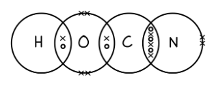
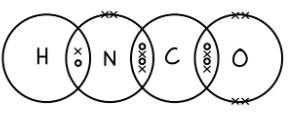
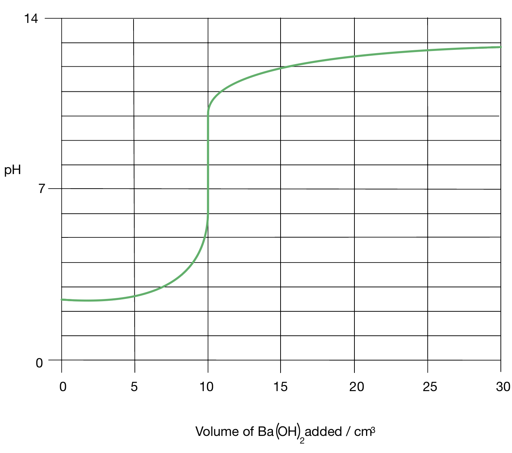
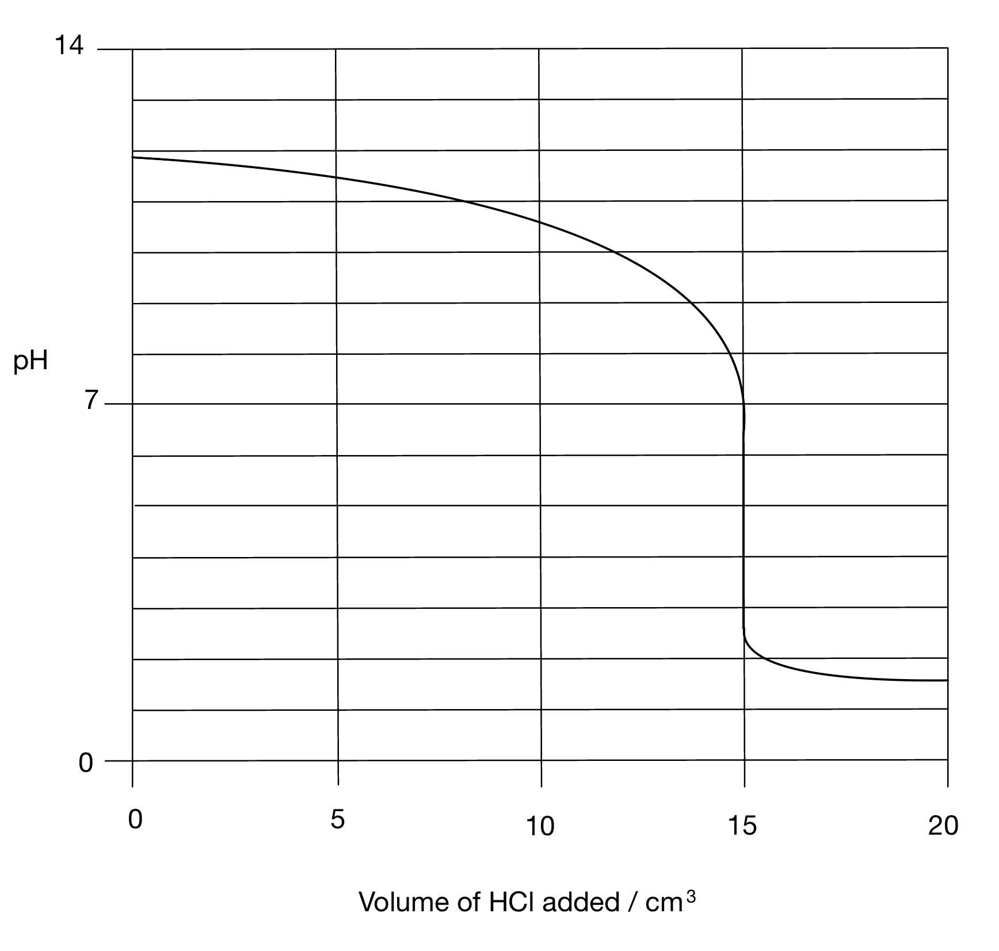

# Mark Schemes — Acids & Bases
**25. Equilibria** · Cambridge (CIE) A-LEVEL chemistry (9701)

## Structured Questions (9 questions)

### Q1
> **[mark-scheme]**
> i) pH is defined as:
> 
> - pH = -log[H+] **[1 mark]**

ii) To calculate the pH of 0.025 mol dm-3 Ba(OH)2 (aq) at 298 K:

- Ba(OH)2 is a strong base and fully dissociates:

Ba(OH)2 → Ba2+ + 2OH-

[OH-] = 2 x [Ba(OH)2]

[OH-] = 2 x 0.025

[OH-] = 0.050 mol dm-3 **[1 mark]**

- Calculate [H+] using the ionic product of water, *K*w = [H+][OH-] (*K*w = 1 x 10-14 mol2 dm-6 at 298 K):

[H+] = `\frac{K_{w}}{[OH^{-}]}`

[H+] = $\frac{1\times10^{-14}}{0.050}$

[H+] = 2 x 10-13 mol dm-3 **[1 mark]**

- Use pH = -log[H+] to calculate pH:

pH = -log(2 x 10-13)

pH = **12.7** **[1 mark]**

> **[exam-tip]**
> When performing calculations involving *K*w, always ensure your final answer is consistent with the significant figures provided in the data, typically 3 significant figures for 1.00 x 10-14.
> 
> Failure to include or correctly derive units in structured questions can lead to a loss of marks.
> 
> As a quick check, strong alkalis at this concentration should give a pH well above 12, so an answer near neutral should immediately raise concern.
i) To calculate the pH of the buffer solution:

**Method 1:**

- Find the p*K*a using p*K*a = -log(*K*a):

p*K*a = -log(1.75 x 10-5)

p*K*a = 4.76 **[1 mark]**

- Substitute values into the Henderson-Hasselbalch equation, pH = p*K*a + log([salt]/[acid]):

pH = 4.76 + log`\left(\frac{0.60}{0.40}\right)`

pH = 4.76 + 0.176 **[1 mark]**

pH = **4.93** **[1 mark]**

**Method 2:**

- Write the *K*a expression and rearrange to find [H+]:

*K*a = `\frac{[H^{+}][A^{-}]}{[HA]}`

[H+] = `\frac{K_{a} \times [HA]}{[A^{-}]}` **[1 mark]**

- Substitute values:

[H+] = $\frac{1.75\times10^{-5}\times0.40}{0.60}$

[H+] = 1.167 x 10-5 mol dm-3 **[1 mark]**

pH = -log(1.167 x 10-5)

pH = **4.93** **[1 mark]**

> **[mark-scheme]**
> Method 1:
> 
> - 1 mark for p*K*a = 4.76
> - 1 mark for pH = 4.76 + log(0.60/0.40) with the log step shown
> - 1 mark for pH = 4.93
> 
> A final answer of pH = 4.94 is allowed from Method 1
> 
> Method 2:
> 
> - 1 mark for [H+] = *K*a x [HA] / [A-] correctly stated
> - 1 mark for [H+] = 1.167 x 10-5 mol dm-3
> - 1 mark for pH = 4.93

> **[exam-tip]**
> For buffer calculations, you can use either the Henderson-Hasselbalch equation (pH = p*K*a + log([salt]/[acid])) or the *K*a expression rearranged for [H+]. Both give the same result.
> 
> Always place the conjugate base (CH3COO-) over the weak acid (CH3COOH) in the log term, not the other way around.

> **[mark-scheme]**
> ii) When NaOH is added to the buffer:
> 
> - CH3COOH + OH- → CH3COO- + H2O **[1 mark]**
> - The OH- ions are neutralised by reacting with CH3COOH, preventing a significant change in pH **[1 mark]**

> **[exam-tip]**
> When NaOH is added, OH- is removed by reaction with the weak acid CH3COOH, so the pH changes only slightly.
> **[mark-scheme]**
> i) The solubility product, *K*sp, is defined as:
> 
> - The product of the equilibrium concentrations of each ion in a saturated solution **[1 mark]**
> - Each raised to the power of its stoichiometric coefficient **[1 mark]**

ii) To calculate the solubility of Ag2SO4 in water in mol dm-3:

- Write out the ionic equation for dissolution:

Ag2SO4 (s) ⇌ 2Ag+ (aq) + SO42- (aq)

- Write out the *K*sp expression:

*K*sp = [Ag+]2[SO42-] **[1 mark]**

- Let the solubility of Ag2SO4 be s mol dm-3:

[SO42-] = s, and [Ag+] = 2s

- Substitute into the *K*sp expression:

*K*sp = (2s)2(s)

*K*sp = 4s3

1.20 x 10-5 = 4s3 **[1 mark]**

- Solve for s:

s3 = $\frac{1.20\times10^{-5}}{4}$

s3 = 3.0 x 10-6

s = `\sqrt[3]{3.0 \times 10^{-6}}`

s = **0.0144 mol dm****-3** **[1 mark]**

> **[mark-scheme]**
> 1 mark for *K*sp = [Ag+]2[SO42-]
> 
> 1 mark for *K*sp = (2s)2(s) **OR** *K*sp = 4s3 **OR** 1.20 x 10-5 = 4s3
> 
> 1 mark for s = 0.0144 mol dm-3

> **[exam-tip]**
> A common error is missing powers when an ion appears more than once in the dissolution equation.
> 
> Always write the dissociation equation first, then express every ion concentration in terms of s before substituting into the *K*sp expression.
> **[mark-scheme]**
> i) The solubility of Ag2SO4 in 0.10 mol dm-3 Na2SO4 (aq) is:
> 
> - Less than its solubility in pure water **[1 mark]**
> 
> ii) The reason for this is:
> 
> - Adding Na2SO4 increases the concentration of the common ion, SO42- **[1 mark]**
> - This shifts the equilibrium to the left, resulting in precipitation of Ag2SO4 and a reduction in solubility **[1 mark]**

> **[exam-tip]**
> If a solution already contains one of the ions from a sparingly soluble salt, solubility always decreases.
> 
> Always name the specific common ion (here: SO42-). Saying "a common ion" without naming it can lose credit.
> 
> Use the phrase "shifts the equilibrium to the left" as examiners look for this.
> 
> A quick check: adding more product ions never increases solubility.

### Q2
> **[mark-scheme]**
> The assumptions made when using this equation for buffer calculations are:
> 
> - The equilibrium concentration of the weak acid, [HA], is equal to the initial concentration of the weak acid **[1 mark]**
> - The equilibrium concentration of the conjugate base, [A-], is equal to the initial concentration of the salt **[1 mark]**
> 
> These assumptions hold because the degree of dissociation of the weak acid is negligible, so the contributions to [HA] and [A-] from dissociation are insignificant.

> **[exam-tip]**
> Both assumptions stem from the same principle: the weak acid dissociates so slightly that the equilibrium concentrations of HA and A- are effectively unchanged from the initial values. If asked to justify the assumptions, state that the degree of dissociation is negligible.
> **[mark-scheme]**
> A salt that could be used to form a buffer solution with propanoic acid is:
> 
> - Sodium propanoate / CH3CH2COONa
> **OR**
> Potassium propanoate / CH3CH2COOK
> **OR**
> Lithium propanoate / CH3CH2COOLi **[1 mark]**
> 
> Any other soluble salt containing the CH3CH2COO- ion is accepted

> **[exam-tip]**
> An acidic buffer requires a weak acid and the salt of that weak acid. The salt must be soluble. Group 1 metal salts (sodium, potassium, lithium) are always soluble and are the standard choices.
To calculate the pH of the buffer solution:

- Write the expression for *K*a:

`K_a = \frac{[H^+][A^-]}{[HA]}` **[1 mark]**

- Rearrange to find [H+]:

`[H^+] = \frac{K_a \times [HA]}{[A^-]}` **[1 mark]**

- Substitute values and calculate [H+]:

`[H^+] = \frac{1.35 \times 10^{-5} \times 0.15}{0.30}`

[H+] = 6.75 × 10-6 mol dm-3 **[1 mark]**

- Calculate the pH:

pH = –log(6.75 × 10-6)

pH = **5.17** **[1 mark]**

> **[mark-scheme]**
> 1 mark for correct *K*a expression
> 
> 1 mark for correctly rearranging to find [H+]
> 
> 1 mark for [H+] = 6.75 × 10-6 mol dm-3
> 
> 1 mark for pH = 5.17
> 
> Allow error carried forward from an incorrect [H+] value if pH = –log[H+] is correctly applied

> **[exam-tip]**
> The Henderson-Hasselbalch equation gives an equivalent route:
> 
> pH = p*K*a + log([A-] / [HA]).
> 
> Here p*K*a = –log(1.35 × 10-5) = 4.87, and log(0.30 / 0.15) = log 2 = 0.30, giving pH = 4.87 + 0.30 = 5.17.
> **[mark-scheme]**
> The effect on pH when the concentration of the salt is increased:
> 
> - The pH will increase **[1 mark]**
> - [A-] increases, so [H+] = *K*a[HA] / [A-] decreases, therefore pH increases **[1 mark]**

> **[exam-tip]**
> Use the expression [H+] = *K*a[HA] / [A-] to reason through the effect: a larger [A-] makes the fraction smaller, decreasing [H+] and increasing pH. This is 'fine-tuning' as the ratio [HA] : [A-] is being shifted towards A-.

### Q3
i) The dot-and-cross diagrams showing outer shell electrons only are:

**HOCN, cyanic acid**

**HNCO, isocyanic acid**

**[3 marks]**

> **[mark-scheme]**
> 1 mark for correct dot-and-cross structure for HOCN
> 
> 1 mark for correct dot-and-cross structure for HNCO
> 
> 1 mark for 16 outer shell electrons shown on each diagram (H: 1, C: 4, N: 5, O: 6)
> 
> ii) Bond angles in HNCO:
> 
> - HNC = 115–125°
> **AND**
> NCO = 180° **[1 mark]**
> 
> iii) The acid with the shorter C–N bond length:
> 
> - Cyanic acid, HOCN
> **AND**
> The C–N bond in HOCN is a triple bond (C≡N), which is shorter than the C=N double bond in HNCO **[1 mark]**

> **[exam-tip]**
> For dot-and-cross diagrams, check: total outer shell electrons = H(1) + C(4) + N(5) + O(6) = 16.
> 
> In HOCN the bonding is H–O–C≡N (H–O single bond, O–C double bond, C≡N triple bond).
> 
> In HNCO the bonding is H–N=C=O (H–N single bond, two double bonds). N has a lone pair in HNCO, which compresses the HNC angle to 115–125°; the linear N=C=O arrangement gives NCO = 180°. A triple bond has greater electron density between nuclei than a double bond, so it is shorter.
i) To calculate the pH of 0.10 mol dm-3 isocyanic acid:

- Rearrange the *K*a expression (applying [H+] = [NCO-]):

[H+] = `\sqrt{K_a \times [HNCO]}`

[H+] = $\sqrt{1.2\times10^{-4}\times0.10}$

[H+] = 3.46 x 10-3 mol dm-3 **[1 mark]**

- Calculate the pH:

pH = –log(3.46 x 10-3)

pH = **2.46** **[1 mark]**

> **[mark-scheme]**
> 1 mark for [H+] = 3.46 x 10-3 mol dm-3
> 
> 1 mark for pH = 2.46 (allow 2.46 to 2.5)
> 
> Allow error carried forward from an incorrect [H+] if pH = –log[H+] is correctly applied

> **[exam-tip]**
> For the pH calculation, the assumption [H+] = [NCO-] (equal amounts from dissociation) gives [H+]2 = Ka × [HNCO]. This approximation is valid when [H+] << [HNCO]: here 3.46 x 10-3 << 0.10 mol dm-3.

> **[mark-scheme]**
> ii) The equation for the production of NaNCO:
> 
> - Na2CO3 + 2(NH2)2CO → 2NaNCO + CO2 + 2NH3 + H2O **[1 mark]**

> **[exam-tip]**
> For the equation in ii), balance by inspection: Na2CO3 provides 2 Na for 2 NaNCO; CO2 and H2O account for the oxygen from CO32-.
To calculate [OH-] and the pH at the end of the addition:

- Calculate the initial moles of OH- and of HNCO:

moles of OH- = 2 x 0.100 x $\frac{30.0}{1000}$ = 6.00 x 10-3 mol

moles of HNCO = 0.100 x $\frac{20.0}{1000}$ = 2.00 x 10-3 mol

- Find the moles of OH- remaining after neutralisation (in 50.0 cm3):

moles of OH- remaining = (6.00 – 2.00) x 10-3 = 4.00 x 10-3 mol

[OH-] = $\frac{4.00\times10^{-3}}{0.0500}$ = 0.0800 mol dm-3 **[1 mark]**

- Calculate [H+] using *K*w:

[H+] = `\frac{K_w}{[OH^-]}` = $\frac{1.00\times10^{-14}}{0.0800}$ = 1.25 x 10-13 mol dm-3 **[1 mark]**

- Calculate the pH:

pH = –log(1.25 x 10-13)

pH = **12.9** **[1 mark]**

The completed pH curve is:

**[3 marks]**

> **[mark-scheme]**
> 1 mark for [OH-] = 0.0800 mol dm-3
> 
> 1 mark for [H+] = 1.25 x 10-13 mol dm-3 and pH = 12.9
> 
> 1 mark for sketch starting at pH = 12.9 is not awarded if [OH-] is incorrect
> 
> 1 mark for sketch: curve starts at pH 2.46 (allow 2.5)
> 
> 1 mark for sketch: steep vertical rise (equivalence point) at volume added = 10.0 cm3
> 
> 1 mark for sketch: curve finishes at pH 12.9

> **[exam-tip]**
> Ba(OH)2 provides 2 mol OH- per mol Ba(OH)2.
> 
> The equivalence point occurs when moles of OH- = moles of HNCO: 2 x 0.100 x V/1000 = 2.00 x 10-3 mol, giving V = 10.0 cm3.
> 
> After this point, excess OH- raises the pH above 7.
> 
> To find the final pH, use [H+] = Kw / [OH-] rather than pH = 14 + log[OH-]. Both methods give the same answer but the Kw route is more explicit.

### Q4
> **[mark-scheme]**
> The expression for the *K*sp of Ca3(PO4)2:
> 
> - *K*sp = [Ca2+]3[PO43-]2 **[1 mark]**

> **[exam-tip]**
> For solubility product expressions, raise each concentration term to the power of its stoichiometric coefficient in the dissolution equation:
> 
> Ca3(PO4)2 (s) ⇌ 3Ca2+ (aq) + 2PO43- (aq).
> 
> So *K*sp = [Ca2+]3[PO43-]2.
> 
> Solid Ca3(PO4)2 does not appear in the expression.
To calculate the *K*sp for Ca3(PO4)2:

- Calculate the concentrations of each ion:

[Ca2+] = 3 x 2.50 x 10-6

[Ca2+] = 7.50 x 10-6 mol dm-3

[PO43-] = 2 x 2.50 x 10-6

[PO43-] = 5.00 x 10-6 mol dm-3

**[1 mark]**

- Calculate *K*sp:

*K*sp = (7.50 x 10-6)3 x (5.00 x 10-6)2

*K*sp = **1.05 x 10****-26**

**[1 mark]**

- State the units:

units = **mol****5**** dm****-15**

**[1 mark]**

> **[mark-scheme]**
> 1 mark for [Ca2+] = 7.50 x 10-6 mol dm-3 AND [PO43-] = 5.00 x 10-6 mol dm-3
> 
> 1 mark for *K*sp = 1.05 x 10-26
> 
> 1 mark for units = mol5 dm-15

> **[exam-tip]**
> Multiply the solubility by the stoichiometric coefficient to find each ion concentration: [Ca2+] = 3s and [PO43-] = 2s, where s = 2.50 x 10-6 mol dm-3.
> 
> Units are derived as (mol dm-3)3 x (mol dm-3)2 = mol5 dm-15.
> **[mark-scheme]**
> The lattice energy of calcium phosphate is more exothermic than strontium phosphate because:
> 
> - Ca2+ has a smaller ionic radius than Sr2+ **[1 mark]**
> - The smaller Ca2+ ions are closer to the PO43- ions in the lattice, so the electrostatic attraction between the ions is stronger, making the lattice energy more exothermic **[1 mark]**

> **[exam-tip]**
> Lattice energy depends on ionic charge and ionic radius.
> 
> Both Ca2+ and Sr2+ have the same charge (+2), so the difference comes from ionic radius: Ca2+ is smaller (r = 100 pm) than Sr2+ (r = 118 pm).
> 
> Smaller ions means shorter interionic distance, stronger electrostatic attraction, and a more exothermic (more negative) lattice energy.

### Q5
> **[mark-scheme]**
> The reason why equal concentrations of a strong and weak acid have different pH values:
> 
> - A strong acid fully dissociates / ionises in solution, so [H+] is equal to the initial concentration of the acid
> **AND**
> A weak acid only partially dissociates, so [H+] is much less than the initial concentration **[1 mark]**
> - The strong acid therefore has a higher [H+] and a lower pH than the weak acid **[1 mark]**

> **[exam-tip]**
> pH depends on [H+], not on the total concentration of acid molecules.
> 
> A strong acid at 0.10 mol dm-3 fully dissociates to give [H+] = 0.10 mol dm-3 and pH = 1.0.
> 
> A weak acid at the same concentration only partially dissociates, giving a much lower [H+] and a higher pH.
As HCl is a strong acid, it fully dissociates, so [H+] = 0.1 mol dm-3.

pH = –log10(0.1)

pH = **1.0** **[1 mark]**

> **[mark-scheme]**
> 1 mark for pH = 1.0
> 
> Allow pH = 1 (without decimal place)

> **[exam-tip]**
> HCl is a strong acid and fully dissociates in water:
> 
> HCl → H+ + Cl-.
> 
> This means [H+] = [HCl] = 0.1 mol dm-3. Substituting directly into pH = –log10[H+] gives pH = 1.0.
> **[mark-scheme]**
> i) The *K*a expression for methanoic acid is:
> 
> - `K_a = \frac{[H^+][HCOO^-]}{[HCOOH]}` **[1 mark]**

ii) To calculate the pH of 0.1 mol dm-3 methanoic acid:

- Rearrange the *K*a expression (applying the assumption that [H+] << [HCOOH]):

[H+]2 = *K*a x [HCOOH]

[H+]2 = 1.78 x 10-4 x 0.1

[H+]2 = 1.78 x 10-5 (mol dm-3)2 **[1 mark]**

- Calculate [H+]:

[H+] = $\sqrt{1.78\times10^{-5}}$

[H+] = 4.22 x 10-3 mol dm-3 **[1 mark]**

- Calculate the pH:

pH = –log10(4.22 x 10-3)

pH = **2.37** **[1 mark]**

> **[mark-scheme]**
> 1 mark for [H+]2 = 1.78 x 10-5 (mol dm-3)2
> 
> 1 mark for [H+] = 4.22 x 10-3 mol dm-3
> 
> 1 mark for pH = 2.37
> 
> Allow error carried forward from an incorrect [H+] value if pH = –log10[H+] is correctly applied

> **[exam-tip]**
> The *K*a expression must name the specific species (H+, HCOO-, HCOOH), not a generic HA/A- formula.
> 
> In the calculation, the approximation [H+]2 = *K*a x [HCOOH] assumes minimal dissociation, so [HCOOH]eq ≈ [HCOOH]initial.
> 
> Check the assumption holds: here [H+] = 4.22 x 10-3 mol dm-3 is much less than 0.1 mol dm-3, so the approximation is valid.

### Q6
> **[mark-scheme]**
> A buffer solution is defined as:
> 
> - A solution that resists significant changes in pH **[1 mark]**
> - when small amounts of acid or alkali are added **[1 mark]**

> **[exam-tip]**
> The definition must include both components to gain full marks:
> 
> 1. Resists pH change...
> 2. ...on addition of small amounts of acid or alkali.
> 
> A buffer does not completely prevent pH change, it minimises it. 'Small amounts' is important as adding large volumes of acid or alkali will overcome the buffer capacity.
> **[mark-scheme]**
> i) The two types of substance required for an acidic buffer:
> 
> - A weak acid
> **AND**
> The salt of that same weak acid (providing the conjugate base) **[1 mark]**
> 
> ii) The key feature of an acidic buffer:
> 
> - The pH is less than 7 **[1 mark]**

> **[exam-tip]**
> A common example is ethanoic acid (CH3COOH) mixed with sodium ethanoate (CH3COONa).
> 
> The salt must be from the same weak acid so that both the acid (HA) and conjugate base (A-) are present in solution.
> 
> The salt fully dissociates providing the A- ions; the weak acid partially dissociates providing HA.
> **[mark-scheme]**
> i) Equilibrium equations for the two weak acids:
> 
> - CH3COOH (aq) ⇌ CH3COO- (aq) + H+ (aq) **[1 mark]**
> - HCO3- (aq) ⇌ CO32- (aq) + H+ (aq)
> **OR**
> H2O (aq) + HCO3- (aq) ⇌ CO32- (aq) + H3O+ (aq) **[1 mark]**
> 
> State symbols are not required for either equation
> 
> ii) How the Na2CO3 / NaHCO3 buffer acts when acid is added:
> 
> - [H+] increases; the equilibrium shifts to the left
> **OR**
> Added H+ ions react with CO32- ions: H+ + CO32- → HCO3- **[1 mark]**
> - The concentration of H+ remains approximately constant
> **OR**
> The added H+ ions are consumed / removed **[1 mark]**

> **[exam-tip]**
> The Na2CO3 / NaHCO3 buffer uses CO32- as the conjugate base to mop up H+ ions.
> 
> Note that the HCO3- equilibrium equation (the less familiar one) must specifically show HCO3- acting as the acid, donating H+ to form CO32-. This is the species that acts as the buffer's base component when acid is added.
> **[mark-scheme]**
> The ethanoic acid / sodium ethanoate buffer works when alkali is added because:
> 
> - OH- ions are added; the equilibrium shifts to the right
> **OR**
> OH- ions react with H+ ions: OH- (aq) + H+ (aq) → H2O (l) **[1 mark]**
> - The concentration of H+ remains approximately constant
> **OR**
> H+ ions are replenished by further dissociation of CH3COOH **[1 mark]**

> **[exam-tip]**
> The buffer resists pH change because the weak acid (CH3COOH) acts as a reservoir of H+ ions. When OH- ions are added, they react with H+ to form water, removing H+ and shifting the equilibrium CH3COOH ⇌ CH3COO- + H+ to the right. This releases more H+, maintaining a nearly constant [H+] and pH.
To calculate the pH of the buffer solution:

- Write the *K*a expression and rearrange to find [H+]:

[H+] = `\frac{K_a \times [HA]}{[A^-]}` **[1 mark]**

- Substitute the known values:

[H+] = $\frac{1.80\times10^{-5}\times0.10}{0.20}$

[H+] = 9.0 x 10-6 mol dm-3 **[1 mark]**

- Calculate the pH:

pH = –log(9.0 x 10-6)

pH = **5.05** **[1 mark]**

> **[mark-scheme]**
> 1 mark for correct *K*a expression rearranged to find [H+]
> 
> 1 mark for [H+] = 9.0 x 10-6 mol dm-3
> 
> 1 mark for pH = 5.05
> 
> Allow Henderson-Hasselbalch equation:
> 
> pH = p*K*a + log([A-]/[HA])
> 
> pH = 4.74 + log(0.20/0.10)
> 
> pH = 4.74 + 0.30
> 
> pH= 5.04–5.05

> **[exam-tip]**
> In the *K*a expression:
> 
> - [A-] is the concentration of the methanoate ion (HCOO-), which equals the concentration of sodium methanoate because the salt fully dissociates
> - [HA] is the equilibrium concentration of methanoic acid, approximated as the initial concentration (minimal dissociation assumption).
> 
> The Henderson-Hasselbalch equation p*K*a + log([salt]/[acid]) gives the same result.

### Q7
> **[mark-scheme]**
> The reagents, conditions and mechanism for the reaction are:
> 
> - C12H25Br **AND**AlBr3
> **OR**
> C12H25Cl **AND** AlCl3 **[1 mark]**
> - Electrophilic substitution **[1 mark]**

> **[exam-tip]**
> This reaction is Friedel-Crafts alkylation.
> 
> The halogen carrier (AlBr3 or AlCl3) acts as a Lewis acid, generating a carbocation electrophile from the halogenoalkane:
> 
> C12H25Br + AlBr3 → C12H25+ + AlBr4-.
> 
> This carbocation attacks the benzene ring via electrophilic substitution.
> **[mark-scheme]**
> i) The expression for *K*a2 is:
> 
> - `K_{a2} = \frac{[H^+][SO_4^{2-}]}{[HSO_4^-]}` **[1 mark]**
> 
> ii) The *K*a of H2SO4 compared with *K*a2:
> 
> - *K*a1 of H2SO4 is larger / greater than *K*a2 **[1 mark]**

> **[exam-tip]**
> The stronger the acid, the larger its *K*a value.
> 
> The *K*a value measures the extent of dissociation.
> 
> Stage 1 (H2SO4 → H+ + HSO4-) is essentially complete for a strong acid, so *K*a1 is very large.
> 
> Stage 2 has *K*a2 = 1.0 × 10-2 mol dm-3, confirming HSO4- is weak.
> 
> A useful check: a strong acid has Ka >> 1 mol dm-3; a weak acid has Ka << 1 mol dm-3.
To calculate the pH of the benzoic acid solution:

- Calculate the moles and concentration of benzoic acid (*M*r of C6H5COOH = 122.0):

moles of C6H5COOH = $\frac{0.50}{122.0}$ = 4.10 x 10-3 mol

[C6H5COOH] = $\frac{4.10\times10^{-3}}{0.250}$ = 0.0164 mol dm-3

**[1 mark]**

- Write the simplified *K*a expression (applying the assumption [H+] = [C6H5COO-]):

`K_a = \frac{[H^+]^2}{[C_6H_5COOH]}`

**[1 mark]**

- Calculate [H+]:

[H+] = `\sqrt{K_a \times [C_6H_5COOH]}` = $\sqrt{6.3\times10^{-5}\times0.0164}$

[H+] = 1.02 x 10-3 mol dm-3

**[1 mark]**

- Calculate the pH:

pH = –log10(1.02 x 10-3)

pH = **2.99**

**[1 mark]**

> **[mark-scheme]**
> 1 mark for correct moles **AND **concentration of benzoic acid (allow 0.016 mol dm-3 if moles rounded to 4.00 x 10-3)
> 
> 1 mark for correct *K*a expression for benzoic acid
> 
> Accept full or simplified form with [H+]2 in the numerator
> 
> 1 mark for [H+] in the range 1.00–1.02 x 10-3 mol dm-3
> 
> 1 mark for pH = 2.99 (allow 2.99–3.00 depending on rounding of [H+])
> 
> Allow error carried forward from an incorrect [H+] if pH = –log10[H+] is correctly applied

> **[exam-tip]**
> The simplified form *K*a = [H+]2 / [HA] uses the approximation that [H+] = [A-] (minimal dissociation, so equal amounts of H+ and A- are produced).
> 
> This approximation is valid when Ka << [HA], which should be checked: here Ka = 6.3 x 10-5 << 0.016, so the approximation holds.
To calculate the pH of the buffer solution formed:

NaOH + C6H5COOH → C6H5COONa + H2O

- Calculate the moles of NaOH added:

moles of NaOH = $\frac{0.060}{40.0}$ = 1.50 x 10-3 mol **[1 mark]**

- Calculate the remaining moles of benzoic acid and the moles of benzoate formed:

moles of C6H5COOH = 0.005 x 0.500 – 1.50 x 10-3 = 1.00 x 10-3 mol

moles of C6H5COO- = 1.50 x 10-3 mol

**[1 mark]**

- Rearrange the *K*a expression to find [H+]:

[H+] = *K*a x (moles of acid / moles of salt) **[1 mark]**

[H+] = 6.3 x 10-5 x (1.00 x 10-3 / 1.50 x 10-3)

[H+] = 4.2 x 10-5 mol dm-3 **[1 mark]**

- Calculate the pH:

pH = –log10(4.2 x 10-5)

pH = **4.38** **[1 mark]**

> **[mark-scheme]**
> 1 mark for moles of NaOH = 1.50 x 10-3 mol
> 
> 1 mark for moles of C6H5COOH remaining = 1.00 x 10-3 mol **AND** moles of C6H5COO- = 1.50 x 10-3 mol
> 
> 1 mark for correct *K*a rearrangement applied to the buffer, or Henderson-Hasselbalch equation used correctly
> 
> 1 mark for [H+] = 4.2 x 10-5 mol dm-3
> 
> 1 mark for pH = 4.38
> 
> Allow error carried forward from incorrect moles if method is correct

> **[exam-tip]**
> Moles can be used directly in the ratio *K*a x (moles acid / moles salt) because both species are in the same solution volume — the volume cancels.
> 
> The Henderson-Hasselbalch equation gives the same answer:
> 
> pH = p*K*a + log([salt] / [acid])
> 
> pH = 4.20 + log(1.50 x 10-3 / 1.00 x 10-3)
> 
> pH = 4.20 + log(1.5)
> 
> pH = 4.20 + 0.18
> 
> pH = 4.38

### Q8
i) To calculate the moles of HCl remaining at the end of the addition:

- Calculate the initial moles of each reactant:

n(HCl) = $\frac{20.0}{1000}$ x 0.200 =

n(HCl) 4.00 x 10-3 mol

n(piperidine) = $\frac{20.0}{1000}$ x 0.150

n(piperidine) = 3.00 x 10-3 mol

**[1 mark]**

- Calculate the moles of HCl remaining:

n(HCl) remaining = 4.00 x 10-3 – 3.00 x 10-3 = 1.00 x 10-3 mol

**[1 mark]**

> **[mark-scheme]**
> 1 mark for n(HCl) = 4.00 x 10-3 mol **AND **n(piperidine) = 3.00 x 10-3 mol
> 
> 1 mark for n(HCl) remaining = 1.00 x 10-3 mol

ii) To calculate [H+] and the pH at the end of the addition (total volume = 40.0 cm3):

[H+] = $\frac{1.00\times10^{-3}}{0.0400}$

[H+] = 0.025 mol dm-3 **[1 mark]**

pH = –log(0.025)

pH = **1.60** **[1 mark]**

> **[mark-scheme]**
> 1 mark for [H+] = 0.025 mol dm-3
> 
> 1 mark for pH = 1.60
> 
> Allow error carried forward from an incorrect n(HCl) remaining if [H+] = n / V is correctly applied

> **[exam-tip]**
> HCl is in excess at the end of the addition, so the excess H+ ions determine the pH.
> 
> The total volume of the final solution is 20.0 + 20.0 = 40.0 cm3 = 0.0400 dm3.
> 
> Divide the excess moles of HCl by this total volume to find [H+].
The completed pH curve is:

**[3 marks]**

> **[mark-scheme]**
> 1 mark for curve starting at pH 11.9
> 
> 1 mark for steep vertical portion (equivalence point) at volume of HCl added = 15.0 cm3
> 
> 1 mark for curve levelling off at pH 1.6

> **[exam-tip]**
> The equivalence point volume can be found from: concacid x Vacid = concbase x Vbase. So 0.200 x Vacid = 0.150 x 20.0, giving Vacid = 15.0 cm3.
> 
> This is a weak base–strong acid titration, so the equivalence point is below pH 7 (the solution is acidic at equivalence because the ammonium-type salt formed undergoes partial hydrolysis).
> **[mark-scheme]**
> i) The equation for the reaction:
> 
> - HNO3 (aq) + NH3 (aq) → NH4NO3 (aq) **[1 mark]**
> 
> ii) The explanation of why NH4NO3 is acidic:
> 
> - NH4NO3 dissociates to form NH4+ ions; NH4+ is the conjugate acid of the weak base NH3 **[1 mark]**
> - NH4+ (aq) donates a proton to water: NH4+ (aq) + H2O (l) ⇌ NH3 (aq) + H3O+ (aq), producing H3O+ ions which lower the pH below 7 **[1 mark]**

> **[exam-tip]**
> The acidity of a salt depends on the nature of its parent acid and base.
> 
> Ammonium nitrate forms from a strong acid (HNO3) and a weak base (NH3). The anion NO3- is the conjugate base of a strong acid and does not hydrolyse. The cation NH4+ is the conjugate acid of a weak base and does donate H+ to water, which is the hydrolysis step that makes the solution acidic.
> 
> General rule:
> 
> strong acid + weak base → acidic salt.
> **[mark-scheme]**
> i) The equation for the reaction between HNO3 and water:
> 
> - HNO3 (aq) + H2O (l) → NO3- (aq) + H3O+ (aq) **[1 mark]**
> 
> The equation must use → not ⇌ as HNO3 is a strong acid and dissociation is essentially complete
> 
> ii) The conjugate acid formed:
> 
> - H3O+ **[1 mark]**

> **[exam-tip]**
> In the Brønsted-Lowry model, HNO3 is the acid (H+ donor) and H2O is the base (H+ acceptor).
> 
> After accepting H+, H2O becomes H3O+, which is the conjugate acid of H2O.
> 
> The conjugate acid–base pairs are:
> 
> - HNO3 / NO3-
> - H3O+ / H2O

### Q9
To calculate the pH of the buffer solution:

- Calculate the moles and concentration of benzoic acid (*M*r = 122.0):

moles of C6H5COOH = $\frac{0.275}{122.0}$ = 2.25 x 10-3 mol

[C6H5COOH] = $\frac{2.25\times10^{-3}}{0.250}$ = 9.02 x 10-3 mol dm-3

**[1 mark]**

- Calculate the moles and concentration of sodium benzoate (*M*r = 144.0):

moles of C6H5COONa = $\frac{0.525}{144.0}$ = 3.65 x 10-3 mol

[C6H5COO-] = $\frac{3.65\times10^{-3}}{0.250}$ = 0.0146 mol dm-3

**[1 mark]**

- Apply the *K*a expression to find [H+]:

[H+] = *K*a x ([C6H5COOH] / [C6H5COO-])

[H+] = 6.3 x 10-5 x (9.02 x 10-3 / 0.0146)

[H+] = 3.90 x 10-5 mol dm-3 **[1 mark]**

- Calculate the pH:

pH = –log(3.90 x 10-5)

pH = **4.41** **[1 mark]**

> **[mark-scheme]**
> 1 mark for correct moles **AND **concentration of benzoic acid
> 
> 1 mark for correct moles **AND **concentration of sodium benzoate
> 
> 1 mark for [H+] = 3.90 x 10-5 mol dm-3 (allow 3.89–3.90 x 10-5)
> 
> 1 mark for pH = 4.41
> 
> Allow moles ratio used directly in place of concentration ratio (volume cancels)

> **[exam-tip]**
> Since both acid and salt are dissolved in the same 250 cm3, their volumes are equal and cancel in the ratio [acid]/[salt]. This means moles can be used directly instead of concentrations: [H+] = *K*a x (moles acid / moles salt).
> 
> The Henderson-Hasselbalch equation gives the same answer:
> 
> pH = p*K*a + log([salt] / [acid])
> 
> pH = 4.20 + log(0.0146 / 9.02 x 10-3)
> 
> pH = 4.20 + 0.21
> 
> pH = 4.41
To calculate the pH of the buffer solution:

- Calculate the diluted concentrations after mixing (total volume = 215 cm3):

[CH3COOH] = 0.2 x $\frac{130}{215}$ = 0.121 mol dm-3

[CH3COO-] = 0.45 x $\frac{85}{215}$ = 0.178 mol dm-3

**[1 mark]**

- Apply the *K*a expression to find [H+]:

[H+] = *K*a x ([CH3COOH] / [CH3COO-])

[H+] = 1.74 x 10-5 x (0.121 / 0.178)

[H+] = 1.18 x 10-5 mol dm-3

**[1 mark]**

- Calculate the pH:

pH = –log(1.18 x 10-5)

pH = **4.93**

**[1 mark]**

> **[mark-scheme]**
> 1 mark for correct diluted concentrations of CH3COOH **AND **CH3COO- (allow slight rounding variations)
> 
> 1 mark for [H+] = 1.18 x 10-5 mol dm-3
> 
> 1 mark for pH = 4.93 (allow 4.92–4.93)
> 
> Allow moles used directly instead of concentrations (volume cancels in the ratio)
> 
> Allow error carried forward from incorrect concentrations if the *K*a method is correctly applied

> **[exam-tip]**
> When mixing two solutions, the total volume must be used to calculate the new diluted concentrations.
> 
> Alternatively, use moles directly:
> 
> moles CH3COOH = 0.2 x 0.130 = 0.026 mol
> 
> moles CH3COO- = 0.45 x 0.085 = 0.038 mol
> 
> The ratio of moles = ratio of concentrations (same volume), giving the same [H+] and pH.
> **[mark-scheme]**
> i) The comparison of pH values before and after addition of NaOH demonstrates:
> 
> - The pH changed by only ~0.02 (from 4.93 to 4.95)
> **AND**
> This demonstrates the buffer successfully resists significant changes in pH when a small amount of alkali is added **[1 mark]**

ii) To calculate the new pH of the buffer after adding 1.00 cm3 of 1.00 mol dm-3 NaOH:

- List the initial moles of acid and salt from part **(b)**:

  - moles of CH3COOH = 0.121 x 0.215 = 0.026 mol
  - moles of CH3COO- = 0.178 x 0.215 = 0.038 mol
- Calculate the moles of OH- added:

moles of OH- = 1.00 x $\frac{1.00}{1000}$ = 1.00 x 10-3 mol

**[1 mark]**

- Calculate the new moles of acid and salt after the reaction OH- + CH3COOH → CH3COO- + H2O:

moles of CH3COOH = 0.026 – 1.00 x 10-3 = 0.025 mol

moles of CH3COO- = 0.038 + 1.00 x 10-3 = 0.039 mol

**[1 mark]**

- Apply the *K*a expression:

[H+] = *K*a x (moles acid / moles salt) = 1.74 x 10-5 x (0.025 / 0.039)

[H+] = 1.12 x 10-5 mol dm-3

**[1 mark]**

- Calculate the pH:

pH = –log(1.12 x 10-5)

pH = **4.95**

**[1 mark]**

> **[mark-scheme]**
> 1 mark for moles of OH- = 1.00 x 10-3 mol
> 
> 1 mark for new moles of CH3COOH AND CH3COO-
> 
> 1 mark for [H+] = 1.12 x 10-5 mol dm-3
> 
> 1 mark for pH = 4.95 (allow 4.95–4.96)
> 
> Allow error carried forward from incorrect moles if the *K*a method is correctly applied

> **[exam-tip]**
> When NaOH is added to the buffer, OH- reacts with the weak acid:
> 
> CH3COOH + OH- → CH3COO- + H2O.
> 
> This decreases the moles of acid and increases the moles of salt by the same amount. Since both components change by only 1.00 x 10-3 mol, and the initial moles are much larger, the pH changes by only ~0.02. This is the buffer in action.
> **[mark-scheme]**
> Equation 1: addition of acid to the buffer
> 
> - CH3COO- (aq) + H+ (aq) → CH3COOH (aq)
> **OR**
> CH3COO- (aq) + H3O+ (aq) → CH3COOH (aq) + H2O (l) **[1 mark]**
> 
> Equation 2: addition of base to the buffer
> 
> - CH3COOH (aq) + OH- (aq) → CH3COO- (aq) + H2O (l) **[1 mark]**
> 
> State symbols are required for each equation

> **[exam-tip]**
> Buffers resist pH change by reacting with both added acid and added base. The conjugate base (CH3COO-) mops up added H+ ions, and the weak acid (CH3COOH) reacts with added OH- ions. Both equations must include state symbols. Note: adding H3O+ and H2O as a product is also accepted for equation 1.
