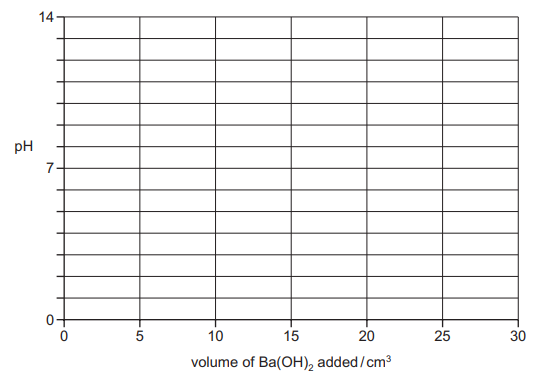
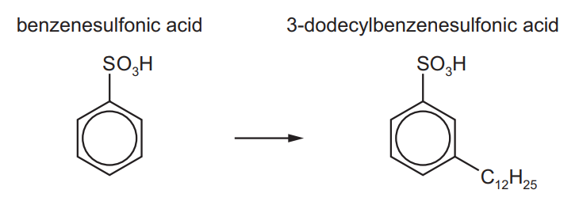

# Exam Questions — Acids & Bases
**25. Equilibria** · Cambridge (CIE) A-LEVEL chemistry (9701)
> Source: [https://www.savemyexams.com/a-level/chemistry/cie/25/topic-questions/](https://www.savemyexams.com/a-level/chemistry/cie/25/topic-questions/) · 9 questions across 1 sets

## Structured Questions (9 questions)

### Q1 — medium — 17 marks

**Q1** [4 marks]

i) Define the term pH.

[1]

ii) Calculate the pH of 0.025 mol dm-3 Ba(OH)2 (aq) at 298 K. Show your working.

[3]

**Q1** [5 marks]

A buffer solution has 0.40 mol dm-3 CH3COOH and 0.60 mol dm-3 CH3COONa.

i) Calculate the pH of the buffer (*K*a = 1.75 x 10-5). Show your working.

[3]

ii) Construct an equation and explain how the buffer resists pH change when NaOH is added.

[2]

**Q1** [5 marks]

Silver sulfate, Ag2SO4, is a sparingly soluble salt.

i) Define the term solubility product, *K*sp.

[2]

ii) The *K*sp for Ag2SO4 is 1.20 x 10-5 mol3 dm-9.

Calculate the solubility of Ag2SO4 in water in mol dm-3. Show your working.

[3]

**Q1** [3 marks]

**Extract:**

Silver sulfate, Ag₂SO₄, is a sparingly soluble salt.

The Ksp for Ag₂SO₄ is 1.20 x 10⁻⁵ mol³ dm⁻⁹.

i) Predict whether the solubility of Ag2SO4 in 0.10 mol dm-3 Na2SO4 (aq) is greater than, less than, or equal to its solubility in pure water.

[1]

ii) Explain your answer to (d)(i).

[2]

### Q2 — easy — 9 marks

**Q2** [2 marks]

pH calculations of buffer solutions use the following equation:

`K_a = \frac{[H^+][A^-]}{[HA]}`

State the assumptions made when using this equation for buffer solutions.

**Q2** [1 mark]

Suggest a salt that could be used to form a buffer solution with propanoic acid, CH3CH2COOH.

**Q2** [4 marks]

**Extract:**

pH calculations of buffer solutions use the following equation:

\$\$K_{a} = \frac{\left[\right. H^{+} \left]\right. \left[\right. A^{-} \left]\right.}{\left[\right. H A \left]\right.}\$\$

A buffer solution contains propanoic acid at a concentration of 0.15 mol dm-3 and a propanoate salt with [A-] = 0.30 mol dm-3.

The value of *K*a for propanoic acid at 298 K is 1.35 × 10-5 mol dm-3.

Calculate the pH of this buffer solution at 298 K. Show your working.

**Q2** [2 marks]

**Extract:**

pH calculations of buffer solutions use the following equation:

Ka = [H+][A-] / [HA]

Buffer solutions can be tailored to a specific pH by 'coarse-tuning' by changing the acid used, and 'fine-tuning' by altering the ratio of [HA] : [A-].

State and explain the effect on the pH of the buffer solution of increasing the concentration of the salt only.

### Q3 — hard — 15 marks

**Q3** [5 marks]

One atom of each of the four elements H, C, N and O can bond together in different ways.

Two examples are molecules of cyanic acid, HOCN, and isocyanic acid, HNCO. The atoms are bonded in the order they are written.

i) Draw 'dot-and-cross' diagrams of HOCN (cyanic acid) and HNCO (isocyanic acid), showing outer shell electrons only.

[3]

ii) Suggest the values of the bond angles HNC and NCO in isocyanic acid.

[1]

iii) Suggest which acid, cyanic or isocyanic, will have the shorter C–N bond length. Explain your answer.

[1]

*Source: 2017 43 Q2A*

**Q3** [3 marks]

Isocyanic acid is a weak acid.

HNCO $\rightleftharpoons$ H+ + NCO-    *K*a = 1.2 × 10-4 mol dm-3

i) Calculate the pH of a 0.10 mol dm-3 solution of isocyanic acid. Show your working.

[2]

Sodium cyanate, NaNCO, is used in the production of isocyanic acid. Sodium cyanate is prepared commercially by reacting urea, (NH2)2CO, with sodium carbonate. Other products in this reaction include ammonia and steam.

ii) Construct an equation for the production of NaNCO by this method.

[1]

*Source: 2017 43 Q2B*

**Q3** [7 marks]

**Extract:**

Isocyanic acid is a weak acid.

HNCO ⇌ H⁺ + NCO⁻    Ka = 1.2 × 10⁻⁴ mol dm⁻³

i) Calculate the pH of a 0.10 mol dm⁻³ solution of isocyanic acid. Show your working.

pH = 2.46

Barium hydroxide, Ba(OH)2, is completely ionised in aqueous solutions. During the addition of 30.0 cm3 of 0.100 mol dm-3 Ba(OH)2 to 20.0 cm3 of 0.100 mol dm-3 isocyanic acid, the pH was measured.

Calculate [OH-] and the pH of the solution at the end of the addition. Show your working.

On Fig. 2.1, sketch how the pH changes during the addition of a total of 30.0 cm3 of 0.100 mol dm-3 Ba(OH)2 to 20.0 cm3 of 0.100 mol dm-3 isocyanic acid.

**Fig. 2.1**

*Source: 2017 43 Q2C*

### Q4 — medium — 6 marks

**Q4** [1 mark]

Write an expression for the solubility product, *K*sp, of Ca3(PO4)2.

**Q4** [3 marks]

**Extract:**

*K*~sp~ = [Ca^2+^]^3^[PO~4~^3-^]^2^

At 298 K, the solubility of Ca3(PO4)2 is 2.50 x 10-6 mol dm-3.

Calculate the solubility product, *K*sp, for Ca3(PO4)2 at this temperature. State the units. Show your working.

**Q4** [2 marks]

Explain why the lattice energy of calcium phosphate is more exothermic than that of strontium phosphate.

### Q5 — easy — 7 marks

**Q5** [2 marks]

Explain why a 0.10 mol dm-3 solution of a strong acid has a significantly different pH from a 0.10 mol dm-3 solution of a weak acid.

**Q5** [1 mark]

Calculate the pH of a 0.1 mol dm-3 solution of HCl.

**Q5** [4 marks]

A sample of 0.1 mol dm-3 methanoic acid has a *K*a value of 1.78 x 10-4 mol dm-3 at 298 K.

i) Write an expression for the acid dissociation constant, *K*a, for methanoic acid.

[1]

ii) Calculate the pH of the 0.1 mol dm-3 methanoic acid. Give your answer to two decimal places and show your working.

[3]

### Q6 — medium — 13 marks

**Q6** [2 marks]

This question is about buffers.

Define the term buffer solution.

**Q6** [2 marks]

Buffers can be acidic or basic, depending on the substances mixed to create them.

i) State the two types of substance that must be mixed to prepare an acidic buffer solution.

[1]

ii) State the key feature which makes a buffer acidic.

[1]

**Q6** [4 marks]

Ethanoic acid is a weak acid. Hydrogen carbonate ions act as a weak acid in aqueous solution.

i) Construct equilibrium equations for each of these weak acids.

[2]

ii) A solution was made up containing sodium hydrogen carbonate and sodium carbonate. Explain how this solution would act as a buffer if a small amount of acid was added to it.

[2]

**Q6** [2 marks]

Explain how a buffer solution made from ethanoic acid and sodium ethanoate works when small amounts of alkali are added.

**Q6** [3 marks]

A buffer solution contains 0.10 mol dm-3 methanoic acid and 0.20 mol dm-3 sodium methanoate. The value of *K*a for methanoic acid is 1.80 × 10-5 mol dm-3.

Calculate the pH of this buffer solution at 298 K. Give your answer to 2 decimal places and show your working.

### Q7 — hard — 13 marks

**Q7** [2 marks]

3-dodecylbenzenesulfonic acid can be prepared from benzenesulfonic acid.

Identify the reagents and conditions, and state the name of the mechanism, for this reaction.

**Q7** [2 marks]

When concentrated sulfuric acid is added to water, dissociation takes place in two stages.

stage 1 H2SO4 $\rightleftharpoons$ H+ + HSO4-

stage 2 HSO4- $\rightleftharpoons$ H+ + SO42-     *K*a2 = 1.0 × 10-2 mol dm-3

*K*a2 is the acid dissociation constant for stage 2.

i) Write an expression for the acid dissociation constant *K*a2.

[1]

ii) H2SO4 is considered a strong acid whereas HSO4- is considered a weak acid.

Suggest how the magnitude of the acid dissociation constant for stage 1 compares to *K*a2.

[1]

**Q7** [4 marks]

Benzoic acid, C6H5CO2H, is a weak acid.

The value of the acid dissociation constant, *K*a, of benzoic acid is 6.3 x 10-5 mol dm-3 at 298K.

Calculate the pH of the solution formed when 0.50 g of benzoic acid is dissolved in 250 cm3 of water.

Give your answer to two decimal places and show your working.

**Q7** [5 marks]

**Extract:**

Benzoic acid, C₆H₅CO₂H, is a weak acid.

The value of the acid dissociation constant, Ka, of benzoic acid is 6.3 x 10⁻⁵ mol dm⁻³ at 298K.

Calculate the pH of the solution formed when 0.060 g of sodium hydroxide is added to 500.00 cm3 of 0.005 mol dm-3 benzoic acid.

Give your answer to two decimal places. Show your working.

### Q8 — medium — 12 marks

**Q8** [4 marks]

The pH of a 0.150 mol dm-3 solution of piperidine is 11.9.

20.0 cm3 of 0.200 mol dm-3 HCl was slowly added to a 20.0 cm3 sample of 0.150 mol dm-3 piperidine. The pH was measured throughout the addition. One mole of hydrochloric acid reacts with one mole of piperidine.

i) Calculate the number of moles of HCl remaining at the end of the addition. Show your working.

[2]

ii) Hence calculate [H+] and the pH at the end of the addition.

[2]

**Q8** [3 marks]

**Extract:**

The pH of a 0.150 mol dm⁻³ solution of piperidine is 11.9.

20.0 cm³ of 0.200 mol dm⁻³ HCl was slowly added to a 20.0 cm³ sample of 0.150 mol dm⁻³ piperidine. The pH was measured throughout the addition. One mole of hydrochloric acid reacts with one mole of piperidine.

On the following axes shown in Fig. 3.1, sketch how the pH will change during the addition of a total of 20.0 cm3 of 0.200 mol dm-3 HCl.

**Fig. 3.1**

**Q8** [3 marks]

**Extract:**

multiple

25.0 cm3 of 0.100 mol dm-3 nitric acid, HNO3 (aq), is added to 0.100 mol dm-3 ammonia, NH3 (aq).

i) Construct an equation for this reaction.

[1]

ii) Explain why the salt produced in this reaction is acidic.

[2]

**Q8** [2 marks]

i) Construct an equation for the reaction between nitric acid and water.

[1]

ii) Identify the conjugate acid formed in this reaction.

[1]

### Q9 — hard — 14 marks

**Q9** [4 marks]

This question is about buffer solutions.

Calculate the pH of a buffer solution made by dissolving 0.275 g of benzoic acid (*K*a = 6.3 x 10-5 mol dm-3) and 0.525 g of sodium benzoate in 250 cm3 of water. Show your working.

**Q9** [3 marks]

Calculate the pH of a buffer solution made by mixing together 130 cm3 of 0.2 mol dm-3 ethanoic acid (*K*a = 1.74 x 10-5 mol dm-3) and 85 cm3 of 0.45 mol dm-3 sodium ethanoate. Show your working.

**Q9** [5 marks]

**Extract:**

Calculate the pH of a buffer solution made by mixing together 130 cm^3^ of 0.2 mol dm^-3^ ethanoic acid (*K*~a~ = 1.74 x 10^-5^ mol dm^-3^) and 85 cm^3^ of 0.45 mol dm^-3^ sodium ethanoate. Show your working.

1.00 cm3 of 1.00 mol dm-3 sodium hydroxide is added to the buffer solution in part **(b)**.

i) State what the comparison of the pH values before and after the addition of NaOH demonstrates about the buffer solution.

[1]

ii) Calculate the new pH of the buffer solution after the addition. Show your working.

[4]

**Q9** [2 marks]

**Extract:**

Calculate the pH of a buffer solution made by mixing together 130 cm^3^ of 0.2 mol dm^-3^ ethanoic acid (*K*~a~ = 1.74 x 10^-5^ mol dm^-3^) and 85 cm^3^ of 0.45 mol dm^-3^ sodium ethanoate.

Construct two equations for the separate addition of a small volume of acid and a small volume of base to the buffer solution in part **(b)**.
