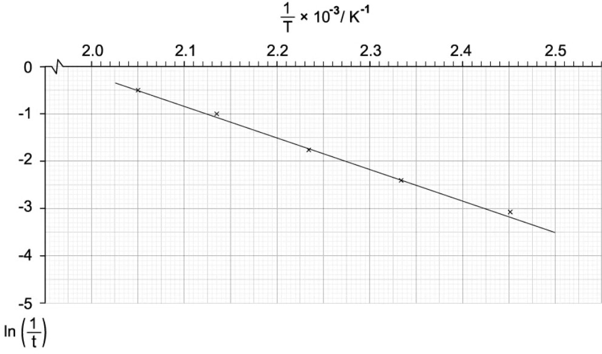
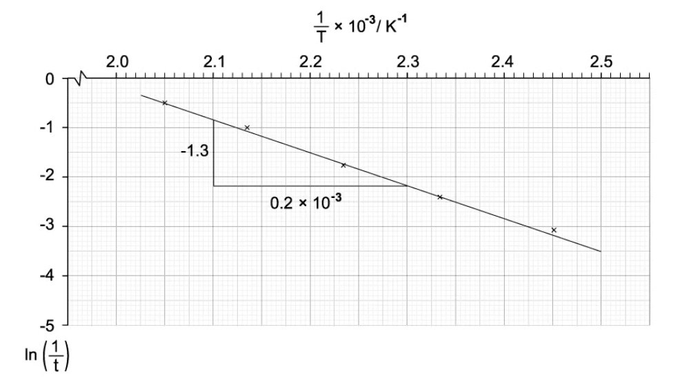
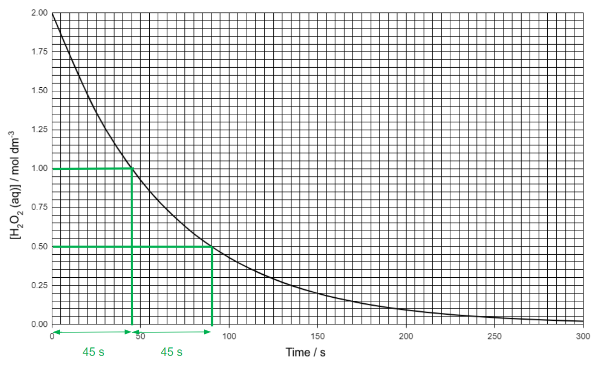
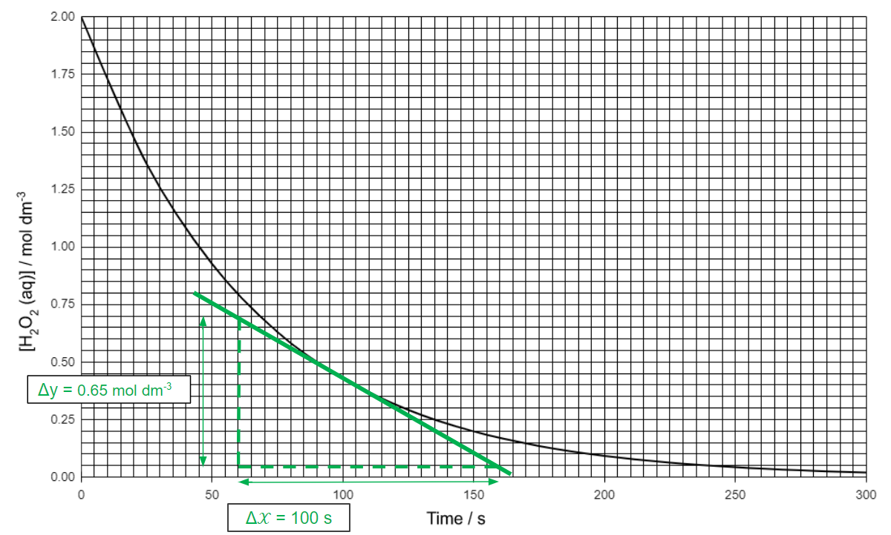
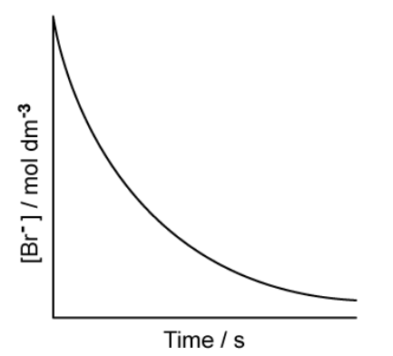

# Mark Schemes — Simple Rate Equations, Orders of Reaction & Rate Constants
**26. Reaction Kinetics** · Cambridge (CIE) A-LEVEL chemistry (9701)

## Structured Questions (12 questions)

### Q1
To deduce the order with respect to A, B and C, compare experiments where **only one concentration changes**:

- Order with respect to A

  - Compare Experiments 1 and 2 (B and C constant)

`[ A ] _ 2 / [ A ] _ 1`= $\frac{0.060}{0.040}$= 1.5

$\frac{Rate_{2}}{Rate_{1}}=\frac{1.80\times10^{-5}}{1.20\times10^{-5}}$ = 1.5

So the reaction is first order with respect to A** ****[1 mark]**

- Order with respect to B

  - Compare Experiments 1 and 3 (A and C constant)

`[ B ] _ 3 / [ B ] _ 1`= $\frac{0.060}{0.120}$= 0.5

$\frac{Rate_{3}}{Rate_{1}}=\frac{3.00\times10^{-6}}{1.20\times10^{-5}}$ = 0.25

0.5y = 0.25 ⇒ y = 2

So the reaction is second order with respect to B** ****[1 mark]**

- Order with respect toC

  - Compare Experiments 3 and 4 (B constant)

$\frac{Rate_{4}}{Rate_{3}}=\frac{6.00\times10^{-5}}{3.00\times10^{-5}}$ = 2

`[ A ] _ 4 / [ A ] _ 3`= $\frac{0.080}{0.040}$= 2

`[ C ] _ 4 / [ C ] _ 3`= $\frac{0.150}{0.050}$= 3

Using orders already found for A and B

2 = 2×3z

1=3z

z=0

So the reaction is zero order with respect to C** ****[1 mark]**

> **[mark-scheme]**
> 1 mark for 1st order with respect to A with correct mathematical working
> 
> 1 mark for 2nd order with respect to B with correct mathematical working
> 
> 1 mark for 0 order with respect to C with correct mathematical working

> **[exam-tip]**
> When finding orders, the cleanest approach is to compare two experiments where **only one concentration changes**. If that is not possible, use a ratio method and substitute in the orders you have already found.
> 
> Do not assume reaction orders from the balanced equation. A species can have a coefficient in the equation but still be **zero order**, meaning changing its concentration does not affect the rate under the conditions of the experiment.
> **[mark-scheme]**
> i) The rate equation is:
> 
> - rate = *k*[A][B]2  
> **OR**
> rate = k[A][B]2[C]0 **[1 mark]**

ii) To calculate the value for *k*:

- Rearrange the rate equation:

*k* = `\frac{rate}{\left[A\right] \left[B\right]^{2}}`

- Substitute the values from the experiment:

*k* = `\frac{1 . 20 \times 10^{- 5}}{\left(0 . 040\right) \left(0 . 120\right)^{2}}`

*k* = $\frac{1.20\times10^{-5}}{5.76\times10^{-4}}$

*k *= 2.0833.. x 10-2 **[1 mark]**

*k* = 0.0208 to 3 significant figures **[1 mark]**

- Determine the units:

`\frac{\cancel{mol dm^{- 3}} s^{- 1}}{\cancel{\left(mol dm^{- 3}\right)} \times \left(mol dm^{- 3}\right)^{2}}` = `\frac{s^{- 1}}{\left(m o l d m^{- 3}\right)^{2}}`

mol-2 dm6 s-1 **[1 mark]**

> **[mark-scheme]**
> 1 mark for the correct substitution and calculation of *k (*2.0833.. x 10-2)
> 
> 1 mark for the value of *k* given to 2 or 3 significant figures
> 
> 1 mark for correct units derived from the rate equation (mol-2 dm6 s-1)

> **[exam-tip]**
> When calculating *k*, always check that you have used the **correct powers** from the rate equation, especially squared terms.
> 
> A common mistake is forgetting to square the concentration of B before substituting.
> 
> For the units:
> 
> - Start from the fact that **rate is always in mol dm**-3** s**-1
> - Then cancel units systematically using the rate equation
> - This avoids guessing and ensures consistency
To suggest a two-step mechanism:

- The rate equation is:

Rate = *k*[A][B]2 

- This means the rate-determining (slow) step must involve 1 A and 2 B, and it must not involve C (because C is zero order)
- So, the slow (rate-determining) step is:

A + 2B → Intermediate **[1 mark]**

- Then, use a fast step to react the intermediate with C and form the products, so that the two steps add up to the overall reaction
- So, the fast step is:

Intermediate + 2C → D + 2E **[1 mark]**

> **[mark-scheme]**
> 1 mark for a slow step that matches the rate equation stoichiometry (contains A once and B twice, and no C)
> 
> 1 mark for a fast step thatproduces products and the two steps add to the overall equation

> **[exam-tip]**
> Build the **slow step from the rate equation**, not from the overall equation.
> 
> Any reactant with **zero order** (here, C) should not appear in the slow step, but it can appear in a fast step.
> 
> Finally, check that adding the two steps together gives the overall reaction and that the intermediate cancels.
Fe2+ ions are an effective catalyst because the direct reaction between two negative ions (I- and S2O82-) is split into two feasible redox steps involving Fe2+/Fe3+:

- Fe2+ is oxidised by S2O82−:

*E*cellθ =* E*θ (S2O82−/SO42−) − *E*θ(Fe3+/Fe2+)

*E*cellθ = +2.01 − 0.77 = +1.24 V

So this step is feasible because *E*cellθ is positive **[1 mark]**

- Fe3+ oxidises I−:

*E*cellθ = *E*θ(Fe3+/Fe2+) - *E*θ(I2/I-)

*E*cellθ = +0.77 − 0.54 = +0.23 V

So this step is feasible because *E*cellθ is positive **[1 mark]**

- Therefore, Fe2+ provides an alternative pathway made of two energetically feasible steps, which lowers the activation energy by avoiding repulsion between two negative ions (I− and S2O82−) **[1 mark]**

> **[mark-scheme]**
> 1 mark for calculating *E*cellθ for Fe2+ reducing S2O82− as +2.01 - 0.77 V = +1.24 V and stating this is feasible
> 
> 1 mark for calculating *E*cellθ for Fe3+ reducing I- as 0.77 - 0.54 = +0.23 V and stating this is feasible
> 
> 1 mark for stating that Fe2+/Fe3+ provides an alternative pathway with lower activation energy by avoiding repulsion between two negative ions

> **[exam-tip]**
> Do not stop after calculating *E*cellθ.
> 
> You must state what the sign means: a **positive ***E*cellθ shows each step is **feasible**.
> 
> Then link this to catalysis by explaining that Fe2+ and Fe3+ split one difficult redox change into two easier steps, lowering activation energy rather than changing the overall cell potential.

### Q2
The completed table is:

| Temperature (***T*****) / K** | $\frac{1}{T}$ x 10-3** / K**-1 | Time (***t*****) / s** | $\frac{1}{t}$** / s**-1 | **ln **$\frac{1}{t}$ |
|---|---|---|---|---|
| 408 | 2.451 | 21.14 | 0.0473 | -3.051 |
| 428 | **2.336** | 10.57 | 0.0946 | -2.358 |
| 448 | 2.232 | 5.54 | **0.1805** | **-1.712** |
| 468 | 2.137 | **3.02** | **0.3309** | -1.106 |
| 488 | 2.049 | 1.71 | 0.5851 | -0.536 |

- Calculate the missing value for 428K:

$\frac{1}{T} = \frac{1}{428} = 2 . 336 \times 10^{-3}$

- Calculate the missing values for 448K:

$\frac{1}{t} = \frac{1}{5.54} = 0 . 1805$
**AND**
$l n \frac{1}{t} = l n 0 . 1805 = - 1 . 712$

- Calculate the missing value for 468K:

$e^{-1.106} = 0 . 3309$
**AND**
$t = \frac{1}{0.3309} = 3 . 02$

**[3 marks]**

> **[mark-scheme]**
> 1 mark for 1/*T* = 2.336 × 10-3 K-1
> 
> 1 mark for 1/*t* = 0.1805 s-1 **AND** ln(1/*t*) = −1.712 (both values required)
> 
> 1 mark for *t* = 3.02 s andn (1/*t*) = 0.3309 derived from ln(1/*t*) = −1.106

> **[exam-tip]**
> The table requires three types of calculation: reciprocal (1/*T* and 1/*t*), natural logarithm (ln(1/*t*)), and the reverse — finding *t* from a known ln(1/*t*) by taking e to the power.
> 
> For the last row: ln(1/*t*) = −1.106, so 1/*t* = e−1.106 = 0.3309, then *t* = 1/0.3309 = 3.02 s.
> 
> Keep units in mind: 1/*T* is in K-1, 1/*t* is in s-1, and ln(1/*t*) is dimensionless.
The completed graph of ln(1/*t*) against (1/*T*) × 10-3 is:

**[4 marks]**

> **[mark-scheme]**
> 1 mark for correctly labelled axes (x-axis: 1/*T* × 10-3 / K-1; y-axis: ln(1/*t*))
> 
> 1 mark for appropriate scales on both axes
> 
> 1 mark for all data points plotted within ± 1 small square
> 
> 1 mark for a straight line of best fit

> **[exam-tip]**
> Choose scales that spread the data across most of the grid area. Avoid starting both axes at zero if this wastes space, instead start at a value just below your smallest data point.
> 
> Plot all five points before drawing the line of best fit. The line does not need to pass through every point but it should balance the number of points above and below it.
> 
> Axis labels must include units: 1/*T* × 10-3 / K-1 for the x-axis. The y-axis, ln(1/*t*), is dimensionless so no units are needed.
To calculate the activation energy, *E*a:

- Calculate the gradient from the graph:

gradient = $\frac{Δy}{Δx}$

gradient = $\frac{-E_{a}}{R}$

gradient = $\frac{- 2.2 - ( - 0.9 )}{( 2.3 \times 10^{- 3} ) - ( 2.1 \times 10^{- 3} )}$

gradient = $\frac{-1.3}{0.2\times10^{-3}}$  **[1 mark]**

gradient = −6500 K **[1 mark]**

- Rearrange:

*E*a = −gradient × *R*

*E*a = −(−6500) × 8.31

*E*a = 54 015 J mol-1 **[1 mark]**

- Convert from J mol-1 to kJ mol-1:

*E*a = $\frac{54015}{1000}$

*E*a = 54.0 kJ mol-1 **[1 mark]**

> **[mark-scheme]**
> 1 mark for gradient calculation with working shown (acceptable range approximately −6000 to −7000 K)
> 
> 1 mark for gradient value with units K
> 
> 1 mark for *E*a calculated in J mol-1 using *E*a = −gradient × *R*
> 
> 1 mark for *E*a converted correctly to kJ mol-1

> **[exam-tip]**
> The gradient of ln(1/*t*) against 1/*T* equals −*E*a/*R*.
> 
> Rearranging gives *E*a = −gradient × *R*.
> 
> Use a large gradient triangle spanning most of the line of best fit to reduce reading error. Record the exact coordinates of the two points you choose.
> 
> The gradient will be negative (the line slopes downward). The double negative in *E*a = −gradient × *R* produces a positive value, which is correct as activation energy is always positive.
> 
> Remember to convert from J mol-1 to kJ mol-1 by dividing by 1000.

### Q3
The student is **not** correct.

The rate equation cannot be deduced from the chemical equation or stoichiometry

The rate equation can only be determined experimentally

> **[mark-scheme]**
> 1 mark for stating the rate equation cannot be deduced from the chemical equation/stoichiometry
> 
> 1 mark for stating the rate equation is determined experimentally
> 
> Award 0 marks if the student is stated to be correct.

> **[exam-tip]**
> Rate equations can never be deduced from a chemical equation. They can only be established through experiment. Even when the orders happen to match the stoichiometric coefficients, this is coincidental.
> 
> In this case, rate = *k*[H2O2]2 might look plausible from the equation, but the actual orders must be measured and could be any value.
i) The completed graph is:

![Line graph of reaction rate versus hydrogen peroxide concentration, showing a straight increasing line from the origin, indicating rate is directly proportional to [H₂O₂].](assets/005-line-graph-of-reaction-rate-versus-hydrogen-pero.png)

**[2 marks]**

> **[mark-scheme]**
> 1 mark for all 6 data points plotted correctly
> 
> 1 mark for a straight line of best fit starting at the origin

> **[exam-tip]**
> Plot each data point carefully and draw a straight line of best fit.
> 
> A straight line through the origin indicates that rate is directly proportional to [H2O2], confirming the reaction is first order.

> **[mark-scheme]**
> ii) The rate equation is:
> 
> - rate = *k*[H2O2] **[1 mark]**

> **[exam-tip]**
> For the rate equation, do not omit *k*. The line passes through the origin, confirming there is no intercept and no zero-order term.
> **[mark-scheme]**
> The student could use the graph to show the order by:
> 
> - Measuring two or more half-lives from the graph **[1 mark]**
> - Showing that the half-lives are equal/constant **[1 mark]**

> **[exam-tip]**
> For a first order reaction, the half-life is constant regardless of concentration. For zero order it decreases; for second order it increases.
> 
> To show first order: measure at least two half-lives from the graph (e.g. from concentration 8 → 4, then 4 → 2).
> 
> If both time intervals are the same (47 s), the reaction is confirmed as first order with respect to H2O2.
i) To calculate the initial rate of decomposition:

rate = *k*[H2O2]

rate = 2.0 x 10-6 x 0.65

rate = 1.3 x 10-6 mol dm-3 s-1 **[1 mark]**

> **[mark-scheme]**
> ii) Decreasing the temperature:
> 
> - Decreases both the rate constant and the rate of reaction **[1 mark]**
> - Because a smaller proportion of molecules have energy equal to or greater than the activation energy **[1 mark]**

> **[exam-tip]**
> Decreasing temperature reduces the average kinetic energy of molecules. A smaller proportion of molecules have energy equal to or greater than the activation energy, so fewer collisions are successful. Both *k* and the rate of reaction decrease.

### Q4
> **[mark-scheme]**
> The half-life of a reaction is:
> 
> - The time taken for the concentration of a reactant to halve / fall to half its original value **[1 mark]**

> **[exam-tip]**
> This is a definition you need to know precisely. The key elements are:
> 
> 1. The time taken...
> 2. ...for the concentration of a reactant to fall to half its original value.
> 
> Avoid phrases like "the time for the reaction to be half complete" as the half-life specifically refers to concentration, not the overall extent of reaction.
To show that the reaction is first order with respect to hydrogen peroxide:

- Rate = *k*[H2O2]

**[3 marks]**

> **[mark-scheme]**
> 1 mark for evidence of two successive equal half-lives (drawn on the graph or stated)
> 
> 1 mark for half-life value in the range 43–47 s
> 
> 1 mark for Rate = *k*[H2O2]

> **[exam-tip]**
> To demonstrate first order behaviour, you must show two successive equal half-lives on the graph. Mark the concentration at the start, and the points where it has fallen to half, then to a quarter of its original value. If the time intervals are equal, the half-life is constant.
> 
> A common mistake is measuring only one half-life. One measurement alone cannot confirm that the half-life is constant, which is why you need at least two.
> 
> The rate equation follows directly: only H2O2 affects the rate and it is first order, so Rate = *k*[H2O2].
i) The rate of reaction at *t* = 100 s is determined from the tangent to the graph:

- Evidence of tangent drawn at *t* = 100 s **[1 mark]**
- Gradient: 6.5 ± 0.5 × 10-3 mol dm-3 s-1 **[1 mark]**

> **[mark-scheme]**
> 1 mark for tangent drawn at *t* = 100 s shown on graph
> 
> 1 mark for gradient value in the range (6.0–7.0) × 10-3 mol dm-3 s-1

ii) The rate constant can be determined by either method:

- Rate constant clearly linked to rate: `k = \frac{rate}{[H_{2}O_{2}]}`
**OR**
Rate constant clearly linked to half-life: $k = \frac{ln2}{t_{1/2}}$ **[1 mark]**
- Units: s-1 **[1 mark]**

> **[mark-scheme]**
> 1 mark for *k* correctly derived from rate / [H2O2] or ln 2 / *t*1/2, with correct working
> 
> 1 mark for units s-1

> **[exam-tip]**
> Draw the tangent carefully at *t* = 100 s. The line should touch the curve at one point, with equal angles on either side. Take two widely-spaced points on the tangent to calculate a more accurate gradient.
> 
> For the rate constant: from Rate = *k*[H2O2], rearrange to *k* = rate / [H2O2]. You can also use the half-life method: *k* = ln 2 / *t*1/2. Both approaches are accepted.
> 
> For units: (mol dm-3 s-1) / (mol dm-3) = s-1. The concentration terms cancel, leaving only s-1.
> **[mark-scheme]**
> The effect on the half-life is:
> 
> - No effect (on the half-life) **[1 mark]**

> **[exam-tip]**
> For a first order reaction, the half-life is constant and independent of the initial concentration. Halving the starting concentration of H2O2 does not change the time taken for that concentration to halve again.
> 
> This is a defining characteristic of first order kinetics. In contrast, for a zero order reaction, the half-life decreases as the concentration decreases.

### Q5
> **[mark-scheme]**
> The orders with respect to each reactant are:
> 
> - **X**: second / 2nd order / order 2 **[1 mark]**
> - **Y**: first / 1st order / order 1 **[1 mark]**
> - **Z**: zero order / order 0 **[1 mark]**

> **[exam-tip]**
> The order of reaction for each reactant is found from the power to which its concentration is raised in the rate equation.
> 
> - [**X**] is raised to the power of 2, so **X** is second order
> - [**Y**] is raised to the power of 1, so **Y** is first order
> - **Z** does not appear in the rate equation, so it is zero order. Changing [**Z**] has no effect on the rate
> **[mark-scheme]**
> The overall order of this reaction is:
> 
> - 3 / third / 3rd (order) **[1 mark]**

> **[exam-tip]**
> The overall order is the sum of the individual orders with respect to each reactant: 2 (**X**) + 1 (**Y**) + 0 (**Z**) = 3.
The rate constant, *k*, is calculated by rearranging the rate equation.

- List the known values:

  - rate = 3.72 × 10-5 mol dm-3 s-1
  - [**X**] = 0.01 mol dm-3
  - [**Y**] = 0.02 mol dm-3
- Rearrange rate = *k*[**X**]2[**Y**] for *k* and substitute values:

`k = \frac{3 . 72 \times 10^{- 5}}{\left(\right. 0 . 01 \left.\right)^{2} \times 0 . 02}` **[1 mark]**

*k* = **18.6 ****[1 mark]**

- Units of *k*:

dm6 mol-2 s-1 **[1 mark]**

> **[mark-scheme]**
> 1 mark for correct substitution into the rearranged rate equation
> 
> 1 mark for *k* = 18.6
> 
> 1 mark for correct units dm6 mol-2 s-1

> **[exam-tip]**
> Rearrange the rate equation to make *k* the subject: *k* = rate / ([**X**]2[**Y**]).
> 
> A common mistake is forgetting to apply the power of 2 to [**X**] before substituting. Always check each concentration term matches its power in the rate equation.
> 
> To determine the units, substitute units into the rearranged expression and cancel:
> 
> - Units of *k* = mol dm-3 s-1 / ((mol dm-3)2 × mol dm-3) = dm6 mol-2 s-1
> **[mark-scheme]**
> The effect on the rate of reaction is:
> 
> - Rate quadruples / increases by a factor of 4 / (becomes) 1.488 × 10-4 mol dm-3 s-1 **[1 mark]**
> - (Because) reaction is second / 2nd order with respect to **X**, so doubling [**X**] multiplies rate by 22 = 4 **[1 mark]**

> **[exam-tip]**
> Because the reaction is second order with respect to **X**, doubling [**X**] multiplies the rate by 22 = 4, not by 2.
> 
> You can verify numerically: 3.72 × 10-5 × 4 = 1.488 × 10-4 mol dm-3 s-1.

### Q6
> **[mark-scheme]**
> The order of reaction with respect to hydrogen ions is:
> 
> - 2 / 2nd / second order **[1 mark]**

> **[exam-tip]**
> On a rate-concentration graph, the shape of the curve indicates the order:
> 
> - Zero order: horizontal line (rate does not change with concentration)
> - First order: straight line through the origin (rate proportional to concentration)
> - Second order: upward curve (rate increases as the square of concentration)
> 
> The curve in Fig. 2.1 steepens as [H+] increases, which is consistent with second order.
The concentration-time graph for bromide ions is:

**[1 mark]**

> **[mark-scheme]**
> 1 mark for a shallow curve, decreasing as time increases

> **[exam-tip]**
> For a first order reaction, concentration decreases as a smooth exponential decay curve that gets shallower over time. The curve must start at the initial [Br-] and approach (but not reach) zero.
> 
> Zero order gives a straight line with constant gradient. Do not draw a straight line here.
> **[mark-scheme]**
> i) The order with respect to bromate(V) ions is:
> 
> - 1 / 1st / first order **[1 mark]**
> 
> ii) The rate equation for the reaction is:
> 
> - Rate = *k*[Br-][BrO3-][H+]2 **[1 mark]**

> **[exam-tip]**
> To find the bromate(V) order, use the total overall order. The reaction is fourth order overall: Br- contributes 1, H+ contributes 2, so BrO3- = 4 - 1 - 2 = 1.
> 
> For the rate equation, include each reactant raised to its order as the power. A first order term appears as [species]1, which is conventionally written as [species] (no superscript needed).
> **[mark-scheme]**
> i) The expression for the rate constant is:
> 
> - $\mathrm{k} = \frac{rate}{[ Br^{ - } ] [ BrO_{3}^{ - } ] [ \mathrm{H} ^{ + } ] ^{2} }$ **[1 mark]**
> 
> ii) Suitable units for the rate constant are:
> 
> - dm9 mol-3 s-1 **[1 mark]**

> **[exam-tip]**
> Rearrange the rate equation to make *k* the subject: *k* = rate / ([Br-][BrO3-][H+]2).
> 
> To determine the units, substitute units into the expression for *k* and cancel:
> 
> - *k* = mol dm-3 s-1 / ((mol dm-3)(mol dm-3)(mol dm-3)2) = dm9 mol-3 s-1

### Q7
> **[mark-scheme]**
> If the initial concentration of NO is tripled and the initial concentration of O2 is halved, the rate of reaction would:
> 
> - Increase by a factor of 4.5 **[1 mark]**

> **[exam-tip]**
> Calculate each concentration change separately using the rate equation, then multiply the effects together:
> 
> - Tripling [NO] (second order): rate x 32 = x 9
> - Halving [O2] (first order): rate x ½
> 
> Combined effect: 9 x ½ = 4.5, so the rate increases by a factor of 4.5.
> 
> A common mistake is adding the effects (9 + ½ = 9.5) rather than multiplying them. Always multiply the factors for simultaneous concentration changes.
> **[mark-scheme]**
> i) The overall equation for this series of reactions is:
> 
> - 1½O2 (g) → O3 (g)
> **OR**
> 3O2 (g) → 2O3 (g) **[1 mark]**
> 
> ii) NO is acting as a homogeneous catalyst because:
> 
> - It is in the same phase as the reaction mixture **[1 mark]**
> - It is (used in the first step and) regenerated in the second step **[1 mark]**

> **[exam-tip]**
> To find the overall equation, cancel all species that appear on both sides across the two mechanism steps.
> 
> - NO2 is an intermediate (formed in step 1, used in step 2) and cancels.
> - NO is the catalyst (used and regenerated) and cancels.
> - The net change is O2 molecules being converted to O3.
> 
> For the catalyst marks: "homogeneous" means the same physical state as the reactants.
> 
> NO is a gas and the reactants are gases, so same phase. You also need to explicitly show it is used and regenerated.
> **[mark-scheme]**
> i) The mechanism contains more than one step because:
> 
> - The overall equation does not match the rate equation **[1 mark]**

ii) Possible two-step mechanisms are:

**Step 1**: NO (g) + O3 (g) → NO2 (g) + O2 (g)
**Step 2**: O (g) + NO2 (g) → NO (g) + O2 (g)

**OR**

**Step 1**: NO (g) + O3 (g) → N (g) + 2O2 (g)
**Step 2**: O (g) + N (g) → NO (g)

> **[mark-scheme]**
> 1 mark for correct reactants in step 1
> 
> 1 mark for correct products in step 1 and correct reactants and products in step 2

> **[exam-tip]**
> For part (i): if the mechanism were a single step, its stoichiometry would match the overall equation exactly. Here the rate equation (first order in NO and O3) does not match the overall equation (which contains O atoms), so more than one step is required.
> 
> For part (ii): the rate-determining (slow) step must involve exactly the species in the rate equation, i.e. one NO and one O3. The intermediate formed in step 1 must appear as a reactant in step 2 and cancel when the steps are added.
> 
> Always check your mechanism by adding the two steps together. All intermediates should cancel and the sum should equal the overall equation.
The initial rate of oxygen formation is found as follows:

- Both reactants are first order:

  - Doubling [O3] doubles rate
  - Tripling [C2H4] triples rate
  - Rate of methanal formation increases by factor of 2 x 3 = 6
- Determine the initial rate of methanal formation:

2.0 x 10-11 x 6 = 1.2 x 10-10 mol dm-3 s-1 **[1 mark]**

- Determine the rate of O2 formation:

From the equation: 2 mol CH2O formed per ½ mol O2

rate of O2 formation = rate of CH2O x (½ ÷ 2) = x ¼

Initial rate of O2 formation = 1.2 x 10-10 ÷ 4

Initial rate of O2 formation = **3.0 x 10****-11**** mol dm****-3**** s****-**1 **[1 mark]**

> **[mark-scheme]**
> 1 mark for rate of methanal formation = 1.2 x 10-10 mol dm-3 s-1
> 
> 1 mark for rate of O2 formation = 3.0 x 10-11 mol dm-3 s-1

> **[exam-tip]**
> This question has two steps. First, use the rate equation to find the new rate of methanal formation after the concentration changes. Then use stoichiometry from the balanced equation to convert to the rate of O2 formation.
> 
> From the equation:
> 
> O3 + C2H4 → 2CH2O + ½O2
> 
> For every 2 mol of CH2O produced, only ½ mol of O2 is produced, so the rate of O2 formation is ¼ of the rate of CH2O formation.

### Q8
> **[mark-scheme]**
> i) The order of reaction with respect to a particular reagent is:
> 
> - The power to which the concentration of that reactant is raised in the rate equation
> **OR**
> The index / exponent / power of the reactant's concentration in the rate equation **[1 mark]**

ii) To calculate the rate constant, *k*, using the data from experiment 1:

- List the known values:

  - rate = 2.20 × 10-3 mol dm-3 s-1
  - [ClO2] = 0.010 mol dm-3
  - [F2] = 0.060 mol dm-3
- Rearrange rate = *k*[ClO2][F2] for *k* and substitute values:

$k = \frac{2.20\times10^{-3}}{0.010\times0.060}$

*k* = **3.7 ****[1 mark]**

- Units of *k*:

mol-1 dm3 s-1 **[1 mark]**

> **[mark-scheme]**
> ii)
> 
> 1 mark for *k* = 3.7 (accept 3.66–3.70)
> 
> 1 mark for units mol-1 dm3 s-1

iii) The initial rate in experiment 2 is found using *k*:

rate = *k*[ClO2][F2]

rate = 3.7 × 0.025 × 0.060

rate = 5.50 × 10-3 mol dm-3 s-1 **[1 mark]**

> **[mark-scheme]**
> iii)
> 
> 1 mark for rate = 5.50 × 10-3 mol dm-3 s-1 (allow 5.55 × 10-3 if using rounded *k*)

iv) [ClO2] in experiment 3 is found by rearranging the rate equation:

- Rearrange rate = *k*[ClO2][F2] for [ClO2] and substitute values:

[ClO2] = $\frac{7.04\times10^{-3}}{3.7\times0.040}$

[ClO2] = 0.048 mol dm-3 **[1 mark]**

> **[mark-scheme]**
> iv) 1 mark for [ClO2] = 0.048 mol dm-3 (accept 0.047–0.049)
> 
> Allow error carried forward from an incorrect *k* in parts iii and iv.

> **[exam-tip]**
> For part (i): the order refers to the power in the rate equation, not the stoichiometric coefficient in the balanced equation. They are frequently different.
> 
> For parts (ii)–(iv): always rearrange the rate equation to make the unknown the subject before substituting values.
> 
> To find the units of *k*, substitute units into the rearranged expression and cancel:
> 
> - *k* = mol dm-3 s-1 / ((mol dm-3)(mol dm-3)) = mol-1 dm3 s-1
> 
> For part (iii): use the unrounded *k* value for the most accurate answer. Using rounded *k* = 3.7 gives 5.55 × 10-3, which is also accepted.
> 
> For part (iv): rearrange for [ClO2] = rate / (*k* × [F2]). Divide by BOTH *k* AND [F2] as a common mistake is omitting one of them.
> **[mark-scheme]**
> i) The rate-determining step is:
> 
> - The slowest step in a multi-step reaction **[1 mark]**
> 
> ii) Equations for the two steps of the mechanism:
> 
> Step 1: ClO2 + F2 → ClO2F2
> Step 2: ClO2 + ClO2F2 → 2ClO2F
> 
> **OR**
> 
> Step 1: ClO2 + F2 → ClO2F + F
> Step 2: ClO2 + F → ClO2F **[1 mark]**
> 
> iii) The rate-determining step is:
> 
> - Step 1
> **AND**
> Stoichiometry of step 1 (1 mol ClO2 and 1 mol F2) is consistent with the rate equation **[1 mark]**

> **[exam-tip]**
> For part (i): the rate-determining step controls the overall rate because it is the slowest step. Only the species that react in this step affect the rate.
> 
> For part (ii): the two steps must add together to give the overall equation. The intermediate formed in step 1 must appear as a reactant in step 2 and cancel when the steps are added.
> 
> For part (iii): identify the rate-determining step by comparing the stoichiometry of each step with the rate equation rate = *k*[ClO2][F2]. Step 1 has exactly one ClO2 and one F2, matching first order in each. Step 2 involves the intermediate (not in the rate equation), so it cannot be rate-determining.
> **[mark-scheme]**
> The effect of temperature change on the rate of a reaction and the rate constant is:
> 
> - As temperature increases, both the rate of reaction and the rate constant / *k* increase **[1 mark]**

> **[exam-tip]**
> Increasing temperature increases both the rate AND the rate constant *k*. Note that *k* is not a fixed value as it depends on temperature and increases exponentially as temperature rises.
> 
> This question asks you to "describe", which means that you do not need to explain why in terms of activation energy. A description of the direction of change is sufficient.

### Q9
i) To deduce the order of reaction with respect to **X**:

- Use experiments 1 and 2:

  - [X] increases by a factor of 1.5
  - [Y] is constant
  - Rate increases by a factor of 1.5
  - The rate is proportional to [X]
  - Therefore, the order of reaction with respect to **X** is 1 / first **[1 mark]**

> **[mark-scheme]**
> 1 mark for X is 1st order

i) To deduce the order of reaction with respect to **Y**:

- Use experiments 2 and 3:

  - [Y] increases by a factor of 1.5
  - [X] is constant
  - Rate increases by a factor of 1.5
  - The rate is proportional to [Y]
  - Therefore, the order of reaction with respect to **Y** is 1 / first **[1 mark]**

> **[mark-scheme]**
> 1 mark for Y is 1st order

> **[mark-scheme]**
> iii) The overall order of reaction is:
> 
> - 2 **[1 mark]**
> 
> iv) The rate equation is:
> 
> - rate = *k*[X][Y] **[1 mark]**

> **[exam-tip]**
> When determining the order of a reactant, look for a pair of experiments where only that reactant's concentration changes.
> 
> For the rate equation, always include *k* and use square brackets to show concentration. First order terms are written as [X], not [X]1.
i) To deduce the order of reaction with respect to **A**:

- Use experiments 1 and 2:

  - [A] decreases by a factor of 2
  - [B] is constant
  - Rate decreases by a factor of 4
  - Since halving [A] quarters the rate, A is second order **[1 mark]**

To deduce the order of reaction with respect to **B**:

- Use experiments 2 and 3:

  - [B] increases by a factor of 2
  - [A] is constant
  - Rate increases by a factor of 2
  - The rate is proportional to [X]
  - Therefore, the order of reaction with respect to **B** is 1 / first **[1 mark]**

> **[mark-scheme]**
> 1 mark for A is 2nd order / order 2
> 
> 1 mark for B is 1st order / order 1

ii) The rate equation is:

rate = *k*[A]2[B] **[1 mark]**

To calculate *k*:

*k* = `\frac{rate}{\left[A\right]^{2}\left[B\right]}`

*k* = `\frac{7.6 \times 10^{-4}}{\left(0.50\right)^{2}\left(0.30\right)}` **[1 mark]**

*k* = **0.010 ****[1 mark]**

- Units:

mol-2 dm6 s-1 **[1 mark]**

> **[mark-scheme]**
> 1 mark for rate = *k*[A]2[B]
> 
> 1 mark for correct substitution into the rearranged rate equation
> 
> 1 mark for k = 0.010 (accept: 1.0 × 10-2)
> 
> 1 mark for mol-2 dm6 s-1

> **[exam-tip]**
> When calculating *k*, remember to square [A] in the denominator. A common error is using [A] rather than [A]2.
> 
> To find the units, substitute mol dm-3 s-1 for rate and mol dm-3 for each concentration term, then cancel.
> **[mark-scheme]**
> i) The units of k are:
> 
> - mol-2 dm6 s-1 **[1 mark]**
> 
> ii) The overall order of the reaction is:
> 
> - 3 **[1 mark]**

> **[exam-tip]**
> To find the units of *k*, rearrange the rate equation to make *k* the subject, then substitute units for rate (mol dm-3 s-1) and concentration (mol dm-3). Cancel mol dm-3 where possible.
> 
> For the overall order, add all the indices: 2 (from [P]2) + 1 (from [Q]) = 3.
i) To deduce the order of reaction with respect to C and D:

- Use experiments 1 and 2:

  - [C] increases by a factor of 3
  - [D] is constant
  - Rate increases by a factor of 9
  - C is second order **[1 mark]**
- Use experiments 2 and 3:

  - [C] increases by a factor of 2
  - [D] increases by a factor of 2
  - Rate increases by a factor of 4
  - The [C] should cause a rate increase of factor 4 alone
  - Therefore, D is zero order **[1 mark]**

> **[mark-scheme]**
> 1 mark for C = 2nd order / order 2 **AND **D = zero order / order 0

> **[mark-scheme]**
> ii) The overall rate equation is:
> 
> - rate = *k*[C]2 **[1 mark]**
> 
> rate = *k*[C]2[D]0 is not accepted as  [D] must not appear in the rate equation for a zero order species.

> **[exam-tip]**
> In the rate equation, zero order species are omitted entirely, so do not write [D] or [D]0.

### Q10
To deduce the reaction orders:

- From the graph / Fig 1.1:

  - There is a constant negative gradient
  - So, the rate is independent of [Cl2]
  - Therefore, it is zero / 0 order with respect to Cl2
- From experiment 2 to 3:

  - [H+ (aq)] doubles
  - Rate doubles
  - So, it is first / 1st order with respect to H+
- From experiment 1 to 2:

  - [CH3COCH3 (aq)] doubles
  - [H+ (aq)] triples
  - Rate increases by a factor of 6
  - The tripling of [H+ (aq)] should cause the rate to triple

> **[mark-scheme]**
> 1 mark for zero / 0 order with respect to Cl2 **AND **constant / linear negative gradient on Fig. 1.1 / rate independent of [Cl2]
> 
> 1 mark for first / 1st order with respect to H+ **AND **from experiment 2 to 3, [H+ (aq)] doubles and rate doubles
> 
> 1 mark for first / 1st order with respect to propanone / CH3COCH3
> 
> 1 mark for using experiment 1 and 2 to identify [CH3COCH3 (aq)] x 2 **AND** [H+ (aq)] x 3 **AND** rate x 6
> **OR**
> Using experiment 1 and 3 to identify [CH3COCH3 (aq)] x 2 **AND** [H+ (aq)] x 6 **AND** rate x 12 **[1 mark]**

> **[exam-tip]**
> For Cl2: the concentration-time graph in Fig. 1.1 shows a constant (linear) negative gradient, which means the rate does not depend on [Cl2]. A straight line on a concentration-time graph indicates zero order.
> 
> For H+: compare experiments 2 and 3, where only [H+] changes. [H+] doubles and the rate doubles, confirming first order.
> 
> For propanone: experiments 1 and 2 change both [CH3COCH3] and [H+] simultaneously. Account for the known H+ effect first (x3 in [H+] = x3 in rate for first order), then the remaining rate increase must be due to propanone doubling, confirming first order in propanone.
> **[mark-scheme]**
> i) The rate equation is:
> 
> - Rate = *k*[CH3COCH3 (aq)][H+ (aq)] **[1 mark]**

ii) Talculate the rate constant, *k*:

- List the known values:

  - rate = 0.18 x 10-5 mol dm-3 s-1
  - [CH3COCH3] = 0.75 mol dm-3
  - [H+] = 0.05 mol dm-3
- Rearrange for *k* and substitute values:

$k = \frac{0.18\times10^{-5}}{0.75\times0.05}$ **[1 mark]**

*k* = **4.80 x 10****-5** **[1 mark]**

- Units:

dm3 mol-1 s-1 **[1 mark]**

> **[mark-scheme]**
> 1 mark for correct substitution into the rearranged rate equation
> 
> 1 mark for *k* = 4.80 x 10-5
> 
> 1 mark for units dm3 mol-1 s-1

> **[exam-tip]**
> The rate equation is built directly from the orders found in part (a): Cl2 is zero order so it does not appear; propanone and H+ are both first order so each appears with power 1.
> 
> A common mistake is including [Cl2] in the rate equation. Zero order means the concentration of Cl2 has no effect on the rate, so it must be omitted entirely.
> 
> To check units:
> 
> *k* = (mol dm-3 s-1) / ((mol dm-3)(mol dm-3)) = dm3 mol-1 s-1.
The initial rate at pH 1 is found by considering the change in [H+]:

- At pH 2:

[H+] = 10-2 = 0.01 mol dm-3

- At pH 1:

[H+] = 10-1 = 0.1 mol dm-3

- This is a x10 increase
- The reaction is first order with respect to H+, so rate increases by factor of 10
- Calculate the initial rate:

initial rate = 0.26 x 10-5 x 10

initial rate = 2.60 x 10-5 mol dm-3 s-1 **[1 mark]**

> **[mark-scheme]**
> 1 mark for initial rate = 2.60 x 10-5 mol dm-3 s-1

> **[exam-tip]**
> A common mistake is dividing by 10 rather than multiplying. Remember that pH 1 is more acidic (higher [H+]) than pH 2.
> **[mark-scheme]**
> The effect of lowering temperature on the rate and the rate constant is:
> 
> - Both the rate and the rate constant / *k* decrease **[1 mark]**
> - (Because) fewer molecules have kinetic energy ≥ the activation energy (Ea), so the frequency of successful collisions decreases **[1 mark]**

> **[exam-tip]**
> Lowering temperature reduces both the rate AND the rate constant *k*. Note that *k* is not a fixed universal constant. It varies with temperature.
> 
> The explanation must be specific: fewer molecules have kinetic energy greater than or equal to the activation energy, so fewer collisions result in reaction.
> 
> Do not say only that molecules move more slowly. The key is the proportion of molecules with sufficient energy to react.

### Q11
> **[mark-scheme]**
> i) The overall equation is:
> 
> - 1½O2 (g) → O3 (g)
> **OR**
> 3O2 (g) → 2O3 (g) **[1 mark]**
> 
> ii) NO is acting as a catalyst because:
> 
> - It is consumed in the first step and regenerated in the second step **[1 mark]**

> **[exam-tip]**
> To find the overall equation, combine all three reactions. List all reactants on the left and all products on the right, then cancel species that appear on both sides.
> 
> NO, NO2, and O all cancel out, leaving 1½O2 → O3 (or 3O2 → 2O3 if multiplied through by 2).
> 
> A catalyst is consumed in one step and regenerated in a later step, so it does not appear in the overall equation. Here, NO is used in reaction 1 and reformed in reaction 2.
To calculate the rate constant *k*:

- Rearrange the rate equation:

*k* = `(rate)/(left square bracket NO right square bracket ^2 left square bracket O _ 2 right square bracket)`

- Substitute values:

*k* = $\frac{( 6.5 \times 10^{- 4} )}{( ( 5.0 \times 10^{- 2} )^{2} \times ( 1.0 \times 10^{- 2} ) )}$

*k* = **26 ****[1 mark]**

- Units:

mol-2 dm6 s-1 **[1 mark]**

> **[exam-tip]**
> Remember to square [NO] before dividing. Using [NO] rather than [NO]2 is a common error.
> 
> For the units, substitute mol dm-3 s-1 for rate and mol dm-3 for each concentration term, then cancel.
i) To calculate the rate constant, *k*:

- Rearrange the rate equation for *k*:

*k = *$\frac{rate}{open} \text{square} \text{brackets} NO_{2} ] ^{2}$

- Substitute the values:

*k* = `\frac{3 . 3 \times 10^{- 5}}{\left(4 . 1 \times 10^{- 2}\right)^{2}}`

*k* = **1.96 x 10****-2** **[1 mark]**

- Units:

mol-1 dm3 s-1 **[1 mark]**

> **[mark-scheme]**
> 1 mark for k = 1.96 x 10-2 (accept: 2.0 x 10-2)
> 
> 1 mark for mol-1 dm3 s-1

ii) The missing values:

Experiment 2 initial rate:

rate = 1.96 x 10-2 x (7.8 x 10-3)2

rate = 1.19 x 10-6 mol dm-3 s-1 **[1 mark]**

Experiment 3 [NO2]:

[NO2] = $\sqrt{\frac{1.8\times10^{-4}}{1.96\times10^{-2}}}$

[NO2] = 9.58 x 10-2 mol dm-3 **[1 mark]**

> **[mark-scheme]**
> 1 mark for Experiment 2 rate = 1.19 x 10-6 mol dm-3 s-1 (error carried forward from k)
> 
> 1 mark for Experiment 3 [NO2] = 9.58 x 10-2 mol dm-3 (accept: 9.6 x 10-2; error carried forward)

> **[exam-tip]**
> For part (i), the rate equation is rate = *k*[NO2]2. [CO] is zero order and does not appear. Do not include [CO] in the calculation.
> 
> For part (ii), when finding [NO2] in Experiment 3, remember the reaction is second order: first calculate [NO2]2 = rate/k, then take the square root to find [NO2]. Forgetting the square root is a common error.
> 
> If your value of k in part (i) is incorrect, you can still earn the marks in part (ii) by using your incorrect value consistently (error carried forward).
> **[mark-scheme]**
> The rate-determining step is:
> 
> - Step 1
> **AND** Both NO and H2 from Step 1 appear in the rate equation **[1 mark]**
> - Their stoichiometry in Step 1 (2NO + H2) matches the indices in the rate equation ([NO]2[H2]) **[1 mark]**
> 
> Award 0 marks if Step 2 is identified as the rate-determining step.

> **[exam-tip]**
> The rate-determining (slow) step contains the reactants that appear in the rate equation, raised to powers that match the stoichiometry of that step.
> 
> Here, rate = *k*[NO]2[H2]: both NO (coefficient 2) and H2 (coefficient 1) appear. Step 1 is 2NO + H2 → N2 + H2O2, which matches exactly.
> 
> Step 2 involves H2O2 and H2, which do not match the rate equation, so Step 2 cannot be the rate-determining step.

### Q12
> **[mark-scheme]**
> i) The order of reaction with respect to CH3COCH3, I2 and H+ is:
> 
> - CH3COCH3 = 1st order
> **AND**
> I2 = zero order
> **AND**
> H+ = 1st order **[1 mark]**
> 
> ii) The overall order of the reaction is:
> 
> - Second / 2 **[1 mark]**
> 
> iii) The role of the acid is:
> 
> - A catalyst **[1 mark]**
> - It appears in the rate equation but is not a reactant in the overall equation **[1 mark]**

> **[exam-tip]**
> To read orders from a rate equation: species that appear are first order (unless raised to a power); species that do not appear are zero order.
> 
> Here, [CH3COCH3] appears without a power (1st order), [I2] does not appear (zero order), and [H+] appears without a power (1st order). The overall order = 1 + 0 + 1 = 2.
> 
> Any species that appears in the rate equation but is not a reactant in the overall equation is a catalyst, consumed in one step and regenerated in another.
i) To calculate the rate constant, *k*:

- Write the rate equation:

rate = *k* [CH3COCH3][H+]

- Rearrange for *k*:

*k* = $\frac{rate}{[ CH_{3} COCH_{3} ] [ \mathrm{H} ^{ + } ]}$

- Substitute the values:

*k* = $\frac{5.40 \times 10^{ - } 3}{[ 1.50 \times 10^{ - } 2 ] [ 7.75 \times 10^{ - } 1 ]}$

*k* = 0.46 **[1 mark]**

- Units:

mol-1 dm3 s-1 **[1 mark]**

> **[mark-scheme]**
> 1 mark for k = 0.46 (accept values in range 0.464–0.465)
> 
> 1 mark for mol-1 dm3 s-1

> **[exam-tip]**
> The rate equation from Part a is rate = *k*[CH3COCH3][H+], noting that [I2] is not included because it is zero order and has no effect on the rate.
> 
> Rearrange to *k* = rate / ([CH3COCH3][H+]) and substitute the given values.

ii) The completed table is:

|   | decreases | no change | increases |
|---|---|---|---|
| rate constant |   |   | **Final answer:** **✔** |
| rate of reaction |   |   | **Final answer:** **✔** |

- Both rate constant and rate of reaction increase **[1 mark]**

> **[mark-scheme]**
> 1 mark for both ticks in the increases column

> **[exam-tip]**
> Increasing temperature increases the proportion of molecules with energy greater than or equal to the activation energy. Both the rate constant *k* and the rate of reaction therefore increase with temperature.
> **[mark-scheme]**
> **Fig 3.1** could be used to determine the initial rate by:
> 
> - Drawing a tangent to the curve at time t = 0 **[1 mark]**
> - Measuring the gradient of the tangent **[1 mark]**

> **[exam-tip]**
> The initial rate of reaction is the rate at the very start of the reaction (t = 0). To find it from a concentration-time graph, draw a tangent to the curve at t = 0 and calculate the gradient. This gives the rate in mol dm-3 s-1.
The sketch graph shows:

![Graph showing a straight green line with positive gradient, indicating reaction rate increases linearly with hydrogen ion concentration [H⁺].](assets/016-graph-showing-a-straight-green-line-with-positiv.png)

**[1 mark]**

> **[mark-scheme]**
> 1 mark for a straight line through the origin, showing rate proportional to [H+]

> **[exam-tip]**
> Since H+ is first order, doubling [H+] doubles the rate, a directly proportional relationship. On a rate-concentration graph this appears as a straight line passing through the origin.
