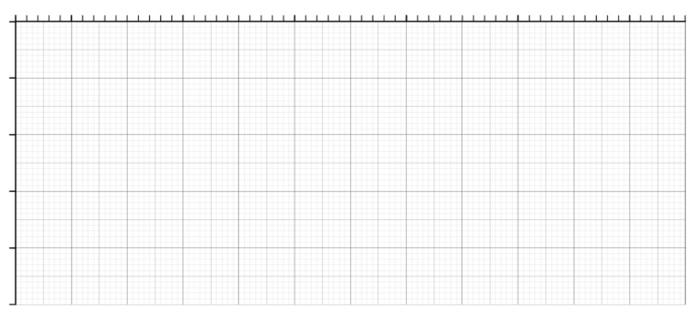
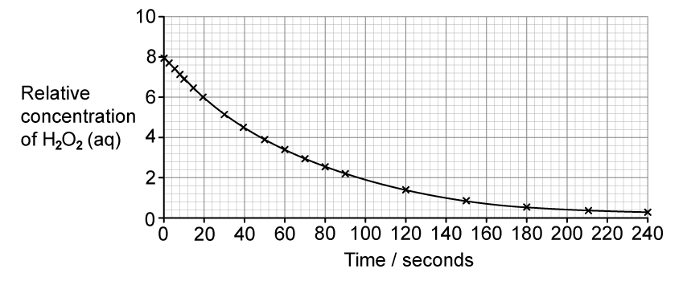
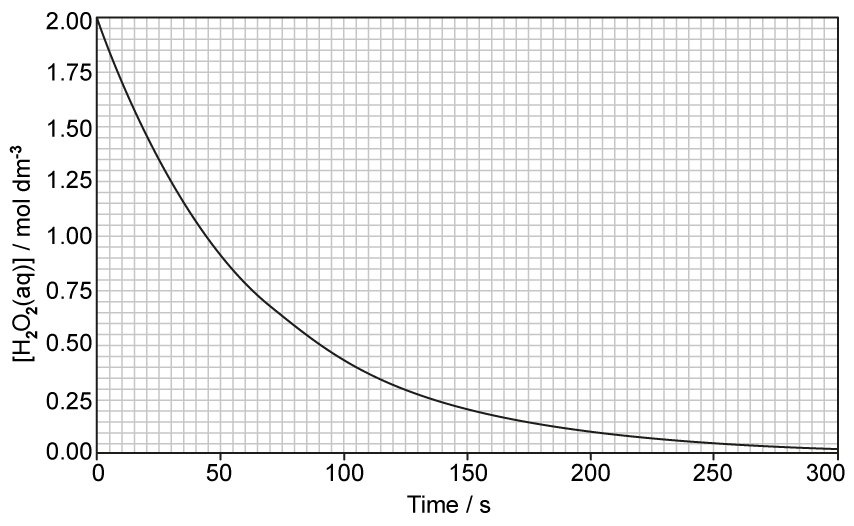
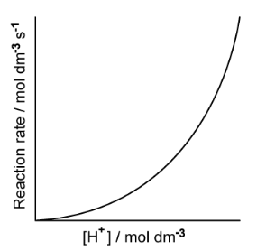
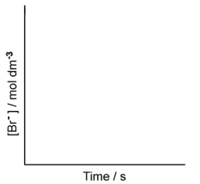

# Exam Questions — Simple Rate Equations, Orders of Reaction & Rate Constants
**26. Reaction Kinetics** · Cambridge (CIE) A-LEVEL chemistry (9701)
> Source: [https://www.savemyexams.com/a-level/chemistry/cie/25/topic-questions/](https://www.savemyexams.com/a-level/chemistry/cie/25/topic-questions/) · 12 questions across 1 sets

## Structured Questions (12 questions)

### Q1 — hard — 12 marks

**Q1** [3 marks]

The reaction

A + 2B + 2C → D + 2E

was studied. The following initial rates data were collected at 298 K in Table 4.1.

**Table 4.1**

| experiment | [A] / mol dm-3 | [B] / mol dm-3 | [C] /  mol dm-3 | initial rate / mol dm-3 s-1 |
|---|---|---|---|---|
| 1 | 0.040 | 0.120 | 0.050 | 1.20 x 10-5 |
| 2 | 0.060 | 0.120 | 0.050 | 1.80 x 10-5 |
| 3 | 0.040 | 0.060 | 0.050 | 3.00 x 10-6 |
| 4 | 0.080 | 0.060 | 0.150 | 6.00 x 10-6 |

Use the data in Table 4.1 to deduce the order of reaction with respect to A, B, and C.

Show your mathematical reasoning.

**Q1** [4 marks]

**Extract:**

The reaction

A + 2B + 2C → D + 2E

was studied. The following initial rates data were collected at 298 K in Table 4.1.

**Table 4.1**

| experiment | [A] / mol dm^-3^ | [B] / mol dm^-3^ | [C] /  mol dm^-3^ | initial rate / mol dm^-3 ^s^-1^ |
| :---: | :---: | :---: | :---: | :---: |
| 1 | 0.040 | 0.120 | 0.050 | 1.20 x 10^-5^ |
| 2 | 0.060 | 0.120 | 0.050 | 1.80 x 10^-5^ |
| 3 | 0.040 | 0.060 | 0.050 | 3.00 x 10^-6^ |
| 4 | 0.080 | 0.060 | 0.150 | 6.00 x 10^-6^ |

(i) Construct the rate equation for the reaction.

[1]

(ii) Calculate the value of the rate constant, *k*, for Experiment 1. Include the units for* k*.

k = .................... units = ...................

[3]

**Q1** [2 marks]

**Extract:**

The reaction

A + 2B + 2C → D + 2E

was studied. The following initial rates data were collected at 298 K in Table 4.1.

**Table 4.1**

| experiment | [A] / mol dm^-3^ | [B] / mol dm^-3^ | [C] /  mol dm^-3^ | initial rate / mol dm^-3 ^s^-1^ |
| :---: | :---: | :---: | :---: | :---: |
| 1 | 0.040 | 0.120 | 0.050 | 1.20 x 10^-5^ |
| 2 | 0.060 | 0.120 | 0.050 | 1.80 x 10^-5^ |
| 3 | 0.040 | 0.060 | 0.050 | 3.00 x 10^-6^ |
| 4 | 0.080 | 0.060 | 0.150 | 6.00 x 10^-6^ |

(i) Construct the rate equation for the reaction.

rate = k[A][B]^2

Suggest a two-step mechanism for this reaction where the first step is the rate-determining step.

**Q1** [3 marks]

The reaction between I− and S2O82− is slow due to high activation energy.

S2O82− (aq) + 2e− ⇌ 2SO42− (aq)   *E*θ=+2.01 V

Fe3+ (aq) + e−⇌ Fe2+ (aq)  *E*θ=+0.77 V

I2 (aq) + 2e− ⇌ 2I− (aq)  *E*θ=+0.54 V

Explain, using the *E*θ values provided, why Fe2+ ions are an effective catalyst for this reaction.

### Q2 — hard — 11 marks

**Q2** [3 marks]

Bromate(V) ions and bromide ions react in the presence of acid to form bromine and water.

BrO3– (aq) + 5Br– (aq) + 6H+ (aq) → 3Br2 (aq) + 3H2O (l)

A student carried out a series of experiments to investigate how the rate of the reaction of bromate and bromide in the presence of an acid varies with temperature.

The time taken, *t*, was measured for a fixed amount of bromine to form at different temperatures. The results are shown in the Table 3.1.

**Table 3.1**

| Temperature (***T*****) / K** | $\frac{1}{T}$ x 10-3** / K**-1 | Time (***t*****) / s** | $\frac{1}{t}$** / s**-1 | **ln **$\frac{1}{t}$ |
|---|---|---|---|---|
| 408 | 2.451 | 21.14 | 0.0473 | -3.051 |
| 428 |   | 10.57 | 0.0946 | -2.358 |
| 448 | 2.232 | 5.54 |   |   |
| 468 | 2.137 |   |   | -1.106 |
| 488 | 2.049 | 1.71 | 0.5851 | -0.536 |

Calculate the missing values to complete the table above. Show your working.

**Q2** [4 marks]

**Extract:**

A student carried out a series of experiments to investigate how the rate of the reaction of bromate and bromide in the presence of an acid varies with temperature.

The time taken, *t*, was measured for a fixed amount of bromine to form at different temperatures. The results are shown in the Table 3.1.

**Table 3.1**

| Temperature (***T*****) / K** | \$\$\frac{1}{\mathbf{T}}\$\$ x 10^-3^** / K**^-1^ | Time (***t*****) / s** | \$\$\frac{1}{\mathbf{t}}\$\$** / s**^-1^ | **ln **\$\$\frac{1}{\mathbf{t}}\$\$ |
| :---: | :---: | :---: | :---: | :---: |
| 408 | 2.451 | 21.14 | 0.0473 | -3.051 |
| 428 |   | 10.57 | 0.0946 | -2.358 |
| 448 | 2.232 | 5.54 |   |   |
| 468 | 2.137 |   |   | -1.106 |
| 488 | 2.049 | 1.71 | 0.5851 | -0.536 |

The relationship between the rate constant, *k*, and the activation energy, *E*a, and temperature, *T*, is given by the following equation.

ln *k* = ln *A* + $\frac{-E_{a}}{RT}$

In this experiment, the rate constant, *k*, is directly proportional to $\frac{1}{t}$. Therefore,

$\mathrm{ln} \frac{1}{t} = \mathrm{ln} A + \frac{-E_{a}}{RT}$

Use your answers from part **(a)** to plot a graph of ln $\frac{1}{t}$ against $\frac{1}{T}$ × 10-3 on the graph in Fig. 3.1.

**Fig. 3.1**

**Q2** [4 marks]

**Extract:**

The relationship between the rate constant, *k*, and the activation energy, *E*~a~, and temperature, *T*, is given by the following equation.

ln *k* = ln *A* + (-E_a)/(RT)

In this experiment, the rate constant, *k*, is directly proportional to 1/t. Therefore,

ln(1/t) = ln A + (-E_a)/(RT)

Use your graph in Fig. 3.1 and information from part **(b)** to calculate a value for the activation energy, in kJ mol– 1, for this reaction. Show your working.

The value of the gas constant, *R* = 8.31 J K–1 mol–1

*E*a = ....................... kJ mol-1

### Q3 — medium — 10 marks

**Q3** [2 marks]

The equation for the decomposition of hydrogen peroxide without a catalyst is shown.

2H2O2 (aq) → 2H2O (l) + O2 (g)

With this information, a student suggests that the rate equation for this reaction is as follows.

rate = *k* [H2O2]2

State whether the student is correct. Explain your answer.

**Q3** [3 marks]

A student carries out separate experiments using different initial concentrations of H2O2. The initial rate of each reaction is measured.

The table shows the results that are obtained.

| [H2O2] / mol dm-3 | 0.100 | 0.210 | 0.285 | 0.420 | 0.540 | 0.700 |
|---|---|---|---|---|---|---|
| rate / mol dm-3 s-1 | 0.0055 | 0.0116 | 0.0157 | 0.0230 | 0.0297 | 0.0385 |

i) Plot a graph on the grid of H2O2 concentration against rate of reaction.

Draw a line of best fit through the plotted points.

[2]

![Blank graph with gridlines showing rate (mol dm⁻³ s⁻¹) versus hydrogen peroxide concentration [H₂O₂] (mol dm⁻³), axes ranging 0–0.05 and 0–0.8 respectively.](assets/004-blank-graph-with-gridlines-showing-rate-mol-dm-s.png)

ii) State the rate equation for this reaction.

[1]

**Q3** [2 marks]

Another student monitors the concentration of H2O2 over time. The graph obtained is shown.

Using appropriate calculations, describe how the student could use this graph to show the order of reaction with respect to H2O2.

**Q3** [3 marks]

Under certain conditions, the decomposition of hydrogen peroxide is found to be first order with respect to hydrogen peroxide, with a rate constant, *k*, of 2.0 × 10–6 s–1.

i) Calculate the initial rate of decomposition of a 0.65 mol dm–3 hydrogen peroxide solution.

initial rate = .............................. mol dm–3 s–1

[1]

ii) Explain the effect (if any) of decreasing the temperature on the rate constant and the rate of reaction.

[2]

### Q4 — easy — 9 marks

**Q4** [1 mark]

Hydrogen peroxide, H2O2, is a colourless liquid. It is widely used in cosmetic and medical products. It is an effective disinfectant and bleaching agent.

Hydrogen peroxide is unstable and will decompose slowly to form water and oxygen. The rate of decomposition can be increased using manganese(IV) oxide as a catalyst.

2H2O2 (aq) → 2H2O (l) + O2 (g)

The graph in Fig. 3.1 shows how hydrogen peroxide decomposes in the presence of manganese(IV) oxide.

**Fig. 3.1**

Define the term half-life of a reaction.

**Q4** [3 marks]

**Extract:**

Hydrogen peroxide, H~2~O~2~, is a colourless liquid. It is widely used in cosmetic and medical products. It is an effective disinfectant and bleaching agent.

Hydrogen peroxide is unstable and will decompose slowly to form water and oxygen. The rate of decomposition can be increased using manganese(IV) oxide as a catalyst.

2H~2~O~2~ (aq) → 2H~2~O (l) + O~2~ (g)

The graph in Fig. 3.1 shows how hydrogen peroxide decomposes in the presence of manganese(IV) oxide.

**Fig. 3.1**

Use the graph in Fig. 3.1 to show that this reaction is first order with respect to hydrogen peroxide.

Deduce the rate equation of the reaction.

**Q4** [4 marks]

**Extract:**

Hydrogen peroxide, H2O2, is a colourless liquid. It is widely used in cosmetic and medical products. It is an effective disinfectant and bleaching agent.

Hydrogen peroxide is unstable and will decompose slowly to form water and oxygen. The rate of decomposition can be increased using manganese(IV) oxide as a catalyst.

2H2O2 (aq) → 2H2O (l) + O2 (g)

To show that the reaction is first order with respect to hydrogen peroxide:

Rate = k[H2O2]

Using the graph in Fig. 3.2, determine

i) the rate of reaction, in mol dm-3 s-1, at 100 seconds.

[2]

ii) the rate constant for this reaction. State the units of *k*. Show your working.

[2]

Your answer must show full working on the graph in Fig. 3.2.

**Fig. 3.2**

**Q4** [1 mark]

**Extract:**

Hydrogen peroxide, H~2~O~2~, is a colourless liquid. It is widely used in cosmetic and medical products. It is an effective disinfectant and bleaching agent.

Hydrogen peroxide is unstable and will decompose slowly to form water and oxygen. The rate of decomposition can be increased using manganese(IV) oxide as a catalyst.

2H~2~O~2~ (aq) → 2H~2~O (l) + O~2~ (g)

To show that the reaction is first order with respect to hydrogen peroxide:

Rate = *k*[H~2~O~2~]

When the initial concentration of hydrogen peroxide was halved, state what the effect, if any, on the half-life of this reaction would be.

### Q5 — easy — 9 marks

**Q5** [3 marks]

The rate equation for the reaction between reactants **X**, **Y** and **Z** is shown below.

rate = *k *[**X**]2 [**Y**]

State the orders with respect to **X**, **Y** and **Z**.

**Q5** [1 mark]

**Extract:**

The rate equation for the reaction between reactants **X**, **Y** and **Z** is shown below.

rate = *k *[**X**]^2^ [**Y**]

State the overall order of this reaction.

**Q5** [3 marks]

**Extract:**

The rate equation for the reaction between reactants X, Y and Z is shown below.

rate = k[X]²[Y]

The rate of reaction is 3.72 x 10-5 mol dm-3 s-1 when the

- concentration of **X** is 0.01 mol dm-3
- concentration of **Y** is 0.02 mol dm-3
- concentration of **Z** is 0.04 mol dm-3

Calculate the rate constant, *k*, for this reaction. State the units of *k*. Show your working.

**Q5** [2 marks]

**Extract:**

The rate equation for the reaction between reactants X, Y and Z is shown below.

rate = k[X]²[Y]

The rate of reaction is 3.72 x 10⁻⁵ mol dm⁻³ s⁻¹ when the
- concentration of X is 0.01 mol dm⁻³
- concentration of Y is 0.02 mol dm⁻³
- concentration of Z is 0.04 mol dm⁻³

The experiment was repeated but the initial concentration of **X** was doubled, all other concentrations remained the same.

State and explain the effect on the rate of reaction.

### Q6 — easy — 6 marks

**Q6** [1 mark]

Bromide ions and bromate(V) ions react in acidic conditions to form aqueous bromine in the following equation.

5Br– (aq) + BrO3– (aq) + 6H+ (aq) → 3Br2 (aq) + 3H2O (l)

A series of experiments was carried out at a given temperature to find the rate equation for the reaction.

The results from experiments using different hydrogen ion concentrations are shown in Fig. 2.1.

**Fig. 2.1**

Use the information in Fig. 2.1 to deduce the order of reaction with respect to hydrogen ions.

**Q6** [1 mark]

**Extract:**

Bromide ions and bromate(V) ions react in acidic conditions to form aqueous bromine in the following equation.

5Br⁻ (aq) + BrO₃⁻ (aq) + 6H⁺ (aq) → 3Br₂ (aq) + 3H₂O (l)

Experiments using different bromide concentrations showed that the order of reaction with respect to bromide ions was first order.

On the graph in Fig. 2.2, sketch a graph to show how the concentration of bromide ions would change during the course of a reaction.

**Fig. 2.2**

**Q6** [2 marks]

**Extract:**

Bromide ions and bromate(V) ions react in acidic conditions to form aqueous bromine in the following equation.

5Br⁻ (aq) + BrO₃⁻ (aq) + 6H⁺ (aq) → 3Br₂ (aq) + 3H₂O (l)

A series of experiments was carried out at a given temperature to find the rate equation for the reaction.

The order of reaction with respect to hydrogen ions is: 2 / 2nd / second order

Experiments using different bromide concentrations showed that the order of reaction with respect to bromide ions was first order.

Overall, the reaction between bromide ions and bromate(V) ions in acidic conditions is fourth order.

i) Deduce the order with respect to bromate(V) ions.

[1]

ii) Using your answer to part **(a)** and the information in part **(b)**, construct the rate equation for the reaction.

[1]

**Q6** [2 marks]

**Extract:**

Overall, the reaction between bromide ions and bromate(V) ions in acidic conditions is fourth order.

ii) Using your answer to part (a) and the information in part (b), construct the rate equation for the reaction.

The rate equation for the reaction is:

Rate = k[Br^-][BrO3^-][H^+]^2

Bromide ions and bromate(V) ions react in acidic conditions to form aqueous bromine in the following equation.

5Br– (aq) + BrO3– (aq) + 6H+ (aq) → 3Br2 (aq) + 3H2O (l)

i) Using your answer to part **(c)**, construct an expression for the rate constant for the reaction between bromide ions and bromate(V) ions in acidic conditions.

[1]

ii) Suggest suitable units for the rate constant.

[1]

### Q7 — hard — 9 marks

**Q7** [1 mark]

Nitrogen monoxide, NO, reacts with oxygen, O2. The rate equation for this reaction is shown below.

rate = *k*[NO (g)]2[O2 (g)]

State what would happen to the rate of the reaction if the initial concentration of NO is tripled and the initial concentration of O2 is halved.

**Q7** [3 marks]

Nitrogen monoxide is produced by combustion in car engines and released into the atmosphere.

In the lower atmosphere, nitrogen monoxide is responsible for the formation of ozone in a series of reactions shown below.

NO (g) + ½O2 (g) → NO2 (g)

NO2 (g) → NO (g) + O (g)

O2 (g) + O (g) → O3 (g)

i) Construct the overall equation for this series of reactions.

[1]

ii) Explain why NO is acting as a homogeneous catalyst in this reaction.

[2]

**Q7** [3 marks]

When nitrogen monoxide is present in the upper atmosphere, is it involved in the removal of ozone, O3. The overall equation for the reaction is shown below.

O (g) + O3 (g) → 2O2 (g)

The rate equation is:

rate = *k*[NO (g)][O3 (g)]

i) State how this shows that the mechanism contains more than one step.

[1]

ii) Deduce a possible two-step mechanism for this reaction.

[2]

**Q7** [2 marks]

Ozone in the lower atmosphere can react with ethene to produce methanal, CH2O (g) which contributes to low-level smog. The equation is shown below.

O3 (g) + C2H4 (g) → 2CH2O (g) + ½O2 (g)

The order of the reaction with respect to both reactants is first order. The initial rate of formation of methanal was found to be 2.0 x 10-11 mol dm-3 s-1.

The initial concentration of ozone was doubled and the initial concentration of ethene was tripled.

Calculate the initial rate of oxygen formation. Show your working.

### Q8 — medium — 9 marks

**Q8** [5 marks]

The initial rate of the reaction of chlorine dioxide, ClO2, and fluorine, F2, is measured in a series of experiments at a constant temperature.

2 ClO2 + F2 → 2ClO2F

The results obtained are shown in Table 1.1.

**Table 1.1**

| **experiment** | **[ClO****2****] / mol dm****-3** | **[F****2****] / mol dm****-3** | **initial rate / mol dm****-3**** s****-1** |
|---|---|---|---|
| 1 | 0.010 | 0.060 | 2.20 × 10-3 |
| 2 | 0.025 | 0.060 | to be calculated |
| 3 | to be calculated | 0.040 | 7.04 × 10-3 |

The rate equation is rate = *k*[ClO2][F2].

i) Define the term order of reaction with respect to a particular reagent.

[1]

ii) Use the results of experiment 1 to calculate the rate constant, *k*, for this reaction. State the units of *k*. Show your working.

*k* = ............................. units .............................

[2]

iii) Use the data in Table 1.1 to calculate the initial rate in experiment 2.

initial rate = ...................................... mol dm-3 s-1

[1]

iv) Use the data in Table 1.1 to calculate [ClO2] in experiment 3.

[ClO2] = ............................................ mol dm-3

[1]

*Source: 2022 Specimen Paper 4 Q3A*

**Q8** [3 marks]

**Extract:**

The initial rate of the reaction of chlorine dioxide, ClO2, and fluorine, F2, is measured in a series of experiments at a constant temperature.

2 ClO2 + F2 → 2ClO2F

The rate equation is rate = k[ClO2][F2].

i) Define the term rate-determining step.

[1]

ii) The mechanism of the reaction between ClO2 and F2 has two steps.

Suggest equations for the two steps of this mechanism.

step 1 ..............................................................................

step 2 ...............................................................................

[1]

iii) State and explain which of the two steps is the rate-determining step.

rate-determining step = ..........................

[1]

*Source: 2022 Specimen Paper 4 Q3B*

**Q8** [1 mark]

Describe the effect of temperature change on the rate of a reaction and the rate constant.

*Source: 2022 Specimen Paper 4 Q3C*

### Q9 — medium — 15 marks

**Q9** [4 marks]

This question is about the reactions of different unknown compounds.

Two compounds, **X** and **Y**, were reacted together.

The initial rate of reaction was measured when compound **X** and compound **Y** were reacted together. The temperature was kept constant and the results of the experiments are shown in **Table 2.1**.

**Table 2.1**

| **experiment** | **[X] / mol dm****-3** | **[Y] / mol dm****-3** | **rate of reaction** **/ mol dm****-3**** s****-1** |
|---|---|---|---|
| 1 | 0.030 | 0.040 | 4.0 x 10-4 |
| 2 | 0.045 | 0.040 | 6.0 x 10-4 |
| 3 | 0.045 | 0.060 | 9.0 x 10-4 |
| 4 | 0.060 | 0.120 | 2.4 × 10-3 |

i) Use the data in **Table 2.1** to deduce the order of reaction with respect to **X**.

[1]

ii) State the order of the reaction with respect to **Y**.

[1]

iii) State the overall order of the reaction.

[1]

iv) Construct the rate equation for the reaction.

[1]

**Q9** [6 marks]

Three separate experiments were carried out at 400K with different starting concentrations of A and B. The results are shown in **Table 2.2.**

**Table 2.2**

| **experiment ** | **[A] / mol dm****-3** | **[B] / mol dm****-3** | **rate of reaction** **/ mol dm****-3**** s****-1** |
|---|---|---|---|
| 1 | 0.50 | 0.30 | 7.6 x 10-4 |
| 2 | 0.25 | 0.30 | 1.9 x 10-4 |
| 3 | 0.25 | 0.60 | 3.8 x 10-3 |

i) Deduce the order of reaction with respect to each reactant. Explain your reasoning.

[2]

ii) Construct the rate equation for this reaction. Calculate the rate constant, k.

State the units of k. Show your working.

[4]

**Q9** [2 marks]

The overall rate equation for a reaction is rate = *k*[P]2[Q]

i) State what the units would be of the rate constant, *k*, in this reaction.

[1]

ii) State the overall order of the reaction above.

[1]

**Q9** [3 marks]

Chemists measured the rate of a chemical reaction in a series of experiments between compounds C and D at a fixed temperature as shown in **Table 2.3**.

**Table 2.3**

| **experiment** | **[C] / mol dm****-3** | **[D] / mol dm****-3** | **rate of reaction** **/ mol dm****-3**** s****-1** |
|---|---|---|---|
| 1 | 0.13 | 0.12 | 0.32 x 10-3 |
| 2 | 0.39 | 0.12 | 2.88 x 10-3 |
| 3 | 0.78 | 0.24 | 11.52 x 10-3 |

i) Deduce the order of reaction with respect to C and D.

[2]

ii) Construct the rate equation for this reaction.

[1]

### Q10 — hard — 11 marks

**Q10** [4 marks]

In the presence of acid, H+(aq), chlorine and propanone react together:

CH3COCH3 (aq) + Cl2 (aq) → CH3COCH2Cl (aq) + HCl (aq)

A student carried out an investigation into the kinetics of this reaction.

The student investigated how different concentrations of chlorine affect the initial rate of the reaction. A graph of [Cl2 (aq)] against time is shown in Fig. 1.1.

**Fig. 1.1**

The student then investigated how different concentrations of propanone and H+(aq) affect the initial rate of reaction.

Their results are shown below.

| **Experiment** | ** [Cl**2 **(aq)] / mol dm**-3 | **[CH**3**COCH**3 **(aq)] / mol dm**-3 | ** [H**+ **(aq)] / mol dm**-3 | **Initial rate / mol dm**-3** s**-1 |
|---|---|---|---|---|
| **1** | 0.003 | 0.75 | 0.05 | 0.18 x 10-5 |
| **2** | 0.003 | 1.50 | 0.15 | 1.08 x 10-5 |
| **3** | 0.003 | 1.50 | 0.30 | 2.16 x 10-5 |

Use the student's results to deduce the reaction orders. Explain your answer.

**Q10** [4 marks]

**Extract:**

In the presence of acid, H^+^(aq), chlorine and propanone react together:

CH~3~COCH~3~ (aq) + Cl~2~ (aq) → CH~3~COCH~2~Cl (aq) + HCl (aq)

| **Experiment** | ** [Cl**~2~ **(aq)] / mol dm**^-3^ | **[CH**~3~**COCH**~3~ **(aq)] / mol dm**^-3^ | ** [H**^+^ **(aq)] / mol dm**^-3^ | **Initial rate / mol dm**^-3^** s**^-1^ |
| :---: | :---: | :---: | :---: | :---: |
| **1** | 0.003 | 0.75 | 0.05 | 0.18 x 10^-5^ |
| **2** | 0.003 | 1.50 | 0.15 | 1.08 x 10^-5^ |
| **3** | 0.003 | 1.50 | 0.30 | 2.16 x 10^-5^ |

i) Deduce the rate equation for this reaction.

Rate equation ...........................................................

[1]

ii) Calculate the rate constant, *k*, for this reaction. State the units of *k*. Show your working.

[3]

**Q10** [1 mark]

**Extract:**

In the presence of acid, H+(aq), chlorine and propanone react together:

CH3COCH3 (aq) + Cl2 (aq) → CH3COCH2Cl (aq) + HCl (aq)

The student then investigated how different concentrations of propanone and H+(aq) affect the initial rate of reaction.

Their results are shown below.

| **Experiment** | ** [Cl**2 **(aq)] / mol dm**-3 | **[CH**3**COCH**3 **(aq)] / mol dm**-3 | ** [H**+ **(aq)] / mol dm**-3 | **Initial rate / mol dm**-3** s**-1 |
| :---: | :---: | :---: | :---: | :---: |
| **1** | 0.003 | 0.75 | 0.05 | 0.18 x 10-5 |
| **2** | 0.003 | 1.50 | 0.15 | 1.08 x 10-5 |
| **3** | 0.003 | 1.50 | 0.30 | 2.16 x 10-5 |

From experiment 2 to 3: [H+ (aq)] doubles, Rate doubles. So, it is first / 1st order with respect to H+.

The student varied the concentrations of the reactants in another experiment and they found the rate to be 0.26 x 10-5 mol dm-3 s-1. They also used a pH probe and found that the reaction mixture had a pH of 2.

Calculate the initial rate of the reaction mixture if the amount of acid added was altered to give a pH of 1. Show your working.

Assume the temperature and the initial concentrations of the other reactants remained the same.

**Q10** [2 marks]

The experiment was repeated at a lower temperature. State and explain the effect on the rate and the rate constant of the reaction.

### Q11 — medium — 10 marks

**Q11** [2 marks]

This question is about nitrogen oxides.

Nitrogen monoxide is produced by combustion in car engines and released into the atmosphere.

In the lower atmosphere, nitrogen monoxide is responsible for the formation of ozone in a series of reactions shown below.

NO (g) + ½O2 (g) → NO2 (g)

NO2 (g) → NO (g) + O (g)

O2 (g) + O (g) → O3 (g)

i) Construct the overall equation for this series of reactions.

[1]

ii) Explain why NO is acting as a catalyst in this reaction.

[1]

**Q11** [2 marks]

The rate equation for the reaction between nitrogen monoxide (NO) and oxygen (O2) under certain conditions is given.

Rate = *k* [NO]2[O2]

The result of an experiment in which NO reacted with O2 is shown in the table.

| **initial [NO] / mol dm****-3** | **initial [O****2****] / mol dm****-3** | **initial rate of reaction ** **/ mol dm****-3**** s****-1** |
|---|---|---|
| 5.0 x 10-2 | 1.0 x 10-2 | 6.5 x 10-4 |

Use the data and the rate equation to calculate a value for the rate constant *k*.

State the units of k. Show your working.

**Q11** [4 marks]

Nitrogen dioxide reacts with carbon monoxide at 100 ℃ to form nitrogen monoxide and carbon dioxide.

2NO2 (g) + CO (g) → NO (g) + CO2 (g)

The rate of this reaction was measured at different initial concentrations of the two reagents.

The rate equation was determined to be

Rate = *k* [NO2]2

The table shows an incomplete set of results.

| **experiment** | **[NO****2****] / mol dm****-3** | **[CO] / mol dm****-3** | **Initial rate ** **/ mol dm****-3**** s****-1** |
|---|---|---|---|
| 1 | 4.1 x 10-2 | 2.8  x 10-3 | 3.3  x 10-5 |
| 2 | 7.8  x 10-3 | 2.8  x 10-3 | to be calculated |
| 3 | to be calculated | 5.6  x 10-3 | 1.8  x 10-4 |

i) Use the data from Experiment 1 to calculate a value for the rate constant, *k*, at this temperature. State the units of k. Show your working.

[2]

ii) Use your value of *k* from (i) to complete the table for the reaction between NO2 and CO.

[2]

**Q11** [2 marks]

Nitrogen monoxide, NO (g), reacts with hydrogen, H2 (g), under certain conditions.

2NO (g) + 2H2 (g) → N2 (g) + 2H2O (g)

The rate equation for this reaction is given.

rate = *k* [NO]2 [H2]

One proposed mechanism for this reaction occurs in two steps.

1. 2NO + H2 → N2 + H2O2
2. H2O2 + H2 → 2H2O

Explain which of the steps is the rate-determining step.

### Q12 — medium — 10 marks

**Q12** [4 marks]

The initial rate of reaction for iodine and propanone in acid solution is measured in a series of experiments at constant temperature.

CH3COCH3 + I2 $\overset{H^{+}}{\rightarrow}$ CH3COCH2I + HI

The rate equation was determined experimentally to be as shown.

rate = *k* [CH3COCH3][H+]

i) State the order of reaction with respect to CH3COCH3, I2 and H+.

[1]

ii) State the overall order of the reaction.

[1]

iii) State and explain the role of the acid.

[2]

*Source: 2019 Ju42 Q4*

**Q12** [3 marks]

**Extract:**

The initial rate of reaction for iodine and propanone in acid solution is measured in a series of experiments at constant temperature.

CH3COCH3 + I2 → CH3COCH2I + HI (with H+ above the arrow)

The rate equation was determined experimentally to be as shown.

rate = k [CH3COCH3][H+]

The rate of this reaction is 5.40 × 10–3 mol dm–3 s–1 when

- the concentration of CH3COCH3 is 1.50 × 10–2 mol dm–3
- the concentration of I2 is 1.25 × 10–2 mol dm–3
- the concentration of H+ is 7.75 × 10–1 mol dm–3.

i) Calculate the rate constant, *k*, for this reaction. State the units of *k*.

*k* = ..............................

units = ..............................

[2]

ii) Complete the table by placing one tick (✔) in each row to describe the effect of increasing the temperature on the rate constant and on the rate of reaction.

|   | decreases | no change | increases |
|---|---|---|---|
| rate constant |   |   |   |
| rate of reaction |   |   |   |

[1]

*Source: 2019 Ju42 Q4*

**Q12** [2 marks]

**Fig. 3.1 **is produced from the results, which shows how the concentration of I2 changes during the reaction.

![Graph showing exponential decrease of iodine concentration [I₂] over time, starting high at time zero and approaching zero as time increases](assets/014-graph-showing-exponential-decrease-of-iodine-con.png)

**Fig. 3.1**

Describe how **Fig 3.1** could be used to determine the initial rate of the reaction.

*Source: 2019 Ju42 Q4*

**Q12** [1 mark]

**Extract:**

The rate equation was determined experimentally to be as shown.

rate = k [CH₃COCH₃][H⁺]

i) State the order of reaction with respect to CH₃COCH₃, I₂ and H⁺.

Mark scheme:
H⁺ = 1st order

On **Fig 3.2**, sketch a graph to show how the initial rate changes with different initial concentrations of H+ in this reaction.

![Blank graph with vertical axis labelled rate and horizontal axis labelled [H⁺], both starting at zero with arrows showing increasing rate and hydrogen ion concentration](assets/015-blank-graph-with-vertical-axis-labelled-rate-and.png)

**Fig. 3.2 **

*Source: 2019 Ju42  Q4*

