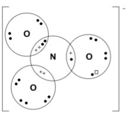

# Mark Schemes — Similarities & Trends in the Properties of the Group 2 Metals, Magnesium to Barium, & Their Compounds
**27. Group 2** · Cambridge (CIE) A-LEVEL chemistry (9701)

## Structured Questions (10 questions)

### Q1
> **[mark-scheme]**
> The factors responsible for the trend in solubility of Group 2 hydroxides going down the group:
> 
> - Both lattice energy and enthalpy of hydration (of M2+) are responsible for the trend **[1 mark]**
> - Both lattice energy and enthalpy of hydration decrease going down Group 2, but lattice energy decreases by more / the decrease in lattice energy is greater **[1 mark]**
> - So Δ*H*θsol becomes more negative / exothermic, and solubility increases going down the group **[1 mark]**

> **[exam-tip]**
> For Group 2 hydroxides, the lattice energy decreases faster than the enthalpy of hydration because OH- is a small, compact anion. Therefore, the lattice is especially sensitive to cation size.
> 
> The opposite applies to sulfates and carbonates (larger anions), where hydration enthalpy decreases faster, making Δ*H*θsol more endothermic and solubility decreases.
> **[mark-scheme]**
> Why Mg(OH)2 cannot be used to test for CO2 but Ba(OH)2 can:
> 
> - Mg(OH)2 is not very soluble / too insoluble to form a (clear) solution **[1 mark]**
> - Ba(OH)2 is (sufficiently) soluble
> **OR**
> BaCO3 is insoluble (forming a visible white precipitate when CO2 is absorbed) **[1 mark]**

> **[exam-tip]**
> The reaction of Ba(OH)2 with CO2 follows the same pattern as Ca(OH)2 (limewater):
> 
> Ba(OH)2 (aq) + CO2 (g) → BaCO3 (s) + H2O (l).
> 
> A hydroxide solution must be sufficiently soluble to form a clear solution; when CO2 is absorbed, the insoluble carbonate precipitates as a white solid.
> **[mark-scheme]**
> i) The expression for *K*sp of Sr(OH)2:
> 
> - *K*sp = [Sr2+][OH-]2 **[1 mark]**

ii) To calculate *K*sp for Sr(OH)2 at 293 K:

- Convert solubility to mol dm-3 (Mr of Sr(OH)2 = 87.6 + 34 = 121.6 g mol-1):

[Sr(OH)2] = $\frac{17.70}{121.6}$

[Sr(OH)2] = 0.146 mol dm-3 **[1 mark]**

- Note that [OH-] = 2 x [Sr2+] = 2 x 0.146 = 0.292 mol dm-3

- Calculate *K*sp:

*K*sp = 0.146 x (0.292)2

*K*sp = **0.0124** **[1 mark]**

- Units:

**mol****3**** dm****-9** **[1 mark]**

> **[mark-scheme]**
> Allow *K*sp in the range 0.012–0.013
> 
> The units must be consistent with the expression: [mol dm-3]3 = mol3 dm-9

> **[exam-tip]**
> A common mistake is to forget that [OH-] = 2[Sr2+] as each formula unit of Sr(OH)2 releases two OH- ions. The [OH-] must be doubled before squaring in the *K*sp expression.
> 
> The units for *K*sp come from the concentration terms in the expression: [mol dm-3] x [mol dm-3]2 = mol3 dm-9.
To calculate the pH of a saturated solution of Mg(OH)2 at 293 K:

- Convert solubility to mol dm-3 (Mr of Mg(OH)2 = 24.3 + 34 = 58.3 g mol-1):

[Mg(OH)2] = $\frac{0.140}{58.3}$

[Mg(OH)2] = 0.0024 mol dm-3 **[1 mark]**

- Find [OH-] using the dissociation equation:

Mg(OH)2 → Mg2+ + 2OH- **[1 mark]**

[OH-] = 2 x 0.0024

[OH-] = 0.0048 mol dm-3 **[1 mark]**

- Calculate [H+] using *K*w:

[H+] = `\frac{K_w}{[OH^-]}`

[H+] = $\frac{0.681\times10^{-14}}{0.0048}$

[H+] = 1.42 x 10-12 mol dm-3 **[1 mark]**

- Calculate pH:

pH = −log(1.42 x 10-12) = **11.8** **[1 mark]**

> **[mark-scheme]**
> Allow [Mg(OH)2] in the range 0.0024–0.0025 mol dm-3
> 
> Also accept pH = 11.85
> 
> Do not allow using pH + pOH = 14

> **[exam-tip]**
> Many students miss the step of multiplying [Mg(OH)2] by 2 to get [OH-], even though the dissociation equation shows each formula unit releases two OH- ions.
> 
> Since the temperature is 293 K (not 298 K), you cannot assume pH + pOH = 14.
> 
> Use the *K*w value given in the question to calculate [H+] via: [H+] = *K*w ÷ [OH-].

### Q2
> **[mark-scheme]**
> The trend in expected mass for the precipitates:
> 
> - Magnesium hydroxide produces the greatest mass of precipitate, with mass decreasing going down the group
> **OR**
> Barium hydroxide produces the least mass of precipitate, with mass increasing going up the group **[1 mark]**
> - (Because) the solubility of Group 2 hydroxides increases going down the group **[1 mark]**

> **[exam-tip]**
> The key insight is that more soluble hydroxides will produce less precipitate after filtering. Magnesium hydroxide is sparingly soluble so a large amount precipitates; barium hydroxide is very soluble so little or no precipitate forms. The trend in the precipitate mass directly reflects the inverse of the solubility trend.
To identify the metal hydroxide, convert the given data to g dm-3:

- Convert mass from mg to g:

$\frac{802}{1000}$ = 0.802 g in 50 cm3

- Scale from 50 cm3 to 1 dm3:

0.802 x 20 = 16.04 g dm-3 **[1 mark]**

- Compare the value with the data in Table 4.1:

closest value is strontium hydroxide (17.70 g dm-3)

- The unknown metal hydroxide is **strontium hydroxide** **[1 mark]**

> **[mark-scheme]**
> 1 mark for calculating the solubility of the unknown Group 2 metal hydroxide: 16.04 g dm-3
> 
> 1 mark identifying the unknown Group 2 metal hydroxide as strontium hydroxide
> 
> Allow error carried forward from the calculation to the identification, e.g. accept the identification that corresponds to the closest table value if the conversion step is incorrect

> **[exam-tip]**
> The table is in g dm-3 but the data given is in mg and cm3. Two conversions are needed:
> 
> - Divide mg by 1000 to get g
> - Then multiply by (1000 ÷ 50) = 20 to scale from 50 cm3 to 1 dm3.
> 
> The result will not exactly match a table value, so you should choose the closest.
The balanced equation for the reaction between magnesium hydroxide and sulfuric acid is:

Mg(OH)2 (s) + H2SO4 (aq) → MgSO4 (aq) + 2H2O (l)

**[2 marks]**

> **[mark-scheme]**
> 1 mark for correctly balanced equation: Mg(OH)2 + H2SO4 → MgSO4 + 2H2O
> 
> 1 mark for all four correct state symbols: (s), (aq), (aq), (l)
> 
> '(aq)' for Mg(OH)2 is not accepted

> **[exam-tip]**
> Magnesium hydroxide is sparingly soluble in water, so it is treated as a solid (s) in equations, not aqueous.
> 
> Magnesium sulfate (MgSO4) is soluble. Group 2 sulfate solubility decreases going down the group but MgSO4 at the top of the group is soluble, so (aq) is correct.
> **[mark-scheme]**
> i) The definition of enthalpy of solution, Δ*H*θsol:
> 
> - The enthalpy change when 1 mole of an ionic solid **[1 mark]**
> - dissolves to form a dilute solution under standard conditions **[1 mark]**

> **[mark-scheme]**
> ii) Why Δ*H*θsol becomes more exothermic going down Group 2:
> 
> - The enthalpy change of hydration (of M2+) decreases / becomes less negative going down Group 2 **[1 mark]**
> - The lattice energy decreases / becomes less negative going down Group 2 **[1 mark]**
> - The decrease in lattice energy is greater than / outweighs the decrease in enthalpy of hydration **[1 mark]**

> **[exam-tip]**
> For Group 2 hydroxides, the lattice energy decreases faster than the hydration enthalpy going down the group. This is because OH- is a small, compact anion, so the lattice is particularly sensitive to cation size. The net effect is that less energy is needed to break the lattice than is lost in hydration, so Δ*H*θsol becomes more negative (more exothermic) and solubility increases.
> 
> This is the opposite trend to Group 2 sulfates and carbonates: for larger anions, the hydration enthalpy decreases faster than the lattice energy, making Δ*H*θsol less exothermic going down the group.

### Q3
i) The balanced equation for the reaction is:

Sr (s) + 2H2O (l) → Sr(OH)2 (aq) + H2 (g)

**[2 marks]**

> **[mark-scheme]**
> 1 mark for correct balanced equation: Sr + 2H2O → Sr(OH)2 + H2
> 
> 1 mark for all four correct state symbols: (s), (l), (aq), (g)
> 
> '(s)' for Sr(OH)2 is not accepted

> **[mark-scheme]**
> ii) A test to identify the gas produced:
> 
> - Apply a lighted splint to the gas
> **AND**
> A squeaky pop is heard / the gas ignites with a squeaky pop **[1 mark]**
> 
> Both the test and the observation must be stated to score the mark

> **[exam-tip]**
> A common mistake is to give (s) for Sr(OH)2, but strontium hydroxide dissolves in water, so the correct state symbol is (aq).
> 
> For part ii), both the test (applying a lighted splint) and the observation (squeaky pop) must be given to score the mark.
i) The balanced equation for the reaction is:

Ca(OH)2 (aq) + H2SO4 (aq) → CaSO4 (s) + 2H2O (l)

**[2 marks]**

> **[mark-scheme]**
> 1 mark for correct balanced equation: Ca(OH)2 + H2SO4 → CaSO4 + 2H2O
> 
> 1 mark for all four correct state symbols: (aq), (aq), (s), (l)

> **[mark-scheme]**
> ii) The trend in the solubility of the Group 2 sulfates going down Group 2:
> 
> - The solubility of the Group 2 sulfates decreases **[1 mark]**

> **[exam-tip]**
> The general equation for this type of reaction is:
> 
> metal hydroxide + acid → salt + water.
> 
> The solubility of Group 2 sulfates decreases going down the group, but the solubility of Group 2 hydroxides increases. These trends are opposite and a common source of confusion.
> **[mark-scheme]**
> The trend in Δ*H*θ*latt* and Δ*H*θ*hyd* of Group 2 sulfates going down Group 2:
> 
> - Δ*H*θ*latt* decreases (becomes less negative) **[1 mark]**
> - Δ*H*θ*hyd* decreases (becomes less negative) **[1 mark]**

> **[exam-tip]**
> Both Δ*H*θ*latt* and Δ*H*θ*hyd* decrease going down Group 2, but by different amounts:
> 
> - Δ*H*θ*latt* decreases by a relatively small amount
> - Δ*H*θ*hyd* decreases by a relatively large amount, because ionic radius increases down the group
> 
> As a result, Δ*H*θsol becomes more endothermic going down the group, and solubility decreases.

### Q4
> **[mark-scheme]**
> i) The difference between the reactions of calcium carbonate with hydrochloric acid and with sulfuric acid:
> 
> - Calcium carbonate forms a soluble salt (CaCl2) with hydrochloric acid but forms an insoluble salt (CaSO4) with sulfuric acid **[1 mark]**
> - CaSO4 is insoluble / Group 2 sulfates are insoluble, so the insoluble layer coats the surface of the carbonate and prevents further reaction **[1 mark]**

> **[mark-scheme]**
> ii) The equation for the reaction between calcium carbonate and sulfuric acid:
> 
> - CaCO3 (s) + H2SO4 (aq) → CaSO4 (s) + H2O (l) + CO2 (g) **[1 mark]**
> 
> All state symbols must be correct to score the mark

> **[exam-tip]**
> All Group 2 metal carbonates react with acids to give:
> 
> metal carbonate + acid → salt + water + carbon dioxide
> 
> The key difference is the solubility of the salt formed. Group 2 chlorides are all soluble, but calcium sulfate is insoluble, forming a protective coating that halts the reaction.
> 
> A common error is to write 2H2O in the equation for this reaction, when the equation contains 1 mole of H2O
> **[mark-scheme]**
> The trend in thermal stability of Group 2 carbonates:
> 
> - Thermal stability increases going down Group 2 **[1 mark]**
> - The ionic radius / size of the Group 2 cation increases
> **OR**
> The charge density of the Group 2 cation decreases **[1 mark]**
> - (So) polarisation / distortion of the carbonate ion (CO32-) decreases **[1 mark]**

> **[exam-tip]**
> This explanation applies equally to Group 2 nitrates. As the cation increases in size going down the group, its polarising power over the carbonate ion decreases. Less polarisation means the C-O bond is harder to weaken, so more energy is required to decompose the compound and thermal stability increases.
> **[mark-scheme]**
> The thermal stabilities of ZnCO3 and PbCO3 compared to CaCO3:
> 
> - Zinc carbonate is less thermally stable (than CaCO3)
> **AND**
> (Because) the ionic radius of Zn2+ is smaller (than Ca2+) / Zn2+ has greater charge density / polarising power **[1 mark]**
> - Lead carbonate is more thermally stable (than CaCO3)
> **AND**
> (Because) the ionic radius of Pb2+ is larger (than Ca2+) / Pb2+ has smaller charge density / polarising power **[1 mark]**

> **[exam-tip]**
> Apply the same logic as Group 2 carbonates:
> 
> - Smaller cation radius
> - → greater polarising power
> - → greater polarisation of CO32-
> - → weaker C-O bond
> - → less thermally stable.
> 
> From the table:
> 
> - Zn2+ (0.074 nm) < Ca2+ (0.099 nm)
> - → ZnCO3 is less stable
> - Pb2+ (0.120 nm) > Ca2+ (0.099 nm)
> - → PbCO3 is more stable
> **[mark-scheme]**
> i) Why zinc is not classed as a transition element:
> 
> - It forms an ion (Zn2+) with a complete 3d subshell
> **OR**
> Zn2+ has a full / complete 3d10 configuration **[1 mark]**

> **[mark-scheme]**
> ii) Characteristic chemical properties of transition elements not shown by Group 2 elements:
> 
> Any **three** from (1 mark for each point):
> 
> - Form coloured ions / coloured compounds
> - Show variable oxidation states
> - Form complex ions / complexes
> - Act as catalysts / show catalytic behaviour
> 
> **[3 marks]**

> **[exam-tip]**
> A transition element is defined as an element that can form at least one stable ion with an incomplete d-subshell. Zinc forms only Zn2+, which has the configuration [Ar] 3d10, where the 3d subshell is complete in the ion, so zinc does not meet the definition.
> 
> The characteristic properties of transition elements arise from their partially filled d-subshells:
> 
> - Coloured ions (d-d electron transitions absorb visible light)
> - Variable oxidation states (d electrons at similar energies)
> - Complex ion formation
> - Catalytic activity

### Q5
> **[mark-scheme]**
> i) The trend in reactivity with water of the elements down Group 2 from Mg to Ba:
> 
> - Reactivity increases (going down Group 2) **[1 mark]**

> **[mark-scheme]**
> ii) A possible pH for the solutions formed when Group 2 elements are added to water:
> 
> - Any value from 10 to 12 inclusive **[1 mark]**

> **[exam-tip]**
> Group 2 elements react more vigorously with water further down the group. Note that beryllium does not react with water, and magnesium only reacts with steam, not liquid water.
> 
> A metal hydroxide is formed, which releases OH- ions into solution, making it alkaline. Group 2 hydroxide solutions typically have a pH in the range of 10–12.
> **[mark-scheme]**
> The formula of the most soluble Group 2 hydroxide:
> 
> - Ba(OH)2 **[1 mark]**

> **[exam-tip]**
> The solubility of Group 2 hydroxides increases going down the group. Barium hydroxide is the most soluble, while magnesium hydroxide is only sparingly soluble.
> **[mark-scheme]**
> i) The oxidation number of nitrogen in Ca(NO3)2:
> 
> - +5 **[1 mark]**

ii) The equation for the thermal decomposition of Ca(NO3)2 is:

2Ca(NO3)2 (s) → 2CaO (s) + 4NO2 (g) + O2 (g)

**[2 marks]**

> **[mark-scheme]**
> 1 mark for correctly balanced equation: 2Ca(NO3)2 → 2CaO + 4NO2 + O2
> 
> 1 mark for all four correct state symbols: (s), (s), (g), (g)

> **[mark-scheme]**
> iii) The trend in thermal stability of Group 2 nitrates going down Group 2:
> 
> - Thermal stability increases / become more thermally stable **[1 mark]**

> **[exam-tip]**
> To find the oxidation state of nitrogen in Ca(NO3)2: calcium is +2 and each oxygen is -2. With two NO3- groups giving -12, and calcium giving +2, the two nitrogen atoms must contribute +10, so each nitrogen is +5.
> 
> Group 2 nitrates thermally decompose to give a metal oxide, nitrogen dioxide (toxic brown gas) and oxygen.
> 
> The thermal stability of Group 2 nitrates increases down the group because the cation size increases, reducing its polarising power over the nitrate ion. The less the nitrate ion is polarised, the more energy is required to decompose the compound.

### Q6
> **[mark-scheme]**
> i) The equation for the reaction between magnesium and steam:
> 
> - Mg (s) + H2O (g) → MgO (s) + H2 (g) **[1 mark]**
> 
> ii) The equation for the reaction between magnesium and sulfuric acid:
> 
> - Mg (s) + H2SO4 (aq) → MgSO4 (aq) + H2 (g) **[1 mark]**
> 
> State symbols must be correct in both equations to score the marks

> **[exam-tip]**
> Magnesium reacts with steam (H2O (g)) to form magnesium oxide and hydrogen gas. With dilute acids, the general equation is:
> 
> metal + acid → salt + hydrogen.
> 
> Group 2 elements are expected to react with oxygen, water/steam, dilute HCl, and dilute H2SO4.
> **[mark-scheme]**
> The trend in solubility of Group 2 sulfates going down the group:
> 
> - Solubility decreases / the sulfates become less soluble **[1 mark]**
> - Both lattice energy and enthalpy of hydration decrease / become less negative **[1 mark]**
> - The enthalpy of hydration decreases by more than the lattice energy / the decrease in hydration enthalpy is greater than the decrease in lattice energy **[1 mark]**
> - So Δ*H*θsol becomes more endothermic / more positive going down the group **[1 mark]**

> **[exam-tip]**
> Although Δ*H*θsol can be positive (endothermic) or negative (exothermic), a compound is more likely to be soluble when Δ*H*θsol is negative or has a small positive value. As Δ*H*θsol becomes more positive going down the group, solubility decreases.
> 
> Note that the trend for Group 2 hydroxides is the opposite: hydroxide solubility increases going down the group because the lattice energy decreases by more than the hydration enthalpy.
To calculate Δ*H*θsol for each compound:

Δ*H*θsol = Δ*H*θhyd(total) − Δ*H*θlatt

- For Mg(OH)2:

Δ*H*θsol = [(−1890) + 2(−550)] − (−2993)

Δ*H*θsol = −2990 − (−2993)

Δ*H*θsol = **+3 kJ mol****-1** **[1 mark]**

- For Sr(OH)2:

Δ*H*θsol = [(−1414) + 2(−550)] − (−2467)

Δ*H*θsol = −2514 − (−2467)

Δ*H*θsol = **-47 kJ mol****-1** **[1 mark]**

> **[mark-scheme]**
> 1 mark for Δ*H*θsol(Mg(OH)2) = +3 kJ mol-1; allow ±1 kJ mol-1
> 
> 1 mark for Δ*H*θsol(Sr(OH)2) = −47 kJ mol-1; allow ±1 kJ mol-1
> 
> In both cases, the hydration enthalpy of OH- must be multiplied by 2 as there are two hydroxide ions in M(OH)2

> **[exam-tip]**
> The formula for enthalpy change of solution:
> 
> Δ*H*θsol = sum of all Δ*H*θhyd values − Δ*H*θlatt
> 
> Remember to multiply the hydration enthalpy of OH- by 2 as there are two OH- ions in each formula unit of M(OH)2.
> **[mark-scheme]**
> Whether Sr(OH)2 is more or less soluble than Mg(OH)2:
> 
> - Sr(OH)2 is more soluble (than Mg(OH)2) **[1 mark]**
> - Δ*H*θsol for Sr(OH)2 is negative / exothermic, while Δ*H*θsol for Mg(OH)2 is positive / endothermic **[1 mark]**
> 
> Allow error carried forward from incorrect values in part (c) provided the conclusion is consistent with the calculated values

> **[exam-tip]**
> A compound is more likely to be soluble when Δ*H*θsol is negative (exothermic). Sr(OH)2 has Δ*H*θsol = −47 kJ mol-1 (negative, more soluble), while Mg(OH)2 has Δ*H*θsol = +3 kJ mol-1 (positive, less soluble).
> 
> This deduction is consistent with the trend in Group 2 hydroxide solubility increasing down the group.

### Q7
> **[mark-scheme]**
> Using oxidation states to explain both oxidation and reduction:
> 
> - The oxidation state of nitrogen (N) changes from +5 (in NO3-) to +4 (in NO2) **[1 mark]**
> - The oxidation state of oxygen (O) changes from -2 (in NO3-) to 0 (in O2) **[1 mark]**
> - Nitrogen is reduced
> **AND**
> Oxygen is oxidised **[1 mark]**

> **[exam-tip]**
> When using oxidation states to explain redox, you must quote the actual values. Stating that an element has 'lost' or 'gained' electrons without citing oxidation state changes will not score marks.
> 
> Key rules:
> 
> - Oxygen is -2 (except in peroxides)
> - Nitrogen in NO3- is +5
> - Nitrogen in NO2 is +4
> - Oxygen in O2 is 0
> 
> Magnesium goes from +2 in Mg(NO3)2 to +2 in MgO. There is no change, so it is neither oxidised nor reduced.
i) The equation for the second ionisation energy of magnesium is:

Mg+ (g) → Mg2+ (g) + e-

**[2 marks]**

> **[mark-scheme]**
> 1 mark for correct equation: Mg+ → Mg2+ + e-
> 
> 1 mark for all species shown with state symbol (g)

> **[mark-scheme]**
> ii) The trend in the first three ionisation energies of magnesium:
> 
> - Successive ionisation energies increase **[1 mark]**
> - The 2nd IE is greater than the 1st because the same nuclear charge acts on fewer electrons / less electron-electron repulsion, giving greater effective nuclear attraction **[1 mark]**
> - There is a large increase between the 2nd and 3rd IE because the 3rd electron is removed from the 2p subshell (n=2), which is closer to the nucleus and experiences less shielding than the 3s subshell (n=3) from which the 1st and 2nd electrons are removed **[1 mark]**

> **[mark-scheme]**
> iii) Why the second ionisation energy of magnesium is greater than that of barium:
> 
> - Mg+ has a smaller ionic radius / fewer electron shells than Ba+ **[1 mark]**
> - Less shielding (of the outer electron from the nucleus in Mg+) **[1 mark]**
> - Greater nuclear attraction / the outer electron is more strongly attracted to the nucleus **[1 mark]**

> **[exam-tip]**
> For successive ionisation energies, write out the electronic configuration to identify large jumps: Mg is 1s2 2s2 2p6 3s2. The 1st and 2nd electrons are removed from 3s (n=3); the 3rd from 2p (n=2), which is an inner shell, closer to nucleus, much less shielded. This produces the large jump.
> 
> A common error for part iii) is to cite 'nuclear charge' as the reason Mg has a higher IE than Ba. This is wrong as Ba has a higher nuclear charge (more protons). The correct reasoning is smaller ionic radius, less shielding, and therefore greater effective nuclear attraction per remaining electron.
> **[mark-scheme]**
> i) The equation for the thermal decomposition of strontium peroxide:
> 
> - 2SrO2 (s) → 2SrO (s) + O2 (g) **[1 mark]**
> 
> Allow without state symbols; allow 1:1 ratio (SrO2 → SrO + ½O2) if balanced

> **[mark-scheme]**
> ii) How the temperature for thermal decomposition of MO2 varies going down Group 2:
> 
> - Temperature required for decomposition increases going down Group 2 **[1 mark]**
> - (Because) the charge density of the cation decreases going down Group 2 **[1 mark]**
> - (So) there is less polarisation of the O22- ion / the O-O bond is polarised less / weakened less **[1 mark]**

> **[exam-tip]**
> The clue in the question is that MO2 decomposition is similar to Group 2 carbonates. In both cases, a larger cation with lower charge density polarises the anion less, making the relevant bond harder to break (O-O in peroxides, C-O in carbonates). More energy (higher temperature) is therefore needed.
> 
> The general equation is: 2MO2 (s) → 2MO (s) + O2 (g), where the solid metal oxide and gaseous oxygen are analogous to MO and CO2 in carbonate decomposition.

### Q8
i) To show that CaCO3 is stable at 25°C, calculate Δ*G* at 298 K:

- Calculate Δ*S*:

Δ*S* = (40 + 214) − 89

Δ*S* = +165 J K-1 mol-1 **[1 mark]**

- Convert units:

165 ÷ 1000 = 0.165 kJ K-1 mol-1

- Substitute into Δ*G* = Δ*H* − *T*Δ*S*:

Δ*G* = +178 − (298 x 0.165) **[1 mark]**

Δ*G* = **+129 kJ mol****-1** **[1 mark]**

- Since Δ*G* > 0, the reaction is not feasible / spontaneous at 298 K; CaCO3 does not decompose and is therefore stable at room temperature **[1 mark]**

> **[mark-scheme]**
> Allow Δ*G* in the range +127 to +131 kJ mol-1
> 
> The substitution mark requires consistent units — using 0.165 kJ K-1 mol-1, not 165

ii) To calculate the minimum temperature for decomposition, set Δ*G* = 0:

- Rearrange to find *T*:

*T* = $\frac{ΔH}{ΔS}$ **[1 mark]**

*T* = $\frac{178}{0.165}$ = **1079 K** **[1 mark]**

> **[mark-scheme]**
> Also accept *T* = 806°C
> 
> Allow error carried forward from incorrect Δ*S* provided the method is correct

> **[exam-tip]**
> Δ*S* values are in J K-1 mol-1 but Δ*H* is in kJ mol-1, so you should always convert Δ*S* to kJ K-1 mol-1 before substituting into the Δ*G* equation.
> 
> If Δ*G* > 0 the reaction is not feasible (not spontaneous). At the minimum temperature for decomposition, Δ*G* = 0, giving *T* = Δ*H*/Δ*S*.
> **[mark-scheme]**
> The trend in thermal decomposition of Group 2 carbonates:
> 
> - Carbonates become more thermally stable / more difficult to decompose / require a higher temperature going down Group 2 **[1 mark]**
> - The ionic radius of the Group 2 cation increases
> **OR**
> The charge density of the Group 2 cation decreases going down Group 2 **[1 mark]**
> - (So) there is less polarisation of the carbonate ion (CO32-) / the C-O bond is polarised / weakened less **[1 mark]**

> **[exam-tip]**
> This explanation applies equally to Group 2 nitrates — replace 'C-O bond' with 'N-O bond'. The key principle:
> 
> - Smaller, denser cation
> - → greater polarising power
> - → more distortion of the anion
> - → easier to break the bond
> - → lower thermal stability
> **[mark-scheme]**
> i) The equilibrium expression for the solubility product of CaCO3:
> 
> - CaCO3 (s) ⇌ Ca2+ (aq) + CO32- (aq) **[1 mark]**

> **[mark-scheme]**
> ii) What is observed when K2CO3 (aq) is added to a saturated solution of CaCO3:
> 
> - A white solid / precipitate (of CaCO3) forms / appears **[1 mark]**
> - [CO32-] increases, shifting the equilibrium to the left; CaCO3 precipitates out of solution **[1 mark]**

> **[exam-tip]**
> This is the common ion effect.
> 
> Adding CO32- (already present in the equilibrium) increases its concentration, causing the system to shift left (Le Chatelier’s principle) to reduce [CO32-].
> 
> Ca2+ and CO32- recombine to form solid CaCO3, reducing the solubility of calcium carbonate.
To calculate the solubility of CaCO3:

- Recognise that [Ca2+] = [CO32-] = *s*, so *K*sp = *s*2:

*s*2 = 5 x 10-9 **[1 mark]**

- Calculate the molar solubility:

*s* = $\sqrt{5\times10^{-9}}$ 
*s* = 7.07 x 10-5 mol dm-3 **[1 mark]**

- Convert to g dm-3 (Mr of CaCO3 = 100.1 g mol-1):

solubility = 7.07 x 10-5 x 100.1 
solubility = **7.08 x 10****-3**** g dm****-3** **[1 mark]**

> **[mark-scheme]**
> Allow solubility in the range 7.0–7.2 x 10-3 g dm-3

> **[exam-tip]**
> *K*sp = [Ca2+][CO32-] = *s* x *s* = *s*2. Since both ions are produced in a 1:1 ratio, the molar solubility is simply √*K*sp. Remember to multiply by the molar mass to convert mol dm-3 to g dm-3.

### Q9
> **[mark-scheme]**
> i) The formula of magnesium carbonate is:
> 
> - MgCO3 **[1 mark]**
> 
> ii) An equation for the reaction of magnesium carbonate with dilute nitric acid:
> 
> - MgCO3 + 2HNO3 → Mg(NO3)2 + CO2 + H2O **[1 mark]**
> 
> State symbols are not required.

> **[exam-tip]**
> The general pattern for a metal carbonate reacting with an acid is:
> 
> metal carbonate + acid → salt + carbon dioxide + water
> 
> You need to be able to deduce the formulae for each substance. The salt formed from magnesium and nitric acid is magnesium nitrate, Mg(NO3)2. Carbon dioxide and water are always produced in acid-carbonate reactions.
> **[mark-scheme]**
> i) The compound that decomposes at the lowest temperature is:
> 
> - Calcium carbonate **[1 mark]**
> 
> ii) An equation for the thermal decomposition of calcium carbonate:
> 
> - CaCO3 (s) → CaO (s) + CO2 (g) **[1 mark]**
> 
> Allow error carried forward from (i): if a different carbonate is identified in (i), award the mark for the corresponding correctly balanced decomposition equation.

> **[exam-tip]**
> Calcium carbonate decomposes at the lowest temperature because Ca2+ has the smallest ionic radius of the Group 2 ions listed, giving it the greatest charge density and polarising power.
> 
> The trend in thermal stability of Group 2 carbonates increases down the group: CaCO3 decomposes at the lowest temperature, BaCO3 at the highest.
> **[mark-scheme]**
> Calcium nitrate decomposes at a lower temperature than barium nitrate because:
> 
> - Ca2+ has a smaller ionic radius than Ba2+ / Ca2+ has a greater charge density **[1 mark]**
> - (therefore) Ca2+ has a greater polarising power / greater ability to distort the electron cloud of the nitrate ion **[1 mark]**
> - (therefore) the N-O bonds in the nitrate ion are weakened to a greater extent, so a lower temperature is required for decomposition **[1 mark]**

> **[exam-tip]**
> This is a 3-mark explain question that follows a three-step reasoning chain:
> 
> - ionic radius (or charge density)
> - → polarising power
> - → bond weakening.
> 
> The first mark is for stating that Ca2+ has a smaller ionic radius or greater charge density than Ba2+. The second mark is for the consequence: greater polarising power. The third mark is for linking this to the weakening of the N-O bonds in the nitrate ion, which lowers the decomposition temperature.
> 
> A common mistake is to write only "Ca2+ is smaller" without explaining the consequences for polarisation and bond strength.

### Q10
> **[mark-scheme]**
> i) The formula of strontium nitrate:
> 
> - Sr(NO3)2 **[1 mark]**

> **[mark-scheme]**
> ii) The colour that strontium nitrate produces in fireworks:
> 
> - Red / scarlet / crimson **[1 mark]**
> 
> 'Brick red' is not accepted

> **[exam-tip]**
> Group 2 flame colours to know:
> 
> - Ca2+ gives brick red
> - Sr2+ gives crimson/red
> - Ba2+ gives pale green
> 
> Note that lilac flames are associated with potassium (Group 1), not Group 2.
> 
> For strontium nitrate, two nitrate ions (NO3-) are needed per Sr2+ ion to give overall neutrality, so the formula is Sr(NO3)2.
i) The equation for the reaction when strontium nitrate is heated:

2Sr(NO3)2 (s) → 2SrO (s) + 4NO2 (g) + O2 (g)

**[2 marks]**

> **[mark-scheme]**
> 1 mark for correctly balanced equation: 2Sr(NO3)2 → 2SrO + 4NO2 + O2
> 
> 1 mark for all four correct state symbols: (s), (s), (g), (g)

> **[mark-scheme]**
> ii) One observation of this reaction:
> 
> Any **one** from:
> 
> - Brown fumes / brown gas (NO2)
> - White solid / white residue forms (SrO)
> 
> **[1 mark]**

> **[exam-tip]**
> Thermal decomposition of Group 2 nitrates follows the general pattern:
> 
> metal nitrate → metal oxide + nitrogen dioxide + oxygen.
> 
> The nitrogen dioxide appears as brown fumes, and the metal oxide forms as a white solid.
The completed dot-and-cross diagram of the nitrate ion is:

**[3 marks]**

> **[mark-scheme]**
> 1 mark for a dative covalent bond shown to one oxygen atom, with both electrons from nitrogen (marked ×)
> 
> 1 mark for 8 electrons around the nitrogen atom, arranged as 1 double bond and 2 single bonds
> 
> 1 mark for a total of 24 electrons shown, including exactly one □ electron representing the negative charge

> **[exam-tip]**
> The negative charge on the nitrate ion means one extra electron has been added, which must be shown using the □ symbol (not a dot or cross) to score the third mark.
> 
> A dative covalent bond is formed when both electrons come from the same atom. Both electrons in the dative bond must be shown as × (nitrogen electrons) to score the first mark.
> 
> Each atom in the completed diagram should have 8 electrons around it (a full octet).
> **[mark-scheme]**
> The trend in thermal stabilities of Group 2 nitrates:
> 
> - Thermal stability increases going down Group 2 **[1 mark]**
> - The ionic radius / size of the Group 2 cation increases
> **OR**
> The charge density of the Group 2 cation decreases **[1 mark]**
> - (So) polarisation / distortion of the nitrate ion decreases **[1 mark]**

> **[exam-tip]**
> This trend and explanation apply equally to Group 2 carbonates and nitrates.
> 
> As the Group 2 cation increases in size going down the group, its polarising power over the nitrate ion decreases. A less polarised nitrate ion requires more energy to decompose, so thermal stability increases.
