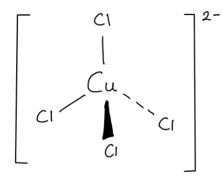
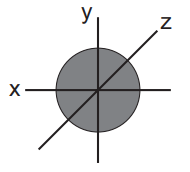
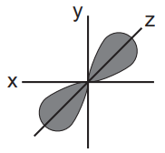

# Mark Schemes — General Physical & Chemical Properties of the First Row of Transition Elements, Titanium to Copper
**28. Chemistry of Transition Elements** · Cambridge (CIE) A-LEVEL chemistry (9701)

## Structured Questions (4 questions)

### Q1
> **[mark-scheme]**
> i) The full electronic configuration of a Cu atom and a Cu2+ ion:
> 
> - Cu atom: 1s22s22p63s23p63d104s1 **[1 mark]**
> - Cu2+ ion: 1s22s22p63s23p63d9 **[1 mark]**
> 
> ii) Three characteristic properties of copper and its compounds:
> 
> Any **three** from (1 mark for each point):
> 
> - Variable oxidation states
> - Form coloured ions / compounds
> - Form complexes / complex ions
> - Act as catalysts
> 
> **[3 marks]**

> **[exam-tip]**
> For part i), copper has an anomalous electronic configuration. The expected configuration would be [Ar]3d94s2, but the actual configuration is [Ar]3d104s1, because a fully filled 3d subshell is particularly stable. When Cu loses two electrons to form Cu2+, it loses the 4s1 electron first, then one 3d electron, giving [Ar]3d9.
> 
> For part ii), the four characteristic properties of transition elements are: variable oxidation states, formation of coloured ions, formation of complex ions, and catalytic activity. These apply to all first-row transition elements, not just copper.
> **[mark-scheme]**
> i) The definition of monodentate ligand:
> 
> - A molecule / ion that has a lone pair of electrons **[1 mark]**
> - That donates one lone pair to form one coordinate (dative covalent) bond to a central metal atom / ion **[1 mark]**
> 
> ii) The equation for the reaction:
> 
> - [Cu(H2O)6]2+ + 4Cl- → [CuCl4]2- + 6H2O **[1 mark]**

iii) The 3D structure of [CuCl4]2-:

**[1 mark]**

> **[mark-scheme]**
> 1 mark for the correct tetrahedral structure with the 2− charge on the complex
> 
> iv) The shape of the complex ion:
> 
> - Tetrahedral **[1 mark]**
> 
> v) The change in coordination number:
> 
> - 6 to 4 **[1 mark]**

> **[exam-tip]**
> For part i), a monodentate ligand forms exactly one coordinate bond. The prefix 'mono' means one. Contrast this with bidentate ligands (e.g. ethane-1,2-diamine), which form two coordinate bonds per ligand molecule.
> 
> For part ii), when concentrated HCl is added, four chloride ions replace all six water ligands. Cl- is a larger ligand than H2O, so only four can fit around the Cu2+ ion.
> 
> The shape changes from octahedral ([Cu(H2O)6]2+, six ligands) to tetrahedral ([CuCl4]2-, four ligands). These two complexes also have different colours:
> 
> - [Cu(H2O)6]2+ is blue
> - [CuCl4]2- is yellow-green
> **[mark-scheme]**
> i) The overall equation for this reaction:
> 
> - SO2 + ½O2 → SO3
> **OR**
> 2SO2 + O2 → 2SO3 **[1 mark]**
> 
> ii) V2O5 acts as a catalyst in this reaction because:
> 
> - It is regenerated at the end of the reaction / not consumed overall **[1 mark]**
> - Vanadium has variable oxidation states (changes from +5 to +4 and back to +5) **[1 mark]**

> **[exam-tip]**
> For part i), to find the overall equation, add the two steps and cancel species that appear on both sides. V2O5 cancels (reactant in step 1, product in step 2) and V2O4 cancels (product in step 1, reactant in step 2), leaving SO2 + ½O2 → SO3.
> 
> For part ii), the first mark is for identifying that the catalyst is regenerated (not consumed). The second mark is for the mechanism: vanadium cycles between oxidation states +5 and +4 across the two steps, providing an alternative reaction pathway. This ability to cycle between oxidation states is a general property of transition metal catalysts.
> **[mark-scheme]**
> i) The full electronic configuration of an iron(II) ion:
> 
> - 1s22s22p63s23p63d6 **[1 mark]**
> 
> ii) The shape and bond angle of the hexaaquairon(II) complex:
> 
> - Octahedral **[1 mark]**
> - 90° **[1 mark]**

> **[exam-tip]**
> For part i), the iron(II) ion has lost two electrons from the 4s subshell of the iron atom ([Ar]3d64s2), leaving [Ar]3d6.
> 
> For part ii), the hexaaqua complex has six water ligands arranged symmetrically around the central Fe2+ ion. Six bonding pairs repel equally, giving an octahedral geometry with 90° bond angles.

### Q2
The completed table is:

| **Ion** | [CuCl4]2- | [Fe(H2O)6]3+ | Cr2O72- |
|---|---|---|---|
| **Oxidation state** | **Final answer:** **+2** | **Final answer:** **+3** | **Final answer:** **+6** |

**[3 marks]**

> **[mark-scheme]**
> 1 mark for each correct oxidation state:
> 
> 1 mark for +2 in [CuCl4]2-
> 
> 1 mark for +3 in [Fe(H2O)6]3+
> 
> 1 mark for +6 in Cr2O72-
> 
> The sign must be written before the number: +2 not 2+.

> **[exam-tip]**
> Use the overall charge and the known oxidation states of the other atoms:
> 
> - Cl- ligand: oxidation state = −1. For [CuCl4]2-: Cu + (4 x −1) = −2, so Cu = +2.
> - H2O ligand: oxidation state = 0. For [Fe(H2O)6]3+: Fe = +3.
> - O in Cr2O72-: oxidation state = −2. (2 x Cr) + (7 x −2) = −2, so (2 x Cr) = +12, Cr = +6.
> 
> The dichromate ion (Cr2O72-) is a common example of a high oxidation state for chromium. Remember that both chromium atoms share the oxidation number equally, so divide +12 by 2 to get +6.
> **[mark-scheme]**
> i) The full electronic configuration of the manganese(III) ion:
> 
> - 1s22s22p63s23p63d4
> **OR**
> [Ar]3d4 **[1 mark]**
> 
> ii) The definition of a ligand:
> 
> - A molecule / ion that has a lone pair of electrons **[1 mark]**
> - That forms a coordinate (dative covalent) bond to a central metal atom / ion **[1 mark]**

> **[exam-tip]**
> For part i), manganese has the configuration [Ar]3d54s2. Forming Mn3+ removes three electrons: first both 4s electrons, then one 3d electron, giving [Ar]3d4.
> 
> For part ii), a ligand must be defined with two features: (1) it has a lone pair of electrons, and (2) it donates that lone pair to a metal ion to form a coordinate bond. Stating only that a ligand "bonds to a metal ion" without mentioning the lone pair or the type of bond will not score the second mark.
> **[mark-scheme]**
> Two characteristic properties of transition elements that allow EUK-134 to act in this way:
> 
> - Variable oxidation states
> **OR**
> Acts as a reducing agent **[1 mark]**
> - Catalytic properties / acts as a catalyst **[1 mark]**

> **[exam-tip]**
> EUK-134 decreases the concentration of oxidising agents by two related mechanisms:
> 
> 1. Variable oxidation states: manganese can cycle between oxidation states (e.g. Mn3+ and Mn2+), allowing it to accept electrons from oxidising agents and act as a reducing agent.
> 2. Catalytic activity: the variable oxidation states allow EUK-134 to provide an alternative reaction pathway with lower activation energy, speeding up the removal of oxidising agents.

### Q3
> **[mark-scheme]**
> Transition metals exhibit variable oxidation states but Group 1 elements do not because:
> 
> Transition metals:
> 
> - The 3d and 4s subshells are similar in energy
> **OR**
> Successive ionisation energies increase gradually **[1 mark]**
> 
> Group 1 elements:
> 
> - The second electron occupies a much lower energy level / inner shell
> **OR**
> There is a very large increase in ionisation energy between the first and second ionisation energies **[1 mark]**

> **[exam-tip]**
> Transition metals can exist in multiple oxidation states because the 3d and 4s subshells have similar energies. Electrons from either subshell can be removed with gradually increasing ionisation energies, so transition metals can form ions with different charges (e.g. Fe2+ and Fe3+; Ti2+, Ti3+, and Ti4+).
> 
> For Group 1 elements, the first electron removed comes from the outer shell, but the second would come from a much lower energy inner shell. The very large jump in ionisation energy makes a second ionisation effectively impossible under normal conditions, so Group 1 elements exist only in the +1 oxidation state.
The completed table is:

| **Ion** | [Cr(H2O)6]3+ | [Co(NH3)6]2+ | [Cr(OH)6]3- | Mn2O3 |
|---|---|---|---|---|
| **Oxidation state** | **Final answer:** **+3** | **Final answer:** **+2** | **Final answer:** **+3** | **Final answer:** **+3** |

**[4 marks]**

> **[mark-scheme]**
> 1 mark for +3 in [Cr(H2O)6]3+
> 
> 1 mark for +2 in [Co(NH3)6]2+
> 
> 1 mark for +3 in [Cr(OH)6]3-
> 
> 1 mark for +3 in Mn2O3
> 
> The sign must be written before the number: +3 not 3+.

> **[exam-tip]**
> To find the oxidation state of the transition element, use the overall charge and the known oxidation states of the other atoms:
> 
> - Neutral ligands (H2O, NH3): oxidation state = 0
> - OH- ligand: oxidation state = −1
> - O in Mn2O3: oxidation state = −2
> 
> For [Cr(OH)6]3-: Cr + (6 x −1) = −3, so Cr = +3.
> 
> For Mn2O3: (2 x Mn) + (3 x −2) = 0, so Mn = +3.
> 
> A common error is to write the oxidation state as 3+ rather than +3. CIE mark schemes will not award the mark for the wrong notation.
> **[mark-scheme]**
> i) The full electronic configuration for the metal ions:
> 
> - [Zn(H2O)6]2+: 1s22s22p63s23p63d10 **[1 mark]**
> - [Co(H2O)6]2+: 1s22s22p63s23p63d7 **[1 mark]**
> 
> ii) Zinc is not classified as a transition element because:
> 
> - The Zn2+ ion has a complete / full 3d subshell **[1 mark]**
> - The electronic configuration of Zn2+ is [Ar]3d10, showing no partially filled 3d subshell **[1 mark]**

> **[exam-tip]**
> For part i), when writing the electronic configuration of an ion, the 4s electrons are removed first. Both Zn2+ and Co2+ lose their two 4s electrons:
> 
> - Zn: [Ar]3d104s2 → Zn2+: [Ar]3d10 (3d subshell is full)
> - Co: [Ar]3d74s2 → Co2+: [Ar]3d7 (3d subshell is incomplete)
> 
> For part ii), the definition of a transition element requires at least one stable ion with a partially filled 3d subshell. The Zn2+ ion has a complete 3d subshell ([Ar]3d10), so zinc does not qualify.

### Q4
> **[mark-scheme]**
> The definition of a transition element:
> 
> - A d-block element **[1 mark]**
> - That forms one or more stable ions with an incomplete / partially filled 3d subshell **[1 mark]**

> **[exam-tip]**
> Both marks are needed for the complete definition. The first mark is for identifying it as a d-block element, and the second mark is for the key criterion: it must form at least one stable ion with a partially filled 3d subshell.
> 
> Two d-block elements do not qualify as transition elements: scandium (Sc3+ has an empty 3d subshell) and zinc (Zn2+ has a full 3d subshell, [Ar]3d10). Neither ion has a partially filled d subshell.
> **[mark-scheme]**
> i) The full electronic configuration of Ti2+:
> 
> - 1s22s22p63s23p63d2
> **OR**
> [Ar]3d2 **[1 mark]**
> 
> ii) Zinc is not classified as a transition element because:
> 
> - The Zn2+ ion has a complete / full 3d subshell **[1 mark]**
> - The electronic configuration of Zn2+ is 1s22s22p63s23p63d10 / [Ar]3d10, showing no partially filled 3d subshell **[1 mark]**

> **[exam-tip]**
> For part i), both the full notation (1s22s22p63s23p63d2) and the noble gas shorthand ([Ar]3d2) are accepted.
> 
> For part ii), the critical point is the electronic configuration of the Zn2+ ion, not the Zn atom. The Zn atom has configuration [Ar]3d104s2, but when it forms Zn2+ it loses both 4s electrons, leaving [Ar]3d10. Since the 3d subshell is completely full, Zn2+ does not have a partially filled d subshell, so zinc does not qualify as a transition element.
The completed table is:

| Shape of orbital | Type of orbital |
|---|---|
|  | **Final answer:** **d** |
|  | **Final answer:** **s** |
|  | **Final answer:** **p** |

**[3 marks]**

> **[mark-scheme]**
> 1 mark for d (dxy orbital, four lobes in the xy-plane)
> 
> 1 mark for s (spherical orbital)
> 
> 1 mark for p (pz orbital, two lobes on the z-axis)

> **[exam-tip]**
> You need to be able to recognise s, p, and d orbitals from their shapes.
> 
> The s orbital is spherical. The p orbital has two lobes on opposite sides of the nucleus along one axis. The d orbital shown here (dxy) has four lobes arranged in the xy-plane. Note that the dz2 orbital looks different: it has two lobes along the z-axis with a doughnut-shaped ring around the middle.
> **[mark-scheme]**
> Two characteristic properties of transition elements, other than the formation of coloured ions:
> 
> Any **two** from (1 mark for each point):
> 
> - Form complexes / complex ions
> - Have variable oxidation states
> - Behave as / act as catalysts
> 
> **[2 marks]**

> **[exam-tip]**
> Transition elements have four characteristic properties: formation of coloured ions, formation of complex ions, variable oxidation states, and catalytic activity.
> 
> Exam questions often follow up by asking you to explain one of these in more detail. For example, variable oxidation states arise because the 3d and 4s subshells are similar in energy, so electrons can be removed from either subshell with gradually increasing ionisation energies.
