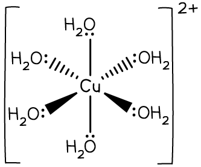
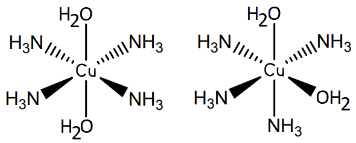
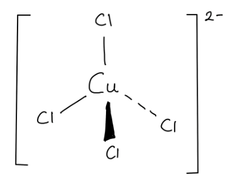
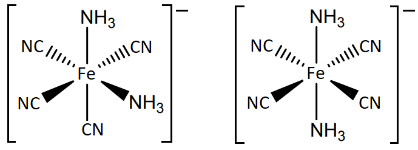
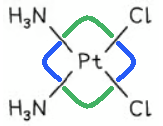

# Mark Schemes — General Characteristic Chemical Properties of the First Set of Transition Elements, Titanium to Copper
**28. Chemistry of Transition Elements** · Cambridge (CIE) A-LEVEL chemistry (9701)

## Structured Questions (12 questions)

### Q1
> **[mark-scheme]**
> The equation for the formation of complex D from complex A:
> 
> - [Cu(H2O)6]2+ + 4Cl– → [CuCl4]2– + 6H2O **[1 mark]**
> 
> State symbols are not required

> **[exam-tip]**
> Complex A is the hexaaquacopper(II) ion [Cu(H2O)6]2+, formed when copper(II) sulfate dissolves in water. Complex D is [CuCl4]2–, formed when concentrated hydrochloric acid provides excess Cl– ions for ligand substitution. The coordination number changes from 6 (octahedral) to 4 (tetrahedral).
> **[mark-scheme]**
> It is not possible to identify complex B because:
> 
> - The amount of ammonia is not given
> **OR**
> It is not clear if the ammonia is in excess **[1 mark]**
> - A small amount of ammonia forms Cu(H2O)4(OH)2
> **AND**
> Excess ammonia forms [Cu(NH3)4(H2O)2]2+ **[1 mark]**

> **[exam-tip]**
> Excess ammonia does not result in full ligand substitution for copper(II): only four of the six water ligands are replaced by ammonia, giving [Cu(NH3)4(H2O)2]2+, not [Cu(NH3)6]2+.
i) The equation, including state symbols, to form compound C:

CuSO4 (aq) + Na2CO3 (aq) → CuCO3 (s) + Na2SO4 (aq)

**[2 marks]**

> **[mark-scheme]**
> 1 mark for correct reactants and products
> 
> 1 mark for all state symbols correct

> **[mark-scheme]**
> ii) The type of reaction when compound C is converted into copper(II) oxide:
> 
> - Thermal decomposition / thermolysis **[1 mark]**
> 
> 'Decomposition' alone is not accepted; 'thermal' must be specified

> **[exam-tip]**
> For part i: all species are soluble except copper(II) carbonate (all Group 1 salts are soluble), so CuCO3 is the precipitate. Compound C is CuCO3 (s).
> 
> For part ii: copper(II) carbonate breaks down on heating to form copper(II) oxide and carbon dioxide. This is thermal decomposition. If you write 'decomposition' alone, you must include 'thermal' to gain the mark.
> **[mark-scheme]**
> i) The electronic configuration of a Cu+ ion:
> 
> - 1s2 2s2 2p6 3s2 3p6 3d10 **[1 mark]**
> 
> ii) The role of copper metal in the formation of [CuCl4]3– from complex D:
> 
> - A reducing agent **[1 mark]**

> **[exam-tip]**
> The ground state electron configuration of Cu is 1s2 2s2 2p6 3s2 3p6 4s1 3d10 (copper is an exception to aufbau filling: the 4s1 3d10 arrangement is more stable than 4s2 3d9). When Cu forms Cu+, the 4s1 electron is removed, leaving the stable [Ar] 3d10 configuration.
> 
> In the reaction [CuCl4]2– + Cu → [CuCl4]3– + Cu+, copper metal loses an electron and is oxidised. Because it causes reduction of the complex, it acts as a reducing agent. Remember: reducing agents are themselves oxidised.

### Q2
The completed table is:

|   | **Ligand exchange of similarly sized ligands** | **Ligand exchange of differently sized ligands** |
|---|---|---|
| **Coordination number** | **Final answer:** **No change** | **Final answer:** **Change** |
| **Shape** | **Final answer:** **No change** | **Final answer:** **Change** |

**[2 marks]**

> **[mark-scheme]**
> 1 mark for the correct coordination number row (No change / Change)
> 
> 1 mark for the correct shape row (No change / Change)

> **[exam-tip]**
> When similarly sized ligands exchange, the coordination number stays the same, so the geometry is unchanged. When differently sized ligands exchange (for example, six small water ligands replaced by four larger chloride ions), the coordination number changes and the geometry changes with it.
> **[mark-scheme]**
> The formula of the hexaaquacopper(II) complex represented by Cu2+ (aq) is:
> 
> - [Cu(H2O)6]2+ (aq) **[1 mark]**

> **[exam-tip]**
> The hexaaquacopper(II) name tells you there are six (hexa) water molecules (aqua) bonded to a Cu2+ ion. Charged complexes must have square brackets around them with the charge shown outside.
> 
> Always include state symbols for transition metal complex ions, as they are usually required for full marks in CIE IAL questions.
The completed three-dimensional diagram of the hexaaquacopper(II) ion complex is:

**[2 marks]**

> **[mark-scheme]**
> 1 mark for the central copper ion surrounded by six water molecules with two bonds of each type (straight, dotted, and wedge)
> 
> 1 mark for square brackets with 2+ charge outside the brackets

> **[exam-tip]**
> Place the Cu2+ ion at the centre. In a three-dimensional octahedral diagram, use two straight bonds, two dashed (dotted) bonds, and two wedge bonds to show the six water ligands around the central ion. Add square brackets with the 2+ charge outside to complete the complex ion notation.
The completed table is:

|   | **Hexaaquacopper(II) complex** | **A** |
|---|---|---|
| **colour of complex** | **Final answer:** **Blue / pale blue** | **Final answer:** **Yellow** |
| **geometry of complex** | **Final answer:** **Octahedral** | **Final answer:** **Tetrahedral** |
| **formula of complex** | [Cu(H2O)6]2+ | **Final answer:** **[CuCl****4****]****2-** |

**[2 marks]**

> **[mark-scheme]**
> 1 mark for any three answer cells correct
> 
> 2 marks for all five answer cells correct

> **[exam-tip]**
> You are expected to know the colours, geometries, and formulae of copper(II) and cobalt(II) complexes with water, ammonia, chloride, and hydroxide ligands.
> 
> The hexaaquacopper(II) ion [Cu(H2O)6]2+ is blue/pale blue and octahedral. When chloride ions (which are larger than water) replace the six water ligands, the coordination number drops to 4 and the geometry changes to tetrahedral, giving the yellow [CuCl4]2– ion.
> **[mark-scheme]**
> i) The colour and physical state of Cu(OH)2(H2O)4 are:
> 
> - Pale blue
> **AND**
> Solid / precipitate / (s) **[1 mark]**
> 
> ii) The colour and physical state of [Cu(NH3)4(H2O)2]2+ are:
> 
> - Deep / dark / royal blue
> **AND**
> Aqueous / (aq) **[1 mark]**

iii) The completed three-dimensional diagram of the cis isomer of [Cu(NH3)4(H2O)2]2+ is:

**[1 mark]**

> **[mark-scheme]**
> 1 mark for the correct cis-isomer structure with the two water molecules adjacent to each other

> **[exam-tip]**
> You are expected to know the ligand exchange reactions of copper(II) complexes with ammonia, including the colours and physical states at each stage.
> 
> The trans isomer shown in Fig. 1.2 has the two H2O ligands directly opposite each other (180° apart). In the cis isomer, the two H2O ligands are adjacent (90° apart).

### Q3
> **[mark-scheme]**
> The equation for the thermal decomposition of Co(NO3)2 is:
> 
> - Co(NO3)2 → CoO + 2NO2 + ½O2
> **OR**
> 2Co(NO3)2 → 2CoO + 4NO2 + O2 **[1 mark]**
> 
> State symbols are not required

> **[exam-tip]**
> Group 2 metal nitrates thermally decompose to form the metal oxide, nitrogen dioxide, and oxygen:
> 
> M(NO3)2 → MO + 2NO2 + ½O2.
> 
> Cobalt(II) nitrate follows the same pattern. Make sure you give the cobalt(II) nitrate equation, not the copper(II) equation.
The completed Table 2.1 is:

|   | **State of cobalt-containing species formed** | **Formula of cobalt-containing species formed** | **Colour of cobalt-containing species formed** |
|---|---|---|---|
| **A** | **Final answer:** **aqueous / (aq)** | **Final answer:** **[Co(H****2****O)****6****]****2+** | **Final answer:** **Pink** |
| **B** | **Final answer:** **solid / (s) / precipitate** | **Final answer:** **Co(H****2****O)****4****(OH)****2**** / Co(OH)****2** | **Final answer:** **Blue-green** |
| **C** | **Final answer:** **aqueous / (aq)** | **Final answer:** **[Co(NH****3****)****6****]****2+** | **Final answer:** **(Straw) yellow / brown** |
| **D** | **Final answer:** **aqueous / (aq)** | **Final answer:** **[CoCl****4****]****2-** | **Final answer:** **Blue** |

**[4 marks]**

> **[mark-scheme]**
> 1 mark for correct state, formula, and colour of **A**
> 
> 1 mark for correct state, formula, and colour of **B**
> 
> 1 mark for correct state, formula, and colour of **C**
> 
> 1 mark for correct state, formula, and colour of **D**

> **[exam-tip]**
> You are expected to know the states, formulae, and colours of cobalt(II) complexes.
> 
> Adding Co(NO3)2 to water forms the hexaaquacobalt(II) ion [Co(H2O)6]2+, a pink aqueous solution (A).
> 
> Adding a small amount of ammonia forms cobalt(II) hydroxide Co(H2O)4(OH)2 / Co(OH)2, a blue-green precipitate (B).
> 
> Adding excess ammonia dissolves the precipitate to give the hexaamminecobalt(II) ion [Co(NH3)6]2+, a straw yellow/brown solution (C).
> 
> Adding concentrated hydrochloric acid forms the tetrachlorocobalt(II) ion [CoCl4]2–, a blue solution (D).
> 
> If the cobalt-containing species carries a charge, it exists as an aqueous solution. Neutral cobalt(II) hydroxide is the only solid species.
Equations for each type of ligand substitution by Cu2+ (ligands available: H2O, NH3, Cl–, C2O42– and EDTA4–):

i) No change in coordination number or charge:

[Cu(H2O)6]2+ + 4NH3 → [Cu(NH3)4(H2O)2]2+ + 4H2O

**OR**

[Cu(NH3)4(H2O)2]2+ + 4H2O → [Cu(H2O)6]2+ + 4NH3

**[2 marks]**

> **[mark-scheme]**
> 1 mark for correct chemical species
> 
> 1 mark for correct balancing

ii) Change in both coordination number and charge:

[Cu(H2O)6]2+ + 4Cl– → [CuCl4]2– + 6H2O

**OR**

[Cu(NH3)4(H2O)2]2+ + 4Cl– → [CuCl4]2– + 2H2O + 4NH3

**[2 marks]**

> **[mark-scheme]**
> 1 mark for correct chemical species
> 
> 1 mark for correct balancing
> 
> Only octahedral → tetrahedral reactions via Cl– substitution are accepted
> 
> Reverse reactions are not accepted (entropically unfavourable).

iii) Change in charge but no change in coordination number:

[Cu(H2O)6]2+ + 3C2O42– → [Cu(C2O4)3]4– + 6H2O

**OR**

[Cu(H2O)6]2+ + Cl– → [Cu(H2O)5Cl]+ + H2O

**[2 marks]**

> **[mark-scheme]**
> 1 mark for correct chemical species
> 
> 1 mark for correct balancing
> 
> Full Cl– substitution is not accepted

iv) Greatest increase in entropy:

[Cu(H2O)6]2+ + EDTA4– → [Cu(EDTA)]2– + 6H2O

**OR**

[Cu(NH3)4(H2O)2]2+ + EDTA4– → [Cu(EDTA)]2– + 2H2O + 4NH3

**[2 marks]**

> **[mark-scheme]**
> 1 mark for correct chemical species
> 
> 1 mark for correct balancing

> **[exam-tip]**
> Read each sub-part carefully and identify exactly what must change and what must stay the same before writing your equation.
> 
> For part iv, entropy increases most when the fewest ligand molecules replace the greatest number of ligands.
> 
> One EDTA4– (hexadentate) replaces six monodentate ligands, releasing six water molecules and greatly increasing the number of moles of products.

### Q4
> **[mark-scheme]**
> i) The expression for the *K*stab of [Cu(NH3)4]2+ is:
> 
> - *K*stab = `(left square bracket Cu ( NH _ 3 ) _ 4 right square bracket ^ 2 + )/(left square bracket Cu ( H _ 2 O ) _ 6 right square bracket ^ 2 + left square bracket NH _ 3 right square bracket ^ 4)` **[1 mark]**
> 
> Water / H2O must not be included in the *K*stab expression.
> 
> ii) The colour of the solution of [Cu(NH3)4]2+ is:
> 
> - Deep / dark / royal blue **[1 mark]**

> **[exam-tip]**
> The Kstab expression is constructed like a Kc expression: the concentration of the complex in the numerator, and the concentrations of the separated metal ion and ligands in the denominator. Water ligands are not included (they are the solvent).
> 
> CuSO4•5H2O dissolves in water to give [Cu(H2O)6]2+ (pale blue). Adding excess ammonia displaces the water ligands to give [Cu(NH3)4]2+, which is a characteristic deep/dark blue.
> **[mark-scheme]**
> The equation for the reaction of [Cu(NH3)4]2+ to form Cu(OH)2 on heating is:
> 
> - [Cu(NH3)4]2+ + 2H2O → Cu(OH)2 + 2NH4+ + 2NH3
> **OR**
> [Cu(NH3)4]2+ + 2H2O → Cu(OH)2 + 2H+ + 4NH3 **[1 mark]**

> **[exam-tip]**
> On heating, the NH3 ligands are driven off and the remaining water hydrolyses the copper ion to give Cu(OH)2. When NH3 leaves as a gas, some may remain in solution as NH4+ (giving the first equation) or all may leave as NH3 gas (giving the second equation). Both are acceptable.
The equation for the reaction of Cu(OH)2 with concentrated hydrochloric acid to form **Y** is:

Cu(OH)2 + 4HCl → [CuCl4]2– + 2H2O + 2H+

**OR**

Cu(OH)2 + 4Cl– + 2H+ → [CuCl4]2– + 2H2O

**[2 marks]**

> **[mark-scheme]**
> 1 mark for the correct [CuCl4]2– complex including charge
> 
> 1 mark for the rest of the equation fully correct and balanced

> **[exam-tip]**
> Cu(OH)2 contains Cu2+ with two OH– ions. In concentrated HCl, four Cl– ligands (which are larger than water) displace all ligands to give tetrahedral [CuCl4]2–. The two OH– ions react with two of the H+ ions from HCl to give 2H2O, leaving 2H+ unreacted on the right-hand side.
The completed table is:

|   | **Y** | **Z** |
|---|---|---|
| colour of complex | **Final answer:** **Yellow** | **Final answer:** **(Pale) blue** |
| geometry of complex | **Final answer:** **Tetrahedral** | **Final answer:** **Octahedral** |
| formula of complex | [CuCl4]2- | **Final answer:** **[Cu(H****2****O)****6****]****2+** |

**[2 marks]**

> **[mark-scheme]**
> 1 mark for any three answer cells correct
> 
> 2 marks for all five answer cells correct
> 
> Allow 'blue' for the colour of Z.

> **[exam-tip]**
> [CuCl4]2– is yellow and tetrahedral. This is one of the rare copper(II) complexes that is not blue. The large size of Cl– means only four ligands can coordinate to the central Cu2+ ion, giving a tetrahedral geometry.
> 
> When Cu(OH)2 is added to dilute sulfuric acid, it dissolves to give Cu2+ (aq) which then forms [Cu(H2O)6]2+ with the classic pale blue octahedral hexaaqua complex.
> **[mark-scheme]**
> Complexes **Y** and **Z** are coloured and have different colours because:
> 
> - The d orbitals split into two sets of energy levels of different energy **[1 mark]**
> - Electrons absorb a specific frequency / wavelength of light / photons **[1 mark]**
> - The absorbed energy promotes / excites electron(s) to the higher energy level **[1 mark]**
> - The colour observed is complementary to the wavelength / colour absorbed **[1 mark]**
> - The d–d energy gap / Δ*E* is different for **Y** and **Z**, so a different frequency / wavelength of light is absorbed for each complex **[1 mark]**

> **[exam-tip]**
> The origin of colour in transition metal complexes is frequently identified by examiners as an area students find difficult. The key chain of reasoning is: d orbital splitting causes a specific energy gap; an electron absorbs a photon of that exact energy and is promoted; the colour you see is the complementary colour (what is not absorbed).
> 
> The reason Y and Z have different colours is that they have different ligands (Cl– vs H2O), which cause different amounts of d orbital splitting, and therefore different frequencies of light are absorbed.

### Q5
> **[mark-scheme]**
> i) The full electronic configurations are:
> 
> - Cu atom: 1s22s22p63s23p63d104s1 **[1 mark]**
> - Cu2+ ion: 1s22s22p63s23p63d9 **[1 mark]**
> 
> For the Cu atom, allow 3d and 4s in either order.
> 
> ii) Four characteristic features of copper and its compounds:
> 
> Any **four** from (1 mark each):
> 
> - Variable oxidation states
> - Forms coloured ions / compounds
> - Forms complex ions
> - Acts as a catalyst
> - Has an incomplete d subshell (in at least one of its common oxidation states)
> 
> **[4 marks]**

> **[exam-tip]**
> Copper has the unusual electronic configuration [Ar]3d104s1 (not [Ar]3d94s2), because a fully filled d subshell is particularly stable. When it forms Cu2+, it loses the 4s electron and one 3d electron to give a 3d9 configuration.
> 
> The characteristic features listed above apply to all transition metals. You can remember them as: variable oxidation states, colour, complex formation, and catalytic behaviour.
> **[mark-scheme]**
> i) A monodentate ligand is:
> 
> - A ligand that forms one coordinate bond / donates one lone pair of electrons to a central metal atom or ion **[1 mark]**
> 
> ii) The equation for the ligand substitution reaction is:
> 
> - [Cu(H2O)6]2+ + 4Cl– → [CuCl4]2– + 6H2O **[1 mark]**

iii) The structure of the complex ion formed is:

**[1 mark]**

> **[mark-scheme]**
> 1 mark for the correct tetrahedral structure of [CuCl4]2–
> 
> iv) The geometry of the complex ion formed is:
> 
> - Tetrahedral **[1 mark]**
> 
> v) The change in coordination number is:
> 
> - 6 to 4 **[1 mark]**

> **[exam-tip]**
> A monodentate ligand donates one lone pair of electrons (forms one coordinate bond). The Cl– ion has lone pairs available for donation.
> 
> In the ligand substitution, six water ligands (smaller) are replaced by four chloride ions (larger). Fewer ligands can fit around the copper ion when they are larger, so the coordination number drops from 6 to 4 and the geometry changes from octahedral to tetrahedral.
> **[mark-scheme]**
> i) The oxidation state of cobalt in [Co(NH3)4Cl2]+ is:
> 
> - +3 **[1 mark]**
> - The 4 NH3 ligands are neutral and the 2 Cl– ligands each contribute –1 (total –2). The overall charge is +1, so: x + 0 + (–2) = +1, giving x = +3 **[1 mark]**
> 
> ii) The geometry of this complex ion is:
> 
> - Octahedral **[1 mark]**
> 
> The complex has six monodentate ligands (4 NH3 + 2 Cl–) around the central Co3+ ion, which gives an octahedral geometry.

> **[exam-tip]**
> To deduce the oxidation state: set the unknown as x, substitute the charges of all other species (NH3 = 0, Cl– = –1, overall charge = +1), and solve for x.
> 
> The overall charge on the complex tells you about the central metal ion. Here: x + 4(0) + 2(–1) = +1, so x = +3.

### Q6
> **[mark-scheme]**
> A complex ion is:
> 
> - A species consisting of a central metal atom or ion **[1 mark]**
> - Bonded to / surrounded by one or more ligands (by coordinate bonds) **[1 mark]**

> **[exam-tip]**
> A complete definition of a complex ion requires two components: the central metal atom or ion, and the ligands surrounding it. A one-sentence answer that includes both components will gain full marks.
The completed table is:

|   | **[Cu(H****2****O)****6****]****2+**** with NaOH (aq)** | **[Co(H****2****O)****6****]****2+**** with excess NH****3**** (aq)** |
|---|---|---|
| Colour and state of product | **Final answer:** **Blue precipitate / solid** | **Final answer:** **(Straw) yellow / brown solution** |
| Ionic equation | **Final answer:** **[Cu(H****2****O)****6****]****2+**** + 2OH****–**** → Cu(OH)****2**** + 6H****2****O** | **Final answer:** **[Co(H****2****O)****6****]****2+**** + 6NH****3**** → [Co(NH****3****)****6****]****2+**** + 6H****2****O** |
| Type of reaction | **Final answer:** **Precipitation / acid-base** | **Final answer:** **Ligand substitution / exchange** |

**[6 marks]**

> **[mark-scheme]**
> **[Cu(H****2****O)****6****]****2+**** with NaOH (aq) column**
> 
> 1 mark for blue precipitate / solid for the Cu(II) product
> 
> 1 mark for the correct ionic equation for the Cu(II) reaction: [Cu(H2O)6]2+ + 2OH– → Cu(OH)2 + 6H2O (allow [Cu(H2O)4(OH)2] as the precipitate formula)
> 
> 1 mark for precipitation OR acid-base as the type of reaction
> 
> **[Co(H****2****O)****6****]****2+**** with excess NH****3**** (aq) column**
> 
> 1 mark for (straw) yellow / brown solution for the Co(II) product
> 
> 1 mark for the correct ionic equation for the Co(II) reaction: [Co(H2O)6]2+ + 6NH3 → [Co(NH3)6]2+ + 6H2O
> 
> 1 mark for ligand substitution / ligand exchange / ligand displacement as the type of reaction

> **[exam-tip]**
> You need to know the colours of both precipitates and the colours of the subsequent reactions with excess ammonia for both Cu(II) and Co(II). Note that only Cu(II) and Co(II) (among the common transition metals) react further with excess ammonia to dissolve the precipitate.
> 
> For the Co(II)/NH3 reaction, some mark schemes accept 'blue solution' as an alternative colour because [Co(NH3)6]2+ oxidises easily in air to give brown [Co(NH3)6]3+. The expected answer is straw yellow / brown.
The completed three-dimensional diagrams of the two isomers of [Fe(NH3)2(CN)4]– are:

**[3 marks]**

> **[mark-scheme]**
> 1 mark for the cis isomer with the two NH3 ligands at 90° to each other, inside square brackets with a 1– charge
> 
> 1 mark for the trans isomer with the two NH3 ligands at 180° to each other, inside square brackets with a 1– charge
> 
> 1 mark for geometric / cis-trans (stereoisomerism)

> **[exam-tip]**
> Do not be put off by the unfamiliar complex ion. Focus on the two NH3 ligands: in the cis isomer they are adjacent (90° apart); in the trans isomer they are opposite (180° apart). Both structures must show square brackets and the 1– charge to gain full marks.
> **[mark-scheme]**
> i) One molecule of **A** can form three coordinate bonds because:
> 
> - Each nitrogen atom has a lone pair of electrons that can be donated to the central metal ion **[1 mark]**
> 
> ii) The equation for this reaction is:
> 
> - [Cr(H2O)6]3+ + 2C4H13N3 → [Cr(C4H13N3)2]3+ + 6H2O **[1 mark]**

> **[exam-tip]**
> A ligand must have at least one lone pair of electrons to donate to the central metal ion. Compound A has three nitrogen atoms, each with a lone pair, so it can form three coordinate bonds (it is tridentate).
> 
> Since each molecule of A is tridentate (forms 3 coordinate bonds) and [Cr(H2O)6]3+ has 6 water ligands, two molecules of A are needed to replace all six water ligands.

### Q7
> **[mark-scheme]**
> The half-equations for the reaction are:
> 
> - Reduction: Pb4+ + 2e– → Pb2+ **[1 mark]**
> - Oxidation: Mn2+ → Mn3+ + e– **[1 mark]**
> 
> Allow ⇌ instead of → in the reduction half-equation.

> **[exam-tip]**
> The overall reaction shows Pb going from +4 to +2 (gaining electrons / reduction) and Mn going from +2 to +3 (losing electrons / oxidation). Select the matching half-equations from the table.
> 
> For the oxidation half-equation, reverse the direction from the table: Mn3+ + e– ⇌ Mn2+ in the table becomes Mn2+ → Mn3+ + e– when written as an oxidation.
To calculate the standard cell potential *E*θcell:

*E*θcell = *E*θreduction – *E*θoxidation

*E*θcell = (+1.69) – (+1.49)

*E*θcell = **+0.20 V** **[1 mark]**

> **[mark-scheme]**
> Allow 0.20 V without the + sign.

> **[exam-tip]**
> Use the formula *E*θcell = *E*θreduction – *E*θoxidation. The reduction half-equation has *E*θ = +1.69 V (Pb4+/Pb2+) and the value for the oxidation half-equation as written in the table is +1.49 V (Mn3+/Mn2+). Subtracting: +1.69 – 1.49 = +0.20 V.
> **[mark-scheme]**
> The reaction is:
> 
> - Feasible **[1 mark]**
> - The standard cell potential / *E*θcell is positive **[1 mark]**

> **[exam-tip]**
> A positive *E*θcell value indicates the reaction is thermodynamically feasible under standard conditions. A negative *E*θcell value would indicate the reaction is not feasible in the forward direction.

### Q8
> **[mark-scheme]**
> i) The completed half-equation is:
> 
> - MnO4– (aq) + 8H+ (aq) + 5e– → Mn2+ (aq) + 4H2O (l) **[1 mark]**
> 
> ii) The half-equation represents:
> 
> - Reduction; electrons are gained **[1 mark]**

> **[exam-tip]**
> To balance the manganate(VII) half-equation, work in steps.
> 
> - First, balance the oxygens using H2O: four oxygens in MnO4– give 4H2O.
> - Then balance the hydrogens using H+: four H2O require 8H+.
> - Finally, balance the charge: the left side has a total charge of +7 before adding electrons, and the right side has +2, so 5e– are needed.
> 
> Remember OIL RIG: Oxidation Is Loss, Reduction Is Gain (of electrons).
> **[mark-scheme]**
> i) The half-equation for the oxidation of Fe2+ to Fe3+ is:
> 
> - Fe2+ (aq) → Fe3+ (aq) + e– **[1 mark]**
> 
> ii) The half-equation represents:
> 
> - Oxidation; electrons are lost **[1 mark]**

> **[exam-tip]**
> The iron half-equation is straightforward: Fe2+ loses one electron to become Fe3+. Always include state symbols, even though, in this context both iron species are in aqueous solution.
> 
> Contrast this with the MnO4– half-equation in part (a): there, electrons are gained (reduction), whereas here electrons are lost (oxidation).
The overall ionic equation is:

MnO4– (aq) + 8H+ (aq) + 5Fe2+ (aq) → Mn2+ (aq) + 4H2O (l) + 5Fe3+ (aq)

**[2 marks]**

> **[mark-scheme]**
> 1 mark for correct reactants and products
> 
> 1 mark for correct balancing throughout

> **[exam-tip]**
> To combine the two half-equations, first balance the electrons. The MnO4– equation uses 5e– and the Fe2+ equation produces 1e–, so multiply the Fe2+ equation by 5. Then add the two equations and cancel the electrons:
> 
> - MnO4– (aq) + 8H+ (aq) + 5e– → Mn2+ (aq) + 4H2O (l)
> - 5Fe2+ (aq) → 5Fe3+ (aq) + 5e–
> 
> The 5e– cancel to give the overall equation.

### Q9
> **[mark-scheme]**
> The equation for the reaction between ethanedioic acid and sodium hydroxide:
> 
> - H2C2O4 + 2NaOH → Na2C2O4 + 2H2O
> **OR**
> (COOH)2 + 2NaOH → (COONa)2 + 2H2O **[1 mark]**
> 
> State symbols are not required

> **[exam-tip]**
> Ethanedioic acid (H2C2O4) may also be written as (COOH)2. It is a diprotic acid, so it reacts with 2 moles of NaOH to form the salt sodium ethanedioate / sodium oxalate (Na2C2O4) and water.
To calculate the concentration of the H2C2O4 solution:

- Calculate the moles of NaOH:

moles of NaOH = $\frac{0.25\times10.30}{1000}$

moles of NaOH = 2.575 x 10-3 mol **[1 mark]**

- Calculate the moles of H2C2O4 (mole ratio H2C2O4 : NaOH = 1:2, from the equation in the previous part):

moles of H2C2O4 = $\frac{2.575\times10^{-3}}{2}$

moles of H2C2O4 = 1.2875 x 10-3 mol **[1 mark]**

- Calculate the concentration of H2C2O4:

concentration = $\frac{1.2875\times10^{-3}}{15.00} \times 1000$

concentration of H2C2O4 = **0.0858 mol dm****-3** **[1 mark]**

> **[mark-scheme]**
> 1 mark for moles of NaOH = 2.575 x 10-3 mol
> 
> 1 mark for moles of H2C2O4 = 1.2875 x 10-3 mol (using 1:2 mole ratio)
> 
> 1 mark for concentration = 0.0858 mol dm-3
> 
> Allow error carried foward as long as the error is carried forward correctly

> **[exam-tip]**
> Use the equation from the previous part (H2C2O4 + 2NaOH → Na2C2O4 + 2H2O) to find the mole ratio: 1 mole of H2C2O4 reacts with 2 moles of NaOH.
> 
> The volume of KMnO4 solution (12.35 cm3) given in the problem context is used to calculate the KMnO4 concentration in a separate part. This calculation only requires the NaOH titration data.
To construct the full redox equation for the KMnO4/H2C2O4 titration:

- Construct the two half-equations:

MnO4– (aq) + 8H+ (aq) + 5e– → Mn2+ (aq) + 4H2O (l) **[1 mark]**

H2C2O4 (aq) → 2CO2 (g) + 2H+ (aq) + 2e– **[1 mark]**

- Combine the half-equations (multiply reduction x 2, oxidation x 5; cancel H+ and e–):

2MnO4– (aq) + 6H+ (aq) + 5H2C2O4 (aq) → 2Mn2+ (aq) + 8H2O (l) + 10CO2 (g) **[1 mark]**

> **[mark-scheme]**
> If state symbols are absent or incorrect, a maximum of 1 mark is deducted overall

> **[exam-tip]**
> The colour change at the end-point of a KMnO4 redox titration is from purple (MnO4–) to very pale pink / colourless (Mn2+).
> 
> To derive the half-equations:
> 
> - MnO4– is reduced from +7 to +2 (gains 5 electrons per Mn)
> - H2C2O4 is oxidised to CO2 (loses 2 electrons per molecule)
> - Add H+ and H2O to balance charge and atoms.
> 
> To combine:
> 
> - Multiply the reduction half-equation by 2 and the oxidation half-equation by 5 so that both sides have 10 electrons.
> - Then cancel the 10e– and 10H+ that appear on both sides.
To calculate the concentration of the KMnO4 solution:

- Calculate the moles of KMnO4 using the 5:2 mole ratio (H2C2O4 : MnO4–) from the full equation:

moles of KMnO4 = 1.2875 x 10-3 x $\frac{2}{5}$

moles of KMnO4 = 5.15 x 10-4 mol **[1 mark]**

- Calculate the concentration of KMnO4:

concentration = $\frac{5.15\times10^{-4}\times1000}{12.35}$

concentration of KMnO4 = **0.0417 mol dm****-3** **[1 mark]**

> **[mark-scheme]**
> 1 mark for moles of KMnO4 = 5.15 x 10-4 mol (using 5:2 mole ratio)
> 
> 1 mark for concentration = 0.0417 mol dm-3
> 
> Allow error carried forward if a different consistent value for moles of H2C2O4 is used

> **[exam-tip]**
> From the full equation 2MnO4– + 6H+ + 5H2C2O4 → 2Mn2+ + 8H2O + 10CO2, the mole ratio of H2C2O4 to MnO4– is 5:2. Multiply the moles of H2C2O4 by 2/5 to get the moles of KMnO4.

### Q10
> **[mark-scheme]**
> The definitions of the terms are:
> 
> - Ligand: a molecule or ion that has one or more lone pairs of electrons **[1 mark]**
> - Complex ion: a molecule or ion formed by a central metal atom or ion surrounded by one or more ligands **[1 mark]**

> **[exam-tip]**
> You should know the definitions of these key terms as they are commonly tested at the start of transition metal questions.
> **[mark-scheme]**
> The species that does not act as a ligand is:
> 
> - H2 / hydrogen **[1 mark]**
> - H2 has no lone pairs of electrons, so it cannot form a coordinate bond with the metal ion **[1 mark]**

> **[exam-tip]**
> Ligands must have at least one lone pair of electrons to donate to the central metal ion. Water (H2O), thiocyanate (SCN–) and carbon monoxide (CO) all have lone pairs and can act as ligands. Hydrogen (H2) has no lone pairs, so it cannot.
> **[mark-scheme]**
> i) The formula of this complex ion is:
> 
> - [Co(NH3)4Cl2] **[1 mark]**
> 
> ii) The geometry of this complex ion is:
> 
> - Octahedral **[1 mark]**

> **[exam-tip]**
> Each Cl– ligand has a charge of –1 and each NH3 ligand is neutral. The Co2+ ion has a charge of +2, so the overall charge on the complex is: +2 + (2 × –1) = 0. A neutral complex does not need square brackets with a charge.
> 
> With 6 ligands bonded to the central metal ion, the geometry is octahedral.
> **[mark-scheme]**
> i) Exchanging all H2O ligands for OH– ligands:
> 
> - Octahedral **[1 mark]**
> 
> ii) Exchanging six H2O ligands for four Cl– ligands:
> 
> - Tetrahedral **[1 mark]**
> 
> 'Shape' is accepted in place of 'geometry'.

> **[exam-tip]**
> When all six H2O ligands are replaced by six OH– ligands, the coordination number stays at 6, so the geometry remains octahedral.
> 
> When six H2O ligands are replaced by four Cl– ligands, the coordination number changes from 6 to 4. Four large ligands such as Cl– adopt a tetrahedral arrangement to minimise repulsion.
The completed three-dimensional structure and bond angle of cisplatin are:

**[2 marks]**

> **[mark-scheme]**
> 1 mark for the correct square planar structure with no overall charge shown
> 
> 1 mark for any bond angle correctly identified and labelled as 90°

> **[exam-tip]**
> Cisplatin is a cis-isomer, meaning the two NH3 ligands are on the same side and the two Cl– ligands are on the same side. The Pt2+ ion has a charge of +2; there are two Cl– ligands (each –1) and two neutral NH3 ligands, giving an overall charge of zero — so no charge is shown outside the brackets.
> 
> Since all four bonds in a square planar complex lie in the same plane, no dot-and-wedge bonds are needed. All bond angles in a square planar complex are 90°.

### Q11
To calculate the mass of iron(II) gluconate in one tablet:

- List the known values:

  - volume of KMnO4 = 13.50 cm3
  - concentration of KMnO4 = 0.00200 mol dm–3
  - mole ratio MnO4– : Fe2+ = 1:5
- Calculate the moles of MnO4–:

moles = $\frac{13.50}{1000}$ x 0.00200

moles of MnO4– = 2.70 x 10–5 mol

**[1 mark]**

- Calculate the moles of Fe2+ in the aliquot:

moles of Fe2+ in 25.0 cm3 = 2.70 x 10–5 x 5

moles of Fe2+ in 25.0 cm3 = 1.35 x 10–4 mol

- Scale to the full solution:

moles of Fe2+ in 250 cm3 = 1.35 x 10–4 x 10

moles of Fe2+ in 250 cm3 = 1.35 x 10–3 mol

**[1 mark]**

- Calculate *M*r of C12H22FeO14 and the mass in both tablets:

*M*r = (12 x 12.0) + (22 x 1.0) + 55.8 + (14 x 16.0)

*M*r = 445.8

mass in 2 tablets = 1.35 x 10–3 x 445.8

mass in 2 tablets = 0.60183 g

**[1 mark]**

- Divide by 2 for one tablet and convert to mg:

mass in 1 tablet = $\frac{0.60183}{2}$ x 1000

mass in 1 tablet = **301 mg**

**[1 mark]**

> **[mark-scheme]**
> 1 mark for moles of MnO4– = 2.70 x 10–5 mol
> 
> 1 mark for moles of Fe2+ in 25.0 cm3 = 1.35 x 10–4 mol **AND** in 250 cm3 = 1.35 x 10–3 mol
> 
> 1 mark for *M*r = 445.8 **AND** mass in 2 tablets = 0.60183 g
> 
> 1 mark for final answer = 301 mg
> 
> Allow error carried forward if any error is correctly carried forward through subsequent steps

> **[exam-tip]**
> Take care with the *M*r calculation:
> 
> (12 x 12.0) + (22 x 1.0) + 55.8 + (14 x 16.0) = 445.8.
> 
> A common error is calculating the mass of Fe only rather than the mass of C12H22FeO14, which gives 37.7 mg.
> 
> Remember the student crushed two tablets in step 1, so divide the total mass by 2 to get the mass per tablet. Convert from g to mg (x 1000) before rounding to 3 significant figures.
> **[mark-scheme]**
> The student used 0.00200 mol dm–3 instead of 0.0200 mol dm–3 because:
> 
> - A 0.0200 mol dm–3 potassium manganate(VII) solution would produce a titre of 1.35 cm3 **[1 mark]**
> - This would be hard to measure accurately from a burette
> **OR**
> This would have a high (percentage) error / uncertainty **[1 mark]**

> **[exam-tip]**
> This question asks you to use the **information** in part (a) (the data given in the experiment), not your calculated answer. The 0.00200 mol dm–3 solution gives a 13.50 cm3 titre. Since 0.0200 mol dm–3 is ten times more concentrated, it would require only 13.50 ÷ 10 = 1.35 cm3.
> 
> A titre of 1.35 cm3 is too small to measure accurately with a standard 50 cm3 burette as it would have a very high percentage error.
To determine which supplement provides the greater mass of iron per tablet:

- Calculate the mass of Fe in supplement **A**:

*M*r of FeSO4 = 55.8 + 32.1 + (4 x 16.0)

*M*r of FeSO4 = 151.9

mass of Fe in **A** = $\frac{55.8}{151.9}$ x 180

mass of Fe in **A** = 66.1 mg

- Calculate the mass of Fe in supplement **B**:

*M*r of C4H2FeO4 = (4 x 12.0) + (2 x 1.0) + 55.8 + (4 x 16.0)

*M*r of C4H2FeO4 = 169.8

mass of Fe in **B** = $\frac{55.8}{169.8}$ x 210

mass of Fe in **B** = 69.0 mg

**[1 mark]**

Supplement **B** provides the greater mass of iron per tablet (69.0 mg > 66.1 mg) **[1 mark]**

> **[mark-scheme]**
> 1 mark for mass of Fe in **A** = 66 mg **AND** mass of Fe in **B** = 69 mg (both correct)
> 
> Accept values to 3 sf: A = 66.1 mg, B = 69.0 mg
> 
> 1 mark for supplement **B** identified as providing the greater mass of iron per tablet

> **[exam-tip]**
> Iron fumarate contains iron as Fe2+: the fumarate ion (C4H2O42–) pairs with Fe2+, giving iron(II) fumarate.
> 
> Calculate the mass of iron (not the mass of the compound) in each tablet. The *M*r values needed are FeSO4 = 151.9 and C4H2FeO4 = 169.8.

### Q12
> **[mark-scheme]**
> The ammonium ion cannot act as a ligand because:
> 
> - Ammonium ions do not have a lone pair (of electrons for bonding) **[1 mark]**

> **[exam-tip]**
> A ligand must have a lone pair of electrons to form a dative covalent (coordinate) bond with the transition metal ion. In this type of bond, both electrons are donated by the ligand.
> **[mark-scheme]**
> [Co(NH3)6]2+ and [Co(H2O)6]2+ form coloured solutions with different colours because:
> 
> - The d orbitals / sub-shells split (into two different energy levels)
> **OR**
> The d orbitals / sub-shells change from degenerate to non-degenerate **[1 mark]**
> - Different ligands lead to different energy level splits **[1 mark]**
> - The difference in energy / Δ*E* leads to different frequencies / wavelengths / photons of light being absorbed
> **OR**
> The difference in energy / Δ*E* is absorbed by an electron (being promoted) **[1 mark]**
> - The different unabsorbed frequencies / wavelengths / photons are reflected / transmitted **[1 mark]**

> **[exam-tip]**
> Factors affecting the colour of a complex ion include the type and size of ligands, the identity and nuclear charge of the metal ion, its oxidation state, and the shape of the complex. In this case, both complexes have the same metal ion, oxidation state, and shape. The ligand is the only structural difference.
> 
> When a ligand coordinates to the cobalt ion, it causes the 3d energy level to split into two sub-levels. Different ligands cause different degrees of splitting, so different frequencies of light are absorbed. The colour observed is the complementary colour to the light that is absorbed.
> **[mark-scheme]**
> A comparison of the complex ions formed by Co3+ with ethane-1,2-diamine (en) and with EDTA4–:
> 
> One similarity between the complex ions:
> 
> Any **one** from:
> 
> - Both ligands form dative covalent bonds with the cobalt(III) ion / both ligands donate lone pairs of electrons to cobalt(III)
> - Both complex ions have a coordination number of 6 / have six coordinate bonds
> - Both complex ions are octahedral in shape
> 
> **[1 mark]**
> 
> Three differences between the complex ions:
> 
> - EDTA4– is hexadentate
> **AND**
> en is bidentate
> **OR**
> The ratio of cobalt(III) to EDTA4– is 1:1
> **AND**
> The ratio of cobalt(III) to en is 1:3 **[1 mark]**
> - The EDTA complex is anionic / negatively charged / has a charge of 1–
> **AND**
> The en complex is cationic / positively charged / has a charge of 3+ **[1 mark]**
> - The EDTA complex has a greater stability constant, *K*stab / is more thermodynamically stable than the en complex **[1 mark]**

> **[exam-tip]**
> Ethane-1,2-diamine (en) and EDTA4– are common ligands that frequently appear in CIE exam questions. Know the denticity of each (en = bidentate; EDTA4– = hexadentate) and the charge each confers on the resulting complex ion.
> 
> When comparing complex ions, structure your answer as direct comparisons rather than writing separate descriptions of each complex.
> **[mark-scheme]**
> Deducing the formula of the chromium(III) complex ion:
> 
> - The formula is [Cr(H2O)5(Cl)]2+ **[1 mark]**
> - 0.10 mol of complex produces 0.20 mol AgCl, so 0.20 mol of chloride ions are free in solution
> **OR**
> 0.10 mol of chloride ions remain coordinated as ligands
> **OR**
> One chloride ion acts as a ligand **[1 mark]**

> **[exam-tip]**
> The ionic equation for the reaction of chloride ions with silver nitrate is Ag+ (aq) + Cl– (aq) → AgCl (s), showing a 1:1 molar ratio.
> 
> Since 0.10 mol of complex produces 0.20 mol of AgCl, 0.20 mol of chloride ions are free in solution. Each formula unit releases 2 free Cl– ions. From CrCl3.6H2O, there are 3 Cl– in total, so 1 must remain as a ligand within the complex.
> 
> With one Cl– ligand and using the general formula [Cr(H2O)x(Cl)]2+, the complex is octahedral with six coordinate bonds, giving x = 5.
