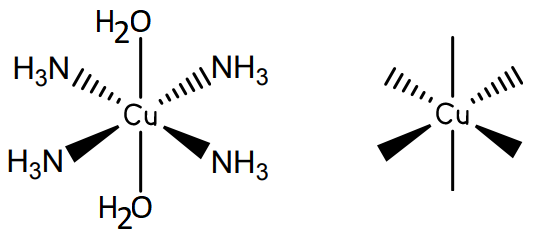
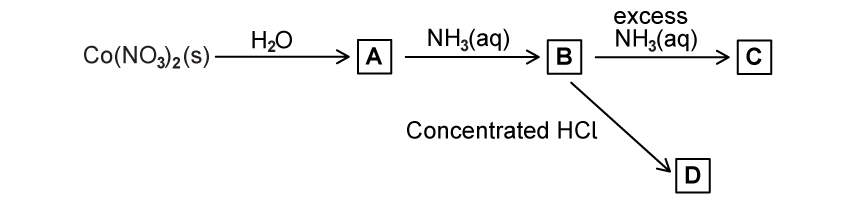
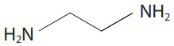
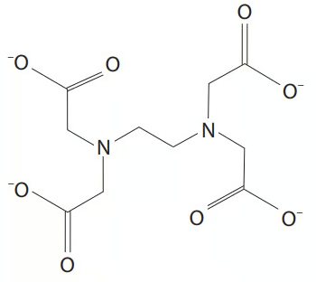

# Exam Questions — General Characteristic Chemical Properties of the First Set of Transition Elements, Titanium to Copper
**28. Chemistry of Transition Elements** · Cambridge (CIE) A-LEVEL chemistry (9701)
> Source: [https://www.savemyexams.com/a-level/chemistry/cie/25/topic-questions/](https://www.savemyexams.com/a-level/chemistry/cie/25/topic-questions/) · 12 questions across 1 sets

## Structured Questions (12 questions)

### Q1 — hard — 8 marks

**Q1** [1 mark]

Fig. 3.1 shows a reaction pathway involving various copper(II) species.

![Flow diagram of reactions converting solid CuSO₄ through intermediates A–D to CuO, Cu(s) and [CuCl₄]³⁻, using H₂O, NH₃, Na₂CO₃, heat and conc. HCl](assets/001-flow-diagram-of-reactions-converting-solid-cuso-.png)

**Fig. 3.1**

Construct the equation for the formation of complex **D** from complex **A**.

**Q1** [2 marks]

**Extract:**

Fig. 3.1 shows a reaction pathway involving various copper(II) species.

![Flow diagram of reactions converting solid CuSO₄ through intermediates A–D to CuO, Cu(s) and [CuCl₄]³⁻, using H₂O, NH₃, Na₂CO₃, heat and conc. HCl](https://cdn.savemyexams.com/uploads/2023/06/6-2-3a-h-copper-carbonate-reaction-scheme.png)

**Fig. 3.1**

Explain why it is not possible to identify complex **B**.

**Q1** [3 marks]

**Extract:**

Fig. 3.1 shows a reaction pathway involving various copper(II) species.

![Flow diagram of reactions converting solid CuSO₄ through intermediates A–D to CuO, Cu(s) and [CuCl₄]³⁻, using H₂O, NH₃, Na₂CO₃, heat and conc. HCl](https://cdn.savemyexams.com/uploads/2023/06/6-2-3a-h-copper-carbonate-reaction-scheme.png)

**Fig. 3.1**

i) Using the information in Fig. 3.1, construct the equation including state symbols to form compound **C** and other products.

[2]

ii) State the type of reaction that occurs when compound **C** is converted into copper(II) oxide.

[1]

**Q1** [2 marks]

**Extract:**

Fig. 3.1 shows a reaction pathway involving various copper(II) species.

Complex A is the hexaaquacopper(II) ion [Cu(H2O)6]2+, formed when copper(II) sulfate dissolves in water. Complex D is [CuCl4]2-, formed when concentrated hydrochloric acid provides excess Cl- ions for ligand substitution.

The oxidation number of copper in [CuCl4]3– is +1.

i) State the electronic configuration of a Cu+ ion.

[1]

ii) Deduce the role of copper metal in the formation of [CuCl4]3– from the complex **D**.

[1]

### Q2 — easy — 10 marks

**Q2** [2 marks]

This question is about ligand exchange in copper(II) complexes.

Complete Table 2.1 to show whether the coordination number and shape of the complex changes in the given situations.

**Table 2.1 **

|   | **Ligand exchange of similarly sized ligands** | **Ligand exchange of differently sized ligands** |
|---|---|---|
| **Coordination number** |   |   |
| **Shape** |   |   |

**Q2** [1 mark]

When copper(II) sulfate dissolves in water, the conventional equation for this can be represented as

CuSO4 (s) + aq → Cu2+ (aq) + SO42– (aq)

State the formula of the hexaaquacopper(II) complex represented by Cu2+ (aq).

**Q2** [2 marks]

**Extract:**

When copper(II) sulfate dissolves in water, the conventional equation for this can be represented as

CuSO4 (s) + aq → Cu2+ (aq) + SO42– (aq)

State the formula of the hexaaquacopper(II) complex represented by Cu2+ (aq).

Complete the three-dimensional diagram in Fig. 2.1 to show the hexaaquacopper(II) ion complex.

| Cu |
|---|

**Fig. 2.1**

**Q2** [2 marks]

Hexaaquacopper(II) ions react with concentrated hydrochloric acid to form complex **A**.

Complete Table 2.2 with the colour and geometry of the hexaaquacopper(II) complex and the colour, geometry and formula of complex **A**.

**Table 2.2 **

|   | **Hexaaquacopper(II) complex** | **A** |
|---|---|---|
| **colour of complex** |   |   |
| **geometry of complex** |   |   |
| **formula of complex** | [Cu(H2O)6]2+ |   |

**Q2** [3 marks]

In the presence of concentrated ammonia, hexaaquacopper(II) initially reacts to form Cu(OH)2(H2O)4.

i) State the colour and physical state of Cu(OH)2(H2O)4.

[1]

ii) In the presence of excess concentrated ammonia, the Cu(OH)2(H2O)4 further reacts to form [Cu(NH3)4(H2O)2]2+.

State the colour and physical state of [Cu(NH3)4(H2O)2]2+.

[1]

iii) The [Cu(NH3)4(H2O)2]2+ formed is a mixture of two geometrically isomeric octahedral complexes.

Fig. 1.2 shows the three-dimensional diagram of the trans isomer. Complete Fig. 1.2 to show the three-dimensional diagram of the cis isomer.

**Fig. 1.2**

[1]

### Q3 — hard — 13 marks

**Q3** [1 mark]

Cobalt(II) and copper(II) undergo similar reactions to each other.

Cobalt(II) nitrate and copper(II) nitrate both decompose in a similar manner to that of Group 2 nitrates.

Construct an equation for the thermal decomposition of Co(NO3)2.

**Q3** [4 marks]

Co(NO3)2 is added to water to form solution **A**.

Fig. 2.1 shows some reactions of solution **A**.

**Fig 2.1**

Complete Table 2.1 to show the state, formula and colour of each of the cobalt-containing species present in **A**, **B** and **C**.

**Table 2.1**

|   | **State of cobalt-containing species formed** | **Formula of cobalt-containing species formed** | **Colour of cobalt-containing species formed** |
|---|---|---|---|
| **A** |   |   |   |
| **B** |   |   |   |
| **C** |   |   |   |
| **D** |   |   |   |

**Q3** [8 marks]

Using complex ions formed by Cu2+ with ligands selected from H2O, NH3, Cl–, C2O42– and EDTA4–, construct an equation for each of the following.

i) A ligand substitution reaction with no change in the coordination number or the charge on the complex ion.

[2]

ii) A ligand substitution reaction with both a change in the coordination number and the charge on the complex ion.

[2]

iii) A ligand substitution reaction with no change in the coordination number but a change in the charge on the complex ion.

[2]

iv) A ligand substitution reaction with the greatest increase in entropy.

[2]

### Q4 — medium — 12 marks

**Q4** [2 marks]

A solution is made by dissolving CuSO4•5H2O in an excess of aqueous ammonia. This solution contains the copper complex [Cu(NH3)4]2+.

i) State the expression for the *K*stab of [Cu(NH3)4]2+.

[1]

ii) State the colour of the solution of [Cu(NH3)4]2+.

[1]

*Source: 2020 Oct41 Q5*

**Q4** [1 mark]

The solution of [Cu(NH3)4]2+ is heated gently so that NH3 is released. A precipitate of Cu(OH)2 forms and is collected.

A sample of Cu(OH)2 is added to concentrated hydrochloric acid to form a coloured copper complex, **Y**.

A sample of Cu(OH)2 is added to dilute sulfuric acid to form a coloured copper complex, **Z**.

Construct an equation for the reaction of [Cu(NH3)4]2+ to form Cu(OH)2 when the solution is heated.

*Source: 2020  OCt 41 Q5*

**Q4** [2 marks]

**Extract:**

A sample of Cu(OH)~2~ is added to concentrated hydrochloric acid to form a coloured copper complex, **Y**.

Construct an equation for the reaction of Cu(OH)2 with concentrated hydrochloric acid, forming **Y**.

*Source: 2020 Oct 41 Q5*

**Q4** [2 marks]

**Extract:**

A sample of Cu(OH)~2~ is added to concentrated hydrochloric acid to form a coloured copper complex, **Y**.

A sample of Cu(OH)~2~ is added to dilute sulfuric acid to form a coloured copper complex, **Z**.

Complete Table 1.1 with the colour and geometry of complex **Y** and the colour, geometry and formula of complex **Z**.

**Table 1.1**

|   | ** Y** | **Z** |
|---|---|---|
| colour of complex |   |   |
| geometry of complex |   |   |
| formula of complex | [CuCl4]2- |   |

*Source: 2020 Oct41 Q5*

**Q4** [5 marks]

**Extract:**

A sample of Cu(OH)~2~ is added to concentrated hydrochloric acid to form a coloured copper complex, **Y**.

A sample of Cu(OH)~2~ is added to dilute sulfuric acid to form a coloured copper complex, **Z**.

|   | **Y** | **Z** |
| :---: | :---: | :---: |
| colour of complex |   |   |
| geometry of complex |   |   |
| formula of complex | [CuCl~4~]^2-^ |   |

Explain why complexes **Y** and **Z** are coloured and why their colours are different.

*Source: 2020 Oct41 Q5*

### Q5 — medium — 14 marks

**Q5** [6 marks]

This question is about the transition metal copper.

i) State the full electronic configuration of a Cu atom and a Cu2+ ion.

[2]

ii) State **four** characteristic features of the chemistry of copper and its compounds.

[4]

**Q5** [5 marks]

The chloride ion is a monodentate ligand. When concentrated hydrochloric acid is added to [Cu(H2O)6]2+ ions the water ligands are replaced.

i) Explain what is meant by the term monodentate ligand.

[1]

ii) Construct an equation to represent the ligand substitution reaction.

[1]

iii) Draw a diagram to show the structure of the complex ion formed.

[1]

iv) State the geometry of the complex ion formed.

[1]

v) State the change in coordination number.

[1]

**Q5** [3 marks]

[Co(NH3)4Cl2]+ is an example of a complex ion containing cobalt.

i) Deduce the oxidation state of cobalt in this complex ion. Explain your answer.

[2]

ii) State the geometry of this complex ion.

[1]

### Q6 — medium — 13 marks

**Q6** [2 marks]

This question is about transition metal complexes.

An aqueous solution of copper(II) contains the [Cu(H2O)6]2+ complex ion.

Define the term complex ion.

**Q6** [6 marks]

A sample of [Cu(H2O)6]2+ is reacted with aqueous sodium hydroxide, and a separate sample of [Co(H2O)6]2+ with an excess of aqueous ammonia.

Complete Table 1.2 to show the colour and state of the product, the ionic equation, and the type of reaction for each case.

**Table 1.2**

|   | **[Cu(H****2****O)****6****]****2+**** with NaOH (aq)** | **[Co(H****2****O)****6****]****2+**** with excess NH****3**** (aq)** |
|---|---|---|
| Colour and state of product |   |   |
| Ionic equation |   |   |
| Type of reaction |   |   |

**Q6** [3 marks]

The [Fe(NH3)2(CN)4]– complex shows stereoisomerism.

Complete the three-dimensional diagrams to show the two isomers of [Fe(NH3)2(CN)4]–.

State the type of stereoisomerism shown.

**Q6** [2 marks]

Compound **A**, C4H13N3, is a tridentate ligand.

i) Explain why one molecule of **A** can form three coordinate bonds.

[1]

ii) C4H13N3 reacts with aqueous chromium(III) ions, [Cr(H2O)6]3+, in a 2:1 ratio to form a new complex ion.

Construct an equation for this reaction.

[1]

### Q7 — easy — 5 marks

**Q7** [2 marks]

The feasibility of redox reactions can be determined using standard electrode potential, *E*θ, values.

The following electrochemical cell is set up.

Pb4+ (aq) + 2Mn2+ (aq) → 2Mn3+ (aq) + Pb2+ (aq)

| **Electrode reaction** | ***E*****θ**** / V** |
|---|---|
| Mn2+ + 2e– ⇌ Mn | –1.18 |
| Mn3+ + e– ⇌ Mn2+ | +1.49 |
| Pb2+ + 2e– ⇌ Pb | –0.13 |
| Pb4+ + 2e– ⇌ Pb2+ | +1.69 |

Construct the reduction half-equation and the oxidation half-equation for the reaction.

**Q7** [1 mark]

**Extract:**

The feasibility of redox reactions can be determined using standard electrode potential, *E*^θ^, values.

The following electrochemical cell is set up.

Pb^4+^ (aq) + 2Mn^2+^ (aq) → 2Mn^3+^ (aq) + Pb^2+^ (aq)

| **Electrode reaction** | ***E***^**θ**^** / V** |
| :---: | :---: |
| Mn^2+^ + 2e^–^ ⇌ Mn | –1.18 |
| Mn^3+^ + e^–^ ⇌ Mn^2+^ | +1.49 |
| Pb^2+^ + 2e^–^ ⇌ Pb | –0.13 |
| Pb^4+^ + 2e^–^ ⇌ Pb^2+^ | +1.69 |

Use Table 3.1 and your answer to part (a) to calculate the standard cell potential, *E*θcell, for the reaction.

**Q7** [2 marks]

**Extract:**

To calculate the standard cell potential *E*^θ^~cell~:

*E*^θ^~cell~ = *E*^θ^~reduction~ – *E*^θ^~oxidation~

*E*^θ^~cell~ = (+1.69) – (+1.49)

*E*^θ^~cell~ = +0.20 V

Use your answer to part (b) to deduce whether the reaction is feasible. Explain your answer.

### Q8 — easy — 6 marks

**Q8** [2 marks]

Potassium manganate(VII) can be used to titrate a sample containing an unknown percentage of iron(II).

i) Complete the half-equation for the reduction of manganate(VII) ions, MnO4–, to manganese(II) ions, Mn2+.

MnO4– (aq) + ........H+ (aq) + ........e– → Mn2+ (aq) + ........H2O (l)

[1]

ii) State, in terms of electron transfer, whether this half-equation represents oxidation or reduction.

[1]

**Q8** [2 marks]

i) Construct the half-equation for the oxidation of Fe2+ to Fe3+. Include state symbols.

[1]

ii) State, in terms of electron transfer, whether this half-equation represents oxidation or reduction.

[1]

**Q8** [2 marks]

**Extract:**

i) Complete the half-equation for the reduction of manganate(VII) ions, MnO4–, to manganese(II) ions, Mn2+.

MnO4– (aq) + ........H+ (aq) + ........e– → Mn2+ (aq) + ........H2O (l)

The completed half-equation is:
MnO4– (aq) + 8H+ (aq) + 5e– → Mn2+ (aq) + 4H2O (l)

i) Construct the half-equation for the oxidation of Fe2+ to Fe3+. Include state symbols.

The half-equation for the oxidation of Fe2+ to Fe3+ is:
Fe2+ (aq) → Fe3+ (aq) + e–

Using your answers to parts (a) and (b), construct the overall ionic equation for the reaction between Fe2+ ions and MnO4– ions.

### Q9 — hard — 9 marks

**Q9** [1 mark]

Construct an equation for the reaction between ethanedioic acid, H2C2O4, and sodium hydroxide, NaOH.

**Q9** [3 marks]

**Extract:**

The equation for the reaction between ethanedioic acid and sodium hydroxide:

H2C2O4 + 2NaOH → Na2C2O4 + 2H2O

OR

(COOH)2 + 2NaOH → (COONa)2 + 2H2O

15.00 cm3 of H2C2O4 (aq) requires 10.30 cm3 of a 0.25 mol dm-3 solution of NaOH for complete neutralisation, using phenolphthalein as the indicator.

15.00 cm3 of the same H2C2O4 (aq) required 12.35 cm3 of potassium manganate(VII), KMnO4, solution for complete oxidation to carbon dioxide and water, in the presence of dilute sulfuric acid.

Calculate the concentration of the H2C2O4 (aq) solution.

**Q9** [3 marks]

**Extract:**

15.00 cm^3^ of the same H~2~C~2~O~4~ (aq) required 12.35 cm^3^ of potassium manganate(VII), KMnO~4~, solution for complete oxidation to carbon dioxide and water, in the presence of dilute sulfuric acid.

Construct the full redox equation, including state symbols, for this redox titration.

**Q9** [2 marks]

**Extract:**

15.00 cm^3^ of H~2~C~2~O~4~ (aq) requires 10.30 cm^3^ of a 0.25 mol dm^-3^ solution of NaOH for complete neutralisation, using phenolphthalein as the indicator.

15.00 cm^3^ of the same H~2~C~2~O~4~ (aq) required 12.35 cm^3^ of potassium manganate(VII), KMnO~4~, solution for complete oxidation to carbon dioxide and water, in the presence of dilute sulfuric acid.

moles of H~2~C~2~O~4~ = 1.2875 x 10^-3^ mol

2MnO~4~^–^ (aq) + 6H^+^ (aq) + 5H~2~C~2~O~4~ (aq) → 2Mn^2+^ (aq) + 8H~2~O (l) + 10CO~2~ (g)

Calculate the concentration of the potassium manganate(VII), KMnO4, solution.

### Q10 — easy — 10 marks

**Q10** [2 marks]

This question is about transition metal complexes.

Define the terms ligand and complex ion.

**Q10** [2 marks]

**Extract:**

Ligand: a molecule or ion that has one or more lone pairs of electrons

Transition metals can form complexes with different ligands.

Identify **one** species from the following list that does not act as a ligand. Explain your answer.

CO          H2O          SCN–          H2

**Q10** [2 marks]

A complex ion contains one Co2+ ion, four ammonia molecules and two chloride ions.

i) State the formula of this complex ion.

[1]

ii) State the geometry of this complex ion.

[1]

**Q10** [2 marks]

The H2O ligands in [Fe(H2O)6]3+ can be exchanged for other ligands.

Deduce the geometry of the complex ions formed after the following substitutions.

i) All the H2O ligands are exchanged for OH– ligands.

[1]

ii) The six H2O ligands are exchanged for four Cl– ligands.

[1]

**Q10** [2 marks]

Cisplatin can be used to treat some types of cancer.

It is a square planar transition metal complex with a central platinum(II) ion, two chloride ligands and two ammonia ligands.

Complete the three-dimensional diagram in Fig. 1.1 to show the shape of cisplatin. Label and state the value of one bond angle.

| Pt |
|---|

**Fig. 1.1**

### Q11 — hard — 8 marks

**Q11** [4 marks]

Iron(II) gluconate, C12H22FeO14, is the active ingredient in some brands of iron supplements.

A student carries out an experiment to determine the mass of iron(II) gluconate in one tablet of an iron supplement, using the method below.

1. The student crushes two tablets and dissolves the powdered tablets in dilute sulfuric acid
2. The student makes up the solution from step 1 to 250.0 cm3 in a volumetric flask.
3. The student then titrated 25.0 cm3 portions of the solution obtained in step 2 with 0.00200 mol dm−3 potassium manganate(VII).

The student obtains a mean titre of 13.50 cm3.

In this titration, 1 mole of manganate(VII) ions reacts with 5 moles of iron(II) ions.

Calculate the mass, in mg, of iron(II) gluconate in **one** tablet. Show your working and give your answer to 3 significant figures.

**Q11** [2 marks]

**Extract:**

A student carries out an experiment to determine the mass of iron(II) gluconate in one tablet of an iron supplement, using the method below.

1. The student crushes two tablets and dissolves the powdered tablets in dilute sulfuric acid
2. The student makes up the solution from step 1 to 250.0 cm^3^ in a volumetric flask.
3. The student then titrated 25.0 cm^3^ portions of the solution obtained in step 2 with 0.00200 mol dm^−3^ potassium manganate(VII).

The student obtains a mean titre of 13.50 cm^3^.

The typical concentration of a potassium manganate(VII) solution used in redox titrations is 0.0200 mol dm-3.

Use the information in part (a) to explain, quantitatively, why the student replaced this with a 0.00200 mol dm-3 potassium manganate(VII) solution for this titration.

**Q11** [2 marks]

Some iron supplements contain iron(II) sulfate or iron(II) fumarate.

**Table 4.1** shows the information taken from the labels of two iron supplements, **A** and **B**.

**Table 4.1**

| **Iron supplement** | **Iron compound** | **Mass of iron compound in one tablet / mg** |
|---|---|---|
| **A** | Iron(II) sulfate, FeSO4 | 180 |
| **B** | Iron(II) fumarate, C4H2FeO4 | 210 |

State which iron supplement, **A** or **B**, would provide the greater mass of iron per tablet. Show your working.

### Q12 — hard — 11 marks

**Q12** [1 mark]

Complex ions have a central transition metal ion surrounded by ligands.

Explain why the ammonium ion cannot act as a ligand.

*Source: Oct 2021 9CHO/01 Q8A*

**Q12** [4 marks]

Explain why the complex ions [Co(NH3)6]2+ and [Co(H2O)6]2+ both form coloured solutions but exhibit different colours to each other.

*Source: Oct 2021 9CHO/01 Q8B*

**Q12** [4 marks]

The structures of the ligands ethane-1,2-diamine and EDTA4– are shown in Fig. 1.1.

|  |  |
|---|---|
| **ethane-1,2-diamine** | **EDTA**4- |

**Fig. 1.1**

Compare the complex ions formed by cobalt(III) ions with each ligand. In your answer, state **one** similarity and **three** differences. Ignore any difference in colour.

*Source: Oct 2021 9CHO/01 Q8C*

**Q12** [2 marks]

Hydrated chromium(III) chloride, CrCl3.6H2O, dissolves in water to form a number of different complex ions containing both chloride and water ligands.

The general formula of these complex ions is [Cr(H2O)x(Cl)y](3–y)+

In an experiment, 0.10 mol of a complex reacted with excess silver nitrate solution to produce 0.20 mol of silver chloride.

Chloride ions which are ligands within the complex do not react with silver nitrate.

Deduce the formula of this chromium(III) complex ion. Explain your reasoning.

*Source: Oct 2021 9CHO/01 Q8D*

