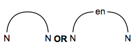
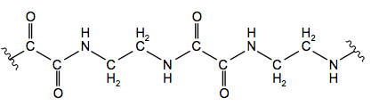
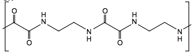
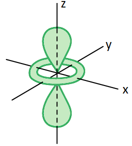

# Mark Schemes — Colour of Complexes
**28. Chemistry of Transition Elements** · Cambridge (CIE) A-LEVEL chemistry (9701)

## Structured Questions (4 questions)

### Q1
> **[mark-scheme]**
> i) Aqueous Ni2+ ions are green because:
> 
> - Ligands cause the d-orbitals to split into two sets of non-degenerate energy levels **[1 mark]**
> - Visible light is absorbed when an electron is promoted / excited from a lower to a higher energy d-orbital **[1 mark]**
> - Ni2+ has a partially filled 3d subshell, so d-d electron transitions can occur **[1 mark]**
> - The observed colour (green) is the complement of the colour of light absorbed **[1 mark]**
> 
> ii) Aqueous Sc3+ ions are colourless because:
> 
> - Sc3+ has an empty 3d subshell (d0), so no d-d electron transitions can occur **[1 mark]**

> **[exam-tip]**
> Scandium is not a transition element because Sc3+ has the electron configuration [Ar], it has no 3d electrons at all.
> 
> Without any electrons in the d-orbitals, no d-d transitions are possible and no visible light is absorbed, so Sc3+ solutions are colourless.
> 
> Nickel(II) has the configuration [Ar]3d8, which is a partially filled 3d subshell, so it can form coloured complexes.
> **[mark-scheme]**
> Adding excess aqueous ammonia to aqueous copper(II) ions causes a colour change because:
> 
> - (Four of the) water ligands are replaced by ammonia ligands / ligand exchange occurs **[1 mark]**
> - The d-orbital splitting energy (Δ*E*) between the two sets of d-orbitals changes because it depends on the identity of the ligand **[1 mark]**
> - A different wavelength / frequency of light is absorbed, so a different colour is observed **[1 mark]**

> **[exam-tip]**
> First recognise that adding excess ammonia causes ligand exchange: water ligands in [Cu(H2O)6]2+ are replaced by ammonia ligands to form [Cu(NH3)4(H2O)2]2+.
> 
> Different ligands cause different extents of d-orbital splitting, so the energy gap changes. Since a different wavelength of light is absorbed, the complementary colour seen changes, and the solution appears a deeper blue.
i) To deduce the oxidation state of iron in [Fe(CN)6]4-:

Fe + (6 x -1) = -4

Fe = +2 **[1 mark]**

> **[mark-scheme]**
> 1 mark for +2 with working shown (CN- = -1 stated or implied; Fe + 6(-1) = -4 seen)

ii) The arrangement of electrons in the 3d and 4s subshells of the Fe2+ ion is:

![Fe2+ orbital box diagram showing the 3d subshell with six electrons arranged as three pairs in the lower three boxes and empty 4s subshell, with [Ar] noble gas core notation](assets/001-fe2-orbital-box-diagram-showing-the-3d-subshell-.png)

**[1 mark]**

> **[mark-scheme]**
> 1 mark for six electrons correctly arranged in the 3d subshell with empty 4s and [Ar] noble gas core notation

> **[exam-tip]**
> To find the oxidation state, recall that each CN- ligand carries a -1 charge. With six CN- ligands, total charge from ligands = 6 x (-1) = -6. The overall complex charge is -4, so: Fe + (-6) = -4, giving Fe = +2.
> 
> For the orbital diagram, Fe2+ has the configuration [Ar]3d6 — the 4s subshell is empty because electrons are removed from 4s before 3d. Include [Ar] at the start to indicate the noble gas core.

### Q2
> **[mark-scheme]**
> Transition elements have variable oxidation states but Group 1 elements do not because:
> 
> - In transition elements, the 4s and 3d subshells are close in energy / successive ionisation energies increase gradually **[1 mark]**
> - In Group 1 elements, the second electron is removed from a much lower energy level / there is a large increase in ionisation energy between the first and second ionisation energies **[1 mark]**

> **[exam-tip]**
> You should be able to explain variable oxidation states in terms of successive ionisation energies. For transition elements, the small differences between ionisation energies mean that several oxidation states are energetically accessible. For Group 1 elements, the second ionisation energy is far higher than the first because the electron is removed from a stable noble gas core, so only the +1 oxidation state is observed.
> **[mark-scheme]**
> Transition element complexes are coloured because:
> 
> - Ligands cause the d-orbitals to split into two sets of non-degenerate energy levels **[1 mark]**
> - Visible light is absorbed when an electron is promoted / excited from a lower to a higher energy d-orbital **[1 mark]**
> - The observed colour is the complement of the colour of light absorbed **[1 mark]**
> - The wavelength of light absorbed depends on the size of the d-orbital splitting energy (Δ*E*), which depends on the identity and number of ligands **[1 mark]**

> **[exam-tip]**
> These four marking points come up every time a question asks why transition element complexes are coloured. Learn them in order:
> 
> 1. d-orbital splitting by ligands
> 2. Visible light absorbed / electron promoted
> 3. Complementary colour observed
> 4. Different ligands give different Δ*E*, hence different colours.
> 
> If the question only asks why the complex is coloured (not why different complexes have different colours), points 1–3 are sufficient.
> **[mark-scheme]**
> i) Water is able to act as a ligand because:
> 
> - Oxygen has a lone pair of electrons **[1 mark]**
> - Which it donates to form a dative covalent / coordinate bond with the metal ion **[1 mark]**
> 
> ii) The geometry of [Co(H2O)6]2+ is:
> 
> - Octahedral **[1 mark]**

> **[exam-tip]**
> A ligand must be able to donate a lone pair of electrons to form a coordinate bond with the central metal ion — it acts as a Lewis base. Water uses the lone pairs on the oxygen atom for this purpose. With six water ligands, [Co(H2O)6]2+ adopts an octahedral geometry to place the six coordinate bonds as far apart as possible.
> **[mark-scheme]**
> [Zn(H2O)4]2+ is colourless because:
> 
> - The Zn2+ ion has a completely full 3d subshell (d10) **[1 mark]**
> - No d-d electron transitions can occur / no electrons can be promoted between d-orbitals **[1 mark]**

> **[exam-tip]**
> Zinc is not a transition element because Zn2+ has the electron configuration [Ar]3d10, which is a full 3d subshell.
> 
> For a complex to be coloured, d-orbital splitting must occur and an electron must be able to move between the two sets.
> 
> With a completely full d subshell, this is impossible, so no visible light is absorbed and the solution appears colourless. Contrast this with Co2+, which has the configuration [Ar]3d7 (a partially filled 3d subshell) and can absorb visible light.

### Q3
> **[mark-scheme]**
> A transition element is:
> 
> - (A d-block element that can) form one or more stable ions with an incomplete d subshell **[1 mark]**

> **[exam-tip]**
> This is a standard definition you are required to know. Note that zinc and scandium are not transition elements: Zn2+ has a full 3d subshell (d10) and Sc3+ has an empty 3d subshell (d0), so neither meets the definition.
> **[mark-scheme]**
> i) A monodentate ligand is defined as:
> 
> - A species / molecule / ion that forms one dative covalent / coordinate bond to a central metal ion **[1 mark]**
> - Using a lone pair of electrons to form the bond **[1 mark]**
> 
> ii) The formula of this complex, including its charge, is:
> 
> - [Ag(NH3)2]+ **[1 mark]**

> **[exam-tip]**
> Monodentate ligands form only one coordinate bond to the central metal ion. Common examples include:
> 
> - Water (H2O)
> - Ammonia (NH3)
> - Chloride ions (Cl-)
> - Cyanide ions (CN-).
> 
> The linear [Ag(NH3)2]+ complex forms because Ag+ adopts linear geometry with two coordinate bonds. Since NH3 carries no charge, the overall charge of the complex equals the charge on the silver ion.
> **[mark-scheme]**
> i) The type of stereoisomerism shown is:
> 
> - Cis-trans / geometrical (stereoisomerism) **[1 mark]**
> 
> ii) These complex ions are coloured and have different colours because:
> 
> - Ligands split the d-orbitals into two sets of non-degenerate energy levels **[1 mark]**
> - Visible light is absorbed when an electron is promoted / excited from a lower to a higher energy d-orbital **[1 mark]**
> - The observed colour is the complement of the colour of light absorbed **[1 mark]**
> - The two isomers have different spatial arrangements of ligands, giving different d-orbital splitting energies (Δ*E*), so different wavelengths of light are absorbed **[1 mark]**

> **[exam-tip]**
> The four marking points for colour are always the same:
> 
> 1. d-orbital splitting by ligands
> 2. Visible light absorbed / electron promoted
> 3. Complementary colour observed
> 4. Different spatial arrangement of ligands → different Δ*E* → different wavelength absorbed.
> 
> Learn these four points and you will always score full marks on this type of question.
> 
> ![Cis and trans isomers of [Cr(NH3)4Cl2]+ showing the two different spatial arrangements of chloride ligands around the octahedral chromium centre](assets/002-cis-and-trans-isomers-of-cr-nh3-4cl2-showing-the.jpeg)
The two stereoisomers of [Ni(en)3]2+ are:

![Optical isomers of [Ni(en)3]2+ showing three bidentate en ligands in a left-handed propeller arrangement around the nickel centre and a right-handed propeller arrangement around the nickel centre](assets/004-optical-isomers-of-ni-en-3-2-showing-three-biden.png)

**[2 marks]**

> **[mark-scheme]**
> 1 mark for a correct first stereoisomer
> 
> 1 mark for a second correct stereoisomer that is the non-superimposable mirror image of the first
> 
> "en" notation is acceptable in place of the full structural formula H2NCH2CH2NH2
> 
> 

> **[exam-tip]**
> Ethane-1,2-diamine is a bidentate ligand because each NH2 group can donate a lone pair to the central metal ion. When three bidentate ligands surround a metal ion octahedrally, the only type of stereoisomerism possible is optical isomerism. To draw the second isomer, draw the mirror image of the first and confirm the two structures cannot be superimposed.
> **[mark-scheme]**
> i) Ethane-1,2-diamine acts as a Brønsted–Lowry base because:
> 
> - The nitrogen atoms have lone pairs of electrons **[1 mark]**
> - These lone pairs accept protons / are donated to protons (from the acid) **[1 mark]**
> 
> ii) The equation for the reaction with excess hydrochloric acid is:
> 
> - H2NCH2CH2NH2 + 2HCl → ClH3NCH2CH2NH3Cl **[1 mark]**

> **[exam-tip]**
> A Brønsted–Lowry base accepts protons using a lone pair of electrons. Ethane-1,2-diamine has two NH2 groups, each with a lone pair on nitrogen, so it can accept two protons in total. With excess HCl, both amino groups are protonated. You can also write the ionic equation: H2NCH2CH2NH2 + 2H+ → (H3NCH2CH2NH3)2+
i) The structure of polymer **Z**, showing two repeat units, is:

**OR**

**[2 marks]**

> **[mark-scheme]**
> 1 mark for a correct amide bond / CONH link shown
> 
> 1 mark for the rest of the repeat unit with correct continuation bonds at both ends
> 
> ii) The type of polymerisation is:
> 
> - Condensation (polymerisation) **[1 mark]**

> **[exam-tip]**
> Polyamides are formed by condensation polymerisation. Draw out both monomers, then link the NH2 group of ethane-1,2-diamine to the COOH group of ethanedioic acid, eliminating water at each step. The key mark is the amide bond (–CO–NH–). Do not forget the continuation bonds at each end to show the polymer chain extends further.

### Q4
> **[mark-scheme]**
> Degenerate orbitals are:
> 
> - Orbitals that are all at the same energy level
> **OR**
> Orbitals that are equal in energy **[1 mark]**

> **[exam-tip]**
> Although questions specifically on the definition of degenerate orbitals are uncommon in exams, understanding degeneracy is essential for explaining why transition element complexes are coloured as it underpins the whole d-orbital splitting concept.
> **[mark-scheme]**
> i) The difference in spatial alignment between a dxy orbital and a dx2-y2 orbital is:
> 
> - The lobes of a dxy orbital point between the x and y axes
> **AND**
> The lobes of a dx2-y2 orbital point along the x and y axes **[1 mark]**

ii) The shape of a dz2 orbital is:

**[2 marks]**

> **[mark-scheme]**
> 1 mark for two lobes along the z-axis
> 
> 1 mark for a ring / hoop / doughnut of electron density in the xy-plane

> **[exam-tip]**
> It is more common to be asked to draw the shapes of orbitals or to identify an orbital from a diagram than to describe the difference in spatial alignment. The key distinction is direction: dxy lobes point between the axes, whereas dx2-y2 lobes point along them. The dz2 orbital is unique in having two lobes along z plus a ring of electron density in the xy-plane.
> **[mark-scheme]**
> The d-orbitals in a transition element ion become non-degenerate when:
> 
> - Dative covalent / coordinate bonds form between the transition element ion and ligands
> **OR**
> Ligands bond to / surround the transition element ion **[1 mark]**

> **[exam-tip]**
> The splitting of the degenerate d-orbitals into two sets of non-degenerate d-orbitals is caused by the dative covalent bonding of ligands to the central metal ion. The extent of the splitting depends on the number, type, and size of the ligands present.
The completed table is:

|   | **Higher energy** | **Lower energy** |
|---|---|---|
| **Octahedral** | dx2-y2  and dz2 | dxy, dxz and dyz |
| **Tetrahedral** | dxy, dxz and dyz | dx2-y2  and dz2 |

**[2 marks]**

> **[mark-scheme]**
> 1 mark for all d-orbitals correctly assigned for octahedral complexes
> 
> 1 mark for all d-orbitals correctly assigned for tetrahedral complexes

> **[exam-tip]**
> You only need to remember the energy assignments for one geometry because they are reversed in the other. In octahedral complexes, dx2-y2 and dz2 have higher energy; in tetrahedral complexes these same orbitals have lower energy, with dxy, dxz and dyz taking the higher energy positions.
