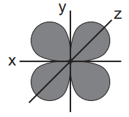
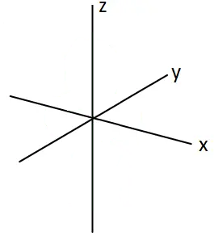

# Exam Questions — Colour of Complexes
**28. Chemistry of Transition Elements** · Cambridge (CIE) A-LEVEL chemistry (9701)
> Source: [https://www.savemyexams.com/a-level/chemistry/cie/25/topic-questions/](https://www.savemyexams.com/a-level/chemistry/cie/25/topic-questions/) · 4 questions across 1 sets

## Structured Questions (4 questions)

### Q1 — medium — 10 marks

**Q1** [5 marks]

i) Explain why aqueous nickel(II) ions, Ni2+(aq), are green.

[4]

ii) Explain why aqueous scandium(III) ions, Sc3+(aq), are colourless.

[1]

**Q1** [3 marks]

Explain why the addition of an excess of aqueous ammonia to aqueous copper(II) ions causes a change in the colour of the solution.

**Q1** [2 marks]

The [Fe(CN)6]4- complex ion contains iron and cyanide ligands.

i) Deduce the oxidation state of iron in [Fe(CN)6]4-. Show your working.

[1]

ii) Draw the arrangement of electrons in the 3d and 4s subshells of the iron ion in [Fe(CN)6]4-, using arrow-in-box notation.

[1]

### Q2 — medium — 11 marks

**Q2** [2 marks]

This question is about the geometry and colours of transition element complexes.

Explain why transition elements have variable oxidation states but Group 1 elements do not.

**Q2** [4 marks]

Transition element compounds are often coloured. For example, [Cr(H2O)6]3+ is green.

Explain why transition element complexes are coloured.

**Q2** [3 marks]

Zinc and cobalt ions react with water to form the complexes [Zn(H2O)4]2+ and [Co(H2O)6]2+.

i) Explain why water is able to act as a ligand in forming these complexes.

[2]

ii) State the geometry of the [Co(H2O)6]2+ complex ion.

[1]

**Q2** [2 marks]

**Extract:**

Transition element complexes are coloured because:

- Ligands cause the d-orbitals to split into two sets of non-degenerate energy levels
- Visible light is absorbed when an electron is promoted / excited from a lower to a higher energy d-orbital
- The observed colour is the complement of the colour of light absorbed
- The wavelength of light absorbed depends on the size of the d-orbital splitting energy (ΔE), which depends on the identity and number of ligands

Explain why solutions containing [Zn(H2O)4]2+ are colourless.

### Q3 — medium — 17 marks

**Q3** [1 mark]

Define the term transition element.

*Source: 2022 Specimen Paper 4 Q6A*

**Q3** [3 marks]

Ammonia, NH3, acts as a monodentate ligand in many transition element complexes.

i) Define the term monodentate ligand.

[2]

ii) Aqueous silver ions, Ag+ (aq), react with aqueous ammonia, NH3 (aq), to form a linear complex.

State the formula of this complex. Include its charge.

[1]

*Source: 2022 Specimen Paper 4 Q6B*

**Q3** [5 marks]

There are two isomeric complex ions with the formula [Cr(NH3)4Cl2]+. One is green and the other is violet.

i) State the type of stereoisomerism shown by these two complex ions.

[1]

ii) Explain why these complex ions are coloured, and why their colours are different.

[4]

*Source: 2022 Specimen Paper 4 Q6C*

**Q3** [2 marks]

Ethane-1,2-diamine, H2NCH2CH2NH2, is represented as en. Nickel forms the complex ion [Ni(en)3]2+, in which it is surrounded octahedrally by six nitrogen atoms.

Draw three-dimensional diagrams to show the two stereoisomers of [Ni(en)3]2+.

![Blank three-dimensional octahedral framework for drawing the two stereoisomers of [Ni(en)3]2+](assets/003-blank-three-dimensional-octahedral-framework-for.png)

*Source: 2022 Specimen Paper 4 Q6D*

**Q3** [3 marks]

**Extract:**

Ethane-1,2-diamine, H₂NCH₂CH₂NH₂, is represented as en.

Ethane-1,2-diamine is a useful reagent in organic chemistry.

i) Explain why ethane-1,2-diamine acts as a Brønsted–Lowry base.

[2]

ii) Construct an equation for the reaction of ethane-1,2-diamine with an excess of hydrochloric acid.

[1]

*Source: 2022 Specimen Paper 4 Q6E*

**Q3** [3 marks]

**Extract:**

Ethane-1,2-diamine, H₂NCH₂CH₂NH₂, is represented as en.

Under certain conditions, ethane-1,2-diamine reacts with ethanedioic acid, HOOCCOOH, to form polymer **Z**.

i) Draw the structure of polymer **Z**, showing two repeat units.

[2]

ii) State the type of polymerisation that occurs during this reaction.

[1]

*Source: 2022 Specimen Paper 4 Q6F*

### Q4 — easy — 7 marks

**Q4** [1 mark]

The d-orbitals of a transition element are involved in the formation of complexes.

Explain what is meant by the term degenerate orbitals.

**Q4** [3 marks]

Fig. 1.1 shows the shape of the dxy orbital.

**Fig. 1.1**

The dxz orbital has a similar shape but the lobes are between the x-axis and z-axis and the dyz orbital has a similar shape but the lobes are between the y-axis and z-axis.

i) State the difference in the spatial alignment of a dxy orbital compared to a dx2-y2 orbital.

[1]

ii) Sketch the shape of a dz2 orbital on the axes provided in Fig. 1.2.

**Fig. 1.2**

[2]

**Q4** [1 mark]

**Extract:**

The d-orbitals of a transition element are involved in the formation of complexes.

Degenerate orbitals are:
- Orbitals that are all at the same energy level
OR
Orbitals that are equal in energy

State what causes the d-orbitals in a transition element ion to become non-degenerate.

**Q4** [2 marks]

The splitting of degenerate d-orbitals gives two sets of non-degenerate d-orbitals at different energy levels.

Complete Table 1.1 to show which d-orbitals have higher energy and which have lower energy in octahedral and tetrahedral complexes.

**Table 1.1**

|   | **Higher energy** | **Lower energy** |
|---|---|---|
| **Octahedral** |   |   |
| **Tetrahedral** |   |   |
