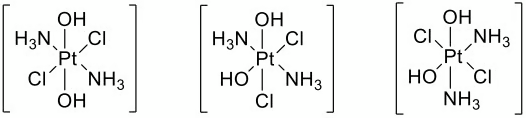
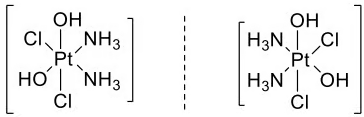

# Mark Schemes — Stereoisomerism in Transition Element Complexes
**28. Chemistry of Transition Elements** · Cambridge (CIE) A-LEVEL chemistry (9701)

## Structured Questions (4 questions)

### Q1
i) The equation for the reaction of [Co(H2O)6]2+(aq) with concentrated hydrochloric acid is:

[Co(H2O)6]2+(aq) + 4Cl-(aq) → [CoCl4]2-(aq) + 6H2O (l)

**[2 marks]**

> **[mark-scheme]**
> 1 mark for [CoCl4]2- complex with correct charge
> 
> 1 mark for rest of equation fully correct with state symbols

ii) The three-dimensional diagram of [CoCl4]2- is:

![Tetrahedral [CoCl4]2- complex with cobalt at the centre, four chloride ligands positioned at the corners of a tetrahedron, using 3D bond notation (wedge and dash bonds), with an overall 2- charge indicated](assets/001-tetrahedral-cocl4-2-complex-with-cobalt-at-the-c.png)

**[2 marks]**

> **[mark-scheme]**
> 1 mark for correct structure **AND** correct charge
> 
> 1 mark for 3D bonds used correctly **AND** showing the tetrahedral shape of the complex

> **[exam-tip]**
> In the ligand substitution reaction, the six water ligands are replaced by four chloride ions.
> 
> The shape of the complex formed is tetrahedral as it has four bonding pairs of electrons around the central metal ion.
> 
> As the chloride ion is larger than water, a change in coordination number from 6 to 4 is observed.
> **[mark-scheme]**
> The oxidation state of cobalt in [Co(NH3)4Cl2]+:
> 
> - +3 **[1 mark]**

ii) The three-dimensional diagrams of the two [Co(NH3)4Cl2]+ isomers are:

Cis-isomer:

![Three-dimensional diagram of the cis isomer of [Co(NH3)4Cl2]+ showing cobalt at the centre of an octahedral complex, with the two Cl ligands adjacent at 90° to each other and four NH3 ligands in the remaining positions](assets/002-three-dimensional-diagram-of-the-cis-isomer-of-c.png)

Trans-isomer:

![Three-dimensional diagram of the trans isomer of [Co(NH3)4Cl2]+ showing cobalt at the centre of an octahedral complex, with the two Cl ligands directly opposite at 180° to each other and four NH3 ligands in the remaining positions](assets/003-three-dimensional-diagram-of-the-trans-isomer-of.png)

**[3 marks]**

> **[mark-scheme]**
> 1 mark for six correct ligands around Co **AND** bonds shown from the N of NH3
> 
> 1 mark for 3D bonds used correctly for an octahedral structure
> 
> 1 mark for cis and trans isomers correctly identified

> **[exam-tip]**
> In the cis isomer, the two Cl- ligands are at 90° to each other / next to each other.
> 
> In the trans isomer, the two Cl- ligands are at 180° to each other / opposite each other.
> **[mark-scheme]**
> Explanation of the origin of colour in a transition element complex such as [Co(NH3)4Cl2]+:
> 
> - d-orbitals split into two sets of different energy
> **OR**
> Complexes have two sets of d orbitals of different energy **[1 mark]**
> - Visible light is absorbed **[1 mark]**
> - Electron(s) are promoted / excited
> **OR**
> Electron(s) move to the higher (d-) orbital **[1 mark]**
> - Complementary colour is observed **[1 mark]**

> **[exam-tip]**
> Questions about the origins of colour in transition metal complexes typically test these four points.
> 
> It is worth learning these points in order, as each step follows logically from the previous one.

### Q2
> **[mark-scheme]**
> The oxidation state and geometry of the platinum complexes are:
> 
> - Oxidation state of the platinum ion = +4 **[1 mark]**
> - Geometry of the complexes = Octahedral **[1 mark]**

> **[exam-tip]**
> To deduce the oxidation state of platinum, use oxoplatin as it contains familiar ligands. The charge contributions are:
> 
> - OH- contributes -1
> - Cl- contributes -1
> - NH3 contributes 0 (neutral ligand)
> 
> Since the overall charge on the complex is 0:
> 
> Pt + 2(-1) + 2(-1) + 2(0) = 0
> 
> Pt - 4 = 0
> 
> Pt = +4
> 
> All four complexes have 6 coordinate bonds, so the geometry must be octahedral.
The other stereoisomers of oxoplatin are:

The chiral stereoisomers of oxoplatin are:

**[4 marks]**

> **[mark-scheme]**
> 1 mark for each of the three correct three-dimensional stereoisomer structures (3 marks)
> 
> 1 mark for correctly identifying the enantiomeric pair as the chiral stereoisomers

> **[exam-tip]**
> To find all stereoisomers, arrange the three pairs of different ligands (NH3, Cl and OH) in all possible positions around the central platinum atom. Be careful not to draw the same structure twice from a different angle.
> 
> None of the geometric isomers are chiral. You can check this by looking for an internal mirror plane through the structure. If the structure is superimposable on its mirror image, it is not chiral.
> 
> The optical isomers (enantiomers) are non-superimposable mirror images of each other. These are the only oxoplatin stereoisomers that lack any internal mirror plane.
The structure of *cis, trans, cis*-[PtCl2(OCOCH3)2(NH3)2] is:

![Three-dimensional octahedral diagram of cis,trans,cis-[PtCl2(OCOCH3)2(NH3)2] with Cl ligands cis to each other, OCOCH3 ligands trans to each other, and NH3 ligands cis to each other](assets/008-three-dimensional-octahedral-diagram-of-cis-tran.png)

**[1 mark]**

> **[mark-scheme]**
> 1 mark for a correct three-dimensional diagram of *cis, trans, cis*-[PtCl2(OCOCH3)2(NH3)2] with Cl ligands adjacent (*cis*), OCOCH3 ligands opposite (*trans*), and NH3 ligands adjacent (*cis*)

> **[exam-tip]**
> The notation *cis, trans, cis*-[PtCl2(OCOCH3)2(NH3)2] tells you the arrangement of each pair of identical ligands, in order:
> 
> - *Cis*: the two Cl ligands are adjacent (90° apart)
> - *Trans*: the two OCOCH3 ligands are opposite (180° apart)
> - *Cis*: the two NH3 ligands are adjacent (90° apart)

### Q3
> **[mark-scheme]**
> The meaning of a bidentate ligand:
> 
> - A ligand that donates 2 lone pairs to a central metal atom/ion
> **OR**
> A ligand that forms 2 dative (coordinate) bonds to a central metal atom/ion **[1 mark]**

> **[exam-tip]**
> Make sure you can describe what monodentate, bidentate and polydentate ligands are. Each type may be tested.
The three-dimensional diagrams of the two optical isomers of [Cu(en)3]2+ are:

![Two three-dimensional octahedral diagrams showing the enantiomers of [Cu(en)3]2+; each shows copper at the centre with three bidentate 1,2-diaminoethane ligands coordinated through the N atoms, drawn as non-superimposable mirror images with correct 3D bond notation](assets/009-two-three-dimensional-octahedral-diagrams-showin.png)

**[3 marks]**

> **[mark-scheme]**
> 1 mark for three correct ligands around Cu **AND** bonds shown from the N of the 1,2-diaminoethane ligand
> 
> 1 mark for 3D bonds used correctly to show an octahedral shape
> 
> 1 mark for two non-superimposable mirror images drawn to show optical isomerism

> **[exam-tip]**
> The optical isomers of [Cu(en)3]2+ are non-superimposable mirror images of each other. This is the key test for chirality.
> 
> Be confident drawing these structures: questions asking you to draw optical isomers of transition metal complexes are common.
The equation for the reaction of [Cu(H2O)6]2+(aq) with 1,2-diaminoethane is:

[Cu(H2O)6]2+(aq) + 3H2NCH2CH2NH2(aq) → [Cu(H2NCH2CH2NH2)3]2+(aq) + 6H2O (l)

**[2 marks]**

> **[mark-scheme]**
> 1 mark for [Cu(H2NCH2CH2NH2)3]2+ complex with correct charge
> 
> 1 mark for rest of equation fully correct with state symbols

> **[exam-tip]**
> Each 1,2-diaminoethane ligand is bidentate, donating 2 lone pairs to Cu2+. Only 3 molecules are needed to replace all 6 water ligands.
> 
> The overall charge on the complex is 2+ since 1,2-diaminoethane is a neutral ligand, so the charge comes entirely from Cu2+.

### Q4
> **[mark-scheme]**
> The electronic configurations of a Co atom and a Co2+ ion are:
> 
> - Co atom: 1s2 2s2 2p6 3s2 3p6 3d7 4s2
> **OR**
> 1s2 2s2 2p6 3s2 3p6 4s2 3d7 **[1 mark]**
> - Co2+ ion: 1s2 2s2 2p6 3s2 3p6 3d7 **[1 mark]**

> **[exam-tip]**
> Although the Periodic Table suggests electrons fill in the order 1s, 2s, 2p, 3s, 3p, 4s, 3d, the correct filling order is 1s, 2s, 2p, 3s, 3p, 3d, 4s. The 3d orbital is slightly lower in energy than 4s, so 3d fills before 4s.
> 
> You can check your answer by adding up all the electrons:
> 
> 2 + 2 + 6 + 2 + 6 + 7 + 2 = 27
> 
> When writing the Co2+ ion configuration, remember that 4s electrons are lost before 3d electrons. Co2+ has 25 electrons, so the 4s electrons are removed first, giving 1s2 2s2 2p6 3s2 3p6 3d7.
The complex ion formed is the tetrachlorocobaltate(II) ion:

![Three-dimensional tetrahedral diagram of [CoCl4]2- with cobalt at the centre and four chloride ligands at the corners, showing correct 3D bonds](assets/001-tetrahedral-cocl4-2-complex-with-cobalt-at-the-c.png)

**[2 marks]**

> **[mark-scheme]**
> 1 mark for a correct three-dimensional tetrahedral diagram with four chloride ligands and 3D bonds shown
> 
> 1 mark for correct overall charge: 2- / [CoCl4]2-

> **[exam-tip]**
> When concentrated hydrochloric acid is added to [Co(H2O)6]2+, all six water ligands are replaced by four chloride ions. Chloride ions are larger than water molecules, so the coordination number changes from 6 to 4, and the geometry changes from octahedral to tetrahedral.
> 
> The overall charge: Co2+ + 4(Cl-) = +2 + 4(-1) = -2, giving [CoCl4]2-.
The completed three-dimensional diagram of [Co(H2O)6]2+ is:

![Three-dimensional octahedral diagram of [Co(H2O)6]2+ with six water ligands and bond angles of 90 degrees and 180 degrees labeled on the diagram](assets/011-three-dimensional-octahedral-diagram-of-co-h2o-6.png)

**[3 marks]**

> **[mark-scheme]**
> 1 mark for a correct three-dimensional octahedral structure showing six water ligands **AND** correct 2+ overall charge
> 
> 1 mark for stating octahedral geometry
> 
> 1 mark for stating a bond angle of 90° on the diagram (allow 180°)

> **[exam-tip]**
> Complexes with six ligands always form an octahedral geometry. The bond angles in an octahedral complex are 90° between adjacent ligands and 180° between opposite ligands.
> 
> Since water is a neutral ligand, the overall charge on the complex equals the charge of the metal ion: the [Co(H2O)6]2+ complex has an overall charge of 2+.
> **[mark-scheme]**
> i) Observations and equation for addition of a few drops of NH3 (aq):
> 
> - Observation: blue / blue-green precipitate **[1 mark]**
> - [Co(H2O)6]2+ (aq) + 2NH3 (aq) ⇌ Co(H2O)4(OH)2 (s) + 2NH4+ (aq)
> **OR**
> [Co(H2O)6]2+ (aq) + 2OH- (aq) ⇌ Co(H2O)4(OH)2 (s) + 2H2O (l) **[1 mark]**
> 
> ii) Observations and equation for addition of excess NH3 (aq):
> 
> - Observation: (straw) yellow / brown solution **[1 mark]**
> - Co(H2O)4(OH)2 (s) + 6NH3 (aq) ⇌ [Co(NH3)6]2+ (aq) + 4H2O (l) + 2OH- (aq)
> **OR**
> Co(OH)2 (s) + 6NH3 (aq) ⇌ [Co(NH3)6]2+ (aq) + 2OH- (aq) **[1 mark]**

> **[exam-tip]**
> Cobalt(II) and copper(II) are the two transition metals commonly tested for ligand substitution reactions with aqueous ammonia.
> 
> Cobalt(II) undergoes complete substitution with six water ligands replaced by six ammonia ligands, forming [Co(NH3)6]2+. In contrast, copper(II) undergoes partial substitution with only four of the six water ligands replaced.
> 
> The [Co(NH3)6]2+ complex is unstable in air and readily oxidises to form a blue [Co(NH3)6]3+ solution. You may be asked about this in a follow-on question.
> **[mark-scheme]**
> i) The meaning of the term hexadentate ligand:
> 
> - A ligand that can donate six lone pairs of electrons (to a central metal atom / ion) **[1 mark]**
> - To form six dative (covalent) / coordinate bonds **[1 mark]**
> 
> ii) The type of reaction is:
> 
> - Ligand exchange / substitution / replacement / displacement **[1 mark]**
> 
> iii) The stability constant expression for [CoEDTA]2- is:
> 
> - *K*stab = [[CoEDTA]2-] / ([[Co(H2O)6]2+][[EDTA]4-]) **[1 mark]**
> 
> iv) The value of *K*stab indicates that:
> 
> - [CoEDTA]2- is (very) stable / more stable than [Co(H2O)6]2+ **[1 mark]**

> **[exam-tip]**
> A ligand is a species that donates a lone pair of electrons to a central metal atom or ion to form a coordinate (dative covalent) bond. The prefix tells you how many lone pairs it can donate: mono (1), bi (2), and so on up to hexa (6).
> 
> Since all six water ligands in [Co(H2O)6]2+ are replaced by one EDTA4- ligand, this is a ligand exchange reaction. The equation is:
> 
> [Co(H2O)6]2+ + EDTA4- ⇌ [CoEDTA]2- + 6H2O
> 
> The *K*stab expression follows from this equation in the same way as any equilibrium expression. Water is not included because it is the solvent:
> 
> *K*stab = [[CoEDTA]2-] / ([[Co(H2O)6]2+][[EDTA]4-])
> 
> The greater the value of *K*stab, the more stable the complex ion is relative to the aquo complex it replaced.
