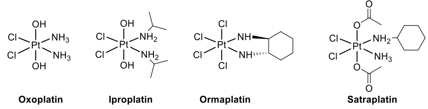
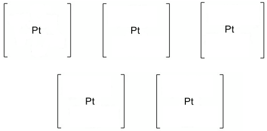

# Exam Questions — Stereoisomerism in Transition Element Complexes
**28. Chemistry of Transition Elements** · Cambridge (CIE) A-LEVEL chemistry (9701)
> Source: [https://www.savemyexams.com/a-level/chemistry/cie/25/topic-questions/](https://www.savemyexams.com/a-level/chemistry/cie/25/topic-questions/) · 4 questions across 1 sets

## Structured Questions (4 questions)

### Q1 — medium — 12 marks

**Q1** [4 marks]

The chloride ion is a monodentate ligand. When concentrated hydrochloric acid is added to [Co(H2O)6]2+(aq) ions the water ligands are replaced.

i) Construct an equation for the reaction of [Co(H2O)6]2+(aq) with concentrated hydrochloric acid. Include state symbols.

[2]

ii) Draw the three-dimensional diagram to show the complex formed in the reaction between [Co(H2O)6]2+(aq) and HCl.

[2]

**Q1** [4 marks]

[Co(NH3)4Cl2]+ is an example of an octahedral complex which exhibits cis-trans isomerism.

i) Deduce the oxidation state of cobalt in [Co(NH3)4Cl2]+.

[1]

ii) Draw three-dimensional diagrams of the two [Co(NH3)4Cl2]+ isomers. Label each isomer as cis or trans.

[3]

**Q1** [4 marks]

Explain the origin of colour in a transition element complex such as [Co(NH3)4Cl2]+.

### Q2 — hard — 7 marks

**Q2** [2 marks]

Several platinum complexes, including oxoplatin, iproplatin, ormaplatin and satraplatin, are used as anti-cancer drugs. The central platinum ions in the four complexes shown in **Fig. 1.1** all have the same geometry and oxidation state.

**Fig. 1.1**

State the oxidation state of the platinum ion and the geometry of these complexes.

oxidation state of the platinum ion ..................................................

geometry of the complexes ..................................................

**Q2** [4 marks]

**Extract:**

Several platinum complexes, including oxoplatin, iproplatin, ormaplatin and satraplatin, are used as anti-cancer drugs. The central platinum ions in the four complexes shown in Fig. 1.1 all have the same geometry and oxidation state.

Fig. 1.1

State the oxidation state of the platinum ion and the geometry of these complexes.

Oxidation state of the platinum ion = +4
Geometry of the complexes = Octahedral

One isomer of the [Pt(NH3)2Cl2(OH)2] complex oxoplatin is shown in **(a)** Fig. 1.1.

Draw three-dimensional diagrams to show the other stereoisomers of oxoplatin. State which of these stereoisomers are chiral.

**Q2** [1 mark]

Cisplatin can be produced by the reduction of the complex *cis, trans, cis*-[PtCl2(OCOCH3)2(NH3)2].

Draw a three-dimensional diagram to show the structure of *cis, trans, cis*-[PtCl2(OCOCH3)2(NH3)2].

### Q3 — medium — 6 marks

**Q3** [1 mark]

Bidentate ligands form two coordinate bonds to a central metal atom or ion in a complex.

State what is meant by a bidentate ligand.

**Q3** [3 marks]

**Extract:**

Bidentate ligands form two coordinate bonds to a central metal atom or ion in a complex.

The product of the reaction between [Cu(H2O)6]2+ and 1,2-diaminoethane exists as a pair of optical isomers.

Draw three-dimensional diagrams to show the two optical isomers.

**Q3** [2 marks]

1,2-diaminoethane is an example of a compound which is a bidentate ligand. Full ligand substitution occurs when 1,2-diaminoethane is added to [Cu(H2O)6]2+.

Construct an equation for the reaction of [Cu(H2O)6]2+ with 1,2-diaminoethane. Include state symbols.

### Q4 — medium — 16 marks

**Q4** [2 marks]

Cobalt is a transition element with atomic number 27.

Complete the electronic configurations of a Co atom and a Co2+ ion.

Co atom   1s2 2s2 2p6  ..................................

Co2+ ion   1s2 2s2 2p6  ..................................

**Q4** [2 marks]

When concentrated hydrochloric acid is added to a solution containing [Co(H2O)6]2+, a ligand exchange reaction occurs.

Draw a three-dimensional diagram to show the shape of the complex ion formed. Include the overall charge.

overall charge ......................................

**Q4** [3 marks]

Co2+ ions exist as [Co(H2O)6]2+ complex ions in aqueous solution.

Complete the three-dimensional diagram to show the shape of this complex. State the geometry. On your diagram, state the bond angle.

![Blank three-dimensional octahedral diagram of [Co(H2O)6]2+ with cobalt at the centre and positions for six water ligands to be added](assets/010-blank-three-dimensional-octahedral-diagram-of-co.png)

geometry ..................................................

**Q4** [4 marks]

When aqueous ammonia, NH3 (aq), is added to [Co(H2O)6]2+ (aq), dropwise at first and then in excess, two distinct chemical reactions occur. For each reaction, state the expected observations and construct an equation.

i) Addition of a few drops of NH3 (aq)

observation .............................................................................

equation ..................................................................................

[2]

ii) Addition of an excess of NH3 (aq)

observation .............................................................................

equation ..................................................................................

[2]

**Q4** [5 marks]

EDTA4- is a hexadentate ligand. When a solution of EDTA4- is added to a solution containing [Co(H2O)6]2+, a new complex is formed. The formula of this complex is [CoEDTA]2-.

i) Explain what is meant by the term hexadentate ligand.

[2]

ii) State the type of reaction occurring here.

[1]

iii) Write an expression for the stability constant, *K*stab, of [CoEDTA]2- in this reaction.

[1]

iv) The numerical value of the *K*stab of [CoEDTA]2- is 7.7 x 104 mol-1 dm3 at 298 K.

Deduce what this value indicates about the stability of [CoEDTA]2- compared to [Co(H2O)6]2+.

[1]
