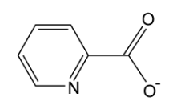
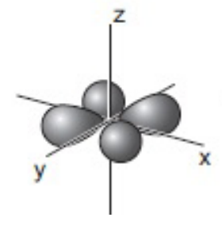

# Mark Schemes — Stability Constants, Kstab
**28. Chemistry of Transition Elements** · Cambridge (CIE) A-LEVEL chemistry (9701)

## Structured Questions (5 questions)

### Q1
> **[mark-scheme]**
> i) The stability constant, *K*stab, is:
> 
> - The equilibrium constant for the formation of a complex ion (from a central metal ion and its ligands) **[1 mark]**
> - In aqueous solution / in a solvent / from its constituent ions or molecules in solution **[1 mark]**
> 
> Answers referring to the equilibrium constant for the dissociation of a complex are not accepted
> 
> ii) The stability constant expression for [Ni(NH3)6]2+ is:
> 
> - *K*stab = [[Ni(NH3)6]2+] / ([Ni2+][NH3]6)
> **OR**
> *K*stab = [[Ni(NH3)6]2+] / ([[Ni(H2O)6]2+][NH3]6) **[1 mark]**
> 
> Water is not included in the denominator unless the hexaaqua ion is treated as the reactant

> **[exam-tip]**
> When writing a stability constant expression, write the complex formation equation first to identify which species appear in the numerator and denominator and the correct power for each ligand.
> 
> A common mistake is forgetting the ligand coefficient. Here, six ammonia molecules coordinate to the nickel ion, so [NH3] must be raised to the power of 6.
> **[mark-scheme]**
> i) A bidentate ligand is:
> 
> - A molecule or ion that can donate two lone pairs of electrons **[1 mark]**
> - To form two coordinate / dative (covalent) bonds with the same central metal ion **[1 mark]**

ii) The three-dimensional diagrams showing the two stereoisomers of [Ni(en)3]2+ are:

**OR**

**[2 marks]**

> **[mark-scheme]**
> 1 mark for a correct three-dimensional diagram of one isomer showing octahedral geometry, using wedges and dashes, with each bidentate ligand linking adjacent (cis) positions on the metal ion
> 
> 1 mark for the second isomer drawn as a non-superimposable mirror image of the first (same connectivity, opposite handedness)
> **[mark-scheme]**
> The difference in stability in terms of entropy changes:
> 
> - [Ni(NH3)6]2+ + EDTA4– ⇌ [Ni(EDTA)]2– + 6NH3 **[1 mark]**
> - The number of particles / moles of species increases from 2 (on the left) to 7 (on the right), so entropy increases / Δ*S* is positive **[1 mark]**
> - The positive Δ*S* makes Δ*G* more negative (via Δ*G* = Δ*H* − *T*Δ*S*), making the ligand exchange more feasible / the EDTA complex more stable **[1 mark]**

> **[exam-tip]**
> The chelate effect: polydentate ligands like EDTA displace multiple monodentate ligands in a single exchange step, increasing the total number of particles in solution and therefore increasing entropy.
> 
> Even if the enthalpy changes are similar, the more positive Δ*S* for EDTA displacement makes Δ*G* more negative, favouring formation of [Ni(EDTA)]2–.

### Q2
> **[mark-scheme]**
> i) The bond angle is:
> 
> - 90° **[1 mark]**

> **[exam-tip]**
> [Cr(H2O)6]3+ is octahedral as six identical water ligands arranged symmetrically around the Cr3+ ion. All six ligand-metal-ligand bond angles between adjacent ligands are 90°.

> **[mark-scheme]**
> ii) The chromium(III) complex ion is coloured because:
> 
> - The water ligands cause the 3d orbitals to split into two energy levels of different energies **[1 mark]**
> - Light / radiation in the visible region of the electromagnetic spectrum is absorbed **[1 mark]**
> - The absorbed energy promotes electrons from the lower 3d energy level to the higher 3d energy level **[1 mark]**
> - The complementary colour / violet light is transmitted / observed **[1 mark]**
> 
> 'Green light is transmitted' is not accepted

> **[exam-tip]**
> In an isolated transition metal atom the five 3d orbitals are degenerate (equal energy). When a complex ion forms, the ligands split the 3d orbitals into two energy levels. Light of a wavelength matching this energy gap is absorbed, promoting an electron to the higher level. The remaining complementary colour is transmitted and observed.
> 
> A common error is to state that colour arises because electrons 'return to their ground state and emit light', but this describes emission spectra (flame tests), not complex ion colour.
> 
> Also note: the question specifies [Cr(H2O)6]3+, which appears violet, not green. Stating the wrong transmitted colour will lose the final mark.
> **[mark-scheme]**
> i) The type of reaction occuring is:
> 
> - Ligand exchange / substitution / displacement / replacement **[1 mark]**
> 
> ii) The stability constant expression for [Cr(EDTA)]– is:
> 
> - *K*stab = [[Cr(EDTA)]–] / ([[Cr(H2O)6]3+][EDTA4–]) **[1 mark]**

> **[exam-tip]**
> Identify the product ([Cr(EDTA)]–) and the two reactants ([Cr(H2O)6]3+ and EDTA4–) from the equation given in the question. Write the product concentration in the numerator and the reactant concentrations in the denominator. Water is excluded as the solvent.

> **[mark-scheme]**
> iii) The large value of *K*stab for [Cr(EDTA)]– indicates:
> 
> - The equilibrium lies far to the right / [Cr(EDTA)]– is more stable than [Cr(H2O)6]3+
> **OR**
> The forward reaction is very feasible / spontaneous / goes to completion **[1 mark]**
> - Δ*S*system is positive / entropy increases **[1 mark]**
> - The number of moles / particles increases from 2 (reactants) to 7 (products)
> **OR**
> 2 moles of reactants form 7 moles of products **[1 mark]**
> 
> Explaining only the entropy change without addressing the position of equilibrium is not accepted for full marks

> **[exam-tip]**
> A large *K*stab means the equilibrium strongly favours products.
> 
> The entropy change follows from the ligand exchange equation: 2 species on the left (the hexaaqua complex and EDTA4–) produce 7 on the right (1 Cr-EDTA complex + 6 water molecules), so the number of particles increases and Δ*S* is positive.
> 
> This is the chelate effect: replacing six monodentate ligands with one hexadentate ligand in a single step greatly increases entropy and drives the reaction forward.
i) The structure of the ligand in chromium(III) picolinate is:

**[1 mark]**

> **[mark-scheme]**
> 1 mark for the picolinate ligand: pyridine ring with deprotonated carboxylate (COO–) at position 2, without a negative charge on the nitrogen
> 
> The negative charge on the nitrogen is not accepted

> **[exam-tip]**
> The picolinate ligand is picolinic acid (pyridine-2-carboxylic acid) after deprotonation of the COOH group.
> 
> Three of nitrogen's five valence electrons are used in bonding within the pyridine ring, leaving a lone pair that forms the coordinate bond with Cr3+.
> 
> The nitrogen does not carry a formal negative charge, only the carboxylate oxygen does.

ii) To calculate the mass, in g, of chromium(III) picolinate in a typical tablet:

- State the *M*r of chromium(III) picolinate:

*M*r = 418.0

- Calculate moles of chromium (1 μg = 10–6 g):

n(Cr) = $\frac{200\times10^{-6}}{52.0}$

n(Cr) = 3.85 x 10–6 mol

**[1 mark]**

- Calculate mass of chromium(III) picolinate:

mass = 3.85 x 10–6 x 418.0

mass = **1.61 x 10****–3** g **[1 mark]**

> **[mark-scheme]**
> 1 mark for *M*r(chromium(III) picolinate) = 418.0 **AND** moles of chromium = 3.85 x 10–6 mol
> 
> 1 mark for mass = 1.61 x 10–3 g (to 3 s.f.)

> **[exam-tip]**
> The *M*r of chromium(III) picolinate requires care: the picolinate ligand has *M*r = 122.1, and three coordinate to the Cr3+ ion (plus one proton lost per ligand), giving *M*r = 52.0 + (3 x 122.0) = 418.0. Remember 1 μg = 10–6 g.
> **[mark-scheme]**
> i) The formula of complex ion **M** is:
> 
> - [Cr(NH3)4Cl2]+ / [CrN4H12Cl2]+ **[1 mark]**

> **[exam-tip]**
> Compound **L** has the empirical formula CrN4H12Cl3 and contains one ionically-bonded chloride ion. Removing this gives complex ion **M** the composition CrN4H12Cl2 with a 1+ charge. The N4H12 portion is four NH3 ligands, giving the formula [Cr(NH3)4Cl2]+.

ii) The three-dimensional diagrams showing the two stereoisomers of complex ion **M** are:

![Three-dimensional diagrams of cis-[Cr(NH3)4Cl2]+ and trans-[Cr(NH3)4Cl2]+ showing correct wedge-dash notation with 1+ charges indicated on both isomers](assets/006-three-dimensional-diagrams-of-cis-cr-nh3-4cl2-an.png)

**[2 marks]**

> **[mark-scheme]**
> 1 mark for a correct 3D diagram of one isomer with 4NH3 and 2Cl ligands, correct wedge-dash notation, and 1+ charge shown
> 
> 1 mark for the second isomer drawn as the other geometric isomer (*cis* or *trans*), correctly labelled, with 1+ charge shown

> **[exam-tip]**
> [Cr(NH3)4Cl2]+ is octahedral and exists as *cis* (both Cl adjacent, 90° apart) and *trans* (both Cl opposite, 180° apart) isomers. Draw each with 2 'out wedges', 2 'in wedges', and 2 bonds in the plane of the paper.
> 
> Make sure the 1+ charge appears on both structures. A common error is to omit the charge or to draw cis and trans incorrectly by placing the Cl ligands in the wrong positions.

### Q3
> **[mark-scheme]**
> The stability constant, *K*stab, is:
> 
> - The equilibrium constant for the formation of a complex ion (from a central metal ion and ligands) **[1 mark]**
> - In aqueous solution / in a solvent / from its constituent ions or molecules in solution **[1 mark]**
> 
> Answers referring to the equilibrium constant for the dissociation of a complex are not accepted

> **[exam-tip]**
> A complete definition requires two elements: that *K*stab is an equilibrium constant, and that it refers specifically to the formation (not dissociation) of a complex ion in solution.
> 
> Writing only 'equilibrium constant for a complex' without specifying formation is not accepted for full marks.
> **[mark-scheme]**
> i) The stability constant expression for [Ag(NH3)]+ is:
> 
> - *K*stab = [[Ag(NH3)]+] / ([Ag+][NH3]) **[1 mark]**

> **[exam-tip]**
> Write the complex ion product in the numerator and the free metal ion and ligand in the denominator. Water is excluded because it is the solvent and its concentration remains effectively constant.

ii) To calculate *K*stab and its units:

- List concentrations using an ICE table:

|   | Ag+ | NH3 | ⇌ | [Ag(NH3)]+ |
|---|---|---|---|---|
| initial / mol dm–3 | 0.500 | 0.500 |   | 0 |
| change / mol dm–3 | −0.4998 | −0.4998 |   | +0.4998 |
| equilibrium / mol dm–3 | 2 x 10–4 | 2 x 10–4 |   | 0.4998 |

**[1 mark]**

- Substitute equilibrium concentrations into the *K*stab expression:

*K*stab = $\frac{0.4998}{((2\times10^{-4})\times(2\times10^{-4}))}$

*K*stab = **1.25 x 10****7** **[1 mark]**

- State the units:

Units = **dm****3**** mol****–1** **[1 mark]**

> **[mark-scheme]**
> 1 mark for ICE table with correct equilibrium concentrations: [Ag+] = [NH3] = 2 x 10–4 mol dm–3
> 
> 1 mark for *K*stab = 1.25 x 107 (allow 1.24–1.25 x 107; note: the table value of 1.7 x 107 uses different source data and is not the expected calculated answer here)
> 
> 1 mark for units dm3 mol–1 / mol–1 dm3

> **[exam-tip]**
> In an ICE table, the amount of [Ag(NH3)]+ formed equals the drop in [Ag+] and [NH3]:
> 
> 0.500 − 0.4998 = 2 x 10–4 mol dm–3 for both reactants.
> 
> Substitute these equilibrium values into the *K*stab expression.
> 
> To find the units, substitute mol dm–3 for each concentration term and cancel:
> 
> mol dm–3 / (mol dm–3 x mol dm–3) = mol–1 dm3.
The completed order of stability is:

| most stable | **Final answer:** **[Ag(CN)****2****]****–** |
|---|---|
|   | **Final answer:** **[Ag(S****2****O****3****)****2****]****3–** |
| least stable | **Final answer:** **[Ag(NH****3****)]****+** |

**[1 mark]**

> **[mark-scheme]**
> 1 mark for all three complexes in the correct order: [Ag(CN)2]– (most stable), [Ag(S2O3)2]3–, [Ag(NH3)]+ (least stable)

> **[exam-tip]**
> The larger the *K*stab value, the more stable the complex

### Q4
> **[mark-scheme]**
> A ligand is a molecule or ion that:
> 
> - Contains a lone pair of electrons **[1 mark]**
> - Donates a lone pair to a central metal ion to form a coordinate / dative (covalent) bond **[1 mark]**
> 
> A ligand must be described as a molecule or ion, not just a species
> 
> Stating only 'donates electrons' without specifying a lone pair is not accepted.

> **[exam-tip]**
> A complete definition requires two elements: that the ligand possesses a lone pair of electrons, and that it donates that lone pair to the metal ion to form a coordinate bond.
> **[mark-scheme]**
> The stability constant expression for the formation of [Cu(NH3)4(H2O)2]2+ is:
> 
> - *K*stab = `fraction numerator left square bracket left square bracket Cu left parenthesis NH subscript 3 right parenthesis subscript 4 left parenthesis straight H subscript 2 straight O right parenthesis subscript 2 right square bracket to the power of 2 plus end exponent right square bracket over denominator left square bracket left square bracket Cu left parenthesis straight H subscript 2 straight O right parenthesis subscript 6 right square bracket to the power of 2 plus end exponent right square bracket space left square bracket NH subscript 3 right square bracket to the power of 4 end fraction` **[1 mark]**
> 
> Water is not included in the *K*stab expression as it is the solvent / present in large excess

> **[exam-tip]**
> The equation for the substitution reaction is:
> 
> [Cu(H2O)6]2+ + 4NH3 ⇌ [Cu(NH3)4(H2O)2]2+ + 4H2O
> 
> Write the *K*stab expression with the complex product in the numerator and the reactant complex and free ligand in the denominator. Water is excluded because it is the solvent and its concentration remains effectively constant throughout the reaction.
i) To calculate the stability constant, *K*stab, and its units:

- Recall that the overall stability constant is the product of the stepwise constants:

*K*stab = *K*1 x *K*2 x *K*3 x *K*4

*K*stab = 1.78 x 104 x 4.07 x 103 x 9.55 x 102 x 1.74 x 102

*K*stab = **1.20 x 10****13** **[1 mark]**

- Determine the units from (dm3 mol-1)4:

Units = **dm****12**** mol****-4** **[1 mark]**

> **[mark-scheme]**
> 1 mark for *K*stab = 1.20 x 1013 (allow values in range 1.19–1.21 x 1013)
> 
> 1 mark for units dm12 mol-4

> **[exam-tip]**
> The overall *K*stab equals the product of all stepwise stability constants: *K*stab = *K*1 x *K*2 x *K*3 x *K*4.
> 
> The units follow from multiplying four sets of dm3 mol-1 together to give dm12 mol-4.

> **[mark-scheme]**
> ii) The *K*stab value indicates the relative stabilities of the two complexes:
> 
> - The very large *K*stab value indicates that the tetraamine complex / [Cu(NH3)4(H2O)2]2+ is (much) more stable than the hexaaqua complex / [Cu(H2O)6]2+ **[1 mark]**

### Q5
The shape of a 3dxy orbital:

**[1 mark]**

> **[mark-scheme]**
> 1 mark for four lobes in the same plane, oriented between the x and y axes (at 45° to each axis)

> **[exam-tip]**
> The dxy orbital has four lobes that lie in the xy plane, at 45° angles between the x and y axes.
> 
> The lobes point between the axes, not along them. This distinguishes dxy from dx2–y2, which has lobes pointing directly along the x and y axes.
> **[mark-scheme]**
> i) Transition elements are able to act as catalysts because:
> 
> - Transition elements have more than one stable oxidation state **[1 mark]**
> - There are vacant d-orbitals that can accept lone pairs from reactant molecules
> **OR**
> They can form dative bonds with ligands **[1 mark]**

ii) The completed Table 1.1:

|   | **type of catalysis** |   |
|---|---|---|
| **reaction** | **heterogeneous** | **homogeneous** |
| Fe in the Haber process | `\checkmark` |   |
| Fe2+ in the I– / S2O82– reaction |   | `\checkmark` |
| NO2 in the oxidation of SO2 |   | `\checkmark` |

**[1 mark]**

> **[mark-scheme]**
> 1 mark for all three rows correct

> **[exam-tip]**
> For part (i), the two key properties that allow transition elements to act as catalysts are their ability to adopt multiple oxidation states (allowing them to act as both electron donors and acceptors in reaction cycles) and their vacant d-orbitals (which allow reactant molecules to form coordinate bonds with the metal).
> 
> For part (ii), a heterogeneous catalyst is in a different phase from its reactants. Iron in the Haber process is a solid while the reactant gases N2 and H2 are in the gas phase.
> 
> A homogeneous catalyst is in the same phase as the reactants. Fe2+ ions and the I–/S2O82– reactants are all aqueous. NO2 and SO2 are both gases.
> **[mark-scheme]**
> i) The equation for this reaction:
> 
> - Sn2+ + 2Fe3+ → Sn4+ + 2Fe2+ **[1 mark]**
> 
> State symbols are not required.
> 
> ii) The standard cell potential:
> 
> - *E*ɵcell = 0.77 – 0.15 = **+0.62 V** **[1 mark]**

> **[exam-tip]**
> For the equation, compare the *E*ɵ values: Sn2+/Sn4+ (+0.15 V) is less positive than Fe3+/Fe2+ (+0.77 V). The less positive electrode acts as the anode (oxidation), so Sn2+ is oxidised to Sn4+. The Fe3+ half-equation runs in the forward direction (reduction). Balance electrons: 2 moles of Fe3+ are reduced per mole of Sn2+ oxidised.
> 
> For *E*ɵcell, use:
> 
> *E*ɵcell = *E*ɵreduction – *E*ɵoxidation:
> 
> *E*ɵcell = (+0.77) – (+0.15) = +0.62 V
> **[mark-scheme]**
> i) The colour changes observed are:
> 
> Experiment 1:
> 
> - Violet to deep-red (adding KSCN forms the thiocyanate complex) **[1 mark]**
> - Deep-red to colourless (adding KF displaces the thiocyanate complex) **[1 mark]**
> 
> Experiment 2:
> 
> - Violet to colourless (adding KF forms the fluoride complex), remaining colourless on addition of KSCN **[1 mark]**
> 
> Explanation:
> 
> - *K*stab of [Fe(H2O)5F]2+ > *K*stab of [Fe(H2O)5SCN]2+
> **OR**
> 2.0 × 105 > 1.0 × 103, so the fluoride complex is more stable and displaces the thiocyanate complex **[1 mark]**
> 
> ii) The type of reaction:
> 
> - Ligand exchange / substitution / displacement **[1 mark]**
> 
> In Experiment 2, the fluoride complex is not displaced by SCN– because the F– complex has the larger *K*stab value.

> **[exam-tip]**
> Work through each experiment step by step.
> 
> Experiment 1: the pale violet [Fe(H2O)6]3+ turns deep-red when KSCN is added, forming [Fe(H2O)5SCN]2+. When KF is then added, the solution becomes colourless because the fluoride complex ([Fe(H2O)5F]2+, *K*stab = 2.0 × 105 mol–1 dm3) is more stable than the thiocyanate complex (*K*stab = 1.0 × 103 mol–1 dm3) and displaces it.
> 
> Experiment 2: the pale violet solution turns colourless when KF is added. When KSCN is then added, there is no colour change. The fluoride complex has the larger *K*stab value and cannot be displaced by SCN–.
> 
> For part (ii), any reaction in which one ligand replaces another is called ligand exchange or ligand substitution.
To calculate the pH of a 0.25 mol dm–3 FeCl3 solution:

- Find [H+]:

[H+]2 = *K*a × [Fe3+]

[H+]2 = 8.9 × 10–4 × 0.25

[H+]2 = 2.225 × 10–4

[H+] = $\sqrt{2.225\times10^{-4}}$

[H+] = 0.0149 mol dm–3 **[1 mark]**

- Calculate pH:

pH = –log(0.0149)

pH = **1.83** **[1 mark]**

> **[mark-scheme]**
> 1 mark for [H+] = 0.0149 mol dm–3 (accept 0.01492)
> 
> 1 mark for pH in the range 1.8–1.83

> **[exam-tip]**
> For this weak acid calculation, use:
> 
> [H+]2 = *K*a × [HA]
> 
> This assumes [H+] equals [A–] (both produced in equal amounts) and that the equilibrium concentration of the weak acid equals the initial concentration, since the degree of dissociation is small.
> 
> Here, [Fe(H2O)6]3+ acts as the weak acid, so [HA]initial = 0.25 mol dm–3. Take the square root to find [H+], then use pH = –log[H+].
