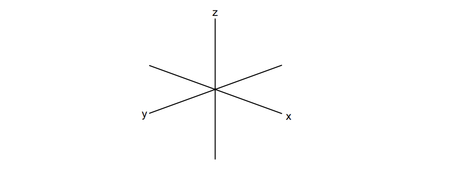

# Exam Questions — Stability Constants, Kstab
**28. Chemistry of Transition Elements** · Cambridge (CIE) A-LEVEL chemistry (9701)
> Source: [https://www.savemyexams.com/a-level/chemistry/cie/25/topic-questions/](https://www.savemyexams.com/a-level/chemistry/cie/25/topic-questions/) · 5 questions across 1 sets

## Structured Questions (5 questions)

### Q1 — medium — 10 marks

**Q1** [3 marks]

Nickel(II) ions, Ni2+ (aq), react with a variety of ligands to form octahedral complexes.

i) Define the term stability constant, *K*stab

[2]

Nickel(II) ions react with an excess of aqueous ammonia to form the complex ion [Ni(NH3)6]2+.

ii) Write an expression for the stability constant, *K*stab, for this complex.

[1]

*K*stab =

**Q1** [4 marks]

Ethane-1,2-diamine (represented as en) is a bidentate ligand.

Nickel(II) forms the complex ion [Ni(en)3]2+. This complex exists as two stereoisomers.

i) Define the term bidentate ligand.

[2]

ii) Draw three-dimensional diagrams to show the two stereoisomers of [Ni(en)3]2+.

[2]

**Q1** [3 marks]

The complex [Ni(EDTA)]2– is significantly more stable than the complex [Ni(NH3)6]2+.

By considering the ligand exchange reaction between [Ni(NH3)6]2+ and EDTA4–, explain this difference in stability in terms of entropy changes.

### Q2 — hard — 16 marks

**Q2** [5 marks]

When chromium(III) sulfate dissolves in water, a violet solution containing the [Cr(H2O)6]3+ ion forms.

i) State the bond angles found in this complex ion.

[1]

ii) Explain why the chromium(III) complex ion is coloured.

[4]

**Q2** [5 marks]

Ethylenediaminetetraacetate, EDTA4−, shown in Fig. 1.1, is a polydentate ligand.

**Fig. 1.1**

When a solution of EDTA4− is added to a solution of [Cr(H2O)6]3+ ions, a new complex ion is formed.

[Cr(H2O)6]3+ + EDTA4– ⇌ [Cr(EDTA)]– + 6H2O

i) Name the type of reaction occurring here.

[1]

ii) Write an expression for the stability constant, *K*stab, of [Cr(EDTA)]– in this reaction.

[1]

iii) The numerical value of the *K*stab of [Cr(EDTA)]– is 2.51 × 1023 in this reaction.

Suggest what this indicates about the position and entropy of the equilibrium.

[3]

**Q2** [3 marks]

Chromium(III) picolinate, shown in Fig. 1.2, is a neutral complex that can be prepared from the weak acid, picolinic acid.

**Fig. 1.2**

Chromium(III) picolinate is used in tablets as a nutritional supplement for chromium.

i) Draw the structure of the ligand in chromium(III) picolinate.

[1]

ii) A typical tablet of chromium(III) picolinate contains 200 μg of chromium.

Calculate the mass, in g, of chromium(III) picolinate in a typical tablet. Give your answer to three significant figures. Show your working.

[2]

**Q2** [3 marks]

Compound **L** is a complex with the empirical formula CrN4H12Cl3

The formula of compound **L** contains one chloride ion and a complex ion **M**, which has two stereoisomers.

i) Deduce the formula of complex ion **M**.

[1]

ii) Draw three-dimensional diagrams to show the two stereoisomers of complex ion **M**.

[2]

### Q3 — medium — 7 marks

**Q3** [2 marks]

Define the term stability constant, *K*stab

**Q3** [4 marks]

Silver forms different complexes. The stability constant, *K*stab, values at 298 K are shown in Table 3.1

**Table 3.1**

| **complex** | **stability constant, *****K*****stab** |
|---|---|
| [Ag(CN)2]– | 5.3 x 1018 |
| [Ag(NH3)]+ | 1.7 x 107 |
| [Ag(S2O3)2]3– | 2.9 x 1013 |

The following equilibrium exists between two complex ions of silver in the +1 oxidation state.

Ag+ + NH3 ⇌ [Ag(NH3)]+

i) Write the expression for the stability constant, *K*stab, for this equilibrium

*K*stab =

[1]

ii) When a 0.500 mol dm–3 solution of AgNO3 (aq) is mixed with 0.500 mol dm–3 NH3 (aq) the equilibrium mixture of [Ag(NH3)]+ (aq) was found to be 0.4998 mol dm–3

Calculate *K*stab and state the units. Show your working.

[3]

**Q3** [1 mark]

**Extract:**

Silver forms different complexes. The stability constant, *K*~stab~, values at 298 K are shown in Table 3.1

**Table 3.1**

| **complex** | **stability constant, *****K***~**stab**~ |
| :---: | :---: |
| [Ag(CN)~2~]^–^ | 5.3 x 10^18^ |
| [Ag(NH~3~)]^+^ | 1.7 x 10^7^ |
| [Ag(S~2~O~3~)~2~]^3–^ | 2.9 x 10^13^ |

Using Table 3.1, deduce the order of stability of the silver complexes

| most stable |   |
|---|---|
|   |   |
| least stable |   |

### Q4 — medium — 6 marks

**Q4** [2 marks]

Define the term ligand.

**Q4** [1 mark]

[Cu(H2O)6]2+ reacts with ammonia to form a new complex. Write an expression for the overall stability constant, *K*stab, for the formation of [Cu(NH3)4(H2O)2]2+

*K*stab =

**Q4** [3 marks]

**Extract:**

[Cu(H~2~O)~6~]^2+^ reacts with ammonia to form a new complex. Write an expression for the overall stability constant, *K*~stab~, for the formation of [Cu(NH~3~)~4~(H~2~O)~2~]^2+^

Table 2.1 shows the stability constants for each stage in the replacement of four water molecules for the [Cu(H2O)6]2+ complex

**Table 2.1**

| ***K***n | **value / dm**3** mol**-1 |
|---|---|
| *K*1 | 1.78 x 104 |
| *K*2 | 4.07 x 103 |
| *K*3 | 9.55 x 102 |
| *K*4 | 1.74 x 102 |

i) Using Table 2.1, calculate the stability constant, *K*stab, and state the units. Show your working.

[2]

ii) Deduce what this value indicates about the relative stabilities of the two complexes.

[1]

### Q5 — medium — 13 marks

**Q5** [1 mark]

Sketch the shape of a 3dxy orbital.

*Source: 2022 Specimen Paper 4 Q7A*

**Q5** [3 marks]

i) Some transition elements and their compounds behave as catalysts. Explain why transition elements behave as catalysts.

[2]

ii) Catalysis can be classified as heterogeneous or homogeneous. Complete Table 1.1 by placing **one **tick (`✓`) in each row to indicate the type of catalysis in each reaction.

**Table 1.1**

|   | **type of catalysis** |   |
|---|---|---|
| **reaction** | **heterogeneous** | **homogeneous** |
| Fe in the Haber process |   |   |
| Fe2+ in the I– / S2O82– reaction |   |   |
| NO2 in the oxidation of SO2 |   |   |

[1]

*Source: 2022 Specimen Paper 4 Q7B*

**Q5** [2 marks]

A solution containing a mixture of Sn2+ (aq) and Sn4+ (aq) is added to a solution containing a mixture of Fe2+ (aq) and Fe3+ (aq).

Table 2.2 lists electrode potentials for some electrode reactions of these ions.

**Table 2.2**

| **electrode reaction** | ***E*****ɵ**** / V** |
|---|---|
| Fe2+ + 2e– ⇌ Fe | –0.44 |
| Fe3+ + 3e– ⇌ Fe | –0.04 |
| Fe3+ + e– ⇌ Fe2+ | +0.77 |
| Sn2+ + 2e– ⇌ Sn | –0.14 |
| Sn4+ + 2e– ⇌ Sn2+ | +0.15 |

*E*ɵ data from the table can be used to predict the reaction that takes place when the two solutions are mixed.

i) Construct an equation for this reaction.

[1]

ii) Calculate *E*ɵcell for this reaction.

[1]

*Source: 2022 Specimen Paper 4 Q7C*

**Q5** [5 marks]

Hexaaquairon(III) ions are pale violet. They form a colourless complex with fluoride ions, F–, as shown in equilibrium **1**, and a deep-red complex with thiocyanate ions, SCN–, as shown in equilibrium **2**.

equilibrium **1:**

[Fe(H2O)6]3+ + F– ⇌ [Fe(H2O)5F]2+ + H2O

violet ⇌ colourless

*K*stab = 2.0 × 105 mol–1 dm3

equilibrium **2:**

[Fe(H2O)6]3+ + SCN– ⇌ [Fe(H2O)5SCN]2+ + H2O

violet ⇌ deep-red

*K*stab = 1.0 × 103 mol–1 dm3

The following two experiments are carried out.

Experiment 1: A few drops of KSCN (aq) are added to 5 cm3 of Fe3+ (aq), followed by a few drops of KF (aq).

Experiment 2: A few drops of KF (aq) are added to 5 cm3 of Fe3+ (aq), followed by a few drops of KSCN (aq).

i) State and explain the sequence of colour changes you would observe in each of Experiment 1 and Experiment 2.

[4]

ii) State the type of reaction occurring during the experiments in **(d)(i)**.

[1]

*Source: 2022 Specimen Paper 4 Q7D*

**Q5** [2 marks]

Solutions of iron(III) salts are acidic due to the equilibrium shown.

[Fe(H2O)6]3+ (aq) ⇌ [Fe(H2O)5(OH)]2+ (aq) + H+ (aq)

Ka = 8.9 × 10–4 mol dm–3

Calculate the pH of a 0.25 mol dm–3 FeCl3 solution. Show your working.

pH = ..........................................................

*Source: 2022 Specimen Paper 4 Q7E*

