# Mark Schemes — Formulas, Functional Groups & the Naming of Organic Compounds
**29. An Introduction to A Level Organic Chemistry** · Cambridge (CIE) A-LEVEL chemistry (9701)

## Structured Questions (7 questions)

### Q1
> **[mark-scheme]**
> The systematic name of each compound:
> 
> - compound **K** = phenol **[1 mark]**
> - compound **L** = ethanoyl chloride **[1 mark]**
> - compound **M** = 2-phenylpropylamine **[1 mark]**

> **[exam-tip]**
> Compound **K** is the well-known compound phenol, so this name should be memorised.
> 
> Compound **L** is an acyl chloride:
> 
> - Acyl chlorides have the suffix -oyl chloride
> - The carbon chain is 2 carbons long, so the stem is eth-
> - The chain contains only single bonds, so the name includes -an-
> - Overall: eth + an + oyl chloride = ethanoyl chloride
> 
> Compound **M** has a phenyl ring attached to carbon-2 of a three-carbon chain ending in an amine group:
> 
> - The 2-phenyl- prefix indicates the benzene ring at carbon-2
> - The propylamine suffix indicates a three-carbon chain with a terminal amine
> - Overall: 2-phenyl + propylamine = 2-phenylpropylamine
The completed table is:

|   | **Aliphatic** | **Aromatic** |
|---|---|---|
| compound **K** | **Final answer:** **x** | **Final answer:** **✓** |
| compound **L** | **Final answer:** **✓** | **Final answer:** **x** |
| compound **M** | **Final answer:** **✓** | **Final answer:** **✓** |

**[2 marks]**

> **[mark-scheme]**
> 1 mark for compounds **L** and **M** identified as aliphatic **AND** compound **K** identified as not aliphatic
> 
> 1 mark for compounds **K** and **M** identified as aromatic **AND** compound **L** identified as not aromatic

> **[exam-tip]**
> Aromatic compounds contain a benzene ring.
> 
> Aliphatic compounds do not contain benzene rings. They are most commonly carbon chains, although they can also be cyclic, e.g. cyclohexane.
> **[mark-scheme]**
> i) The meaning of structural isomerism:
> 
> - Compounds with the same molecular formula but different structural formulae **[1 mark]**
> 
> Three specific types of structural isomerism:
> 
> - (Branched) chain
> **AND**
> Positional
> **AND**
> Functional group **[1 mark]**
> 
> ii) The meaning of stereoisomerism:
> 
> - Compounds with the same molecular formula and structural formula but a different arrangement of atoms in space **[1 mark]**
> 
> Two specific types of stereoisomerism:
> 
> - Geometric(al)
> **AND**
> Optical **[1 mark]**

> **[exam-tip]**
> You need to know the definitions of structural isomerism and stereoisomerism, as well as be able to work with each type of isomer.
The three-dimensional diagrams showing the optical isomers of compound **M** are:

| isomer 1 | isomer 2 |
|---|---|
| 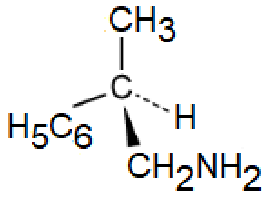 | 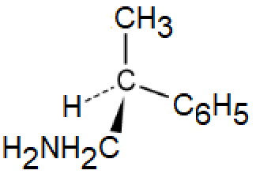 |

**[2 marks]**

> **[mark-scheme]**
> 1 mark for the correct structure of one optical isomer
> 
> 1 mark for the correct mirror image of the first optical isomer

> **[exam-tip]**
> The three-dimensional diagrams required here show optical isomers.
> 
> Optical isomers have a chiral centre, where one carbon atom has four different atoms or groups attached. The chiral centre in compound **M** is carbon-2, which carries a CH3 group, a H atom, a CH2NH2 group, and a phenyl ring (C6H5, not C6H6, since one hydrogen has been substituted).
> 
> Take your time identifying the chiral centre, and remember that hydrogen atoms are often not shown explicitly in structural formulae.

### Q2
i) The product of the reaction between CH3CH2CH2CHO and HCN is:

- 2-hydroxypentanenitrile

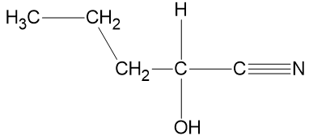

**[2 marks]**

> **[mark-scheme]**
> 1 mark for the correct structure of 2-hydroxypentanenitrile
> 
> 1 mark for the correct name: 2-hydroxypentanenitrile

> **[mark-scheme]**
> ii) Changes in shape and chirality during the formation of the organic product:
> 
> Shape:
> 
> - The CHO / aldehyde group changes from trigonal planar to tetrahedral (the CHOHCN / hydroxynitrile group) **[1 mark]**
> - The C=O bond breaks, forming two single bonds (to OH and CN groups)
> **AND**
> The carbon atom is now surrounded by 4 single bonding pairs, resulting in a tetrahedral shape **[1 mark]**
> 
> Chirality:
> 
> - CH3CH2CH2CHO / butanal has no chiral centres
> **AND**
> The organic product / 2-hydroxypentanenitrile has one chiral centre **[1 mark]**
> - The C=O bond breaks, forming two single bonds to OH and CN groups
> **AND**
> The carbon atom now has four different atoms or groups of atoms attached **[1 mark]**

> **[exam-tip]**
> CH3CH2CH2CHO is the aldehyde butanal, which has no chiral centres because no carbon has four different atoms or groups attached.
> 
> The aldehyde carbon has a trigonal planar shape due to the C=O double bond.
> 
> Aldehydes undergo an addition reaction with HCN to form hydroxynitrile compounds. The product here is 2-hydroxypentanenitrile (note that the CN group adds a carbon to the chain, making it five carbons rather than four).
> 
> After the reaction, the former carbonyl carbon has four different groups attached (H, OH, CN, and CH3CH2CH2-), so it becomes a chiral centre.
> **[mark-scheme]**
> i) The name of the mechanism and its steps:
> 
> - (Nucleophilic) addition-elimination **[1 mark]**
> 
> Description of the mechanism steps:
> 
> - The lone pair on CH3OH / methanol acts as a nucleophile, attacking the δ+ carbonyl carbon
> **AND**
> One C=O bond breaks heterolytically, giving both electrons to the oxygen atom **[1 mark]**
> - A lone pair from the O- reforms the C=O bond
> **AND**
> The C-Cl bond breaks heterolytically, releasing a chloride ion **[1 mark]**
> - The O-H bond breaks heterolytically, giving both electrons to the electron-deficient oxygen / O+ atom
> **AND**
> H+ is lost **[1 mark]**
> - Overall, an HCl molecule is eliminated **[1 mark]**
> 
> ii) The systematic name of the organic product:
> 
> - Methyl butanoate **[1 mark]**

> **[exam-tip]**
> The reaction of an alcohol with an acyl chloride produces an ester and HCl via nucleophilic addition-elimination.
> 
> Each step of the mechanism requires precise reference to lone pairs, bond breaking, and the charges formed.
> 
> For naming the ester product:
> 
> - Methanol gives the methyl- prefix
> - Butanoyl chloride gives the -butanoate suffix
> - Product: methyl butanoate
i) The formula of the electrophile:

> **[mark-scheme]**
> - CH3CH2CH2CO+ **[1 mark]**

ii) The three structural isomers of phenylbutanone are:

Isomer 1:

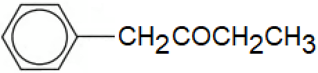

Isomer 2:

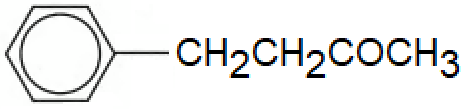

Isomer 3:

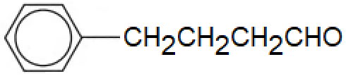

None of the isomers form optical isomers as there are no chiral centres are present / no carbon has four different atoms or groups attached

**[4 marks]**

> **[mark-scheme]**
> 1 mark for the correct structure of isomer 1
> 
> 1 mark for the correct structure of isomer 2
> 
> 1 mark for the correct structure of isomer 3
> 
> 1 mark for explaining that none of the isomers form optical isomers, with a correct explanation

> **[exam-tip]**
> The catalyst AlCl3 (a halogen carrier) generates the electrophile:
> 
> CH3CH2CH2COCl + AlCl3 → CH3CH2CH2CO+ + AlCl4-
> 
> The three structural isomers are drawn by moving the CO group one position along the carbon chain each time.
> 
> Each isomer has carbon atoms with either two hydrogen atoms or a C=O double bond attached, so none has a chiral centre and no optical isomers are formed.

### Q3
The completed table is:

| **formula** | **name** |
|---|---|
| (CH3)2C(OH)CH(CH3)2 | **Final answer:** **2,3-dimethylbutan-2-ol** |
| CH3COCl | **Final answer:** **ethanoyl chloride** |
| CH3CONHCH3 | **Final answer:** **N****-methylethanamide** |
| CH3CN | **Final answer:** **ethanenitrile** |

**[4 marks]**

> **[mark-scheme]**
> 1 mark for 2,3-dimethylbutan-2-ol
> 
> 1 mark for ethanoyl chloride
> 
> 1 mark for *N*-methylethanamide
> 
> 1 mark for ethanenitrile

> **[exam-tip]**
> There is a mix of compound types here, so take your time with each:
> 
> (CH3)2C(OH)CH(CH3)2:
> 
> - 4 carbons in the main chain
> - An -OH at carbon-2
> - Methyl groups at carbons 2 and 3
> - Name: 2,3-dimethylbutan-2-ol
> 
> CH3COCl:
> 
> - An acyl chloride (-COCl) with a 2-carbon chain
> - Name: ethanoyl chloride
> 
> CH3CONHCH3:
> 
> - An amide with a methyl group on nitrogen (an *N*-substituted amide)
> - Name: *N*-methylethanamide
> 
> CH3CN:
> 
> - A nitrile (-CN) with 2 carbons total including the CN carbon
> - Name: ethanenitrile
i) The isomer also formed in the elimination is:

2,3-dimethylbut-1-ene

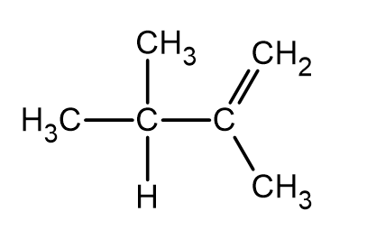

**[2 marks]**

> **[mark-scheme]**
> 1 mark for the correct structure of 2,3-dimethylbut-1-ene
> 
> 1 mark for the correct name: 2,3-dimethylbut-1-ene

> **[mark-scheme]**
> ii) Why two products are obtained:
> 
> - Elimination can occur at either of the two carbons adjacent to the OH group / hydrogen can be lost from either adjacent carbon **[1 mark]**

> **[exam-tip]**
> The two isomers are formed by elimination occurring at different positions:
> 
> - Loss of H from carbon-1 of the alcohol gives 2,3-dimethylbut-1-ene (C1=C2 double bond)
> - Loss of H from carbon-3 gives 2,3-dimethylbut-2-ene (C2=C3 double bond)
> **[mark-scheme]**
> i) The equation for the hydrolysis of CH3COCl:
> 
> - CH3COCl + H2O → CH3COOH + HCl **[1 mark]**
> 
> ii) The equation for the formation of CH3CONHCH3:
> 
> - CH3COCl + CH3NH2 → CH3CONHCH3 + HCl **[1 mark]**

> **[exam-tip]**
> Acyl chlorides are highly reactive and undergo rapid hydrolysis even in cold water, producing steamy fumes of HCl.
> 
> For forming *N*-methylethanamide, the amine must carry the correct substituent: CH3NH2 (methylamine) provides the *N*-methyl group.

### Q4
> **[mark-scheme]**
> The IUPAC names of compounds **W** and **X**:
> 
> - **W** is propene **[1 mark]**
> - **X** is 2-chloropropane **[1 mark]**

> **[exam-tip]**
> Step 1 gives the major product, so the Cl group attaches to the middle carbon.
> 
> Propene (compound **W**) undergoes electrophilic addition of HCl. The secondary carbocation formed at carbon-2 is more stable than a primary carbocation, so Cl bonds preferentially to carbon-2 to give 2-chloropropane (compound **X**).
> **[mark-scheme]**
> Suitable reagents for steps 2 and 3:
> 
> - Step 2: ammonia / NH3 **[1 mark]**
> - Step 3: propanoyl chloride **[1 mark]**

> **[exam-tip]**
> Nucleophilic substitution of a haloalkane with excess ammonia (step 2) produces a primary amine.
> 
> Acyl chlorides react with amines to form N-substituted amides (step 3). Propanoyl chloride must be used to ensure compound **Z** contains 6 carbon atoms in total.
To calculate the mass of compound **X**:

- List the known values:

  - mass of W = 5.0 g
  - Mr of W (propene) = 42
  - Mr of X (2-chloropropane) = 78.5
  - percentage yield = 64%
- Calculate the moles of compound **W**:

n(W) = $\frac{mass}{M_{r}}$

n(W) = $\frac{5.0}{42}$

n(W) = 0.119 mol **[1 mark]**

- Mole ratio W : X = 1 : 1, so n(X) theoretical = 0.119 mol

- Calculate the theoretical mass of compound **X**:

mass(X) = n(X) x Mr(X)

mass(X) = 0.119 x 78.5

mass(X) = 9.34 g **[1 mark]**

- Calculate the actual mass of compound **X** using the percentage yield:

actual mass = theoretical mass x $\frac{\mathrm{percentage} \mathrm{yield}}{100}$

actual mass = 9.34 x $\frac{64}{100}$

actual mass = **6.0 g** **[1 mark]**

> **[mark-scheme]**
> Allow error carried forward in steps 2 and 3 if a correct method is used with an incorrect moles value from step 1.

> **[exam-tip]**
> Percentage yield = (actual yield / theoretical yield) x 100.
> 
> Give your answer to the number of decimal places specified. Take care to use an unrounded intermediate value where possible: 5.0 / 42 x 78.5 x 0.64 = 5.98... g, which rounds to 6.0 g (1 dp).

> **[mark-scheme]**
> ii) Two reasons why the percentage yield is not 100%:
> 
> Any **two** from (1 mark for each point):
> 
> - By-products are formed in this reaction
> - Reaction has not gone to completion
> - Alternative chemical pathways exist
> - Formation of intermediates
> 
> **[2 marks]**

### Q5
The completed table is:

| **Structural formula** | **IUPAC name** |
|---|---|
| C6H5CH3 | **Final answer:** **methylbenzene** |
| CH3CH2CH2CH2CHO | **Final answer:** **pentanal** |
| CH3NHCH3 | **Final answer:** **dimethylamine** |
| CH3CH(NH2)CO2H | **Final answer:** **2-aminopropanoic acid** |

**[4 marks]**

> **[mark-scheme]**
> 1 mark for methylbenzene
> 
> 1 mark for pentanal
> 
> 1 mark for dimethylamine
> 
> 1 mark for 2-aminopropanoic acid

> **[exam-tip]**
> For C6H5CH3:
> 
> - C6H5 tells you this is a benzene ring
> - The five hydrogen atoms in the structure tell you that one hydrogen atom has been substituted, in this case for a CH3 group
> - Therefore it is methylbenzene
> 
> For CH3CH2CH2CH2CHO:
> 
> - The CHO group at the end of the molecule indicates the compound is an aldehyde
> - There are five carbon atoms in the straight chain, so the name is pentanal
> 
> For CH3NHCH3:
> 
> - The NH atom indicates that this is an amine
> - There are two CH3 groups bonded to the nitrogen atom, so dimethyl- should be in the name
> - Therefore the name is dimethylamine
> 
> For CH3CH(NH2)CO2H:
> 
> - This compound is an amino acid
> - There are three carbon atoms in the chain with a carboxylic acid group, CO2H
> - This group takes priority so is named last: propanoic acid
> - There is also a NH2 group (amine group) bonded to the second carbon
> - Therefore the name is 2-aminopropanoic acid
The displayed formula for butanoyl chloride is:

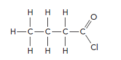

**[1 mark]**

> **[mark-scheme]**
> 1 mark for correct displayed formula of butanoyl chloride

> **[exam-tip]**
> Butanoyl chloride is an acyl chloride, so the structure contains a COCl group at the end of the chain. Remember that the carbon in the COCl group is counted as part of the main carbon chain, so take care when drawing or naming acyl chlorides.
> **[mark-scheme]**
> The name of the mechanism is:
> 
> - Addition-elimination **[1 mark]**

> **[exam-tip]**
> In this reaction, a water molecule adds across the C=O bond and a hydrochloric acid (HCl) molecule is eliminated. This makes it an addition-elimination mechanism. Note that the reaction overall is described as hydrolysis, but the specific mechanism type is addition-elimination.

### Q6
The displayed formula of the smallest aldehyde that can form optical isomers is:

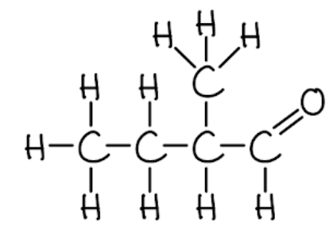

**[1 mark]**

The three-dimensional diagrams of the optical isomers of 2-methylbutanal are:

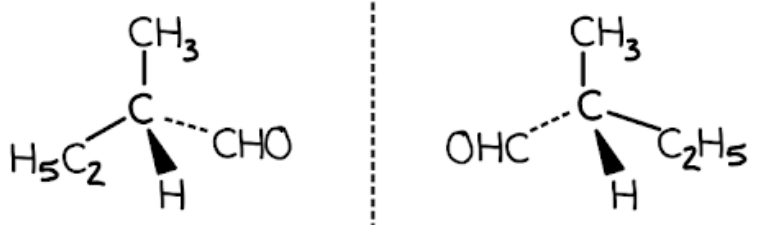

**[2 marks]**

> **[mark-scheme]**
> 1 mark for the correct displayed formula of 2-methylbutanal
> 
> 1 mark for the correct three-dimensional structure of one optical isomer of 2-methylbutanal
> 
> 1 mark for the correct mirror image (non-superimposable mirror image of the first isomer)

> **[exam-tip]**
> To form optical isomers, a carbon atom must have four different atoms or groups attached (a chiral centre). The aldehyde carbon cannot be the chiral centre.
> 
> The chiral centre must carry the CHO group, leaving three bonds available. The smallest combination that gives four different groups is CHO, H, CH3 and C2H5, which gives 2-methylbutanal.
> 
> Do not introduce additional functional groups, as this would not give the smallest aldehyde.
i) The displayed formula of the oxidation product of the aldehyde is:

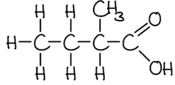

**[1 mark]**

> **[mark-scheme]**
> ii) A suitable reagent and observation for the oxidation:
> 
> Any **one** of the following reagent / observation pairs (1 mark for the reagent and 1 mark for the observation):
> 
> - Reagent: Fehling's solution
> - Observation: Blue solution turns to brick-red precipitate
> 
> **OR**
> 
> - Reagent: Tollens' reagent
> - Observation: Silver mirror / silver deposit on the inside of the tube
> 
> **OR**
> 
> - Reagent: Acidified potassium dichromate(VI) solution
> - Observation: Orange solution turns green
> 
> **[2 marks]**

> **[exam-tip]**
> Aldehydes oxidise to carboxylic acids.
> 
> The three standard reagents for oxidising aldehydes are Fehling's solution, Tollens' reagent, and acidified potassium dichromate(VI). Each has a characteristic colour change.
> **[mark-scheme]**
> i) The balanced equation for the reduction of the aldehyde:
> 
> - C2H5CH(CH3)CHO + 2[H] → C2H5CH(CH3)CH2OH **[1 mark]**
> 
> ii) A suitable reducing agent:
> 
> - Sodium tetrahydridoborate(III) / sodium borohydride / NaBH4
> **OR**
> Lithium tetrahydridoaluminate(III) / lithium aluminium hydride / LiAlH4 **[1 mark]**

> **[exam-tip]**
> Aldehydes reduce to primary alcohols.
> 
> You are expected to know both the product type and the appropriate reducing agents for this transformation.
> **[mark-scheme]**
> The systematic name of the organic compound formed:
> 
> - 2-methylbutyl-2-methylbutanoate **[1 mark]**

> **[exam-tip]**
> The oxidation product from part (b) is 2-methylbutanoic acid. The reduction product from part (c) is 2-methylbutan-1-ol.
> 
> Applying the same pattern as ethanol + ethanoic acid → ethyl ethanoate + water:
> 
> 2-methylbutan-1-ol + 2-methylbutanoic acid → 2-methylbutyl-2-methylbutanoate + water

### Q7
> **[mark-scheme]**
> The IUPAC names of compounds **A**, **B** and **C**:
> 
> - Compound **A**: butanoyl chloride **[1 mark]**
> - Compound **B**: propanamide **[1 mark]**
> - Compound **C**: 4-aminobutanoic acid **[1 mark]**

> **[exam-tip]**
> Naming compound **A** (acyl chloride):
> 
> - Primary functional group: -COCl gives the suffix -oyl chloride
> - Four-carbon chain with single bonds gives the stem butan-
> - The acyl chloride can only be on a terminal carbon, so no position number is needed
> - Name: butanoyl chloride
> 
> Naming compound **B** (amide):
> 
> - Primary functional group: -CONH2 gives the suffix -amide
> - Three-carbon chain with single bonds gives the stem propan-
> - Name: propanamide
> 
> Naming compound **C** (amino acid):
> 
> - Functional groups: -NH2 gives the prefix amino-; -COOH gives the suffix -oic acid
> - Four-carbon chain with single bonds gives the stem butan-
> - The COOH is carbon-1; the NH2 is on carbon-4
> - Name: 4-aminobutanoic acid
> **[mark-scheme]**
> Why this is an example of an addition-elimination reaction:
> 
> - Water adds across the C=O bond **[1 mark]**
> - HCl is eliminated **[1 mark]**

> **[exam-tip]**
> An addition-elimination reaction involves two molecules joining together with the simultaneous loss of a small molecule. In this case:
> 
> - Addition: water adds across the C=O bond
> - Elimination: HCl is lost
> 
> Other named mechanisms to know:
> 
> - Free-radical substitution
> - Electrophilic addition
> - Nucleophilic substitution
> - Nucleophilic addition
> - Electrophilic substitution
The skeletal formula of phenyl butanoate is:

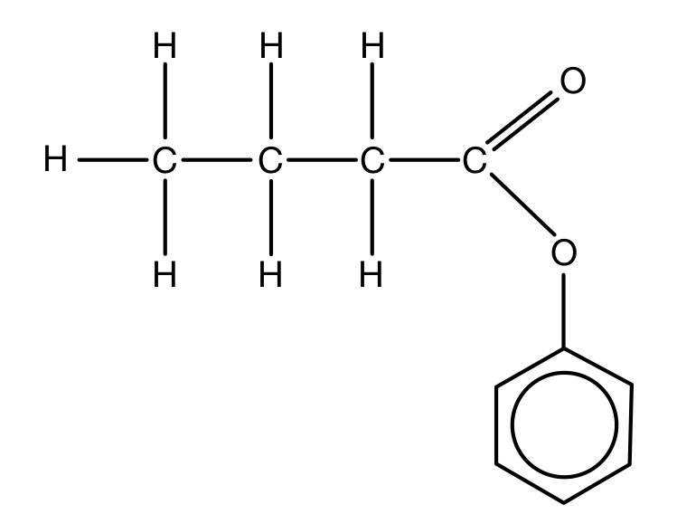

**[2 marks]**

> **[mark-scheme]**
> 1 mark for the correct ester link (-COO-)
> 
> 1 mark for the rest of the structure correct (benzene ring connected via the ester oxygen to the butanoate chain)

> **[exam-tip]**
> 'Butan-' indicates a four-carbon chain with single bonds. '-oate' indicates an ester, so the -COO- group is drawn at one end, with a C=O to one oxygen and a C-O single bond to the other.
> 
> The first part of an ester name comes from the alcohol: phenyl indicates that phenol was used. The H of the -OH group in phenol is lost, leaving the oxygen to form the single bond of the -COO- ester link, with a benzene ring attached.
> **[mark-scheme]**
> Whether any of the compounds exhibit optical isomerism:
> 
> - None of the compounds, **A**, **B** or **C**, exhibit optical isomerism **[1 mark]**
> - None have a chiral centre / no carbon has four different atoms or groups of atoms attached **[1 mark]**

> **[exam-tip]**
> Compounds that exhibit optical isomerism have at least one chiral centre, where  a carbon atom has four different atoms or groups of atoms attached. Such compounds exist as two non-superimposable mirror image forms called enantiomers.
