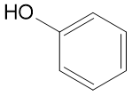
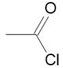
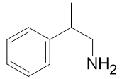
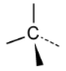
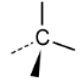
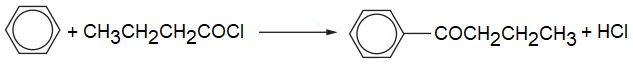
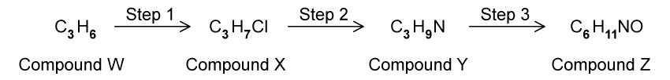
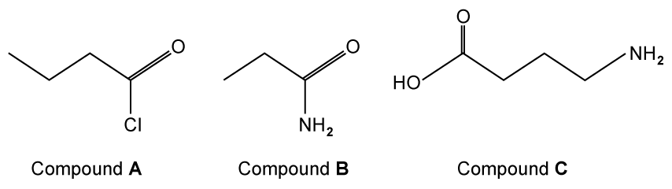
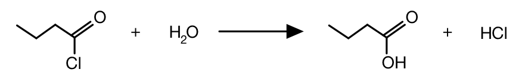

# Exam Questions — Formulas, Functional Groups & the Naming of Organic Compounds
**29. An Introduction to A Level Organic Chemistry** · Cambridge (CIE) A-LEVEL chemistry (9701)
> Source: [https://www.savemyexams.com/a-level/chemistry/cie/25/topic-questions/](https://www.savemyexams.com/a-level/chemistry/cie/25/topic-questions/) · 7 questions across 1 sets

## Structured Questions (7 questions)

### Q1 — easy — 11 marks

**Q1** [3 marks]

Compounds **K**, **L** and **M** are organic compounds with different properties.

| **K** | **L** | **M** |
|---|---|---|
|  |  |  |

State the systematic name of compounds **K**, **L** and **M**.

**Q1** [2 marks]

**Extract:**

Compounds **K**, **L** and **M** are organic compounds with different properties.

| **K** | **L** | **M** |
| :---: | :---: | :---: |
|  |  |  |

Complete Table 2.1 to identify if compounds **K**, **L** and **M** from part **(a)** are aliphatic or aromatic.

**Table 2.1**

|   | **Aliphatic** | **Aromatic** |
|---|---|---|
| compound **K** |   |   |
| compound **L** |   |   |
| compound **M** |   |   |

**Q1** [4 marks]

i) State what is meant by **structural isomerism** and state **three** specific types of structural isomerism.

[2]

ii) State what is meant by **stereoisomerism** and state **two** specific types of stereoisomerism.

[2]

**Q1** [2 marks]

**Extract:**

Compounds **K**, **L** and **M** are organic compounds with different properties.

| **K** | **L** | **M** |
| :---: | :---: | :---: |
|  |  |  |

Complete the three-dimensional diagrams to show the stereoisomers of compound **M**.

| isomer 1 | isomer 2 |
|---|---|
|  |  |

### Q2 — hard — 17 marks

**Q2** [6 marks]

i) State the systematic name and draw the structure of the product of the reaction between CH3CH2CH2CHO and HCN.

[2]

ii) Explain the changes in shape **and** chirality that occur during the formation of the organic product.

[4]

**Q2** [6 marks]

In a second reaction, CH3OH reacts with CH3CH2CH2COCl.

i) State the name of the mechanism involved in this reaction. Describe the steps in the mechanism to support your answer.

[5]

ii) State the systematic name of the organic product of this reaction.

[1]

**Q2** [5 marks]

An equation for the formation of 1-phenylbutan-1-one via the reaction of benzene with CH3CH2CH2COCl is shown in Fig. 4.1. In this reaction, an electrophile is formed from CH3CH2CH2COCl which reacts with benzene.

**Fig. 4.1**

i) State the formula of the electrophile.

[1]

ii) Draw the **three** structural isomers of phenylbutanone and explain which, if any, form optical isomers.

[4]

### Q3 — medium — 9 marks

**Q3** [4 marks]

Table 3.1 shows the formula for different compounds.

**Table 3.1**

| **formula** | **name** |
|---|---|
| (CH3)2C(OH)CH(CH3)2 |   |
| CH3COCl |   |
| CH3CONHCH3 |   |
| CH3CN |   |

Complete Table 3.1.

**Q3** [3 marks]

(CH3)2C(OH)CH(CH3)2 undergoes elimination to form (CH3)2C=C(CH3)2.

i) State the name and draw the structure of the isomer of 2,3-dimethylbut-2-ene which is also formed in this reaction.

[2]

ii) Explain why two products are obtained.

[1]

**Q3** [2 marks]

When CH3COCl is added to cold water, it is hydrolysed to a carboxylic acid.

i) Construct an equation for this hydrolysis reaction.

[1]

ii) Construct an equation for the formation of CH3CONHCH3 from CH3COCl.

[1]

### Q4 — medium — 9 marks

**Q4** [2 marks]

The reaction pathway for the formation of an N-substituted amide is shown in a three-step synthesis in Fig. 2.1. In step 1, the major product of the reaction is formed.

**Fig. 2.1**

State the IUPAC names of compounds **W** and **X**.

**Q4** [2 marks]

**Extract:**

The reaction pathway for the formation of an N-substituted amide is shown in a three-step synthesis in Fig. 2.1. In step 1, the major product of the reaction is formed.

**Fig. 2.1**

State suitable reagents for steps 2 and 3 given in Fig. 2.1 in part **(a)**.

**Q4** [5 marks]

**Extract:**

The reaction pathway for the formation of an N-substituted amide is shown in a three-step synthesis in Fig. 2.1. In step 1, the major product of the reaction is formed.

The IUPAC names of compounds **W** and **X**:
- **W** is propene
- **X** is 2-chloropropane

5.0 g of compound **W** was used to produce compound **X**. The percentage yield was 64%.

i) Calculate the mass, in grams, of compound **X**. Give your answer to 1 decimal place. Show your working.

[3]

ii) State **two** reasons why the percentage yield of the reaction is not 100%.

[2]

### Q5 — easy — 6 marks

**Q5** [4 marks]

The structural formulae of four different organic compounds are shown in Table 1.1.

**Table 1.1**

| **Structural formula** | **IUPAC name** |
|---|---|
| C6H5CH3 |   |
| CH3CH2CH2CH2CHO |   |
| CH3NHCH3 |   |
| CH3CH(NH2)CO2H |   |

Complete Table 1.1 by stating the systematic (IUPAC) name for each compound.

**Q5** [1 mark]

Draw the displayed formula for butanoyl chloride.

**Q5** [1 mark]

Butanoyl chloride reacts with cold water to form butanoic acid. State the name of the mechanism for this reaction.

### Q6 — hard — 9 marks

**Q6** [3 marks]

Draw the displayed formula and three-dimensional diagrams of the optical isomers of the smallest aldehyde that can form optical isomers.

**Q6** [3 marks]

**Extract:**

Draw the displayed formula and three-dimensional diagrams of the optical isomers of the smallest aldehyde that can form optical isomers.

The smallest aldehyde that can form optical isomers is 2-methylbutanal.

i) Draw the displayed formula of the oxidation product of the aldehyde identified in part **(a)**.

[1]

ii) State a suitable reagent and the expected observation for the oxidation of the aldehyde identified in part **(a)**.

[2]

**Q6** [2 marks]

**Extract:**

The smallest aldehyde that can form optical isomers is 2-methylbutanal.

To form optical isomers, a carbon atom must have four different atoms or groups attached (a chiral centre). The aldehyde carbon cannot be the chiral centre.

The chiral centre must carry the CHO group, leaving three bonds available. The smallest combination that gives four different groups is CHO, H, CH~3~ and C~2~H~5~, which gives 2-methylbutanal.

i) Construct a balanced equation, using structural formulae, to show the reduction of the aldehyde identified in part **(a)**. Use [H] to represent the reducing agent.

[1]

ii) State a suitable reducing agent.

[1]

**Q6** [1 mark]

**Extract:**

i) The displayed formula of the oxidation product of the aldehyde is:

2-methylbutanoic acid

i) The balanced equation for the reduction of the aldehyde:

- C₂H₅CH(CH₃)CHO + 2[H] → C₂H₅CH(CH₃)CH₂OH

Aldehydes reduce to primary alcohols.

State the systematic name of the organic compound formed by the reaction of the oxidation product from part **(b)** and the reduction product from part **(c)**.

### Q7 — medium — 9 marks

**Q7** [3 marks]

State the IUPAC names of compounds **A**, **B** and **C**.

**Q7** [2 marks]

Compound **A** can undergo hydrolysis to form a carboxylic acid.

Explain why this is an example of an addition-elimination reaction.

**Q7** [2 marks]

**Extract:**

Compound **A**: butanoyl chloride

When heated, compound **A** will also react with phenol in the presence of a base to produce phenyl butanoate.

Draw the skeletal formula of phenyl butanoate.

**Q7** [2 marks]

**Extract:**

State the IUPAC names of compounds **A**, **B** and **C**.

The IUPAC names of compounds **A**, **B** and **C**:

- Compound **A**: butanoyl chloride
- Compound **B**: propanamide
- Compound **C**: 4-aminobutanoic acid

State whether any of the compounds, **A**, **B** or **C**, exhibit optical isomerism.

Explain your answer.
