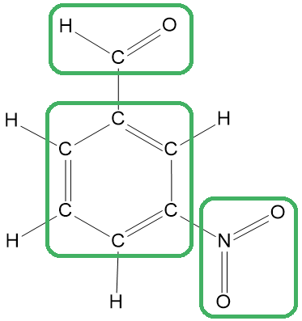
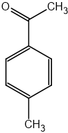
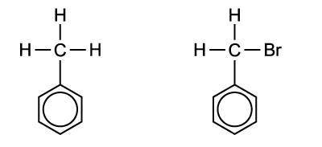
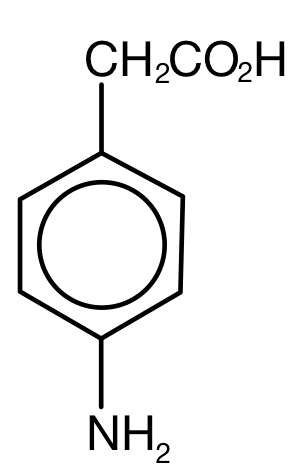

# Mark Schemes — Characteristic Organic Reactions
**29. An Introduction to A Level Organic Chemistry** · Cambridge (CIE) A-LEVEL chemistry (9701)

## Structured Questions (4 questions)

### Q1
> **[mark-scheme]**
> The systematic name of CH3CH2CH(OH)CN is:
> 
> - 2-hydroxybutanenitrile **[1 mark]**
> 
> The 'e' at the end of butane must be included; '2-hydroxybutannitrile' is not accepted

> **[exam-tip]**
> The name is built in three steps: identify the parent chain (4 carbons including the CN carbon = butane), add the nitrile suffix keeping the 'e' (butane + nitrile = butanenitrile), then number the hydroxy group from the nitrile end (OH is on C-2 = 2-hydroxy).
> 
> The most common error is dropping the 'e' to write '2-hydroxybutannitrile', which is not accepted.
> **[mark-scheme]**
> The mechanism for this reaction is:
> 
> - Nucleophilic addition **[1 mark]**
> 
> Both words are required for the mark

> **[exam-tip]**
> Both words, nucleophilic and addition, must be present. Writing only one will not gain the mark.
> 
> This mechanism applies whenever a nucleophile attacks the C=O group of an aldehyde or ketone. The addition part reflects that the nucleophile adds across the C=O double bond rather than substituting an existing group.
> **[mark-scheme]**
> Propanal undergoes this mechanism because:
> 
> - The C=O bond is polar
> **OR**
> O is more electronegative than C
> **OR**
> C is δ+ and O is δ−  **[1 mark]**
> - Nucleophiles / CN- are electron pair donors 
> **AND** 
> They are attracted to the electron-deficient Cδ+ carbon **[1 mark]**

> **[exam-tip]**
> These two marks are sequential: the first establishes why the carbon is susceptible to attack (polar C=O bond, δ+ carbon), and the second explains why a nucleophile is attracted to it (electron pair donors are drawn to δ+ centres).
> 
> For the second mark, both parts are required: you must state that CN- / nucleophiles are electron pair donors, and that they are attracted to the δ+ carbon. Stating only one of these will not gain the mark.

### Q2
> **[mark-scheme]**
> i) The name of the mechanism, reagents and conditions for this nitration reaction are:
> 
> - Mechanism: electrophilic substitution **[1 mark]**
> - Reagents: concentrated nitric acid
> **AND**
> Concentrated sulfuric acid **[1 mark]**
> - Conditions: heat / reflux
> **AND**
> Temperature in the range 25–60 °C **[1 mark]**

> **[exam-tip]**
> This reaction is a nitration, which is a type of electrophilic aromatic substitution in which a nitro group (–NO2) replaces a hydrogen atom on the benzene ring.
> 
> Both acids are required. The sulfuric acid acts as a catalyst by protonating the nitric acid to generate the nitronium ion (NO2+), which is the electrophile in the mechanism.
> 
> The temperature must be controlled carefully. Too high a temperature leads to polynitration, where more than one nitro group is added to the ring.
> 
> When numbering the carbon atoms, count the benzene carbon bearing the aldehyde group as C-1. The –CHO group is an electron-withdrawing meta-director, so the nitro group is added at C-3.

ii) The fully displayed formula of 3-nitrobenzaldehyde with the functional groups circled is:

**[2 marks]**

> **[mark-scheme]**
> 1 mark for a correct fully displayed formula of 3-nitrobenzaldehyde
> 
> 1 mark for all three functional groups correctly circled

> **[exam-tip]**
> The three functional groups to circle are:
> 
> - The aldehyde group (–CHO)
> - The nitro group (–NO2)
> - The benzene ring
> 
> The benzene ring is the most commonly missed functional group. It counts as a functional group in its own right.
> 
> Take care with the nitro group in the fully displayed formula. It contains two N–O bonds: one N=O double bond and one N–O single bond, with the oxygen bearing a negative charge. Make sure the correct number of bonds is shown before circling.
> **[mark-scheme]**
> i) The hybridisation and C–C=O bond angle in benzaldehyde are:
> 
> - Hybridisation: sp2 **[1 mark]**
> - C–C=O bond angle: 120° **[1 mark]**

> **[exam-tip]**
> The carbon atom in the aldehyde group (–CHO) has three groups attached: the ring carbon, the hydrogen, and the oxygen (via the double bond, which counts as one group). Three groups around a central atom corresponds to sp2 hybridisation and a trigonal planar arrangement, giving bond angles of 120°.

> **[mark-scheme]**
> ii) To explain why the student is incorrect:
> 
> - The p-orbital on the carbon atom of the aldehyde group overlaps / delocalises with the π system of the benzene ring **[1 mark]**
> - This gives the C–C bond partial double bond character, which restricts rotation **[1 mark]**
> 
> Writing π orbital instead of p-orbital in the first marking point is accepted
> 
> The statement that lone pairs on the oxygen atom delocalise into the ring is not accepted for the first marking point.
> 
> References to hydrogen bonding or van der Waals' forces are not accepted

> **[exam-tip]**
> The student's error is treating the C–C bond connecting the ring to the aldehyde group as a simple single bond, like those found in alkanes. In benzaldehyde, this is not the case.
> 
> The p-orbital on the carbonyl carbon (the C of –CHO) is parallel to the p-orbitals of the benzene ring. These orbitals overlap sideways, extending the delocalised π system across the C–C bond. This gives the C–C bond partial double bond character, which restricts rotation and holds the molecule in a planar conformation.
> 
> A common error is to state that lone pairs on the oxygen delocalise into the ring. This is what happens in phenol (C6H5OH), not benzaldehyde. In benzaldehyde, it is the p-orbital on the carbonyl carbon that overlaps with the ring, not lone pairs on oxygen.
i) The major organic product of this reaction is:

**[1 mark]**

> **[mark-scheme]**
> 1 mark for the correct structure of the major organic product, with the acetyl group (CH3CO–) at the 4/para position of the methylbenzene ring
> 
> The 2/ortho product is not accepted as the major product.

> **[exam-tip]**
> This is a Friedel-Crafts acylation. The ethanoyl chloride reacts with the AlCl3 catalyst to form the acylium ion (CH3CO+):
> 
> CH3COCl + AlCl3 → CH3CO+ + AlCl4–
> 
> The CH3 group on methylbenzene is an electron-donating ortho/para director, so substitution occurs at the ortho or para positions. The para product is the major product because the ortho positions have greater steric hindrance from the adjacent ring hydrogens.

> **[mark-scheme]**
> ii) The total number of σ and π bonds in one molecule of the organic product is:
> 
> - σ bonds = 20
> **AND**
> π bonds = 4 **[1 mark]**

> **[exam-tip]**
> Every covalent bond contains a sigma bond, including the sigma component of every double bond.
> 
> To count sigma bonds: count every bond in the structure. 4-methylacetophenone has 20 bonds in total, so there are 20 sigma bonds.
> 
> To count pi bonds: count each double bond once. Using a Kekulé structure, the benzene ring contains 3 C=C double bonds, plus 1 C=O double bond in the acetyl group, giving 4 pi bonds in total.

### Q3
> **[mark-scheme]**
> i) The meaning of the term electrophile:
> 
> - A species that accepts / receives an electron pair / electron pair acceptor / electron-deficient species **[1 mark]**
> 
> Answers referring only to positive charge without mention of electron pairs are not accepted

> **[exam-tip]**
> The key distinction between an electrophile and a nucleophile is the direction of the electron pair: electrophiles accept pairs, nucleophiles donate them.
> 
> Electrophiles do not need to carry a full positive charge. A partial positive charge (δ+) is sufficient; for example, the carbon in a polar C–X bond can act as an electrophile.

> **[mark-scheme]**
> ii) The equation for the reaction between benzene and concentrated nitric acid:
> 
> - C6H6 + HNO3 → C6H5NO2 + H2O **[1 mark]**
> 
> State symbols are not required

> **[exam-tip]**
> This reaction is called nitration and produces nitrobenzene, a pale yellow liquid.
> 
> Concentrated sulfuric acid acts as a catalyst, so it does not appear in the overall equation; it is regenerated at the end of the mechanism.

> **[mark-scheme]**
> iii) The electrophile in this reaction:
> 
> - NO2+ / the nitronium ion **[1 mark]**

> **[exam-tip]**
> The electrophile is the nitronium ion, NO2+, not nitric acid itself. Nitric acid must first react with concentrated sulfuric acid to generate NO2+ before the substitution reaction can proceed.

> **[mark-scheme]**
> iv) The equation showing how this electrophile is generated:
> 
> - HNO3 + H2SO4 → NO2+ + HSO4- + H2O **[1 mark]**
> 
> State symbols are not required

> **[exam-tip]**
> Nitric acid acts as a Brønsted–Lowry base in this step, accepting a proton from concentrated sulfuric acid. This is unusual for nitric acid, which is normally an acid, but it occurs because concentrated sulfuric acid is a stronger acid.
> 
> The HSO4- ion can donate a proton back at the end of the mechanism, regenerating H2SO4. This explains why sulfuric acid is described as a catalyst.
> **[mark-scheme]**
> i) Explain why benzene undergoes substitution rather than addition reactions:
> 
> Any **three** from (1 mark for each point):
> 
> - The electrons in benzene are delocalised across all six carbon atoms in the ring
> - Delocalisation confers extra stability to the benzene ring
> - Addition reactions would disrupt / break the delocalised electron system
> - Disrupting delocalisation would require more energy than is released, making addition energetically unfavourable
> - Substitution reactions preserve the delocalised / aromatic ring structure
> 
> **[3 marks]**
> 
> Answers referring to benzene having localised double bonds are not accepted

> **[exam-tip]**
> The stability gained through delocalisation is sometimes called the delocalisation energy or resonance energy. It is this extra stability that makes addition reactions thermodynamically unfavourable compared to substitution reactions, as addition would destroy the aromatic system.
> 
> When explaining this in the exam, link your points clearly: delocalised electrons give stability, and addition would destroy this stability. Saying only "benzene is stable" without explaining why does not gain the mark.

> **[mark-scheme]**
> ii) The equation for the reaction of benzene with chlorine, and the conditions required:
> 
> - C6H6 + Cl2 → C6H5Cl + HCl **[1 mark]**
> - AlCl3 as a catalyst, anhydrous conditions **[1 mark]**
> 
> FeCl3 / iron(III) chloride is accepted as an alternative catalyst
> 
> State symbols are not required

> **[exam-tip]**
> The aluminium chloride catalyst is sometimes called a halogen carrier. It polarises the Cl–Cl bond to generate a Cl+ electrophile, which then attacks the benzene ring.
> 
> Anhydrous conditions are essential because AlCl3 reacts vigorously with water. If moisture is present, the catalyst is destroyed and the reaction will not proceed.
> **[mark-scheme]**
> i) The type of reaction is:
> 
> - Free radical substitution **[1 mark]**

> **[exam-tip]**
> The clue here is the presence of UV light, which provides the energy needed to initiate free radical substitution. This reaction occurs at the methyl group (side chain), not on the benzene ring itself. Bromine reacts with alkyl hydrogens under UV light, not with the delocalised ring.

ii) The structures of the reactant and product are:

**[2 marks]**

> **[mark-scheme]**
> 1 mark for the correct structure of the reactant: methylbenzene / toluene, C6H5CH3
> 
> 1 mark for the correct structure of the product: (bromomethyl)benzene, C6H5CH2Br

> **[exam-tip]**
> The molecular formula C7H8 corresponds to methylbenzene: a benzene ring with one methyl group. The degree of unsaturation is 4, consistent with a benzene ring.
> 
> When UV light initiates the reaction, a bromine radical abstracts a hydrogen from the methyl group, not from the ring. The benzene ring is too stable to undergo addition or radical substitution under these conditions.

> **[mark-scheme]**
> iii) One other organic product that could form is:
> 
> Any **one** from:
> 
> - C6H5CHBr2 / C7H6Br2
> - C6H5CBr3 / C7H5Br3
> - C6H5CH2CH2C6H5 / C14H14
> 
> **[1 mark]**
> 
> HBr is not accepted as it is an inorganic product

> **[exam-tip]**
> Further substitution can occur with excess bromine and UV light, where one or two more hydrogen atoms in the methyl group can be replaced, giving C6H5CHBr2 and C6H5CBr3.
> 
> The final alternative product, C6H5CH2CH2C6H5, forms when two benzyl radicals combine in the termination step.

### Q4
> **[mark-scheme]**
> The shape of benzene can be described and explained as follows:
> 
> - Bond angle between carbon atoms: 120° **[1 mark]**
> - Hybridisation of carbon atoms: sp2 **[1 mark]**
> - σ bonds formed by end-on overlap of sp2 orbitals
> **AND**
> π bonds formed by sideways overlap of p orbitals above and below the plane of the ring **[1 mark]**

> **[exam-tip]**
> Each carbon in benzene forms three σ bonds using its sp2 hybrid orbitals: one to each neighbouring ring carbon and one to a hydrogen atom. These bonds lie in the plane of the ring at 120° to each other.
> 
> Each carbon also has one unhybridised p orbital pointing perpendicular to the ring plane. These p orbitals overlap sideways with the p orbitals on neighbouring carbons to form the π system. Because all six p orbitals overlap equally, the π electrons are delocalised across the whole ring rather than fixed between specific carbon pairs.
> 
> A key consequence of this delocalisation is that all six C–C bond lengths in benzene are equal, with a value between a C–C single bond (0.154 nm) and a C=C double bond (0.134 nm). Students sometimes lose the third mark by describing either σ or π bond formation but not both.
> **[mark-scheme]**
> i) The mechanism of this nitration reaction is:
> 
> - Electrophilic substitution **[1 mark]**

> **[exam-tip]**
> The mechanism is electrophilic because the attacking species, NO2+, is electron-deficient and attacks the electron-rich benzene ring. It is substitution rather than addition because the hydrogen atom is replaced by the NO2 group, preserving the aromaticity of the ring. Addition would break the delocalised π system and is strongly disfavoured.

> **[mark-scheme]**
> ii) The equation for the generation of the electrophile is:
> 
> - HNO3 + H2SO4 → NO2+ + HSO4- + H2O **[1 mark]**
> 
> The two-step representation: H2SO4 + HNO3 → H2NO3+ + HSO4- followed by H2NO3+ → NO2+ + H2O is accepted

> **[exam-tip]**
> In this equation, concentrated sulfuric acid acts as an acid, donating a proton (H+) to nitric acid. The protonated nitric acid (H2NO3+) is unstable and loses water to form the nitronium ion, NO2+. It is this NO2+ ion that acts as the electrophile and attacks the benzene ring in the mechanism shown in Fig. 1.1.
i) The structure of (4-aminophenyl)ethanoic acid is:

**[1 mark]**

> **[mark-scheme]**
> 1 mark for the correct structure of (4-aminophenyl)ethanoic acid

> **[exam-tip]**
> Work through the name systematically to build up the structure:
> 
> - "ethanoic acid" indicates a –CH2COOH group attached to a benzene ring (phenylethanoic acid)
> - "4-amino" indicates an –NH2 group at the para (4-) position of the ring, directly opposite the –CH2COOH group
> 
> Start by drawing phenylethanoic acid, with the –CH2COOH group attached to C-1 of the benzene ring:
> 
> Then add the –NH2 group at C-4 to give the final structure:

> **[mark-scheme]**
> ii) The systematic name of the molecule shown in Fig. 1.2 is:
> 
> - 4-nitromethylbenzene **[1 mark]**

> **[exam-tip]**
> The molecule in Fig. 1.2 is methylbenzene with a nitro group (–NO2) substituted onto the ring. When naming, take the carbon bearing the methyl group as C-1. The nitro group is directly opposite, at C-4, giving the name 4-nitromethylbenzene.
> **[mark-scheme]**
> Three functional groups in noradrenaline in addition to the arene group are:
> 
> - Phenol **[1 mark]**
> - (Secondary) alcohol **[1 mark]**
> - (Primary) amine **[1 mark]**

> **[exam-tip]**
> Noradrenaline contains three functional groups in addition to the arene group:
> 
> 1. Phenol: the –OH group attached directly to the benzene ring. This is a separate functional group from alcohol and must be named specifically as phenol.
> 2. Secondary alcohol: the –OH group attached to a carbon that is bonded to two other carbon atoms. Because the central carbon has two C–C bonds, it is a secondary alcohol, not a primary one.
> 3. Primary amine: the –NH2 group, where the nitrogen is bonded to one carbon chain (one R group) and two hydrogen atoms.
> 
> A common error is to name the phenol –OH as an alcohol. In CIE mark schemes, phenol and alcohol are distinct functional groups and cannot be substituted for each other.
