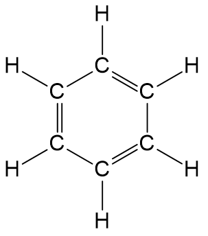
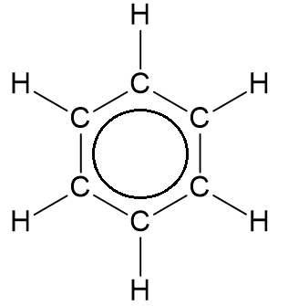

# Mark Schemes — Shapes of Aromatic Organic Molecules; σ & π Bonds
**29. An Introduction to A Level Organic Chemistry** · Cambridge (CIE) A-LEVEL chemistry (9701)

## Structured Questions (4 questions)

### Q1
> **[mark-scheme]**
> The systematic (IUPAC) names for compounds W, X and Y are:
> 
> - W = 4-chloromethylbenzene **[1 mark]**
> - X = 3-nitrobenzoic acid **[1 mark]**
> - Y = propylbenzene **[1 mark]**

> **[exam-tip]**
> The benzene ring is the main functional group in compounds W and Y, so the suffix is -benzene.
> 
> In W, the prefixes chloro- and methyl- are needed. The methyl group assumes position 1 and the chloro- group is given a position in relation to this, i.e. 4.
> 
> In Y, the prefix propyl- is used to represent the –CH2CH2CH3 group.
> 
> For compound X, the benzene ring has the –COOH group attached, so its suffix is benzoic acid. It also has the NO2 group attached, so the prefix nitro- is needed, and its position is given in relation to the –COOH group.
> **[mark-scheme]**
> The systematic (IUPAC) name for compound Z is:
> 
> - 2,4-dibromophenol **[1 mark]**

> **[exam-tip]**
> The benzene ring contains an –OH group, so the main stem is phenol.
> 
> Starting from the OH group (on carbon 1, as this is the dominant functional group) and counting anticlockwise, there are two bromine atoms on carbons 2 and 4. This is the lowest numbered version as counting clockwise would give 4 and 6.
> **[mark-scheme]**
> The bond angle in benzene is:
> 
> - 120° **[1 mark]**

> **[exam-tip]**
> Each carbon atom in benzene is sp2 hybridised and bonded to three other atoms. The three areas of electron density arrange themselves as far apart as possible, giving a trigonal planar arrangement and a bond angle of 120°.
> **[mark-scheme]**
> i) σ bonds between neighbouring carbon atoms are formed by:
> 
> - End-on / axial overlap of sp2 hybridised orbitals **[1 mark]**
> 
> ii) π bonds between neighbouring carbon atoms are formed by:
> 
> - Sideways / lateral overlap of adjacent p orbitals (above and below the plane of the ring) **[1 mark]**

> **[exam-tip]**
> Each carbon atom has three sp2 hybridised orbitals (formed from one s and two p orbitals), arranged at 120° to each other in a plane. These sp2 orbitals overlap end-on with the sp2 orbitals of neighbouring carbon atoms and the s orbital of the hydrogen atom, forming σ bonds.
> 
> Each carbon atom also has one unhybridised p orbital, perpendicular to the plane of the molecule. These p orbitals overlap sideways with adjacent p orbitals, forming π bonds. The resulting electrons become delocalised around the ring.

### Q2
> **[mark-scheme]**
> The systematic (IUPAC) names are:
> 
> - compound X: 1-chloro-2-methylbenzene **[1 mark]**
> - compound Y: 3,5-dichlorophenylamine **[1 mark]**

> **[exam-tip]**
> To name compound X, the chloro and methyl groups are listed in alphabetical order, with the methyl group at position 1.
> 
> To name compound Y, the dominant functional group is the amine group. When bonded directly to a benzene ring, this gives the parent name phenylamine. The two chloro groups are at positions 3 and 5.
> **[mark-scheme]**
> The benzene ring is planar because:
> 
> - All carbon atoms in C6H6 / benzene are sp2 hybridised **[1 mark]**
> - Forming a trigonal planar / triangular planar arrangement
> **AND**
> (With) bond angles of 120° **[1 mark]**

> **[exam-tip]**
> Hybridisation explains the shape of molecules. sp2 hybridisation produces three equivalent orbitals arranged at 120° in a plane, giving a trigonal planar geometry. Since all six carbon atoms in benzene are sp2 hybridised, the entire ring lies in one plane.
> **[mark-scheme]**
> The reagents and conditions for each step are:
> 
> - step 1 reagents: CH3Cl and AlCl3 **[1 mark]**
> - step 1 conditions: anhydrous **[1 mark]**
> - step 2 reagents: Cl2 and AlCl3 **[1 mark]**
> - step 2 conditions: anhydrous **[1 mark]**

> **[exam-tip]**
> For benzene to react, a powerful electrophile must be generated. The delocalised π system is very stable and will only react with powerful electrophiles. AlCl3 acts as a Lewis acid catalyst (halogen carrier) by generating an electrophilic species from the reagent.
> 
> Step 1 is a Friedel-Crafts alkylation: benzene reacts with CH3Cl / AlCl3 to form methylbenzene.
> 
> Step 2 is a Friedel-Crafts halogenation: methylbenzene reacts with Cl2 / AlCl3 to form compound X as a mixture of 2- and 4-chloromethylbenzene.
> 
> Anhydrous conditions are essential: water hydrolyses AlCl3, destroying its catalytic activity.

### Q3
> **[mark-scheme]**
> The bond angle in benzene is:
> 
> - 120° **[1 mark]**

> **[exam-tip]**
> Each carbon atom in benzene is sp2 hybridised and bonded to three other atoms. The three areas of electron density arrange themselves as far apart as possible, giving a trigonal planar arrangement and a bond angle of 120°.
> **[mark-scheme]**
> Hexene reacts with aqueous bromine but benzene does not because:
> 
> - The π bond in hexene / C6H12 contains localised electrons / an area of high electron density **[1 mark]**
> - The π bond in hexene / C6H12 induces a partial positive (δ+) and partial negative (δ–) in the Br2 molecule **[1 mark]**
> - The δ+ Br / bromine atom is attracted to the π bond in hexene / C6H12, forming a carbocation intermediate **[1 mark]**
> - The carbocation intermediate attracts the δ– Br / bromine atom **[1 mark]**
> - In benzene / C6H6, there are no localised electrons / areas of high electron density, so it cannot polarise the Br2 molecule
> **OR**
> In benzene / C6H6, the electrons are delocalised with no areas of high electron density, so it cannot polarise the Br2 molecule **[1 mark]**

> **[exam-tip]**
> Alkenes undergo electrophilic addition with halogen molecules because the localised π bond has high electron density that readily polarises the Br2 molecule. Benzene's delocalised electrons cannot do this as a halogen carrier such as AlBr3 is needed to generate a sufficiently powerful electrophile for benzene to react.
> **[mark-scheme]**
> The mechanism for this reaction is:
> 
> - Electrophilic substitution **[1 mark]**

> **[exam-tip]**
> Benzene's delocalised π electron system is very stable. Unlike alkenes, it does not undergo electrophilic addition (which would disrupt the stabilising ring), but instead undergoes electrophilic substitution, which restores the delocalised ring after each step.

### Q4
The displayed formula of benzene is:

**OR**

**[1 mark]**

> **[mark-scheme]**
> 1 mark for a correct displayed formula of benzene showing all six C–H bonds and all six C–C bonds. Both the Kekulé structure and the delocalised (circle) representation are accepted.

> **[exam-tip]**
> The fully displayed formula must show all atoms and all bonds. For benzene (C6H6), draw all six C–H bonds and all six C–C bonds explicitly.
> 
> You can draw benzene as a hexagon with alternating single and double bonds (Kekulé structure) or as a regular hexagon with a circle inside to represent the delocalised π electrons.
> **[mark-scheme]**
> The bond angle in benzene is:
> 
> - 120° **[1 mark]**

> **[exam-tip]**
> Each carbon atom in benzene is bonded to three other atoms, creating three regions of electron density. These arrange in a trigonal planar geometry, giving bond angles of 120°. There are no lone pairs on the carbon atoms to distort this angle.
> **[mark-scheme]**
> The type of hybridisation of the carbon atoms in benzene is:
> 
> - sp2 **[1 mark]**

> **[exam-tip]**
> sp2 hybridisation means that one s orbital and two p orbitals combine to form three sp2 hybrid orbitals arranged at 120° to each other in a plane. Each carbon in benzene also has one unhybridised p orbital perpendicular to this plane, which participates in the delocalised π system.
> 
> Compare with sp3 hybridised carbon (e.g. methane), where all four orbitals hybridise to give a tetrahedral geometry with 109.5° bond angles.
