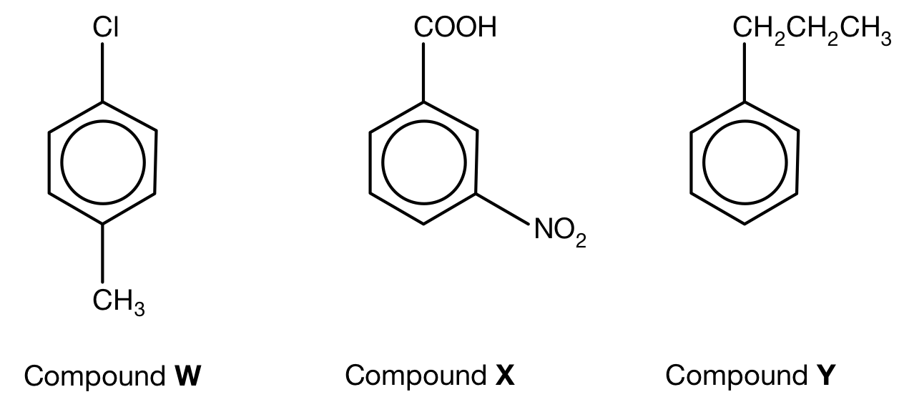
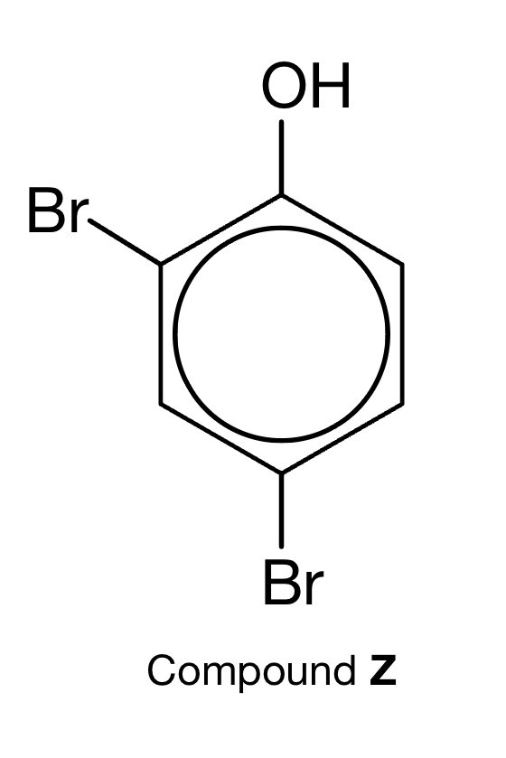
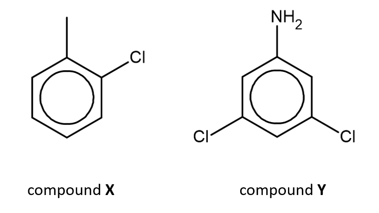

# Exam Questions — Shapes of Aromatic Organic Molecules; σ & π Bonds
**29. An Introduction to A Level Organic Chemistry** · Cambridge (CIE) A-LEVEL chemistry (9701)
> Source: [https://www.savemyexams.com/a-level/chemistry/cie/25/topic-questions/](https://www.savemyexams.com/a-level/chemistry/cie/25/topic-questions/) · 4 questions across 1 sets

## Structured Questions (4 questions)

### Q1 — medium — 7 marks

**Q1** [3 marks]

State the systematic (IUPAC) name for compounds W, X and Y.

**Q1** [1 mark]

State the systematic (IUPAC) name for compound Z.

**Q1** [1 mark]

State the bond angle in a benzene molecule.

**Q1** [2 marks]

In benzene, each of the carbon atoms is sp2 hybridised.

i) Describe how neighbouring carbon atoms form σ bonds.

[1]

ii) Neighbouring carbon atoms also form π bonds. Describe how these π bonds are formed.

[1]

### Q2 — medium — 8 marks

**Q2** [2 marks]

State the systematic (IUPAC) name for each of the following aromatic compounds.

**Q2** [2 marks]

Explain why the benzene ring is planar.

**Q2** [4 marks]

**Extract:**

compound X: 1-chloro-2-methylbenzene

Compound X can be formed from benzene in a two-step reaction.

State the reagents and conditions required for each step.

### Q3 — medium — 7 marks

**Q3** [1 mark]

State the bond angle in a benzene molecule.

**Q3** [5 marks]

Explain why benzene, C6H6, does not react with aqueous bromine, whereas hexene, C6H12, reacts readily.

**Q3** [1 mark]

Benzene reacts with liquid bromine in the presence of a suitable catalyst.

State the name of the mechanism for this reaction.

### Q4 — easy — 3 marks

**Q4** [1 mark]

Draw the displayed formula of benzene.

**Q4** [1 mark]

State the bond angle in a benzene molecule.

**Q4** [1 mark]

State the type of hybridisation of the carbon atoms in benzene.
