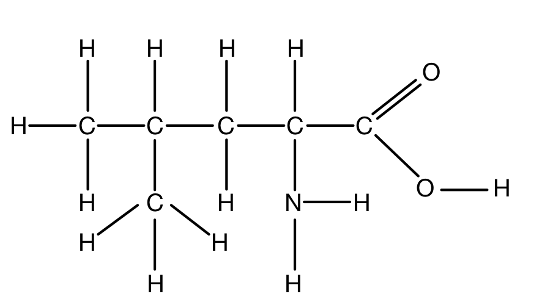
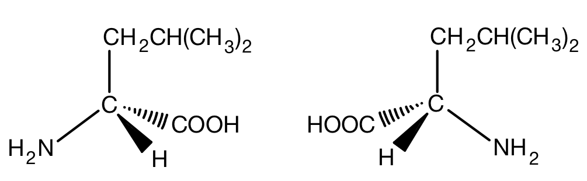
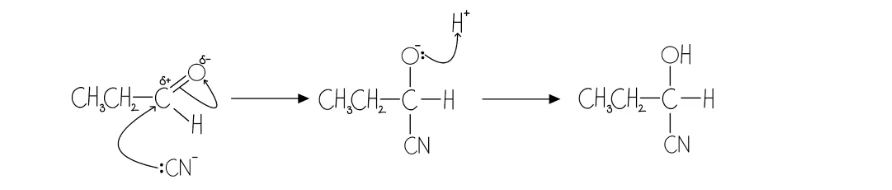
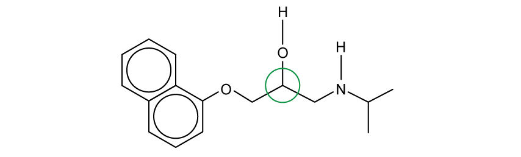
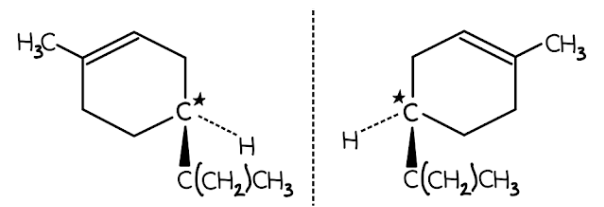
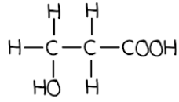
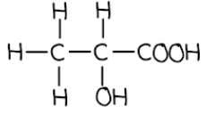
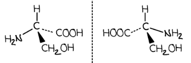

# Mark Schemes — Isomerism: Optical
**29. An Introduction to A Level Organic Chemistry** · Cambridge (CIE) A-LEVEL chemistry (9701)

## Structured Questions (6 questions)

### Q1
The displayed formula of leucine is:

**[1 mark]**

> **[mark-scheme]**
> 1 mark for the correct fully-displayed formula of leucine with all bonds shown, including the O–H bond in the carboxylic acid group and the N–H bonds in the amino group

> **[exam-tip]**
> A displayed formula shows every bond in the molecule as a line. The most commonly missed bonds are the O–H in the –COOH group and both N–H bonds in the –NH2 group. Check your diagram includes all of these before moving on.
> **[mark-scheme]**
> i) The meaning of the term stereoisomerism:
> 
> - Molecules with the same structural formula / same atoms bonded to each other in the same order **[1 mark]**
> - But with a different arrangement of atoms in space **[1 mark]**
> 
> ii) The two optical isomers of leucine can be distinguished:
> 
> - By passing plane-polarised light through solutions of each isomer / by using a polarimeter **[1 mark]**
> - Each optical isomer / enantiomer rotates the plane of polarised light in opposite directions **[1 mark]**

> **[exam-tip]**
> For the definition of stereoisomerism, two points are needed:
> 
> 1. The molecules have the same structural formula (the same atoms bonded in the same order)
> 2. They differ in the spatial arrangement of those atoms.
> 
> Saying only 'different arrangement' without specifying it is a spatial difference will not score the second mark.
> 
> For distinguishing optical isomers, focus on the one physical property that sets them apart: their effect on plane-polarised light. One enantiomer rotates the plane clockwise and the other rotates it anticlockwise. A racemic mixture contains equal amounts of both, so the rotations cancel and there is no net effect on the light.
The two optical isomers of leucine are:

**[2 marks]**

> **[mark-scheme]**
> 1 mark for a correct three-dimensional diagram of one optical isomer of leucine, with the chiral carbon at the centre bearing four different groups shown using wedge-and-dash notation
> 
> 1 mark for the second optical isomer drawn as the non-superimposable mirror image of the first
> 
> Allow other valid orientations of the four groups provided the two structures are non-superimposable mirror images of each other

> **[exam-tip]**
> To find the chiral centre in leucine, identify the carbon with four different groups attached. In leucine, this is the carbon bearing –H, –NH2, –COOH, and –CH2CH(CH3)2:
> 
> Place the chiral carbon at the centre of your diagram. Use two standard bonds in the plane of the page, one wedge bond coming towards you, and one dash bond going away from you. Attach the four different groups to the ends of these bonds.
> 
> To draw the second isomer, reflect the first in a mirror. The two structures must be non-superimposable: no rotation should make one identical to the other.
> **[mark-scheme]**
> 2-amino-4-methylpentanoic acid **[1 mark]**

> **[exam-tip]**
> To name leucine systematically:
> 
> - Identify the longest carbon chain containing the –COOH group:
> 
>   - 5 carbons (pentanoic acid)
> - Identify the substituents:
> 
>   - –NH2 (amino-) on C2
>   - –CH3 branch (methyl-) on C4
> - List the prefixes alphabetically:
> 
>   - amino- before methyl-
> - Assemble the full name:
> 
>   - 2-amino-4-methylpentanoic acid.

### Q2
> **[mark-scheme]**
> i) The systematic (IUPAC) names of compounds **A** and **B** are:
> 
> - **A**: propanal **[1 mark]**
> - **B**: propanone **[1 mark]**
> 
> ii) The name of the mechanism is:
> 
> - Nucleophilic addition **[1 mark]**

iii) The mechanism for the reaction between compound **A** and HCN is:

**[4 marks]**

> **[mark-scheme]**
> 1 mark for a curly arrow drawn from the lone pair of :CN- to the δ+ carbon atom of compound A
> 
> 1 mark for a curly arrow drawn from the C=O bond to the δ- oxygen atom
> 
> 1 mark for the correct negatively charged intermediate with O- and CN bonded to the former carbonyl carbon
> 
> 1 mark for a curly arrow drawn from the lone pair of O- to an H+ ion, forming the final product
> 
> HCN alone is not accepted as the nucleophile. The cyanide ion (:CN-) is the nucleophile.

> **[mark-scheme]**
> iv) The systematic name of the organic product is:
> 
> - 2-hydroxybutanenitrile **[1 mark]**

> **[exam-tip]**
> Compound A is an aldehyde (the carbonyl group is at the end of the chain); compound B is a ketone (the carbonyl group is internal). Both can undergo nucleophilic addition with HCN.
> 
> For the mechanism in part iii), the nucleophile is the cyanide ion CN-, which attacks the δ+ carbon of the C=O group. Your diagram must show:
> 
> - The lone pair on :CN- with a curly arrow going to the δ+ carbon.
> - → A curly arrow from the C=O bond going to the δ- oxygen (forming O-).
> - → The complete intermediate with O- and CN bonded to the former carbonyl carbon.
> - → A curly arrow from the lone pair on O- going to H+, forming the final –OH group.
> 
> For part iv), the product is a hydroxynitrile. The –CN group becomes part of the carbon chain (extending it by one carbon), so the parent chain is 4 carbons long. The –OH is on C2 and the nitrile is the principal functional group: 2-hydroxybutanenitrile.
> **[mark-scheme]**
> i) The systematic name of the organic product:
> 
> - 2-hydroxy-2-methylpropanenitrile **[1 mark]**
> 
> ii) The product does not exhibit optical isomerism because:
> 
> - The central carbon of the product is bonded to two identical methyl / –CH3 groups **[1 mark]**
> - Optical isomerism requires a chiral centre; this compound has no carbon bonded to four different groups **[1 mark]**

> **[exam-tip]**
> When propanone (compound B) reacts with HCN, the product is 2-hydroxy-2-methylpropanenitrile. The central carbon (C2) carries –OH, –CN, and two –CH3 groups. Because two of its substituents are identical, C2 is not a chiral centre, and the compound cannot exhibit optical isomerism.
> 
> This contrasts with the product from compound A (propanal), where C2 after HCN addition carries –H, –OH, –CN, and –CH3: four different groups, giving a chiral centre and therefore a pair of optical isomers.
> **[mark-scheme]**
> The reaction between compound A and HCN produces a racemic mixture because:
> 
> - Compound A / the carbonyl group is planar
> **OR**
> The carbonyl carbon is sp2 hybridised **[1 mark]**
> - The nucleophile / CN- ion can attack from above or below the plane of the carbonyl group with equal probability **[1 mark]**
> - A chiral centre is created with four different groups attached, giving equal amounts of both enantiomers **[1 mark]**

> **[exam-tip]**
> The key is the geometry of the carbonyl group. The carbonyl carbon in compound A is sp2 hybridised and the molecule is planar around that carbon. This means the incoming nucleophile (CN-) can approach from either side of the plane with equal probability. Attack from above gives one enantiomer; attack from below gives the mirror image. Since both are equally probable, equal amounts of each enantiomer form, giving a racemic mixture.
> **[mark-scheme]**
> The racemic mixture has no effect on plane-polarised light because:
> 
> - It contains a 50:50 / equal mixture of each enantiomer / optical isomer **[1 mark]**
> - The rotation of plane-polarised light by each enantiomer is equal in magnitude but opposite in direction, so the effects cancel out
> **OR**
> Half of the mixture rotates the plane of polarised light clockwise and half rotates it anticlockwise, giving zero net rotation **[1 mark]**

> **[exam-tip]**
> Each enantiomer rotates plane-polarised light by the same angle but in opposite directions. Because the racemic mixture contains exactly equal amounts of both, the clockwise rotation from one enantiomer is exactly cancelled by the anticlockwise rotation of the other. The overall effect on the light is zero.

### Q3
> **[mark-scheme]**
> i) The molecular formula of propranolol is:
> 
> - C16H21NO2
> **OR**
> C16H21O2N **[1 mark]**

> **[exam-tip]**
> To count atoms in a skeletal formula, go through carbon by carbon. In a skeletal formula, each line end and intersection represents a carbon, and H atoms on carbon are implied (not shown). The fused ring system in propranolol has carbons shared between the two rings, so be careful not to count those shared carbons twice.

ii) The chiral centre of propranolol is:

**[1 mark]**

> **[mark-scheme]**
> 1 mark for identifying the chiral centre as the carbon attached to the –OH group, with four different groups (–H, –OH, –OCH2– chain, and –CH(CH3)– chain).

> **[exam-tip]**
> To identify the chiral centre, look for the only carbon bonded to four different groups. The carbon attached to the –OH group carries –H, –OH, the –OCH2– chain, and the –CH(CH3)– group: all four are different, making it the chiral centre. Other carbons in propranolol either form part of the aromatic ring or carry identical substituents.
> **[mark-scheme]**
> A racemic mixture of propranolol has no effect on plane-polarised light because:
> 
> - A racemic mixture contains equal amounts of each enantiomer / optical isomer **[1 mark]**
> - The rotation of plane-polarised light by each enantiomer is equal in magnitude but opposite in direction, so the effects cancel out **[1 mark]**

> **[exam-tip]**
> The key word here is 'equal': a racemic mixture has a 50:50 ratio of the two enantiomers. One enantiomer rotates plane-polarised light clockwise by a given angle; the other rotates it anticlockwise by the same angle. Because the amounts are equal, these rotations exactly cancel, giving no net rotation.
> 
> If the mixture were not a 50:50 ratio (for example, if it contained more of one enantiomer), it would still rotate plane-polarised light and would not be described as a racemic mixture.
> **[mark-scheme]**
> It is often important because:
> 
> - Each enantiomer has / may have different biological activity / interacts differently with biological receptors **[1 mark]**
> - One enantiomer may have unwanted / harmful side effects
> **OR**
> Administering a single enantiomer increases the potency / effectiveness of the drug **[1 mark]**

> **[exam-tip]**
> Enantiomers have identical physical and chemical properties in achiral environments, but biological receptors are chiral. This means the two enantiomers of a drug can interact very differently with receptors in the body. In some drugs, one enantiomer provides the therapeutic benefit while the other is inactive or causes side effects. By administering the pure active enantiomer, the required dose is lower and the risk of side effects is reduced.
> **[mark-scheme]**
> i) The purpose of using a chiral catalyst in drug synthesis:
> 
> - To ensure that only one enantiomer is produced / formed **[1 mark]**
> 
> ii) One advantage and one disadvantage of using a chiral catalyst:
> 
> One advantage:
> 
> - Only small amounts of catalyst are needed
> **OR**
> The catalyst can be reused / recycled **[1 mark]**
> 
> One disadvantage:
> 
> - Chiral catalysts are expensive / costly to produce **[1 mark]**

> **[exam-tip]**
> The advantages and disadvantages of a chiral catalyst follow the same pattern as any catalyst: small quantities are required and the catalyst is not consumed in the reaction, so it can be recovered and reused. The specific purpose in chiral synthesis is selectivity: only one enantiomer is formed, avoiding the need to separate a racemic mixture afterwards.
> 
> Enzymes are biological chiral catalysts. They can achieve very high enantiomeric purity but may require carefully controlled reaction conditions (pH, temperature, aqueous environment) that are not always practical for industrial synthesis.

### Q4
The three-dimensional diagrams of the two optical isomers of limonene are:

**[2 marks]**

> **[mark-scheme]**
> 1 mark for a correct three-dimensional structure of optical isomer 1
> 
> 1 mark for a correct three-dimensional structure of optical isomer 2
> 
> Both structures must be non-superimposable mirror images drawn at the same chiral centre

> **[exam-tip]**
> To identify the chiral centre in limonene, rule out any carbon atom attached to more than one hydrogen or that forms part of a C=C double bond. This leaves one carbon as the chiral centre.
> 
> The clearest approach is to keep the ring structure in the plane (two flat bonds) and place the hydrogen and isopropenyl substituent as the wedge and dash bonds.
> **[mark-scheme]**
> Receptors in the human nose can distinguish between the enantiomers of limonene because:
> 
> - Each enantiomer has a different three-dimensional shape / structure **[1 mark]**
> - Receptors in the human nose have a specific three-dimensional shape
> **OR**
> Receptors in the human nose are stereospecific **[1 mark]**
> - Only one enantiomer fits a given receptor / the two enantiomers fit different receptors **[1 mark]**

> **[exam-tip]**
> This question draws on the concept of molecular shape complementarity, the same principle as enzyme-substrate specificity in biology. Enantiomers have the same physical properties such as melting and boiling points, but different three-dimensional arrangements, which is why they interact differently with chiral environments such as receptors.
To calculate the percentage purity of the limonene sample:

- Convert the volume of H2 and calculate moles of H2:

870 cm3 = 0.870 dm3

moles H2 = $\frac{0.870}{24.0}$

moles H2 = 0.03625 mol

**[1 mark]**

- Use the molar ratio to find moles of limonene (limonene : H2 = 1 : 2):

moles limonene = $\frac{0.03625}{2}$

moles limonene = 0.018125 mol

**[1 mark]**

- Calculate Mr of limonene and the mass of pure limonene:

Mr (limonene) = (12.0 x 10) + (1.0 x 16) = 136 g mol-1

mass of limonene = 0.018125 x 136

mass of limonene = 2.465 g

**[1 mark]**

- Calculate the percentage purity:

$\text{percentage purity} = \frac{\text{mass of pure limonene}}{\text{total mass of impure sample}} \times 100$

percentage purity = $\frac{2.465}{3.00}$ x 100

percentage purity = **82.2%**

**[1 mark]**

> **[mark-scheme]**
> 1 mark for correct moles of H2 = 0.03625 mol (accept 0.0363 or 0.0362) **AND** correct unit conversion 870 cm3 = 0.870 dm3
> 
> 1 mark for correct moles of limonene = 0.018125 mol
> 
> 1 mark for correct mass of limonene = 2.465 g
> 
> 1 mark for correct percentage purity = 82.2%
> 
> Allow error carried forward from any step within the calculation

> **[exam-tip]**
> Retrieve the molar volume at RTP (24.0 dm3 mol-1) from the Data Booklet; it is not provided in the question.
> 
> Show all steps clearly: convert the volume of H2 to dm3, use the 1:2 molar ratio from the equation to find moles of limonene, calculate the mass of pure limonene using Mr, and then apply the percentage purity formula.
> **[mark-scheme]**
> The reagent and type of reaction for this step are:
> 
> - Reagent: sodium tetrahydridoborate / sodium borohydride / NaBH4 **[1 mark]**
> - Type of reaction: reduction **[1 mark]**

> **[exam-tip]**
> Look at the functional group that changes: the intermediate has a ketone (C=O), and the product menthol has a hydroxyl group (OH). Converting a carbonyl group to a hydroxyl group is reduction, requiring a reducing agent such as NaBH4.

### Q5
i) The two position isomers of hydroxypropanoic acid are:

3-hydroxypropanoic acid:

2-hydroxypropanoic acid:

**[2 marks]**

> **[mark-scheme]**
> 1 mark for the correct name and structure of 3-hydroxypropanoic acid
> 
> 1 mark for the correct name and structure of 2-hydroxypropanoic acid

> **[mark-scheme]**
> ii) The isomer that exhibits optical isomerism is:
> 
> - 2-hydroxypropanoic acid
> **OR**
> Lactic acid **[1 mark]**

> **[exam-tip]**
> The two position isomers differ only in the location of the –OH group: C2 in 2-hydroxypropanoic acid and C3 in 3-hydroxypropanoic acid. The –OH cannot sit on the same carbon as the –COOH group, so only two positions are possible.
> 
> To identify the optically active isomer, look for a carbon carrying four different groups (the chiral centre). In 2-hydroxypropanoic acid, C2 carries –H, –OH, –CH3, and –COOH: four different groups, so it is chiral. In 3-hydroxypropanoic acid, C3 carries two H atoms, so it cannot be a chiral centre.
> **[mark-scheme]**
> The amino acid in Fig. 1.1 that does not exhibit optical isomerism is:
> 
> - Glycine / Gly **[1 mark]**

> **[exam-tip]**
> An optically active compound contains a chiral centre: a carbon bonded to four different atoms or groups. Of the three amino acids in Fig. 1.1, glycine is the only one where the central carbon carries two hydrogen atoms. Because two of its substituents are identical, glycine has no chiral centre and does not exhibit optical isomerism.
The two optical isomers of serine are:

**[2 marks]**

> **[mark-scheme]**
> 1 mark for a correct three-dimensional diagram of one optical isomer of serine, with the chiral carbon at the centre bearing four different groups (–H, –OH, –NH2, –CH2OH) shown using wedge-and-dash notation
> 
> 1 mark for the second optical isomer drawn as the non-superimposable mirror image of the first
> 
> Allow other valid orientations of the groups provided the two structures are non-superimposable mirror images of each other

> **[exam-tip]**
> The chiral centre in serine is the central carbon, which carries –H, –NH2, –COOH, and –CH2OH. Place this carbon at the centre of your diagram and draw four bonds arranged tetrahedrally: two standard bonds in the plane of the page, one wedge bond (coming towards you) and one dash bond (going away from you).
> 
> The second optical isomer is the mirror image of the first. The simplest way to generate it is to keep two groups in the same position and swap the other two. The key check is that no rotation of one structure should allow it to be superimposed onto the other.
