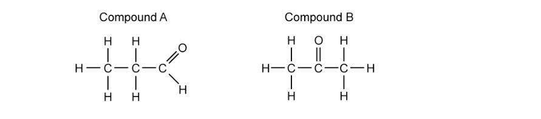
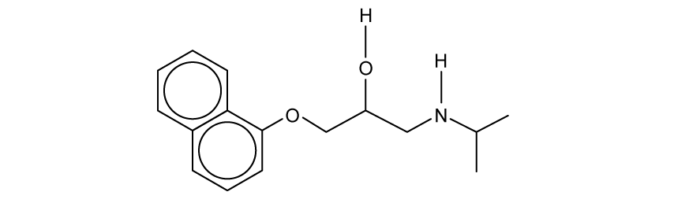
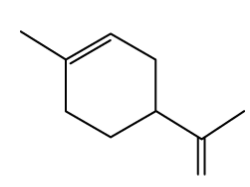
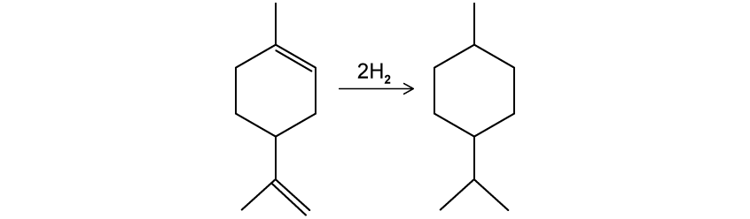
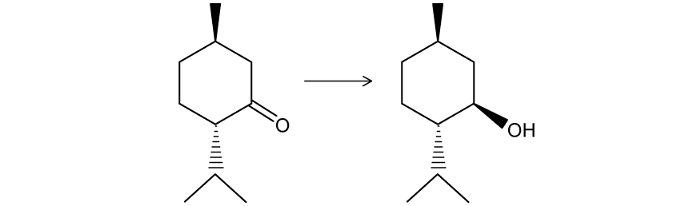
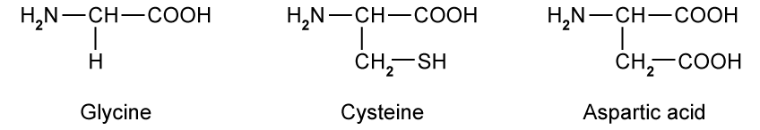
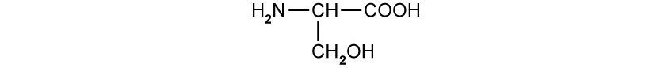

# Exam Questions — Isomerism: Optical
**29. An Introduction to A Level Organic Chemistry** · Cambridge (CIE) A-LEVEL chemistry (9701)
> Source: [https://www.savemyexams.com/a-level/chemistry/cie/25/topic-questions/](https://www.savemyexams.com/a-level/chemistry/cie/25/topic-questions/) · 5 questions across 1 sets

## Structured Questions (6 questions)

### Q1 — medium — 8 marks

**Q1** [1 mark]

Leucine is an optically active amino acid with the molecular formula (CH3)2CHCH2CH(NH2)COOH.

Draw the displayed formula of leucine.

**Q1** [4 marks]

**Extract:**

Leucine is an optically active amino acid with the molecular formula (CH~3~)~2~CHCH~2~CH(NH~2~)COOH.

Leucine exists as stereoisomers.

i) Explain what is meant by the term stereoisomerism.

[2]

ii) Describe how the two optical isomers of leucine can be distinguished.

[2]

**Q1** [2 marks]

**Extract:**

Leucine is an optically active amino acid with the molecular formula (CH₃)₂CHCH₂CH(NH₂)COOH.

Draw three-dimensional diagrams to show the two optical isomers of leucine.

**Q1** [1 mark]

**Extract:**

Leucine is an optically active amino acid with the molecular formula (CH~3~)~2~CHCH~2~CH(NH~2~)COOH.

State the systematic (IUPAC) name of leucine.

### Q2 — medium — 16 marks

**Q2** [8 marks]

Two isomers of C3H6O are shown below in Fig. 3.1.

**Fig. 3.1**

i) State the systematic (IUPAC) name of compound **A** and of compound **B**.

[2]

ii) State the name of the mechanism for the reaction between compound **A** and HCN.

[1]

iii) Describe the mechanism for the reaction between compound **A** and HCN. Include all relevant curly arrows, lone pairs, and partial charges in your diagram.

[4]

iv) State the systematic name of the organic product formed in this reaction.

[1]

**Q2** [3 marks]

**Extract:**

Two isomers of C~3~H~6~O are shown below in Fig. 3.1.

**Fig. 3.1**

Compound **A**: propanal (an aldehyde)
Compound **B**: propanone (a ketone)

Compound **B** also reacts with HCN.

i) State the systematic name of the organic product formed.

[1]

ii) Explain why the organic product in b(i) does not exhibit optical isomerism.

[2]

**Q2** [3 marks]

**Extract:**

Two isomers of C~3~H~6~O are shown below in Fig. 3.1.

**Fig. 3.1**

Compound A is propanal (an aldehyde) and compound B is propanone (a ketone).

Explain why the reaction between compound **A** and HCN produces a racemic mixture.

**Q2** [2 marks]

**Extract:**

Two isomers of C~3~H~6~O are shown below in Fig. 3.1.

Compound A is propanal (an aldehyde) and compound B is propanone (a ketone).

The reaction between compound A and HCN produces a racemic mixture because:
- Compound A / the carbonyl group is planar OR The carbonyl carbon is sp^2^ hybridised
- The nucleophile / CN^-^ ion can attack from above or below the plane of the carbonyl group with equal probability
- A chiral centre is created with four different groups attached, giving equal amounts of both enantiomers

Explain why the racemic mixture formed in this reaction has no effect on plane-polarised light.

### Q3 — medium — 9 marks

**Q3** [2 marks]

Propranolol is an optically active drug. Its structure is shown in Fig. 2.1.

**Fig. 2.1**

i) Deduce the molecular formula of propranolol.

[1]

ii) On Fig. 2.1, indicate the chiral centre with an asterisk (*).

[1]

**Q3** [2 marks]

Explain why a racemic mixture of propranolol has no effect on plane-polarised light.

**Q3** [2 marks]

Explain why it is often important that chiral drugs, such as propranolol, are administered as a single pure enantiomer rather than as a racemic mixture.

**Q3** [3 marks]

Chiral catalysts are often used in the manufacturing process of drugs.

i) State the purpose of using a chiral catalyst in drug synthesis.

[1]

ii) State one advantage and one disadvantage of using a chiral catalyst.

[2]

### Q4 — hard — 11 marks

**Q4** [2 marks]

This question is about the chemistry of limonene.

Limonene is a naturally occurring hydrocarbon found in citrus fruits, with the molecular formula C10H16.

Limonene exists as a pair of enantiomers:

- One enantiomer is responsible for a strong orange smell
- The other enantiomer is responsible for a lemon smell

Draw three-dimensional diagrams to show the two optical isomers of limonene.

| optical isomer 1 | optical isomer 2 |
|---|---|
|   |   |

**Q4** [3 marks]

**Extract:**

This question is about the chemistry of limonene.

Limonene is a naturally occurring hydrocarbon found in citrus fruits, with the molecular formula C~10~H~16~.

Limonene exists as a pair of enantiomers:

- One enantiomer is responsible for a strong orange smell
- The other enantiomer is responsible for a lemon smell

Suggest why receptors in the human nose can distinguish between the orange and lemon enantiomers of limonene.

**Q4** [4 marks]

**Extract:**

Limonene is a naturally occurring hydrocarbon found in citrus fruits, with the molecular formula C~10~H~16~.

Limonene can undergo full hydrogenation to form menthane as shown.

For the complete hydrogenation of an impure sample of 3.00 g of limonene at room temperature and pressure, 870 cm3 of hydrogen was required.

Calculate, showing your working, the percentage purity of limonene.

percentage purity = ........................ %

**Q4** [2 marks]

The final step of the multi-step synthetic conversion of limonene to menthol is shown.

State the reagent and the type of reaction for this step.

Reagent: ..............................................................

Type of reaction: ..............................................................

### Q5 — easy — 6 marks

**Q5** [3 marks]

Hydroxypropanoic acid has two position isomers.

i) Draw the structural formulae of the two position isomers of hydroxypropanoic acid and state the systematic name of each.

[2]

ii) State which of these isomers exhibits optical isomerism.

[1]

**Q5** [1 mark]

Fig. 1.1 shows the structures of three amino acids.

**Fig. 1.1**

Identify the amino acid in Fig. 1.1 that does not exhibit optical isomerism.

**Q5** [2 marks]

Serine, shown in Fig. 1.2, exhibits optical isomerism.

**Fig. 1.2**

Draw three-dimensional diagrams to show the two optical isomers of serine.
