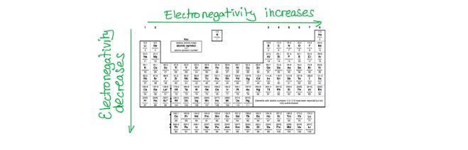
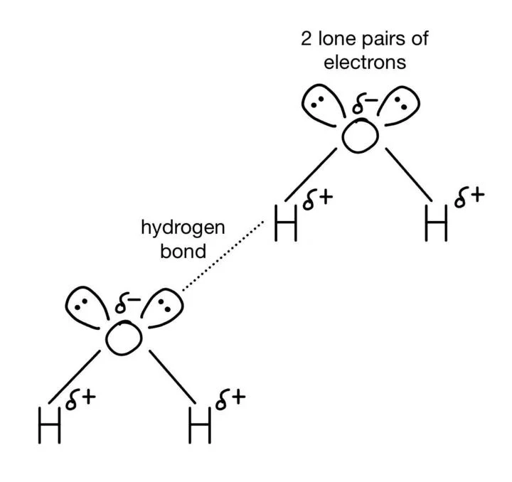

# Mark Schemes — Electronegativity & Bonding
**3. Chemical Bonding** · Cambridge (CIE) A-LEVEL chemistry (9701)

## Multiple Choice Questions (9 questions)

### Q1
**Final answer:** **The correct answer is D**

- Ionic character increases with the difference in electronegativity between the two atoms.
- Electronegativity decreases down a group and increases across a period.
- Rubidium is in Group 1, Period 5, making it the least electronegative metal among the options.
- Chlorine is in Group 17, Period 3, making it the most electronegative non-metal among the options.
- Therefore, RbCl has the largest electronegativity difference of the four compounds, giving it the greatest ionic character.

**A** is incorrect as potassium is higher in Group 1 than rubidium, making it more electronegative. Bromine is lower in Group 17 than chlorine, making it less electronegative. Both effects reduce the electronegativity difference, so KBr is less ionic than RbCl.

**B** is incorrect as magnesium is in Group 2, Period 3, making it more electronegative than rubidium. Bromine is also less electronegative than chlorine. The smaller electronegativity difference means MgBr~2~ has less ionic character than RbCl.

**C** is incorrect as sodium is higher in Group 1 than rubidium, making it more electronegative. The electronegativity difference between sodium and chlorine is therefore smaller than between rubidium and chlorine, giving NaCl less ionic character than RbCl.

### Q2
**Final answer:** **The correct answer is B**

- Electronegativity increases across a period (left to right) as nuclear charge increases with similar electron shielding.
- Electronegativity decreases down a group as atomic radius and shielding increase, weakening the nuclear attraction for the bonding pair of electrons.
- Chlorine is the furthest right element in Period 3 among the options given, and is higher in Group 17 than bromine, making it the most electronegative.

**A** is incorrect as bromine is in the same group as chlorine (Group 17) but is one period lower. The increased atomic radius and shielding reduce the nuclear attraction for bonding electrons, giving bromine a lower electronegativity than chlorine.

**C** is incorrect as magnesium is in Group 2, on the left-hand side of the periodic table. Electronegativity increases across a period, so magnesium is significantly less electronegative than chlorine.

**D** is incorrect as sodium is in Group 1, the furthest left of the Period 3 elements present. It has the lowest electronegativity of the options given.

### Q3
**Final answer:** **The correct answer is B**

- Ionic bonds form when there is a large difference in electronegativity between two atoms.
- A large difference means one atom attracts the bonding electrons much more strongly than the other, resulting in electron transfer to form ions rather than electron sharing.
- Bonding exists on a continuum from pure covalent to purely ionic.

  - The greater the difference in electronegativity, the greater the ionic character.

**A** is incorrect as when both atoms have high electronegativity values (e.g. two non-metals such as O and Cl), they both attract the bonding pair strongly. This results in electron sharing and the formation of a covalent bond.

**C** is incorrect as when two atoms have identical electronegativity values, the bonding electrons are shared equally between the two atoms, forming a non-polar pure covalent bond (e.g. Cl2 or H2).

**D** is incorrect as the more electronegative atom in an ionic bond gains electrons to become a negative ion (anion). It is the less electronegative atom that loses electrons to become a positive ion (cation).

### Q4
**Final answer:** **The correct answer is C**

- Bonding exists on a continuum from non-polar covalent to ionic, determined by the electronegativity difference between the two atoms.
- When the electronegativity difference is zero, electrons are shared equally and the bond is non-polar covalent (e.g. Cl~2~).
- A moderate electronegativity difference results in unequal sharing, giving a polar covalent bond (e.g. H–Cl).
- A large electronegativity difference results in electron transfer rather than sharing, forming an ionic bond (e.g. NaCl).
- As electronegativity difference increases, ionic character increases.

**A** is incorrect as two atoms with the same electronegativity share the bonding electrons equally. This produces a non-polar covalent bond, not a polar covalent bond.

**B** is incorrect as a large electronegativity difference leads to electron transfer and the formation of an ionic bond. Polar covalent bonds arise from a moderate electronegativity difference, not a large one.

**D** is incorrect as electronegativity difference is the key factor in determining bond type. A large difference favours ionic bonding, while a small or zero difference favours covalent bonding.

### Q5
**Final answer:** **The correct answer is D**

- In sulfur dichloride (SCl2), there is a difference in electronegativity between sulfur and chlorine.
- Chlorine is more electronegative than sulfur, so it attracts the bonding pair of electrons towards itself.
- This creates a polar Sδ+–Clδ– covalent bond.

**A** is incorrect as calcium bromide (CaBr2) is formed from a metal and a non-metal with a large difference in electronegativity. This results in electron transfer, forming an ionic bond rather than a covalent bond.

**B** is incorrect as chlorine (Cl2) is a diatomic molecule consisting of two identical atoms. There is no difference in electronegativity, so the bonding pair of electrons is shared equally, forming a non-polar pure covalent bond.

**C** is incorrect as the C–H bonds in ethane (C2H6) have a negligible difference in electronegativity between carbon and hydrogen. The C–H bonds are effectively non-polar.

### Q6
**Final answer:** **The correct answer is B**

- Bonding exists on a continuum from pure covalent to purely ionic. A smaller difference in electronegativity results in greater covalent character, as the atoms share the bonding electrons more equally.
- Hydrogen (2.2) has the closest Pauling value to fluorine (4.0), giving a difference of 1.8, which is the smallest of the four options.
- Therefore, hydrogen forms the bond with the greatest covalent character with fluorine, making HF a polar covalent molecule.

**A** is incorrect as the difference in electronegativity between copper (1.95) and fluorine (4.0) is 2.05, which is larger than the H–F difference. CuF has greater ionic character than HF.

**C** is incorrect as the difference between magnesium (1.3) and fluorine (4.0) is 2.70. Magnesium is a Group 2 metal and MgF2 is an ionic compound.

**D** is incorrect as potassium (0.82) has the largest difference with fluorine (3.18) of all the options. KF is an almost purely ionic compound.

### Q7
**Final answer:** **The correct answer is A**

- Both first ionisation energy and electronegativity are governed by the attraction between the nucleus and the valence electrons.
- Down a group, atomic radius increases and the number of inner electron shells increases, causing greater electron shielding.
- This reduces the effective nuclear charge experienced by the outermost electrons, weakening the nuclear attraction and causing both properties to decrease down a group.

**B** is incorrect as both properties do not increase down a group. This describes the trend observed across a period (left to right), where nuclear charge increases with similar shielding.

**C** is incorrect as electronegativity does not increase down a group. Increased shielding and atomic radius reduce nuclear attraction for bonding electrons, so electronegativity decreases down a group alongside first ionisation energy.

**D** is incorrect as first ionisation energy does not increase down a group. Increased shielding and atomic radius reduce the energy needed to remove the outermost electron, so first ionisation energy decreases down a group.

### Q8
**Final answer:** **The correct answer is C**

- The C–H bond is effectively non-polar as there is negligible difference in electronegativity between C and H.
- Also, carbon is slightly more electronegative than hydrogen

  - So, any dipole that exists would give δ–C–Hδ+.

**A** is incorrect as oxygen is more electronegative than carbon. It attracts the bonding pair of electrons towards itself, making δ+C−Oδ– the correct label for this bond.

**B** is incorrect as oxygen is more electronegative than carbon. It attracts the bonding pair of electrons towards itself, making δ+C=Oδ– the correct label for this bond.

**D** is incorrect as chlorine is more electronegative than carbon. It attracts the bonding pair of electrons towards itself, making δ+C−Clδ– the correct label for this bond.

### Q9
**Final answer:** **The correct answer is A**

- H2S has 2 bonding pairs and 2 lone pairs around the central sulfur atom, giving a non-linear (V-shaped) molecular geometry.
- Because the molecule is non-linear, the S–H bond dipoles do not cancel out, resulting in a net dipole moment and a polar molecule.

**B** is incorrect as ICl4– has an octahedral electron geometry (4 bonding pairs and 2 lone pairs). The 2 lone pairs sit directly opposite each other, forcing the 4 Cl atoms into a square planar arrangement. The I–Cl bond dipoles cancel out symmetrically, making the ion non-polar.

**C** is incorrect as PF5 has a trigonal bipyramidal geometry (5 bonding pairs, 0 lone pairs). The arrangement is symmetrical and the P–F bond dipoles cancel out, making the molecule non-polar.

**D** is incorrect as SO3 has a trigonal planar geometry (3 bonding regions, 0 lone pairs). The arrangement is symmetrical and the S=O bond dipoles cancel out, making the molecule non-polar.

## Structured Questions (5 questions)

### Q1
> **[mark-scheme]**
> The term electronegativity means:
> 
> - The ability of an atom / nucleus to attract electrons / a bonding pair of electrons (to itself); **[1 mark]**
> - In a covalent bond; **[1 mark]**

> **[exam-tip]**
> This is a high-frequency exam definition, so learn it precisely.
> 
> The two marks are awarded for two distinct ideas: the attraction of electrons by an atom, and the specific context of a covalent bond. Stating only 'an atom that attracts electrons' will score 1 of the 2 marks.
> 
> A common slip is to write 'the ability to attract atoms' or 'to form a bond'. Neither gains the first mark. Be specific: it is electrons (or a bonding pair of electrons) that the atom attracts.
> **[mark-scheme]**
> i) The meaning of the symbol δ+:
> 
> - (Slightly / partially) positive charge / electron deficient; **[1 mark]**
> 
> ii) From this bond representation it can be deduced that:
> 
> - Nitrogen is more electronegative than hydrogen; **[1 mark]**

> **[exam-tip]**
> The δ symbol means 'partial'. So δ+ indicates a partial positive charge, and δ- indicates a partial negative charge.
> 
> In a polar covalent bond, the more electronegative atom carries the δ- charge because it pulls the bonding pair of electrons closer to itself. The less electronegative atom is left δ+ because the bonding electrons are drawn away from it.
> 
> For part i), 'partial positive charge' or 'slightly positive' is the most direct answer; 'electron deficient' is also accepted.
> 
> For part ii), the symbol δ- sits on nitrogen, so nitrogen is the more electronegative atom. This is a one-step deduction directly from the bond polarity diagram, so do not over-explain.
> **[mark-scheme]**
> Three factors which affect the electronegativity of an element:
> 
> - Nuclear charge; **[1 mark]**
> - Atomic radius; **[1 mark]**
> - Shielding (by inner electrons); **[1 mark]**

> **[exam-tip]**
> The more electronegative an element, the more strongly it attracts the bonding pair of electrons in a covalent bond. Each of the three factors influences the strength of that attraction:
> 
> - Nuclear charge: the more protons in the nucleus, the stronger the pull on the bonding electrons.
> - Atomic radius: the smaller the distance between the nucleus and the bonding pair, the stronger the attraction.
> - Shielding: the more inner electron shells, the more the bonding pair is screened from the nuclear charge, weakening the attraction.
> 
> A common error is to write 'number of protons' or 'number of electrons' alone. The precise terms (nuclear charge, atomic radius, and shielding) are what the mark scheme expects.
> **[mark-scheme]**
> i) The element in Period 4 with the highest electronegativity value:
> 
> - Bromine; **[1 mark]**
> 
> ii) Fluorine is more electronegative than oxygen because:
> 
> - The nuclear charge of fluorine is greater
> **AND**
> The atomic radius of fluorine is smaller; **[1 mark]**
> - (The two elements have) similar shielding; **[1 mark]**

> **[exam-tip]**
> Going across a period, electronegativity increases. Each successive element gains one more proton (greater nuclear charge), but the number of inner electron shells stays the same, so shielding is essentially unchanged. The smaller atomic radius across the period also brings the bonding electrons closer to the nucleus, strengthening the attraction.
> 
> For part i), be careful with period numbering. Period 1 contains hydrogen and helium, not lithium. Period 4 begins with potassium and ends with krypton, so the most electronegative element in Period 4 is bromine (the only halogen in that row).
> 
> For part ii), simply stating 'fluorine has more protons' will not score the first mark on its own. You need to refer to greater nuclear charge AND smaller atomic radius together for one mark, plus similar shielding for the second mark.

### Q2
> **[mark-scheme]**
> The type of bonds in each compound:
> 
> - The bond between Mg and O is ionic; **[1 mark]**
> - The difference in electronegativity is greater than 2.0 / 2.2; **[1 mark]**
> - The bond between P and O is polar covalent / covalent with some ionic character; **[1 mark]**
> - The difference in electronegativity is between 1.0 and 2.0 / 1.2; **[1 mark]**

> **[exam-tip]**
> The presence of Pauling electronegativity values in the figure is your cue to use them. A response based only on 'magnesium is a metal and oxygen is a non-metal, while phosphorus and oxygen are both non-metals' will not score at this level. You must reference the electronegativity differences explicitly.
> 
> Use these threshold values to decide bond type:
> 
> - ΔEN ≈ 0.0: non-polar (identical electronegativities, e.g. O–O)
> - ΔEN < 1.0: largely non-polar covalent
> - ΔEN ≈ 1.0 to 2.0: polar covalent (or 'covalent with some ionic character')
> - ΔEN > 2.0: predominantly ionic
> 
> For Mg-O, ΔEN ≈ 3.5 − 1.2 = 2.3, which is greater than 2.0, so the bond is ionic. For P-O, ΔEN ≈ 3.5 − 2.1 = 1.4, which sits between 1.0 and 2.0, so the bond is polar covalent.
> 
> A common slip is to give the bond type without the supporting electronegativity reasoning. Each bond type and its justification is awarded as a separate mark, so state the rule and the calculation explicitly.
> **[mark-scheme]**
> The melting point of phosphorus(III) oxide is lower than that of magnesium oxide because:
> 
> - MgO has a giant ionic lattice with strong ionic bonds
> **AND**
> P4O6 has a simple molecular / covalent structure with weak intermolecular forces; **[1 mark]**
> - More energy is required to break the (ionic) bonds in MgO than to overcome the weak intermolecular forces in P4O6; **[1 mark]**

> **[exam-tip]**
> The key distinction here is between bonding within molecules (intramolecular) and bonding between molecules (intermolecular). P4O6 has strong intramolecular covalent bonds, but it is the weak intermolecular forces between P4O6 molecules that are overcome on melting.
> 
> A common error is to compare 'covalent bonds' against 'ionic bonds' directly and conclude that ionic must be stronger. The comparison is between ionic bonds and intermolecular forces, not ionic bonds and covalent bonds.
> 
> Acceptable terms for the intermolecular forces in P4O6 include:
> 
> - London dispersion forces
> - Van der Waals' forces
> - Permanent dipole-permanent dipole forces
> 
> State explicitly that MgO has a giant ionic lattice and P4O6 has a simple molecular structure to secure the first mark. Describing the bonding alone is not enough.
A structure for P4O6 is:

**[1 mark]**

> **[mark-scheme]**
> 1 mark for a structure where each P atom is bonded to three O atoms AND each O atom is bonded to two atoms (a P=O double bond counts as the O being divalent in the alternative structure).

> **[exam-tip]**
> The first diagram is the canonical P4O6 cage structure: four phosphorus atoms at the corners of a tetrahedron, with six oxygen atoms bridging the P-P edges. The second diagram is also accepted, with two of the oxygen atoms forming P=O double bonds (treated as divalent in this counting).
> 
> Check your structure has the correct bond count: each P with three bonds and each O with two bonds (or one double bond), giving six P-O linkages in total.
> 
> Common errors are drawing P=O bonds in positions that leave a P with only two bonds, or omitting one or more of the six oxygen atoms.
> **[mark-scheme]**
> The difference in electronegativity between magnesium and calcium is because:
> 
> - Calcium has more shielding (than magnesium); **[1 mark]**
> - Calcium has a larger atomic radius (than magnesium); **[1 mark]**
> - (Therefore) there is less attraction between the calcium nucleus and the bonding pair of electrons; **[1 mark]**

> **[exam-tip]**
> Magnesium and calcium are in the same group (Group 2), so the key factors that change down the group are atomic radius and shielding, not nuclear charge. Although calcium has a greater nuclear charge than magnesium, the increase is more than offset by the larger atomic radius and additional inner shells of shielding electrons.
> 
> When explaining electronegativity differences, anchor your reasoning to the attraction between the nucleus and the bonding pair of electrons:
> 
> - Down a group: atomic radius and shielding both increase, weakening the attraction. Electronegativity decreases.
> - Across a period: nuclear charge increases while shielding stays similar, strengthening the attraction. Electronegativity increases.
> 
> The third mark requires you to state the consequence explicitly: less attraction for the bonding pair means lower electronegativity. Listing only the two factors (shielding and radius) without the attraction outcome will score 2 of the 3 marks.
> 
> You can also gain credit by reversing the comparison. For example, 'magnesium has less shielding than calcium' scores the same mark as 'calcium has more shielding than magnesium'.

### Q3
> **[mark-scheme]**
> Electronegativity is:
> 
> - The ability of an atom to attract a pair of electrons / a bonding pair of electrons towards itself in a covalent bond; **[1 mark]**

> **[exam-tip]**
> This is a high-frequency exam definition, so learn it precisely.
> 
> The definition packs three ideas into a single mark: an atom (the agent), attracting a pair of electrons (the action), in a covalent bond (the context). All three must be present to score the mark.
> 
> A common slip is to omit 'in a covalent bond', which leaves the definition incomplete. Another is to write 'attract atoms' or 'attract electrons' without specifying that it is a pair (or bonding pair) of electrons. Be precise about each of the three elements.
> **[mark-scheme]**
> The general trend in electronegativity across a period:
> 
> - (Electronegativity) shows a general increase; **[1 mark]**
> 
> Explanation:
> 
> - (Across the period) there is a greater / increased nuclear charge
> **OR**
> There are more protons in the nucleus; **[1 mark]**
> - The electrons are added to the same shell
> **OR**
> The shielding is the same / shielding does not change
> **OR**
> There are no additional shells of electrons (added); **[1 mark]**
> - (Therefore,) there is a stronger attraction between the (bonding) electrons and the nucleus; **[1 mark]**

> **[exam-tip]**
> The 'state and explain' command requires both the trend and the underlying reasoning. A one-word answer ('increases') will only score the first mark.
> 
> Anchor the explanation to the three factors that affect electronegativity. Across a period:
> 
> - Nuclear charge increases (one extra proton per element)
> - Atomic radius decreases (electrons added to the same shell are pulled closer by the greater nuclear charge)
> - Shielding stays roughly the same (no new inner shell)
> 
> The combined effect is a stronger attraction between the nucleus and the bonding pair of electrons, so electronegativity increases.
> 
> A common error is to state only that 'there are more protons' without linking this to the attraction for the bonding electrons. The fourth mark is awarded for connecting the cause (greater nuclear charge, same shielding) to the consequence (stronger attraction).
> **[mark-scheme]**
> i) The type of bond between B and Cl:
> 
> - Covalent; **[1 mark]**
> 
> ii) The B-Cl bond is formed from:
> 
> - A shared pair of electrons between the B and Cl atoms
> **OR**
> The sharing of one electron from B and one electron from Cl; **[1 mark]**
> 
> iii) The B-Cl bond is more polar than the B-H bond because:
> 
> - The B-H bond is less polar than the B-Cl bond; **[1 mark]**
> - The difference in electronegativity in B-H is smaller / 0.2
> **OR**
> The difference in electronegativity in B-Cl is larger / 1.2; **[1 mark]**

> **[exam-tip]**
> For part i), the answer is 'covalent'. Both B and Cl are non-metals, so they form a covalent bond by sharing electrons. The bond is polar (because of the electronegativity difference shown in part iii)), but the bond type is still classified as covalent.
> 
> For part ii), the sharing must be specified clearly. 'A shared pair of electrons' or 'one electron from each atom' both work; vague phrases like 'they share electrons' may not score.
> 
> For part iii), a 2-mark explain question requires a comparison and a reason:
> 
> - Comparison: B-H is less polar OR B-Cl is more polar
> - Reason: smaller (or larger) difference in electronegativity, with the calculated values where possible
> 
> The calculated electronegativity differences are:
> 
> - B-H: ΔEN = 2.2 − 2.0 = 0.2
> - B-Cl: ΔEN = 3.2 − 2.0 = 1.2
> 
> The larger difference (1.2 vs 0.2) means the B-Cl bond is more polar. Citing the numerical values is the safest way to secure the second mark.

### Q4
> **[mark-scheme]**
> The term electronegativity means:
> 
> - The ability of an atom to attract electrons / a pair of electrons / a bonding pair of electrons towards itself; **[1 mark]**
> - In a covalent bond; **[1 mark]**

> **[exam-tip]**
> This is a high-frequency exam definition, so learn it precisely.
> 
> The two marks are awarded for two distinct ideas: the attraction of electrons by an atom, and the specific context of a covalent bond. Stating only 'an atom that attracts electrons' will score 1 of the 2 marks.
> 
> A common slip is to write 'the ability to attract atoms' or 'to form a bond'. Neither gains the first mark. Be specific: it is electrons (or a pair of electrons) that the atom attracts, in the context of a covalent bond.
> **[mark-scheme]**
> The trend in electronegativity across a period:
> 
> - (Electronegativity) increases (across the period); **[1 mark]**
> - Nuclear charge increases
> **AND**
> Atomic radius decreases; **[1 mark]**
> - (But) shielding stays similar; **[1 mark]**

> **[exam-tip]**
> Use Table 3.1 to anchor the trend in real values: H (2.1) < C (2.5) < N (3.0). Electronegativity rises across the row.
> 
> Three factors drive this:
> 
> - Nuclear charge increases (one extra proton per element).
> - Atomic radius decreases (electrons added to the same shell are pulled closer by the greater nuclear charge).
> - Shielding stays similar (no new inner shell is added).
> 
> The combined effect is a stronger attraction between the nucleus and the bonding pair of electrons, so electronegativity increases.
> 
> A common error is to state only 'more protons' without linking to the attraction for the bonding electrons. The mark scheme rewards the cause-and-effect: greater nuclear charge plus smaller atomic radius plus similar shielding lead to stronger attraction.
> **[mark-scheme]**
> The N-H bond is more polar than the C-H bond because:
> 
> - The N-H bond is more polar than the C-H bond; **[1 mark]**
> - The difference in electronegativity in C-H is smaller / 0.4
> **OR**
> The difference in electronegativity in N-H is larger / 0.9; **[1 mark]**

> **[exam-tip]**
> A 2-mark 'explain' question on bond polarity needs both a comparison and a reason. The comparison alone is not enough.
> 
> Use Table 3.1 to calculate:
> 
> - C-H: ΔEN = 2.5 − 2.1 = 0.4
> - N-H: ΔEN = 3.0 − 2.1 = 0.9
> 
> The larger electronegativity difference (0.9 > 0.4) means the bonding pair of electrons is more strongly drawn towards the nitrogen atom in N-H, making it the more polar bond.
> 
> A common pitfall is to quote the individual electronegativity values without taking the difference. Examiners want the comparison of ΔEN, not just '2.5 vs 3.0'.
> **[mark-scheme]**
> The bonding in NH3 is covalent but the bonding in LiCl is ionic because:
> 
> For NH3:
> 
> - The difference in electronegativity between N and H is small; **[1 mark]**
> - (So) the electrons are shared (between the two atoms); **[1 mark]**
> 
> For LiCl:
> 
> - The difference in electronegativity between Li and Cl is large; **[1 mark]**
> - (So) the electron is transferred from Li to Cl (forming Li+ and Cl- ions); **[1 mark]**

> **[exam-tip]**
> Bonding type (covalent vs ionic) is determined by the electronegativity difference between the two atoms in the bond. Use Table 3.1 to anchor your reasoning:
> 
> - N-H: ΔEN = 3.0 − 2.1 = 0.9 (small difference, so the bonding pair is shared between the atoms, giving a covalent bond)
> - Li-Cl: ΔEN = 3.0 − 1.0 = 2.0 (large difference, so the electron is fully transferred from Li to Cl, giving an ionic bond)
> 
> The question says 'in terms of electronegativity', so do not score by reasoning from 'metals vs non-metals' alone. The marks are awarded for:
> 
> 1. Stating that the electronegativity difference is small (NH3) or large (LiCl).
> 2. Linking that difference to electron sharing (covalent) or transfer (ionic).
> 
> For the fourth mark, the direction of electron transfer matters: lithium loses an electron to chlorine. Stating 'electrons are transferred' without specifying which atom gains and which atom loses will not score the fourth mark.

### Q5
> **[mark-scheme]**
> i) The type of bond between B and Cl:
> 
> - Covalent; **[1 mark]**
> 
> ii) The B-Cl bond is formed from:
> 
> - A shared pair of electrons between the B and Cl atoms
> **OR**
> The sharing of one electron from B and one electron from Cl; **[1 mark]**
> 
> iii) The B-Cl bond is more polar than the B-H bond because:
> 
> - The B-H bond is less polar than the B-Cl bond; **[1 mark]**
> - The difference in electronegativity in B-H is smaller / 0.2
> **OR**
> The difference in electronegativity in B-Cl is larger / 1.2; **[1 mark]**

> **[exam-tip]**
> For part i), the answer is 'covalent'. Both B and Cl are non-metals, so they form a covalent bond by sharing electrons. The bond is polar (because of the electronegativity difference shown in part iii)), but the bond type is still classified as covalent.
> 
> For part ii), the sharing must be specified clearly. 'A shared pair of electrons' or 'one electron from each atom' both work; vague phrases like 'they share electrons' may not score.
> 
> For part iii), a 2-mark explain question requires a comparison and a reason:
> 
> - Comparison: B-H is less polar OR B-Cl is more polar
> - Reason: smaller (or larger) difference in electronegativity, with the calculated values where possible
> 
> The calculated electronegativity differences are:
> 
> - B-H: ΔEN = 2.2 − 2.0 = 0.2
> - B-Cl: ΔEN = 3.2 − 2.0 = 1.2
> 
> The larger difference (1.2 vs 0.2) means the B-Cl bond is more polar. Citing the numerical values is the safest way to secure the second mark.
> **[mark-scheme]**
> i) The strongest type of intermolecular force between water molecules:
> 
> - Hydrogen bonding; **[1 mark]**

ii) The completed diagram is:

**[3 marks]**

> **[mark-scheme]**
> 1 mark for a hydrogen bond (clearly labelled) going from a hydrogen atom in one molecule to an oxygen atom in another molecule.
> 
> 1 mark for a partial positive (δ+) charge on all hydrogen atoms AND a partial negative (δ-) charge on both oxygen atoms.
> 
> 1 mark for two lone pairs on each oxygen atom, with the hydrogen bond clearly starting at a lone pair.

> **[exam-tip]**
> Hydrogen bonding only occurs when a hydrogen atom is covalently bonded to a very electronegative atom (F, O or N), leaving the H electron-deficient.
> 
> In water, the more electronegative oxygen carries a δ- charge while the hydrogen atoms carry δ+ charges. The hydrogen bond forms between the δ+ hydrogen of one molecule and a lone pair on the δ- oxygen of another.
> 
> Common diagram errors include:
> 
> - Drawing the hydrogen bond starting at the oxygen atom itself rather than at a lone pair.
> - Forgetting to label δ+ / δ- on all atoms.
> - Showing only one lone pair on each oxygen atom (oxygen has two).
> 
> The hydrogen bond is conventionally drawn as a dashed line between the H of one molecule and a lone pair on the O of another.
> **[mark-scheme]**
> i) The boiling point of H2O is higher than that of CCl4 because:
> 
> - There are stronger intermolecular forces / hydrogen bonds between the H2O molecules (in addition to the other intermolecular forces); **[1 mark]**
> - More energy is required to break the intermolecular forces between the H2O molecules; **[1 mark]**
> 
> ii) The boiling point of CH4:
> 
> - Will be lower than that of CCl4; **[1 mark]**
> - (Because) there are more electrons in CCl4; **[1 mark]**
> - (Therefore) there are more / stronger Van der Waals' forces in CCl4; **[1 mark]**
> - (So) more energy is required to break the intermolecular forces between the CCl4 molecules; **[1 mark]**

> **[exam-tip]**
> Boiling point depends on the strength of the intermolecular forces between molecules, NOT on the strength of the covalent bonds within molecules. The covalent bonds stay intact on boiling; only the intermolecular forces break.
> 
> For part i), the key fact is that H2O has hydrogen bonds (because each H is bonded to a very electronegative O, leaving the H electron-deficient), whereas CCl4 has only Van der Waals' forces. Although the C-Cl bonds are polar, the tetrahedral symmetry of CCl4 means the bond dipoles cancel and the molecule has no permanent dipole. Hydrogen bonds are much stronger than Van der Waals' forces, so H2O boils at the higher temperature.
> 
> For part ii), CCl4 molecules have far more electrons (74 in total) than CH4 molecules (10), so the Van der Waals' forces between CCl4 molecules are stronger.
> 
> A common slip is to compare the strengths of C-H and C-Cl bonds. These are covalent bonds within the molecule and do not affect boiling point.
> 
> For full marks, work through the cause-and-effect chain explicitly: more electrons in CCl4 → stronger Van der Waals' forces → more energy needed to break IMFs → higher boiling point for CCl4 (so CH4 has the lower boiling point).
