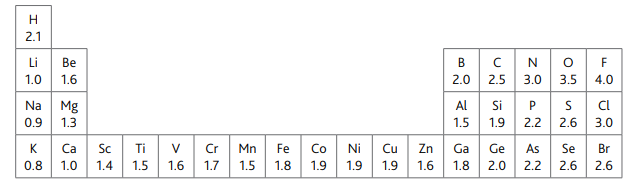

# Exam Questions — Electronegativity & Bonding
**3. Chemical Bonding** · Cambridge (CIE) A-LEVEL chemistry (9701)
> Source: [https://www.savemyexams.com/a-level/chemistry/cie/25/topic-questions/](https://www.savemyexams.com/a-level/chemistry/cie/25/topic-questions/) · 14 questions across 2 sets

## Multiple Choice Questions (9 questions)

### Q1 — medium — 1 marks

**Q1** [1 mark]

Which compound is the most ionic?

### Q2 — easy — 1 marks

**Q2** [1 mark]

Which atom is the most electronegative?

### Q3 — easy — 1 marks

**Q3** [1 mark]

Which statement about electronegativity and ionic bonding is correct?

### Q4 — medium — 1 marks

**Q4** [1 mark]

Which statement correctly describes the relationship between electronegativity difference and bond type?

### Q5 — medium — 1 marks

**Q5** [1 mark]

Which substance contains polar covalent bonds?

### Q6 — hard — 1 marks

**Q6** [1 mark]

The table shows the Pauling electronegativity values for five elements.

|   | **Element** | **Pauling electronegativity value** |
|---|---|---|
|   | Fluorine | 4.0 |
| **A** | Copper | 1.95 |
| **B** | Hydrogen | 2.2 |
| **C** | Magnesium | 1.3 |
| **D** | Potassium | 0.82 |

Which element forms a covalent bond with fluorine?

### Q7 — hard — 1 marks

**Q7** [1 mark]

Which statement about first ionisation energy and electronegativity is correct?

### Q8 — easy — 1 marks

**Q8** [1 mark]

Which bond is not correctly labelled with its dipole?

### Q9 — hard — 1 marks

**Q9** [1 mark]

Which species is polar?

## Structured Questions (5 questions)

### Q1 — easy — 10 marks

**Q1** [2 marks]

Define the term electronegativity.

**Q1** [2 marks]

A bond between nitrogen and hydrogen can be represented as $\overset{δ-}{N}\overset{δ+}{H}$.

i) In this representation, state the meaning of the symbol δ+.

[1]

ii) From this bond representation, state what can be deduced about the electronegativity of nitrogen relative to that of hydrogen.

[1]

**Q1** [3 marks]

State **three** factors which affect the electronegativity of an element.

**Q1** [3 marks]

**Extract:**

State three factors which affect the electronegativity of an element.

Three factors which affect the electronegativity of an element:
- Nuclear charge
- Atomic radius
- Shielding (by inner electrons)

i) Identify the element in Period 4 with the highest electronegativity value.

[1]

ii) Explain why fluorine is more electronegative than oxygen.

[2]

### Q2 — hard — 10 marks

**Q2** [4 marks]

The Pauling electronegativity values of different elements are shown in Fig. 3.1.

**Fig. 3.1**

A compound formed from magnesium and oxygen has a different structure to a compound formed from phosphorus and oxygen.

Predict the type of bonds that will occur in each compound. Explain your answer.

**Q2** [2 marks]

Explain why the melting point of phosphorus(III) oxide, P4O6, is lower than that of magnesium oxide in terms of their bonding and structure.

**Q2** [1 mark]

Phosphorus(III) oxide, P4O6, contains no P–P or O–O bonds.

In the P4O6 molecule, all oxygen atoms are bonded to two other atoms and all phosphorus atoms are bonded to three other atoms.

Sketch a structure for P4O6.

**Q2** [3 marks]

**Extract:**

The Pauling electronegativity values of different elements are shown in Fig. 3.1.

**Fig. 3.1**

Explain the difference in electronegativity shown in Fig. 3.1 between magnesium and calcium.

### Q3 — medium — 9 marks

**Q3** [1 mark]

Define the term *electronegativity*.

**Q3** [4 marks]

State and explain the general trend in electronegativity across a period.

**Q3** [4 marks]

Chlorine, Cl2, reacts with boron, B, to form boron trichloride, BCl3.

i) What type of bond is the B-Cl bond?

[1]

ii) How is this bond formed?

[1]

iii) The electronegativities of boron, chlorine and hydrogen are 2.0, 3.2 and 2.2 respectively. Is the B-Cl more or less polar than a B-H bond in borane, BH3? Explain your answer.

[2]

### Q4 — medium — 11 marks

**Q4** [2 marks]

The electronegativities of some elements are shown in Table 3.1.

**Table 3.1**

| **Element** | **Electronegativity** |
|---|---|
| Li | 1.0 |
| H | 2.1 |
| C | 2.5 |
| N | 3.0 |
| Cl | 3.0 |

Define the term electronegativity.

**Q4** [3 marks]

**Extract:**

The electronegativities of some elements are shown in Table 3.1.

**Table 3.1**

| **Element** | **Electronegativity** |
| --- | --- |
| Li | 1.0 |
| H | 2.1 |
| C | 2.5 |
| N | 3.0 |
| Cl | 3.0 |

Use Table 3.1 to explain the trend in electronegativity across the Periodic Table.

**Q4** [2 marks]

**Extract:**

The electronegativities of some elements are shown in Table 3.1.

**Table 3.1**

| **Element** | **Electronegativity** |
| --- | --- |
| Li | 1.0 |
| H | 2.1 |
| C | 2.5 |
| N | 3.0 |
| Cl | 3.0 |

Explain how the carbon-hydrogen bond (such as in CH4) differs from the nitrogen-hydrogen bond (such as in NH3) in terms of the bond polarity.

**Q4** [4 marks]

**Extract:**

The electronegativities of some elements are shown in Table 3.1.

**Table 3.1**

| **Element** | **Electronegativity** |
| --- | --- |
| Li | 1.0 |
| H | 2.1 |
| C | 2.5 |
| N | 3.0 |
| Cl | 3.0 |

Explain, in terms of electronegativity, why the bonding in ammonia (NH3) is covalent but the bonding in lithium chloride (LiCl) is ionic.

### Q5 — medium — 14 marks

**Q5** [4 marks]

Chlorine (Cl) reacts with boron (B) to form boron trichloride (BCl3).

i) What type of bond is the B-Cl bond?

[1]

ii) How is this bond formed?

[1]

iii) The electronegativities of boron, chlorine and hydrogen are 2.0, 3.2 and 2.2 respectively. Is the B-Cl more or less polar than a B-H bond in borane (BH3)? Explain your answer.

[2]

**Q5** [4 marks]

Molecules and separate atoms (such as noble gases) are attracted to one another by intermolecular forces.

i) What is the strongest type of intermolecular force that takes place between water (H2O) molecules?

[1]

ii) Draw a diagram that illustrates the interaction between two water molecules. Indicate any lone pairs of electrons and partial charges in your diagram.

[3]

**Q5** [6 marks]

The boiling point of tetrachloromethane (CCl4) is 77 °C whereas the boiling point of water (H2O) is 100 °C.

i) Suggest why the boiling point of H2O is higher than that of CCl4.

[2]

ii) Predict whether the boiling point of methane (CH4) is higher or lower than the boiling point of CCl4. Explain your answer.

[4]
