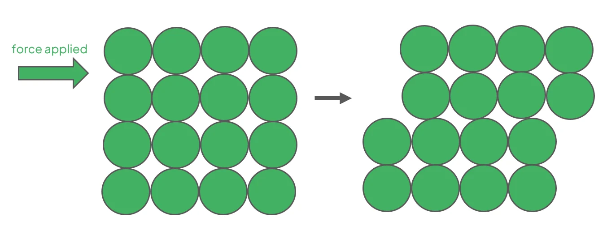
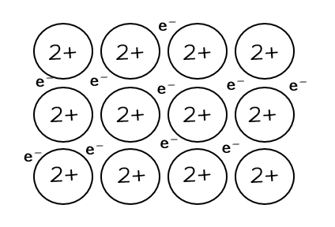
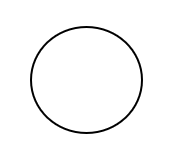
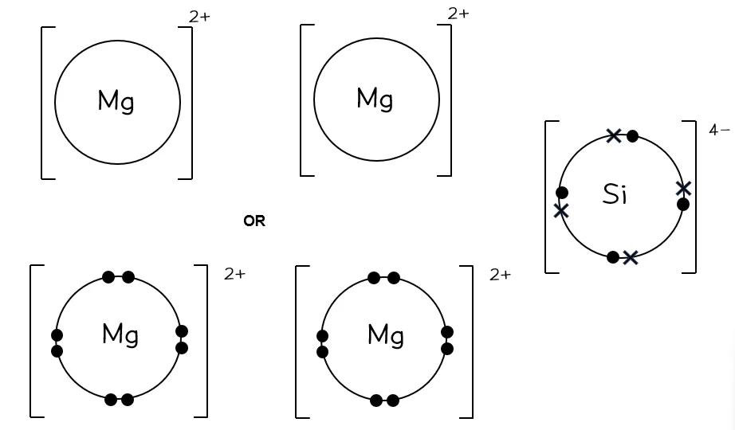

# Mark Schemes — Metallic Bonding
**3. Chemical Bonding** · Cambridge (CIE) A-LEVEL chemistry (9701)

## Multiple Choice Questions (9 questions)

### Q1
**Final answer:** **The correct answer is A**

- Electrical conductivity requires mobile charge carriers.
- In solid copper, delocalised electrons are free to move through the giant metallic lattice when a potential difference is applied, carrying electrical charge.

**B** is incorrect as the positive metal ions are fixed in their lattice positions and only vibrate; they do not translate through the solid.

**C** is incorrect as this is a true statement about metallic bonding, but it describes the structure of copper, not the mechanism of electrical conduction.

**D** is incorrect as this is also a true statement about metallic bonding, but it explains why copper is malleable and ductile, not why it conducts electricity.

### Q2
**Final answer:** **The correct answer is D**

- Metals form giant metallic lattices in which layers of positive ions are surrounded by delocalised electrons.
- When a force is applied, the layers of ions slide over one another.
- The non-directional metallic bonds break and re-form in the new positions, allowing the metal to change shape without shattering, which is malleability.
- The same property allows metals to be drawn into wires, which is ductility.

**A** is incorrect as metals are not brittle and are highly ductile; giant ionic or covalent lattices tend to shatter when struck because layers of like-charged ions or rigid bonds resist deformation.

**B** is incorrect as metals have both high electrical conductivity and high thermal conductivity, due to the presence of mobile delocalised electrons.

**C** is incorrect as metals typically have relatively high melting and boiling points because the electrostatic attraction between the positive ions and the delocalised electrons is strong.

### Q3
**Final answer:** **The correct answer is D**

- Metallic bonding is the strong electrostatic attraction between a lattice of positive metal ions and a sea of delocalised electrons.

**A** is incorrect as a permanent dipole–permanent dipole attraction is an intermolecular force between polar molecules that have permanent net dipoles, caused by unequal sharing of electrons in polar covalent bonds.

**B** is incorrect as a hydrogen bond is a strong intermolecular force between a δ+ hydrogen atom (attached to a highly electronegative atom such as N, O, or F) and a lone pair on a neighbouring electronegative atom.

**C** is incorrect as ionic bonding is the strong electrostatic attraction between oppositely charged ions.

### Q4
**Final answer:** **The correct answer is C**

- Metals are malleable: when a mechanical force is applied, the layers of positive metal ions slide over one another.
- The metallic bonds break and immediately re-form in the new positions.
- Since this attraction is non-directional, the lattice can change shape without shattering.

**A** is incorrect as the strength of the metallic bonds does not increase when the macroscopic shape of the metal is altered.

**B** is incorrect as if bonds broke and did not re-form, the lattice would shatter. This is the behaviour of brittle solids such as giant ionic lattices, not metals.

**D** is incorrect as individual bonds between specific ions and local electrons must break and re-form as the ion layers physically move to new positions; the bonds cannot remain completely unchanged.

### Q5
**Final answer:** **The correct answer is B**

- Brass is an alloy of copper and zinc.
- Both elements are metals and form a giant metallic lattice containing only metallic bonds.
- Metallic bonds are the electrostatic attraction between positive metal ions and a sea of delocalised electrons.

**A** is incorrect as ammonium chloride contains ionic bonds between the NH4+ cation and Cl– anion, as well as covalent and coordinate (dative covalent) bonds within the ammonium ion.

**C** is incorrect as ice contains strong covalent bonds between O and H atoms within each water molecule, and hydrogen bonds between neighbouring water molecules.

**D** is incorrect as solid iodine contains strong covalent bonds between the iodine atoms within each I2 molecule, and weak instantaneous dipole-induced dipole forces between the molecules.

### Q6
**Final answer:** **The correct answer is A**

- Electrical conductivity in a metal depends on the number of mobile delocalised electrons per atom.
- Aluminium is in Group 13 and contributes 3 delocalised electrons per atom to the giant metallic lattice.
- This gives it the highest charge-carrier density of the four metals listed.

**B** is incorrect as lithium is a Group 1 metal and contributes only 1 delocalised electron per atom, giving it lower conductivity than aluminium.

**C** is incorrect as magnesium is a Group 2 metal and contributes only 2 delocalised electrons per atom, giving it lower conductivity than aluminium.

**D** is incorrect as sodium is a Group 1 metal and contributes only 1 delocalised electron per atom, giving it lower conductivity than aluminium.

### Q7
**Final answer:** **The correct answer is D**

- Anion polarisation is maximised by a cation with high polarising power and an anion that is highly polarisable.
- Li+ has a smaller ionic radius than K+, giving it a higher charge density and therefore greater polarising power.
- I– has a larger ionic radius than F–, so its outer electrons are more loosely held and more easily distorted.
- The combination of Li+ (high polarising power) and I– (high polarisability) produces the greatest anion polarisation.

**A** is incorrect as KF combines the cation with the lowest charge density (K+) and the least polarisable anion (F–), giving the least polarisation of the four compounds.

**B** is incorrect as although I– is highly polarisable, K+ has a larger ionic radius and lower charge density than Li+, so it exerts less polarising power.

**C** is incorrect as although Li+ has high polarising power due to its high charge density, F– has a very small ionic radius and its outer electrons are strongly held, making it difficult to polarise.

### Q8
**Final answer:** **The correct answer is A**

- Across Period 3 from Na to Mg, the nuclear charge increases

  - Na: 11 protons
  - Mg: 12 protons
- Both outer electrons occupy the same principal quantum shell (n = 3), so shielding is approximately equal.
- The greater effective nuclear charge in Mg pulls the electron cloud closer to the nucleus, giving Mg a smaller atomic radius.
- The combination of larger nuclear charge and smaller atomic radius produces a stronger electrostatic attraction between the nucleus and the outer electrons.
- More energy is therefore required to remove an outer electron from Mg, giving it a higher first ionisation energy.

**B** is incorrect as the larger nuclear charge is also a contributing factor and cannot be excluded from the explanation.

**C** is incorrect as the stronger nuclear attraction for outer electrons is the result of both a smaller atomic radius and a larger nuclear charge acting together; neither alone is sufficient.

**D** is incorrect as the stronger nuclear attraction for outer electrons is a direct consequence of both factors; it cannot occur without the larger nuclear charge.

### Q9
**Final answer:** **The correct answer is A**

- Metals contain mobile delocalised electrons.
- When a metal is heated, these electrons gain kinetic energy and rapidly transfer it through the lattice by collisions, making metals excellent thermal conductors.

**B** is incorrect as although ions do vibrate and transfer some thermal energy to neighbouring ions, this occurs in all solids including ionic compounds and does not explain the characteristically high thermal conductivity of metals.

**C** is incorrect as metals contain metallic bonds, not covalent bonds.

**D** is incorrect as metallic bonds are relatively strong, which is reflected in the high melting points and hardness of most metals.

## Structured Questions (3 questions)

### Q1
> **[mark-scheme]**
> The structure and bonding present in solid magnesium:
> 
> - A regular (lattice) arrangement of metal ions / positive ions / cations / Mg2+ ions; **[1 mark]**
> - (Surrounded by) delocalised electrons; **[1 mark]**
> - (Strong) electrostatic attraction between the positive ions and delocalised electrons; **[1 mark]**

> **[exam-tip]**
> Three distinct ideas earn the three marks:
> 
> 1. **The arrangement of cations.** A regular lattice of positive metal ions (Mg2+).
> 2. **The presence of delocalised electrons.** Outer electrons that are not associated with any single ion. Often described as a 'sea' of electrons in textbooks, but the CIE mark scheme just says 'delocalised electrons'.
> 3. **The bonding force itself.** The electrostatic attraction between the positive ions and the delocalised electrons.
> 
> A common slip is to describe only the structure (the lattice of ions) without mentioning the delocalised electrons, or to describe only the bonding without locating the ions in a lattice. All three points are independently marked.
> 
> You can support your written answer with a labelled diagram of a metallic lattice showing positive ions, delocalised electrons, and the electrostatic attraction. Some examiners look for marking points within supporting diagrams.
> **[mark-scheme]**
> Magnesium has a higher boiling point than sodium because:
> 
> - Mg forms Mg2+ ions
> **AND**
> Na forms Na+ ions / Mg has more delocalised electrons per atom than Na (2 vs 1); **[1 mark]**
> - (This results in) stronger electrostatic attraction between the positive ions and delocalised electrons in magnesium; **[1 mark]**
> - (Therefore) more energy is required to overcome the (stronger) attraction in magnesium than in sodium; **[1 mark]**

> **[exam-tip]**
> The strength of metallic bonding is determined by three factors:
> 
> - Charge on the cation (higher = stronger).
> - Number of delocalised electrons per atom (more = stronger).
> - Size of the cation (smaller = stronger).
> 
> For Mg vs Na:
> 
> - Mg forms Mg2+ (vs Na+), giving twice the cation charge.
> - Mg releases 2 outer electrons per atom into the 'sea' (vs 1 for Na).
> - Mg2+ has a smaller ionic radius than Na+.
> 
> All three factors point the same way: Mg has stronger metallic bonding, so more energy is required to overcome the electrostatic attraction between the cations and delocalised electrons.
> 
> For full marks, link the factor (charge / delocalised electrons / size) to the strength of attraction AND to the energy needed to overcome it. Stating only 'stronger forces' will not score the third mark.
> **[mark-scheme]**
> Metals are suitable for manufacturing shaped objects because:
> 
> - Metals are malleable (can be hammered / shaped without breaking); **[1 mark]**
> - The layers of positive ions can slide over each other (when force is applied); **[1 mark]**
> - The positive ions are attracted to delocalised electrons in all directions
> **OR**
> The metallic bonding is non-directional; **[1 mark]**

> **[exam-tip]**
> Metals are malleable (can be shaped under force) because of two structural features:
> 
> - The layers of positive ions in the metallic lattice can slide past one another when a force is applied.
> - The metallic bond is non-directional. The delocalised electrons are equally attracted to all surrounding positive ions, so the electrostatic attraction is maintained even when the layers move.
> 
> This is what allows metals to be hammered, rolled, or extruded into shapes (railings, sheets, wires) without the metallic bonding breaking.
> 
> By contrast, ionic and covalent solids are brittle because their bonds ARE directional. When layers slide in an ionic solid, like charges meet and the lattice shatters; in a covalent solid, the directional bonds are broken irreversibly.
> 
> A common slip is to say only 'metals are malleable' without explaining the underlying reason. The mark scheme expects you to explain both WHAT the property is (malleability) and WHY (sliding layers + non-directional bonding).

### Q2
> **[mark-scheme]**
> Metallic bonding is:
> 
> - The (strong) electrostatic attraction between positively charged metal ions / cations
> **AND**
> Delocalised electrons; **[1 mark]**

> **[exam-tip]**
> This is a 1-mark CIE definition. Both elements must be present to score:
> 
> - 'Electrostatic attraction' (not just 'attraction' or 'force')
> - 'Between positive ions / cations / metal ions' AND 'delocalised electrons'
> 
> Saying only 'attraction between ions and electrons' is too vague. Specify that the ions are positive AND that the electrons are delocalised.
> 
> A common slip is to describe metallic bonding as 'sharing of electrons' (covalent) or 'transfer of electrons' (ionic). Metallic bonding is neither. The outer electrons become delocalised across the metallic lattice.
> **[mark-scheme]**
> For each row of Table 2.1:
> 
> Covalent bonding:
> 
> - Similarity: electrons are shared / both involve electrostatic attraction; **[1 mark]**
> - Difference: covalent bonding shares electrons between atoms
> **AND**
> metallic bonding has electrons delocalised between (positive) ions; **[1 mark]**
> 
> Ionic bonding:
> 
> - Similarity: involves the (transfer of) electrons / involves positively charged ions / both involve electrostatic attraction; **[1 mark]**
> - Difference: ionic bonding forms positive AND negative ions
> **AND**
> metallic bonding forms positive ions only; **[1 mark]**

> **[exam-tip]**
> This is a comparison question, so each response needs a similarity AND a difference. The mark scheme expects you to fill all four cells of Table 2.1.
> 
> Each type of bonding involves an electrostatic attraction:
> 
> - Metallic: between positive ions and delocalised electrons.
> - Ionic: between oppositely charged ions.
> - Covalent: between nuclei and the shared bonding electrons.
> 
> Similarities to metallic:
> 
> - Covalent: both involve sharing of electrons (delocalised electrons in metallic CAN be thought of as 'shared' between cations).
> - Ionic: both involve transfer of electrons to form ions (the outer electrons in metallic atoms are 'transferred' to the delocalised pool, leaving cations).
> 
> Differences from metallic:
> 
> - Covalent: localised between two specific atoms (vs delocalised across the whole lattice).
> - Ionic: forms BOTH positive and negative ions (vs only positive ions in metallic).
> 
> A common slip is to give a similarity that applies to all three bonding types ('all involve electrostatic attraction'). This is true but very generic. Be specific about HOW each type differs from metallic.
> **[mark-scheme]**
> Two factors that affect the strength of metallic bonding:
> 
> Any **two** from (1 mark for each point):
> 
> - The number of delocalised / outer / valence electrons per atom
> **OR**
> The charge of the metal ion
> - The size of the metal ion / ionic radius / charge density
> - The arrangement of atoms in the metallic lattice / packing efficiency
> 
> **[2 marks]**

> **[exam-tip]**
> The strength of metallic bonding (which determines properties like melting point, boiling point, and hardness) depends on three main factors:
> 
> 1. **Number of delocalised electrons.** More outer electrons released per atom means a higher concentration of delocalised electrons, giving stronger attraction. Mg2+ (2 electrons released) gives stronger bonding than Na+ (1 electron released).
> 2. **Cation charge.** Closely related to the first factor. A higher charge on the cation gives stronger electrostatic attraction to the delocalised electrons.
> 3. **Cation size / charge density.** Smaller cations pack more closely and have higher charge density, giving stronger attraction. Mg2+ is smaller than Na+, contributing to Mg's higher melting point.
> 
> Any two of these factors will score the marks. CIE accepts 'higher charge density' as a single descriptor that combines size and charge.

### Q3
The diagram showing the structure of magnesium:

**[2 marks]**

> **[mark-scheme]**
> 1 mark for a regular (lattice) arrangement of metal ions / positive ions / cations AND each ion shown with a 2+ charge.
> 
> 1 mark for delocalised electrons drawn between the ions AND labelled (as 'delocalised electrons' or shown as a 'sea of delocalised electrons').

> **[exam-tip]**
> A magnesium metallic lattice diagram needs three features for full marks:
> 
> - A regular array of cations (rows and columns).
> - A 2+ charge clearly shown on each ion (Mg loses 2 outer electrons, so ions are Mg2+, not Mg+).
> - Delocalised electrons shown between the ions AND labelled. CIE examiner reports flag unlabelled electrons as a frequent reason for losing marks.
> 
> Common errors specific to magnesium:
> 
> - Showing the charge as just '+' (this would be sodium). Mg2+ requires '2+'.
> - Drawing a single isolated ion. The lattice arrangement must show multiple ions in a regular pattern.
> - Drawing electrons inside the ion circles instead of between them. Delocalised electrons sit in the gaps between the cations.
The highest energy orbital in Mg is the 3s orbital.

**[1 mark]**

> **[mark-scheme]**
> 1 mark for identification as 3s AND a correct spherical sketch (representing an s-orbital).

> **[exam-tip]**
> Magnesium's electron configuration is 1s2 2s2 2p6 3s2, so the highest energy occupied orbital is 3s.
> 
> The s-orbital is spherical (a single sphere centred on the nucleus). Don't draw a 'p-orbital' shape (figure-of-eight / dumbbell). That's wrong for an s-orbital.
> 
> Quick electron-configuration check for Mg:
> 
> - Period 3, Group 2, so 2 electrons in the third shell.
> - Both electrons go into the 3s subshell (3s2).
> - 3s is higher in energy than 2p, which fills first.
> 
> Both halves of the answer are required for the single mark: state '3s' AND draw a sphere.
The dot-and-cross diagram for Mg2Si:

**[2 marks]**

> **[mark-scheme]**
> 1 mark for two [Mg]2+ ions, each with empty outer shells (or 8 electrons shown if the second shell is drawn as the outermost), with a 2+ charge as superscript outside the bracket.
> 
> 1 mark for one [Si]4- ion with 8 electrons in the outer shell (4 of one symbol AND 4 of the other, showing electron transfer from the two Mg atoms) and a 4- charge as superscript outside the bracket.

> **[exam-tip]**
> Mg2Si is an ionic compound formed by complete electron transfer:
> 
> - Each Mg atom loses 2 electrons (the 3s2 pair), forming Mg2+ (electron configuration 2,8).
> - One Si atom gains 4 electrons (the 4 electrons released by the 2 Mg atoms), forming Si4- (electron configuration 2,8,8).
> 
> For full marks:
> 
> - Use square brackets around each ion.
> - Show charges as superscripts outside the brackets, e.g. [Mg]2+ and [Si]4- (use '2+' and '4-', not '+2' or '-4').
> - For Si4-, show 8 electrons in the outer shell with 4 dots (Si's own electrons) and 4 crosses (the electrons from the two Mg atoms) to demonstrate electron transfer.
> - For Mg2+, the outer shell is empty because the 3s electrons have transferred away. The second shell is now the outermost shell shown, with 8 electrons.
> 
> A common slip is to draw all 8 electrons on Si4- as the same symbol. This fails to show the electron transfer and loses the mark.
