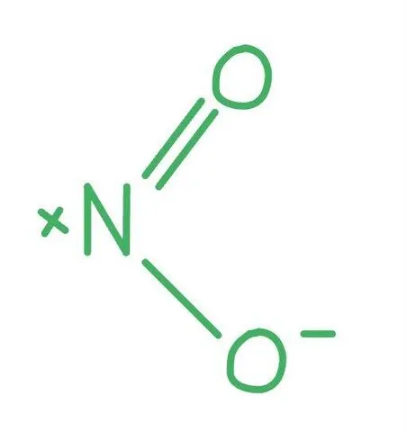
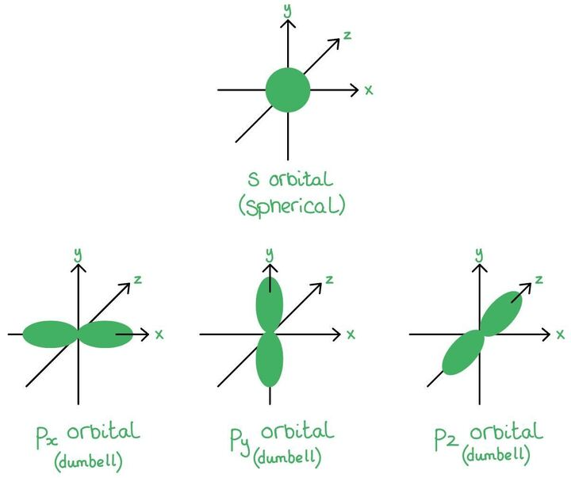

# Mark Schemes — Covalent Bonding & Coordinate (Dative Covalent) Bonding
**3. Chemical Bonding** · Cambridge (CIE) A-LEVEL chemistry (9701)

## Multiple Choice Questions (14 questions)

### Q1
**Final answer:** **The correct answer is C**

- Expand the condensed formula into the full displayed structure:

CH2=CH–C≡N

- Count each bond type systematically:

  - 3 C–H single bonds: 3 σ bonds.
  - C=C double bond: 1 σ bond + 1 π bond.
  - C–C single bond: 1 σ bond.
  - C≡N triple bond: 1 σ bond + 2 π bonds.

- Total σ bonds = 3 + 1 + 1 + 1 = 6.
- Total π bonds = 1 + 2 = 3.

**A** is incorrect as only 4 σ bonds have been counted. The C=C double bond, the C–C single bond, and the C≡N triple bond each contain one σ bond that must be included.

**B** is incorrect as the C≡N triple bond contributes 2 π bonds, not zero. The total π bond count is 1 (from C=C) + 2 (from C≡N) = 3.

**D** is incorrect as the C≡N triple bond contains only one σ bond (plus two π bonds), giving a total of 6 σ bonds, not 7.

### Q2
**Final answer:** **The correct answer is C**

- Structure of ethanenitrile: H3C−C≡N.
- **σ bonds:**

  - 3 (C−H) + 1 (C−C) + 1 (C≡N) = **5**
- **π bonds:**

  - The triple bond between C and N contains **2** π bonds.

**A** is incorrect as there are 5 σ bonds, not 4; the C−C single bond is also a σ bond and must be counted.

**B** is incorrect as the C≡N triple bond contains 2 π bonds, not 1.

**D** is incorrect as there are 5 σ bonds, not 6; the triple bond contributes only one σ bond (plus two π bonds).

> **[exam-tip]**
> Every bond (single, double, or triple) contains exactly one σ bond.
> 
> A double bond adds 1 π bond.
> 
> A triple bond adds 2 π bonds.
> 
> Count all σ bonds first, then count π bonds separately from any multiple bonds.

### Q3
**Final answer:** **The correct answer is C**

- All four compounds have similar relative molecular masses (*M*r ≈ 58–60).
- So, differences in boiling point are determined by the type of intermolecular forces present.
- CH3CH2CH2OH has the highest boiling point due to **hydrogen bonding** between the O–H group and adjacent molecules.
- Hydrogen bonds are stronger than all other intermolecular forces present in these compounds.

**A** is incorrect as butane has only instantaneous dipole-induced dipole forces, which are weaker than hydrogen bonds.

**B** is incorrect as 2-methylpropane also has only instantaneous dipole-induced dipole forces. Its branched structure further reduces intermolecular contact, giving a slightly lower boiling point than butane.

**D** is incorrect as propanal has a polar C=O group, giving permanent dipole–dipole forces, but these are weaker than hydrogen bonds.

### Q4
**Final answer:** **The correct answer is D**

- Bond polarity depends on the **difference in electronegativity** between the two bonded atoms.
- Electronegativity increases across a period; the greater the separation in group number, the larger the difference.
- In the Si–Cl bond, silicon is in Group 14 and chlorine is in Group 17.

  - This is a separation of three groups across Period 3.
- The other three bonds are all between elements in adjacent groups.

  - So, their electronegativity differences are much smaller.
- Therefore, Si–Cl therefore has the largest electronegativity difference and is the most polar bond.

**A** is incorrect as C and N are adjacent elements in Period 2 (Groups 14 and 15), so the electronegativity difference is small.

**B** is incorrect as N and O are adjacent elements in Period 2 (Groups 15 and 16), giving a similarly small electronegativity difference.

**C** is incorrect as P and S are adjacent elements in Period 3 (Groups 15 and 16), so the electronegativity difference is also small.

### Q5
**Final answer:** **The correct answer is B**

- Bond length is determined by bond order and atomic radius.

  - A higher bond order and smaller atomic radius both result in a shorter bond.

- Nitrogen gas, N2, contains a triple bond (bond order 3).

  - Nitrogen (Group 15) has a greater nuclear charge and smaller atomic radius than carbon (Group 14).
  - So, the N≡N bond is shorter than the C≡C bond in ethyne.

**A** is incorrect as ethyne, C2H2, also contains a triple bond (bond order 3), but carbon atoms have a larger atomic radius than nitrogen atoms. Therefore the C≡C bond is longer than the N≡N bond.

**C** is incorrect as oxygen gas, O2, contains a double bond (bond order 2). Double bonds have fewer shared electrons than triple bonds, resulting in a weaker electrostatic attraction between the nuclei and the shared electrons, and therefore a longer bond.

**D** is incorrect as ozone, O3, has a delocalised π electron system across its three oxygen atoms. The O–O bonds have an average bond order of 1.5, which is lower than the double bond in O2, making the bonds in ozone longer than those in oxygen gas.

### Q6
**Final answer:** **The correct answer is B**

- The bonding within the carbonate ion consists of covalent bonds between the carbon atom and the oxygen atoms.
- A covalent bond is defined as the strong electrostatic attraction between shared pairs of electrons and the positively charged nuclei of the bonded atoms.

**A** is incorrect as the separate carbonate ions, CO32–, both carry a negative charge. Electrostatic attraction cannot occur between two negatively charged species. Also, this describes an interaction between ions, not the bonding within the ion itself.

**C** is incorrect as instantaneous dipole-induced dipole forces are weak intermolecular forces acting between separate molecules, not the intramolecular covalent bonds holding atoms together within an ion.

**D** is incorrect as permanent dipole–permanent dipole forces are intermolecular forces acting between separate polar molecules, not the intramolecular covalent bonds within a polyatomic ion.

### Q7
**Final answer:** **The correct answer is A**

- The nitrogen atom in NO2 has three electron domains:

  - One double bond to oxygen.
  - One single bond to oxygen.
  - One unpaired electron.
- To accommodate three regions of electron density, the nitrogen atom is sp2 hybridised, giving a bent (V-shaped) geometry with a bond angle of approximately 134°.

- Ethene, C2H4, contains:

  - A C=C double bond.
  - Each carbon atom forms three σ bonds (two C–H and one C–C) and has no lone pairs, giving three electron domains and sp2 hybridisation.

**B** is incorrect as ethyne, C2H2, contains a C≡C triple bond. Each carbon atom forms only two σ bonds and has two electron domains, so it is sp hybridised (linear, 180°).

**C** is incorrect as methane, CH4, contains only single bonds. The carbon atom forms four σ bonds and has four electron domains, so it is sp3 hybridised (tetrahedral, 109.5°).

**D** is incorrect as propane, CH3CH2CH3, is an alkane containing only single bonds. All carbon atoms form four σ bonds and are sp3 hybridised.

### Q8
**Final answer:** **The correct answer is C**

- Diatomic molecules like HBr and HI consist of only two atoms.
- A bond angle requires at least three atoms to be defined.
- Therefore, neither molecule has a bond angle, making this row an impossible and incorrect completion of the sentence.

**A** is incorrect as the H–Br bond is shorter than the H–I bond; bromine is in a lower period than iodine and has fewer electron shells, giving a smaller atomic radius and a shorter bond length. The statement is TRUE and so this is not the answer.

**B** is incorrect as the shorter H–Br bond has a greater bond energy than the longer H–I bond. A shorter, stronger bond requires more energy to break. The statement is TRUE and so this is not the answer.

**D** is incorrect as bromine (Group 17) is more electronegative than iodine. The greater electronegativity difference in HBr creates a larger permanent dipole and greater bond polarity compared with HI. The statement is TRUE and so this is not the answer.

### Q9
**Final answer:** **The correct answer is B**

- A sigma (σ) bond is formed by the direct, head-on overlap of atomic orbitals; this can be two s orbitals, an s and a p orbital, or two p orbitals meeting end-on.

- A pi (π) bond is formed by the sideways (lateral) overlap of two adjacent, parallel p orbitals, producing electron density above and below the internuclear axis.

- Diagram B correctly shows two p orbitals overlapping head-on to form a σ bond, and two p orbitals overlapping sideways to form a π bond.

**A** is incorrect as the diagram for the π bond shows an s orbital overlapping sideways with a p orbital; s orbitals are spherical and cannot form the above-and-below electron density required for a π bond.

**C** is incorrect as the π bond diagram does not show the sideways overlap of two adjacent p orbitals.

**D** is incorrect as the σ bond diagram does not show the correct head-on overlap of atomic orbitals.

### Q10
**Final answer:** **The correct answer is D**

- A sigma (σ) bond is formed by the direct, end-on (head-on) overlap of atomic orbitals along the internuclear axis between the bonding atoms.

**A** is incorrect as ionic bonds are formed by the strong electrostatic attraction between oppositely charged ions. They do not involve the overlap of atomic orbitals.

**B** is incorrect as metallic bonds are formed by the electrostatic attraction between positive metal ions and a sea of delocalised electrons. They do not involve the directional end-on overlap of atomic orbitals.

**C** is incorrect as pi (π) bonds are formed by the sideways (lateral) overlap of adjacent p orbitals, not by end-on overlap.

### Q11
**Final answer:** **The correct answer is A**

- A co-ordinate (dative covalent) bond is a covalent bond in which both shared electrons are provided by the same atom.
- The H+ ion has an empty 1s orbital.
- The lone pair on the phosphorus atom in PH3 is donated to the H+ ion, forming a co-ordinate bond and creating the PH4+ ion.

![Diagram of phosphine showing a lone pair on phosphorus reacting with H⁺ to form the tetrahedral phosphonium ion, [PH₄]⁺, labelled throughout](assets/006-diagram-of-phosphine-showing-a-lone-pair-on-phos.jpg)

**B** is incorrect as dipole-dipole forces are intermolecular forces of attraction between polar molecules, not an intramolecular bond formed during a chemical reaction.

**C** is incorrect as hydrogen bonds only form when hydrogen is covalently bonded to nitrogen, oxygen, or fluorine. Phosphorus is not electronegative enough to form hydrogen bonds. Also, hydrogen bonding is an intermolecular force, not the bond formed in this reaction.

**D** is incorrect as ionic bonding is the strong electrostatic attraction between oppositely charged ions.

### Q12
**Final answer:** **The correct answer is B**

- A nitrogen molecule contains a triple covalent bond.
- A triple bond consists of exactly one sigma (σ) bond and two pi (π) bonds.

  - σ bonds are formed by the end-on overlap of atomic orbitals.
  - π bonds are formed by the sideways (lateral) overlap of adjacent p orbitals.
- Therefore, three π bonds are not present in N2.

**A** is incorrect as the triple bond in N2 does contain exactly one σ bond. The statement is TRUE and so this is not the answer.

**C** is incorrect as the triple bond in N2 consists of three shared pairs of electrons (six electrons total). The statement is TRUE and so this is not the answer.

**D** is incorrect as nitrogen has five valence electrons. Three are used in the triple bond, leaving one lone pair on each nitrogen atom (two lone pairs in the molecule). The statement is TRUE and so this is not the answer.

### Q13
**Final answer:** **The correct answer is D**

- The ammonium ion, NH4+, is formed when ammonia, NH3, reacts with a hydrogen ion, H+.

- The nitrogen atom in NH3 has a lone pair of electrons.
- The H+ ion has an empty 1s orbital.
- The lone pair on nitrogen is donated to the H+ ion to form a co-ordinate (dative covalent) bond, creating the NH4+ ion.

**A** is incorrect as the cyanide ion, CN–, contains a standard covalent triple bond between carbon and nitrogen. The negative charge means carbon effectively has 5 valence electrons (isoelectronic with nitrogen). So, both atoms share three electrons in a normal triple bond and no co-ordinate bond is present.

**B** is incorrect as nitrogen gas, N2, contains a triple covalent bond in which each nitrogen atom shares three of its five valence electrons. The remaining two electrons form a lone pair on each nitrogen atom.

**C** is incorrect as ammonia, NH3, contains three standard single covalent bonds. The lone pair on the nitrogen atom is present but is not donated within the NH3 molecule itself.

### Q14
**Final answer:** **The correct answer is D**

- An O2 molecule contains a double bond (4 shared electrons, bond order 2).
- An N2 molecule contains a triple bond (6 shared electrons, bond order 3)v
- The greater number of shared electrons in the N2 triple bond creates a stronger electrostatic attraction between the shared electrons and the two nitrogen nuclei.

  - This pulls the atoms closer together and results in a shorter bond length.

**A** is incorrect as nitrogen (Group 15) actually has a larger atomic radius than oxygen (Group 16). Both are in Period 2, but oxygen has a greater nuclear charge (8 protons vs 7 protons), which pulls its outer electrons closer to the nucleus. A larger atomic radius would tend to increase bond length.

**B** is incorrect as it is true that oxygen is more electronegative than nitrogen. However, higher electronegativity tends to shorten bonds, not lengthen them. The fact that N2 is shorter than O2 demonstrates that bond order overrides electronegativity in this comparison.

**C** is incorrect as the O–O double bond in O2 is not stronger than the N≡N triple bond. The triple bond (bond order 3) is stronger than the double bond (bond order 2).
