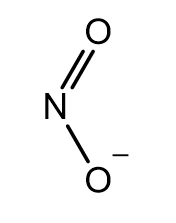
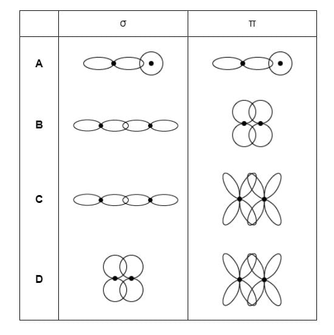

# Exam Questions — Covalent Bonding & Coordinate (Dative Covalent) Bonding
**3. Chemical Bonding** · Cambridge (CIE) A-LEVEL chemistry (9701)
> Source: [https://www.savemyexams.com/a-level/chemistry/cie/25/topic-questions/](https://www.savemyexams.com/a-level/chemistry/cie/25/topic-questions/) · 14 questions across 1 sets

## Multiple Choice Questions (14 questions)

### Q1 — medium — 1 marks

**Q1** [1 mark]

Which row gives the number of σ and π bonds in one molecule of acrylonitrile?

|   | number of σ bonds | number of π bonds |
|---|---|---|
| **A** | 4 | 2 |
| **B** | 6 | 1 |
| **C** | 6 | 3 |
| **D** | 7 | 3 |

### Q2 — medium — 1 marks

**Q2** [1 mark]

How many σ and π bonds are present in ethanenitrile?

### Q3 — medium — 1 marks

**Q3** [1 mark]

Which compound has the highest boiling point?

### Q4 — medium — 1 marks

**Q4** [1 mark]

Which bond is the most polar?

### Q5 — hard — 1 marks

**Q5** [1 mark]

Which bond is the shortest?

### Q6 — hard — 1 marks

**Q6** [1 mark]

Which statement describes the bonding within a carbonate ion, CO32–?

### Q7 — hard — 1 marks

**Q7** [1 mark]

The structure of the NO2 molecule is shown below.

Which compound has the same hybridisation of carbon atoms as the nitrogen atom in NO2?

### Q8 — medium — 1 marks

**Q8** [1 mark]

“The bond **X** between the hydrogen and halogen atoms in HBr is **Y** than in HI.”

Which row does **not** correctly complete the sentence?

|   | **X** | **Y** |
|---|---|---|
| **A** | length | shorter |
| **B** | energy | greater |
| **C** | angle | smaller |
| **D** | polarity | greater |

### Q9 — medium — 1 marks

**Q9** [1 mark]

Which diagrams correctly illustrate the formation of a σ bond and a π bond from the overlap of atomic orbitals?

### Q10 — easy — 1 marks

**Q10** [1 mark]

Which bond is formed by the end-on overlap of atomic orbitals?

### Q11 — easy — 1 marks

**Q11** [1 mark]

Phosphine, PH3, can react with a hydrogen ion, H+, to form the phosphonium ion.

Which type of bond is formed in this reaction?

### Q12 — medium — 1 marks

**Q12** [1 mark]

Which feature is **not** present in a nitrogen molecule, N2?

### Q13 — easy — 1 marks

**Q13** [1 mark]

Which species contains a co-ordinate (dative covalent) bond?

### Q14 — medium — 1 marks

**Q14** [1 mark]

The bond length in an O2 molecule is 0.121 nm and the bond length in an N2 molecule is 0.109 nm.

Which statement explains why the bond in N2 is shorter than the bond in O2?
