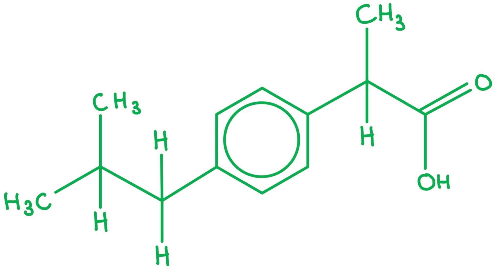
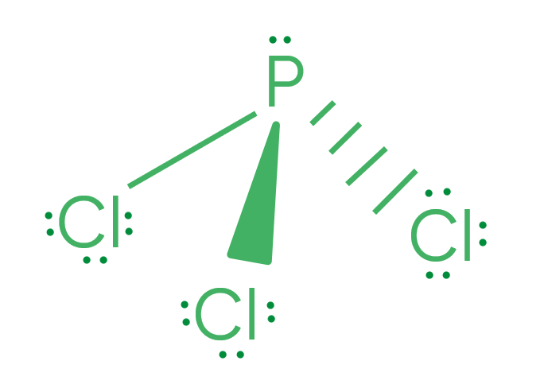
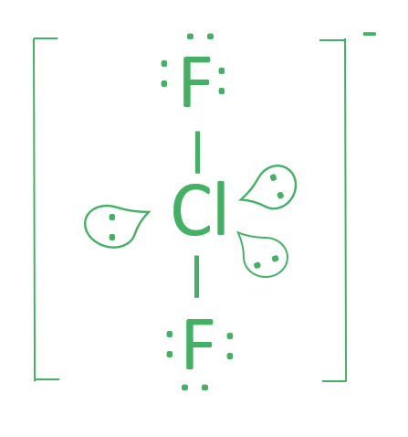
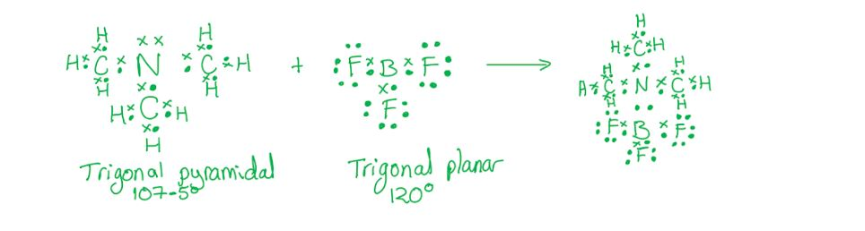
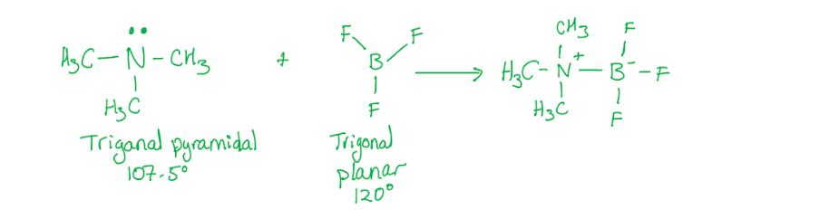
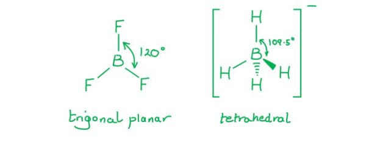
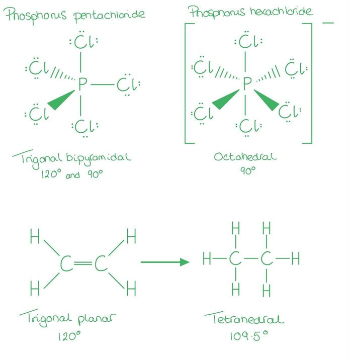
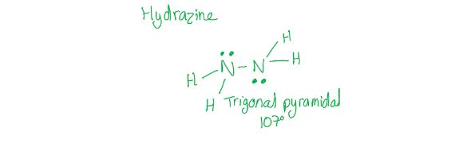

# Mark Schemes — Shapes of Molecules
**3. Chemical Bonding** · Cambridge (CIE) A-LEVEL chemistry (9701)

## Multiple Choice Questions (10 questions)

### Q1
**Final answer:** **The correct answer is C**

- Nitrogen (Group 15) has 5 valence electrons.
- The 1– charge adds 1 more electron, giving 6 available electrons.
- Nitrogen uses 2 to form single bonds with hydrogen, leaving 4 non-bonding electrons.
- This gives the central nitrogen 2 bond pairs and 2 lone pairs.
- The strong repulsion from two lone pairs compresses the standard tetrahedral angle (109.5°) to give a bond angle of 104.5°, identical to the geometry of water.

**A** is incorrect as CH4 has a tetrahedral shape with a bond angle of 109.5°. Carbon (Group 14) uses all 4 of its valence electrons in bonding, giving the central carbon 4 bond pairs and 0 lone pairs.

**B** is incorrect as CO2 has a linear shape with a bond angle of 180°. The central carbon forms two double bonds with oxygen. Each double bond counts as one region of electron density, giving 2 regions of electron density and 0 lone pairs.

**D** is incorrect as NH4+ has a tetrahedral shape with a bond angle of 109.5°. Nitrogen has 5 valence electrons, the 1+ charge removes one, leaving 4. All 4 are used in bonding, giving 4 bond pairs and 0 lone pairs.

### Q2
**Final answer:** **The correct answer is B**

- Bond angle *a* is 109.5°.

  - The carbon atom at *a* is bonded to 3 carbon atoms and 1 undrawn hydrogen atom (skeletal formulae omit C-H bonds).
  - This gives 4 bond pairs and 0 lone pairs, resulting in a tetrahedral shape.

- Bond angle *b* is 120°.

  - The carbon atom in the carboxyl group at *b* is bonded to 1 carbon and 2 oxygen atoms, with one C=O double bond.
  - A double bond counts as a single region of electron density in VSEPR theory, giving 3 regions of electron density and 0 lone pairs, resulting in a trigonal planar shape.

**A** is incorrect as 107° corresponds to a trigonal pyramidal shape (3 bond pairs, 1 lone pair), which does not apply to either carbon atom shown.

**C** is incorrect as the angles are reversed. Bond angle *a* is tetrahedral (109.5°) and bond angle *b* is trigonal planar (120°), not the other way around.

**D** is incorrect as bond angle *b* is 120° (trigonal planar), not 109.5°. The C=O double bond in the carboxyl group counts as one region of electron density, giving 3 regions in total and a flat, planar arrangement.

### Q3
**Final answer:** **The correct answer is C**

- If the yield increases with temperature, the equilibrium shifts to the right when temperature increases.

  - By Le Chatelier's principle, increasing temperature favours the endothermic direction.
  - So, the forward reaction is **endothermic**.

- Phosphorus in PCl3 has 5 valence electrons and uses 3 to form single bonds with chlorine.

  - This gives the central phosphorus atom **3 bond pairs and 1 lone pair**.
  - Lone pair-bond pair repulsion is greater than bond pair-bond pair repulsion, giving a **trigonal pyramidal** shape with a bond angle of approximately 107°.

**A** and **B** are incorrect as if the reaction were exothermic, increasing temperature would shift the equilibrium to the left, decreasing the yield of PCl3.

**D** is incorrect as phosphorus has a lone pair of electrons, which reduces the bond angle to approximately 107° and gives a trigonal pyramidal shape, not a trigonal planar shape with 120°.

### Q4
**Final answer:** **The correct answer is A**

- Boron is in Group 13 and has 3 valence electrons.
- It uses all 3 to form single bonds with the three chlorine atoms, giving the central boron atom 3 bond pairs and 0 lone pairs.
- Three regions of electron density repel equally, giving a trigonal planar shape with a bond angle of 120°.

**B** is incorrect as H3O+ has a trigonal pyramidal shape with a bond angle of approximately 107°. Oxygen has 6 valence electrons; the positive charge removes one, leaving 5. Three are used in bonding, leaving 1 lone pair (3 bond pairs and 1 lone pair).

**C** is incorrect as NH3 has a trigonal pyramidal shape with a bond angle of approximately 107°. Nitrogen (Group 15) uses 3 of its 5 valence electrons to bond with hydrogen, leaving 1 lone pair (3 bond pairs and 1 lone pair).

**D** is incorrect as TlBr32- has a trigonal pyramidal shape with a bond angle of approximately 107°. Thallium (Group 13) has 3 valence electrons; the 2– charge adds 2 more, giving 5 available electrons. Three are used in bonding with bromine, leaving 1 lone pair (3 bond pairs and 1 lone pair).

### Q5
**Final answer:** **The correct answer is B**

- Chlorine (Group 17) has 7 valence electrons.

  - The 1– charge adds 1 more, giving 8 available electrons.
- Chlorine uses 2 to form single bonds with the fluorine atoms, leaving 6 non-bonding electrons.

  - This gives the central chlorine **2 bond pairs and 3 lone pairs** (5 regions of electron density in total).
- Chlorine can expand its octet as it is in Period 3 and can use the empty 3d subshell.
- Five regions of electron density adopt a **trigonal bipyramidal** arrangement to minimise repulsion.
- The 3 lone pairs occupy the equatorial positions, forcing the 2 bond pairs into the axial positions.
- The two fluorine atoms are positioned above and below the plane of the three lone pairs, giving a **linear** molecular shape with a bond angle of 180°.

**A** is incorrect as a bent shape arises from 2 bond pairs and 1 or 2 lone pairs (e.g. H2O). ClF2- has 3 lone pairs on the central atom.

**C** is incorrect as a T-shaped molecule has 3 bond pairs and 2 lone pairs (e.g. ClF3). ClF2- has only 2 bond pairs and 3 lone pairs.

**D** is incorrect as trigonal planar requires 3 bond pairs and 0 lone pairs. ClF2- has 2 bond pairs and 3 lone pairs.

### Q6
**Final answer:** **The correct answer is A**

- Nitrogen in trimethylamine has 3 bond pairs and 1 lone pair on the central nitrogen atom, giving a **trigonal pyramidal** shape (~107°).

- Boron in BF3 has 3 bond pairs and 0 lone pairs on the central boron atom, giving a **trigonal planar** shape (120°).

  - Boron is electron-deficient as it does not complete an octet.

- The nitrogen atom donates its lone pair into the empty orbital of the electron-deficient boron atom, forming a **dative covalent bond**.

- After bond formation, both nitrogen and boron have 4 bond pairs and 0 lone pairs on their central atoms, giving **tetrahedral** shapes (109.5°) in the product.

**B** and **C** are incorrect as they show BF3 drawn with a lone pair of electrons on boron, giving it a trigonal pyramidal shape. BF3 is electron-deficient: the central boron has 3 bond pairs and 0 lone pairs, making it trigonal planar.

**D** is incorrect as it shows the product with nitrogen and boron retaining their original shapes. The new dative covalent bond adds a 4th bonding region to both central atoms, changing both to tetrahedral geometry (109.5°).

### Q7
**Final answer:** **The correct answer is C**

- A trigonal planar molecule has a central atom with 3 bond pairs and 0 lone pairs, such as BF3.

- Three regions of electron density repel equally to maximise separation, giving a bond angle of 120°.

**A** is incorrect as 107° is the bond angle for a trigonal pyramidal molecule such as NH3, where 3 bond pairs and 1 lone pair are present. The lone pair exerts greater repulsion than a bond pair, compressing the angle below 109.5°.

**B** is incorrect as 109.5° is the bond angle for a tetrahedral molecule such as CH4, where 4 bond pairs and 0 lone pairs repel equally.

**D** is incorrect as 180° is the bond angle for a linear molecule such as CO2, where 2 regions of electron density and 0 lone pairs repel to opposite sides of the central atom.

### Q8
**Final answer:** **The correct answer is C**

- In BF3:

  - Boron has 3 valence electrons and uses all 3 to form single bonds with three fluorine atoms, giving 3 bond pairs and 0 lone pairs.
  - Three regions of electron density repel equally to give a trigonal planar shape with bond angles of 120°.

- In BH4-:

  - The negative charge adds one electron to give 4 bonding electrons.
  - Boron forms four single bonds with hydrogen, giving 4 bond pairs and 0 lone pairs.
  - Four regions of electron density repel equally to give a tetrahedral shape with bond angles of 109.5°.

**A** and **B** are incorrect as BF3 is trigonal planar, not pyramidal. Pyramidal shapes arise when a central atom has 3 bond pairs **and** 1 lone pair (like NH3). Boron in BF3 has no lone pair.

**B** and **D** are incorrect as BH4- is tetrahedral, not square planar. Square planar geometry arises in certain transition metal complexes, not in *s*- and *p*-block species with 4 bond pairs and 0 lone pairs.

### Q9
**Final answer:** **The correct answer is B**

- In both reactions, the central atom gains an additional bonding region, changing the molecular geometry and **decreasing the bond angle**:
- PCl5 (trigonal bipyramidal):

  - 5 bond pairs, 0 lone pairs, 120°/90°.
  - Gains Cl- to form PCl6-.
- PCl6- (octahedral)

  - 6 bond pairs, 0 lone pairs, all 90°.
  - The maximum bond angle decreases from 120° to 90°.
- C2H4:

  - Each C: 3 regions of electron density, 0 lone pairs, 120°.
  - Undergoes addition to form C2H6.
- C2H6 :

  - Each C: 4 bond pairs, 0 lone pairs, 109.5°.
  - The bond angle decreases from 120° to 109.5°.

**A** is incorrect as the oxidation state of phosphorus does not change in PCl5 → PCl6- (phosphorus remains +5 in both). This is not a feature common to both reactions.

**C** is incorrect as PCl5 contains only σ bonds, so no π bond disappears in the first reaction. A π bond does disappear in C2H4 → C2H6, but this does not apply to both reactions.

**D** is incorrect as neither product contains a lone pair on the central atom. The phosphorus in PCl6- has 6 bond pairs and 0 lone pairs, and each carbon in C2H6 has 4 bond pairs and 0 lone pairs.

### Q10
**Final answer:** **The correct answer is B**

- Each nitrogen atom in hydrazine forms 3 bonds (one N-N bond and two N-H bonds) and has one lone pair, giving 4 regions of electron density.

- Four regions of electron density give a basic tetrahedral arrangement (109.5°).

- Lone pair-bond pair repulsion is greater than bond pair-bond pair repulsion.
- So, the bond angle is compressed by approximately 2.5° to give a bond angle of 107°.

**A** is incorrect as it shows a planar structure with a 120° bond angle, which would occur if there were no lone pair on the nitrogen atom.

**C** is incorrect as it shows a bond angle of 109.5°, which assumes all four regions of electron density repel equally and ignores the additional repulsion of the lone pair.

**D** is incorrect as it shows 90° bond angles, which do not correctly maximise the separation of four regions of electron density.
