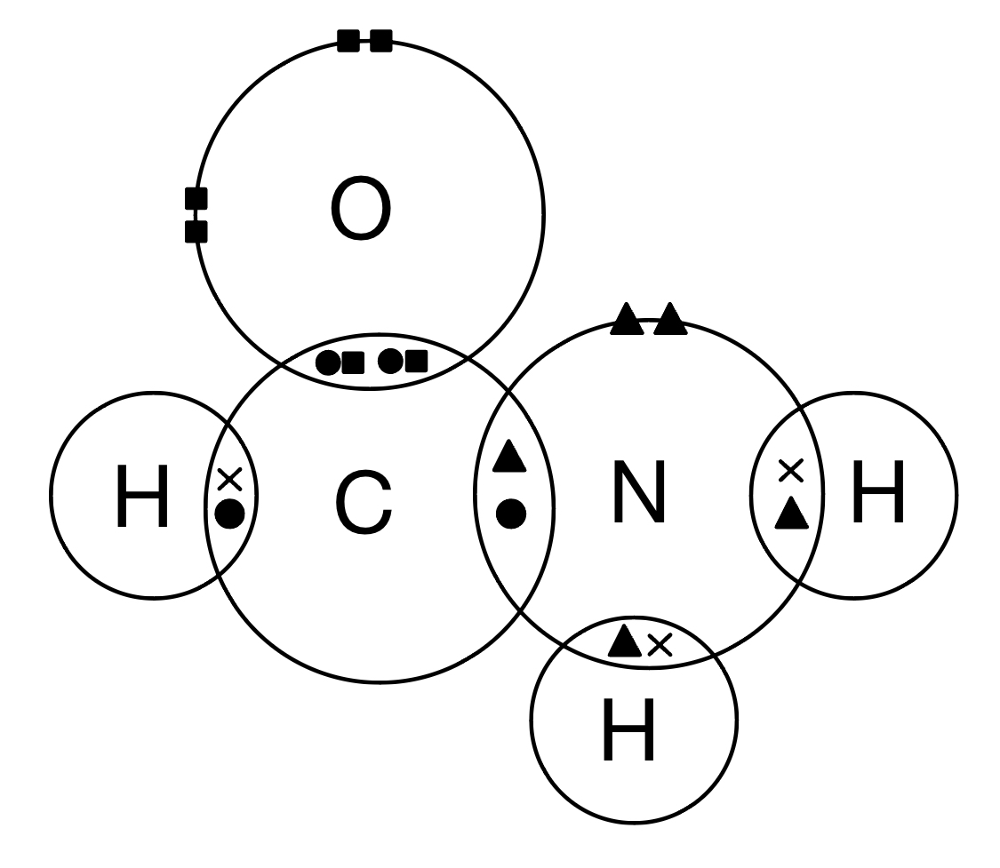
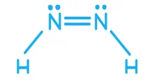
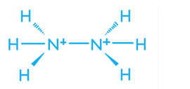

# Mark Schemes — Shapes of Molecules
**3. Chemical Bonding** · Cambridge (CIE) A-LEVEL chemistry (9701)

## Multiple Choice Questions (10 questions)

### Q1
**Final answer:** **The correct answer is C**

- Nitrogen (Group 15) has 5 valence electrons.
- The 1– charge adds 1 more electron, giving 6 available electrons.
- Nitrogen uses 2 to form single bonds with hydrogen, leaving 4 non-bonding electrons.
- This gives the central nitrogen 2 bond pairs and 2 lone pairs.
- The strong repulsion from two lone pairs compresses the standard tetrahedral angle (109.5°) to give a bond angle of 104.5°, identical to the geometry of water.

**A** is incorrect as CH4 has a tetrahedral shape with a bond angle of 109.5°. Carbon (Group 14) uses all 4 of its valence electrons in bonding, giving the central carbon 4 bond pairs and 0 lone pairs.

**B** is incorrect as CO2 has a linear shape with a bond angle of 180°. The central carbon forms two double bonds with oxygen. Each double bond counts as one region of electron density, giving 2 regions of electron density and 0 lone pairs.

**D** is incorrect as NH4+ has a tetrahedral shape with a bond angle of 109.5°. Nitrogen has 5 valence electrons, the 1+ charge removes one, leaving 4. All 4 are used in bonding, giving 4 bond pairs and 0 lone pairs.

### Q2
**Final answer:** **The correct answer is B**

- Bond angle *a* is 109.5°.

  - The carbon atom at *a* is bonded to 3 carbon atoms and 1 undrawn hydrogen atom (skeletal formulae omit C-H bonds).
  - This gives 4 bond pairs and 0 lone pairs, resulting in a tetrahedral shape.

- Bond angle *b* is 120°.

  - The carbon atom in the carboxyl group at *b* is bonded to 1 carbon and 2 oxygen atoms, with one C=O double bond.
  - A double bond counts as a single region of electron density in VSEPR theory, giving 3 regions of electron density and 0 lone pairs, resulting in a trigonal planar shape.

**A** is incorrect as 107° corresponds to a trigonal pyramidal shape (3 bond pairs, 1 lone pair), which does not apply to either carbon atom shown.

**C** is incorrect as the angles are reversed. Bond angle *a* is tetrahedral (109.5°) and bond angle *b* is trigonal planar (120°), not the other way around.

**D** is incorrect as bond angle *b* is 120° (trigonal planar), not 109.5°. The C=O double bond in the carboxyl group counts as one region of electron density, giving 3 regions in total and a flat, planar arrangement.

### Q3
**Final answer:** **The correct answer is C**

- If the yield increases with temperature, the equilibrium shifts to the right when temperature increases.

  - By Le Chatelier's principle, increasing temperature favours the endothermic direction.
  - So, the forward reaction is **endothermic**.

- Phosphorus in PCl3 has 5 valence electrons and uses 3 to form single bonds with chlorine.

  - This gives the central phosphorus atom **3 bond pairs and 1 lone pair**.
  - Lone pair-bond pair repulsion is greater than bond pair-bond pair repulsion, giving a **trigonal pyramidal** shape with a bond angle of approximately 107°.

**A** and **B** are incorrect as if the reaction were exothermic, increasing temperature would shift the equilibrium to the left, decreasing the yield of PCl3.

**D** is incorrect as phosphorus has a lone pair of electrons, which reduces the bond angle to approximately 107° and gives a trigonal pyramidal shape, not a trigonal planar shape with 120°.

### Q4
**Final answer:** **The correct answer is A**

- Boron is in Group 13 and has 3 valence electrons.
- It uses all 3 to form single bonds with the three chlorine atoms, giving the central boron atom 3 bond pairs and 0 lone pairs.
- Three regions of electron density repel equally, giving a trigonal planar shape with a bond angle of 120°.

**B** is incorrect as H3O+ has a trigonal pyramidal shape with a bond angle of approximately 107°. Oxygen has 6 valence electrons; the positive charge removes one, leaving 5. Three are used in bonding, leaving 1 lone pair (3 bond pairs and 1 lone pair).

**C** is incorrect as NH3 has a trigonal pyramidal shape with a bond angle of approximately 107°. Nitrogen (Group 15) uses 3 of its 5 valence electrons to bond with hydrogen, leaving 1 lone pair (3 bond pairs and 1 lone pair).

**D** is incorrect as TlBr32- has a trigonal pyramidal shape with a bond angle of approximately 107°. Thallium (Group 13) has 3 valence electrons; the 2– charge adds 2 more, giving 5 available electrons. Three are used in bonding with bromine, leaving 1 lone pair (3 bond pairs and 1 lone pair).

### Q5
**Final answer:** **The correct answer is B**

- Chlorine (Group 17) has 7 valence electrons.

  - The 1– charge adds 1 more, giving 8 available electrons.
- Chlorine uses 2 to form single bonds with the fluorine atoms, leaving 6 non-bonding electrons.

  - This gives the central chlorine **2 bond pairs and 3 lone pairs** (5 regions of electron density in total).
- Chlorine can expand its octet as it is in Period 3 and can use the empty 3d subshell.
- Five regions of electron density adopt a **trigonal bipyramidal** arrangement to minimise repulsion.
- The 3 lone pairs occupy the equatorial positions, forcing the 2 bond pairs into the axial positions.
- The two fluorine atoms are positioned above and below the plane of the three lone pairs, giving a **linear** molecular shape with a bond angle of 180°.

**A** is incorrect as a bent shape arises from 2 bond pairs and 1 or 2 lone pairs (e.g. H2O). ClF2- has 3 lone pairs on the central atom.

**C** is incorrect as a T-shaped molecule has 3 bond pairs and 2 lone pairs (e.g. ClF3). ClF2- has only 2 bond pairs and 3 lone pairs.

**D** is incorrect as trigonal planar requires 3 bond pairs and 0 lone pairs. ClF2- has 2 bond pairs and 3 lone pairs.

### Q6
**Final answer:** **The correct answer is A**

- Nitrogen in trimethylamine has 3 bond pairs and 1 lone pair on the central nitrogen atom, giving a **trigonal pyramidal** shape (~107°).

- Boron in BF3 has 3 bond pairs and 0 lone pairs on the central boron atom, giving a **trigonal planar** shape (120°).

  - Boron is electron-deficient as it does not complete an octet.

- The nitrogen atom donates its lone pair into the empty orbital of the electron-deficient boron atom, forming a **dative covalent bond**.

- After bond formation, both nitrogen and boron have 4 bond pairs and 0 lone pairs on their central atoms, giving **tetrahedral** shapes (109.5°) in the product.

**B** and **C** are incorrect as they show BF3 drawn with a lone pair of electrons on boron, giving it a trigonal pyramidal shape. BF3 is electron-deficient: the central boron has 3 bond pairs and 0 lone pairs, making it trigonal planar.

**D** is incorrect as it shows the product with nitrogen and boron retaining their original shapes. The new dative covalent bond adds a 4th bonding region to both central atoms, changing both to tetrahedral geometry (109.5°).

### Q7
**Final answer:** **The correct answer is C**

- A trigonal planar molecule has a central atom with 3 bond pairs and 0 lone pairs, such as BF3.

- Three regions of electron density repel equally to maximise separation, giving a bond angle of 120°.

**A** is incorrect as 107° is the bond angle for a trigonal pyramidal molecule such as NH3, where 3 bond pairs and 1 lone pair are present. The lone pair exerts greater repulsion than a bond pair, compressing the angle below 109.5°.

**B** is incorrect as 109.5° is the bond angle for a tetrahedral molecule such as CH4, where 4 bond pairs and 0 lone pairs repel equally.

**D** is incorrect as 180° is the bond angle for a linear molecule such as CO2, where 2 regions of electron density and 0 lone pairs repel to opposite sides of the central atom.

### Q8
**Final answer:** **The correct answer is C**

- In BF3:

  - Boron has 3 valence electrons and uses all 3 to form single bonds with three fluorine atoms, giving 3 bond pairs and 0 lone pairs.
  - Three regions of electron density repel equally to give a trigonal planar shape with bond angles of 120°.

- In BH4-:

  - The negative charge adds one electron to give 4 bonding electrons.
  - Boron forms four single bonds with hydrogen, giving 4 bond pairs and 0 lone pairs.
  - Four regions of electron density repel equally to give a tetrahedral shape with bond angles of 109.5°.

**A** and **B** are incorrect as BF3 is trigonal planar, not pyramidal. Pyramidal shapes arise when a central atom has 3 bond pairs **and** 1 lone pair (like NH3). Boron in BF3 has no lone pair.

**B** and **D** are incorrect as BH4- is tetrahedral, not square planar. Square planar geometry arises in certain transition metal complexes, not in *s*- and *p*-block species with 4 bond pairs and 0 lone pairs.

### Q9
**Final answer:** **The correct answer is B**

- In both reactions, the central atom gains an additional bonding region, changing the molecular geometry and **decreasing the bond angle**:
- PCl5 (trigonal bipyramidal):

  - 5 bond pairs, 0 lone pairs, 120°/90°.
  - Gains Cl- to form PCl6-.
- PCl6- (octahedral)

  - 6 bond pairs, 0 lone pairs, all 90°.
  - The maximum bond angle decreases from 120° to 90°.
- C2H4:

  - Each C: 3 regions of electron density, 0 lone pairs, 120°.
  - Undergoes addition to form C2H6.
- C2H6 :

  - Each C: 4 bond pairs, 0 lone pairs, 109.5°.
  - The bond angle decreases from 120° to 109.5°.

**A** is incorrect as the oxidation state of phosphorus does not change in PCl5 → PCl6- (phosphorus remains +5 in both). This is not a feature common to both reactions.

**C** is incorrect as PCl5 contains only σ bonds, so no π bond disappears in the first reaction. A π bond does disappear in C2H4 → C2H6, but this does not apply to both reactions.

**D** is incorrect as neither product contains a lone pair on the central atom. The phosphorus in PCl6- has 6 bond pairs and 0 lone pairs, and each carbon in C2H6 has 4 bond pairs and 0 lone pairs.

### Q10
**Final answer:** **The correct answer is B**

- Each nitrogen atom in hydrazine forms 3 bonds (one N-N bond and two N-H bonds) and has one lone pair, giving 4 regions of electron density.

- Four regions of electron density give a basic tetrahedral arrangement (109.5°).

- Lone pair-bond pair repulsion is greater than bond pair-bond pair repulsion.
- So, the bond angle is compressed by approximately 2.5° to give a bond angle of 107°.

**A** is incorrect as it shows a planar structure with a 120° bond angle, which would occur if there were no lone pair on the nitrogen atom.

**C** is incorrect as it shows a bond angle of 109.5°, which assumes all four regions of electron density repel equally and ignores the additional repulsion of the lone pair.

**D** is incorrect as it shows 90° bond angles, which do not correctly maximise the separation of four regions of electron density.

## Structured Questions (5 questions)

### Q1
> **[mark-scheme]**
> i) The number of electrons in the outer shell of the sulfur atom in SF6:
> 
> - 12 **[1 mark]**
> 
> ii) The reason the sulfur atom can accommodate this number of electrons:
> 
> - Sulfur has available empty 3d orbitals / can use its 3d orbitals to expand its octet **[1 mark]**

> **[exam-tip]**
> Period 2 elements such as carbon, nitrogen, and oxygen cannot accommodate more than 8 electrons in their outer shell because the second shell contains only s and p subshells.
> 
> Sulfur is in Period 3. The third shell contains 3s, 3p, and 3d subshells. The 3d orbitals are empty in ground-state sulfur and are energetically accessible for bonding, allowing sulfur to form 6 bonds in SF6 and accommodate 12 electrons in its outer shell.
> **[mark-scheme]**
> The shape of a molecule of SF6:
> 
> - Octahedral **[1 mark]**

> **[exam-tip]**
> In SF6, sulfur forms 6 bonds with 6 fluorine atoms and has no lone pairs. Six bonding domains with no lone pairs gives an octahedral arrangement.
> **[mark-scheme]**
> The F-S-F bond angles in SF6:
> 
> - 90° **[1 mark]**

> **[exam-tip]**
> In an octahedral molecule, the six bonding domains point towards the vertices of a regular octahedron. All adjacent bond angles are 90°. Because there are no lone pairs to distort the geometry, all F-S-F angles in SF6 are exactly 90°.
> 
> Do not confuse with trigonal bipyramidal molecules such as PF5, which have two different bond angles: 90° (axial-equatorial) and 120° (equatorial-equatorial).
> 
> The molecules listed in the CIE 9701 syllabus with their shapes and bond angles are:
> 
> - BF3: trigonal planar, 120°
> - CO2: linear, 180°
> - CH4: tetrahedral, 109.5°
> - NH3: pyramidal, 107°
> - H2O: non-linear, 104.5°
> - SF6: octahedral, 90°
> - PF5: trigonal bipyramidal, 90° and 120°
> **[mark-scheme]**
> i) The polarity of the S-F bond:
> 
> - The S-F bond is polar **[1 mark]**
> 
> ii) The polarity of SF6:
> 
> - SF6 is non-polar / has no net dipole moment **[1 mark]**
> - The six polar S-F bonds are arranged symmetrically / the bond dipoles cancel **[1 mark]**

> **[exam-tip]**
> A bond is polar when there is a significant electronegativity difference between the bonded atoms, generally 0.5 or more on the Pauling scale. The electronegativity difference for S-F is 3.98 - 2.58 = 1.40, so each S-F bond is strongly polar, with fluorine as δ- and sulfur as δ+.
> 
> A molecule can contain polar bonds but still be non-polar overall if the bond dipoles cancel due to symmetry. In SF6, the octahedral geometry means the six S-F bond dipoles point outward along three perpendicular axes in opposing pairs. The dipoles cancel exactly, giving no net dipole.
> 
> Contrast with H2O: two polar O-H bonds at 104.5° do not cancel, so H2O is polar.

### Q2
> **[mark-scheme]**
> The basic principles of VSEPR theory:
> 
> - Electron pairs / electron domains in the outer shell of the central atom repel each other **[1 mark]**
> - Electron pairs arrange as far apart as possible to minimise repulsion **[1 mark]**
> - Lone pair–lone pair repulsion > lone pair–bonding pair repulsion > bonding pair–bonding pair repulsion **[1 mark]**

> **[exam-tip]**
> VSEPR theory is based on three key ideas:
> 
> 1. Electron pairs in the outer shell are negatively charged and repel each other.
> 2. To minimise repulsion, electron pairs arrange as far apart as possible in space. The arrangement determines the shape.
> 3. Not all electron pairs repel equally. Lone pairs are concentrated closer to the central atom and exert more repulsion than bonding pairs.
> 
> The repulsion hierarchy explains why molecules with lone pairs have bond angles smaller than the ideal value. For example, H2O has 2 lone pairs and a H-O-H angle of 104.5°, compared to the tetrahedral ideal of 109.5°.
> **[mark-scheme]**
> The shape and F-O-F bond angle of OF2:
> 
> - Non-linear / V-shaped / bent **[1 mark]**
> - F-O-F bond angle in the range 97° to 109° **[1 mark]**
> - Oxygen has 4 electron domains: 2 bonding pairs and 2 lone pairs
> **OR**
> Oxygen has a tetrahedral arrangement of electron pairs **[1 mark]**
> 
> Lone pair–bonding pair repulsion is greater than bonding pair–bonding pair repulsion, reducing the F-O-F bond angle below 109.5°.

> **[exam-tip]**
> Oxygen in OF2 has 6 outer-shell electrons: 2 used in the two O-F bonds and 4 remaining as 2 lone pairs. Four electron domains give a tetrahedral electron geometry, but the shape is named by bonding domains only: 2 bonding pairs + 2 lone pairs = non-linear / V-shaped.
> 
> Fluorine is more electronegative than hydrogen, which slightly increases the F-O-F bond angle compared to H2O (104.5°). A value in the range 97° to 109° is accepted.
> 
> The rough rule of thumb is that each lone pair reduces the bond angle by approximately 2.5° from the ideal tetrahedral value of 109.5°.
> **[mark-scheme]**
> i) The shape and bond angle in BF3:
> 
> - Trigonal planar **[1 mark]**
> - 120° **[1 mark]**
> 
> ii) The shape and bond angle in NBr3:
> 
> - Trigonal pyramidal **[1 mark]**
> - 107° **[1 mark]**

> **[exam-tip]**
> For BF3: boron (Group 3) has 3 outer-shell electrons, all used in bonding. BF3 has 3 bonding pairs and no lone pairs: trigonal planar, 120°.
> 
> For NBr3: nitrogen (Group 5) has 5 outer-shell electrons. Three are used in bonding, leaving 1 lone pair. Four electron domains (3 bonding pairs + 1 lone pair): trigonal pyramidal, approximately 107°.
> 
> The identity of the substituent (F vs Br) does not change the shape. What matters is the electron domain count around the central atom.

### Q3
> **[mark-scheme]**
> The bond angle in BH3 is 120° because:
> 
> - BH3 has 3 bonding pairs of electrons and no lone pairs **[1 mark]**
> - The bonding pairs repel each other equally and arrange as far apart as possible to minimise repulsion **[1 mark]**

> **[exam-tip]**
> VSEPR theory states that electron pairs in the outer shell repel each other and arrange to minimise repulsion. Boron (Group 3) has 3 outer-shell electrons, all used to form the 3 B-H bonds. With 3 bonding pairs and no lone pairs, all repulsions are equal.
> 
> In a planar arrangement, equal repulsion between 3 pairs gives 360° / 3 = 120° bond angles. BH3 is trigonal planar.
> 
> Note: bond angles are 120° due to repulsion between electron pairs, not between hydrogen atoms.
> **[mark-scheme]**
> The H-N-H bond angle in NH3:
> 
> - 107° **[1 mark]**

> **[exam-tip]**
> NH3 has 3 bonding pairs and 1 lone pair on nitrogen = 4 electron domains. Four electron domains give approximately 109.5° (tetrahedral), but the lone pair exerts greater repulsion than a bonding pair, compressing the H-N-H angles to approximately 107°.
> 
> The H-N-H bond angle in NH3 (107°) is smaller than the H-B-H angle in BH3 (120°) because NH3 has a lone pair on nitrogen whereas BH3 does not.
> **[mark-scheme]**
> The bond angle in NH3 is smaller than in BH3 because:
> 
> - NH3 has a lone pair of electrons on the central nitrogen atom, whereas BH3 has no lone pairs **[1 mark]**
> - Lone pair–bonding pair repulsion is greater than bonding pair–bonding pair repulsion, reducing the H-N-H bond angle **[1 mark]**

> **[exam-tip]**
> The order of electron pair repulsion strength is:
> 
> - lone pair–lone pair > lone pair–bonding pair > bonding pair–bonding pair
> 
> In BH3, all three bonding pairs repel equally, giving 120°. In NH3, the lone pair exerts extra repulsion on the bonding pairs, compressing them and reducing the H-N-H angle from the ideal tetrahedral value (109.5°) to approximately 107°.

### Q4
The dot-and-cross diagram for methanamide, HCONH2 is:

**[2 marks]**

> **[mark-scheme]**
> 1 mark for correct bonding pairs: C=O double bond, C-H single bond, C-N single bond, two N-H single bonds shown as shared electron pairs.
> 
> 1 mark for correct non-bonding pairs: two lone pairs on oxygen, one lone pair on nitrogen.

> **[exam-tip]**
> Methanamide (HCONH2) contains 1 C, 1 O, 1 N, and 3 H atoms. Typical bonding in uncharged covalent molecules:
> 
> - Carbon forms 4 bonds
> - Oxygen forms 2 bonds (2 lone pairs remaining)
> - Nitrogen forms 3 bonds (1 lone pair remaining)
> - Hydrogen forms 1 bond
> 
> In methanamide: carbon forms a C=O double bond, a C-N single bond, and a C-H single bond (4 bonds total). Nitrogen forms the C-N bond and two N-H bonds (3 bonds, 1 lone pair). Oxygen forms the C=O double bond (2 bonds, 2 lone pairs).
> **[mark-scheme]**
> H-C-N bond angle:
> 
> - Any angle in the range 117° to 120° **[1 mark]**
> - Carbon has 3 electron domains: 2 single bonds (C-H and C-N) and 1 double bond (C=O) / 3 bonding regions and no lone pairs **[1 mark]**
> - The electron domains arrange to minimise repulsion / repel each other equally **[1 mark]**
> 
> C-N-H bond angle:
> 
> - Any angle in the range 104° to 108° **[1 mark]**
> - Nitrogen has 4 electron domains: 3 bonding pairs and 1 lone pair **[1 mark]**
> - Lone pair–bonding pair repulsion is greater than bonding pair–bonding pair repulsion, reducing the C-N-H bond angle below 109.5° **[1 mark]**

> **[exam-tip]**
> For the carbon atom in HCONH2: carbon forms a C=O double bond, a C-N single bond, and a C-H single bond. For VSEPR, the double bond counts as one electron domain. Carbon has 3 electron domains, no lone pairs: trigonal planar geometry, approximately 120°.
> 
> For the nitrogen atom: nitrogen forms a C-N bond and two N-H bonds, with one lone pair remaining. Four electron domains (3 bonding + 1 lone pair): ideal tetrahedral 109.5° compressed to approximately 107° by the lone pair's greater repulsion.
> **[mark-scheme]**
> The shapes around C and N in HCONH2:
> 
> - Around C: trigonal planar; **[1 mark]**
> - Around N: trigonal pyramidal / pyramidal; **[1 mark]**

> **[exam-tip]**
> The shape around an atom is determined by its bonding domains only — lone pairs affect bond angles but are not counted when naming the shape.
> 
> Around C: 3 bonding domains, no lone pairs: trigonal planar.
> 
> Around N: 3 bonding domains and 1 lone pair: trigonal pyramidal / pyramidal.
> 
> Note: at A Level, the lone pair on nitrogen in amides can be delocalised into the C=O pi bond, making the geometry around N closer to trigonal planar in reality. For a straightforward VSEPR question at this level, trigonal pyramidal / pyramidal is the expected answer.
> **[mark-scheme]**
> The polarity of HCONH2:
> 
> - Methanamide is polar; **[1 mark]**
> - It contains polar bonds (C=O / N-H); **[1 mark]**
> - The bond dipoles do not cancel / there is an unsymmetrical distribution of charge / there is a net dipole moment; **[1 mark]**

> **[exam-tip]**
> For a molecule to be polar, it must contain polar bonds AND those bonds must be arranged unsymmetrically so their dipoles do not cancel.
> 
> Methanamide contains a strongly polar C=O bond (oxygen is much more electronegative than carbon) and polar N-H bonds (nitrogen is more electronegative than hydrogen).
> 
> The geometry of methanamide is not symmetrical, which means that the C=O and N-H dipoles point in a similar direction, giving a resultant net dipole. Methanamide is therefore polar.
> 
> Contrast with SF6, which has polar S-F bonds but is non-polar because the six bonds are arranged symmetrically and the dipoles cancel exactly.

### Q5
> **[mark-scheme]**
> The bond angles are:
> 
> - H-C-H bond angle in ethene: any angle in the range 118° to 122° **[1 mark]**
> - H-N-H bond angle in hydrazine: any angle in the range 104° to 108° **[1 mark]**
> 
> Explanation:
> 
> - Each carbon atom in ethene has 3 electron domains: 1 C=C double bond and 2 C-H single bonds / 3 bonding regions and no lone pairs **[1 mark]**
> - Each nitrogen atom in hydrazine has 4 electron domains: 3 bonding pairs and 1 lone pair **[1 mark]**
> - Lone pair–bonding pair repulsion is greater than bonding pair–bonding pair repulsion, reducing the H-N-H angle below 109.5° **[1 mark]**

> **[exam-tip]**
> For ethene (C2H4): each carbon forms a C=C double bond and two C-H single bonds. For VSEPR, the C=C double bond counts as one electron domain. Each carbon has 3 electron domains, no lone pairs: trigonal planar geometry, approximately 120°.
> 
> For hydrazine (N2H4): each nitrogen has 3 N-H bonds and 1 lone pair = 4 electron domains. The ideal tetrahedral angle of 109.5° is compressed to approximately 107° by the lone pair's extra repulsion.
> **[mark-scheme]**
> The shape and H-N-N bond angle in diimide:
> 
> - Non-linear / V-shaped / bent around each nitrogen atom **[1 mark]**
> - H-N-N bond angle in the range 115° to 120° **[1 mark]**
> 
> An answer of exactly 120° is not accepted as the lone pair on nitrogen reduces the angle below 120°.

> **[exam-tip]**
> In diimide (HN=NH), each nitrogen forms one N=N double bond and one N-H single bond, and has one lone pair. A double bond counts as one electron domain in VSEPR, so each nitrogen has 3 electron domains: 2 bonding domains and 1 lone pair.
> 
> 
> 
> Three electron domains give a trigonal planar electron geometry (ideal 120°), but the lone pair exerts additional repulsion, reducing the H-N-N angle to slightly below 120°.
> 
> Since both nitrogen atoms are bent symmetrically (HN=NH), the molecule is planar overall.
> **[mark-scheme]**
> The H-N-H bond angle in N2H62+:
> 
> - 109.5° / 109° **[1 mark]**

> **[exam-tip]**
> In the N2H62+ cation, each nitrogen has accepted a proton, similar to how ammonia (NH3) becomes ammonium (NH4+). Each nitrogen now has 4 bonding pairs and no lone pairs.
> 
> 
> 
> Four bonding domains with no lone pairs gives a tetrahedral arrangement with bond angles of 109.5°.
> 
> The structure is analogous to ethane: each carbon in ethane has 4 bonding pairs, no lone pairs, and bond angles of 109.5°.
