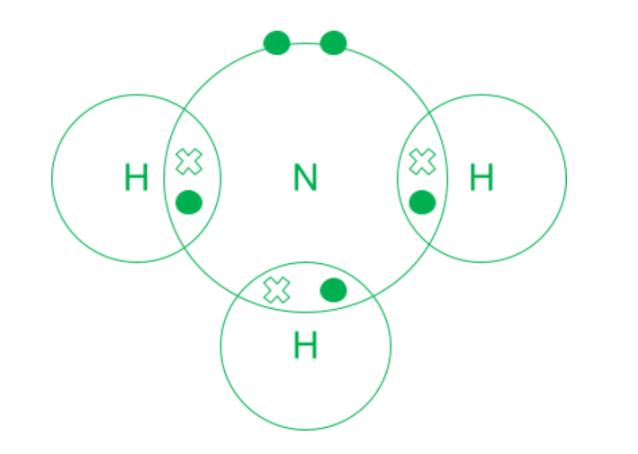
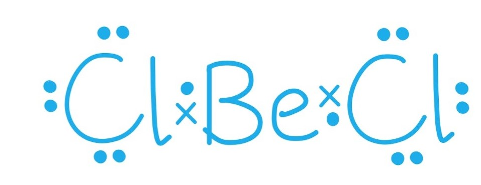
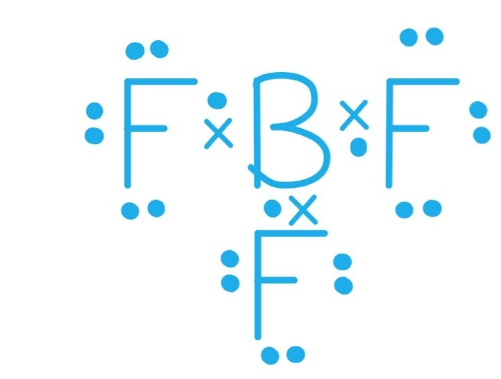
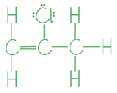
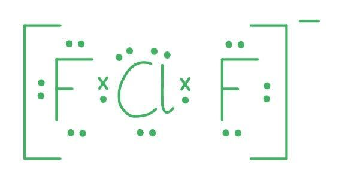
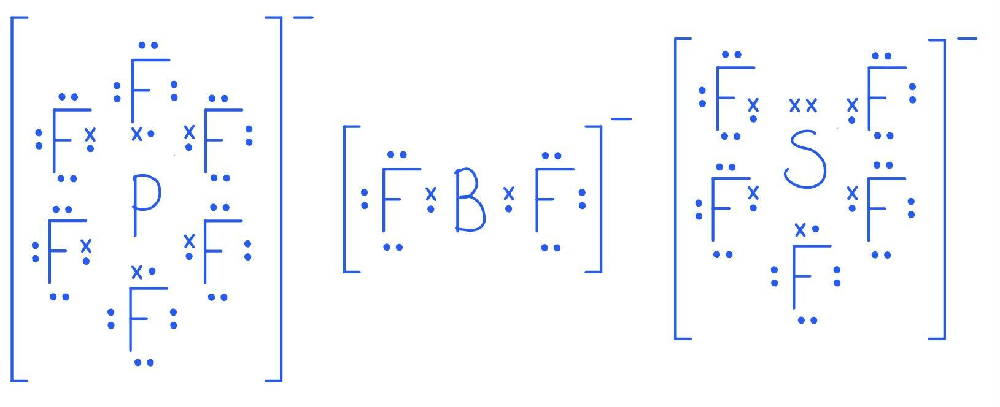
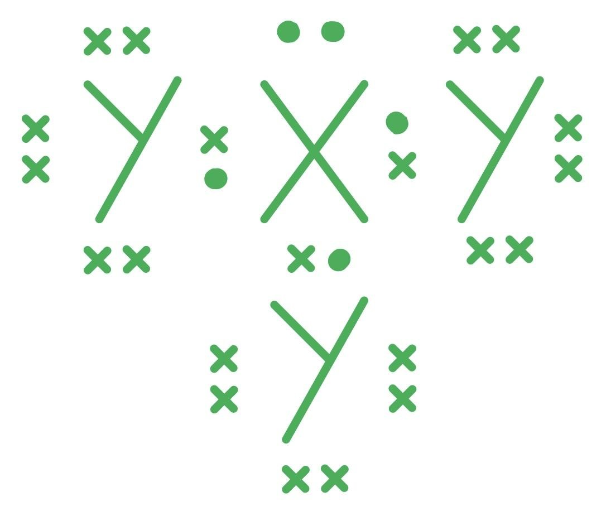

# Mark Schemes — Dot & Cross Diagrams
**3. Chemical Bonding** · Cambridge (CIE) A-LEVEL chemistry (9701)

## Multiple Choice Questions (9 questions)

### Q1
**Final answer:** **The correct answer is A**

- Calcium is in Group 2 and transfers its 2 valence electrons to form a Ca2+ ion.
- The peroxide ion, O22-, consists of two oxygen atoms joined by a **single covalent bond**.
- Each oxygen atom is in Group 16 and has 6 valence electrons. One electron from each oxygen atom is used to form the O-O single bond.
- Each oxygen atom then receives one electron transferred from calcium to complete its octet, giving each oxygen atom 3 lone pairs.
- The correct diagram shows two oxygen atoms sharing one electron pair, with completed octets, enclosed in brackets with a 2- charge.

**B** is incorrect as this shows a double bond between the two oxygen atoms. This represents the neutral oxygen molecule, O2, not the peroxide ion. With a double bond, both oxygen atoms would have a complete octet without accepting any electrons from calcium.

**C** is incorrect as this diagram does not correctly represent the 2- charge of the peroxide ion. The O22- ion has received 2 additional electrons in total (one per oxygen atom). The electron arrangement shown does not match the single covalent bond plus completed octets required for the peroxide ion.

**D** is incorrect as this shows only a single oxygen atom. The peroxide ion contains two oxygen atoms joined together by a single covalent bond.

### Q2
**Final answer:** **The correct answer is B**

- There are no non-bonded electrons on the hydrogen atoms.

  - Each hydrogen uses its single electron to form a covalent bond with nitrogen.
- Nitrogen is in Group 15 and has 5 outer-shell electrons.

  - It shares 3 in covalent bonds with the three hydrogen atoms.
- This leaves **2 non-bonded electrons** (one lone pair) on the outer shell of the nitrogen atom.

**A** is incorrect as this assumes all electrons in the molecule are involved in bonding, ignoring the lone pair on nitrogen.

**C** is incorrect as 5 is the total number of outer-shell electrons on the nitrogen atom before bonding. It does not account for the 3 electrons used in covalent bonds with hydrogen.

**D** is incorrect as 6 is the number of bonding electrons in the molecule (3 covalent bonds x 2 electrons per bond = 6). The question asks for non-bonded outer-shell electrons, not bonding electrons.

### Q3
**Final answer:** **The correct answer is C**

- Carbon is in Group 14 and has 4 valence electrons.
- It uses all 4 to form two double bonds with the two sulfur atoms (S=C=S).
- This gives the central carbon atom **8 electrons** in its outer shell, a complete octet.
- Each sulfur atom also obeys the octet rule, with 4 electrons shared in the double bond and 4 in lone pairs.

**A** is incorrect as beryllium is in Group 2 and has only 2 valence electrons. Forming 2 single bonds with chlorine gives the central beryllium atom only **4 electrons** in its outer shell, an incomplete octet.

**B** is incorrect as boron is in Group 13 and has 3 valence electrons. Forming 3 single bonds with fluorine gives the central boron atom only **6 electrons** in its outer shell, an incomplete octet.

**D** is incorrect as phosphorus is in Group 15 and has 5 valence electrons. Forming 5 single bonds with chlorine gives the central phosphorus atom **10 electrons** in its outer shell, an expanded octet.

### Q4
**Final answer:** **The correct answer is A**

- The carbon atoms and the chlorine atom in 2-chloropropene all have 8 electrons in their outer shells, satisfying the octet rule.
- However, the five hydrogen atoms each have only 2 electrons in their outer shell when bonded to carbon. Hydrogen satisfies the duet rule (2 electrons), not the octet rule.
- Statement A is therefore incorrect as it is not true that every atom in the molecule obeys the octet rule.

**B** is not the correct answer as statement B is true. The C=C double bond consists of one sigma bond and one pi bond, so the molecule contains exactly one pi bond.

**C** is not the correct answer as statement C is true. The total number of valence electrons = (3 C x 4) + (5 H x 1) + (1 Cl x 7) = 12 + 5 + 7 = 24 valence electrons.

**D** is not the correct answer as statement D is true. Chlorine is in Group 17 and has 7 valence electrons. It uses 1 to form a single bond with carbon, leaving 6 non-bonded electrons, giving exactly 3 lone pairs.

### Q5
**Final answer:** **The correct answer is C**

- Chlorine is in Group 17 and has 7 valence electrons.
- It forms 3 covalent bonds with the three fluorine atoms, using 3 of these electrons.
- The remaining 4 electrons on the central chlorine atom form 2 lone pairs.

**A** is incorrect as 0 lone pairs would require all of chlorine's valence electrons to be used in bonding. Chlorine forms only 3 bonds, leaving 4 electrons as lone pairs.

**B** is incorrect as this applies the octet rule too strictly. Assuming chlorine needs only 8 electrons in its outer shell (3 bond pairs + 1 lone pair = 8) gives 1 lone pair. However, chlorine is in Period 3 and can expand its octet, so the correct count is 2 lone pairs.

**D** is incorrect as 3 is the number of lone pairs on each terminal fluorine atom, not on the central chlorine atom.

### Q6
**Final answer:** **The correct answer is B**

- Chlorine is in Group 17 and has 7 valence electrons.
- The 1− charge adds one electron, giving 8 available valence electrons on the central atom.
- Forming 2 bonds to the two fluorine atoms uses 2 of these electrons.
- The remaining 6 electrons on the central chlorine atom form **3 lone pairs**.

**A** is incorrect as boron is in Group 13 (3 valence electrons). The 1− charge gives 4 available electrons on the central atom. Forming 2 bonds uses 2 electrons, leaving only 2 electrons / 1 lone pair on the central boron atom.

**C** is incorrect as phosphorus is in Group 15 (5 valence electrons). The 1− charge gives 6 available electrons on the central atom. Forming 6 bonds to the six fluorine atoms uses all 6 electrons, leaving 0 lone pairs on the central phosphorus atom.

**D** is incorrect as sulfur is in Group 16 (6 valence electrons). The 1− charge gives 7 available electrons on the central atom. Forming 5 bonds uses 5 electrons, leaving only 2 electrons / 1 lone pair on the central sulfur atom.

### Q7
**Final answer:** **The correct answer is C**

- Both **X** (5 outer-shell electrons, Group 15) and **Y** (7 outer-shell electrons, Group 17) are non-metals.
- Neither element will transfer electrons to the other, as both strongly attract electrons to complete their octets. They must share electrons to form a **covalent** bond.
- **X** requires 3 more electrons to complete its octet, so it forms 3 covalent bonds.
- **Y** requires 1 more electron to complete its octet, so each **Y** atom forms 1 covalent bond.
- One atom of **X** therefore bonds with 3 atoms of **Y**, giving the formula **XY**3.

**A** and **B** are incorrect as the formula **X**3**Y** inverts the combining ratios. **X** needs 3 more electrons and forms 3 bonds, while **Y** needs only 1. One atom of **X** bonds with 3 atoms of **Y**, not the reverse.

**D** is incorrect as ionic bonding requires electron transfer from a metal to a non-metal. Both **X** and **Y** are non-metals with high numbers of outer-shell electrons. Neither element will donate electrons to the other, instead they must share them.

### Q8
**Final answer:** **The correct answer is A**

- Boron is in Group 13 and has 3 valence electrons.
- It uses all 3 to form single covalent bonds with the three fluorine atoms.
- This gives the central boron atom only **6 electrons** in its outer shell, which is in an incomplete octet.

**B** is incorrect as the carbon atom in CH3- gains one electron from the negative charge, giving it 5 available valence electrons. It forms 3 bonds to hydrogen and has 1 lone pair, giving carbon a complete outer shell of 8 electrons.

**C** is incorrect as the oxygen atom in H3O+ loses one electron due to the positive charge, leaving 5 available valence electrons. It forms 3 bonds to hydrogen and has 1 lone pair, giving oxygen a complete outer shell of 8 electrons.

**D** is incorrect as magnesium oxide is an ionic compound. The magnesium atom transfers its 2 outer electrons to oxygen, forming Mg2+ and O2-. Both ions have complete outer shells.

### Q9
**Final answer:** **The correct answer is B**

- The H+ ion has no electrons to take part in the bonding with the ammonia molecule.

- The nitrogen atom has a lone pair of electrons that will form a dative (coordinate covalent) bond.

- A dative (coordinate covalent) bond is one where both electrons come from the same **atom**.

**A** is incorrect as the arrow is showing nitrogen electrons moving from the hydrogen ion.

**C** is incorrect as there are no electrons shown.

**D** is incorrect as the diagram is showing hydrogen's electrons moving from the nitrogen atom to the hydrogen ion.
