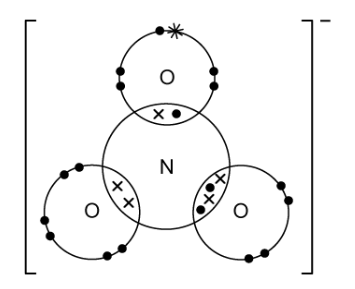
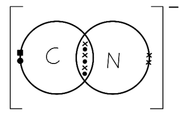
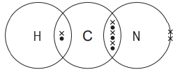
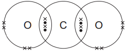
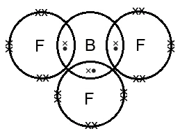
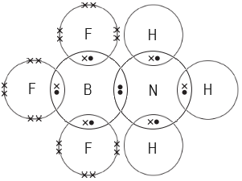
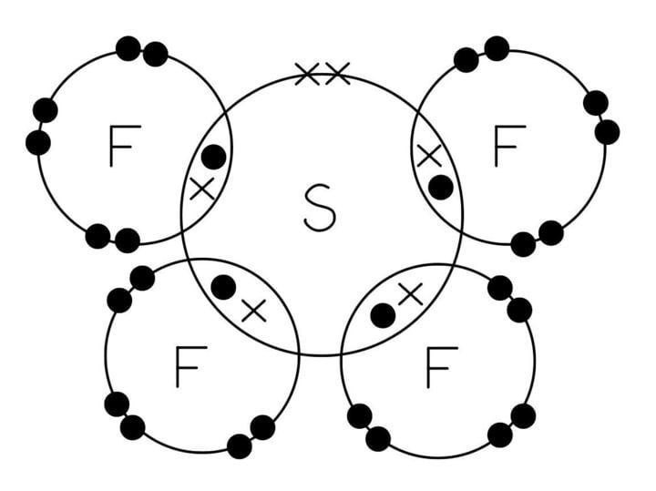
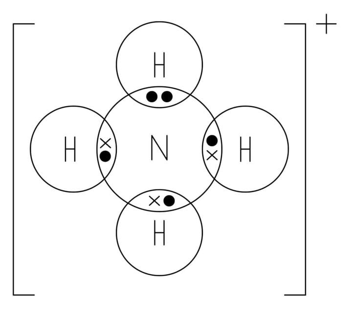

# Mark Schemes — Dot & Cross Diagrams
**3. Chemical Bonding** · Cambridge (CIE) A-LEVEL chemistry (9701)

## Multiple Choice Questions (9 questions)

### Q1
**Final answer:** **The correct answer is A**

- Calcium is in Group 2 and transfers its 2 valence electrons to form a Ca2+ ion.
- The peroxide ion, O22-, consists of two oxygen atoms joined by a **single covalent bond**.
- Each oxygen atom is in Group 16 and has 6 valence electrons. One electron from each oxygen atom is used to form the O-O single bond.
- Each oxygen atom then receives one electron transferred from calcium to complete its octet, giving each oxygen atom 3 lone pairs.
- The correct diagram shows two oxygen atoms sharing one electron pair, with completed octets, enclosed in brackets with a 2- charge.

**B** is incorrect as this shows a double bond between the two oxygen atoms. This represents the neutral oxygen molecule, O2, not the peroxide ion. With a double bond, both oxygen atoms would have a complete octet without accepting any electrons from calcium.

**C** is incorrect as this diagram does not correctly represent the 2- charge of the peroxide ion. The O22- ion has received 2 additional electrons in total (one per oxygen atom). The electron arrangement shown does not match the single covalent bond plus completed octets required for the peroxide ion.

**D** is incorrect as this shows only a single oxygen atom. The peroxide ion contains two oxygen atoms joined together by a single covalent bond.

### Q2
**Final answer:** **The correct answer is B**

- There are no non-bonded electrons on the hydrogen atoms.

  - Each hydrogen uses its single electron to form a covalent bond with nitrogen.
- Nitrogen is in Group 15 and has 5 outer-shell electrons.

  - It shares 3 in covalent bonds with the three hydrogen atoms.
- This leaves **2 non-bonded electrons** (one lone pair) on the outer shell of the nitrogen atom.

**A** is incorrect as this assumes all electrons in the molecule are involved in bonding, ignoring the lone pair on nitrogen.

**C** is incorrect as 5 is the total number of outer-shell electrons on the nitrogen atom before bonding. It does not account for the 3 electrons used in covalent bonds with hydrogen.

**D** is incorrect as 6 is the number of bonding electrons in the molecule (3 covalent bonds x 2 electrons per bond = 6). The question asks for non-bonded outer-shell electrons, not bonding electrons.

### Q3
**Final answer:** **The correct answer is C**

- Carbon is in Group 14 and has 4 valence electrons.
- It uses all 4 to form two double bonds with the two sulfur atoms (S=C=S).
- This gives the central carbon atom **8 electrons** in its outer shell, a complete octet.
- Each sulfur atom also obeys the octet rule, with 4 electrons shared in the double bond and 4 in lone pairs.

**A** is incorrect as beryllium is in Group 2 and has only 2 valence electrons. Forming 2 single bonds with chlorine gives the central beryllium atom only **4 electrons** in its outer shell, an incomplete octet.

**B** is incorrect as boron is in Group 13 and has 3 valence electrons. Forming 3 single bonds with fluorine gives the central boron atom only **6 electrons** in its outer shell, an incomplete octet.

**D** is incorrect as phosphorus is in Group 15 and has 5 valence electrons. Forming 5 single bonds with chlorine gives the central phosphorus atom **10 electrons** in its outer shell, an expanded octet.

### Q4
**Final answer:** **The correct answer is A**

- The carbon atoms and the chlorine atom in 2-chloropropene all have 8 electrons in their outer shells, satisfying the octet rule.
- However, the five hydrogen atoms each have only 2 electrons in their outer shell when bonded to carbon. Hydrogen satisfies the duet rule (2 electrons), not the octet rule.
- Statement A is therefore incorrect as it is not true that every atom in the molecule obeys the octet rule.

**B** is not the correct answer as statement B is true. The C=C double bond consists of one sigma bond and one pi bond, so the molecule contains exactly one pi bond.

**C** is not the correct answer as statement C is true. The total number of valence electrons = (3 C x 4) + (5 H x 1) + (1 Cl x 7) = 12 + 5 + 7 = 24 valence electrons.

**D** is not the correct answer as statement D is true. Chlorine is in Group 17 and has 7 valence electrons. It uses 1 to form a single bond with carbon, leaving 6 non-bonded electrons, giving exactly 3 lone pairs.

### Q5
**Final answer:** **The correct answer is C**

- Chlorine is in Group 17 and has 7 valence electrons.
- It forms 3 covalent bonds with the three fluorine atoms, using 3 of these electrons.
- The remaining 4 electrons on the central chlorine atom form 2 lone pairs.

**A** is incorrect as 0 lone pairs would require all of chlorine's valence electrons to be used in bonding. Chlorine forms only 3 bonds, leaving 4 electrons as lone pairs.

**B** is incorrect as this applies the octet rule too strictly. Assuming chlorine needs only 8 electrons in its outer shell (3 bond pairs + 1 lone pair = 8) gives 1 lone pair. However, chlorine is in Period 3 and can expand its octet, so the correct count is 2 lone pairs.

**D** is incorrect as 3 is the number of lone pairs on each terminal fluorine atom, not on the central chlorine atom.

### Q6
**Final answer:** **The correct answer is B**

- Chlorine is in Group 17 and has 7 valence electrons.
- The 1− charge adds one electron, giving 8 available valence electrons on the central atom.
- Forming 2 bonds to the two fluorine atoms uses 2 of these electrons.
- The remaining 6 electrons on the central chlorine atom form **3 lone pairs**.

**A** is incorrect as boron is in Group 13 (3 valence electrons). The 1− charge gives 4 available electrons on the central atom. Forming 2 bonds uses 2 electrons, leaving only 2 electrons / 1 lone pair on the central boron atom.

**C** is incorrect as phosphorus is in Group 15 (5 valence electrons). The 1− charge gives 6 available electrons on the central atom. Forming 6 bonds to the six fluorine atoms uses all 6 electrons, leaving 0 lone pairs on the central phosphorus atom.

**D** is incorrect as sulfur is in Group 16 (6 valence electrons). The 1− charge gives 7 available electrons on the central atom. Forming 5 bonds uses 5 electrons, leaving only 2 electrons / 1 lone pair on the central sulfur atom.

### Q7
**Final answer:** **The correct answer is C**

- Both **X** (5 outer-shell electrons, Group 15) and **Y** (7 outer-shell electrons, Group 17) are non-metals.
- Neither element will transfer electrons to the other, as both strongly attract electrons to complete their octets. They must share electrons to form a **covalent** bond.
- **X** requires 3 more electrons to complete its octet, so it forms 3 covalent bonds.
- **Y** requires 1 more electron to complete its octet, so each **Y** atom forms 1 covalent bond.
- One atom of **X** therefore bonds with 3 atoms of **Y**, giving the formula **XY**3.

**A** and **B** are incorrect as the formula **X**3**Y** inverts the combining ratios. **X** needs 3 more electrons and forms 3 bonds, while **Y** needs only 1. One atom of **X** bonds with 3 atoms of **Y**, not the reverse.

**D** is incorrect as ionic bonding requires electron transfer from a metal to a non-metal. Both **X** and **Y** are non-metals with high numbers of outer-shell electrons. Neither element will donate electrons to the other, instead they must share them.

### Q8
**Final answer:** **The correct answer is A**

- Boron is in Group 13 and has 3 valence electrons.
- It uses all 3 to form single covalent bonds with the three fluorine atoms.
- This gives the central boron atom only **6 electrons** in its outer shell, which is in an incomplete octet.

**B** is incorrect as the carbon atom in CH3- gains one electron from the negative charge, giving it 5 available valence electrons. It forms 3 bonds to hydrogen and has 1 lone pair, giving carbon a complete outer shell of 8 electrons.

**C** is incorrect as the oxygen atom in H3O+ loses one electron due to the positive charge, leaving 5 available valence electrons. It forms 3 bonds to hydrogen and has 1 lone pair, giving oxygen a complete outer shell of 8 electrons.

**D** is incorrect as magnesium oxide is an ionic compound. The magnesium atom transfers its 2 outer electrons to oxygen, forming Mg2+ and O2-. Both ions have complete outer shells.

### Q9
**Final answer:** **The correct answer is B**

- The H+ ion has no electrons to take part in the bonding with the ammonia molecule.

- The nitrogen atom has a lone pair of electrons that will form a dative (coordinate covalent) bond.

- A dative (coordinate covalent) bond is one where both electrons come from the same **atom**.

**A** is incorrect as the arrow is showing nitrogen electrons moving from the hydrogen ion.

**C** is incorrect as there are no electrons shown.

**D** is incorrect as the diagram is showing hydrogen's electrons moving from the nitrogen atom to the hydrogen ion.

## Structured Questions (4 questions)

### Q1
The dot-and-cross diagram for the NO3- ion is:

**[2 marks]**

> **[mark-scheme]**
> 1 mark for correct bonding around N: one single covalent bond, one double covalent bond, and one coordinate bond to the three oxygen atoms; correct electron counts for each atom
> 
> 1 mark for square brackets **AND** 1- charge outside the brackets

> **[exam-tip]**
> The NO3- ion has three different types of N-O bond. To construct the diagram:
> 
> 1. Start with nitrogen: 5 outer electrons.
> 2. Double bond: 2 electrons from N, 2 from O — this oxygen now has a complete octet.
> 3. Single bond: 1 from N, 1 from O — this oxygen needs 1 extra electron to complete its octet. That extra electron accounts for the 1- charge on the ion.
> 4. Coordinate bond: both electrons donated from N's lone pair to the third O atom.
> 5. Complete the lone pairs on each oxygen.
> 6. Enclose in square brackets and place the 1- charge as a superscript outside.
> 
> Without the square brackets and charge, you will lose the second mark.
> **[mark-scheme]**
> The ions present in H4N2O3 are:
> 
> - NH4+ **[1 mark]**
> - NO3- **[1 mark]**

> **[exam-tip]**
> H4N2O3 is the empirical formula of ammonium nitrate, NH4NO3. One NH4+ ion and one NO3- ion give the combined formula H4N2O3, confirming the match.
> 
> Learn the formulae and charges of all common polyatomic ions as CIE will not provide them. Key ions to know: NH4+, NO3-, SO42-, CO32-, OH-, and PO43-.
> 
> Always include the correct charge on each ion in your answer. Both the formula and the charge are required for each mark.
The dot-and-cross diagram for the CN- ion is:

**[2 marks]**

> **[mark-scheme]**
> 1 mark for correct bonding: C≡N triple bond with correct electron distribution
> 
> 1 mark for the complete structure: lone pairs on both C and N **AND** square brackets **AND** 1- charge outside the brackets

> **[exam-tip]**
> The CN- ion has 10 outer electrons in total: 4 from carbon, 5 from nitrogen, and 1 extra for the 1- charge.
> 
> Distribute them as follows:
> 
> - Form a C≡N triple bond using 6 of the 10 electrons (3 shared pairs).
> - The remaining 4 electrons form 2 lone pairs: one on carbon and one on nitrogen.
> 
> Remember the ionic notation: square brackets around the complete structure with the 1- charge as a superscript outside. This is required for the second mark.
> **[mark-scheme]**
> Comparing the C≡N bond in the cyanide ion with the C-N bond in methylamine:
> 
> - The bond energy of C≡N in CN- is greater than the bond energy of C-N in methylamine **[1 mark]**
> - The bond length of C≡N in CN- is shorter than the bond length of C-N in methylamine **[1 mark]**
> - CN- contains a triple bond whereas methylamine contains a single bond; a triple bond has greater electron density between the nuclei, requiring more energy to break **AND** pulling the nuclei closer together **[1 mark]**

> **[exam-tip]**
> Bond energy and bond length are inversely related: the stronger the bond (higher bond energy), the shorter it is. Both trends have the same cause. More shared electron pairs between two nuclei means stronger electrostatic attraction, which pulls the atoms closer together and makes the bond harder to break.
> 
> The CIE 9701 definitions to know:
> 
> - Bond energy: the energy required to break one mole of a particular covalent bond in the gaseous state
> - Bond length: the internuclear distance between two covalently bonded atoms
> 
> CIE 9701 uses the term bond energy (not bond enthalpy). Use the correct term in your answer.

### Q2
i) Hydrogen cyanide (HCN):

**[1 mark]**

ii) Carbon dioxide (CO2):

**[1 mark]**

iii) Boron trifluoride (BF3):

**[1 mark]**

> **[mark-scheme]**
> 1 mark for correct HCN diagram: H single-bonded to C; C triple-bonded to N; lone pair on N only; correct electron counts throughout
> 
> 1 mark for correct CO2 diagram: O=C=O with double bonds to each oxygen; 2 lone pairs on each O; no lone pairs on C; correct electron counts
> 
> 1 mark for correct BF3 diagram: central B with 3 single bond pairs to three F atoms; 3 lone pairs on each F; incomplete octet on B (only 6 electrons around B)

> **[exam-tip]**
> Each of these three molecules tests a different aspect of covalent bonding:
> 
> - HCN:
> 
>   - Carbon forms a triple bond with nitrogen (1 sigma + 2 pi bonds).
>   - Only nitrogen has a lone pair in the completed structure.
> - CO2:
> 
>   - Carbon forms two double bonds.
>   - Each oxygen has 2 lone pairs.
>   - Carbon has no lone pairs and a complete octet.
> - BF3:
> 
>   - Boron is in Group 13 and only has 3 outer electrons.
>   - After bonding to three fluorines, boron has only 6 electrons (an incomplete octet).
>   - This is why BF3 acts as a Lewis acid and can accept a lone pair to form a coordinate bond.
> **[mark-scheme]**
> The molecule from (a) most likely to form a coordinate (dative covalent) bond is:
> 
> - Boron trifluoride (BF3) **[1 mark]**
> 
> Explanation:
> 
> - Boron's outer shell has space for two more electrons
> **OR**
> Boron only has six outer shell electrons / boron has an incomplete outer shell **[1 mark]**

> **[exam-tip]**
> In HCN and CO2, the central carbon atom has a complete outer shell (8 electrons). It cannot accept an electron pair from a donor and so cannot form a coordinate bond.
> 
> In BF3, the central boron atom has only 6 outer shell electrons. This incomplete octet means boron can accept a lone pair from a donor molecule such as NH3, making BF3 a Lewis acid. The coordinate bond forms when a lone pair is donated into boron's vacant orbital.
i) The dot-and-cross diagram for the product of boron trifluoride and ammonia is:

**[1 mark]**

> **[mark-scheme]**
> 1 mark for the correct BF3-NH3 adduct: coordinate bond between N and B shown with both electrons from nitrogen using the same symbol (both dots or both crosses); correct lone pairs on all atoms
> 
> ii) The coordinate (dative covalent) bond forms because:
> 
> - Ammonia has a lone pair of electrons on nitrogen
> **AND**
> Boron trifluoride has an incomplete outer shell / only 6 electrons around B **[1 mark]**

> **[exam-tip]**
> In the dot-and-cross diagram of the product, the coordinate bond must be shown with both electrons from the same atom. Use two dots (from nitrogen's lone pair) between the N and B atoms, while the other N-H bonds each have one dot and one cross.
> 
> NH3 acts as the electron pair donor (Lewis base) and BF3 acts as the electron pair acceptor (Lewis acid). The lone pair from nitrogen fills the vacant orbital on boron to form the coordinate bond.

### Q3
The dot-and-cross diagrams for phosphorus tribromide and sulfur tetrafluoride are:

Phosphorus tribromide (PBr3):

Sulfur tetrafluoride (SF4):

**[2 marks]**

> **[mark-scheme]**
> 1 mark for a correct dot-and-cross diagram of PBr3: central P atom with 3 bond pairs (one to each Br), 1 lone pair on P; 3 lone pairs on each Br atom
> 
> 1 mark for a correct dot-and-cross diagram of SF4: central S atom with 4 bond pairs (one to each F), 1 lone pair on S; 3 lone pairs on each F atom (expanded octet on S)

> **[exam-tip]**
> Both PBr3 and SF4 have central atoms from Period 3, so they can accommodate more than 8 electrons in their outer shell (expanded octet). This is only possible for elements in Period 3 and beyond, because they have vacant d orbitals available.
> 
> For PBr3: phosphorus is in Group 15 (5 outer electrons) and each bromine is in Group 17 (7 outer electrons). Draw 3 bond pairs between P and each Br, plus 1 lone pair on P. Each Br has 3 lone pairs.
> 
> For SF4: sulfur is in Group 16 (6 outer electrons) and each fluorine is in Group 17 (7 outer electrons). Draw 4 bond pairs between S and each F, plus 1 lone pair on S (giving S 10 electrons in total). Each F has 3 lone pairs.
> **[mark-scheme]**
> The shape and bond angle of PBr3 are:
> 
> - Pyramidal / trigonal pyramidal **[1 mark]**
> - 107° / approximately 107° **[1 mark]**

> **[exam-tip]**
> PBr3 has 3 bonding pairs and 1 lone pair around the central phosphorus atom. The lone pair exerts greater repulsion than a bonding pair, pushing the three P-Br bonds downward and reducing the bond angle from the ideal tetrahedral value of 109.5° to approximately 107°.
> 
> This is the same electron arrangement as NH3, PCl3, and NF3: all have a pyramidal shape and a bond angle of approximately 107°.
> **[mark-scheme]**
> PBr3 and SF4 are polar because:
> 
> - P-Br and S-F bonds are polar / there is a difference in electronegativity between the bonded atoms **[1 mark]**
> - The molecules have non-symmetrical shapes so the bond dipoles do not cancel **[1 mark]**

> **[exam-tip]**
> Both PBr3 (pyramidal) and SF4 (see-saw) have unsymmetrical shapes due to the lone pair(s) on the central atom. Even though each individual P-Br or S-F bond is polar, the key point is that the bond dipoles do not point in equal and opposite directions, so they cannot cancel.
> 
> Compare this with a non-polar molecule such as BF3 (trigonal planar, no lone pairs). In BF3 the three equal B-F dipoles cancel exactly because the molecule is perfectly symmetrical. The absence of lone pairs on the central atom is what allows full cancellation.

### Q4
> **[mark-scheme]**
> The equation for the reaction is:
> 
> - NH3 + H+ → NH4+ **[1 mark]**
> 
> State symbols are not required

> **[exam-tip]**
> The ammonium ion, NH4+, forms because the lone pair on the nitrogen atom in NH3 is donated to the hydrogen ion. This forms a coordinate (dative covalent) bond between nitrogen and H+.
> 
> Note the → arrow: H+ has no lone pairs to donate back, so this reaction does not proceed in reverse under these conditions.
> **[mark-scheme]**
> The shapes are:
> 
> - Ammonia: Pyramidal / trigonal pyramidal **[1 mark]**
> - Ammonium ion: Tetrahedral **[1 mark]**

> **[exam-tip]**
> NH3 has 3 bonding pairs and 1 lone pair around the nitrogen atom. The lone pair repels bonding pairs more strongly, compressing the H-N-H bond angle to approximately 107° and giving a pyramidal shape.
> 
> NH4+ has 4 bonding pairs and no lone pairs around nitrogen. All four pairs repel equally, giving a tetrahedral shape with a bond angle of 109.5°. The fourth N-H bond is a coordinate bond, but once formed it is identical to the other three.
The dot-and-cross diagram for the ammonium ion is:

**[2 marks]**

> **[mark-scheme]**
> 1 mark for 1 central nitrogen atom surrounded by 4 hydrogen atoms, with 3 shared pairs of electrons **AND** 1 coordinate bond shown with both electrons from nitrogen
> 
> 1 mark for square brackets **AND** 1+ charge outside the brackets

> **[exam-tip]**
> Two features are essential in this diagram:
> 
> - The coordinate bond:
> 
>   - Show both electrons using the same symbol (both dots or both crosses), donated from the lone pair on nitrogen.
>   - This distinguishes the dative bond from the three ordinary covalent bonds.
> - The ionic notation:
> 
>   - Draw square brackets around the complete ion and write the 1+ charge as a superscript outside.
>   - Without both of these, you will lose the second mark.
