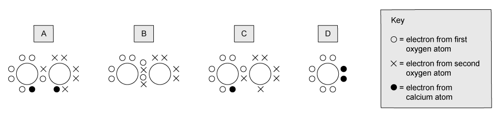
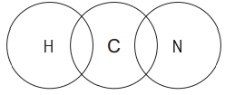
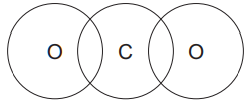
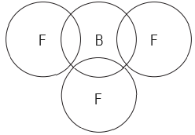

# Exam Questions — Dot & Cross Diagrams
**3. Chemical Bonding** · Cambridge (CIE) A-LEVEL chemistry (9701)
> Source: [https://www.savemyexams.com/a-level/chemistry/cie/25/topic-questions/](https://www.savemyexams.com/a-level/chemistry/cie/25/topic-questions/) · 13 questions across 2 sets

## Multiple Choice Questions (9 questions)

### Q1 — hard — 1 marks

**Q1** [1 mark]

Calcium peroxide, CaO2, can be used in toothpaste as a teeth whitener.

Which dot-and-cross diagram represents the electron structure of the peroxide ion in CaO2?

### Q2 — easy — 1 marks

**Q2** [1 mark]

How many non-bonded, outer-shell electrons are present in one molecule of ammonia, NH3?

### Q3 — medium — 1 marks

**Q3** [1 mark]

Which molecule obeys the octet rule?

### Q4 — hard — 1 marks

**Q4** [1 mark]

Which statement about 2-chloropropene, CH2=C(Cl)CH3, is **not **correct?

### Q5 — medium — 1 marks

**Q5** [1 mark]

How many lone pairs of electrons are on the central atom in a molecule of chlorine trifluoride, ClF3?

### Q6 — medium — 1 marks

**Q6** [1 mark]

Which ion has a central atom with exactly three lone pairs of electrons?

### Q7 — hard — 1 marks

**Q7** [1 mark]

The number of outer-shell electrons in elements **X** and **Y** are 5 and 7 respectively.

What is the formula and the type of bonding in the compound formed between **X** and **Y**?

### Q8 — easy — 1 marks

**Q8** [1 mark]

Which species contains an atom with an incomplete outer shell?

### Q9 — easy — 1 marks

**Q9** [1 mark]

Ammonia, NH3, reacts with a proton, H+, to form ammonium, NH4+.

Using the following key:

•    N electron

$\times$   H electron

Which dot-and-cross diagram correctly illustrates the electron movement in this reaction?

## Structured Questions (4 questions)

### Q1 — hard — 9 marks

**Q1** [2 marks]

Draw a dot-and-cross diagram for the nitrate(V) ion, NO3-.

Show outer shell electrons only.

**Q1** [2 marks]

An ionic compound has the empirical formula H4N2O3.

Suggest the formulae of the ions present in this compound.

**Q1** [2 marks]

Draw a dot-and-cross diagram for the CN- ion.

Show outer shell electrons only.

**Q1** [3 marks]

Compare the C≡N bond energy and bond length in the cyanide ion, CN-, with the C-N bond energy and bond length in methylamine, CH3NH2.

Explain your answer.

### Q2 — medium — 7 marks

**Q2** [3 marks]

Draw dot-and-cross diagrams for the following molecules.

Show outer shell electrons only.

i) Hydrogen cyanide, HCN.

[1]

ii) Carbon dioxide, CO2.

[1]

iii) Boron trifluoride, BF3.

[1]

**Q2** [2 marks]

**Extract:**

Draw dot-and-cross diagrams for the following molecules.

Show outer shell electrons only.

i) Hydrogen cyanide, HCN.

ii) Carbon dioxide, CO~2~.

iii) Boron trifluoride, BF~3~.

Use your diagrams in (a) to deduce which of the three molecules is most likely to form a coordinate (dative covalent) bond. Explain your answer.

**Q2** [2 marks]

**Extract:**

Use your diagrams in (a) to deduce which of the three molecules is most likely to form a coordinate (dative covalent) bond. Explain your answer.

The molecule from (a) most likely to form a coordinate (dative covalent) bond is:
- Boron trifluoride (BF3)

Explanation:
- Boron's outer shell has space for two more electrons OR Boron only has six outer shell electrons / boron has an incomplete outer shell

i) Draw a dot-and-cross diagram for the product of boron trifluoride and ammonia.

Show outer shell electrons only.

[1]

ii) Explain how the coordinate (dative covalent) bond forms between the boron trifluoride and ammonia molecules.

[1]

### Q3 — medium — 6 marks

**Q3** [2 marks]

Draw dot-and-cross diagrams to show the bonding in phosphorus tribromide, PBr3, and sulfur tetrafluoride, SF4.

Show outer shell electrons only.

**Q3** [2 marks]

State the shape of, and the Br-P-Br bond angle in, a molecule of PBr3.

**Q3** [2 marks]

Explain why molecules of PBr3 and SF4 are polar.

### Q4 — medium — 5 marks

**Q4** [1 mark]

Construct an equation for the reaction of ammonia, NH3, with a hydrogen ion.

**Q4** [2 marks]

State the shape of an ammonia molecule and the shape of an ammonium ion.

**Q4** [2 marks]

Draw a dot-and-cross diagram to show the bonding in the ammonium ion.

Show outer shell electrons only.
