# Mark Schemes — Arenes
**30. Hydrocarbons** · Cambridge (CIE) A-LEVEL chemistry (9701)

## Structured Questions (12 questions)

### Q1
> **[mark-scheme]**
> The structure and bonding of a benzene molecule can be described as:
> 
> - The carbon atoms are sp2 hybridised **[1 mark]**
> - The molecule is planar (or a flat hexagon)
> **AND**
> the bond angle is 120° **[1 mark]**
> - The σ bonds are formed by the head-on (or end-on) overlap of (sp2) orbitals **[1 mark]**
> - The π bonds (or delocalised system) are formed by the sideways overlap of p-orbitals (creating electron density above and below the plane of the ring) **[1 mark]**

> **[exam-tip]**
> When describing benzene, avoid drawing or implying **alternating double bonds**. Examiners are looking for the idea of a **delocalised π system** spread over all six carbon atoms, not localised C=C bonds.
> 
> A good way to check your answer is to mention **both** the planar structure **and** the π electron cloud above and below the ring. Together, these explain benzene’s unusual stability compared with alkenes.
> **[mark-scheme]**
> i) An equation to show the generation of the electrophile is:
> 
> - HNO3 + 2H2SO4 → NO2+ + 2HSO4− + H3O+
> **OR**
> HNO3 + H2SO4 → NO2+ + HSO4− + H2O **[1 mark]**

ii) The mechanism for the formation of nitrobenzene is:

**[4 marks]**

> **[mark-scheme]**
> 1 mark for correct name of mechanism: electrophilic substitution
> 
> 1 mark for a curly arrow from the delocalised π-system of the benzene ring to the NO2+ ion (arrow must start from the ring circle and point to the N atom or + charge)
> 
> 1 mark for correct structure of the intermediate: horseshoe delocalisation opening towards the sp3 carbon **AND** positive charge clearly inside the horseshoe/ring system **AND** H and NO2 attached to the sp3 carbon
> 
> 1 mark for a curly arrow from the C−H bond back into the ring to restore delocalisation, showing loss of H+

> **[exam-tip]**
> In nitration mechanisms, the most common lost marks are due to curly arrows starting in the wrong place. Always start the arrow from the benzene ring circle or a C−C bond, never from a carbon atom itself.
> 
> In the intermediate, check that only one carbon is sp3, with both H and NO2 attached, and that the positive charge is inside the ring, not on the NO2 group.
> 
> When the final arrow is drawn, it must clearly show re-formation of the delocalised π system and the loss of H+.
> **[mark-scheme]**
> i) The relative order of increasing acidity is:
> 
> - Ethanol < phenol < ethanoic acid **[1 mark]**
> 
> ii) The electronic effect of the alkyl group that makes the ethoxide ion less stable than the phenoxide ion is:
> 
> - Positive inductive effect
> **OR**
> +*I* effect
> **OR**
> Electron-donating effect **[1 mark]**
> 
> iii) The distribution of the negative charge in the ethanoate ion that makes it the most stable of these three conjugate bases is:
> 
> - Charge is spread equally over both oxygen atoms
> **OR**
> The p-orbital on the carbon atom overlaps with the p-orbitals on both oxygen atoms
> **OR**
> The negative charge / π-electrons are delocalised over the COO− **[1 mark]**

> **[exam-tip]**
> When comparing acid strengths, always think in terms of **conjugate base stability**. The strongest acid forms the **most stable conjugate base**.
> 
> Look for features that stabilise negative charge, such as **delocalisation** and the presence of **electronegative atoms**, and avoid explanations based only on acidity strength or pH without reference to molecular structure.
> **[mark-scheme]**
> The major product is:
> 
> - 4-nitrophenol
> **OR**
> 2-nitrophenol **[1 mark]**

> **[exam-tip]**
> Phenol reacts with dilute nitric acid at room temperature to give a mixture of 2-nitrophenol and 4-nitrophenol. The -OH group activates the benzene ring and directs substitution to the 2- and 4-positions.
> 
> Although 4-nitrophenol is usually formed in greater proportion due to reduced steric hindrance, both products are expected and credited at this level in line with the specification.
One suitable three-step synthetic route for the conversion of benzene into 3-chlorobenzoic acid is:

**Step 1** — Friedel-Crafts alkylation to give methylbenzene:

Reagents: CH3Cl (or CH3Br) with AlCl3 (or FeBr3) catalyst

**Step 2** — Oxidation of the methyl side chain to give benzoic acid:

Reagents: alkaline KMnO4, heat; then acidify

**Step 3** — Electrophilic chlorination of the ring to give 3-chlorobenzoic acid:

Reagents: Cl2 with AlCl3 (or FeCl3) catalyst

**[5 marks]**

> **[mark-scheme]**
> 1 mark for step 1 reagents: CH3Cl / CH3Br **AND** AlCl3 / FeBr3
> 
> 1 mark for the correct intermediate structure of methylbenzene (toluene)
> 
> 1 mark for step 2 reagents: alkaline KMnO4, heat, then acidify
> 
> 1 mark for the correct intermediate structure of benzoic acid
> 
> 1 mark for step 3 reagents: Cl2 **AND** AlCl3 / FeCl3

> **[exam-tip]**
> The order of the steps matters. If chlorination is done while the ring has a −CH3 group, the methyl group directs substitution to the 2- and 4-positions.
> 
> Oxidising the side chain first gives −COOH, which is a meta-director, so chlorination then gives the 3-chloro product.

### Q2
> **[mark-scheme]**
> i) The equation for the generation of the electrophile is:
> 
> - 2H2SO4 + HNO3 → 2HSO4– + H3O+ + NO2+
> **OR**
> HNO3 + H2SO4 → NO2+ + HSO4– + H2O **[1 mark]**
> 
> ii) The reactant acting as a Brønsted-Lowry base and the justification are:
> 
> - Nitric acid / HNO3
> **AND**
> It accepts a proton from sulfuric acid / H2SO4 **[1 mark]**
> 
> H2SO4 is not accepted as the Brønsted-Lowry base.
> 
> iii) The conjugate acids in the reaction are:
> 
> - H3O+
> **AND**
> NO2+ **[1 mark]**

> **[exam-tip]**
> A Brønsted-Lowry base accepts a proton.
> 
> - HNO3 accepts H+ from H2SO4, so HNO3 is the base.
> - H2SO4 donates the proton, making it the acid.
> 
> The intermediate H2NO3+ decomposes immediately to H3O+ and NO2+. Both are conjugate acids because each formed by gaining H+.
> **[mark-scheme]**
> i) The reagents required for the production of compound A are:
> 
> - AlCl3 / aluminium chloride **[1 mark]**
> - CH3CH2COCl / propanoyl chloride **[1 mark]**

ii) The mechanism for step 1 is:

**[3 marks]**

> **[mark-scheme]**
> ii)
> 
> 1 mark for a curly arrow from the π system of the benzene ring to the C+ of the acylium ion (arrow must start from the ring, not inside it)
> 
> 1 mark for the correct intermediate: horseshoe opening towards the sp3 carbon, positive charge inside the ring, with the propanoyl group and H attached to the sp3 carbon
> 
> 1 mark for a curly arrow from the C–H bond back into the ring, restoring the delocalised π system, with H+ shown as lost

> **[exam-tip]**
> The acylium ion (CH3CH2CO+) is generated when propanoyl chloride reacts with AlCl3:
> 
> CH3CH2COCl + AlCl3 → CH3CH2CO+ + AlCl4–
> 
> All electrophilic substitution mechanisms follow the same pattern. The most common errors are starting the first arrow from inside the ring, misplacing the positive charge in the intermediate, and omitting H+ in the final step.
The dot-and-cross diagram for the catalyst AlCl4– is:

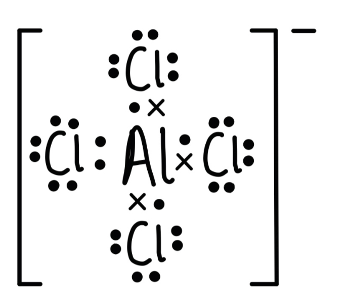

**[2 marks]**

> **[mark-scheme]**
> 1 mark for correct bonds between Al and all four Cl atoms
> 
> 1 mark for the correct number of electron pairs around each Cl atom (3 lone pairs + 1 bonding pair per Cl)

> **[exam-tip]**
> AlCl3 has only 6 electrons around aluminium, making it electron-deficient. When it accepts Cl– from the acyl chloride, aluminium achieves a full octet in the tetrahedral AlCl4– ion.
> **[mark-scheme]**
> Benzene undergoes substitution rather than addition because:
> 
> - Addition requires breaking the delocalised π system to form new bonds **[1 mark]**
> - Breaking the delocalised π system requires significant energy input **[1 mark]**
> - The C–H bond at the ring is not part of the delocalised π system **[1 mark]**
> - Substituting H leaves the delocalised π system intact **[1 mark]**

> **[exam-tip]**
> Benzene's delocalised π system gives it extra stability. Addition would permanently destroy this, which is energetically unfavourable. Substitution replaces only the H atom (not part of the π system), so the ring's full delocalisation is restored after reaction.

### Q3
> **[mark-scheme]**
> Reaction 1 reagents and conditions:
> 
> - Br2
> **AND**
> UV light **[1 mark]**
> 
> Reaction 2 reagents and conditions:
> 
> - Br2
> **AND**
> AlBr3 / FeBr3 **[1 mark]**
> 
> Aqueous Br2 is not accepted for reaction 2.

> **[exam-tip]**
> Reaction 1 is free radical substitution at the side chain (−CH3). UV light generates Br• radicals, so no catalyst is required.
> 
> Reaction 2 is electrophilic aromatic substitution at the ring. A halogen carrier catalyst (AlBr3 or FeBr3) is required to generate the Br+ electrophile. The Br2 must be pure (neat) as aqueous Br2 will not react with the benzene ring.
> **[mark-scheme]**
> i) Name of mechanism for reaction 1:
> 
> - Free radical substitution **[1 mark]**

ii) The structure of the product obtained using excess bromine is:

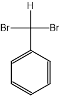

**OR**

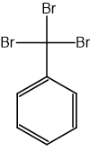

**[1 mark]**

> **[mark-scheme]**
> 1 mark for correct structure showing multiple Br substitution on the −CH3 group (C6H5CHBr2 or C6H5CBr3)
> 
> The benzene ring can be shown as a delocalised ring but it must remain intact

> **[exam-tip]**
> Reaction 1 proceeds by a free radical chain mechanism (initiation, propagation, termination). With excess bromine, successive H atoms on the −CH3 group are replaced:
> 
> CH3 → CH2Br → CHBr2 → CBr3
The mechanism for reaction 2 (electrophilic aromatic substitution) is:

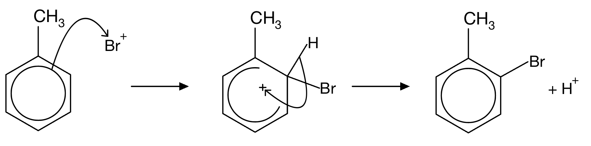

**[3 marks]**

> **[mark-scheme]**
> 1 mark for a curly arrow from the benzene π system to the Br+ electrophile
> 
> 1 mark for the correct arenium ion intermediate: horseshoe delocalisation extending over more than half of the ring but not past carbons 2 and 6; positive charge shown on ring; H shown at the substitution position
> 
> 1 mark for a curly arrow from the C−H bond to the positive charge on the ring **AND** benzene ring restored in product **AND** H+ shown as leaving

> **[exam-tip]**
> Common errors in electrophilic aromatic substitution mechanisms:
> 
> - Forgetting to show the H atom at the ring carbon being substituted
> - Drawing the horseshoe delocalisation incorrectly. It must extend over more than half the ring but must not include the carbon bearing the incoming group
> - Omitting H+ as the eliminated species in the final step
> - Misplacing the positive charge on the arenium ion intermediate
The product of bromination of nitrobenzene under Friedel-Crafts conditions is:

3-bromonitrobenzene :

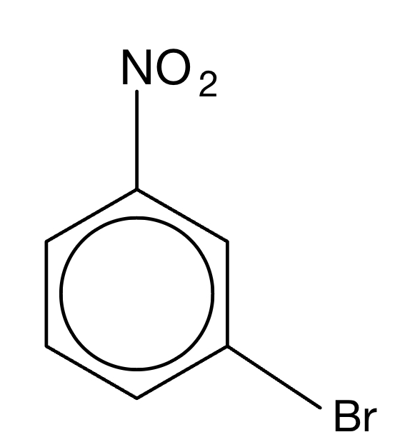

**OR**

3,5-dibromonitrobenzene:

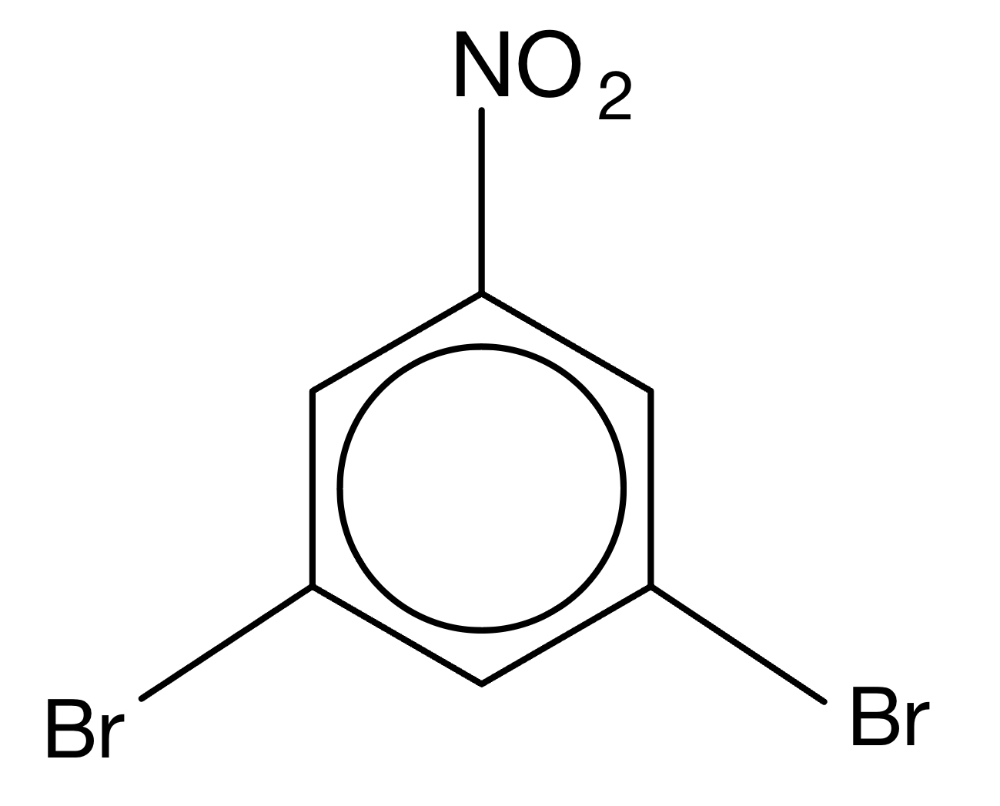

**[2 marks]**

> **[mark-scheme]**
> 1 mark for correct structure of 3-bromonitrobenzene **OR **3,5-dibromonitrobenzene
> 
> 1 mark for correct name of 3-bromonitrobenzene **OR **3,5-dibromonitrobenzene
> 
> The name must correspond to the structure given

> **[exam-tip]**
> The nitro group (−NO2) is an electron-withdrawing substituent. It removes electron density from the benzene ring, deactivating it towards electrophilic substitution and directing the electrophile to the meta positions (3 and 5). This is the opposite effect to electron-donating groups (such as alkyl groups), which direct to ortho and para positions.

### Q4
The mechanism for the formation of the catalyst in step 1 is:

**[2 marks]**

> **[mark-scheme]**
> 1 mark for a curly arrow from the C−Cl bond to the Cl atom
> 
> 1 mark for a curly arrow from one of the Cl lone pairs to the AlCl3

> **[exam-tip]**
> The goal is to generate the acylium ion (CH3CH2CH2CO+) electrophile. The overall equation is:
> 
> CH3CH2CH2COCl + AlCl3 → CH3CH2CH2CO+ + AlCl4−
> 
> Use this equation as a guide for the curly arrows: the C−Cl bond in the acyl chloride must break (Cl leaves to form AlCl4−), and the Cl uses a lone pair to bond to AlCl3.
The mechanism for the formation of the ketone is:

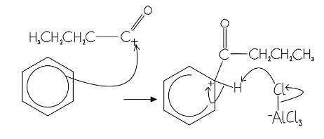

**[5 marks]**

> **[mark-scheme]**
> 1 mark for a curly arrow from the benzene ring to the C+ of the acylium ion (the + must be on the carbon of the acylium group)
> 
> 1 mark for the correct arenium ion intermediate: horseshoe delocalisation extending over more than half of the ring but not past carbons 2 and 6; positive charge on ring; acylium group and H shown at the sp3 carbon
> 
> 1 mark for a curly arrow from the C−H bond back to the ring to restore delocalisation
> 
> 1 mark for a curly arrow from an Al−Cl bond in AlCl4− to the Cl atom (showing Cl− leaving)
> 
> 1 mark for a curly arrow from the Cl− to the H atom on the ring carbon, showing H+ removal and regeneration of AlCl3 **AND** HCl shown as a product

> **[exam-tip]**
> Common errors in Friedel-Crafts acylation mechanisms:
> 
> - The first arrow must start touching the ring, not start inside it
> - The horseshoe in the intermediate must cover more than half the ring, with the gap at the carbon bearing the acylium group
> - The positive charge in the intermediate must be on the ring carbon (not on the acylium group)
> - In the final step, AlCl4− acts as a Brønsted base, removing H+ from the ring to regenerate AlCl3 and form HCl
> **[mark-scheme]**
> The reagents required for step 2 are:
> 
> - NaBH4 (sodium borohydride / sodium tetrahydridoborate) **[1 mark]**
> - Ethanol / CH3CH2OH **[1 mark]**

> **[exam-tip]**
> Step 2 is the reduction of a ketone to a secondary alcohol by nucleophilic addition. NaBH4 generates the hydride ion H−, which attacks the C=O carbon.
> 
> Ethanol is required as the solvent because water would hydrolyse NaBH4 before it can react. NaBH4 reduces C=O groups but is not strong enough to reduce C=C double bonds.

### Q5
> **[mark-scheme]**
> The equation for the formation of the CH3CH2+ species is:
> 
> - CH3CH2Br + AlBr3 → CH3CH2+ + AlBr4– **[1 mark]**
> 
> AlCl3 is not accepted

> **[exam-tip]**
> The aluminium bromide acts as a Lewis acid, accepting a bromide ion from bromoethane to generate the CH3CH2+ carbocation electrophile and the AlBr4– ion.
> 
> Always ensure the halogen in the catalyst matches the halogenoalkane: AlBr3 with bromoalkanes, AlCl3 with chloroalkanes.
> **[mark-scheme]**
> The name of the mechanism for this reaction is:
> 
> - Electrophilic substitution **[1 mark]**

> **[exam-tip]**
> Benzene undergoes electrophilic substitution rather than addition because substitution allows the delocalised π system to be restored. Addition would permanently break the ring's delocalisation, destroying the extra stability this provides.
> 
> Do not confuse the mechanism name (electrophilic substitution) with the reaction type (Friedel-Crafts alkylation). Both describe aspects of this reaction but are not interchangeable.
The mechanism for the conversion of benzene into ethylbenzene is:

**[3 marks]**

> **[mark-scheme]**
> 1 mark for a curly arrow from the π system of the benzene ring to the C+ of the CH3CH2+ ion (arrow must start from the ring, not from inside it)
> 
> 1 mark for the correct intermediate structure: horseshoe opening towards the sp3 carbon, positive charge inside the ring system, with CH3CH2 and H both attached to the sp3 carbon
> 
> 1 mark for a curly arrow from the C–H bond back into the ring, restoring the delocalised π system, with H+ shown as lost

> **[exam-tip]**
> Common errors in electrophilic substitution mechanisms:
> 
> - Starting the first curly arrow from inside the ring rather than from the ring circle
> - Placing the positive charge on the wrong carbon in the CH3CH2+ electrophile. It must be on the terminal carbon
> - Drawing the horseshoe extending past carbons 2 and 6 in the intermediate
> - Omitting H+ in the final step
> **[mark-scheme]**
> Anhydrous conditions are required because:
> 
> - Water reacts with / hydrolyses the AlBr3 catalyst, preventing formation of the electrophile **[1 mark]**
> 
> Allow: water would deactivate / destroy the catalyst

> **[exam-tip]**
> AlBr3 is a Lewis acid that is rapidly destroyed by water. Even trace moisture reacts with the catalyst before it can generate the CH3CH2+ electrophile, so the reaction cannot proceed. Anhydrous solvents and glassware are essential for all Friedel-Crafts reactions.

### Q6
> **[mark-scheme]**
> i) The equation for the formation of the electrophile is:
> 
> - CH3COCl + AlCl3 → CH3CO+ + AlCl4– **[1 mark]**

ii) The mechanism for the Friedel-Crafts acylation is:

**[3 marks]**

> **[mark-scheme]**
> 1 mark for a curly arrow from the π system of the benzene ring to the C+ of the acylium ion (the + must be on the carbonyl carbon of COCH3, not the methyl carbon)
> 
> 1 mark for the correct intermediate structure: horseshoe covering more than half of the ring but not extending past carbons 2 and 6, with a positive charge correctly placed inside the ring
> 
> 1 mark for a curly arrow from the C–H bond back into the ring **AND** the correct product structure **AND** H+ shown

> **[exam-tip]**
> The acylium ion (CH3CO+) is generated from the reaction of ethanoyl chloride with AlCl3. The positive charge is on the carbonyl carbon, not the methyl carbon.
> 
> All electrophilic substitution mechanisms follow the same pattern. The most common errors are starting the first curly arrow from inside the ring, misplacing the + in the intermediate, and omitting H+.
> **[mark-scheme]**
> A suitable reducing agent is:
> 
> - NaBH4 / LiAlH4
> **OR** H2 with Ni / Pd / Pt **[1 mark]**
> 
> An equation for the reduction is:
> 
> - C6H5COCH3 + 2[H] → C6H5CH(OH)CH3 **[1 mark]**

> **[exam-tip]**
> The product from part (a) is phenyl methyl ketone (acetophenone). Reduction of a ketone with NaBH4 or LiAlH4 gives a secondary alcohol. The [H] notation represents the equivalent of one hydrogen atom from the reducing agent.
> **[mark-scheme]**
> Friedel-Crafts acylation gives only a mono-substituted product because:
> 
> - The acyl product contains an electron-withdrawing –COR group, which deactivates the benzene ring towards further electrophilic substitution **[1 mark]**
> - In alkylation, the product contains an electron-donating alkyl group, which activates the ring and allows further substitution to occur (polyalkylation) **[1 mark]**

> **[exam-tip]**
> The acyl group withdraws electron density from the ring through the C=O bond, making the ring less reactive towards electrophiles. An alkyl group donates electron density into the ring by the inductive effect, increasing reactivity and making poly-substitution more likely.
> 
> This is a key practical advantage of acylation: it always gives a single, predictable mono-substituted product.
> **[mark-scheme]**
> The aluminium chloride catalyst reforms because:
> 
> - H+ is produced during electrophilic substitution when the benzene ring is restored **[1 mark]**
> - H+ + AlCl4– → HCl + AlCl3 **[1 mark]**

> **[exam-tip]**
> AlCl3 is consumed when it accepts Cl– to generate the acylium ion, forming AlCl4–. The H+ lost from the ring in the final step then reacts with AlCl4– to regenerate AlCl3 and release HCl. The catalyst is therefore reformed and can participate in further reaction cycles.

### Q7
> **[mark-scheme]**
> i) The type of reaction, reagent and conditions are:
> 
> - Type of reaction: reduction / hydrogenation / addition **[1 mark]**
> - Reagent and conditions: H2
> **AND**
> Ni / Pt catalyst **[1 mark]**
> 
> ii) The bond angles and explanation are:
> 
> - Benzene = 120°
> **AND**
> Cyclohexane = 109.5° **[1 mark]**
> - π-bonds are transformed into σ-bonds (on going from benzene to cyclohexane) **[1 mark]**

> **[exam-tip]**
> Hydrogenation of benzene requires both H2 and a metal catalyst (Ni or Pt). The reaction is also exothermic but less so than expected for three isolated double bonds, reflecting the extra stability from benzene’s delocalised π system.
> 
> In benzene, each carbon is sp2 hybridised (three σ bonds, 120° angles). In cyclohexane, each carbon is sp3 hybridised (four σ bonds, 109.5° angles).
i) The completed mechanism is:

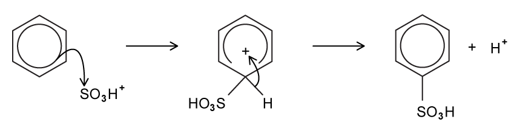

**[3 marks]**

> **[mark-scheme]**
> 1 mark for a curly arrow from the benzene ring to the sulfur atom of SO3H+
> 
> 1 mark for the correct intermediate: horseshoe, positive charge inside the ring, with SO3H and H both attached to the sp3 carbon
> 
> 1 mark for a curly arrow from the C–H bond back into the ring, restoring the delocalised π system, with H+ shown as lost
> 
> ii) The equation to show how the catalyst is reformed is:
> 
> - HSO4– + H+ → H2SO4 **[1 mark]**

> **[exam-tip]**
> This mechanism follows exactly the same pattern as nitration and halogenation of benzene, the only difference is the electrophile. The positive charge in the intermediate must be on the carbon atom bonded to the sulfur, not on the SO3H group.
> 
> The H2SO4 catalyst is regenerated when the H+ produced in the final step reacts with HSO4–. This mirrors how AlCl3 is regenerated in Friedel-Crafts reactions.
i) The structures of **M** and **N** are:

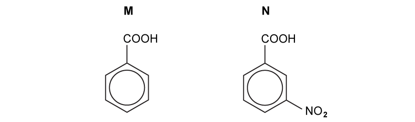

**[2 marks]**

> **[mark-scheme]**
> 1 mark for the correct structure of M: benzoic acid (benzene ring with –COOH group)
> 
> 1 mark for the correct structure of N: 3-nitrobenzoic acid (benzene ring with –COOH and –NO2 at the 3-position)
> 
> ii) The reagents and conditions for each step are:
> 
> - Step 1: alkaline KMnO4 / hot MnO4–, heat under reflux (then acidify) **[1 mark]**
> - Step 2: concentrated H2SO4
> **AND**
> concentrated HNO3 **[1 mark]**
> - Step 3: Sn
> **AND**
> concentrated HCl, heat **[1 mark]**

> **[exam-tip]**
> The order of steps matters. Oxidising the methyl group first gives a –COOH group, which is an electron-withdrawing meta-director, which directs the nitro group to the 3-position in step 2. If nitration were done before oxidation, the directing group would be –CH3 (ortho/para-director) and you would get a mixture of 2- and 4-nitrotoluene.
> 
> For the reduction of the nitro group in step 3, Sn and concentrated HCl is the required reagent combination at A level. Other reducing agents (e.g. H2/Ni) are not acceptable for this specific transformation.

### Q8
i) The structure of the isomer by-product is:

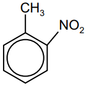

**[1 mark]**

> **[mark-scheme]**
> ii) The equation for the formation of the electrophile is:
> 
> - HNO3 + 2H2SO4 → H3O+ + NO2+ + 2HSO4– 
> **OR**
> HNO3 + H2SO4 → NO2+ + HSO4– + H2O **[1 mark]**
> 
> iii) Differences between the six-membered ring in intermediate T and in methylbenzene:
> 
> Any **three** from (1 mark for each point):
> 
> - The delocalised / π system extends over only five carbons in **T**
> **OR**
> The delocalised / π system extends over all six carbons in methylbenzene
> 
> - There are only four π-electrons in (the delocalised system of) **T**
> **OR**
> There are six π-electrons in (the delocalised system of) methylbenzene
> 
> - One carbon is sp3 hybridised in **T**
> **OR**
> Only five carbons are sp2 hybridised in **T**
> **OR**
> All six ring carbons are sp2 hybridised in methylbenzene
> 
> - One carbon has a bond angle of 109.5° / tetrahedral in **T**
> **OR**
> Not all bond angles are 120° in **T**
> **OR**
> All bond angles are 120° in methylbenzene
> 
> **[3 marks]**

> **[exam-tip]**
> The methyl group is an ortho/para director. Substitution at the 4-position gives 4-nitromethylbenzene; at the 2-position gives the by-product.
> 
> Intermediate T is the carbocation formed when NO2+ bonds to the ring. One ring carbon switches from sp2 to sp3, breaking the full delocalisation. The other five carbons remain sp2 and the π electrons are partially delocalised over them.
> **[mark-scheme]**
> i) The systematic name of compound W is:
> 
> - 4-aminobenzoic acid **[1 mark]**
> 
> ii) The reagents and conditions for step 1 are:
> 
> - Sn / tin
> **AND**
> (concentrated) HCl / hydrochloric acid **[1 mark]**
> - Concentrated
> **AND**
> heat **[1 mark]**
> 
> iii) The reagent for step 2 is:
> 
> - CH3COCl / ethanoyl chloride **[1 mark]**
> 
> iv) The reagents and conditions for step 3 and step 4 are:
> 
> - Step 3: KMnO4 / MnO4– (acidified or alkaline)
> **AND**
> heat **[1 mark]**
> - Step 4: acid / H+(aq)
> **AND**
> heat **[1 mark]**

> **[exam-tip]**
> Step 1 reduces the nitro group to an amine: Sn with concentrated HCl under heat is the required combination for CIE.
> 
> Step 2 is acylation of the amine with ethanoyl chloride.
> 
> Step 3 oxidises the methyl side chain to a carboxylic acid.
> 
> Step 4 is acid hydrolysis of the amide formed in step 2, where heating with dilute acid regenerates the free amine and ethanoic acid, giving benzocaine.
> **[mark-scheme]**
> i) The number of peaks in the carbon-13 NMR spectrum of benzocaine is:
> 
> - 7 / seven **[1 mark]**

ii) The completed Table 1.1 is:

| **δ / ppm** | **environment of proton** | **number of ****1****H atoms** | **splitting pattern** |
|---|---|---|---|
| 1.2 | **Final answer:** **alkane / alkyl / CH****3** | **Final answer:** **3** | **Final answer:** **triplet** |
| 3.5 | **Final answer:** **alkyl next to electronegative atom / CH****2****–O** | **Final answer:** **2** | **Final answer:** **quartet** |
| 5.5 | **Final answer:** **aryl amine / NH****2** | **Final answer:** **2** | **Final answer:** **singlet** |
| 7.1–7.4 | attached to aromatic ring | 4 | two doublets |

**[3 marks]**

> **[mark-scheme]**
> 1 mark for the correct row for δ 1.2 ppm (alkane/CH3, 3H, triplet)
> 
> 1 mark for the correct row for δ 3.5 ppm (alkyl next to O, 2H, quartet)
> 
> 1 mark for the correct row for δ 5.5 ppm (aryl amine/NH2, 2H, singlet)

> **[mark-scheme]**
> iii) The splitting pattern for δ 1.2 ppm is a triplet because:
> 
> - The neighbouring carbon atom has two attached protons
> **OR**
> There is a neighbouring / adjacent CH2(O) group **[1 mark]**

> **[exam-tip]**
> To find the number of carbon-13 peaks, identify carbons in chemically distinct environments. Benzocaine has a plane of symmetry through the ring, so the 4 aromatic carbons give 3 distinct environments. Add the COOH carbon, the O, the CH2 carbon, and the CH3 carbon: total 7 environments.
> 
> For proton NMR, use the n + 1 rule: the CH3 at δ 1.2 ppm is adjacent to CH2 (2 protons), giving n + 1 = 3 lines (triplet).
> **[mark-scheme]**
> i) The reagent(s) for step 1 are:
> 
> - NaNO2 / sodium nitrite
> **AND**
> HCl / hydrochloric acid **OR **HNO2 / nitrous acid **[1 mark]**
> 
> Keep temperature below 10 °C to prevent decomposition of the diazonium salt.

ii) The structures of compounds **R** and **S** are:

Compound R:

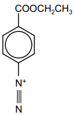

Compound S:

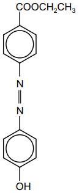

**[2 marks]**

> **[mark-scheme]**
> 1 mark for the correct structure of compound R (diazonium salt from benzocaine)
> 
> 1 mark for the correct structure of compound S (azo dye from coupling with phenol)

> **[exam-tip]**
> The diazonium salt R is thermally unstable and decomposes above 10 °C. Step 1 must therefore be carried out in an ice bath.
> 
> In step 2, the diazonium ion acts as a weak electrophile and couples with the activated phenol ring (–OH is an ortho/para director). Coupling occurs at the 4-position of the phenol ring to give the azo dye S.

### Q9
The skeletal formula of compound **A** is:

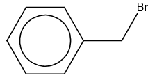

**[1 mark]**

> **[mark-scheme]**
> 1 mark for the correct skeletal formula of compound A: benzene ring with a –CH2Br side chain (benzyl bromide / bromomethylbenzene)

> **[exam-tip]**
> Free radical halogenation of methylbenzene in the presence of UV light substitutes a hydrogen atom in the methyl side chain, not on the ring. This gives benzyl bromide (C6H5CH2Br). If a Lewis acid catalyst such as AlBr3 were used instead, ring halogenation (electrophilic substitution) would occur.
The skeletal formula of compound **B** is:

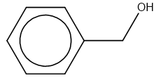

**[1 mark]**

> **[mark-scheme]**
> 1 mark for the correct skeletal formula of compound B: benzyl alcohol / phenylmethanol, showing the benzene ring with a –CH2OH group
> 
> Allow: any correct representation of C6H5CH2OH

> **[exam-tip]**
> Compound A (benzyl bromide, C6H5CH2Br) is a primary halogenoalkane. Heating with NaOH(aq) gives nucleophilic substitution (SN2): the OH– ion displaces Br– to give benzyl alcohol (phenylmethanol), C6H5CH2OH.
> **[mark-scheme]**
> The reagents and conditions required for the formation of benzoic acid from methylbenzene are:
> 
> - Alkaline potassium manganate(VII) / KMnO4 **[1 mark]**
> - Heat under reflux **[1 mark]**
> - Acidified with dilute sulfuric acid / H2SO4 **[1 mark]**

> **[exam-tip]**
> This reaction oxidises the methyl side chain to a carboxylic acid. Alkyl groups attached to a benzene ring are oxidised under more forcing conditions than free alkyl groups.
> 
> The key requirement is alkaline KMnO4 followed by acidification, not acidified KMnO4 directly. The alkaline conditions are needed to dissolve the KMnO4 and produce the reactive MnO4– species; acidification converts the carboxylate salt to the free acid.

### Q10
An equation for the reaction is:

C6H6 + HNO3 → C6H5NO2 + H2O

**[2 marks]**

> **[mark-scheme]**
> 1 mark for correct formulas for the reactants: C6H6 and HNO3
> 
> 1 mark for correct formulas for the products: C6H5NO2 and H2O

> **[exam-tip]**
> This is an electrophilic substitution reaction. A nitro group (–NO2) replaces one hydrogen atom on the benzene ring.
> 
> The reaction requires a mixture of concentrated nitric acid and concentrated sulfuric acid at a temperature between 25 and 60 °C. The concentrated H2SO4 acts as a catalyst and is regenerated at the end.
The two isomers of chloromethylbenzene are:

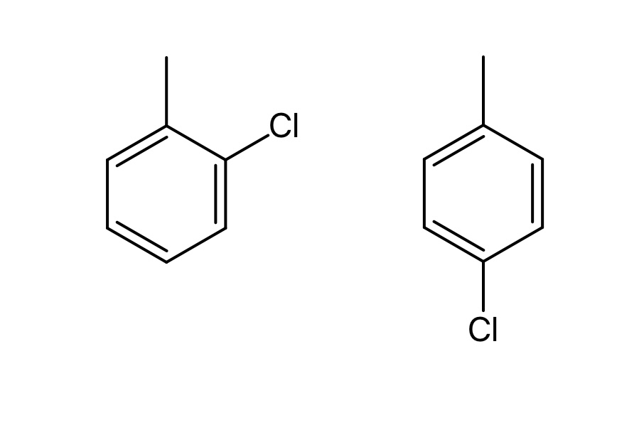

**[2 marks]**

> **[mark-scheme]**
> 1 mark for the correct structure of 2-chloromethylbenzene
> 
> 1 mark for the correct structure of 4-chloromethylbenzene

> **[exam-tip]**
> The methyl group is an electron-donating substituent that activates the ring at the 2-, 4-, and 6-positions. With AlCl3 as a halogen carrier, electrophilic substitution occurs preferentially at the 2- and 4-positions.
> 
> Carbon 1 is the ring carbon bonded to the methyl group. With excess halogen, multiple substitution can give 2,4,6-trichloromethylbenzene.
> **[mark-scheme]**
> Benzene typically undergoes:
> 
> - Electrophilic substitution **[1 mark]**

> **[exam-tip]**
> Benzene undergoes electrophilic substitution rather than addition because substitution restores the delocalised π system. Addition would permanently break the ring's extra stability.
> 
> The three types of substitution to know are: free radical (alkanes + halogens), electrophilic (benzene ring reactions), and nucleophilic (halogenoalkanes + nucleophiles).

### Q11
> **[mark-scheme]**
> Step 1 reagents:
> 
> - Concentrated HNO3
> **AND**
> concentrated H2SO4 **[1 mark]**
> 
> Step 2 reagents:
> 
> - Sn / Fe
> **AND**
> concentrated HCl **[1 mark]**
> 
> Step 3 reagents:
> 
> - NaNO2
> **AND**
> HCl
> **OR**
> HNO2 (nitrous acid) **[1 mark]**
> 
> Conditions:
> 
> - Step 1: Temperature between 25 °C and 60 °C
> **AND**
> Step 3: Temperature less than 10 °C **[1 mark]**

> **[exam-tip]**
> Step 1 is electrophilic substitution (nitration). Concentrated H2SO4 generates the NO2+ electrophile. Keep the temperature below 55 °C to prevent di-nitration.
> 
> Step 2 reduces −NO2 to −NH2. Only Fe or Sn with concentrated HCl are acceptable reducing agents for this step for this specification.
> 
> Step 3 is diazotisation. The diazonium salt decomposes above 10 °C. NaNO2 + HCl and HNO2 are equally acceptable, as NaNO2 + HCl generates HNO2 in situ.
The completed table is:

| Reagent | Product with compound **A** |
|---|---|
| Na | **Final answer:** **Sodium 2-ethylphenoxide** **OR** **sodium 2-ethylphenate** |
| H+ / KMnO4 | **Final answer:** **2-Hydroxybenzoic acid** **OR** **salicylic acid** |

**[2 marks]**

> **[mark-scheme]**
> 1 mark for sodium 2-ethylphenoxide
> 
> Accept displayed structural formula showing O−Na+ on the ring; condone omission of H2 as a second product
> 
> 1 mark for 2-hydroxybenzoic acid
> 
> Accept displayed structural formula showing -OH at position 1 and -COOH at position 2

> **[exam-tip]**
> Compound A is a phenol, not an alcohol. The -OH group is bonded directly to the benzene ring.
> 
> With Na: phenols react with sodium in the same way as alcohols to produce a salt and H2. The salt is a phenoxide (not an alkoxide) — here, sodium 2-ethylphenoxide.
> 
> With acidified KMnO4: alkyl side chains on benzene rings are oxidised to -COOH groups, regardless of chain length. The -C2H5 group gives -COOH, producing 2-hydroxybenzoic acid.
> **[mark-scheme]**
> Ethyl-2-nitrobenzene is formed rather than ethyl-3-nitrobenzene because:
> 
> - The ethyl group is 2,4-directing (ortho/para-directing) **[1 mark]**

> **[exam-tip]**
> Alkyl groups are electron-donating substituents. They donate electron density into the π system of the benzene ring, activating it towards electrophilic attack and directing the incoming electrophile to the 2-, 4-, and 6-positions (ortho and para). The 3-position (meta) is not activated, so ethyl-3-nitrobenzene is not the major product.
> **[mark-scheme]**
> The equation for the formation of the NO2+ (nitronium) ion is:
> 
> - H2SO4 + HNO3 → HSO4− + NO2+ + H2O
> **OR**
> 2H2SO4 + HNO3 → 2HSO4− + NO2+ + H3O+ **[1 mark]**

> **[exam-tip]**
> Both equations are acceptable. The key product is NO2+ (the nitronium ion / electrophile), with HSO4− as the counterion. CIE accepts either form.

### Q12
> **[mark-scheme]**
> The name of the mechanism is:
> 
> - Electrophilic substitution **[1 mark]**

> **[exam-tip]**
> Benzene differs from alkenes as it undergoes electrophilic substitution rather than addition. Addition would permanently break the delocalised π system; substitution restores it.
An equation showing the generation of the Br+ ion is:

AlBr3 + Br2 → AlBr4– + Br+

**OR**

FeBr3 + Br2 → FeBr4– + Br+

**[2 marks]**

> **[mark-scheme]**
> 1 mark for correct reactants: AlBr3 + Br2 or FeBr3 + Br2
> 
> 1 mark for correct products: AlBr4– + Br+ or FeBr4– + Br+

> **[exam-tip]**
> The halogen carrier acts as a Lewis acid, accepting one bromine atom from Br2 to generate the Br+ electrophile. AlBr3 and FeBr3 are equally acceptable.
> 
> The catalyst is regenerated at the end when the complex ion reacts with the H+ lost from the ring:
> 
> AlBr4– + H+ → AlBr3 + HBr.
The completed mechanism is:

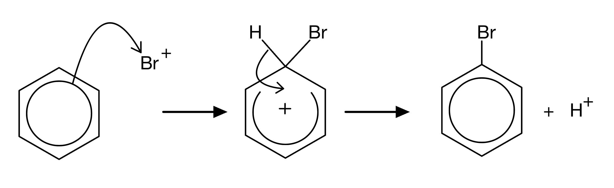

**[3 marks]**

> **[mark-scheme]**
> 1 mark for a curly arrow from the benzene ring to Br+
> 
> 1 mark for the positive charge shown correctly in the intermediate
> 
> 1 mark for a curly arrow from the C–H bond back into the ring, restoring the delocalised π system

> **[exam-tip]**
> The positive charge in the intermediate belongs inside the horseshoe (the partially delocalised portion of the ring), not on any individual carbon atom.
> 
> The final curly arrow must start from the C–H bond, not from the ring, and must clearly show the restoration of the full π system with loss of H+.
