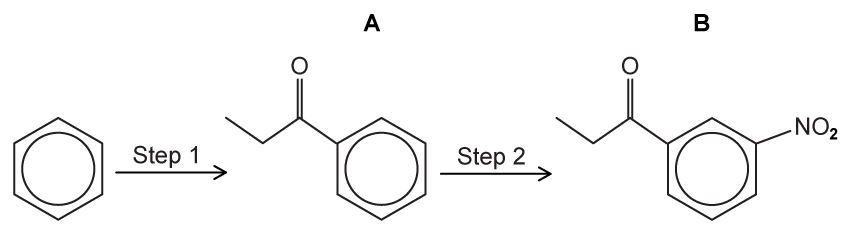
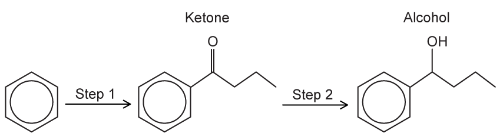
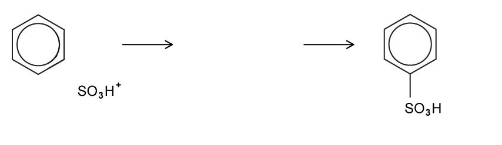
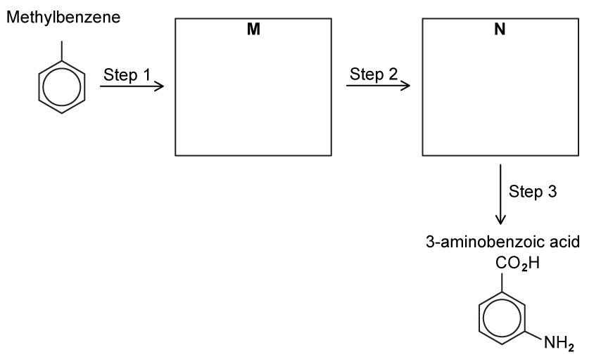
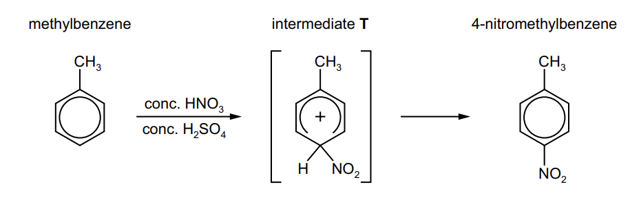
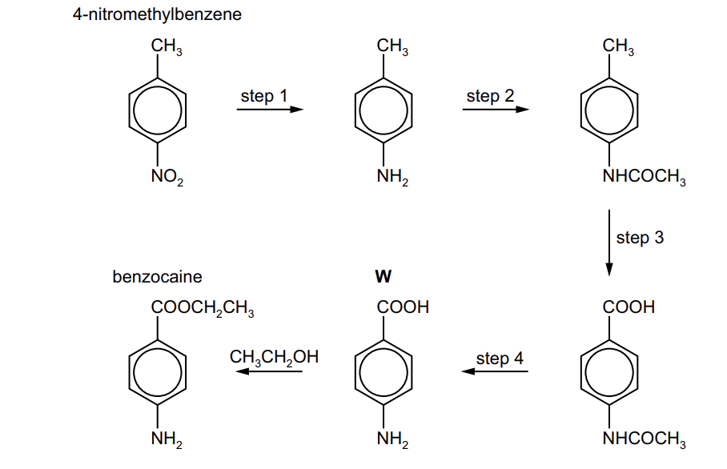
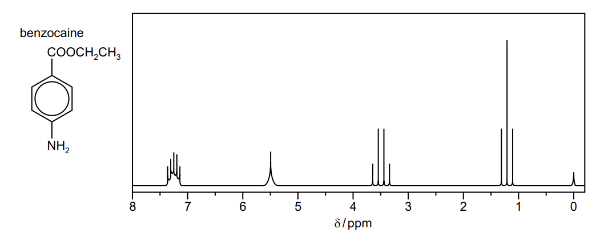
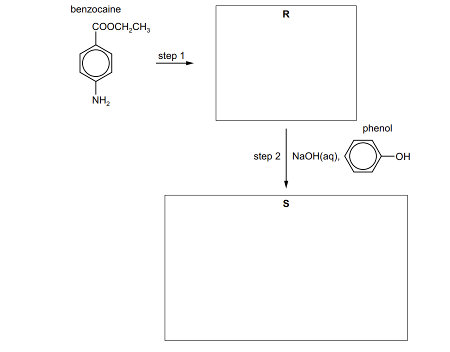
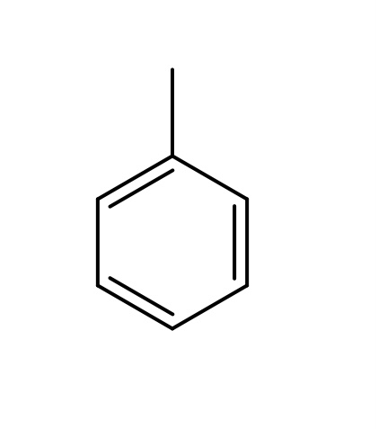
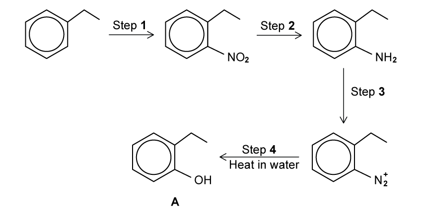

# Exam Questions — Arenes
**30. Hydrocarbons** · Cambridge (CIE) A-LEVEL chemistry (9701)
> Source: [https://www.savemyexams.com/a-level/chemistry/cie/25/topic-questions/](https://www.savemyexams.com/a-level/chemistry/cie/25/topic-questions/) · 12 questions across 1 sets

## Structured Questions (12 questions)

### Q1 — medium — 18 marks

**Q1** [4 marks]

Benzene reacts with concentrated nitric acid in the presence of concentrated sulfuric acid.

Describe the structure and bonding of a benzene molecule, C6H6. In your answer, refer to:

- the hybridisation of the carbon atoms
- the bond angles within the ring
- how the *σ* and *π* bonds are formed.

**Q1** [5 marks]

**Extract:**

Benzene reacts with concentrated nitric acid in the presence of concentrated sulfuric acid.

i) Construct an equation to show the generation of the electrophile.

[1]

ii) Name and draw the fully labelled mechanism for the formation of nitrobenzene.

[4]

**Q1** [3 marks]

i) State the relative order of increasing acidity for ethanol, phenol, and ethanoic acid.

[1]

ii) Identify the electronic effect of the alkyl group that makes the ethoxide ion less stable than the phenoxide ion.

[1]

iii) Describe the distribution of the negative charge in the ethanoate ion that makes it the most stable of these three conjugate bases.

[1]

**Q1** [1 mark]

Predict the major product formed when phenol reacts with dilute nitric acid.

**Q1** [5 marks]

Benzene can be converted into 3-chlorobenzoic acid in a multi-step synthesis.

Suggest a **three-step** synthetic route for this conversion. In your answer, identify the reagents and conditions for each step and draw the structures of the intermediate compounds formed.

### Q2 — hard — 14 marks

**Q2** [3 marks]

The nitration of benzene forms the basis for the synthesis of dyes and explosives.

i) Construct an equation for the generation of the electrophile.

[1]

ii) State which reactant is acting as a Brønsted-Lowry base and justify your answer.

[1]

iii) Identify the conjugate acid in the reaction.

[1]

**Q2** [5 marks]

Compound **B** is produced in two steps as outlined in Fig. 1.1.

**Fig. 1.1**

i) State the reagents and conditions required for the production of compound **A** shown in Fig. 1.1.

[2]

ii) Describe the mechanism for step **1**. Include all relevant curly arrows and charges.

[3]

**Q2** [2 marks]

**Extract:**

i) The reagents required for the production of compound A are:

- AlCl~3~ / aluminium chloride
- CH~3~CH~2~COCl / propanoyl chloride

The acylium ion (CH~3~CH~2~CO^+^) is generated when propanoyl chloride reacts with AlCl~3~:

CH~3~CH~2~COCl + AlCl~3~ → CH~3~CH~2~CO^+^ + AlCl~4~^–^

Draw the dot-and-cross diagram for the structure of the catalyst once the electrophile has been generated in part **(b)**.

**Q2** [4 marks]

Explain why benzene can generally only undergo substitution reactions.

### Q3 — medium — 9 marks

**Q3** [2 marks]

Methylbenzene can undergo different reactions to form the products shown in Fig. 4.1.

**Fig. 4.1**

State the reagents and conditions for these two reactions.

reaction 1 ........................................................................................

reaction 2 ........................................................................................

**Q3** [2 marks]

**Extract:**

Methylbenzene can undergo different reactions to form the products shown in Fig. 4.1.

Reaction scheme showing methylbenzene undergoing two different bromination reactions: side-chain free radical substitution (reaction 1) and ring electrophilic substitution (reaction 2) (Fig. 4.1)

Fig. 4.1

State the reagents and conditions for these two reactions.

reaction 1 ........................................................................................

reaction 2 ........................................................................................

i) Name the mechanism of reaction **1** in part **(a)**

[1]

ii) Draw the structure of the product obtained if reaction **1** is carried out using an excess of bromine.

[1]

**Q3** [3 marks]

**Extract:**

Methylbenzene can undergo different reactions to form the products shown in Fig. 4.1.

Reaction scheme showing methylbenzene undergoing two different bromination reactions: side-chain free radical substitution (reaction 1) and ring electrophilic substitution (reaction 2) (Fig. 4.1)

Reaction 2 reagents and conditions:
- Br2
AND
AlBr3 / FeBr3

Reaction 2 is electrophilic aromatic substitution at the ring. A halogen carrier catalyst (AlBr3 or FeBr3) is required to generate the Br+ electrophile.

Describe the mechanism for reaction 2. Include all relevant curly arrows and charges.

**Q3** [2 marks]

**Extract:**

Methylbenzene can undergo different reactions to form the products shown in Fig. 4.1.

reaction 1 ........................................................................................

reaction 2 ........................................................................................

Reaction 2 reagents and conditions:

- Br2

AND

AlBr3 / FeBr3

Nitrobenzene reacts in the same conditions as reaction **2** in part **(a)**. Draw and name the product of this reaction.

### Q4 — hard — 9 marks

**Q4** [2 marks]

Fig. 2.1 shows the formation of a ketone followed by an alcohol.

**Fig. 2.1**

Describe the mechanism to show the formation of the catalyst responsible for step **1**. Include all relevant curly arrows and charges.

**Q4** [5 marks]

**Extract:**

Fig. 2.1 shows the formation of a ketone followed by an alcohol.

Fig. 2.1

Describe the mechanism for the formation of the ketone, including the regeneration of the catalyst. Include all relevant curly arrows and charges.

**Q4** [2 marks]

**Extract:**

Fig. 2.1 shows the formation of a ketone followed by an alcohol.

Reaction scheme showing benzene converted to a ketone via Friedel-Crafts acylation (step 1), then to a secondary alcohol via reduction (step 2) (Fig. 2.1)

State the reagents required for step **2**.

### Q5 — easy — 6 marks

**Q5** [1 mark]

Benzene can react with aluminium bromide, AlBr3, and bromoethane, CH3CH2Br, to form ethylbenzene.

Construct an equation for the formation of the CH3CH2+ species.

**Q5** [1 mark]

**Extract:**

Benzene can react with aluminium bromide, AlBr~3~, and bromoethane, CH~3~CH~2~Br, to form ethylbenzene.

State the name of the mechanism for the formation of ethylbenzene from benzene and aluminium bromide.

**Q5** [3 marks]

**Extract:**

Benzene can react with aluminium bromide, AlBr3, and bromoethane, CH3CH2Br, to form ethylbenzene.

Describe the mechanism for the conversion of benzene into ethylbenzene using the CH3CH2+ electrophile. Include all relevant curly arrows and charges.

**Q5** [1 mark]

**Extract:**

Benzene can react with aluminium bromide, AlBr~3~, and bromoethane, CH~3~CH~2~Br, to form ethylbenzene.

The equation for the formation of the CH~3~CH~2~^+^ species is:
CH~3~CH~2~Br + AlBr~3~ → CH~3~CH~2~^+^ + AlBr~4~^–^

State why anhydrous conditions are required for this reaction.

### Q6 — medium — 10 marks

**Q6** [4 marks]

Benzene can undergo electrophilic substitution with ethanoyl chloride in the presence of aluminium chloride.

i) Construct an equation to show the formation of the electrophile.

[1]

ii) Describe the mechanism for the reaction. Include all relevant curly arrows and charges.

[3]

**Q6** [2 marks]

**Extract:**

Benzene can undergo electrophilic substitution with ethanoyl chloride in the presence of aluminium chloride.

The organic product from part **(a)** can be reduced to form an alcohol.

Name a suitable reducing agent. Construct an equation for this reduction, using [H] to represent the reducing agent.

**Q6** [2 marks]

Explain why Friedel-Crafts acylation gives a mono-substituted product, while Friedel-Crafts alkylation may give a mixture of poly-substituted products.

**Q6** [2 marks]

**Extract:**

Benzene can undergo electrophilic substitution with ethanoyl chloride in the presence of aluminium chloride.

i) Construct an equation to show the formation of the electrophile.

The equation for the formation of the electrophile is:
CH3COCl + AlCl3 → CH3CO+ + AlCl4–

Explain how the aluminium chloride catalyst reforms at the end of the electrophilic substitution reaction.

### Q7 — hard — 13 marks

**Q7** [4 marks]

Benzene can be converted into cyclohexane as shown in Fig. 3.1.

**Fig. 3.1**

i) For this reaction, name the type of reaction and state the reagent and conditions needed.

[2]

ii) State the bond angles in benzene and cyclohexane. Explain your answers.

[2]

*Source: 2019 41 Q7A*

**Q7** [4 marks]

When benzene reacts with SO3, as shown in Fig. 3.2, benzenesulfonic acid is produced.

**Fig. 3.2**

The mechanism of this reaction is similar to that of the nitration of benzene. Concentrated H2SO4 is used in an initial step to generate the SO3H+ electrophile as shown.

SO3 + H2SO4 → SO3H+ + HSO4–

i) Describe the mechanism for the reaction of benzene with SO3H+ ions in Fig. 3.3. Include all relevant curly arrows and charges.

**Fig. 3.3**

[3]

ii) Construct an equation to show how the H2SO4 catalyst is reformed.

[1]

**Q7** [5 marks]

3-aminobenzoic acid can be synthesised from methylbenzene in three steps as shown in Fig. 3.4.

**Fig. 3.4**

i) Draw the skeletal formulae of **M** and **N** in the boxes.

[2]

ii) State reagents and conditions for each step of the synthesis.

step **1** ................................................................................

step **2** ................................................................................

step **3** ................................................................................

[3]

### Q8 — medium — 19 marks

**Q8** [5 marks]

4-nitromethylbenzene can be prepared via an electrophilic substitution reaction as shown in Fig. 1.1.

**Fig. 1.1**

i) This reaction also forms an isomer of 4-nitromethylbenzene as a by-product. Draw the structure of this by-product.

[1]

ii) Construct an equation for the reaction between HNO3 and H2SO4 that forms the electrophile for this reaction.

[1]

iii) Describe how the structure and bonding of the six-membered ring in intermediate **T** differ from those in methylbenzene. In your answer refer to the hybridisation, the π bonding and the bond angles in the ring system.

[3]

*Source: 2022 Specimen Paper 4 Q4A*

**Q8** [6 marks]

Benzocaine is used as a local anaesthetic. It can be synthesised from 4-nitromethylbenzene by the route shown in Fig. 1.2.

**Fig. 1.2**

i) State the systematic name of compound **W**.

[1]

ii) State the reagents and conditions for step 1.

[2]

iii) State the reagent for step 2.

[1]

iv) State the reagents and conditions for step 3 and step 4.

[2]

*Source: 2022 Specimen Paper 4 Q4B*

**Q8** [5 marks]

A sample of benzocaine was analysed by carbon-13 NMR and proton NMR spectroscopy.

i) Deduce the number of peaks in the carbon-13 NMR spectrum of benzocaine.

[1]

Benzocaine was dissolved in CDCl3 and the proton NMR spectrum of this solution was recorded as shown in Fig. 1.3.

**Fig. 1.3**

ii) The data in Table 1.2 should be used in answering this question. Complete Table 1.1 for the chemical shifts δ 1.2 ppm, 3.5 ppm and 5.5 ppm.

**Table 1.1**

| **δ / ppm** | **environment of proton** | **number of ****1****H atoms responsible for the peak** | **splitting pattern** |
|---|---|---|---|
| 1.2 |   |   |   |
| 3.5 |   |   |   |
| 5.5 |   |   |   |
| 7.1–7.4 | attached to aromatic ring | 4 | two doublets |

[3]

iii) Explain the splitting pattern for the absorption at δ 1.2 ppm.

[1]

**Table 1.2**

| **Environment of proton** | **Example** | **chemical shift range, δ / ppm** |
|---|---|---|
| alkane | –C**H**3, –C**H**2–, >C**H**– | 0.9–1.7 |
| alkyl next to C=O | C**H**3–C=O, –C**H**2–C=O, >C**H**–C=O | 2.2–3.0 |
| alkyl next to aromatic ring | C**H**3–Ar, –C**H**2–Ar, >C**H**–Ar | 2.3–3.0 |
| alkyl next to electronegative atom | C**H**3–O, –C**H**2–O, –C**H**2–Cl | 3.2–4.0 |
| attached to alkene | =C**H**R | 4.5–6.0 |
| attached to aromatic ring | **H**–Ar | 6.0–9.0 |
| aldehyde | **H**COR | 9.3–10.5 |
| alcohol | RO**H** | 0.5–6.0 |
| phenol | Ar–O**H** | 4.5–7.0 |
| carboxylic acid | RCOO**H** | 9.0–13.0 |
| alkyl amine | R–N**H**– | 1.0–5.0 |
| aryl amine | Ar–N**H**2 | 3.0–6.0 |
| amide | RCON**H**R | 5.0–12.0 |

*Source: 2022 Specimen Paper 4 Q4C*

**Q8** [3 marks]

Benzocaine can also be used to synthesise the azo compound **S** by the following route.

**Fig. 1.4**

i) State the reagent(s) used for step 1.

[1]

ii) Draw the structures of compounds **R** and **S** in the boxes in Fig. 1.4.

[2]

*Source: 2022 Specimen Paper 4 Q4D*

### Q9 — easy — 5 marks

**Q9** [1 mark]

Draw the skeletal formula of compound **A** in Fig. 4.1.

**Fig. 4.1**

**Q9** [1 mark]

**Extract:**

Draw the skeletal formula of compound **A** in Fig. 4.1.

Reaction scheme showing methylbenzene reacting with Br~2~ under ultraviolet light to form compound A, a free radical substitution in the side chain

The skeletal formula of compound **A** is: benzene ring with a –CH~2~Br side chain (benzyl bromide / bromomethylbenzene)

Compound **A** is heated with aqueous sodium hydroxide, NaOH(aq), to form compound **B**.

Draw the skeletal formula of compound **B**.

**Q9** [3 marks]

State the reagents and conditions required for reaction **1** in Fig. 4.3 for the formation of benzoic acid from methylbenzene.

**Fig. 4.3**

### Q10 — easy — 5 marks

**Q10** [2 marks]

Construct an equation for the reaction of benzene with concentrated nitric acid to form nitrobenzene and water.

**Q10** [2 marks]

The structure of methylbenzene is shown below in Fig. 2.1.

**Fig. 2.1**

Draw the skeletal formulae of the two isomers of chloromethylbenzene formed from the reaction of methylbenzene and Cl2 in the presence of AlCl3.

**Q10** [1 mark]

State the type of reaction that benzene will typically undergo.

### Q11 — medium — 8 marks

**Q11** [4 marks]

Compound **A** can be formed from ethylbenzene by the following route in Fig. 3.1.

**Fig. 3.1**

State the reagents and conditions for the following steps.

Step **1** ......................................................................................................

Step **2** ......................................................................................................

Step **3** .......................................................................................................

**Q11** [2 marks]

**Extract:**

Compound **A** can be formed from ethylbenzene by the following route in Fig. 3.1.

{align=center} **Fig. 3.1**

Name the organic products of the reactions between each of the compound **A** and the following reagents. If no reaction occurs write ‘no reaction’.

| Reagent | Product with compound **A** |
|---|---|
| Na |   |
| H+ / KMnO4 |   |

**Q11** [1 mark]

**Extract:**

Compound **A** can be formed from ethylbenzene by the following route in Fig. 3.1.

Step **1** - nitration using concentrated HNO~3~ and concentrated H~2~SO~4~ at temperature between 25 °C and 60 °C

Explain why ethyl-2-nitrobenzene is formed rather than ethyl-3-nitrobenzene.

**Q11** [1 mark]

**Extract:**

Step 1 reagents:
- Concentrated HNO3
AND
concentrated H2SO4

Step 1 is electrophilic substitution (nitration). Concentrated H2SO4 generates the NO2+ electrophile.

Using your answer to **(a)**, construct an equation for the formation of the electrophile in step **1**.

### Q12 — easy — 6 marks

**Q12** [1 mark]

State the name of the mechanism that benzene will undergo if reacted with bromine in the presence of a halogen carrier to form bromobenzene, C6H5Br.

**Q12** [2 marks]

**Extract:**

State the name of the mechanism that benzene will undergo if reacted with bromine in the presence of a halogen carrier to form bromobenzene, C~6~H~5~Br.

Construct an equation to show how the halogen carrier generates the Br+ ion in order to allow the reaction in part **(a)** to occur.

**Q12** [3 marks]

Complete the mechanism in Fig. 3.1 for the formation of bromobenzene. Include all relevant curly arrows and charges.

**Fig. 3.1**
